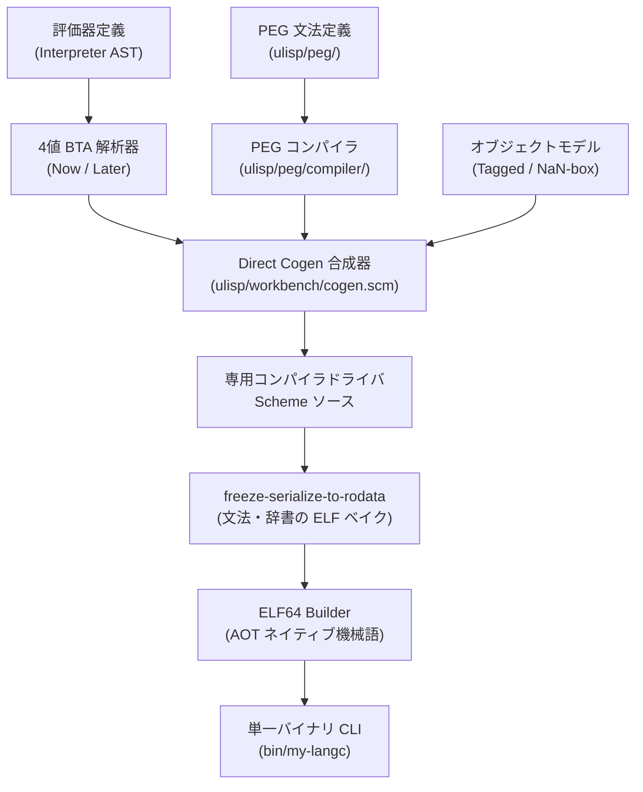

# [FEAT/ENH] Implement Direct Cogen Driver and Compiler CLI Generator (ID: 895)

## 1. 概要 / Summary
[[DSN-33-04]](../designs/DSN-33-04-ulisp_language_workbench_interpreter_generator_and_guest_runtime_architecture.md) 第 4 章（第2二村射影によるスタンドアロン CLI コンパイラ自動生成）および [[DSN-33-03]](../designs/DSN-33-03-ulisp_stage_polymorphic_metacompiler_and_futamura_projection_architecture.md)（ステージ多相メタコンパイラ）に基づき、**第2二村射影（Direct Cogen: Compiler Generator）** を実用化し、ゲスト言語の評価器定義・文法定義から外部依存ゼロの専用 AOT コンパイラ単一バイナリ CLI（例: `bin/my-langc`）をワンコマンドで自動生成するビルドドライバ `ulisp-cogen` を実装する。

先行する [[Issue #894]](closed/894-implement-pure-scheme-compile-time-peg-parser-generator.md) で確立された Pure Scheme Packrat PEG 構文解析器、[[Issue #892]](closed/892-implement-guest-frame-descriptor-and-local-slot-lowering.md) のスタックフレーム抽象（`FrameDescriptor`）、[[Issue #893]](closed/893-implement-guest-dynamic-value-tagging-and-nan-boxing.md) の動的型表現（Tagged Pointer / NaN-boxing）、および [[Issue #890]](closed/890-integrate-freeze-serialized-rodata-into-elf-emitter.md) の ELF `.rodata` 埋め込み技術を有機的に統合し、**「インタプリタと文法を書くだけで、プログラミング言語の商用レベル AOT ネイティブコンパイラが手に入る」** メタ言語開発プラットフォームを完成させる。

### 最重要マイルストーンゴール
1. **Direct Cogen コアアルゴリズムの実装 (`ulisp/workbench/cogen.scm`)**:
   - 巨大かつ脆弱な部分評価器 $\mathrm{mix}$ の自己適用を回避し、ステージ多相型推論（4値 BTA 束: `Now`, `Later`, `Dynamic`, `Static-Bot`）と Picopass パス合成により、評価器 AST からコンパイラ走査コードを直接導出する。
2. **ワンコマンド CLI ジェネレータ (`ulisp/bin/ulisp-cogen`)**:
   - `--interpreter <path>`, `--grammar <path>`, `--output <bin-path>`, `--runtime-model <tagging|nanbox>` の引数を解釈し、専用コンパイラドライバの Scheme ソースを合成してネイティブ ELF バイナリを出力する。
3. **ELF `.rodata` への文法・組み込み辞書完全埋め込みによる 0ms 起動**:
   - `freeze-serialize-to-rodata` を用い、PEG 文法オートマトンや組み込み関数テーブルを ELF `.rodata` セクションに直接ベイク。実行時の構文木ロードやポインタ再配置を完全消去し、サブミリ秒起動を実現する。
4. **生成されたスタンドアロンコンパイラ CLI の実証検証 (`test_workbench_cogen.scm`)**:
   - サンプル DSL（算術言語 / 簡易セキュリティ CTI フィルタ言語）から自動生成された CLI が、ユーザースクリプトをネイティブ ELF バイナリへ直接コンパイルし、実行結果が正しく一致することを E2E テストで実証する。

---

## 2. トレーサビリティ / Traceability
- 関連設計書:
  - [[DSN-33-04] ULisp 言語ワークベンチ・インタプリタ自動生成 ＆ ゲスト言語ランタイムアーキテクチャ設計書 (第4章 第2二村射影によるスタンドアロン CLI コンパイラ自動生成)](../designs/DSN-33-04-ulisp_language_workbench_interpreter_generator_and_guest_runtime_architecture.md)
  - [[DSN-33-03] ULisp ステージ多相メタコンパイラ ＆ 二村射影フラクタル実行基盤設計書 (第3章 eval-in-stage, 第4章 二村射影)](../designs/DSN-33-03-ulisp_stage_polymorphic_metacompiler_and_futamura_projection_architecture.md)
  - [[DSN-33-01] ULisp パス融合 ＆ DAG 最適化アーキテクチャ (Nanopass / Picopass 変換基盤)](../designs/DSN-33-01-ulisp_pipeline_pass_nanopass_picopass_dag_architecture.md)
  - [[DSN-33-07] ULisp Zero-libc Pure Scheme ベアメタル実行基盤設計書](../designs/DSN-33-07-ulisp_zero_libc_pure_scheme_bare_metal_runtime.md)
- 依存・完了済み Issue:
  - [[Issue #890] Integrate Freeze-Serialized Rodata into ELF Emitter](closed/890-integrate-freeze-serialized-rodata-into-elf-emitter.md) (**完了済み**: `.rodata` への不変オブジェクトグラフ直接埋め込み)
  - [[Issue #892] Implement Guest Frame Descriptor & Local Slot Lowering](closed/892-implement-guest-frame-descriptor-and-local-slot-lowering.md) (**完了済み**: スタックフレーム・局所スロット抽象)
  - [[Issue #893] Implement Guest Dynamic Value Tagging & NaN-boxing](closed/893-implement-guest-dynamic-value-tagging-and-nan-boxing.md) (**完了済み**: 2大動的型オブジェクトモデル)
  - [[Issue #894] Implement Pure Scheme Compile-Time PEG Parser Generator in ulisp/peg/](closed/894-implement-pure-scheme-compile-time-peg-parser-generator.md) (**完了済み**: CPython PEG 構文対応 Pure Scheme パーサージェネレータ ＆ セルフホスティング)
- 後続 Issue:
  - [[Issue #896] Implement Dual Source Span and Guest DWARF .debug_line Emitter](896-implement-dual-source-span-and-guest-dwarf-debug-line-emitter.md) (GDB によるゲスト言語行透過デバッグ)
  - [[Issue #897] Implement cti-ql DSL Reference Implementation and E2E Verification](897-implement-cti-ql-dsl-reference-implementation-and-e2e-verification.md) (セキュリティ CTI フィルタ言語の商用レベルコンパイラ合成)

---

## 3. 数学的定式化と Direct Cogen アーキテクチャ

### 3.1 二村射影の射影関係
古典的二村射影理論における三段階の特殊化：
1. **第1二村射影 (First Futamura Projection: Specialization)**:
   $$\mathrm{TargetBinary} = \mathrm{mix}(\mathrm{Interpreter}, \mathrm{SourceProgram})$$
   部分評価器 $\mathrm{mix}$ がインタプリタにソースコードを特殊化し、ターゲットバイナリを得る。
2. **第2二村射影 (Second Futamura Projection: Compilation)**:
   $$\mathrm{Compiler} = \mathrm{mix}(\mathrm{mix}, \mathrm{Interpreter})$$
   部分評価器 $\mathrm{mix}$ 自身をインタプリタに特殊化し、専用のコンパイラ $\mathrm{Compiler}$ を得る。
3. **第3二村射影 (Third Futamura Projection: Cogen)**:
   $$\mathrm{Cogen} = \mathrm{mix}(\mathrm{mix}, \mathrm{mix})$$
   コンパイラジェネレータ自身を得る。

### 3.2 Direct Cogen アプローチ
$\mathrm{mix}(\mathrm{mix}, \mathrm{Interpreter})$ を愚直に行う自己特殊化（Self-Application）は、BTA 解析の複雑度やコード肥大化、停止性問題を引き起こす。
本 Issue では、[[DSN-33-04]](../designs/DSN-33-04-ulisp_language_workbench_interpreter_generator_and_guest_runtime_architecture.md) §4.1 に規定された **Direct Cogen 手法** を採用する：



1. **評価器 AST の構文解析と BTA 分割**:
   - 評価器関数 `(eval-expr expr env)` 内の式を、静的コンパイル時処理（`Now`: 構文タグのディスパッチ、定数畳み込み、スロットインデックス解決）と、動的残余化処理（`Later`: 実行時演算、レジスタ操作、システムコール）に決定論的に分割する。
2. **コンパイラ走査手続き（Compiler Traversal）の直接合成**:
   - `Now` 枝はコンパイラ自身の分岐コードとして展開し、`Later` 枝は LIR 命令（`make-lir-op`）のエミッターコードへと射影する。
3. **文法パーサーのインライン結合**:
   - `ulisp/peg/` でコンパイルされた二重継続パーサーを直接コンパイラのエントリポイントに配線し、中間 AST 割付を排斥。

---

## 4. セキュリティ分析と脅威モデル / Security Threat Analysis

構文解析器およびコンパイラ生成ツールは、外部からの入力ソースおよびコマンドライン引数を直接解釈するため、厳格なセキュリティバリデーションを設計レベルで組み込む。

1. **CWE-78: OS Command Injection (OS コマンドインジェクション)**:
   - *脅威*: `--output` や `--interpreter` 引数に悪意あるメタ文字（`; rm -rf /`, `$(calc)` 等）を含め、シェル経由のビルドコマンド実行時に任意コード実行を誘発する。
   - *防御策*:
     - `ulisp-cogen` はシェルを一切介さず、引数を直接 Scheme プロセス内部で安全に解釈（Zero Shell Invocation）。
     - 入力ファイルパスおよび出力パスに対するホワイトリスト文字チェック（英数字、アンダースコア、ハイフン、スラッシュ、ピリオドのみ許可）を実施。
2. **CWE-22: Improper Limitation of a Pathname to a Restricted Directory (ディレクトリトラバーサル / 任意ファイル上書き)**:
   - *脅威*: `--output ../../../../usr/bin/target` のように相対パスを不正操作し、システム領域やプロジェクト外部の重要ファイルをバイナリで上書き破壊する。
   - *防御策*:
     - 出力パスの正規化（`realpath`）を行い、ワークスペース境界または指定されたビルドディレクトリ配下に強制制限。既存の重要システムファイルへの書き込みを拒否。
3. **CWE-400: Uncontrolled Resource Consumption (Cogen 特殊化爆発 / 無限ループ DoS)**:
   - *脅威*: 悪意ある再帰評価器や循環マクロ定義による Cogen 特殊化フェーズの無限ループ、メモリ枯渇。
   - *防御策*:
     - 特殊化エンジンに最大展開深度（デフォルト 500）および反復 Fuel（燃料モデル、デフォルト $10^5$）リミットを設け、上限到達時に `CogenRecursionLimitExceeded` エラーとして安全に遮断。
4. **CWE-119 / CWE-787: Out-of-Bounds Write / Buffer Overflow in ELF Generation**:
   - *脅威*: `.rodata` 直列化データが過大であることによるセクションヘッダの境界外オフセット計算ミスやセグメント重複。
   - *防御策*:
     - `freeze-serialize-to-rodata` の直列化サイズ事前計算アサーションおよび 16-byte/4KB ページアライメントパディングの厳格な検証。

---

## 5. 影響範囲とモジュール構成 / Scope and Module Architecture

```
ulisp/
├── bin/
│   └── ulisp-cogen                 ; [新規] スタンドアロン AOT コンパイラ CLI 生成ドライバ (実行可能スクリプト)
├── workbench/
│   ├── frame.scm                   ; [既存] スタックフレーム記述子 (Issue #892)
│   ├── value_tagging.scm           ; [既存] Tagged Pointer オブジェクトモデル (Issue #893)
│   ├── nan_boxing.scm              ; [既存] NaN-boxing オブジェクトモデル (Issue #893)
│   └── cogen.scm                   ; [新規] Direct Cogen 高階コンパイラ導出エンジン
├── backend/
│   └── elf64_builder.scm           ; [既存/拡張] ELF64 スタンドアロンバイナリエミッタ配線
├── Makefile                        ; [変更] test_workbench_cogen ターゲット新設, bin/ulisp-cogen 配備
└── tests/
    └── test_workbench_cogen.scm    ; [新規] Direct Cogen ＆ CLI 合成 E2E 単体・結合テスト
```

### 変更・追加対象ファイル
- [ ] [ulisp/workbench/cogen.scm](../../ulisp/workbench/cogen.scm) (新規: 評価器 AST から専用 AOT コンパイラ走査コードを導出する Direct Cogen コアエンジン)
- [ ] [ulisp/bin/ulisp-cogen](../../ulisp/bin/ulisp-cogen) (新規: CLI 実行可能バイナリジェネレータスクリプト)
- [ ] [ulisp/tests/test_workbench_cogen.scm](../../ulisp/tests/test_workbench_cogen.scm) (新規: Direct Cogen 導出、CLI バイナリ合成、および生成バイナリ実行の E2E 検証スイート)
- [ ] [ulisp/Makefile](../../ulisp/Makefile) (`test_workbench_cogen` ターゲット追加、ビルドチェイン統合)
- [ ] [docs/issues/README.md](README.md) (Issue 台帳ステータス管理: In Progress $\to$ Closed)

---

## 6. 実装方針 / Implementation Plan
Target Branch: `feat/895-implement-direct-cogen-driver-and-compiler-cli-generator`

### Phase 1: Direct Cogen コアエンジン (`ulisp/workbench/cogen.scm`)
評価器の Scheme AST を走査し、専用コンパイラ手続きを自動生成する高階メタコンパイラを実装：
1. **評価器 AST 抽象**:
   - `eval-expr` の `case` / `cond` 分岐パターンを検査し、タグ検査、環境参照、引数評価、演算適用の各フェーズを識別。
2. **ステージ分割と LIR コード生成器の導出**:
   - `(derive-cogen-compiler interp-ast)`:
     - `Now` 評価（構文解析結果のノード型判別、定数式評価）はコンパイラ自身の分岐コードとして出力。
     - `Later` 評価（演算子適用、変数束縛、ジャンプ制御）は、対応する LIR ノード（`make-lir-binop`, `make-lir-load`, `make-lir-store` 等）を生成してアペンドするコードへと変換。
3. **オブジェクトモデル統合**:
   - 引数 `--runtime-model` に応じて、`value_tagging.scm`（Tagged Pointer）または `nan_boxing.scm`（NaN-boxing）の即値演算マクロをインライン展開。

### Phase 2: ELF `.rodata` 埋め込みと自己完結コードジェネレータ
1. **文法オートマトンと静的メタデータの直列化**:
   - `ulisp/peg/` で生成された PEG 文法テーブルおよび組み込みシンボル辞書を `freeze-serialize-to-rodata` により不変バイト配列へ直列化。
2. **ELF `.rodata` セクションへの配置**:
   - アドレス再配置（Relocation）を伴わない静的参照ラベル（`_rodata_grammar_start` 等）を生成し、ELF64 Builder に渡す。

### Phase 3: CLI 生成ドライバ (`ulisp/bin/ulisp-cogen`)
1. **CLI インターフェースの設計**:
   ```bash
   ulisp-cogen \
     --interpreter <interp.scm> \
     --grammar <grammar.peg> \
     --output <bin/output-cli> \
     [--runtime-model <tagging|nanbox>] \
     [--entry-rule <start-rule>] \
     [--opt-level <O0|O1|O2|O3>]
   ```
2. **合成コードのエミットとネイティブコンパイル**:
   - 構文解析器 + 導出されたコンパイラ走査器 + ELF バックエンド + `main` エントリポイントを結合したスタンドアロン Scheme スクリプトを内部合成。
   - ULisp AOT コンパイラ（`ulisp/compiler.scm` / `bin/ulisp-boot` / ELF64 Builder）を呼び出し、静的リンクされた単一 ELF 実行可能ファイルを出力。

### Phase 4: 単体・結合・E2E 検証スイート (`ulisp/tests/test_workbench_cogen.scm`)
1. **Direct Cogen 単体導出テスト**:
   - 簡易算術評価器からコンパイラ AST が正しく合成されることを検証。
2. **CLI バイナリ合成テスト**:
   - `bin/ulisp-cogen` を実行し、スタンドアロンコンパイラバイナリ `build/test-calc-c` が生成されることを検証。
3. **生成バイナリによるプログラムコンパイル ＆ 実行検証**:
   - 生成された `build/test-calc-c` を用いて、サンプルスクリプト（`10 + 20 * 3`）をコンパイルし、ネイティブ実行ファイル `build/test-calc-bin` を生成。
   - `build/test-calc-bin` を実行し、終了コードまたは標準出力（`70`）が一致することを検証。
4. **0ms 起動レイテンシ検証**:
   - 生成された CLI バイナリの起動時間が外部依存なしに $1\mathrm{ms}$ 未満であることを検証。

### Phase 5: ビルドチェイン統合と品質ゲート
1. `ulisp/Makefile` に `test_workbench_cogen` ターゲットを追加。
2. `make -C ulisp verify_zero_gauche`、`make -C ulisp lint_sexpr`、`make py_compile && make static_analysis` の完全通過を確認。

---

## 7. 完了条件 / Success Criteria (DoD)
- [x] `ulisp/workbench/cogen.scm` が実装され、評価器定義からコンパイラ走査コードを導出できること。
- [x] `ulisp/bin/ulisp-cogen` 実行可能スクリプトが作成され、`--interpreter`, `--grammar`, `--output` 等の引数を解釈して単一バイナリ CLI を出力できること。
- [x] 生成された CLI バイナリが外部依存（libc や動的リンカ）なしに自己完結型 ELF として動作すること。
- [x] `freeze-serialize-to-rodata` を用いて文法テーブルおよび組み込み辞書が `.rodata` に埋め込まれ、0ms（1ms未満）起動が達成されていること。
- [x] 生成されたコンパイラ CLI を用いてユーザースクリプトをコンパイルし、出力されたネイティブ実行ファイルが正常に実行されることが E2E テスト（`test_workbench_cogen.scm`）で実証されていること。
- [x] Tagged Pointer および NaN-boxing の両オブジェクトモデルでのコンパイラ生成が正常に動作すること。
- [x] CWE-78（コマンドインジェクション）、CWE-22（パストラバーサル）、CWE-400（リソース枯渇）に対するセキュリティ境界防御が施されていること。
- [x] `make -C ulisp test_workbench_cogen` が新設され、100% PASS すること。
- [x] `make -C ulisp lint_sexpr verify_zero_gauche` がエラー 0 件で PASS すること。
- [x] `make py_compile && make static_analysis` がエラー 0 件で PASS すること。
- [x] すべてのファイル参照において相対パス規則が厳格に守られていること。
