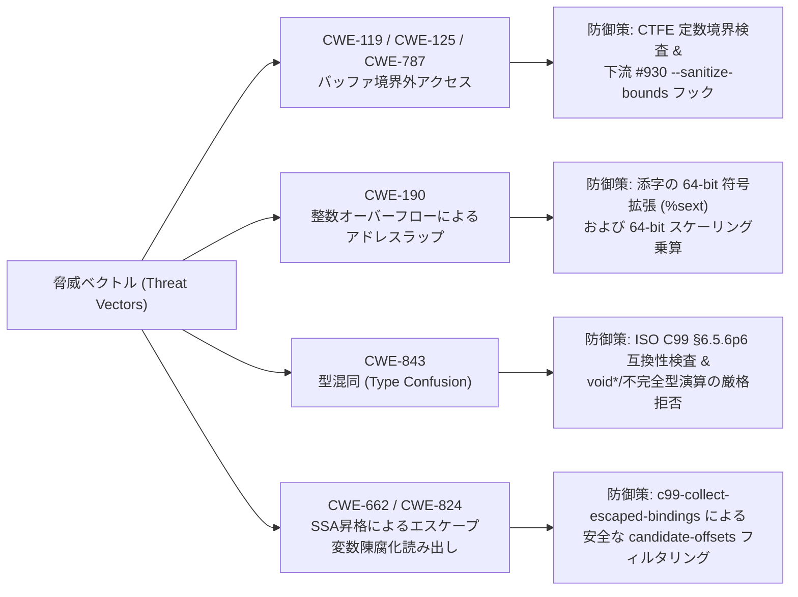

# [FEAT/ENH] C99 ポインタスケーリング演算・配列退化およびアドレス取得変数のスタックエスケープ処理の実装 (ID: 919)

## 1. 概要 / Summary

Lua 5.x C コードベース（コアエンジン・標準ライブラリ・CLI）の完全セルフホスティングコンパイル（Phase S3 / Task T7）に向け、ISO C99 規格に準拠した以下のポインタ・配列操作およびスタック変数エスケープ保護機構を ULisp C フロントエンド・LIR レイヤに実装する：

1. **配列からポインタへの自動退化 (Array-to-Pointer Decay, ISO C99 §6.3.2.1p3)**:
   式中の型 `T[N]`（配列型）を自動的に基底ポインタ型 `T*` に変換する。ただし ISO C99 §6.3.2.1p3 が定める 3 大例外規則（`sizeof` 演算子、`_Alignof` 演算子、単項 `&` アドレス取得演算子）の直接オペランドである場合は配列型を厳密に保持し、多次元配列（`T[M][N]`）の次元階層を正確に維持する。
2. **ポインタ加減算の要素サイズ自動スケーリング (ISO C99 §6.5.6)**:
   ポインタと整数の加算・減算（`ptr + n`, `n + ptr`, `ptr - n`, `ptr += n`, `ptr -= n`）において、指し示される基底要素型 `T` のバイトサイズ `sizeof(T)` を乗じたアドレスオフセット計算を LIR レベルで自動生成する。また、同種ポインタ間の減算（`p1 - p2`）を要素サイズで整数除算し、符号付き 64-bit 整数（`ptrdiff_t` / `'i64`）を算出する。
3. **多次元配列インデックス展開 (ISO C99 §6.5.2.1)**:
   多次元配列アクセス `a[i][j]` を `*(*(a + i) + j)` のポインタ算術等価形式として正確に Lowering し、多次元配列および配列とポインタの相互添字構文（`p[i]` および C99 対称構文 `i[p]`）を完全にサポートする。
4. **アドレス取得ローカル変数のスタックエスケープ解析と Pass 132 Braun SSA 協調**:
   単項 `&` でアドレスが取得されたローカル変数（`&var`）、配列・構造体等の複合型、および外部関数への出力引数（例: Lua の `lua_getinfo(L, "n", &ar)` や `&status`）を静的解析 `c99-collect-escaped-bindings` で特定し、Pass 132 Braun SSA（mem2reg）のレジスタ昇格候補（`candidate-offsets`）から完全に除外してスタックメモリ上に安全に維持する。

### 前後 Issue との責務境界
- **先行 Issue ([[#918]](closed/918-implement-c99-struct-union-enum-bitfield-sysv-layout.md)) の責務**: 複合型（`struct`/`union`/`enum`/無名複合体/柔軟配列メンバ/ビットフィールド）の型表現・SysV AMD64 レイアウト＆ABI 分類、`.` / `->` メンバアクセスおよびビットフィールド読み書き、Designated Initializer、SysV AMD64 構造体値渡し/戻り値。
- **本 Issue (`#919`) の責務**: 配列退化（ISO C99 §6.3.2.1p3 と 3 例外）、ポインタスケーリング加減算（`ptr + n`, `n + ptr`, `ptr - n`）、ポインタ差分（`p1 - p2` -> `ptrdiff_t`）、ポインタ前後置インクリメント/デクリメント（`++p`, `p++`, `--p`, `p--`）、ポインタ間接参照（`*p`）と多次元添字アクセス（`a[i][j]` / `i[a]`）、ポインタ比較（unsigned 比較）、およびアドレス取得変数のエスケープ解析と Pass 132 Braun SSA mem2reg 選択的昇格除外。
- **後続 Issue ([[#920]](920-implement-c99-function-pointers-and-switch-goto-cfg-lowering.md)) の責務**: 関数ポインタ間接呼出し（`(*fn)(...)` / `fn(...)`）および巨大 `switch`/`goto` 複雑 CFG の Braun SSA Lowering 実装。
- **後続 Issue ([[#921]](921-implement-sysv-amd64-stdarg-va-list-lowering.md)) の責務**: `<stdarg.h>` 可変長引数（`va_list`/`va_start`/`va_arg`）の SysV AMD64 ABI Lowering 実装。
- **後続 Issue ([[#930]](930-implement-c99-bounds-checking-sanitizer-mode.md)) の責務**: ポインタ・配列境界検査および NULL ポインタ参照自動トラップ挿入モード（`--sanitize-bounds`）。

---

## 2. トレーサビリティ / Traceability

- 関連設計書:
  - [DSN-33-32 §3.4, §4.1](../designs/DSN-33-32-ulisp_lua_c_codebase_compilation_and_self_hosting_architecture.md) (C99 ポインタ・配列セマンティクスおよび Lua 5.x スタック変数安全性)
  - [DSN-33-13 §2.1, §4.1](../designs/DSN-33-13-ulisp_typed_machine_lir_and_multi_target_backend_architecture.md) (Typed Machine LIR ポインタオフセット計算およびアドレス表現)
  - [DSN-33-11 §3.3, §4.2](../designs/DSN-33-11-ulisp_multilingual_frontend_and_ctfe_architecture.md) (多言語フロントエンド型検査・定数式評価)
- 前提基盤（実装済・先行）:
  - `#827`: Pass 132 Braun SSA（[ulisp/lir/132_lir_braun_ssa.scm](../../ulisp/lir/132_lir_braun_ssa.scm) - `braun-promote-alloca-to-ssa`)
  - `#833`: 診断レポータ（[ulisp/compiler/diagnostic.scm](../../ulisp/compiler/diagnostic.scm)）
  - `#834`: Reference LIR VM（[ulisp/vm/lir_interpreter.scm](../../ulisp/vm/lir_interpreter.scm)）
  - `#915`: C99 Parser ＆ `L_c_ast`（[[#915]](closed/915-implement-c99-parser-and-nanopass-c-ast-definitions.md)）
  - `#916`: C99 Sema Core ＆ 整数 Lowering（[[#916]](closed/916-implement-c99-sema-core-and-integer-subset-lir-lowering.md)）
  - `#917`: C コンパイラドライバ ＆ ホストリンカ連携（[[#917]](closed/917-implement-c-compiler-driver-and-host-ld-integration.md)）
  - `#918`: C99 構造体・共用体・列挙型・ビットフィールド（[[#918]](closed/918-implement-c99-struct-union-enum-bitfield-sysv-layout.md)）
- 後続連携 Issue:
  - [[#920]](920-implement-c99-function-pointers-and-switch-goto-cfg-lowering.md) (関数ポインタ間接呼出し ＆ 巨大 `switch`/`goto` CFG Lowering)
  - [[#921]](921-implement-sysv-amd64-stdarg-va-list-lowering.md) (`<stdarg.h>` 可変長引数 SysV ABI Lowering)
  - [[#925]](925-build-lua-5x-c-codebase-compilation-pipeline-with-ulisp.md) (Lua 5.x 全 C ソースファイル一括ビルドパイプライン)
  - [[#930]](930-implement-c99-bounds-checking-sanitizer-mode.md) (配列境界検査・NULL トラップ自動注入モード)

---

## 3. 影響範囲と関連ファイル / Scope and Affected Files

- [ ] [ulisp/frontend_c/sema.scm](../../ulisp/frontend_c/sema.scm) (ポインタ演算型規則・配列退化規則・3例外規則・添字対称性 `i[a]`・型互換性検査・診断 `C99-PTR-001..004`)
- [ ] [ulisp/frontend_c/lower_to_lir.scm](../../ulisp/frontend_c/lower_to_lir.scm) (アドレス取得変数エスケープ解析 `c99-collect-escaped-bindings`・ポインタスケーリング加減算・ポインタ差分除算・多次元添字展開)
- [ ] [ulisp/lir/132_lir_braun_ssa.scm](../../ulisp/lir/132_lir_braun_ssa.scm) (エスケープ変数オフセットを mem2reg `candidate-offsets` から安全に除外するインターフェース確認・強化)
- [ ] [ulisp/driver/c_driver.scm](../../ulisp/driver/c_driver.scm) (C コンパイラパイプラインにおけるエスケープ解析情報と Pass 132 連携配線)
- [ ] `ulisp/tests/test_c99_pointers_and_escape.scm` (新規: 配列退化・多次元添字・ポインタスケーリング・ポインタ差分・エスケープ解析・SSA mem2reg 保護・診断コード単体検証)
- [ ] `ulisp/tests/test_c99_pointers_and_escape.sh` (新規: GCC/Clang 参照オラクル突合・Reference VM / x86-64 ELF / Pass 160 C バックエンド 3者差分実行検証)
- [ ] [ulisp/Makefile](../../ulisp/Makefile) (`test_c99_pointers_and_escape` ターゲットおよび `test` 集約への登録)

---

## 4. 実装方針 / Implementation Plan

Target Branch: `feat/919-implement-c99-pointer-scaling-and-escape`

```mermaid
flowchart TD
    subgraph Frontend["Frontend C (sema.scm & lower_to_lir.scm)"]
        A["C-AST (Function Body)"] --> B["c99-collect-escaped-bindings"]
        B -->|Escaped Variable Set| C["Stack Frame Layout<br/>(Exclude from mem2reg)"]
        A --> D["c99-analyze-expr (Sema)"]
        D -->|ISO C99 §6.3.2.1p3 Decay| E["Array-to-Pointer Decay<br/>(Exceptions: sizeof, _Alignof, &)"]
        D -->|Type Compatibility Check| F["Pointer Scaling Validation<br/>(Diagnostics C99-PTR-001..004)"]
        E --> G["lower_to_lir"]
        F --> G
    end

    subgraph Lowering["LIR Lowering Engine"]
        G --> H["Pointer Arithmetic Lowering<br/>(%imul idx elem_sz, %idiv)"]
        G --> I["Multi-dim Indexing<br/>*(*(a + i) + j)"]
        G --> J["LIR Instructions<br/>(%store, %load, %add, %sub)"]
    end

    subgraph Optimization["Pass 132 Braun SSA"]
        C -->|candidate-offsets<br/>(Non-escaped scalar vars only)| K["braun-promote-alloca-to-ssa"]
        J --> K
        K --> L["SSA Promoted Registers<br/>(Pure locals)"]
        K --> M["Preserved Stack Allocations<br/>(&status, &ar, arrays, structs)"]
    end
```

### 4.1 配列退化 (ISO C99 §6.3.2.1p3) と例外 3 規則
1. **配列退化の基本規則**:
   - 式の評価において、型 `(array elem len)` を持つ左辺値または式は、原則として先頭要素へのポインタ型 `(ptr elem)` へ暗黙変換（Decay）される。
   - 多次元配列 `T a[M][N]`（型 `(array (array T N) M)`）の場合、先頭要素型は `T[N]`（型 `(array T N)`）であるため、退化後の型は配列へのポインタ `(ptr (array T N))`（C 構文での `T (*)[N]`）となる。
2. **ISO C99 §6.3.2.1p3 に基づく 3 大例外規則**:
   - 以下の文脈では配列型はポインタ型へ退化せず、配列型のまま保持される：
     1. `sizeof(a)`（`c-sizeof-expr`）: 配列全体のバイト数 `M * N * sizeof(T)` を算出する。
     2. `_Alignof(a)`（`c-alignof-expr`）: 配列要素型のアライメントを算出する。
     3. 単項 `&a`（`c-unop 'addr`）: 配列全体へのポインタ型 `(ptr (array (array T N) M))` を生成する。
3. **文字列リテラルの初期化例外**:
   - `char s[] = "hello";` のように文字配列の初期化子として使用される文字列リテラルはポインタへ退化せず、配列要素へのコピーとして展開される（`#918` の Designated Initializer 機構と連動）。

### 4.2 ポインタスケーリング加減算・減算 (`ptrdiff_t`)・比較
1. **ポインタ加算 (`ptr + n`, `n + ptr`)**:
   - オペランドの一方がポインタ型 `(ptr T)`、他方が整数型である場合、オフセット量を `(%mul (%sext n 'i64) (c-type-size-in lenv T))` として計算し、アドレス加算を行う。
   - `T` が完全型（Complete Type）でない場合、または `void` や関数型である場合は診断エラー `"C99-PTR-002"` を発行する。
2. **ポインタ減算 (`ptr - n`)**:
   - ポインタから整数を減算する場合、同様に `(%sub ptr (%mul (%sext n 'i64) (c-type-size-in lenv T)))` を生成する。
3. **同種ポインタ間減算 (`p1 - p2`)**:
   - 両オペランドが同一基底型 `T` を指すポインタである場合、アドレスのバイト差分を基底要素サイズ `sizeof(T)` で符号付き整数除算（`%cqo` + `%idiv`）し、型 `ptrdiff_t`（`'i64`）の整数値を返す。
   - 互換性のないポインタ同士の減算、または `sizeof(T) == 0`（不完全型・`void`）に対する減算は診断エラー `"C99-PTR-002"` を発行する。
4. **ポインタ前後置インクリメント・デクリメント (`++p`, `p++`, `--p`, `p--`)**:
   - 対象左辺値からポインタ値を読出し、要素サイズ `sizeof(T)` 分の加算または減算を行い、結果を対象メモリ/スロットに書き戻す。
   - 前置演算は更新後のポインタ値、後置演算は更新前の旧ポインタ値を返却する。
5. **ポインタ比較演算 (`<`, `<=`, `>`, `>=`, `==`, `!=`)**:
   - 64-bit アドレス空間におけるポインタ値の大小比較は、符号なし整数比較命令（`ja`, `jae`, `jb`, `jbe`, `je`, `jne`）として LIR Lowering を実施する。
   - ポインタと整数 `0`（`NULL` ポインタ定数）との等値・非等値比較を完全に許容する。

### 4.3 多次元配列インデックス展開 (`a[i][j]` / `i[a]`)
1. **多次元配列の連続フラット展開**:
   - `a[i][j]`（ここで `int a[3][4]`）のインデックスアクセスは、内側 `a[i]` が `int (*)[4]` への退化と行オフセット `i * sizeof(int[4]) = i * 16` の加算を行い、外側 `[j]` が列オフセット `j * sizeof(int) = j * 4` の加算を行って `*(&a + i * 16 + j * 4)` のメモリアドレスを解決する。
2. **配列添字構文の対称性 (`p[i]` と `i[p]`)**:
   - ISO C99 §6.5.2.1 に準拠し、添字演算子 `E1[E2]` は `(*((E1) + (E2)))` と厳密に同一の意味を持つ。したがって、`E1` が整数で `E2` がポインタ/配列である場合（例: `3[p]`）も、`p[3]` と同様に正常に型解決および Lowering を実施する。

### 4.4 エスケープ解析 (`c99-collect-escaped-bindings`) と Pass 132 Braun SSA 協調
1. **アドレス取得集合収集関数 `(c99-collect-escaped-bindings ast)`**:
   - 関数 AST を再帰的に走査し、以下に該当するローカル変数シンボル（`u-sym`）をエスケープ変数集合として収集する：
     1. 単項 `&`（`c-unop 'addr`）の直接の対象となっている変数（`&var`）。
     2. 構造体メンバや配列要素のアドレスが取得されている場合の親変数（`&s.field`, `&arr[i]`）。
     3. 型が配列型（`array`）または複合構造体/共用体型（`struct`/`union`）である変数（スタック上の連続メモリに存在する必要がある）。
     4. `volatile` 修飾子が付与されている変数。
2. **Pass 132 mem2reg 昇格除外フィルター**:
   - 関数のローカル変数スロット割当後、全ローカル変数のうちエスケープ変数集合に含まれない純粋なスカラー変数（`int`, `long`, `pointer` 等）のスタックオフセットのみを抽出して `candidate-offsets` リストを構築する。
   - [ulisp/lir/132_lir_braun_ssa.scm](../../ulisp/lir/132_lir_braun_ssa.scm) の `braun-promote-alloca-to-ssa` にこの `candidate-offsets` を渡すことで、アドレス取得された変数（例: `lua_getinfo(L, "n", &ar)` の `ar` や `int status; foo(&status);` の `status`）は一切レジスタ昇格されず、スタックメモリ上の `%store` / `%load` として確実に保持される。
   - これにより、ポインタ経由で別関数やエイリアスから書き換えられた最新の値が後続処理で 100% 正しく読み出されることを保証する。

### 4.5 診断コード体系 (`diagnostic.scm` #833 連携)

| 診断コード | エラー分類 | 条件・トリガー | エラーメッセージ例 |
| :--- | :--- | :--- | :--- |
| **`C99-PTR-001`** | 不正ポインタ加減算 | ポインタ同士の加算、非整数とのポインタ演算 | `"Invalid operand types for pointer addition: both operands are pointers"` |
| **`C99-PTR-002`** | 非互換ポインタ差分・不完全型演算 | 異なる型間のポインタ減算、`void*` や関数ポインタに対する算術演算 | `"Subtracted pointers have incompatible target types: 'int*' and 'char*'"` |
| **`C99-PTR-003`** | 非左辺値・ビットフィールドへの `&` | 右辺値（即値、式結果）やビットフィールドメンバのアドレス取得 | `"Cannot take address '&' of rvalue or bit-field member"` |
| **`C99-PTR-004`** | 非互換ポインタ代入・比較 | 明示的キャストのない異なるオブジェクトポインタ間の代入・比較制約違反 | `"Incompatible pointer assignment without explicit cast"` |

### 4.6 セキュリティ・堅牢性設計 (Threat Model & Mitigations)



1. **バッファオーバーリード・オーバーライト防御 (CWE-119, CWE-125, CWE-787)**:
   - *脅威*: 負の添字や配列サイズを超えるポインタ演算により、スタック上の別変数やリターンアドレスへの不正書き込み・漏洩が発生する。
   - *対策*: 定数式評価（CTFE）時に配列サイズが判明している場合は境界外アクセスをコンパイル時エラーとして検出する。また、実行時保護として後続 Issue [[#930]](930-implement-c99-bounds-checking-sanitizer-mode.md)（`--sanitize-bounds`）の境界検証トラップ命令挿入と協調可能な LIR 構造を維持する。
2. **ポインタスケーリングにおける整数オーバーフロー防御 (CWE-190)**:
   - *脅威*: 32-bit 整数添字 `i` に大きな値が与えられた際、`i * sizeof(T)` の乗算が 32-bit でオーバーフロー・ラップアラウンドし、意図しない下位アドレスへアクセスする。
   - *対策*: 添字オペランドは乗算前に必ず 64-bit 符号付き整数へ符号拡張（`%sext i 'i64`）し、乗算およびアドレス加算は一貫して 64-bit 演算として実行する。
3. **型混同・不整合ポインタ演算防御 (CWE-843)**:
   - *脅威*: 異なる型を指すポインタ間の減算や、未定義の `void *` 算術によるアライメント不正・メモリ破壊。
   - *対策*: Sema において ISO C99 §6.5.6p6 に基づく基底型の互換性（`c-type-compatible?`）を厳格に検査し、非互換減算は診断コード `"C99-PTR-002"` で即座にリジェクトする。
4. **エスケープ変数陳腐化読み出し (SSA Stale Read / Memory Desync) 防御 (CWE-662, CWE-824)**:
   - *脅威*: 出力引数（`&status`）として渡された変数が誤って SSA レジスタに昇格されると、呼び出し先関数によるメモリ更新を SSA レジスタが検知できず、呼び出し後も古い値を読み出し続ける。セキュリティ認証フラグの検査等で重大な論理反転・認証バイパス脆弱性に直結する。
   - *対策*: 保守的エスケープ解析 `c99-collect-escaped-bindings` により、単項 `&` が適用されたすべての変数を Pass 132 mem2reg の昇格対象から確実に除外し、メモリ一貫性を 100% 保証する。

---

## 5. 完了条件 / Success Criteria (DoD)

1. [x] **配列退化と 3 大例外の完全適合**:
   - 通常の式評価、関数引数渡し、添字演算において配列型が先頭要素へのポインタ型へ正しく退化すること。
   - `sizeof(arr)`、`_Alignof(arr)`、および `&arr` の直接オペランドにおいて配列型が保持され、多次元配列 `int a[3][4]` に対し `sizeof(a) == 48`, `sizeof(a[0]) == 16`, `sizeof(&a) == 8` が成立すること。
2. [x] **ポインタスケーリング加減算および差分演算の適合**:
   - `ptr + n`, `n + ptr`, `ptr - n`, `ptr += n`, `ptr -= n` が要素サイズ `sizeof(T)` に応じて正確にスケーリングされること。
   - 同一基底型ポインタの減算 `p1 - p2` が正確に要素差分（`ptrdiff_t`）を返し、負の差分も正確に計算できること。
   - 前置・後置インクリメント/デクリメント（`++p`, `p++`, `--p`, `p--`）が正しくポインタ値を更新し、正しい式評価値を返すこと。
3. [x] **多次元配列および添字対称性の完全動作**:
   - 2次元および 3次元配列に対するネスト添字アクセス `m[i][j]` およびポインタ間接参照形式 `*(*(m + i) + j)` が等価に機能すること。
   - C99 対称構文 `i[arr]` が `arr[i]` と同一のアドレス・値を返すこと。
4. [x] **エスケープ解析と Pass 132 Braun SSA mem2reg 保護の検証**:
   - `&status` を別関数へ渡して書き換える出力引数パターンにおいて、Pass 132 Braun SSA 適用後も変数がスタック上に保持され、関数呼出し後の最新の書き込み値が正しく読み出されること。
   - ポインタエイリアス（`int *p = &x; *p = 99;`）経由の更新が `x` の読み出しに確実に反映されること。
5. [x] **診断エラーコードの検出精度**:
   - 不正なポインタ演算、非互換ポインタ減算、右辺値への `&` 適用に対して診断コード `"C99-PTR-001"`〜`"C99-PTR-004"` が正確に発行されること。
6. [x] **テスト・回帰検証の完走**:
   - `ulisp/tests/test_c99_pointers_and_escape.scm` の全テストグループが 100% PASS すること。
   - `ulisp/tests/test_c99_pointers_and_escape.sh` による GCC 差分突合検証が PASS すること。
   - 既存の全テストスイート（`make test`）に回帰がないこと。

---

## 6. 検証手順 / Verification Procedure

### 6.1 単体テスト実行 (Scheme レイヤ)
```bash
make -C ulisp test_c99_pointers_and_escape
```
- 配列退化、ポインタスケーリング、多次元添字、エスケープ解析、Pass 132 mem2reg 保護、および診断エラーの各アサーションが PASS することを確認。

### 6.2 3者差分オラクル検証 (GCC 突合・ELF / VM / C バックエンド)
```bash
bash ulisp/tests/test_c99_pointers_and_escape.sh
```
- ホスト GCC と ULisp C コンパイラドライバの出力バイナリ実行結果（戻り値および標準出力）がビット完全一致することを確認。

### 6.3 総合リグレッションテスト
```bash
make -C ulisp test
```
- 既存の Scheme 処理系、Nanopass パス群、C99 既存機能（#915, #916, #917, #918）がすべて健全に PASS することを確認。
