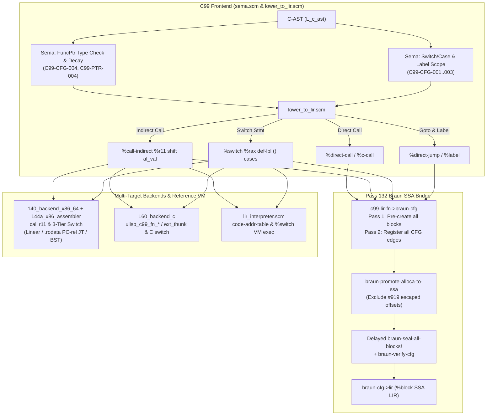
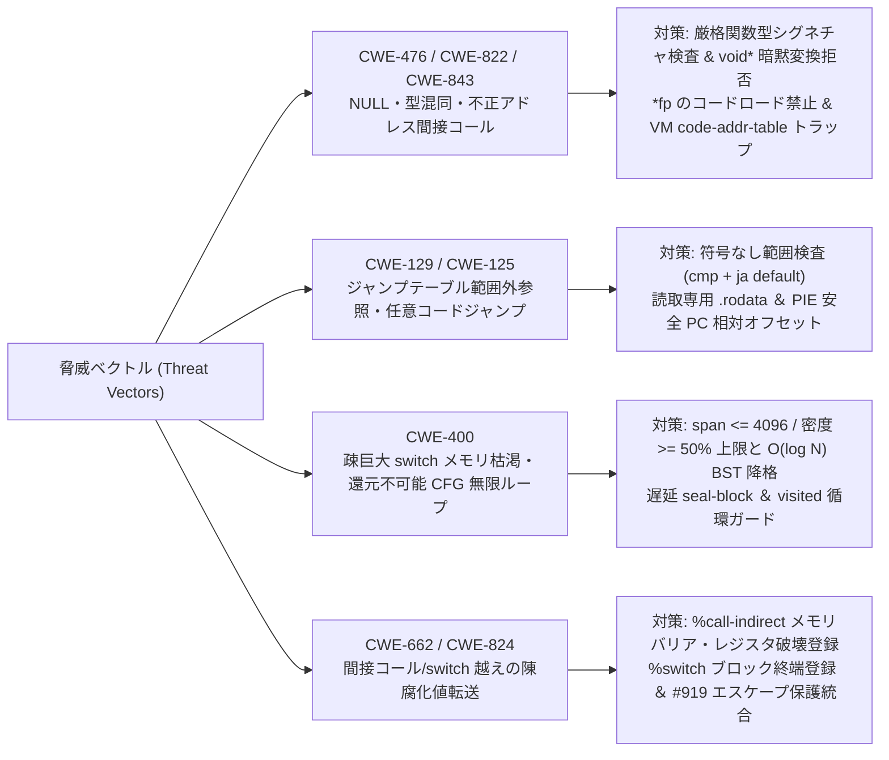

# [FEAT/ENH] C99 関数ポインタ間接呼び出しおよび巨大 switch/goto 複雑 CFG の Braun SSA Lowering 実装 (ID: 920)

## 1. 概要 / Summary

Lua 5.x C コードベース（`lapi.c`, `lauxlib.c`, `lvm.c`, `ldo.c` 等）の完全セルフホスティングコンパイル（Phase S3 / Task T8）に向け、ISO C99 規格に準拠した以下の関数ポインタ機構・複雑制御フローグラフ（CFG）Lowering・Pass 132 Braun SSA 検証を ULisp C フロントエンド、Core Machine LIR、各バックエンドおよび Reference VM に一貫実装する：

1. **関数ポインタ型解決・関数指示子退化および `%call-indirect` 間接呼び出し (ISO C99 §6.3.2.1p4, §6.5.2.2)**:
   - Lua C API の中核である `typedef int (*lua_CFunction)(lua_State *L);`、関数ポインタ配列 `int (*ops[])(int, int)`、構造体メンバ関数ポインタ `obj->cb(a, b)`、関数ポインタを返す関数 `int (*select_op(int))(int, int)` の再帰的型検査・シグネチャ互換性判定を実装する。
   - 関数指示子（Function Designator）から関数ポインタ `(ptr (fn ...))` への暗黙退化、および `*fp` / `**fp` / `&fn` の等価な関数アドレス評価（機械語バイトの誤ロード防止）を保証する。
   - Core Machine LIR (`L_lir_core` / `L_lir_raw`) に `(%call-indirect reg shift [al_val])` 命令を正式導入し、SysV AMD64 ABI（整数レジスタ `rdi..r9`、SSE レジスタ `xmm0..xmm7`、`sret`、スタック引数、`%al` 可変長引数カウント）と 100% 整合する間接呼び出しを x86-64 / Portable C / AArch64 / Reference VM 全系で開通させる。
2. **巨大 `switch-case`（フォールスルー・ネスト・Duff's Device）と任意 `goto` の意味検証 ＆ Core LIR `%switch` Lowering (ISO C99 §6.8.4.2, §6.8.6.1)**:
   - 関数スコープのラベル定義・参照テーブルを導入し、未定義 `goto` ラベル・重複ラベル（`"C99-CFG-001"`）、重複 `case` 定数・複数 `default`（`"C99-CFG-002"`）、`switch` 外の `case`/`default` およびループ/switch 外の `break`/`continue`（`"C99-CFG-003"`）、非関数/非関数ポインタに対する呼び出し（`"C99-CFG-004"`）を厳格に検出する。
   - `lower_to_lir.scm` の `c-switch` 降格を線形 `cmp` 連鎖から正規 Core LIR `%switch` 命令へ移行し、`140_backend_x86_64.scm` において 3 段階ディスパッチ最適化（小規模線形比較 / 密テーブル向け PIE 安全 `.rodata` PC 相対 32-bit ジャンプテーブル $O(1)$ / 疎大規模向け平衡二分探索木 $O(\log N)$）を実装する。
3. **2 パス基本ブロック生成・遅延 `seal-block` による Pass 132 Braun SSA 任意 CFG 協調**:
   - `lvm.c` (`luaV_execute`) 級の 80 分岐以上 `switch`、フォールスルー、前後方 `goto`、および Duff's Device を含む還元不可能ループ（Irreducible CFG）を、全基本ブロック事前生成 → 全エッジ登録 → `#919` エスケープ解析結果を用いた選択的 mem2reg → 遅延 `braun-seal-all-blocks!` → `braun-verify-cfg` → `braun-cfg->lir` のプロトコルで破綻なく SSA 化・検証する。
4. **3 者差分オラクル一貫性（Reference VM / x86-64 Native ELF / Portable C Backend）**:
   - Reference VM の関数コードアドレス一意化・`%call-indirect`・`%switch` 実行サポート、Portable C バックエンドの `%code-ref` 関数ラベル正規化および外部関数ポインタ用サンク生成、Pass 133 ピープホール保護（`%call-indirect` メモリバリア・`%switch` ブロック終端判定）を完備し、ホスト GCC オラクルとビット完全一致する動作を保証する。

### 前後 Issue との責務境界
- **先行 Issue ([[#918]](918-implement-c99-struct-union-enum-bitfield-sysv-layout.md)) の責務**: 構造体・共用体・列挙型・ビットフィールドの SysV AMD64 レイアウトおよび値渡し/戻り値（`sret` / レジスタ分割）。
- **先行 Issue ([[#919]](919-implement-c99-pointer-scaling-array-decay-and-escape-analysis.md)) の責務**: 配列退化と 3 大例外、ポインタスケーリング加減算・差分演算、`c99-collect-escaped-bindings` / `c99-function-candidate-mem2reg-offsets` によるアドレス取得変数のエスケープ保護。
- **本 Issue (`#920`) の責務**: 関数ポインタ型比較・関数指示子退化・`%call-indirect` 命令新設と全バックエンド/VM 配線、`switch`/`case`/`default`/`break`/`continue`/`goto`/ラベルの厳格 Sema 検証（`C99-CFG-001..004`）、Core LIR `%switch` Lowering と x86-64 3 段階展開（線形 / `.rodata` PC 相対ジャンプテーブル / 二分探索木）、およびフラット LIR ↔ Pass 132 Braun SSA 2 パス遅延 `seal-block` 橋渡し・検証。
- **後続 Issue ([[#921]](../921-implement-sysv-amd64-stdarg-va-list-lowering.md)) の責務**: `<stdarg.h>` 可変長引数（`va_list`/`va_start`/`va_arg`）の SysV AMD64 ABI Lowering。
- **後続 Issue ([[#922]](../922-implement-setjmp-longjmp-inline-asm-and-stack-spill-protection.md)) の責務**: `setjmp`/`longjmp` の `%inline-asm` 実装と生存変数スピル保護。
- **後続 Issue ([[#925]](925-build-lua-5x-c-codebase-compilation-pipeline-with-ulisp.md)) の責務**: Lua 5.x 全 C ソースファイル（`lvm.c`, `lapi.c` 等）の一括ビルドパイプライン構築。

---

## 2. トレーサビリティ / Traceability

- 関連設計書:
  - [DSN-33-32 §3.3, §4.4](../../designs/DSN-33-32-ulisp_lua_c_codebase_compilation_and_self_hosting_architecture.md)（関数ポインタ型と Lua C API 境界、`lvm.c` 巨大 `switch`/`goto` ディスパッチ）
  - [DSN-33-13 §4.1, §5.2](../../designs/DSN-33-13-ulisp_typed_machine_lir_and_multi_target_backend_architecture.md)（Core Machine LIR 命令セット、SysV ABI、`.rodata` テーブルおよび多重バックエンド）
  - [DSN-33-11 §3.3, §4.2](../../designs/DSN-33-11-ulisp_multilingual_frontend_and_ctfe_architecture.md)（多言語フロントエンド意味解析・診断コード体系）
- 前提基盤（実装済・先行）:
  - `#827`: Pass 132 Braun SSA 任意 CFG 対応（[ulisp/lir/132_lir_braun_ssa.scm](../../../ulisp/lir/132_lir_braun_ssa.scm)）
  - `#829`: SysV ABI 呼出規約（[ulisp/compiler/calling_convention.scm](../../../ulisp/compiler/calling_convention.scm)）
  - `#830`: `.rodata` セクション・リロケーション基盤（[ulisp/backend/144_backend_x86_elf.scm](../../../ulisp/backend/144_backend_x86_elf.scm), [ulisp/backend/144a_x86_assembler.scm](../../../ulisp/backend/144a_x86_assembler.scm)）
  - `#833`: 診断レポータ（[ulisp/compiler/diagnostic.scm](../../../ulisp/compiler/diagnostic.scm)）
  - `#834`: Reference LIR VM（[ulisp/vm/lir_interpreter.scm](../../../ulisp/vm/lir_interpreter.scm)）
  - `#915`: C99 Parser ＆ `L_c_ast`（[[#915]](915-implement-c99-parser-and-nanopass-c-ast-definitions.md)）
  - `#916`: C99 Sema Core ＆ 整数 Lowering（[[#916]](916-implement-c99-sema-core-and-integer-subset-lir-lowering.md)）
  - `#917`: C コンパイラドライバ ＆ ホストリンカ連携（[[#917]](917-implement-c-compiler-driver-and-host-ld-integration.md)）
  - `#918`: C99 構造体・共用体・列挙型・ビットフィールド（[[#918]](918-implement-c99-struct-union-enum-bitfield-sysv-layout.md)）
  - `#919`: C99 ポインタスケーリング・配列退化・エスケープ解析（[[#919]](919-implement-c99-pointer-scaling-array-decay-and-escape-analysis.md)）
- 後続連携 Issue:
  - [[#921]](../921-implement-sysv-amd64-stdarg-va-list-lowering.md)（`<stdarg.h>` 可変長引数 SysV ABI Lowering）
  - [[#922]](../922-implement-setjmp-longjmp-inline-asm-and-stack-spill-protection.md)（`setjmp`/`longjmp` 生存変数保護）
  - [[#925]](925-build-lua-5x-c-codebase-compilation-pipeline-with-ulisp.md)（`lvm.c` / `lapi.c` を含む Lua 5.x 一括ビルド）

---

## 3. 影響範囲と関連ファイル / Scope and Affected Files

### フロントエンド（C99 構文・意味解析・LIR 降格）
- [x] [ulisp/frontend_c/c_lang.scm](../../../ulisp/frontend_c/c_lang.scm)（`c-types-compatible?` の関数型 `(fn ret params variadic?)` 再帰比較、関数ポインタ文字列表記 `c-type->string` の改善）
- [x] [ulisp/frontend_c/parser.scm](../../../ulisp/frontend_c/parser.scm)（関数ポインタを返す関数宣言・関数ポインタ仮引数・抽象宣言子・ネスト `case`/`label` エッジケース検証と必要時補完）
- [x] [ulisp/frontend_c/sema.scm](../../../ulisp/frontend_c/sema.scm)（関数ポインタ型互換性検査、関数指示子暗黙退化、`*fp`/`&fn` 解決、関数ポインタ比較・三項演算子 NULL 定数処理、関数スコープ `goto`/ラベル検証、ネスト `switch` の `case` 定数重複・複数 `default` 検査、診断 `C99-CFG-001..004`）
- [x] [ulisp/frontend_c/lower_to_lir.scm](../../../ulisp/frontend_c/lower_to_lir.scm)（`c-unop 'deref` の関数型保護、`%c99-lower-call!` での `%call-indirect` 生成、`c-switch` の Core LIR `%switch` 生成、`c99-lir-fn->braun-cfg` 2 パス CFG 構築・遅延 `seal-block` 変換パイプライン）

### Core Machine LIR・検証器・最適化・SSA
- [x] [ulisp/lir/lir_lang.scm](../../../ulisp/lir/lir_lang.scm)（`L_lir_core` / `L_lir_raw` への `(%call-indirect reg shift)` および `(%call-indirect reg shift al_val)` 追加）
- [x] [ulisp/lir/lir_verifier.scm](../../../ulisp/lir/lir_verifier.scm)（`%call-indirect` の構文・レジスタ・オペランド検証追加）
- [x] [ulisp/lir/132_lir_braun_ssa.scm](../../../ulisp/lir/132_lir_braun_ssa.scm)（`braun-auto-add-terminator-edges!` の `%jump-cond`/`%jump-if-zero` 対応、`braun-cfg->lir` の 4/5 引数 `%switch` 両対応、`braun-verify-cfg` の 4 引数 `%jump-if` 境界修正）
- [x] [ulisp/compiler/nanopass_meta.scm](../../../ulisp/compiler/nanopass_meta.scm)（`lir-inst-defines-reg?`・`lir-inst-memory-barrier?` への `%call-indirect` 追加、`lir-inst-terminates-block?` への `%switch` 追加）
- [x] [ulisp/lir/133_lir_peephole.scm](../../../ulisp/lir/133_lir_peephole.scm)（`lir-unconditional-terminator?` への `%switch` 追加および到達不能コード削除との整合性確認）

### バックエンド・アセンブラ・Reference VM
- [x] [ulisp/backend/140_backend_x86_64.scm](../../../ulisp/backend/140_backend_x86_64.scm)（`%call-indirect` の `call <reg>` 生成、`%switch` の 4/5 引数両対応および 3 段階ディスパッチ展開：小規模線形 / 密 `.rodata` PC 相対ジャンプテーブル / 疎平衡二分探索木・64-bit 即値対応）
- [x] [ulisp/backend/144a_x86_assembler.scm](../../../ulisp/backend/144a_x86_assembler.scm)（`asm-parse-data-expr` と Pass 2 での同一セクション内ラベル差分式 `.long L_case - L_base` 評価サポートによる PIE 安全・リロケーションゼロの `.rodata` ジャンプテーブル生成）
- [x] [ulisp/backend/160_backend_c.scm](../../../ulisp/backend/160_backend_c.scm)（`%code-ref` の内部関数 `c-backend-fn-label` 解決、外部関数ポインタ用サンク `ulisp_c99_ext_thunk_*` 自動生成、`%call-indirect` 生成、`%switch` の 4/5 引数両対応）
- [x] [ulisp/backend/150_backend_aarch64.scm](../../../ulisp/backend/150_backend_aarch64.scm)（`%call-indirect` の `blr <reg>` 生成と `arm-call-or-jump-inst?` 登録、`%switch` 4/5 引数対応）
- [x] [ulisp/vm/lir_interpreter.scm](../../../ulisp/vm/lir_interpreter.scm)（関数ごとの一意な仮想コードアドレス表 `code-addr-table` 構築、`%code-ref` と `data` `reloc` の実アドレス解決、`%call-indirect` 実行と NULL/不正アドレス時トラップ、`%switch` 4/5 引数実行の実装）

### テスト・ビルド
- [x] [ulisp/tests/test_c99_funcptr_and_switch_cfg.scm](../../../ulisp/tests/test_c99_funcptr_and_switch_cfg.scm)（新規: 関数ポインタ型検査・間接呼び出し・構造体/配列コールバック・フォールスルー/ネスト/Duff's Device/80+ 分岐 `switch`・前後方 `goto`・Braun SSA 検証・診断 `C99-CFG-001..004` の単体テスト群）
- [x] [ulisp/tests/test_c99_funcptr_and_switch_cfg.sh](../../../ulisp/tests/test_c99_funcptr_and_switch_cfg.sh)（新規: ホスト GCC オラクルとの Native ELF / Portable C 3 者差分突合、80+ 分岐 Lua VM 風ディスパッチ、および Host GCC ↔ ULisp Native ELF 双方向関数ポインタ・コールバック相互リンク検証）
- [x] [ulisp/Makefile](../../../ulisp/Makefile)（`test_c99_funcptr_and_switch_cfg` ターゲットの追加と `.PHONY` / `test` 集約への登録）

---

## 4. 実装方針 / Implementation Plan

Target Branch: `feat/920-implement-c99-funcptr-and-switch-goto-cfg`

> [!IMPORTANT]
> **ULisp AOT コーディング規約（厳守）**:
> すべての `.scm` 変更においてローカル変数への `set!` を一切使用しないこと（可変ボックス `(cons init '())` + `set-car!`、レコードセッタ、または純粋関数型アキュムレータを使用する）。また、既存の `L_lir_core` `%lir-function` スキーマを壊さないこと。



### 4.1 関数ポインタ型比較・関数指示子退化および `*fp` / `&fn` 解決

1. **再帰的な関数型互換性 (`ulisp/frontend_c/c_lang.scm`, `ulisp/frontend_c/sema.scm`)**:
   - `c-types-compatible?` および `c99-pointer-targets-compatible?` に `(and (c-function-type? t1) (c-function-type? t2))` ブランチを追加する：
     - 戻り値型が互換であること（`c99-pointer-targets-compatible?` 相当）。
     - 可変長引数フラグ `(c-fn-variadic? t1)` と `(c-fn-variadic? t2)` が一致すること。
     - 引数リスト長が一致し、各引数型が再帰的に互換であること。
   - **ISO C99 §6.3.2.3 準拠の関数ポインタ ↔ `void*` 制約**:
     - `c99-pointer-targets-compatible?` において `allow-void?` が `#t` であっても、一方の指し先が `(fn ...)` で他方が `'void` の場合は暗黙変換を拒否（明示キャストのみ許可）し、`"C99-PTR-004"` を発行する。
   - `c-type->string` で関数型を `"ret(*)(p1, p2)"` 形式で可読表示できるようにする。
2. **関数指示子の暗黙退化と多段間接参照 (`sema.scm`, `lower_to_lir.scm`)**:
   - `c99-array-decay` による `(fn ...)` → `(ptr (fn ...))` 退化を、代入・初期化・関数引数・戻り値・条件式・三項演算子 `cond ? add : sub` および `cond ? fp : 0`（NULL 定数分岐の型正規化）で一貫適用する。
   - **重要バグ防止（`lower_to_lir.scm` の `c-unop 'deref`）**:
     - 現行 `lower_to_lir.scm` の `((deref) ...)` は `(if (not (%c99-lower-aggregate-like? ty)) (%c99-lower-load-from-mem! ...))` となっており、`ty` が `(fn ...)` のとき関数コード先頭の機械語バイトをメモリロードしてしまう不具合がある。
     - ISO C99 §6.3.2.1p4 / §6.5.3.2p4 に従い、`(not (or (%c99-lower-aggregate-like? ty) (c-function-type? ty)))` として関数ポインタの `*fp` / `**fp` が関数アドレスそのものを返すよう修正する。
   - 関数ポインタ同士の `==` / `!=` 比較および `0`（NULL）との比較を許可し、関数ポインタへの大小比較（`< <= > >=`）は ISO C99 §6.5.8 違反として `"C99-PTR-004"` を発行する。
3. **非呼び出し可能オブジェクト診断 (`sema.scm`)**:
   - `c-call` において、呼び出し対象が関数型でも関数ポインタ型でもない場合（例: `int x = 1; x(2);` や `int *p; p();`）に診断コード `"C99-CFG-004"` を発行する。
   - ※ 既存の引数個数不一致エラー（`test_c99_int_lowering.scm` 検証済）は引き続き `"C99-SEMA-004"` を維持し回帰を起こさないこと。

### 4.2 Core LIR `%call-indirect` 命令の新設と全レイヤ配線

1. **Core LIR 言語仕様 (`ulisp/lir/lir_lang.scm`) ＆ 検証器 (`ulisp/lir/lir_verifier.scm`)**:
   - `L_lir_core` および `L_lir_raw` の `Inst` に以下を追加する：
     ```scheme
     (%call-indirect reg shift)
     (%call-indirect reg shift al_val)
     ```
   - `lir_verifier.scm` に `%call-indirect` 検証（第 1 引数が有効レジスタ、第 2 引数が整数 `shift`、任意の第 3 引数が整数または `#f`）を追加する。
2. **Pass 133 ピープホール安全性 (`ulisp/compiler/nanopass_meta.scm`, `ulisp/lir/133_lir_peephole.scm`)**:
   - `nanopass_meta.scm` の `lir-inst-defines-reg?` に `%call-indirect` を追加（SysV Caller-Saved レジスタ `%rax %rcx %rdx %rsi %rdi %r8..%r11 %al %xmm0..%xmm15` の破壊を宣言）。
   - `nanopass_meta.scm` の `lir-inst-memory-barrier?` に `%call-indirect` を追加（間接呼び出しを跨ぐ誤った Store-Reload 転送を防止）。
   - `nanopass_meta.scm` の `lir-inst-terminates-block?` および `133_lir_peephole.scm` の `lir-unconditional-terminator?` に `%switch` を追加。
3. **C99 Lowering (`ulisp/frontend_c/lower_to_lir.scm` `%c99-lower-call!`)**:
   - 直接呼び出し（`fn-inner` が `c-fn-ref`、または `&fn` / `*fn` を剥がして静的 `c-fn-ref` に帰着する場合）は既存の `%direct-call` / `%c-call` を維持する。
   - それ以外の任意関数ポインタ式（変数 `fp(a, b)`、配列要素 `ops[i](a, b)`、構造体メンバ `obj->cb(a, b)`、間接参照 `(*fp)(a, b)`、戻り値 `get_fn(k)(a, b)`）は以下の手順で Lowering する：
     1. 関数ポインタ式 `fn-node` を評価し、専用の一時スタックスロット `fn-ptr-si` へ退避する（引数評価中にネスト呼び出しがあっても破壊されない）。
     2. 既存の SysV ABI プラン（`c99-plan-sysv-abi`）に従って全実引数を評価・退避し、スタック引数コピー、GPR (`rdi..r9`) / SSE (`xmm0..xmm7`) / 隠し `sret` (`rdi`) をロードする。
     3. 引数レジスタ設定完了後、`(%load %r11 %rsp fn-ptr-si)` で関数ポインタをスクラッチレジスタ `%r11` へロードする（SysV 引数レジスタと完全非競合）。
     4. `(%call-indirect %r11 shift (min 8 xmm-used))` を発行する。
     5. 戻り値（スカラー・構造体レジスタ返却・`sret`）を既存ロジック通り受け取る。
4. **各バックエンドおよび Reference VM 実装**:
   - **x86-64 (`140_backend_x86_64.scm`)**:
     - `%call-indirect` を `sub rsp, shift`（`> 0` 時）→ `xor eax, eax` / `mov al, al_val`（`al_val` 指定時）→ `call <reg>`（`144a_x86_assembler.scm` の `FF /2` エンコード済）→ `add rsp, shift` として出力する。
     - `%code-ref` で `c-tu` モード時に `(asm-label->str lbl)` を用いるよう統一する。
   - **Portable C (`160_backend_c.scm`)**:
     - `%code-ref` を修正し、`lbl` が `*c-backend-fn-syms*` に含まれる場合は `(c-backend-fn-label lbl)`（`ulisp_c99_fn_<name>`）を出力する。
     - 外部 C 関数（`strlen`, `strcmp`, リンク先ホスト C 関数等）が `%code-ref` または `data` `reloc` でアドレス参照された場合、ラッパーサンク `static void ulisp_c99_ext_thunk_<name>(void)` を自動生成し（`reg_rax = ((uint64_t (*)(uint64_t,...))<name>)(reg_rdi, ...)`）、`%code-ref` / `reloc` はそのサンクアドレスを指すようにする。
     - `%call-indirect` は `reg_rsp -= (shift + 8); ((void (*)(void))(uintptr_t)<reg>)(); reg_rsp += (shift + 8);` を出力し、内部関数・外部関数を問わず統一的に間接呼び出し可能にする。
   - **AArch64 (`150_backend_aarch64.scm`)**:
     - `%call-indirect` で `blr <arm-reg>` を出力し、`arm-call-or-jump-inst?` に `%call-indirect` を登録する。
   - **Reference VM (`ulisp/vm/lir_interpreter.scm`)**:
     - 既存のハードコード値 `4096`（`lir_interpreter.scm` の `data` `reloc` および `%code-ref`）を廃止し、ロード時に全内部関数および参照された外部 C 関数へ一意な仮想コードアドレス（例: `0x10000 + idx * 16`）を割り当てる双方向テーブル `code-addr-table` を導入する。
     - `%code-ref` と `data` `reloc` が一意なコードアドレスを返すことで `fp1 == fp2` / `fp1 != fp2` 比較を正確に動作させる。
     - `%call-indirect` 命令ハンドラを追加：レジスタ値 `addr` を `code-addr-table` で逆引きし、未登録または `0` (NULL) の場合は `'invalid-call-target` トラップを発火、内部関数ならコールフレームを積んでジャンプ、外部関数なら `vm-dispatch-c-call!` へ委譲する。

### 4.3 `switch`/`case`/`default`/`goto`/ラベルの意味解析 ＆ 診断体系

1. **`<c99-sema-env>` の拡張 (`ulisp/frontend_c/sema.scm`)**:
   - 関数単位のラベル状態（`defined-labels`: `((sym . span) ...)`, `goto-refs`: `((sym . span) ...)`）およびネスト可能な `switch` スタック（各要素は `(ctrl-ty seen-case-vals-box has-default?-box)`）を環境に追加する。
2. **意味検査ルール**:
   - **`c-switch`**: 制御式が整数型であることを検査（非整数型なら `"C99-SEMA-003"`）、整数昇格型 `ctrl-ty` を決定して `switch` スタックに push してから本体を解析する。
   - **`c-case`**:
     - `switch` スタックが空（`switch` 外）なら `"C99-CFG-003"` を発行する。
     - 定数式を `c99-eval-const-int-expr` で評価し（非定数なら `"C99-SEMA-005"`）、`ctrl-ty` へ `%c99-cast-const-int` で正規化した上で現在の `switch` の `seen-case-vals` と照合し、重複があれば `"C99-CFG-002"` を発行する。
   - **`c-default`**:
     - `switch` スタックが空なら `"C99-CFG-003"` を発行する。
     - 現在の `switch` に既に `default:` が存在する場合は `"C99-CFG-002"` を発行する。
   - **`c-break` / `c-continue`**:
     - ループおよび `switch` 外の `break`、ループ外の `continue` に対して `"C99-CFG-003"` を発行する。
   - **`c-label` / `c-goto`**:
     - `c-label` は現在の関数の `defined-labels` へ登録し、重複定義なら `"C99-CFG-001"` を発行する。
     - `c-goto` は `goto-refs` に `(sym . span)` を記録する。
     - 関数本体解析完了時（`sema-analyze-fn-def` 末尾）にすべての `goto-refs` が `defined-labels` に存在することを検査し、未定義ラベルがあれば該当 `span` 付きで `"C99-CFG-001"` を発行する。
3. **診断コード体系 (`diagnostic.scm` #833 連携)**:

| 診断コード | エラー分類 | トリガー条件 | エラーメッセージ例 |
| :--- | :--- | :--- | :--- |
| **`C99-CFG-001`** | 不正な `goto` / ラベル定義 | 関数内で未定義の `goto` ターゲット参照、または同一関数内でのラベル名重複定義 | `"Use of undeclared label 'err_exit' in goto statement"` / `"Duplicate label definition 'retry'"` |
| **`C99-CFG-002`** | `switch` ケース重複・多重 `default` | 同一 `switch` 内で（制御式型変換後の）`case` 定数値が重複、または 2 つ以上の `default:` が存在 | `"Duplicate case value '42' in switch statement"` / `"Multiple default labels in one switch"` |
| **`C99-CFG-003`** | 制御文スコープ違反 | `switch` 外の `case`/`default`、ループ・`switch` 外の `break`、ループ外の `continue` | `"'case' label not within a switch statement"` / `"'break' statement not within loop or switch"` |
| **`C99-CFG-004`** | 非関数オブジェクト呼び出し | 関数型でも関数ポインタ型でもない式に対する関数呼び出し演算 `expr(...)` | `"Called object of type 'i32' is not a function or function pointer"` |

### 4.4 Core LIR `%switch` 降格と x86-64 3 段階ディスパッチ最適化

1. **`lower_to_lir.scm` での `%switch` 出力**:
   - `c-switch` の Lowering を、制御式評価結果 `%rax` を用いた正規 Core LIR 命令：
     ```scheme
     (%switch %rax <default-or-end-lbl> () ((v1 lbl1 ()) (v2 lbl2 ()) ...))
     ```
     へ変更する（空の `switch` や `case` 0 件の場合は直接 `(%direct-jump <default-or-end-lbl>)` を出力）。
   - `%c99-annotate-switch-body` により、`c-block`, `c-if`, `c-while`, `c-do-while`, `c-for`, `c-label` の内側にネストした `case`/`default`（Duff's Device を含む）も正確に収集し、ネストした内側 `c-switch` には潜らないことを保証する。
   - フォールスルーは C99 仕様通り次の `case` ブロックへ直列配置し、Braun CFG 変換時に明示的フォールスルーエッジ `%jump next-blk` へ正規化する。
2. **4 引数 / 5 引数 `%switch` の全系互換化**:
   - `140_backend_x86_64.scm`、`160_backend_c.scm`、`150_backend_aarch64.scm`、`lir_interpreter.scm`、`132_lir_braun_ssa.scm` のすべてにおいて、4 引数形式 `(%switch val def-lbl cases)` と 5 引数形式 `(%switch val def-lbl def-args cases)` の双方を正しく解釈するよう統一する（現行 `140_backend_x86_64.scm:490` / `160_backend_c.scm:581` の 4 引数時ケース欠落バグを解消）。
3. **x86-64 バックエンド 3 段階 `%switch` 展開 (`140_backend_x86_64.scm` & `144a_x86_assembler.scm`)**:
   - **Tier 1 — 小規模分岐 ($N < 8$)**: 線形比較連鎖（`c-val` が符号付き 32-bit 範囲外の場合はスクラッチレジスタ経由の 64-bit `mov` + `cmp` を生成）。
   - **Tier 2 — 密な大規模分岐 ($N \ge 8$ かつ $\text{span} = \max - \min + 1 \le 4096$ かつ $\text{span} \le 2 \times N$)**:
     - **PIE 安全・ゼロリロケーション `.rodata` PC 相対 32-bit ジャンプテーブル**を生成（Lua `lvm.c` 83 オペコード等を $O(1)$ ディスパッチ）：
       ```asm
       mov r10, <val>
       sub r10, <min_val>          ; (min_val != 0; 32-bit 超過時は r11 経由)
       cmp r10, <span - 1>         ; 符号なし範囲検査
       ja  <def_dispatch_lbl>      ; 範囲外は必ず default へ (CWE-129/125 防御)
       lea r11, [rip + .L_jt_N]
       movsxd r10, dword ptr [r11 + r10*4]
       lea r11, [rip + .L_jt_base_N]
       add r11, r10
       jmp r11
       .L_jt_base_N:
       ```
     - `.rodata` セクションへ `.p2align 2` / `.L_jt_N:` / `.long <target_lbl> - .L_jt_base_N` を出力する（SSA ブロック引数があるケースは並列コピートランポリンラベル経由）。
     - `144a_x86_assembler.scm` の `asm-parse-data-expr` と Pass 2 に同一セクション内シンボル差分 `(sym-diff sym1 sym2)` を追加し、`(- (sym-offset sym1) (sym-offset sym2))` を 32-bit リトルエンディアン即値として解決する（ELF リロケーション不要のため PIE / `-no-pie` / Pass 144 静的 ELF のすべてで完全動作）。
   - **Tier 3 — 疎な大規模分岐 ($N \ge 8$ かつ $\text{span} > 2 \times N$ または $\text{span} > 4096$)**:
     - ソート済みケース配列から再帰的に中央値分割する **平衡二分探索木 ($O(\log N)$)** を生成し、テーブル肥大化を完全防止する。

### 4.5 2 パス基本ブロック生成 ＆ 遅延 `seal-block` による Pass 132 Braun SSA 検証

1. **Pass 132 Braun SSA のバグ修正 (`ulisp/lir/132_lir_braun_ssa.scm`)**:
   - `braun-auto-add-terminator-edges!` に `%jump-cond` / `%jump-if-zero` のサポートを追加（あるいは CFG 構築側で明示的 2 方向エッジを登録）。
   - `braun-cfg->lir` の `%switch` 分岐を 4 引数 / 5 引数両対応にする。
   - `braun-verify-cfg` の `%jump-if` 検証で長さ 4 形式 `(%jump-if c t e)` と長さ 6 形式 `(%jump-if c t t-args e e-args)` の両方を安全に扱うよう修正する。
2. **フラット C99 LIR → Braun SSA CFG 変換エンジン (`c99-lir-fn->braun-cfg` in `lower_to_lir.scm`)**:
   - **Pass 1（全基本ブロック事前登録）**: 関数命令列をすべての `%label` と終端命令直後で基本ブロックに分割し、全ブロックを `braun-new-block!` で事前登録する（前方 `goto`、任意 `switch` ケース、Duff's Device ループ内飛び込み先が 100% 解決可能）。
   - **Pass 2（命令配置 ＆ 全 CFG エッジ登録）**: 各ブロックの非終端命令を `braun-emit-inst!` で配置し、フォールスルー終端には明示的 `(%jump next-blk)` を補完、`%jump-cond`/`%jump-if-zero` には分岐先とフォールスルー先の両エッジを、`%switch` には全 `case` + `default` のエッジを `braun-add-edge!` で登録する。
   - **選択的 mem2reg ＆ 遅延シーリング**:
     - `#919` の `c99-function-candidate-mem2reg-offsets` から得た非エスケープ変数オフセットのみを `braun-promote-alloca-to-ssa` に渡す。
     - **全ブロック・全エッジ登録完了後に一括して `(braun-seal-all-blocks! cfg)` を呼び出す**ことで、還元不可能ループや相互 `goto` を含む 80 分岐以上の巨大 CFG でも安全に Phi ノード生成・自明 Phi 除去を完結させる。
     - `(braun-verify-cfg cfg)` により全ブロック封印済・未解決 `incomplete` 0 件・全先行ブロック入力整合・全終端ラベル実在を検証し、`(braun-cfg->lir cfg)` で正規 `%block` SSA LIR を生成できることを単体テストで検証する。

### 4.6 セキュリティ・堅牢性設計 (Threat Model & Mitigations)



1. **NULL / 不正関数ポインタ呼び出し ＆ 型混同防御 (CWE-476, CWE-822, CWE-843)**:
   - *脅威*: 互換性のないシグネチャを持つ関数ポインタへの暗黙代入、`*fp` による命令列バイト列の誤読込、または NULL / データ領域アドレスへの間接ジャンプによる任意コード実行・クラッシュ。
   - *対策*: Sema で関数戻り値・引数型・可変長引数フラグを厳格照合し、非関数呼び出し（`C99-CFG-004`）と不整合ポインタ代入（`C99-PTR-004`）を拒否する。`*fp` はアドレス値をそのまま維持しロードを発行しない。Reference VM は一意な `code-addr-table` 照合を行い、NULL (`0`) または未登録コードアドレスへの `%call-indirect` を `'invalid-call-target` トラップで即時遮断する。
2. **ジャンプテーブル範囲外読み取り ＆ 改ざん防御 (CWE-129, CWE-125)**:
   - *脅威*: 攻撃者制御の `switch` 入力値（負値または過大値）がジャンプテーブル境界外を読み取り、任意アドレスへ制御を奪取する。
   - *対策*: すべての `.rodata` ジャンプテーブル参照前に必ず `sub r10, min` → `cmp r10, span-1` → `ja default` の**符号なし境界チェック**を挿入し、負値（ラップアラウンドして巨大符号なし整数化）および上限超過値を 1 命令で安全に `default` へ排除する。また、テーブル自体は書込不可の `.rodata` に配置し、PC 相対 32-bit 差分で構成することで PIE 環境での書込可能リロケーション領域（`.data.rel.ro` 等）への依存を排除する。
3. **疎な巨大 `switch` によるメモリ枯渇 ＆ CFG 循環無限再帰防御 (CWE-400)**:
   - *脅威*: `case 0:` と `case 100000000:` のような疎な `switch` に対するナイーブなジャンプテーブル展開がギガバイト級のバイナリ肥大化を引き起こす。また、相互 `goto` や Duff's Device の還元不可能ループが SSA Phi 解決で無限再帰する。
   - *対策*: ジャンプテーブル生成条件にハード上限（`span <= 4096` かつ密度 $\ge 50\%$）を課し、条件外は自動的に $O(\log N)$ 平衡二分探索木へ切り替える。Braun SSA 変換は 2 パス遅延 `braun-seal-all-blocks!` と `braun-try-remove-trivial!` の `visited` 循環検出ガードで必ず有限回で停止する。
4. **最適化によるメモリ一貫性破壊防御 (CWE-662, CWE-824)**:
   - *脅威*: Pass 133 ピープホールが `%call-indirect` をメモリバリアと認識せず、間接呼び出し先（例: コールバックによる `&status` 更新）を跨いで古いスタック値を前方転送する。
   - *対策*: `nanopass_meta.scm` で `%call-indirect` を Caller-Saved 全レジスタ破壊 ＆ メモリバリア、`%switch` をブロック終端命令として登録し、`#919` エスケープ解析と合わせて 100% メモリ一貫性を担保する。

---

## 5. 完了条件 / Success Criteria (DoD)

1. [x] **関数ポインタ型検査 ＆ 関数指示子退化の完全適合**:
   - `typedef int (*lua_CFunction)(lua_State *L);`、関数ポインタ配列 `int (*ops[])(int, int)`、構造体メンバ関数ポインタ、関数ポインタ引数・戻り値、関数指示子からの暗黙退化、`fp(a, b)`・`(*fp)(a, b)`・`(**fp)(a, b)`・`(&f)(a, b)` が正常に型検査・実行されること。
   - 関数ポインタ同士の等値比較（`==`, `!=`）および NULL (`0`) 比較が正確に動作し、非互換シグネチャ代入・比較および関数ポインタ大小比較が `"C99-PTR-004"` で拒否されること。
2. [x] **`%call-indirect` の 3 者一致動作（Reference VM / x86-64 Native ELF / Portable C）**:
   - 関数ポインタ配列、構造体コールバック（Lua `lua_CFunction` / メタテーブルディスパッチ模擬）、関数ポインタ返却関数、および構造体値渡し・戻り値を伴う間接呼び出しが Reference VM・x86-64 Native ELF・Portable C バックエンドおよびホスト GCC オラクルでビット完全一致すること。
   - Host GCC ↔ ULisp Native ELF 間で関数ポインタを相互に受け渡してコールバック実行できること。
   - Reference VM が NULL 関数ポインタ呼び出し時に `'invalid-call-target` トラップを発火すること。
3. [x] **巨大 `switch`（80 分岐以上）・フォールスルー・Duff's Device・任意 `goto` の完全動作**:
   - 85 分岐以上の密 `switch`（Lua `lvm.c` `luaV_execute` 模擬 VM ループ）が x86-64 で `.rodata` PC 相対ジャンプテーブルへ展開され、境界外値（負値・上限超過）が安全に `default` へフォールバックすること。
   - 疎な大規模 `switch`（例: 負数〜`0x100000` 以上の飛び値）が平衡二分探索木へ展開され、テーブル肥大化なしで正確に動作すること。
   - フォールスルー、ネスト `switch`、ループ内 `switch` での `break`/`continue` 境界、Duff's Device（`switch` から `do-while` 内 `case` への飛び込み）、前方/後方 `goto`、および相互 `goto` ループがすべてホスト GCC オラクルと完全一致すること。
4. [x] **Pass 132 Braun SSA 遅延 `seal-block` 検証の完走**:
   - 80 分岐以上の `switch` + 前後方 `goto` + フォールスルー + Duff's Device + エスケープ変数（`&status`）を混在させた関数に対し、`c99-lir-fn->braun-cfg` → `braun-promote-alloca-to-ssa` → `braun-seal-all-blocks!` → `braun-verify-cfg` → `braun-cfg->lir` がクラッシュせず 100% PASS し、生成された `%block` SSA LIR が `L_lir_core?` および `validate-core-lir` に適合すること。
5. [x] **診断エラーコード (`C99-CFG-001`〜`C99-CFG-004`) の検出精度**:
   - 未定義 `goto` ラベル・重複ラベル（`C99-CFG-001`）、重複 `case` 定数・複数 `default`（`C99-CFG-002`）、`switch` 外 `case`/`default`・ループ/switch 外 `break`/`continue`（`C99-CFG-003`）、非関数オブジェクト呼び出し（`C99-CFG-004`）がすべて期待通りの診断コードでリジェクトされること。
6. [x] **テスト・品質ゲート・回帰検証の完走**:
   - `ulisp/tests/test_c99_funcptr_and_switch_cfg.scm` 全テストグループが 100% PASS すること。
   - `ulisp/tests/test_c99_funcptr_and_switch_cfg.sh`（GCC 3 者差分突合 ＆ 双方向コールバック相互リンク）が 100% PASS すること。
   - `make -C ulisp verify_zero_gauche test_lint_sexpr` および既存全 C99 / LIR / Backend テスト群（`make -C ulisp test`）に回帰ゼロであること。

---

## 6. 検証手順 / Verification Procedure

### 6.1 単体テスト実行 (Scheme / VM / Braun SSA レイヤ)
```bash
make -C ulisp test_c99_funcptr_and_switch_cfg
```
- 関数ポインタ型検査・間接呼び出し、Reference VM 一意アドレス＆トラップ、85+ 分岐 `switch`（密・疎・フォールスルー・ネスト・Duff's Device）、前後方 `goto`、Pass 132 Braun SSA 2 パス遅延 `seal-block` + `braun-verify-cfg`、および診断コード `C99-CFG-001`〜`C99-CFG-004` の全アサーションが PASS することを確認。

### 6.2 3 者差分オラクル ＆ 双方向コールバック相互リンク検証
```bash
USE_GOSH=1 bash ulisp/tests/test_c99_funcptr_and_switch_cfg.sh
```
- ホスト GCC オラクル、ULisp Native x86-64 ELF（`.rodata` ジャンプテーブル / 二分探索木 / `call r11`）、および ULisp Portable C バックエンドの実行出力がビット完全一致することを確認。
- Host GCC 側コードから ULisp コンパイル関数の関数ポインタを呼び出し、逆に ULisp 側コードから Host GCC 関数の関数ポインタを呼び出す双方向コールバック相互リンクが PASS することを確認。
- アセンブリ出力（`-S`）に `.rodata` ジャンプテーブル（`.L_jt_` / `ja` 境界検査）および `call r11` が生成されていることを確認。

### 6.3 品質ゲートおよび総合リグレッションテスト
```bash
make py_compile && make -C ulisp verify_zero_gauche test_lint_sexpr test_c99_lexer test_c99_preprocessor test_c99_parser test_c99_int_lowering test_c99_struct_union_layout test_c99_pointers_and_escape test_c99_funcptr_and_switch_cfg test_c99_e2e test_lir test_lir_interpreter test_lir_dialect_separation test_sysv_abi_calls test_elf_sections_and_reloc
```
- 既存 C99 機能（#913〜#919）、Pass 132 Braun SSA、Pass 133 Peephole、Reference VM、x86-64 / ELF / C / AArch64 バックエンドに一切の回帰がないことを確認。
