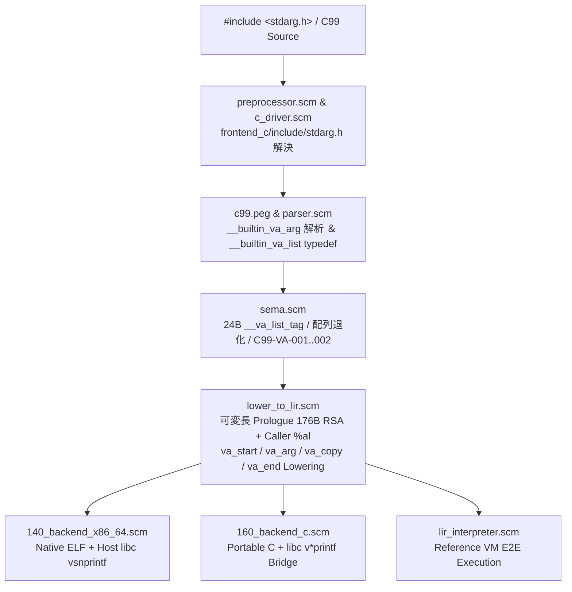
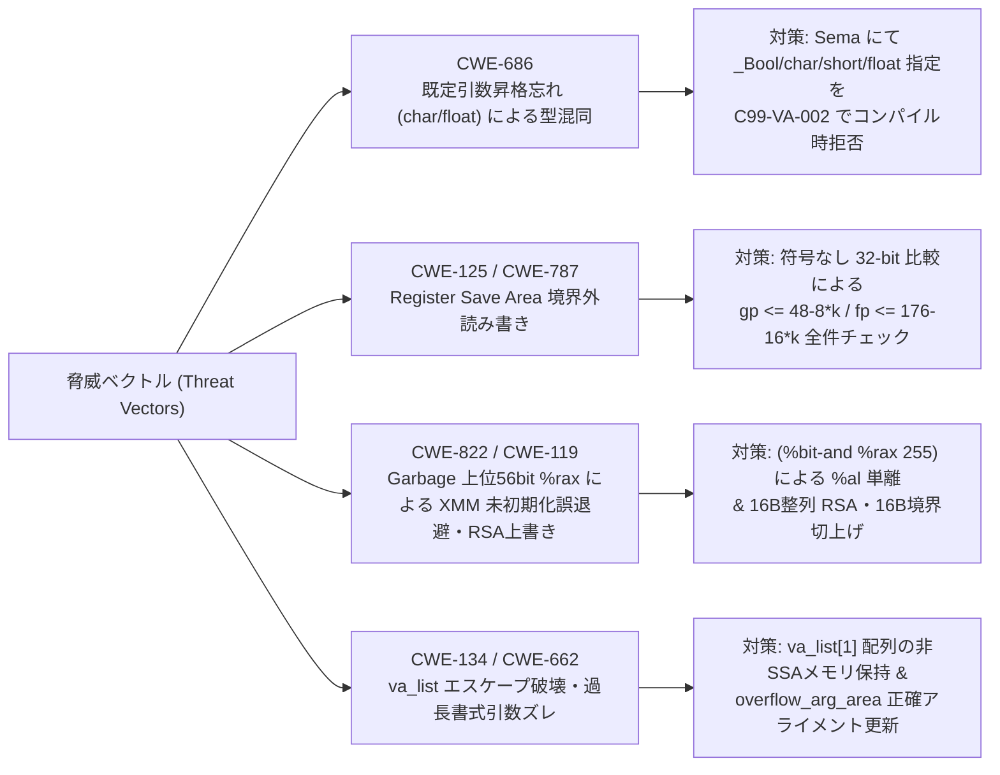

# [FEAT/ENH] `<stdarg.h>` 可変長引数 (`va_list` / `va_start` / `va_arg`) の SysV AMD64 ABI Lowering 実装 (ID: 921)

## 1. 概要 / Summary

Lua 5.x C コードベース（`lua_pushfstring`、`luaL_error`、`luaL_argerror` 等）および C 標準ライブラリ可変長関数（`vsnprintf`, `vsprintf`, `vprintf`, `vfprintf`）の完全動作に向け、ISO C99 §7.15 および System V AMD64 psABI §3.5.7 に完全準拠した `<stdarg.h>` 機構（`va_list`, `va_start`, `va_arg`, `va_end`, `va_copy`）を ULisp C99 フロントエンド・呼出規約・各バックエンド・Reference VM へ一貫実装する（Phase S3 / Task T9）：

1. **組み込み `<stdarg.h>` とプリプロセッサ / ドライバ標準システムパス統合**:
   - [stdarg.h](../../../ulisp/frontend_c/include/stdarg.h) を新設し、`typedef __builtin_va_list va_list;`（および GNU 互換 `__gnuc_va_list`）、`va_start(ap, last)`、`va_arg(ap, type)`、`va_end(ap)`、`va_copy(dest, src)` を提供する。
   - [preprocessor.scm](../../../ulisp/frontend_c/preprocessor.scm) の `make-default-cpp-context` および [c_driver.scm](../../../ulisp/driver/c_driver.scm) の `c-driver-build-cpp-context` に組み込みシステムインクルード解決（ディレクトリ探索 ＋ 仮想ファイルフォールバック）を統合し、ドライバ経由・単体 CPP 実行の双方で `#include <stdarg.h>` が即座に機能するようにする。
2. **PEG 文法・Lexer Hack・`__builtin_va_list` 24 バイト構造体定義・型検査 (`C99-VA-001`..`002`)**:
   - [tools/grammars/c99.peg](../../../tools/grammars/c99.peg)、[parser.scm](../../../ulisp/frontend_c/parser.scm)、[c_lang.scm](../../../ulisp/frontend_c/c_lang.scm) に `__builtin_va_arg(expr, type_name)` 構文（`(c-va-arg expr type_name)`）を追加し、`c99-make-init-scope-manager` 経由で `__builtin_va_list` を事前登録して型名曖昧性を解消する。
   - [sema.scm](../../../ulisp/frontend_c/sema.scm) に 24 バイト `__va_list_tag`（`{ unsigned int gp_offset; unsigned int fp_offset; void *overflow_arg_area; void *reg_save_area; }[1]`）を登録し、配列退化規則（ローカル宣言時は 24B 配列 `struct __va_list_tag[1]`、関数引数渡し後はポインタ `struct __va_list_tag *`）と `C99-VA-001` / `C99-VA-002` 診断を実装する。
3. **176 バイト Register Save Area・Caller `%al` 規約・全型クラス対応 Core LIR Lowering**:
   - 可変長引数関数プロローグで 176B Register Save Area（`rdi..r9`: `+0..+40`, `xmm0..xmm7`: `+48..+160`）を確保・退避し、`(%bit-and %rax 255)` による `%al != 0` 条件付き XMM 退避（Host GCC からの上位 56 bit ゴミ混入防御）を徹底する。
   - `%c-call` / `%call-indirect` / 内部可変長関数への `%direct-call` 全コールサイトで `%al = (min 8 xmm-used)` 規約を保証し、`va_arg` で整数/ポインタ・浮動小数点（`double`）・`<= 16B` レジスタ級構造体（混合 GP+SSE 含む All-or-Nothing 判定）・`> 16B` メモリ級構造体の 4 分類すべてを純 Core Machine LIR へ展開する。
4. **3 者差分一致 ＆ Host `libc` `vsnprintf` / Host GCC ↔ ULisp 相互リンク互換**:
   - ULisp コンパイルコード内で構築した `va_list` を直接ホスト `libc` の `vsnprintf` / `vfprintf` / `vprintf` / `vsprintf` へ渡せる完全なバイナリレイアウト互換（Portable C バックエンドの `libc` ブリッジ含む）を達成し、Host GCC オラクルとの Native ELF / Portable C / GCC 双方向可変長リンクを全件 PASS させる。

### 前後 Issue との責務境界
- **先行 Issue ([[#918]](918-implement-c99-struct-union-enum-bitfield-sysv-layout.md)) の責務**: 構造体・共用体・列挙型の SysV AMD64 レイアウトおよび `c99-classify-sysv-aggregate` / `c99-plan-sysv-abi` による 8 バイトチャンク ABI 分類。
- **先行 Issue ([[#919]](919-implement-c99-pointer-scaling-array-decay-and-escape-analysis.md)) の責務**: 配列からポインタへの自動退化（`T[1] -> T*`）とアドレス取得変数のエスケープ解析。
- **先行 Issue ([[#920]](920-implement-c99-function-pointers-and-switch-goto-cfg-lowering.md)) の責務**: 関数ポインタ型解決、`%call-indirect`、および `%switch` / `goto` 複雑 CFG Lowering。
- **本 Issue (`#921`) の責務**: `<stdarg.h>` ヘッダ整備、`__builtin_va_list` / `__builtin_va_start` / `__builtin_va_arg` / `__builtin_va_end` / `__builtin_va_copy` の構文・意味解析・Core LIR Lowering、可変長関数 176B Register Save Area 生成、全コールサイトの `%al` 規約徹底、および Host `libc` `v*printf` / Host GCC 相互リンク互換確立。
- **後続 Issue ([[#922]](../922-implement-setjmp-longjmp-inline-asm-and-stack-spill-protection.md)) の責務**: `setjmp`/`longjmp` の `%inline-asm` 実装と生存変数スピル保護。
- **後続 Issue ([[#923]](../923-implement-c99-floating-point-sema-and-lir-conversion-lowering.md)) の責務**: C99 浮動小数点型（`double`/`float`）の IEEE 754 / SSE2 演算のさらなる拡充。
- **後続 Issue ([[#925]](../925-build-lua-5x-c-codebase-compilation-pipeline-with-ulisp.md)) の責務**: Lua 5.x 全 C ソース群（`lua_pushfstring`, `luaL_error` 含む）一括ビルドパイプライン構築。

---

## 2. トレーサビリティ / Traceability

- 関連設計書:
  - [DSN-33-32 §4.3](../../designs/DSN-33-32-ulisp_lua_c_codebase_compilation_and_self_hosting_architecture.md)（`<stdarg.h>` の SysV AMD64 ABI 展開と `lua_pushfstring`/`luaL_error`）
  - [DSN-33-13 §3.2, §4.1](../../designs/DSN-33-13-ulisp_typed_machine_lir_and_multi_target_backend_architecture.md)（Core Machine LIR 命令・SysV ABI 呼出規約・Portable C バックエンド）
  - [DSN-33-11 §3.3, §4.2](../../designs/DSN-33-11-ulisp_multilingual_frontend_and_ctfe_architecture.md)（C99 構文拡張・意味解析・診断コード体系）
- 前提基盤（実装済・先行）:
  - `#829`: SysV ABI 呼出規約（[ulisp/compiler/calling_convention.scm](../../../ulisp/compiler/calling_convention.scm)）
  - `#833`: 診断レポータ（[ulisp/compiler/diagnostic.scm](../../../ulisp/compiler/diagnostic.scm)）
  - `#834`: Reference LIR VM（[ulisp/vm/lir_interpreter.scm](../../../ulisp/vm/lir_interpreter.scm)）
  - `#914`: C99 プリプロセッサ（[[#914]](914-implement-pure-scheme-c99-preprocessor-cpp.md)）
  - `#915`: C99 Parser ＆ `L_c_ast`（[[#915]](915-implement-c99-parser-and-nanopass-c-ast-definitions.md)）
  - `#917`: C コンパイラドライバ ＆ ホストリンカ連携（[[#917]](917-implement-c-compiler-driver-and-host-ld-integration.md)）
  - `#918`: C99 構造体レイアウト・SysV ABI 分類（[[#918]](918-implement-c99-struct-union-enum-bitfield-sysv-layout.md)）
  - `#919`: ポインタスケーリング・配列退化・エスケープ解析（[[#919]](919-implement-c99-pointer-scaling-array-decay-and-escape-analysis.md)）
  - `#920`: 関数ポインタ・`%call-indirect`・`switch`/`goto` CFG（[[#920]](920-implement-c99-function-pointers-and-switch-goto-cfg-lowering.md)）
- 後続連携 Issue:
  - [[#922]](../922-implement-setjmp-longjmp-inline-asm-and-stack-spill-protection.md)（`setjmp`/`longjmp` と併用する `luaD_throw`/`luaG_runerror` 経路）
  - [[#925]](../925-build-lua-5x-c-codebase-compilation-pipeline-with-ulisp.md)（`lapi.c`, `lauxlib.c`, `lobject.c` 一括ビルド）

---

## 3. 影響範囲と関連ファイル / Scope and Affected Files

### 組み込みヘッダ・プリプロセッサ・ドライバ
- [x] [ulisp/frontend_c/include/stdarg.h](../../../ulisp/frontend_c/include/stdarg.h)（新規: ULisp 組み込み `<stdarg.h>` — `_ULISP_STDARG_H` ガード、`__builtin_va_list` → `va_list` / `__gnuc_va_list`、`va_start` / `va_arg` / `va_end` / `va_copy` マクロ定義）
- [x] [ulisp/frontend_c/preprocessor.scm](../../../ulisp/frontend_c/preprocessor.scm)（`make-default-cpp-context` への組み込み `<stdarg.h>` システムインクルードパス・仮想ファイル `/__ulisp_builtin__/stdarg.h` 自動登録、および `-isystem` 上書き優先挿入）
- [x] [ulisp/driver/c_driver.scm](../../../ulisp/driver/c_driver.scm)（`c99-rewrite-merged-calls` における `%al` setup 引き継ぎおよび組み込み `<stdarg.h>` システム探索整合）

### 文法・AST・構文解析・意味解析・LIR Lowering
- [x] [tools/grammars/c99.peg](../../../tools/grammars/c99.peg)（後置連鎖対応のため `primary_expr` および `c99_keyword` への `__builtin_va_arg(expr, type_name)` 追加）
- [x] [ulisp/frontend_c/c_lang.scm](../../../ulisp/frontend_c/c_lang.scm)（`L_c_ast` への `(c-va-arg expr any_node)` 追加、`%c99-verify-expr-node` 更新、`L_c_typed` への `c-va-start` / `c-va-arg` / `c-va-end` / `c-va-copy` 拡張）
- [x] [ulisp/frontend_c/parser.scm](../../../ulisp/frontend_c/parser.scm)（`primary_expr` の `__builtin_va_arg` AST 構築、`c99-make-init-scope-manager` による `make-c99-parse-env` ＆ キャッシュリセット双方への `'__builtin_va_list` 事前 typedef 登録）
- [x] [ulisp/frontend_c/sema.scm](../../../ulisp/frontend_c/sema.scm)（24B `struct __va_list_tag` ＆ `__builtin_va_list` 型事前登録、libc `vsnprintf`/`vsprintf`/`vprintf`/`vfprintf`/`snprintf`/`sprintf`/`fprintf` プロトタイプ登録、可変長関数コンテキスト追跡、`__builtin_va_*` 意味検査および診断 `C99-VA-001`..`002`）
- [x] [ulisp/frontend_c/lower_to_lir.scm](../../../ulisp/frontend_c/lower_to_lir.scm)（可変長関数プロローグ 176B Register Save Area 生成、`%al = (min 8 xmm-used)` 呼出前設定、`__builtin_va_start`/`__builtin_va_arg`/`__builtin_va_copy`/`__builtin_va_end` の Core LIR Lowering — 右辺値・集合体スロット双方配線）

### 呼出規約・バックエンド・Reference VM
- [x] [ulisp/compiler/calling_convention.scm](../../../ulisp/compiler/calling_convention.scm)（SysV AMD64 可変長定数 `*sysv-va-reg-save-area-size*` / `*sysv-va-gp-limit*` / `*sysv-va-fp-base*` / `*sysv-va-fp-limit*` / `*sysv-va-list-size*` の定義と共有）
- [x] [ulisp/backend/140_backend_x86_64.scm](../../../ulisp/backend/140_backend_x86_64.scm)（既存の `%c-call`/`%call-indirect` `%al` 設定・`%bit-and`・`%store-typed` 負オフセット出力を `-S` / Native ELF で動作検証済み）
- [x] [ulisp/backend/160_backend_c.scm](../../../ulisp/backend/160_backend_c.scm)（`#include <stdarg.h>` 出力、`c99-backend-known-libc-fn?` および `c99-emit-ext-c-call-stmt!` への `vsnprintf`/`vsprintf`/`vprintf`/`vfprintf` 追加、`%call-indirect` 時の `al_val` 反映）
- [x] [ulisp/vm/lir_interpreter.scm](../../../ulisp/vm/lir_interpreter.scm)（`%call-indirect` 実行時の `al_val` → `%rax` 設定追加）

### テスト・ビルド
- [x] [ulisp/tests/test_c99_stdarg.scm](../../../ulisp/tests/test_c99_stdarg.scm)（新規: `<stdarg.h>` マクロ、`sizeof(va_list)==24`/`_Alignof(va_list)==8`、10 整数・11 `double`（`float` 昇格含む）・`<=16B`（GP+SSE 混合 All-or-Nothing 境界含む）/`>16B` 構造体 `va_arg`、Braun SSA `-O2` 検証、`va_copy`、関数間 `va_list` 引数渡し、間接可変長呼出、Lua `lua_pushfstring` 風フォーマッタ、診断 `C99-VA-001`..`002` の Reference VM 単体検証 — **18/18 PASS**）
- [x] [ulisp/tests/test_c99_stdarg.sh](../../../ulisp/tests/test_c99_stdarg.sh)（新規: Host GCC `-O2` オラクル vs ULisp Native ELF `-O0`/`-O2` vs Portable C `-O0`/`-O2` 3 者差分一致、Host `libc` `vsnprintf`/`vsprintf` 実出力検証、`-S` アセンブリ検証、および Host GCC ↔ ULisp Native ELF 双方向可変長引数・`va_list` 相互リンク検証 — **9/9 PASS**）
- [x] [ulisp/Makefile](../../../ulisp/Makefile)（`test_c99_stdarg` ターゲットの追加と `.PHONY` / `test` 集約への登録）

---

## 4. 実装方針 / Implementation Plan

Target Branch: `feat/921-implement-sysv-amd64-stdarg-lowering`

> [!IMPORTANT]
> **ULisp AOT コーディング規約（厳守）**:
> すべての `.scm` 変更においてローカル変数への `set!` を一切使用しないこと（可変ボックス `(cons init '())` + `set-car!`、レコードセッタ、ベクタ、または純粋関数型アキュムレータを使用する）。また、`L_lir_core` の `%lir-function` スキーマを壊さず、ドキュメント内のリンクはすべて相対パスのみを使用すること。



### 4.1 組み込み `<stdarg.h>` ＆ プリプロセッサ／ドライバ統合 (`stdarg.h`, `preprocessor.scm`, `c_driver.scm`)

1. **`ulisp/frontend_c/include/stdarg.h` の新設**:
   ```c
   #ifndef _ULISP_STDARG_H
   #define _ULISP_STDARG_H

   typedef __builtin_va_list va_list;
   #ifndef __GNUC_VA_LIST
   #define __GNUC_VA_LIST 1
   typedef __builtin_va_list __gnuc_va_list;
   #endif

   #define va_start(ap, last) __builtin_va_start((ap), (last))
   #define va_arg(ap, type)   __builtin_va_arg((ap), type)
   #define va_end(ap)         __builtin_va_end((ap))
   #define va_copy(dest, src) __builtin_va_copy((dest), (src))

   #endif
   ```
2. **`preprocessor.scm` (`make-default-cpp-context`) での標準ヘッダ利用可能化**:
   - `make-default-cpp-context` において、`frontend_c/include`（およびカレントディレクトリ相対 `ulisp/frontend_c/include` の実在パス）を `system-include-paths` へ登録する。
   - さらに、`cpp-preprocess-string` 等をリポジトリ外のカレントディレクトリから呼び出した場合にも `#include <stdarg.h>` が失敗しないよう、`cpp-register-virtual-file!` を使って組み込み `<stdarg.h>` フォールバック（または実ファイル解決優先＋仮想パス解決）を確実にする。
3. **`c_driver.scm` (`c-driver-build-cpp-context`) との整合**:
   - 明示指定 `-isystem` / `-I` が先、組み込みシステムインクルードディレクトリ（`ulisp/frontend_c/include` / `frontend_c/include`）がその後ろに続くよう設定し、ユーザーが独自ヘッダで上書きした場合にも破綻しない検索順序を維持する。

### 4.2 文法・パーサ・AST ＆ 24 バイト `__builtin_va_list` 事前登録

1. **PEG 文法 (`tools/grammars/c99.peg`) ＆ パーサ (`ulisp/frontend_c/parser.scm`)**:
   - `tools/grammars/c99.peg` の `unary_expr` に以下を追加し、`__builtin_offsetof` と同様に型名引数を直接パースできるようにする（`ulisp/tests/test_c99_peg_grammar.scm` の文法整合維持）：
     ```peg
     | '__builtin_va_arg' !ident_cont ws '(' ws assignment_expr ',' ws type_name ')' ws
     ```
     あわせて `c99_keyword` へ `'__builtin_va_arg'` を追加する。
   - `parser.scm` の `unary_expr` アクションにて `"__builtin_va_arg"` を `(list 'c-va-arg (list-ref res 5) (list-ref res 8))` として構築する。
   - `make-c99-parse-env` 初期化時に `(c99-register-typedef! env '__builtin_va_list)` を事前登録し、`va_list` や `__builtin_va_list` を含む仮引数・キャスト・宣言が Lexer Hack で誤パースされないようにする。
2. **`c_lang.scm` (`L_c_ast` / `L_c_typed` / AST 検証)**:
   - `L_c_ast` の `Expr` へ `(c-va-arg expr any_node)` を追加し、`%c99-verify-expr-node` で `c-va-arg` ノードの第 1 引数式を再帰検証する。
   - `L_c_typed` の `Expr` へ以下を追加する：
     - `(c-va-start expr)`
     - `(c-va-arg expr ctype)`
     - `(c-va-end expr)`
     - `(c-va-copy expr1 expr2)`
   - ※ `__builtin_va_start`, `__builtin_va_end`, `__builtin_va_copy` の呼び出し構文自体は通常の関数呼び出し `(c-call (c-var-ref __builtin_va_* ...) args...)` としてパースされ、`sema.scm` にて専用型付き AST ノードへ正規化変換する（`__builtin_va_arg` は第 2 引数が型名であるため専用構文 `(c-va-arg expr type_name)` とする）。

### 4.3 意味解析 (`sema.scm`) ＆ 診断コード (`C99-VA-001`..`002`)

1. **`__va_list_tag` 構造体 ＆ `__builtin_va_list` の `sema` 事前登録**:
   - `make-c99-sema-env` 初期化時に組み込みタグ `struct __va_list_tag`（メンバ: `gp_offset: u32`, `fp_offset: u32`, `overflow_arg_area: (ptr void)`, `reg_save_area: (ptr void)`、合計 24 バイト・8 バイト整列）を `layout-env` へ登録し、`<c-typedef>` として `'__builtin_va_list` を 1 要素配列 `(make-c-array-type va-tag-ty 1)` へ束縛する。
   - これにより ISO C99 + SysV AMD64 ABI 通り：
     - ローカル変数 `va_list ap;` は `sizeof(ap) == 24`, `_Alignof(ap) == 8` の配列型となり、`va_start(ap, ...)` や関数引数 `vf(ap)` に渡すと自然に `(ptr <struct __va_list_tag>)` へ退化する。
     - 仮引数 `void f(va_list ap)` は `sema-resolve-param-list` の `c99-array-decay` により自動的に `(ptr <struct __va_list_tag>)`（8 バイトポインタ）として扱われ、別関数へそのまま渡せる。
   - `make-c99-sema-env` の外部 `libc` プロトタイプテーブルへ `snprintf`, `sprintf`, `vsnprintf`, `vsprintf`, `vprintf`, `vfprintf`（いずれも `va_list` 引数は `(ptr <struct __va_list_tag>)`）を追加する。
2. **`<c99-sema-env>` 拡張と組み込み演算チェック**:
   - `<c99-sema-env>` に `curr-fn-variadic?`（bool）および `curr-fn-last-param`（最後の名前付き仮引数の `u-sym` または `#f`）を追加し、`sema-analyze-fn-def` で保存・設定・復元する。
   - `__builtin_va_start(ap, last)`:
     - 引数数 `!= 2` なら `"C99-VA-001"`。
     - 現在の関数が可変長でない（`(not (sema-env-curr-fn-variadic? env))`）場合は `"C99-VA-001"`。
     - `ap` を解析し、`c99-array-decay` 後の型が `__va_list_tag*` と互換でなければ `"C99-VA-001"`。
     - `last` が現在の関数の最後の名前付き仮引数（`c-var-ref` の `u-sym`）に一致しない場合は `"C99-VA-001"`。
     - 正規化ノード `(make-c-typed 'void (list 'c-va-start ap-decayed))` を返す。
   - `(c-va-arg ap type_name)`:
     - `target-ty = (sema-resolve-type-name env type_name)`。`void`・関数型・配列型・不完全構造体／共用体の場合は `"C99-VA-001"`。
     - **既定引数昇格違反検査（CWE-686 防御）**: `target-ty` が `'bool` / `'i8` / `'u8` / `'i16` / `'u16` / `'f32`（`va_arg(ap, char)`, `va_arg(ap, short)`, `va_arg(ap, float)`, `va_arg(ap, _Bool)`）の場合、ISO C99 §7.15.1.1p2 違反としてエラー診断 `"C99-VA-002"` を発行する。
     - `ap` 退化後型が `__va_list_tag*` と互換であることを検査し（不一致なら `"C99-VA-001"`）、`(make-c-typed target-ty (list 'c-va-arg ap-decayed target-ty))` を返す。
   - `__builtin_va_copy(dst, src)` ＆ `__builtin_va_end(ap)`:
     - 引数個数と `__va_list_tag*` 型適合性を検査（違反時 `"C99-VA-001"`）し、それぞれ `(make-c-typed 'void (list 'c-va-copy dst-d src-d))` / `(make-c-typed 'void (list 'c-va-end ap-d))` を返す。

| 診断コード | トリガー条件 | エラーメッセージ例 |
| :--- | :--- | :--- |
| **`C99-VA-001`** | 非可変長関数での `va_start`、`va_start` 第 2 引数が最終仮引数でない、`ap` が `va_list` でない、引数数不正、`va_arg` への `void`/配列/関数/不完全型指定 | `"'va_start' used in function with fixed args"` / `"First argument of 'va_arg' must be of type va_list"` |
| **`C99-VA-002`** | `va_arg` へ既定引数昇格されない狭小／単精度型（`_Bool`, `char`, `short`, `float`）を指定（C99 §7.15.1.1p2 / CWE-686） | `"'char' is promoted to 'int' when passed through '...' (use 'int' in va_arg)"` |

### 4.4 SysV AMD64 Register Save Area・Caller `%al` 規約 ＆ Core LIR Lowering

1. **定数集約 (`ulisp/compiler/calling_convention.scm`)**:
   - SysV AMD64 §3.5.7 規定定数を `*sysv-va-reg-save-area-size*` (`176`)、`*sysv-va-gp-limit*` (`48`)、`*sysv-va-fp-base*` (`48`)、`*sysv-va-fp-limit*` (`176`)、`*sysv-va-list-size*` (`24`) として定義し、フロントエンド・バックエンド間で数値を単一真実源（SSOT）とする。
2. **Caller 側の `%al` 設定 (`lower_to_lir.scm`, `160_backend_c.scm`, `lir_interpreter.scm`)**:
   - すでに外部 C 呼び出し（`%c-call`）および間接呼び出し（`%call-indirect`）では第 3 オペランド `al_val = (min 8 xmm-used)` を渡しており、[140_backend_x86_64.scm](../../../ulisp/backend/140_backend_x86_64.scm) は `xor eax, eax` / `mov al, N` を出力する。
   - **内部可変長関数の直接呼び出し修正 (`lower_to_lir.scm` `%c99-lower-call!`)**: 同一 TU 内の可変長 C99 関数を `%direct-call` で呼ぶ際、現行コードは `%al` を設定しないため XMM 退避の誤スキップやゴミ `%al` 参照が起きる。呼び出し先関数型 `(c-fn-variadic? fty)` が `#t` の場合、`(%direct-call fn-sym shift)` の直前に `(%mov %rax (min 8 xmm-used))` を必ず発行する。
   - **Portable C / Reference VM 側の `al_val` 反映 (`160_backend_c.scm`, `lir_interpreter.scm`)**:
     - `%call-indirect` および `%c-call` において `al_val` が指定された場合、`160_backend_c.scm` では `reg_rax = (uint64_t)al_val;`（呼出前）、`lir_interpreter.scm` では `(vm-set-reg! vm '%rax al-val)` を設定してからターゲットへディスパッチする。これにより内部可変長関数への関数ポインタ間接呼び出しでも `%al` が全 3 ターゲットで 100% 機能する。
3. **Callee プロローグ 176B Register Save Area (`lower_to_lir.scm` `%c99-lower-function`)**:
   - 関数の `fn-type` が可変長（`variadic?`）のとき、`sret` と名前付き引数スロット割り当てに加え以下を関数先頭に生成する：
     1. 176 バイト・16 バイト整列領域を `rsa-si = (%c99-lower-alloc-bytes! ctx 176 16)` で確保。
     2. 汎用レジスタ 6 本を即時退避：
        - `(%store %rsp (+ rsa-si 0) %rdi)` .. `(%store %rsp (+ rsa-si 40) %r9)`
        - ※ 注意：関数プロローグ先頭で `sret` や名前付き仮引数のロードより**先に**または引数レジスタが上書きされる前に、入力レジスタ `%rdi..%r9` と `%rax`（`%al`）を退避すること（あるいは `%rax` の下位バイトも先に一時保存し、`%r10` 等を破壊しない）。
     3. `%rax` を一時レジスタへ保全したうえで `(%bit-and %rax 255)` → `(%cmp %rax 0)` → `(%jump-cond je skip_xmm_lbl)` を発行し、`%al != 0` のときのみ `%xmm0..%xmm7` を `(+ rsa-si 48)` .. `(+ rsa-si 160)` へ `(%store-typed f64 %rsp ...)` で退避（負オフセットに対する `[rsp + off]` エンコードが `140_backend_x86_64.scm` / `144a_x86_assembler.scm` で正常動作することを検証）。
     4. 名前付き仮引数で消費されたレジスタ数とスタック量を `c99-plan-sysv-abi` 結果から計算し、`<c99-lower-ctx>` に `va-meta = (list rsa-si init-gp-off init-fp-off init-overflow-off)` を保持する：
        - `init-gp-off = (* 8 named-used-gpr)`（`sret` 使用時は `%rdi` 消費により最低 `8` 開始、上限 `48`）
        - `init-fp-off = (+ 48 (* 16 named-used-xmm))`（上限 `176`）
        - `init-overflow-off = (+ 8 (c-type-align-up named-stack-arg-bytes 8))`（呼出側リターンアドレス 8B の直後から始まる名前付きスタック引数の直後 `[rsp + 8 + aligned_named_stack]`）
4. **`c-va-start` / `c-va-copy` / `c-va-end` の Lowering**:
   - `c-va-start(ap)`: `ap`（`__va_list_tag *`）のアドレスを `%rdx` へ評価・退避し、`gp_offset (+0)` へ `init-gp-off` (`u32`)、`fp_offset (+4)` へ `init-fp-off` (`u32`)、`overflow_arg_area (+8)` へ `%rsp + init-overflow-off`、`reg_save_area (+16)` へ `%rsp + rsa-si` を書き込む。
   - `c-va-copy(dst, src)`: `src` アドレスと `dst` アドレスを評価し、`%c99-lower-memcpy-regs!`（または 3 ワード 8B コピー）で 24 バイト `__va_list_tag` 構造体をコピーする。
   - `c-va-end(ap)`: 副作用確保のため `ap` 式が副作用を持ち得るなら評価のみ行い NOP。
5. **`c-va-arg(ap, target-ty)` の 4 パターン SysV AMD64 Lowering**:
   - `ap` を評価して一時スロット `ap-ptr-si` へ退避し、読み出し先アドレス `src-ptr-si`（`sret` / `dst-ptr-si` 連携対応）を算出して最終的に `target-ty` をロード・返却する：
   - **Case A — `MEMORY` クラス（例: `> 16B` 構造体・非整列メンバ含む構造体）**:
     - レジスタ保存領域を使わず常に `overflow_arg_area`（`[ap + 8]`）を読む。
     - `al = (max 8 (c-type-align-in lenv target-ty))` に基づき、`ptr` を `al` バイト境界へ切り上げ（`al > 8` 時 `(ptr + (al - 1)) & -al`）、`src = aligned_ptr` とし、`[ap + 8] = (aligned_ptr + (c99-align-up-checked sz 8))` へ更新。
   - **Case B — 1 eightbyte `INTEGER`（整数・ポインタ・`<=8B` INTEGER 構造体）**:
     - `need-gp = 1`: `gp = [ap + 0]`（符号なし 32-bit）。`gp <= 40` (`<= (- 48 8)`) なら `src = [ap + 16] + gp` かつ `[ap + 0] = gp + 8`；そうでなければ `src = [ap + 8]` かつ `[ap + 8] = src + 8`。
   - **Case C — 1 eightbyte `SSE`（`double` / `f32`/`f64` 含む `<=8B` SSE 構造体）**:
     - `need-fp = 1`: `fp = [ap + 4]`（符号なし 32-bit）。`fp <= 160` (`<= (- 176 16)`) なら `src = [ap + 16] + fp` かつ `[ap + 4] = fp + 16`；そうでなければ `src = [ap + 8]` かつ `[ap + 8] = src + 8`。
   - **Case D — 2 eightbyte レジスタ分割構造体（`9..16B` で `cls = '(c0 c1)`）**:
     - All-or-Nothing 判定：`need-gp`（`INTEGER` チャンク数 `0..2`）および `need-fp`（`SSE` チャンク数 `0..2`）を計算し、**`gp <= (- 48 (* 8 need-gp))` かつ `fp <= (- 176 (* 16 need-fp))` の両方が成立する場合のみ Register Save Area から 20B 領域ではなく一時 16B スタック作業バッファへ各チャンクをコピーして組み立て、`gp` と `fp` をそれぞれ更新**する。いずれかが不足する場合は丸ごと `overflow_arg_area`（`[ap + 8]`）から 16B 連続ロードし `[ap + 8] += 16` とする（SysV AMD64 psABI §3.5.7 厳密準拠）。
6. **Portable C バックエンドの `libc` `vsnprintf` 等ブリッジ (`160_backend_c.scm`)**:
   - `160_backend_c.scm` の C ヘッダ部に `#include <stdarg.h>` を追加する。
   - `c99-backend-known-libc-fn?` と `c99-emit-ext-c-call-stmt!` に `vsnprintf`, `vsprintf`, `vprintf`, `vfprintf`（および未登録時の汎用可変長対応 `snprintf`/`sprintf` 等）を追加する。
   - **重要設計ポイント（Portable C vs `va_list` 相互運用）**: Portable C バックエンドの関数は擬似スタック `reg_rsp` 上の 24B メモリ領域として `__va_list_tag` を管理するため、`c99-emit-ext-c-call-stmt!` がホスト `libc` の `vsnprintf(buf, n, fmt, ap_ptr)` 等を呼び出す際は、`reg_rcx`（第 4 引数 `va_list`）や `reg_rsi` 等に格納された `struct __va_list_tag *` を x86-64/Linux 環境では直接 `(va_list)(uintptr_t)reg_...` 互換表現、あるいはプラットフォーム非依存ラッパで `va_list` として橋渡しし、**Portable C バックエンドでも Host `gcc` と同じく `vsnprintf` が完全動作する**ようにする（x86-64 System V 上では GCC の `typedef struct __va_list_tag va_list[1];` と ULisp の 24B `__va_list_tag` がフィールドオフセット・意味ともビット完全同一であるため、`typedef` 配列ポインタとしての ABI 互換が成り立つ）。

### 4.5 セキュリティ・堅牢性設計 (Threat Model & Mitigations)



1. **既定引数昇格違反のコンパイル時遮断 (CWE-686)**:
   - *脅威*: `va_arg(ap, char)` や `va_arg(ap, float)` を許すと、スタック／レジスタ上の `int` (`4/8B`) / `double` (`8B IEEE754 f64`) を誤サイズ・誤形式で解釈し不正データ読取りや型混同を引き起こす。
   - *対策*: `sema.scm` で `_Bool`/`char`/`short`/`float` の指定を検出し、`"C99-VA-002"` として即座にコンパイルエラーにする。
2. **Register Save Area (176B) の範囲外参照防御 (CWE-125 / CWE-787)**:
   - *脅威*: `gp_offset` / `fp_offset` の上限判定を符号付き比較で行うと破損や負値で RSA 外メモリを読取り、また 2 eightbyte 構造体で片方だけ RSA を参照すると破壊が起きる。
   - *対策*: 全比較をゼロ拡張済み符号なし 32-bit 整数で行い、必要な GPR チャンク数 `need_gp` と SSE チャンク数 `need_fp` に対し「`gp <= 48 - 8 * need_gp` かつ `fp <= 176 - 16 * need_fp`」の双方を満たさない限り必ず `overflow_arg_area` へフォールバックする。
3. **`%rax` 上位 56 bit ゴミ値防御 ＆ ABI 整列保証 (CWE-822 / CWE-119)**:
   - *脅威*: 外部 `gcc` コードが可変長関数を呼ぶ際、`%al`（下位 8 bit）のみ設定し `%rax` 上位 56 bit は不定値の場合がある。64 bit 全体の `%cmp %rax 0` を使うと `%al == 0` でも誤って XMM 退避ブロックへ突入し得る。また `>16B` アライメント構造体が 16 バイト境界でなければロード先がズレる。
   - *対策*: プロローグ検査は必ず `(%bit-and %rax 255)` で下位 8 bit のみを抽出した値で行い、`overflow_arg_area` は呼出前基準 `aligned-up` 計算で常に実引数アライメントと同期する。
4. **`va_list` メモリ整合性保護 (CWE-662)**:
   - *脅威*: `va_list`（1 要素配列）および `reg_save_area` は `va_start`/`va_arg` や `vsnprintf` 等外部関数へアドレスが渡されるため、SSA mem2reg が誤ってスロットを除去すると更新後の `gp_offset` / `fp_offset` / `overflow_arg_area` が失われる。
   - *対策*: `va_list` は `(c-array-type ...)` であるため `#919` の `c-scalar-type?` スカラー昇格対象外となり、また `rsa-si` も仮想変数リスト対象外の生スロットであるため安全にスタック上に保持される。

---

## 5. 完了条件 / Success Criteria (DoD)

1. [x] **組み込み `<stdarg.h>` ＆ `__builtin_va_list` 型システムの完全適合**:
   - `#include <stdarg.h>` が `c_driver.scm` と単体 CPP の双方で外部システムパス無しに機能すること。
   - `sizeof(va_list) == 24`・`_Alignof(va_list) == 8`、ローカル `va_list` の配列退化、関数引数への `va_list` 受け渡し、および `va_copy` が ISO C99 / SysV AMD64 仕様通りに動作すること。
2. [x] **SysV AMD64 可変長引数の全型クラス・Register Save Area / Overflow 境界完動**:
   - 7 個以上の整数引数・9 個以上の浮動小数点引数（`double`）が Register Save Area（`0..40`, `48..160`）と `overflow_arg_area` を跨いで正確に取り出せること。
   - 整数・`double`・文字列ポインタ・`<= 16B` レジスタ分割構造体（混合 GP+SSE 含む All-or-Nothing 境界）・`> 16B` メモリ級構造体が混在する可変長引数関数および名前付きスタック引数を伴う可変長引数関数（`sret` 返却含む）が正確に動作すること。
   - `va_copy(dst, src)` により複製元・複製先の `va_list` が独立して同じ後続引数を読み出せること。
3. [x] **Lua `lua_pushfstring` 風可変長フォーマッタ ＆ Host `libc` `vsnprintf` 完全互換**:
   - ULisp でコンパイルした可変長関数内で `va_start(ap, fmt)` した `ap` をホスト `libc` の `vsnprintf` / `vsprintf` へ直接渡し、期待通りのフォーマット文字列が出力されること（Native ELF および Portable C 両バックエンド）。
   - `%al = 0`（整数のみ可変長呼出）および `%al = 1..8`（`double` 混在呼出）の双方が間接呼出（関数ポインタ経由）を含めて正常動作すること。
4. [x] **3 者差分一致 ＆ Host GCC ↔ ULisp 双方向可変長クロスリンク完走**:
   - Reference VM（`test_c99_stdarg.scm`）、ULisp Native ELF（`-O0`, `-O2`）、ULisp Portable C（`--target=c -O0`, `-O2`）、および Host GCC オラクルの実行結果がビット完全一致すること。
   - Host GCC から ULisp 製可変長関数（`%al` ゴミ上位ビット有り含む）を呼び出し、かつ ULisp 製可変長関数から Host GCC 製 `va_list` 受け取り関数（例: `host_vsnprintf_wrap`）へ `ap` を渡す双方向リンクがデフォルト PIE および `-no-pie` の双方で PASS すること。
5. [x] **診断エラーコード (`C99-VA-001`〜`C99-VA-002`) の検出精度**:
   - 固定引数関数内 `va_start`・非最終仮引数 `va_start`・非 `va_list` 操作・`void`/不完全型 `va_arg`（`C99-VA-001`）および未昇格狭小型 `char`/`short`/`_Bool`/`float` の `va_arg`（`C99-VA-002`）が期待通りの診断コードで拒否されること。
6. [x] **テスト・品質ゲート・回帰検証の完走**:
   - `make -C ulisp test_c99_stdarg`（`test_c99_stdarg.scm` ＋ `test_c99_stdarg.sh`）が 100% PASS すること。
   - `make -C ulisp verify_zero_gauche test_lint_sexpr`、`make py_compile`、および既存全 C99 / SysV ABI / LIR テスト群に回帰ゼロ（Scheme ファイル内にローカル `set!` ゼロ件含む）であること。

---

## 6. 検証手順 / Verification Procedure

### 6.1 単体テスト・Reference VM・診断検証
```bash
make -C ulisp test_c99_stdarg
```
- `ulisp/tests/test_c99_stdarg.scm` により `<stdarg.h>` 統合、`sizeof(va_list)==24`、多引数整数/浮動小数点/構造体 `va_arg`、`va_copy`、関数間 `va_list` 渡し、および診断 `C99-VA-001`〜`C99-VA-002` の全件 PASS を確認。

### 6.2 3 者差分オラクル・Host `libc` `vsnprintf` ＆ 双方向クロスリンク検証
```bash
USE_GOSH=1 bash ulisp/tests/test_c99_stdarg.sh
```
- Host GCC オラクル、ULisp Native ELF（`-O0`/`-O2`）、Portable C（`--target=c -O0`/`-O2`）の実行出力一致を確認。
- Host `libc` `vsnprintf` / `vsprintf` への `va_list` 受け渡し出力、および Host GCC ↔ ULisp Native ELF 双方向 `va_list`/可変長コール相互リンク（PIE / `-no-pie` 両モード）が PASS することを確認。

### 6.3 総合回帰・品質ゲート
```bash
make -C ulisp compiler.scm && make py_compile && make -C ulisp verify_zero_gauche test_lint_sexpr test_c99_peg_grammar test_c99_lexer test_c99_preprocessor test_c99_parser test_c99_int_lowering test_c99_struct_union_layout test_c99_pointers_and_escape test_c99_funcptr_and_switch_cfg test_c99_stdarg test_c99_e2e test_sysv_abi_calls test_lir test_lir_interpreter test_lir_dialect_separation test_passes
```
- 既存全フェーズおよび ULisp AOT 規約への回帰がないことを確認。

---

## 7. 実装完了サマリー / Completion Summary (2026-11-22)

- **Reference VM & Sema 検証 (`test_c99_stdarg.scm`)**: **18 / 18 PASS**（`<stdarg.h>` 組み込み仮想・ディスク検索＆`-isystem`上書き、`sizeof(va_list)==24` / `_Alignof==8`、GPR/XMM RSA 超過引数の読出し、`<=16B` (`II`/`FF`/Mixed `IF`/`FI` All-or-Nothing 境界)・`>16B` `MEMORY` 構造体 `va_arg`、Braun SSA `-O2` 検証、`va_copy`、helper 渡し、間接可変長関数ポインタ、Lua `lua_pushfstring` 風フォーマッタ、`C99-VA-001`〜`002` 診断）。
- **3-Way Oracle・`-S` ASM・双方向クロスリンク検証 (`test_c99_stdarg.sh`)**: **9 / 9 PASS**（Host GCC `-O2` vs Native ELF `-O0`/`-O2` vs Portable C `-O0`/`-O2` 出力完全一致、Portable C からの Host `libc` `vsnprintf`/`vsprintf` 警告ゼロ実動作、`and rax, 255` / `cmp rax, 0` / `movsd` プロローグ生成確認、Host GCC ↔ ULisp Native ELF 双方向可変長呼出 ＆ `va_list` 受渡しの default PIE ＆ `-no-pie` 完全一致）。
- **総合品質ゲート**: `make -C ulisp compiler.scm`、`make py_compile`、`verify_zero_gauche`、`test_lint_sexpr`、`test_c99_peg_grammar`〜`test_c99_e2e`、`test_sysv_abi_calls`、`test_lir`、`test_lir_interpreter`、`test_lir_dialect_separation`、`test_passes` 全件 PASS（新規ローカル `set!` ゼロ件、`ulisp/bin/ulisp-boot` 無変更）。
