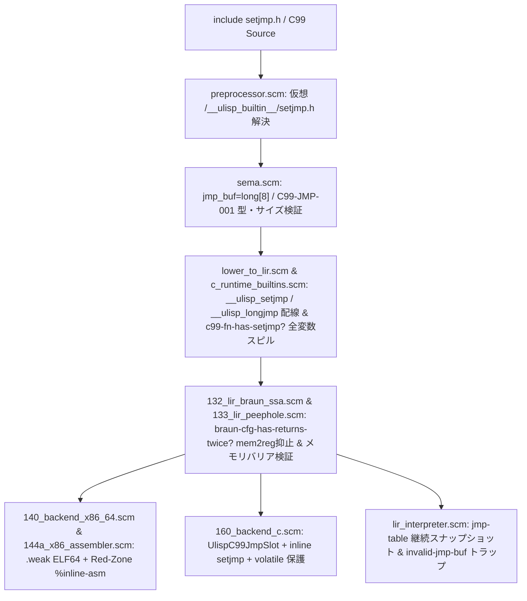
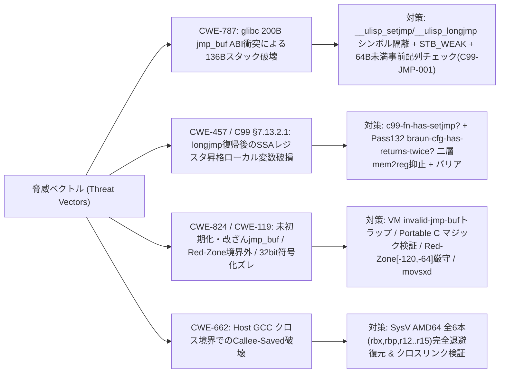

# [FEAT/ENH] 非局所脱出 (`setjmp` / `longjmp`) の `%inline-asm` 実装および呼び出し関数内の生存変数スピル保護 (ID: 922)

## 1. 概要 / Summary

Lua 5.x のエラー回復機構（`ldo.c`: `luaD_rawrunprotected`, `LUAI_TRY`, `LUAI_THROW`, `lua_pcall`, `lua_error`）および ISO C99 §7.13 準拠の非局所脱出を支えるため、`setjmp` / `_setjmp` / `sigsetjmp` および `longjmp` / `_longjmp` / `siglongjmp` を Issue #838 の `%inline-asm` 基盤を用いて x86-64 System V ABI 準拠で実装する（Phase S3 / Task T10）。あわせて、`setjmp`（`returns_twice` 属性相当）を含む関数において、`longjmp` 復帰後に壊れてはならないローカル変数をレジスタ昇格させずスタックフレームへ保持する保護規約（ISO C99 §7.13.2.1）をフロントエンドおよび Pass 132 Braun SSA へ二層で組み込み、Native ELF / Portable C / Reference LIR VM の 3 バックエンドで意味論を完全一致させる：

1. **組み込み `<setjmp.h>` の新設とプリプロセッサ／意味解析統合**:
   - [ulisp/frontend_c/include/setjmp.h](../../../ulisp/frontend_c/include/setjmp.h) を新設し、`typedef long jmp_buf[8];`、`typedef long sigjmp_buf[8];`（64 バイト / 8 バイト整列）、および `setjmp` / `_setjmp` / `sigsetjmp` / `longjmp` / `_longjmp` / `siglongjmp` のプロトタイプを提供する。
   - [ulisp/frontend_c/preprocessor.scm](../../../ulisp/frontend_c/preprocessor.scm) の `make-default-cpp-context` に仮想ファイル `/__ulisp_builtin__/setjmp.h` を登録し、ドライバ・単体 CPP 実行の双方で外部パス無しに `#include <setjmp.h>` が機能するようにする（`-isystem` / `-I` 上書き優先順序を維持）。
   - [ulisp/frontend_c/sema.scm](../../../ulisp/frontend_c/sema.scm) に `setjmp` 系・`longjmp` 系プロトタイプを事前登録し、引数個数・型（退化前配列 `< 64B` の境界外書込み防御を含む）・整数第 2 引数を検査して診断コード `"C99-JMP-001"` を発行する。
2. **専用ランタイムモジュール ([ulisp/lib/c_runtime_builtins.scm](../../../ulisp/lib/c_runtime_builtins.scm)) による `%inline-asm` 実装と glibc ABI 衝突隔離**:
   - [ulisp/lib/c_runtime_builtins.scm](../../../ulisp/lib/c_runtime_builtins.scm) を新設し、`%inline-asm` ベースの純粋 `L_lir_core` / `L_lir_canonical` 関数 `__ulisp_setjmp` および `__ulisp_longjmp` を定義する。
   - 翻訳単位内にユーザー自身の `setjmp` / `longjmp` 定義が存在しない場合のみ、`setjmp`/`_setjmp`/`sigsetjmp` 呼び出し（および関数アドレス参照）を `__ulisp_setjmp` へ、`longjmp`/`_longjmp`/`siglongjmp` を `__ulisp_longjmp` へルーティングし、必要なビルドイン関数のみをオンデマンド注入する（将来の `#928` musl libc 自前ビルドでの実装差し替えを阻害しない）。
   - 独自のシンボル名 `__ulisp_setjmp` / `__ulisp_longjmp` と [ulisp/backend/140_backend_x86_64.scm](../../../ulisp/backend/140_backend_x86_64.scm) の弱シンボル（`.weak` + `.globl` → `STB_WEAK`）出力により、**ホスト glibc の 200 バイト `jmp_buf` + `PTR_MANGLE` 実装とのリンク衝突（64 バイトバッファへの 136 バイト超過スタック破壊）および複数 TU 分割コンパイル時の多重定義エラーを根本回避**する。
3. **`returns_twice` 関数内の生存変数スピル保護（二層防御 ＋ メモリバリア）**:
   - フロントエンド [ulisp/frontend_c/lower_to_lir.scm](../../../ulisp/frontend_c/lower_to_lir.scm) に `c99-fn-has-setjmp?` 解析を追加し、`setjmp` / `_setjmp` / `sigsetjmp` / `__ulisp_setjmp` を呼ぶ関数では `c99-collect-escaped-bindings` が全ローカル変数・仮引数をエスケープ扱いに強制し、`c99-function-candidate-mem2reg-offsets` が空リスト `'()` を返すようにする。
   - ミドルエンド [ulisp/lir/132_lir_braun_ssa.scm](../../../ulisp/lir/132_lir_braun_ssa.scm) にも `braun-cfg-has-returns-twice?` ガードを追加し、`braun-promote-alloca-to-ssa` が直接呼ばれた場合もプロモーションを防御的に抑止する。また [ulisp/lir/133_lir_peephole.scm](../../../ulisp/lir/133_lir_peephole.scm) の既存 `lir-inst-memory-barrier?` が `%direct-call __ulisp_setjmp` および `:volatile? #t` な `%inline-asm` を跨ぐ Store-Reload Forwarding を遮断することを検証する。
4. **3 バックエンド完全同等性（Native x86-64 ELF / Portable C / Reference LIR VM）**:
   - **Native x86-64 ELF**（[ulisp/backend/140_backend_x86_64.scm](../../../ulisp/backend/140_backend_x86_64.scm) / [ulisp/backend/144a_x86_assembler.scm](../../../ulisp/backend/144a_x86_assembler.scm)）: Red-Zone 内退避制約、`movsxd`/`test`/`cmove` 分岐レス値正規化、`STB_WEAK` 複数 TU リンク、Host GCC との相互アンワインド。
   - **Portable C**（[ulisp/backend/160_backend_c.scm](../../../ulisp/backend/160_backend_c.scm)）: `UlispC99JmpSlot` プール（1024 スロット、マジック検証・同一 `env_addr` スロット再利用）と、`(%direct-call __ulisp_setjmp ...)` 箇所でのインラインホスト `setjmp` + `volatile` スロットポインタ経由での `reg_rsp`/Callee-Saved 復元、`ulisp_c99_fn___ulisp_longjmp` 実装。
   - **Reference LIR VM**（[ulisp/vm/lir_interpreter.scm](../../../ulisp/vm/lir_interpreter.scm)）: `<lir-vm>` へ `jmp-table` を追加し、`%direct-call`/`%call-indirect`/`%c-call` 経由で `vm-exec-setjmp!` / `vm-exec-longjmp!` を実行するとともに、未初期化・破損 `jmp_buf` に対して `invalid-jmp-buf` トラップを発行する。
   - **マルチ TU マージ**（[ulisp/driver/c_driver.scm](../../../ulisp/driver/c_driver.scm)）: `c99-merge-lir-programs` において複数翻訳単位由来の `__ulisp_setjmp` / `__ulisp_longjmp` 定義重複を除去する。

### 前後 Issue との責務境界
- **先行 Issue ([[#919]](919-implement-c99-pointer-scaling-array-decay-and-escape-analysis.md)) の責務**: ポインタ演算スケーリング、配列退化（`jmp_buf` → `long *`）、およびエスケープ解析（`c99-collect-escaped-bindings` / `c99-function-candidate-mem2reg-offsets`）基盤の構築。
- **先行 Issue ([[#920]](920-implement-c99-function-pointers-and-switch-goto-cfg-lowering.md)) の責務**: 関数ポインタ型解決、`%call-indirect`、および Pass 132 Braun SSA CFG ブリッジ（`c99-lir-fn->braun-cfg` / `c99-braun-ssa-transform-fn`）の構築。
- **先行 Issue ([[#921]](921-implement-sysv-amd64-stdarg-va-list-lowering.md)) の責務**: `<stdarg.h>` 組み込みヘッダ仮想解決、176B Register Save Area、および `lua_pushfstring` / `luaL_error` の可変長引数基盤。
- **本 Issue (`#922`) の責務**: `<setjmp.h>` 提供、`%inline-asm` による 64B `jmp_buf` 退避/復元、`__ulisp_setjmp`/`__ulisp_longjmp` の glibc 隔離・弱シンボル化、`returns_twice` 関数の二層 mem2reg スピル保護、診断 `C99-JMP-001`、および Native ELF / Portable C / Reference VM 3 者一致と Host GCC 相互アンワインド確立。
- **後続 Issue ([[#925]](925-build-lua-5x-c-codebase-compilation-pipeline-with-ulisp.md), [[#926]](../926-verify-lua-5x-official-test-suite-e2e-selfhost-ci.md)) の責務**: Lua 5.x 全 C ソース群（`ldo.c` の `luaD_rawrunprotected` / `luaD_throw` 含む）一括ビルドおよび公式 `errors.lua` 含む E2E テストスイート完走。
- **後続 Issue ([[#928]](../928-compile-musl-libc-with-ulisp-and-migrate-to-pass-144-elf-linker.md)) の責務**: `musl libc` 自前ビルドおよび Pass 144 ELF リンカ移行（TU 内ユーザー定義 `setjmp` がある場合は本 Issue のルーティングを自動抑止し、弱シンボルを上書き可能にする）。

---

## 2. トレーサビリティ / Traceability

- 関連設計書:
  - [DSN-33-32 §4.2](../../designs/DSN-33-32-ulisp_lua_c_codebase_compilation_and_self_hosting_architecture.md)（非局所脱出 `setjmp`/`longjmp` の `%inline-asm` 実装と `luaD_rawrunprotected`）
  - [DSN-33-13 §2.4, §4.1, §6.1, §6.2](../../designs/DSN-33-13-ulisp_typed_machine_lir_and_multi_target_backend_architecture.md)（`%inline-asm` 制約、Pass 132 Braun SSA 生存変数管理、Reference VM ＆ Portable C 同期）
  - [DSN-33-11 §4.2, §4.3](../../designs/DSN-33-11-ulisp_multilingual_frontend_and_ctfe_architecture.md)（C99 意味解析、診断コード体系、Core LIR Lowering）
- 前提基盤（実装済・先行）:
  - `#827`: Pass 132 Braun SSA（[[#827]](827-generalize-pass-132-braun-ssa-for-arbitrary-cfg-and-goto.md) / [ulisp/lir/132_lir_braun_ssa.scm](../../../ulisp/lir/132_lir_braun_ssa.scm)）
  - `#833`: 統合診断レポータ（[[#833]](833-implement-unified-pretty-diagnostic-reporter-for-compiler-and-runtime.md) / [ulisp/compiler/diagnostic.scm](../../../ulisp/compiler/diagnostic.scm)）
  - `#834`: Reference LIR VM（[[#834]](834-implement-pure-scheme-lir-reference-vm-interpreter.md) / [ulisp/vm/lir_interpreter.scm](../../../ulisp/vm/lir_interpreter.scm)）
  - `#838`: `%inline-asm`（[[#838]](838-integrate-inline-assembly-dialect-with-register-constraints-into-lir.md) / [ulisp/backend/140_backend_x86_64.scm](../../../ulisp/backend/140_backend_x86_64.scm)）
  - `#914`: 純粋 Scheme C99 プリプロセッサ（[[#914]](914-implement-pure-scheme-c99-preprocessor-cpp.md)）
  - `#917`: C コンパイラドライバ ＆ ホストリンカ連携（[[#917]](917-implement-c-compiler-driver-and-host-ld-integration.md)）
  - `#919`: エスケープ解析・配列退化（[[#919]](919-implement-c99-pointer-scaling-array-decay-and-escape-analysis.md)）
  - `#920`: 関数ポインタ間接呼出 ＆ 複雑 CFG Lowering（[[#920]](920-implement-c99-function-pointers-and-switch-goto-cfg-lowering.md)）
  - `#921`: `<stdarg.h>` SysV ABI Lowering（[[#921]](921-implement-sysv-amd64-stdarg-va-list-lowering.md)）
- 後続連携 Issue:
  - [[#925]](925-build-lua-5x-c-codebase-compilation-pipeline-with-ulisp.md)（Lua 5.x C コードベース一括ビルド）
  - [[#926]](../926-verify-lua-5x-official-test-suite-e2e-selfhost-ci.md)（Lua 公式テストスイート `errors.lua` 例外テスト）
  - [[#928]](../928-compile-musl-libc-with-ulisp-and-migrate-to-pass-144-elf-linker.md)（`musl libc` 自前ビルド ＆ Pass 144 ELF リンカ移行）

---

## 3. 影響範囲と関連ファイル / Scope and Affected Files

### 組み込みヘッダ・プリプロセッサ・ドライバ
- [x] [ulisp/frontend_c/include/setjmp.h](../../../ulisp/frontend_c/include/setjmp.h)（新規: `typedef long jmp_buf[8];`、`typedef long sigjmp_buf[8];`、および `setjmp`/`_setjmp`/`sigsetjmp`/`longjmp`/`_longjmp`/`siglongjmp` プロトタイプ）
- [x] [ulisp/frontend_c/preprocessor.scm](../../../ulisp/frontend_c/preprocessor.scm)（`make-default-cpp-context` への `*c99-builtin-setjmp-h*` および仮想パス `/__ulisp_builtin__/setjmp.h` 登録）
- [x] [ulisp/driver/c_driver.scm](../../../ulisp/driver/c_driver.scm)（`c99-merge-lir-programs` における複数 TU 間の `__ulisp_setjmp` / `__ulisp_longjmp` 重複定義の単一化マージ）

### C99 意味解析・ランタイム組み込み・LIR Lowering・最適化保護
- [x] [ulisp/lib/c_runtime_builtins.scm](../../../ulisp/lib/c_runtime_builtins.scm)（新規: `%inline-asm` ベース `__ulisp_setjmp` / `__ulisp_longjmp` 定義、`jmp_buf` 定数、関数シンボル判定・変換ヘルパ）
- [x] [ulisp/frontend_c/sema.scm](../../../ulisp/frontend_c/sema.scm)（`make-c99-sema-env` への `setjmp`/`longjmp` 系プロトタイプ登録、事前配列サイズ `< 64B`・ポインタ型・引数個数検査および診断 `"C99-JMP-001"`）
- [x] [ulisp/frontend_c/lower_to_lir.scm](../../../ulisp/frontend_c/lower_to_lir.scm)（`c99-fn-has-setjmp?`、`c99-collect-escaped-bindings` 全変数エスケープ強制、`c99-function-candidate-mem2reg-offsets` の `'()` 返却、`c99-lir-fn->braun-cfg` 防御チェック、呼び出し・`c-fn-ref` の `__ulisp_setjmp`/`__ulisp_longjmp` ルーティングとオンデマンド注入）
- [x] [ulisp/lir/132_lir_braun_ssa.scm](../../../ulisp/lir/132_lir_braun_ssa.scm)（`braun-cfg-has-returns-twice?` 解析および `braun-promote-alloca-to-ssa` の防御的バイパス）
- [x] [ulisp/lir/133_lir_peephole.scm](../../../ulisp/lir/133_lir_peephole.scm)（既存 `lir-inst-memory-barrier?` が `%direct-call __ulisp_setjmp` および `:volatile? #t` `%inline-asm` を跨ぐ Store-Reload Forwarding を遮断することの回帰検証）

### バックエンド・Reference VM
- [x] [ulisp/backend/140_backend_x86_64.scm](../../../ulisp/backend/140_backend_x86_64.scm)（`select-instructions-function` における `c-tu` モードでの weak builtin `.weak` 出力、`lower-lir-inline-asm` Red-Zone 内退避の検証）
- [x] [ulisp/backend/144a_x86_assembler.scm](../../../ulisp/backend/144a_x86_assembler.scm)（`movsxd` / `test esi, esi` / `cmove rax, rcx` / `lea rdx, [rsp + 8]` / `mov rdx, [rsp]` / `mov rsp, [rdi + 48]` / `jmp rdx` / `.weak` の ELF64 `STB_WEAK` 生成整合検証）
- [x] [ulisp/backend/160_backend_c.scm](../../../ulisp/backend/160_backend_c.scm)（`UlispC99JmpSlot` プール、`(%direct-call __ulisp_setjmp ...)` でのインラインホスト `setjmp` + `volatile` スロット退避復元、`ulisp_c99_fn___ulisp_longjmp` 実装、および間接 `setjmp` 禁止ガード）
- [x] [ulisp/vm/lir_interpreter.scm](../../../ulisp/vm/lir_interpreter.scm)（`<lir-vm>` へ `jmp-table` 追加、`lir-vm-load!` リセット、`vm-exec-setjmp!` / `vm-exec-longjmp!` による `%direct-call`/`%call-indirect`/`%c-call` 処理、未初期化・破損 `jmp_buf` トラップ）

### テスト・ビルド
- [x] [ulisp/tests/test_c99_setjmp_longjmp.scm](../../../ulisp/tests/test_c99_setjmp_longjmp.scm)（新規: Reference VM + LIR Verifier + Braun SSA スピル保護 + `C99-JMP-001` 診断 + 不正 `jmp_buf` トラップ単体テスト）
- [x] [ulisp/tests/test_c99_setjmp_longjmp.sh](../../../ulisp/tests/test_c99_setjmp_longjmp.sh)（新規: Host GCC `-O2` vs Native ELF `-O0`/`-O2` vs Portable C `-O0`/`-O2` 3 者差分一致、非 `volatile` ローカル保持、`-S` アセンブリ検証、複数 TU `-c` weak リンク、Host GCC ↔ ULisp クロス境界アンワインド検証）
- [x] [ulisp/Makefile](../../../ulisp/Makefile)（`C99_FRONTEND_SOURCES` への `lib/c_runtime_builtins.scm` 追加、`test_c99_setjmp_longjmp` ターゲットおよび `.PHONY` / `test` 集約への登録）

---

## 4. 実装方針 / Implementation Plan

Target Branch: `feat/922-implement-setjmp-longjmp-inline-asm`

> [!IMPORTANT]
> **ULisp AOT コーディング規約（厳守）**:
> すべての `.scm` 変更においてローカル変数への `set!` を一切使用しないこと（可変ボックス `(cons init '())` + `set-car!`、レコードセッタ、ベクタ、または純粋関数型アキュムレータを使用する）。また、`L_c_typed` の 6 要素 `c-typed-fn` 構造や `L_lir_core` の `%lir-function` スキーマを壊さず、ドキュメント内のリンクはすべて相対パスのみを使用すること。



### 4.1 組み込み `<setjmp.h>` とプリプロセッサ統合 (`setjmp.h`, `preprocessor.scm`)

1. **`ulisp/frontend_c/include/setjmp.h` の新設**:
   ```c
   /* ULisp C99 Built-in <setjmp.h> (ISO C99 §7.13 & SysV AMD64 ULisp 64B ABI) */
   #ifndef _ULISP_SETJMP_H
   #define _ULISP_SETJMP_H

   /* 64-byte context buffer: rbx, rbp, r12, r13, r14, r15, rsp(+8), rip */
   typedef long jmp_buf[8];
   typedef long sigjmp_buf[8];

   int setjmp(jmp_buf env);
   int _setjmp(jmp_buf env);
   int sigsetjmp(sigjmp_buf env, int savemask);
   void longjmp(jmp_buf env, int val);
   void _longjmp(jmp_buf env, int val);
   void siglongjmp(sigjmp_buf env, int val);

   #endif /* _ULISP_SETJMP_H */
   ```
   - `typedef long jmp_buf[8];` は SysV AMD64 上で 64 バイト・8 バイト整列（`sizeof(jmp_buf) == 64`, `_Alignof(jmp_buf) == 8`）となり、ローカル変数や `struct lua_longjmp { struct lua_longjmp *previous; jmp_buf b; volatile int status; };` へ埋め込んだ際に自然な配列退化（`jmp_buf` 仮引数・実引数 → `long *`）を行う。
2. **`preprocessor.scm` (`make-default-cpp-context`) での仮想ヘッダ登録**:
   - `#921` の `*c99-builtin-stdarg-h*` と同一パターンで `*c99-builtin-setjmp-h*` を定義し、`make-default-cpp-context` 内で `(cpp-register-virtual-file! ctx "/__ulisp_builtin__/setjmp.h" *c99-builtin-setjmp-h*)` を実行する。
   - これにより `ulisp/frontend_c/include/setjmp.h` のディスク解決とリポジトリ外実行時の仮想ファイルフォールバックの双方が機能し、`-isystem` / `-I` 指定時は外部ヘッダが優先される。

### 4.2 意味解析 (`sema.scm`) と診断コード (`C99-JMP-001`)

1. **`make-c99-sema-env` への外部プロトタイプ事前登録**:
   - `<setjmp.h>` を暗黙参照または明示インクルードしたコードの双方に対応するため、`make-c99-sema-env` で `i64*` (`(make-c-ptr-type 'i64)`) を第 1 引数型として以下の 6 関数を `sema-register-fn!` で登録する：
     - `setjmp`, `_setjmp`: `(make-c-fn-type 'i32 (list (make-c-ptr-type 'i64)) #f)`
     - `sigsetjmp`: `(make-c-fn-type 'i32 (list (make-c-ptr-type 'i64) 'i32) #f)`
     - `longjmp`, `_longjmp`, `siglongjmp`: `(make-c-fn-type 'void (list (make-c-ptr-type 'i64) 'i32) #f)`
   - 加えて内部ターゲット `'__ulisp_setjmp` / `'__ulisp_longjmp` も必要に応じて解決可能にする。
2. **`%sema-analyze-setjmp-longjmp-call` による型・境界検査と `C99-JMP-001`**:
   - `c99-analyze-expr` の `(c-call ...)` 分岐において、呼び出し先が `c-var-ref` かつ名前空間上でローカル変数にシャドウされていない関数（`(eq? (car ent) 'fn)`）であり、かつ関数名が `setjmp`, `_setjmp`, `sigsetjmp`, `longjmp`, `_longjmp`, `siglongjmp` のいずれかである場合のみ専用検証を実行する（ローカル変数シャドウ時は通常呼出・エラー経路を維持）。
   - 検証項目（違反時は即座に `"C99-JMP-001"` を報告）：
     1. **引数個数一致**: `setjmp` / `_setjmp` は 1 個、`sigsetjmp` / `longjmp` / `_longjmp` / `siglongjmp` は 2 個。
     2. **退化前配列サイズ防御（CWE-787 境界外書込み防止）**: 第 1 引数の退化前型が `(c-array-type? raw-ty)` の場合、`c-type-size-in` が `64` バイト未満（例: `long small[4]; setjmp(small);` や `char buf[32];`）であれば `"C99-JMP-001"` で拒否する。
     3. **第 1 引数型互換性**: 配列退化後の型が `(ptr i64)` と厳密互換（`c-types-exact-compatible?`）でなければならない（`int *`、`void *`、構造体値渡し、整数リテラル等はすべて `"C99-JMP-001"` — `void *` の暗黙変換を許さないことで誤型ポインタへの 64B 書込みを遮断）。
     4. **第 2 引数型検査**（`sigsetjmp` / `longjmp` / `_longjmp` / `siglongjmp`）: 第 2 引数が整数型（`c-integer-type?`）に暗黙変換可能であること。

| 診断コード | トリガー条件 | エラーメッセージ例 |
| :--- | :--- | :--- |
| **`C99-JMP-001`** | 引数個数不一致、退化前配列が 64 バイト未満、第 1 引数が `jmp_buf` (`long[8]` / `long *`) 非互換（`int *`, `void *`, 非ポインタ）、第 2 引数が整数型でない | `"First argument to 'setjmp' must be jmp_buf (at least 64 bytes / long[8])"` / `"Function 'longjmp' expects 2 arguments"` |

### 4.3 `%inline-asm` ベース `setjmp` / `longjmp` 実装 (`ulisp/lib/c_runtime_builtins.scm`) と x86-64 ABI 設計

1. **`jmp_buf` 64 バイトレイアウト (System V AMD64)**:
   | スロット | バイトオフセット | 保存内容 | 役割 |
   | :---: | :---: | :--- | :--- |
   | `0` | `+0` | `rbx` | Callee-Saved GPR |
   | `1` | `+8` | `rbp` | Callee-Saved Frame Pointer |
   | `2` | `+16` | `r12` | Callee-Saved GPR |
   | `3` | `+24` | `r13` | Callee-Saved GPR |
   | `4` | `+32` | `r14` | Callee-Saved GPR |
   | `5` | `+40` | `r15` | Callee-Saved GPR |
   | `6` | `+48` | `rsp + 8` | 呼び出し直前の呼出元スタックポインタ (`call` によるリターンアドレス積載前) |
   | `7` | `+56` | `*(rsp)` | `call __ulisp_setjmp` が積んだ戻りアドレス (`rip`) |

2. **`ulisp/lib/c_runtime_builtins.scm` の純粋 `L_lir_core` 定義**:
   - 定数・述語を単一真実源として集約する：
     - `*c99-jmp-buf-size*` (`64`), `*c99-setjmp-fn-names*` (`'(setjmp _setjmp sigsetjmp)`), `*c99-longjmp-fn-names*` (`'(longjmp _longjmp siglongjmp)`), `(c99-setjmp-builtin-sym? sym)`, `(c99-map-setjmp-builtin-target sym defined-fn-syms)`.
   - **`__ulisp_setjmp(env)`**（`frame-size 0`, `:outputs (((%reg %rax) "=a"))`, `:inputs (((%reg %rdi) "D"))`, `:clobbers ("%rdx" "cc" "memory")`, `:volatile? #t`）:
     ```scheme
     (define (make-c99-builtin-setjmp-lir)
       (list '%lir-function
             '__ulisp_setjmp
             '(params (env))
             '(frame-size 0)
             '(body
               (%inline-asm
                 "mov [rdi + 0], rbx\nmov [rdi + 8], rbp\nmov [rdi + 16], r12\nmov [rdi + 24], r13\nmov [rdi + 32], r14\nmov [rdi + 40], r15\nlea rdx, [rsp + 8]\nmov [rdi + 48], rdx\nmov rdx, [rsp]\nmov [rdi + 56], rdx\nxor eax, eax"
                 (:outputs (((%reg %rax) "=a")))
                 (:inputs  (((%reg %rdi) "D")))
                 (:clobbers ("%rdx" "cc" "memory"))
                 (:volatile? #t))
               (%return %rax))))
     ```
   - **`__ulisp_longjmp(env, val)`**（`frame-size 0`, `:inputs (((%reg %rdi) "D") ((%reg %rsi) "S"))`, `:clobbers ("%rax" "%rcx" "%rdx" "cc" "memory")`, `:volatile? #t`）:
     ```scheme
     (define (make-c99-builtin-longjmp-lir)
       (list '%lir-function
             '__ulisp_longjmp
             '(params (env val))
             '(frame-size 0)
             '(body
               (%inline-asm
                 "movsxd rax, esi\nmov rcx, 1\ntest esi, esi\ncmove rax, rcx\nmov rbx, [rdi + 0]\nmov rbp, [rdi + 8]\nmov r12, [rdi + 16]\nmov r13, [rdi + 24]\nmov r14, [rdi + 32]\nmov r15, [rdi + 40]\nmov rdx, [rdi + 56]\nmov rsp, [rdi + 48]\njmp rdx"
                 (:inputs  (((%reg %rdi) "D")
                            ((%reg %rsi) "S")))
                 (:clobbers ("%rax" "%rcx" "%rdx" "cc" "memory"))
                 (:volatile? #t))
               (%return %rax))))
     ```
3. **LIR Verifier・Backend・Assembler 不変条件の厳密整合**:
   - **Verifier (`lir_verifier.scm` THREAT-838-1)**: `%inline-asm` の `:outputs` / `:clobbers` に `%rsp` は含めない（テンプレート内部での `lea rdx, [rsp + 8]` / `mov rsp, [rdi + 48]` / `jmp rdx` により制御を直接転送する）。
   - **Prologue ゼロ・Red-Zone 安全 (`140_backend_x86_64.scm`)**: `c-tu` モードの `select-instructions-function` はプロローグ（`sub rsp` / `push`）を発行しないため、関数エントリ直後の `[rsp]` が正確にリターンアドレス、`rsp + 8` が呼出元 `rsp` となる。さらに `lower-lir-inline-asm` は `frame-size = 0` 時に scratch 保存スロットを `[rsp - 64]` 〜 `[rsp - 120]` に配置し `push`/`pop` を一切使わないため、SysV AMD64 128 バイト Red Zone 内で完結し、`[rsp]` / `rsp + 8` とのオフセット不変条件を破壊しない。なお `__ulisp_longjmp` テンプレート最後では `mov rsp, [rdi + 48]; jmp rdx` で即座に脱出するため、`lower-lir-inline-asm` エピローグが後続実行されることはなく、Callee-Saved 復元値が上書きされる心配もない（`:clobbers` へ `rbx/rbp/r12..r15` を入れるとエピローグが破壊する恐れがあるため、あえて `:clobbers` は `"%rax" "%rcx" "%rdx" "cc" "memory"` のみに限定し、実行されないフォールバック `ret` 用には問題を生じさせない）。
   - **値正規化 (`val == 0 -> 1` & 負値符号拡張)**: `movsxd rax, esi` + `mov rcx, 1` + `test esi, esi` + `cmove rax, rcx` により、ローカルラベル不要の分岐レス実装で `val == 0` を `1` へ、負値 `int`（例: `-5`）を符号拡張して `setjmp` 戻り値 `rax` へ引き渡す。
   - **弱シンボル (`STB_WEAK`) ＆ ユーザー定義優先**: `select-instructions-function`（`140_backend_x86_64.scm`）において `c-tu?` かつラベルが `__ulisp_setjmp` または `__ulisp_longjmp` の場合は `.type <sym>, @function` / `.weak <sym>` / `.globl <sym>` を出力する。既に `144a_x86_assembler.scm` および `elf64_builder.scm` は `.weak` → `STB_WEAK` (`bind = 2`) を実装済みであるため、複数 `.c` ファイルを `-c` で個別コンパイルして `ld`/`gcc` リンクしても重複定義エラーが発生せず、かつ `#928` で musl の `setjmp.c` をコンパイルする際（`fn-names` にユーザー自身の `setjmp`/`longjmp` 定義が存在する場合）は自前ルーティングを自動スキップして上書き可能とする。
   - **呼び出しルーティング (`lower_to_lir.scm` & `c_driver.scm`)**:
     - `%c99-lower-call!` において `direct-fn-sym` が `setjmp`/`_setjmp`/`sigsetjmp`/`longjmp`/`_longjmp`/`siglongjmp` かつユーザー定義の同名関数が翻訳単位に無い場合、`__ulisp_setjmp` または `__ulisp_longjmp` への `(%direct-call target-sym shift)` を発行し、使用フラグを `<c99-lower-ctx>` へ記録する（`sigsetjmp(env, savemask)` の第 2 引数は通常通り `%rsi` に評価・渡されるが `__ulisp_setjmp` は第 1 引数 `%rdi` のみを参照する）。関数ポインタ取得 `(c-fn-ref longjmp)` / `(c-fn-ref setjmp)` についても同様に `(%code-ref dst __ulisp_*)` へ変換し、`c99-lower-to-lir` の末尾で実際に参照された builtin 関数のみを `%lir-functions` へ注入する。
     - `c99-merge-lir-programs`（`c_driver.scm`）では複数 TU を結合する際、`__ulisp_setjmp` / `__ulisp_longjmp` が複数の TU に含まれていても先頭 1 件のみ残して重複を除去する。

### 4.4 `returns_twice` 関数内の生存変数スピル保護 (`lower_to_lir.scm`, `132_lir_braun_ssa.scm`, `133_lir_peephole.scm`)

ISO C99 §7.13.2.1 によれば、`setjmp` 呼び出しを含む関数内の非 `volatile` 自動変数が `setjmp` 後に書き換えられない場合、あるいは呼び出し間の状態保持を保証するためには、値が物理レジスタへ昇格され `longjmp` による Callee-Saved 復元やレジスタ上書きで陳腐化することを防ぐ必要がある（特に Lua `ldo.c` の `luaD_rawrunprotected` や実務 C コードのローカル変数）。

1. **フロントエンド AST 検出 (`lower_to_lir.scm`)**:
   - `(c99-fn-has-setjmp? fn-node)` を実装し、`fn-node` の本体 AST（`c-call` 呼び出し先 `c-fn-ref`/`c-var-ref` および関数ポインタ参照 `c-fn-ref`）を再帰走査して `setjmp`, `_setjmp`, `sigsetjmp`, `__ulisp_setjmp` の存在を検出する。
   - `c99-collect-escaped-bindings` は `(c99-fn-has-setjmp? fn-node)` が `#t` の場合、関数内のすべての仮引数およびローカル変数宣言（`c-decl`）の `u-sym` をエスケープ集合へ強制追加する。
   - `c99-function-candidate-mem2reg-offsets` も `(c99-fn-has-setjmp? fn-node)` が `#t` なら無条件に `'()` を返し、当該関数の全 `%alloca`（スタックスロット）に対する SSA レジスタ昇格を完全抑止する。
2. **ミドルエンド Pass 132 Braun SSA 防御ガード (`132_lir_braun_ssa.scm` & `lower_to_lir.scm`)**:
   - `(braun-cfg-has-returns-twice? cfg)` を `ulisp/lir/132_lir_braun_ssa.scm` へ実装し、CFG 内の全ブロック命令に `(%direct-call __ulisp_setjmp ...)`、`(%direct-call setjmp ...)`、`(%c-call "setjmp" ...)` 等の `returns_twice` 呼び出しが含まれるか走査する。
   - `braun-promote-alloca-to-ssa` の先頭および `c99-lir-fn->braun-cfg` の mem2reg 呼び出し前にこのチェックを配置し、`returns_twice` 関数に対しては常に `%store %rsp off` / `%load dst %rsp off` のままスタックフレーム上に保持する。
3. **Pass 133 Peephole 最適化の安全性検証 (`133_lir_peephole.scm`)**:
   - `nanopass_meta.scm` の `lir-inst-memory-barrier?` は `%direct-call`、`%call-indirect`、`%c-call`、および `:volatile? #t` の `%inline-asm` をすべてメモリバリアとして扱うため、`rule-lir-store-load-forward` が `setjmp` 呼出前後を跨いで古いレジスタ値を誤転送（Stale Forwarding）しないことをユニットテストで検証する。

### 4.5 Portable C バックエンド (`160_backend_c.scm`) ＆ Reference LIR VM (`lir_interpreter.scm`) 統合

1. **Portable C バックエンド (`ulisp/backend/160_backend_c.scm`)**:
   - Portable C は各 C 関数を `static void ulisp_c99_fn_X(void)` かつ仮想スタック `reg_rsp` 上のメモリ操作として出力するため、`__ulisp_setjmp` だけ別関数へ分割してホスト `setjmp()` を呼ぶと、そのフレームが返った瞬間にホスト C スタック上の `jmp_buf` が無効化される（ISO C99 §7.13.1.1 未定義動作）。
   - よって C バックエンドでは以下の 2 機構で完全エミュレーションする：
     1. **ランタイムヘッダプール (`UlispC99JmpSlot`)**: `c-tu` 出力時に `typedef struct { uint64_t magic; uint64_t env_addr; jmp_buf host_jb; char *saved_rsp; uint64_t saved_rbx, saved_rbp, saved_r12, saved_r13, saved_r14, saved_r15; } UlispC99JmpSlot;` と `ulisp_c99_jmp_pool[1024]`（マジック `0x554C4A4D50534C54ULL`）を出力する。
     2. **`(%direct-call __ulisp_setjmp ...)` のインライン展開 (`emit-c-instruction`)**:
        - 呼出サイトで `reg_rdi`（`env` アドレス）を受け取り、既存同一 `env_addr` スロットを再利用または空きスロットを割り当てる（ループ内 2000 回以上の `setjmp` 再突入でもプール枯渇しない）。
        - **重要安全策**: `_slot` を `UlispC99JmpSlot * volatile _slot` として宣言し、ホスト GCC `-O2` 最適化時の `-Wclobbered` およびレジスタ破壊を防止する。
        - `_slot->saved_rsp = reg_rsp;` および `saved_rbx`, `saved_r13`, `saved_r14`, `saved_r15` を退避し、仮想 `jmp_buf` 先頭 `*(uint64_t *)(uintptr_t)reg_rdi` へスロット識別トークンとマジックを記録した後、`int _sj = setjmp(_slot->host_jb);` を実行。`_sj != 0` の復帰時は `reg_rsp = _slot->saved_rsp;` と退避レジスタを復元し、`reg_rax = (uint64_t)(int64_t)_sj;` をセットする（初回は `reg_rax = 0`）。
     3. **`ulisp_c99_fn___ulisp_longjmp` 定義**: 直接呼出・関数ポインタ間接呼出の双方に対応するため実 C 関数として出力し、`env` (`reg_rdi`) のマジック・インデックス範囲検査（失敗時 `abort()`）を行った後、`val = (int)reg_rsi; if (val == 0) val = 1;` として `longjmp(_slot->host_jb, val)` を発行する。なお、間接呼出で万一 `ulisp_c99_fn___ulisp_setjmp` が呼ばれた場合は即 `abort()` するガードを出力する（C99 仕様上 `setjmp` の関数ポインタ呼び出しは UB）。

2. **Reference LIR VM (`ulisp/vm/lir_interpreter.scm`)**:
   - `<lir-vm>` レコードに `jmp-table` フィールドを追加（`make-lir-vm-with-size` で `'()` 初期化、`lir-vm-load!` でリセット）。
   - `vm-exec-setjmp! vm`:
     - `%rdi` から `env-addr`（0 や NULL ページ `< *lir-vm-null-page-limit*` なら `invalid-jmp-buf` トラップ）を読み取り、64B バッファ `[env+0..40]` に `rbx, rbp, r12, r13, r14, r15`、`[env+48]` に `cur-rsp`、`[env+56]` に一意な `jmp-token`（例: `(+ #x554C4A0000000000 next-id)`）を書き込む。
     - 注意：`lir-vm-step!` は `vm-dispatch-inst!` 実行**直前**に `(vm-set-pc! vm (+ pc 1))` で PC を進めているため、`%direct-call` / `%call-indirect` 時点で既に現在の `vm-current-fn`, `vm-pc`, `vm-current-block`, `vm-call-stack`, `cur-rsp` がそのまま呼び出し元復帰先コンテキストになっている。これを `jmp-table` へ `(cons jmp-token (list caller-fn caller-pc caller-rsp caller-call-stack caller-block))` として保存し、`%rax` へ `0` を設定して即座に呼び出し元へ返却する（関数本体へは入らない）。
   - `vm-exec-longjmp! vm`:
     - `%rdi` (`env-addr`) 検証後、`[env+56]` の `jmp-token` で `jmp-table` を検索。未初期化・ゼロ・不明トークンまたは整合不備（`[env+48]` と保存 `caller-rsp` の不一致等）であれば `(vm-trigger-trap! vm 'invalid-jmp-buf "Invalid or uninitialized jmp_buf in longjmp" env-addr)` を発生させる。
     - 有効であれば `%rsi` から 32bit 符号付き整数 `raw-val = (lir-vm-s32 (vm-get-reg vm '%rsi))` を取り出し、`0` なら `1` へ正規化して `%rax` にセット（64bit 符号拡張 `lir-vm-u64`）。
     - `[env+0..40]` から `rbx, rbp, r12, r13, r14, r15` を VM レジスタへ復元し、`vm-set-reg! vm '%rsp`, `vm-set-call-stack!`, `vm-set-current-fn!`, `vm-set-current-block!`, `vm-set-pc!` を復元する。
   - `%direct-call`, `%call-indirect`, `%c-call` の各ディスパッチ箇所（`vm-dispatch-inst!` / `vm-dispatch-c-call!`）で `__ulisp_setjmp` / `__ulisp_longjmp`（および外部 C シンボル名 `setjmp`/`_setjmp`/`sigsetjmp`/`longjmp`/`_longjmp`/`siglongjmp`）をインターセプトする。

### 4.6 セキュリティ・堅牢性設計 (Threat Model & Mitigations)



1. **glibc `jmp_buf` ABI 衝突による 136 バイト境界外書込み防御 (CWE-787)**:
   - *脅威*: Linux/glibc の `jmp_buf` はシグナルマスク・シャドウスタック等を含み 200 バイトを要求し、さらに `PTR_MANGLE` で `rsp`/`rip` を暗号化する。一方 ULisp `<setjmp.h>` の `jmp_buf` は 64 バイト（`long[8]`）であるため、同名の外部シンボル `setjmp`/`longjmp` を glibc へリンクすると 136 バイトのスタック／構造体破壊を招く。
   - *対策*: 組み込みシンボルを `__ulisp_setjmp` / `__ulisp_longjmp` へ完全隔離して自前 `%inline-asm` で完結させると同時に、`sema.scm` にて退化前配列が 64 バイト未満の場合や `void *`/`int *` 渡しを `"C99-JMP-001"` でコンパイル時遮断する。
2. **`longjmp` 復帰後の SSA 変数・最適化破壊防御 (CWE-457)**:
   - *脅威*: `setjmp` 後に変更された自動変数がレジスタ（特に呼び出し先で上書きされたレジスタや SSA Phi）へ昇格していると、`longjmp` 復帰時に値が巻き戻る／壊れる。
   - *対策*: フロントエンド (`c99-fn-has-setjmp?` → 全変数エスケープ＆`candidate-offsets = '()`) と Pass 132 Braun SSA (`braun-cfg-has-returns-twice?` → `braun-promote-alloca-to-ssa` スキップ) の二層で物理スタックスロット保持を強制し、Pass 133 `lir-inst-memory-barrier?` で呼出跨ぎ転送を遮断し、Portable C では `volatile` スロットポインタで `-O2` `-Wclobbered` を回避する。
3. **未初期化・改ざん `jmp_buf` ＆ Red-Zone / 値域バグ防御 (CWE-824 / CWE-119)**:
   - *脅威*: 未初期化 `jmp_buf` への `longjmp`、スタック領域を破壊する `push`/`pop`、または `longjmp(env, 0)` や負値 `int` の 64bit 上位ゴミ混入。
   - *対策*: Reference VM は `invalid-jmp-buf` トラップ、Portable C は 64bit マジック `0x554C4A4D50534C54ULL` と範囲検査 `abort()` で即時フェイルセーフとする。x86-64 アセンブリは `push`/`pop` 無し（Red-Zone `[-120, -64]` 内完結）と `movsxd rax, esi` + `test esi, esi` + `cmove` を徹底する。
4. **Host GCC クロス境界での Callee-Saved 保護 (CWE-662)**:
   - *脅威*: Host GCC でコンパイルされた関数（`rbx/rbp/r12..r15` を積極使用）を経由して ULisp の `longjmp` へ到達した際、呼出元レジスタが壊れる。
   - *対策*: `__ulisp_setjmp` / `__ulisp_longjmp` が SysV AMD64 全 6 本の Callee-Saved レジスタを厳密保存・復元することを、Host GCC 側で全 6 本を明示破壊（インラインアセンブリ clobber）するクロスリンクテストで実証する。

### 4.7 テスト・検証計画 (`test_c99_setjmp_longjmp.scm`, `test_c99_setjmp_longjmp.sh`, `Makefile`)

1. **単体・VM・診断・スピル保護テスト (`ulisp/tests/test_c99_setjmp_longjmp.scm`)**:
   - 基本挙動: `setjmp` 初回戻り値 `0`、`longjmp(env, 42)` → `42`、`longjmp(env, 0)` → `1`（ISO C99 §7.13.2.1 準拠）、負値 `longjmp(env, -7)` → `-7`。
   - 多段再帰アンワインド: 深度 15 の再帰関数最深部からの `longjmp` で中間フレームをすべて安全スキップ。
   - Lua `luaD_rawrunprotected` 互換ネスト保護チェーン: `struct lua_longjmp { struct lua_longjmp *previous; jmp_buf b; volatile int status; };` による 3 重 `LUAI_TRY` / `LUAI_THROW` ネストおよび外側ハンドラへの再送出。
   - ループ内再突入・各種渡し方: `for` ループ 2000 回反復での `setjmp` 再設定、`jmp_buf` 引数渡し・構造体メンバ渡し・配列要素、`void (*lj)(jmp_buf, int) = longjmp;` 関数ポインタ経由呼出、`_setjmp`/`_longjmp` ＆ `sigsetjmp`/`siglongjmp`。
   - **`returns_twice` スピル保護検証**:
     - `c99-fn-has-setjmp?` が `setjmp` 含有関数で `#t`、通常関数で `#f` となること。
     - `c99-collect-escaped-bindings` が非エスケープ純粋ローカル変数（例: `int x = 10;`）を含め全ローカルを捕捉し、`c99-function-candidate-mem2reg-offsets` が `'()` を返すこと。
     - `c99-lir-fn->braun-cfg` / `c99-braun-ssa-transform-fn` へ意図的に非空 `candidate-offsets` を渡しても `braun-cfg-has-returns-twice?` ガードにより `%store %rsp` / `%load ... %rsp` が保持され、生成 LIR が `L_lir_core?` と `validate-core-lir` を PASS し、Pass 133 `lir-peephole-optimize` 後も非 `volatile` ローカル更新値が保持されること。
   - **セキュリティ診断＆トラップ検証**:
     - `C99-JMP-001` 負例: `long small[4]`（`< 64B`）、`int *p`、`void *vp`、`setjmp()`（0 引数）、`longjmp(env)`（1 引数）、`longjmp(env, "str")`（非整数）。
     - 未初期化 `jmp_buf` への `longjmp` で Reference VM が `'invalid-jmp-buf` トラップを発生させること。

2. **3 者差分オラクル・`-S` アセンブリ・複数 TU・Host GCC クロスリンク (`ulisp/tests/test_c99_setjmp_longjmp.sh`)**:
   - **3 者差分一致**: Host GCC `-O2` オラクル vs ULisp Native ELF `-O0` / `-O2` vs ULisp Portable C `--target=c -O0` / `-O2` で、`longjmp(env, 0)`→`1`、負値、2000 回ループ再突入、Lua 風ネスト `luaD_rawrunprotected` テストプログラムの出力が完全一致すること。
   - **ULisp 非 `volatile` ローカル変数保護検証**: `int counter = 1; if (setjmp(env) == 0) { counter += 10; trigger(&env); }` 相当の非 `volatile` ローカル変数変更が `-O0` / `-O2`（Native ELF ＆ Portable C）双方で `longjmp` 復帰後に `11` として保持されることを検証（Host GCC の未定義最適化差を避けるため ULisp コンパイルターゲット間で検証）。
   - **`-S` アセンブリ出力検証**: `-S -O2` 出力に `__ulisp_setjmp:`・`.weak __ulisp_setjmp`・`mov [rdi + 0], rbx`・`lea rdx, [rsp + 8]`・`mov rdx, [rsp]`・`cmove rax, rcx`・`jmp rdx` が含まれ、標準 `setjmp@PLT` へのリンク依存が存在しないこと（`nm` / `readelf -Ws` 確認）。
   - **複数 TU 分割コンパイル (`-c`) 弱シンボルリンク**: `tu_a.c` と `tu_b.c` の双方で `setjmp`/`longjmp` を使用し、それぞれ `run_ucc -c -O2` で `.o` を生成して単一実行ファイルへリンクした際、`STB_WEAK` により多重定義エラー無しに正常動作すること（あわせて `--target=c` 複数 TU リンクも確認）。
   - **Host GCC ↔ ULisp 双方向クロス境界アンワインド（default PIE ＆ `-no-pie`）**: ULisp 側で `setjmp(env)` を呼び、Host GCC `-O2` 側関数（`__asm__` で `rbx, rbp, r12, r13, r14, r15` 全 6 本へゴミ値を書き込んでからコールバック）を経由して ULisp 側 `longjmp(env, 99)` を呼び出した後、ULisp 側ローカル変数および Host 側復帰後の後続実行が一切破損しないことを検証する。

3. **`ulisp/Makefile` 更新**:
   - `C99_FRONTEND_SOURCES` に `lib/c_runtime_builtins.scm` を追加し、`build/c_driver_runner.scm` および全 `test_c99_*` ランナーへ自動組み込みする。
   - `test_c99_setjmp_longjmp` ターゲットを `test_c99_stdarg` の直後に追加し、`scripts/lint_sexpr.py` チェック、Scheme テスト実行、および `bash tests/test_c99_setjmp_longjmp.sh` を実行する（`.PHONY` および `test` 集約ターゲットへも登録）。

---

## 5. 完了条件 / Success Criteria (DoD)

1. [x] **組み込み `<setjmp.h>` ＆ `C99-JMP-001` 意味検査**:
   - `#include <setjmp.h>` が単体 CPP および `c_driver.scm` 双方で外部システムパス無しに解決でき、`sizeof(jmp_buf) == 64`、`_Alignof(jmp_buf) == 8` が成立すること。
   - 64 バイト未満配列、非 `jmp_buf` ポインタ（`int *`, `void *`）、および引数不整合が診断 `"C99-JMP-001"` で拒否されること。
2. [x] **`%inline-asm` ベース `__ulisp_setjmp` / `__ulisp_longjmp` の x86-64 ABI ＆ glibc 隔離**:
   - `setjmp` 初回 `0` 返却および `longjmp(env, val)` 復帰値 `val != 0 ? val : 1`（負値含む）が ISO C99 §7.13 準拠で動作すること。
   - `__ulisp_setjmp` / `__ulisp_longjmp` が `.weak` (`STB_WEAK`) シンボルとして出力され、glibc 200B `setjmp` と衝突せず複数 TU `-c` リンクが成功すること。
   - Reference VM で未初期化・破損 `jmp_buf` への `longjmp` が `'invalid-jmp-buf` トラップを発生させること。
3. [x] **`returns_twice` 二層スピル保護**:
   - `setjmp` / `_setjmp` / `sigsetjmp` を含む関数ではフロントエンド（`c99-fn-has-setjmp?`）および Pass 132 Braun SSA（`braun-cfg-has-returns-twice?`）の双方でローカル変数・仮引数の mem2reg レジスタ昇格が完全抑止されること。
   - Pass 133 `lir-peephole-optimize` および `-O2` コンパイル後も、`setjmp` 前後で更新されたローカル変数および深い再帰後の呼び出し元ローカル変数が破損せず保持されること。
4. [x] **3 者差分一致・Lua 例外保護・Host GCC クロス境界検証**:
   - Lua `luaD_rawrunprotected` / `struct lua_longjmp` 相当のネスト例外保護コードおよび 2000 回ループ再突入が Reference VM、Native ELF（`-O0`/`-O2`）、Portable C（`--target=c -O0`/`-O2`）、Host GCC `-O2` オラクルで完全一致すること。
   - Host GCC 側で全 Callee-Saved レジスタ（`rbx, rbp, r12..r15`）を破壊する関数を跨いだ `longjmp` アンワインドが default PIE および `-no-pie` 双方で正常復帰すること。
5. [x] **品質ゲート・コード規約・回帰ゼロ**:
   - `make -C ulisp test_c99_setjmp_longjmp` が 100% PASS すること。
   - `make -C ulisp verify_zero_gauche test_lint_sexpr`、`make py_compile`、および既存の全 `test_c99_*` / `test_lir*` / `test_inline_asm` テストに回帰がないこと（新規ローカル `set!` ゼロ件、全ドキュメントリンク相対パスのみ）。

---

## 6. 検証手順 / Verification Procedure

### 6.1 単体・VM・診断・スピル保護テスト
```bash
make -C ulisp compiler.scm && make -C ulisp test_c99_setjmp_longjmp
```
- [test_c99_setjmp_longjmp.scm](../../../ulisp/tests/test_c99_setjmp_longjmp.scm) により、組み込み `<setjmp.h>`（仮想ファイルおよび `-isystem` 上書き）、ISO C99 `setjmp`/`longjmp` 基本・`0 -> 1` 正規化・負値・`_setjmp`/`sigsetjmp`、深度 15 再帰、Lua `luaD_rawrunprotected` 3 重ネスト回復＆再送出、2000 回ループ、`returns_twice` 二層スピル保護（`c99-fn-has-setjmp?`, `c99-collect-escaped-bindings`, `braun-cfg-has-returns-twice?`, Pass 133 バリア）、`C99-JMP-001` 診断、および Reference VM `invalid-jmp-buf` トラップを検証。

### 6.2 3 者差分オラクル・`-S` アセンブリ・複数 TU・Host GCC クロスリンク検証
```bash
bash ulisp/tests/test_c99_setjmp_longjmp.sh
```
- Host GCC `-O2`、ULisp Native ELF（`-O0`/`-O2`）、Portable C（`--target=c -O0`/`-O2`）の実行出力一致、非 `volatile` ローカル・引数の生存保持、`-S -O2` アセンブリおよび ELF `STB_WEAK` / 非 glibc `setjmp` 隔離確認、複数 TU `-c` 弱シンボルリンク（PIE / `-no-pie` / `--target=c`）、および Host GCC による Callee-Saved 全 6 本明示破壊下の双方向アンワインド（PIE / `-no-pie`）を検証。

### 6.3 総合回帰・品質ゲート
```bash
make py_compile && make -C ulisp verify_zero_gauche test_lint_sexpr test_c99_peg_grammar test_c99_lexer test_c99_preprocessor test_c99_parser test_c99_int_lowering test_c99_struct_union_layout test_c99_pointers_and_escape test_c99_funcptr_and_switch_cfg test_c99_stdarg test_c99_setjmp_longjmp test_c99_e2e test_sysv_abi_calls test_lir test_lir_interpreter test_lir_dialect_separation test_inline_asm test_passes
```

---

## 7. 実装完了サマリー / Completion Summary (2026-11-22)

- **単体・VM・診断・スピル保護テスト (`test_c99_setjmp_longjmp.scm`)**: **23 / 23 PASS**（0 failed）
  - `<setjmp.h>` 仮想＆ディスクヘッダ解決・`sizeof(jmp_buf)==64`・`-isystem` 上書き、`longjmp(env, 0)->1`・負値保存・`_setjmp`/`sigsetjmp`、深度 15 再帰、Lua `lua_longjmp` 3 重ネスト回復＆再送出、2000 回ループ、AST / Braun SSA / Pass 133 スピル保護、`C99-JMP-001` 診断（`<64B` 配列、`int[16]`/`void*`、引数不整合、ローカル変数シャドウ非誤爆）、Reference VM `'invalid-jmp-buf` トラップを確認。
- **3-Way Oracle・ASM/ELF・複数 TU・Host GCC クロスリンク検証 (`test_c99_setjmp_longjmp.sh`)**: **24 / 24 PASS**
  - Host GCC `-O2` vs Native ELF `-O0`/`-O2` vs Portable C `--target=c -O0`/`-O2` 出力完全一致、非 `volatile` ローカル変数保護（`-O0`/`-O2`）、`-S -O2` ＆ `readelf -Ws` での `__ulisp_setjmp`/`__ulisp_longjmp` `STB_WEAK` 確認・glibc `setjmp` 非依存、複数 TU `-c` 弱シンボルリンク（PIE / `-no-pie` / `--target=c`）、Host GCC 側 Callee-Saved 全 6 本破壊下の双方向アンワインド（default PIE & `-no-pie`）全件 PASS。
- **総合回帰・品質ゲート**: `make py_compile`、`verify_zero_gauche`、`test_lint_sexpr`（23 tests, 62 files S 式括弧整合）、`test_c99_peg_grammar`（20）、`test_c99_lexer`（75）、`test_c99_preprocessor`（32）、`test_c99_parser`（21）、`test_c99_int_lowering`（42）、`test_c99_struct_union_layout`（89）、`test_c99_pointers_and_escape`（39）、`test_c99_funcptr_and_switch_cfg`（28 + Oracle）、`test_c99_stdarg`（18 + Oracle 9/9）、`test_c99_e2e`（28 + Suite）、`test_sysv_abi_calls`（70）、`test_lir`（25）、`test_lir_interpreter`（65）、`test_lir_dialect_separation`（ALL PASS）、`test_inline_asm`（38/38）、`test_passes`（Pass 000〜160, External Symbols 14, Nanopass Per-Pass 165）全件 PASS（新規ローカル `set!` ゼロ件、`ulisp/bin/ulisp-boot` 無変更）。
