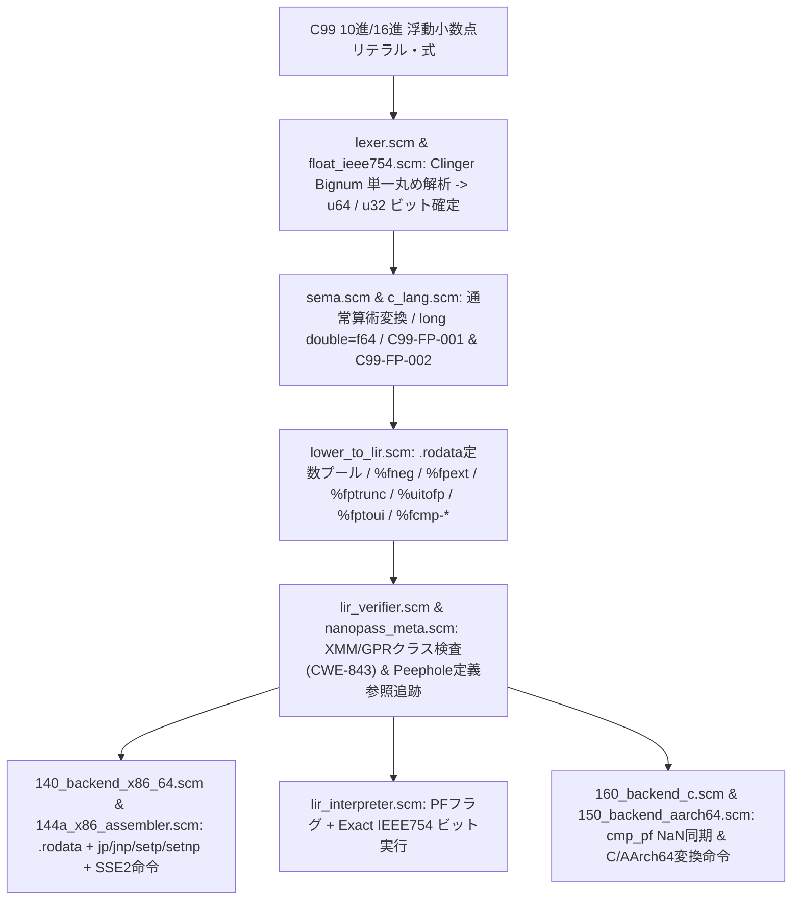
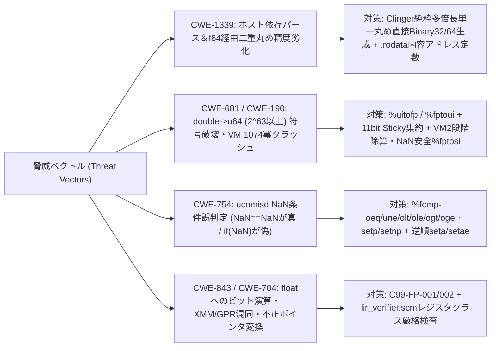

# [FEAT/ENH] C99 浮動小数点型 (`double`/`float`) の意味解析および IEEE 754 / LIR 型変換 Lowering の実装 (ID: 923)

## 1. 概要 / Summary

Lua 5.x のデフォルト数値型 `lua_Number`（`double` / `f64`）および単精度 `float`（`f32`）を C99 / IEEE 754-2008 仕様に完全準拠してコンパイル・実行するため、C99 フロントエンド・IEEE 754 定数エンコーダ・Core Machine LIR 浮動小数点命令群・Reference LIR VM・および各バックエンド（x86-64 / Portable C / AArch64）を一貫接続する（Phase S4 / Task T11）。

事前コード監査により、現行パイプラインには基本骨格（`c-type-f32`/`c-type-f64`, `c99-usual-arithmetic-type`, `%fadd`/`%fsub`/`%fmul`/`%fdiv`/`%fcmp`/`%sitofp`/`%fptosi`）が存在するものの、以下の **6 つの致命的ギャップ・不整合** が存在することが判明しているため、本 Issue で体系的に実装・是正する：

1. **決定論的 IEEE 754 定数エンコーダと 10/16 進リテラル精度 (`float_ieee754.scm` 新設 ＆ `ieee754.scm` / `lexer.scm` 連携)**:
   - 現行 [sema.scm](../../../ulisp/frontend_c/sema.scm) の `%c99-sema-parse-float` および [lexer.scm](../../../ulisp/frontend_c/lexer.scm) の `%c-decode-float-literal` はホスト処理系の `exact->inexact` に依存しており、極大・極小指数での中間オーバーフロー／非正規化数（Subnormal）精度落ちや、`float`（`f32`）への二重丸め（Double Rounding）を防ぐ術がない。
   - また [ulisp/lib/ieee754.scm](../../../ulisp/lib/ieee754.scm) は 10 進 `string->ieee754-u64` を持つが C99 の 16 進浮動小数点（`0x1.8p+1`, `0x1.fffffep+127f`）、`f32` 24bit 直接丸め、および `C99_FRONTEND_SOURCES` への組み込みが未接続である。
   - 解決策として、純粋 Bignum 有理数比較（Clinger's Algorithm）による C99 10 進・16 進両対応・単一丸め（Binary64 53bit / Binary32 24bit）エンコーダ [ulisp/frontend_c/float_ieee754.scm](../../../ulisp/frontend_c/float_ieee754.scm)（`C99_FRONTEND_SOURCES` 組み込み、かつ [ieee754.scm](../../../ulisp/lib/ieee754.scm) の定数・境界仕様と整合）を整備し、AST ノードに正確な 32bit/64bit IEEE 生ビットパターン（`u32`/`u64`）を確定保持させる。
2. **C99 意味解析の網羅 (`c_lang.scm` / `sema.scm`) ＆ 診断 `C99-FP-001` / `C99-FP-002`**:
   - `long double` 指定子（LP64 / 本処理系では `f64` エイリアスとして扱う）、通常の算術変換（ISO C99 §6.3.1.8）、診断コード `"C99-FP-001"`（浮動小数点型へのビット演算 `&`/`|`/`^`/`~`/`<<`/`>>`/`%` および複合代入 `&=`, `|=`, `^=`, `<<=`, `>>=`, `%=`）、および `"C99-FP-002"`（指数部欠落 16 進浮動小数点等の不正リテラル、ポインタ↔浮動小数点の不正キャスト）を実装する。
   - **既存バグ是正**: `1.0 / 0` のような浮動小数点型の 0 除算が `C99-SEMA-005` で誤拒否される問題を修正（IEEE 754 の `±Inf` / `NaN` 生成を許容）し、`int i += 2.5;` 等の異種型複合代入の型変換ノードを補完する。
3. **Core Machine LIR 浮動小数点拡張と Lowering バグ是正 (`lir_lang.scm`, `lir_verifier.scm`, `nanopass_meta.scm`, `lower_to_lir.scm`, `c_driver.scm`)**:
   - `L_lir_core` / `L_lir_raw` / `L_lir_canonical` へ **`%fneg`**（単項 `-` の符号ビット反転による `-0.0` 保存）、**`%fpext`** / **`%fptrunc`**、符号なし整数変換 **`%uitofp`** / **`%fptoui`**（`uint64_t` 全域 $[0, 2^{64}-1]$ 対応）、および IEEE 754 Ordered / Unordered 比較命令 **`%fcmp-oeq` / `%fcmp-une` / `%fcmp-olt` / `%fcmp-ole` / `%fcmp-ogt` / `%fcmp-oge`** を追加する。
   - 定数プールとして内容アドレス型 `.rodata` ラベル（`.L_c99_fp64_<16hex>` / `.L_c99_fp32_<8hex>`）を `data` セクションへ配置し、`c99-merge-lir-programs`（`c_driver.scm`）で複数 TU 間の重複ラベルを排除する。
   - **既存バグ是正**: ①単項 `-` の `0.0 - x` 問題（`-(+0.0)` が `+0.0` になるバグ）を `%fneg` で解消、②`float`/`double` に対する `pre++`/`pre--`/`post++`/`post--`、③`if`/`while`/`do-while`/`for`/`?:`/`&&`/`||` 条件式が浮動小数点型の場合に誤って `%cmp %rax 0` を吐く問題（`(%fcmp-une x 0.0)` 降格）、④`double` → `uint64_t`（$2^{63}$ 以上）への変換、`i64`/`u64` → `float` 変換の 11bit Sticky 集約による二重丸め回避、⑤`int += double` 複合代入、⑥静的初期値（`static double nz = -0.0;` 等）のビット厳密シリアライズを修正する。
4. **Reference LIR VM ＆ 3 バックエンド同期修正 (`lir_interpreter.scm`, `140_backend_x86_64.scm`, `144a_x86_assembler.scm`, `160_backend_c.scm`, `150_backend_aarch64.scm`)**:
   - Reference VM ([lir_interpreter.scm](../../../ulisp/vm/lir_interpreter.scm)) の既存 5 バグ（`vm-pow2-f64 1074` オーバーフローによる非正規化数クラッシュ、丸めの Round-to-Even 不整合、`-0.0` 符号消失、`%fptosi` の `NaN`/`Inf` クラッシュ、および `PF` パリティフラグ欠落）を修正し、新規 LIR 命令をサポートする。
   - x86-64 バックエンド＆アセンブラへ `PF` 分岐（`jp`/`jnp`/`setp`/`setnp`）と `.rodata` 定数セクション出力および新設命令群を実装し、Portable C（`cmp_pf` + 新規命令）・AArch64 バックエンドとも仕様同期する。

### 前後 Issue との責務境界
- **先行 Issue ([[#826]](826-introduce-typed-machine-lir-and-orthogonalize-boxing-operations.md), [[#832]](832-implement-pure-scheme-bignum-and-ieee-754-conversion-libraries.md), [[#913]](913-implement-c99-lexer-and-token-stream-with-source-span.md), [[#916]](916-implement-c99-sema-core-and-integer-subset-lir-lowering.md), [[#918]](918-implement-c99-struct-union-enum-bitfield-sysv-layout.md)) の責務**: Typed Machine LIR 基盤、Bignum/IEEE 754 基本ライブラリ、C99 Lexer 浮動小数点トークン認識、整数 C99 Sema/Lowering、および構造体/共用体（IEEE bit-punning `union` 含む）SysV レイアウト。
- **本 Issue (`#923`) の責務**: `float`/`double`（および `long double` エイリアス）の意味解析、10/16 進リテラルの純粋 Scheme 決定論的 IEEE 754 エンコード（`C99-FP-001`/`C99-FP-002`）、`.rodata` 定数プール、単項 `-` / `++`-- / 条件式 / `i64`/`u64`↔`f32`/`f64` 変換・比較（`NaN`/`±Inf`/`-0.0`）の Core LIR Lowering、および Reference VM / 基本 x86-64・Portable C 命令の同期確立。
- **後続 Issue ([[#924]](../924-verify-sse2-xmm-abi-and-floating-point-differential-fuzzing.md)) の責務**: 多数混合引数（9 個目以降のスタック渡し）、XMM レジスタ干渉グラフ彩色・スピル/リストア最適化、`libm`（`-lm`）外部数学関数リンク統合、および数千パターンの Reference VM / Native ELF / Portable C 3 者差分ファジング（`test_fuzz_xmm_float.sh`）。
- **後続 Issue ([[#925]](925-build-lua-5x-c-codebase-compilation-pipeline-with-ulisp.md), [[#926]](../926-verify-lua-5x-official-test-suite-e2e-selfhost-ci.md)) の責務**: Lua 5.x `lua_Number` / `lmathlib.c` / `lvm.c` 一括ビルドおよび公式テスト（`math.lua` 等）完走。

---

## 2. トレーサビリティ / Traceability

- 関連設計書:
  - [DSN-33-32 §2.1, §4.4, §6.1](../../designs/DSN-33-32-ulisp_lua_c_codebase_compilation_and_self_hosting_architecture.md)（Lua `lua_Number` 要件・XMM/IEEE 754 変換）
  - [DSN-33-11 §3.4, §4.2, §4.3](../../designs/DSN-33-11-ulisp_multilingual_frontend_and_ctfe_architecture.md)（C99 型昇格・通常算術変換・診断体系）
  - [DSN-33-13 §2.1, §3.2, §6.1, §6.2](../../designs/DSN-33-13-ulisp_typed_machine_lir_and_multi_target_backend_architecture.md)（Core Machine LIR 型制約、XMM 命令、Reference VM ＆ Portable C 同期）
- 前提基盤（実装済・先行）:
  - `#826`: Typed Machine LIR 導入（[[#826]](826-introduce-typed-machine-lir-and-orthogonalize-boxing-operations.md) / [ulisp/lir/lir_lang.scm](../../../ulisp/lir/lir_lang.scm)）
  - `#832`: 純粋 Scheme Bignum / IEEE 754 変換（[[#832]](832-implement-pure-scheme-bignum-and-ieee-754-conversion-libraries.md) / [ulisp/lib/ieee754.scm](../../../ulisp/lib/ieee754.scm)）
  - `#833`: 統合診断レポータ（[[#833]](833-implement-unified-pretty-diagnostic-reporter-for-compiler-and-runtime.md)）
  - `#834`: Reference LIR VM（[[#834]](834-implement-pure-scheme-lir-reference-vm-interpreter.md) / [ulisp/vm/lir_interpreter.scm](../../../ulisp/vm/lir_interpreter.scm)）
  - `#913`: C99 Lexer（[[#913]](913-implement-c99-lexer-and-token-stream-with-source-span.md) / [ulisp/frontend_c/lexer.scm](../../../ulisp/frontend_c/lexer.scm)）
  - `#916`: C99 Sema Core ＆ Lowering（[[#916]](916-implement-c99-sema-core-and-integer-subset-lir-lowering.md)）
  - `#918`: 構造体・共用体・ビットフィールド SysV レイアウト（[[#918]](918-implement-c99-struct-union-enum-bitfield-sysv-layout.md)）
  - `#922`: `setjmp`/`longjmp` `%inline-asm` ＆ 生存変数保護（[[#922]](922-implement-setjmp-longjmp-inline-asm-and-stack-spill-protection.md)）
- 後続連携 Issue:
  - [[#924]](../924-verify-sse2-xmm-abi-and-floating-point-differential-fuzzing.md)（SSE2 XMM レジスタ割当・`libm` ＆ 3 者差分ファジング）
  - [[#925]](925-build-lua-5x-c-codebase-compilation-pipeline-with-ulisp.md)（Lua 5.x C コードベース一括ビルド）
  - [[#926]](../926-verify-lua-5x-official-test-suite-e2e-selfhost-ci.md)（公式テストスイート `math.lua` 実証）

---

## 3. 影響範囲と関連ファイル / Scope and Affected Files

### IEEE 754 定数エンコーダ・C99 フロントエンド
- [x] [ulisp/frontend_c/float_ieee754.scm](../../../ulisp/frontend_c/float_ieee754.scm)（新規: 純粋 Scheme Bignum / Clinger アルゴリズムによる C99 10 進・16 進浮動小数点リテラル厳密パース、Binary64 `u64` / Binary32 `u32` 単一丸めエンコード・デコード、`.rodata` リトルエンディアンバイト列生成）
- [x] [ulisp/lib/ieee754.scm](../../../ulisp/lib/ieee754.scm)（極端指数・-0.0・サブノーマル境界の単体テストおよび定数整合確認）
- [x] [ulisp/frontend_c/lexer.scm](../../../ulisp/frontend_c/lexer.scm)（16 進浮動小数点の指数欠落・不正トークン保護および極端指数時のホスト浮動小数点オーバーフロー排除）
- [x] [ulisp/frontend_c/c_lang.scm](../../../ulisp/frontend_c/c_lang.scm)（`c-parse-decl-specs` の `long double` 対応、プリミティブ `typedef` 解決シンボル保護および `<c-type>` / `L_c_typed` 整合修正）
- [x] [ulisp/frontend_c/sema.scm](../../../ulisp/frontend_c/sema.scm)（`c99-parse-constant-info` の決定論的 IEEE ビット連結 `(c-float-bits bits approx)`、`"C99-FP-001"` / `"C99-FP-002"` 診断、浮動小数点 0 除算許容、`long double`・プリミティブ `typedef` 解決保護・異種複合代入・浮動小数点条件式/論理式・不正キャスト/初期化子検査）
- [x] [ulisp/frontend_c/type_layout.scm](../../../ulisp/frontend_c/type_layout.scm)（`c99-f32->le-bytes` / `c99-f64->le-bytes` の決定論的 `u32`/`u64` ビット直変換統合）

### Core LIR・Verifier・Peephole・Lowering・Driver
- [x] [ulisp/lir/lir_lang.scm](../../../ulisp/lir/lir_lang.scm)（`L_lir_core` / `L_lir_raw` / `L_lir_canonical` へ `%fneg`, `%fpext`, `%fptrunc`, `%uitofp`, `%fptoui`, `%fcmp-oeq`, `%fcmp-une`, `%fcmp-olt`, `%fcmp-ole`, `%fcmp-ogt`, `%fcmp-oge` 追加）
- [x] [ulisp/lir/lir_verifier.scm](../../../ulisp/lir/lir_verifier.scm)（上記新設命令のクラス検査: XMM レジスタ vs GPR の CWE-843 型強制）
- [x] [ulisp/compiler/nanopass_meta.scm](../../../ulisp/compiler/nanopass_meta.scm)（Peephole `lir-inst-extract-uses` / `lir-inst-extract-defs` / Liveness への上記新設命令登録）
- [x] [ulisp/frontend_c/lower_to_lir.scm](../../../ulisp/frontend_c/lower_to_lir.scm)（内容アドレス型 `.rodata` 定数プール `.L_c99_fp64_*` / `.L_c99_fp32_*`、`%fneg` 符号ビット反転、`++`/`--` 浮動小数点対応、異種複合代入、`c-if`/`while`/`do-while`/`for`/`?:`/`&&`/`||`/`!` 浮動小数点条件式、Ordered/Unordered `%fcmp-*`、単一丸め `i64`/`u64 -> f32`、`%fptoui` / `%uitofp`、静的初期化子 `-0.0`/`±Inf`/`NaN` 保存）
- [x] [ulisp/driver/c_driver.scm](../../../ulisp/driver/c_driver.scm)（`c99-merge-lir-programs` における `.L_c99_fp*` 定数プールエントリの TU 間重複排除検証）

### Reference LIR VM・各バックエンド
- [x] [ulisp/vm/lir_interpreter.scm](../../../ulisp/vm/lir_interpreter.scm)（`vm-pow2-f64 1074` オーバーフロー・Round-to-Even・`-0.0` 符号・`%fptosi` NaN/Inf の修正、`PF` 第 5 フラグと `jp`/`jnp`/`setp`/`setnp` 追加、および `%fneg`/`%fpext`/`%fptrunc`/`%uitofp`/`%fptoui`/`%fcmp-*`/`vm-s64-int->f64-bits` 実装）
- [x] [ulisp/backend/140_backend_x86_64.scm](../../../ulisp/backend/140_backend_x86_64.scm)（`.L_c99_fp*` の `.section .rodata` 出力、`canonical-x86-cc` への `jp`/`jnp` 追加、`%fneg`/`%fpext`/`%fptrunc`/`%uitofp`/`%fptoui`/`%fcmp-*` 命令選択）
- [x] [ulisp/backend/144a_x86_assembler.scm](../../../ulisp/backend/144a_x86_assembler.scm)（`jp`/`jpe`/`jnp`/`jpo` および `setp`/`setpe`/`setnp`/`setpo` エンコーディング追加）
- [x] [ulisp/backend/160_backend_c.scm](../../../ulisp/backend/160_backend_c.scm)（`cmp_pf` 追加による `NaN` 準拠 `%fcmp`、`%fneg`/`%fpext`/`%fptrunc`/`%uitofp`/`%fptoui`/`%fcmp-*` 実装、および `%load-typed`/`%store-typed` の Strict Aliasing 安全 `memcpy` 化）
- [x] [ulisp/backend/150_backend_aarch64.scm](../../../ulisp/backend/150_backend_aarch64.scm)（新設 LIR 命令の AArch64 命令出力同期）

### テスト・ビルド
- [x] [ulisp/tests/test_c99_floating_point.scm](../../../ulisp/tests/test_c99_floating_point.scm)（新規: 10/16 進リテラル・非正規化数・単一丸め・`i64`/`u64` 境界変換・`NaN`/`±Inf`/`-0.0` Ordered/Unordered 比較・`C99-FP-001`/`002`・LIR Verifier/VM 単体テスト）
- [x] [ulisp/tests/test_c99_floating_point.sh](../../../ulisp/tests/test_c99_floating_point.sh)（新規: Host GCC `-O2` オラクル vs ULisp Native ELF `-O0`/`-O2` vs Portable C `--target=c -O0`/`-O2` 3 者ビット同一比較テスト）
- [x] [ulisp/Makefile](../../../ulisp/Makefile)（`C99_FRONTEND_SOURCES` への `frontend_c/float_ieee754.scm` 追加、`test_c99_floating_point` ターゲットおよび `.PHONY` / `test` 集約登録）

---

## 4. 実装方針 / Implementation Plan

Target Branch: `feat/923-implement-c99-floating-point-sema-and-lowering`

> [!IMPORTANT]
> **ULisp AOT ＆ 自己完結コーディング規約（厳守）**:
> 1. すべての `.scm` ファイル変更においてローカル変数への `set!` を一切使用しないこと（純粋再帰アキュムレータ、レコードセッタ、ベクタ、または `(cons init '())` + `set-car!` を使用し、`scripts/lint_sexpr.py` で 0 件を検証する）。
> 2. `ulisp/compiler.scm`（コアコンパイラパス群 `130..160`）は `C99_FRONTEND_SOURCES` なしでビルドされるため、`lir_verifier.scm`, `140_backend_x86_64.scm`, `160_backend_c.scm`, `150_backend_aarch64.scm`, `lir_interpreter.scm` から `float_ieee754.scm` 内の関数へ依存してはならない。一方、`C99_FRONTEND_SOURCES` 内で共有する関数は `frontend_c/float_ieee754.scm` に配置する。
> 3. ドキュメント内のリンクはすべて相対パスのみを使用し、Mermaid ブロック内には HTML タグを書かないこと。

### 4.1 決定論的 IEEE 754 Binary64 / Binary32 エンコーダ (`ulisp/frontend_c/float_ieee754.scm`, `ieee754.scm`, `lexer.scm`)

C99 コンパイラはホスト環境（ILisp/Python, Gauche, または ULisp AOT 自身）の組み込み浮動小数点数読み取り器に依存せず、任意の有効な 10 進・16 進浮動小数点リテラルを **IEEE 754 Round-to-Nearest, Ties-to-Even（偶数丸め）で厳密単一丸め**できなければならない（DDC 決定論性要件 `#929` の土台）。

1. **Pure Scheme Clinger アルゴリズムの単一モジュール化 (`ulisp/frontend_c/float_ieee754.scm`)**:
   - リポジトリの `C99_FRONTEND_SOURCES` が参照できるよう [ulisp/lib/bignum.scm](../../../ulisp/lib/bignum.scm)（`ULISP_STD_LIBS` 同梱済みだが、`test_c99_*` / `build/c_driver_runner.scm` で使えるよう純粋整数 Bignum 演算または必要ヘルパを自前自己完結 / 共有できるようにする — 注意: 現状 `C99_FRONTEND_SOURCES` には `bignum.scm` が含まれない！）。
   - **重要設計判断**: Gauche・ILisp（Python）・ULisp のすべての Scheme 処理系は任意精度整数（Exact Arbitrary-Precision Integer: `quotient`, `remainder`, `expt`, `arithmetic-shift`, `bitwise-and` 等）をネイティブサポートしているため、`float_ieee754.scm` では**純粋 R7RS 任意精度整数演算**で Clinger 有理数計算 $N / D$ を直接実装することで、`bignum.scm` 未連結の `c_driver_runner.scm` や `test_c99_*` ランナーでも追加依存ゼロかつ高速に厳密動作させる（あわせて `ulisp/lib/ieee754.scm` の `string->ieee754-u64` / `test_ieee754` にも影響を与えず整合性を保つ）。
2. **厳密仕様（10 進および C99 16 進浮動小数点 `0x...p±...`）**:
   - 文字列（オプション符号、接尾辞 `f`/`F`/`l`/`L`、`e`/`E` または `p`/`P` 指数部）を受け取り、構文妥当性を検証してエラー時は `(list 'c99-float-parse-error msg)` を返す（`sema.scm` が `"C99-FP-002"` を発行）。
   - 厳密非負有理数 $\text{Num} / \text{Den}$ への変換:
     - **10 進**: 全桁整数 $M$、小数点以下桁数 $d$、10 進指数 $e_{10}$ に対し $E = e_{10} - d$。$\text{Num} = M \cdot 10^{\max(0,E)}$、$\text{Den} = 10^{\max(0,-E)}$（極端範囲 $E > 320 \implies \pm\infty$、$E < -350 \implies \pm 0.0$ で多倍長冪乗 DoS 防止）。
     - **16 進 (`0x` / `0X`)**: C99 §6.4.4.2 規定により指数部 `p`/`P` は必須（欠落時 `"C99-FP-002"`）。全 16 進桁整数 $M$、小数部 16 進桁数 $d_{16}$、2 進指数 $e_2$ に対し、全体指数 $E_2 = e_2 - 4 d_{16}$。$\text{Num} = M \cdot 2^{\max(0,E_2)}$、$\text{Den} = 2^{\max(0,-E_2)}$（極端範囲 $E_2 > 2200 \implies \pm\infty$、$E_2 < -2200 \implies \pm 0.0$）。
   - パラメータ化 IEEE 754 丸め器 `(c99-ratio->ieee754-bits sign num den precision exp-bits)`:
     - Binary64 (`precision = 53, exp-bits = 11, bias = 1023, min-exp = -1022, max-biased = 2047`) および Binary32 (`precision = 24, exp-bits = 8, bias = 127, min-exp = -126, max-biased = 255`) を**同一アルゴリズム**で直接計算する。
     - これにより `3.14159265358979323846f` や `0x1.0000010000001p+0f` のような定数でも Binary64 を経由した **二重丸め（Double Rounding）を物理的に発生させない**（Binary32 向けに直接 24bit 有効桁＋Sticky ビットで Ties-to-Even 丸め）。
     - 非正規化数（Subnormal: Binary64 $p \in [-1074, -1023]$、Binary32 $p \in [-149, -127]$）、正規化繰り上がり（例: $2^{-1023} \cdot (1 - 2^{-53})$ が $2^{-1022}$ へ丸まる境界）、オーバーフロー（$\pm\infty$）、符号付きゼロ（`-0.0` → `#x8000000000000000` / `#x80000000`）をすべて厳密処理する。
   - **Reverse Converter (`c99-ieee754-bits->bytes bits nbytes`, `c99-ieee754-u64->f64`, `c99-ieee754-u32->f32`)**: Static Data 生成や定数出力で使用する厳密変換を提供し、`type_layout.scm` の `c99-f32->le-bytes` / `c99-f64->le-bytes` からも正確な 32/64bit ビット表現を受け取れるようにする。
3. **`lexer.scm` の極端指数保護**:
   - `%c-decode-float-literal`（Lines 251-273）の `%c-scale-power` において、`(expt 10 exp-val)` / `(expt 2 exp-val)` が極端な指数（例: `1e500`, `1e-500`, `0x1p5000`）で `+inf.0` ゼロ除算や整数巨大化クラッシュを起こさないよう範囲チェックを追加し、さらに `0x1.2p`（`p` 後桁なし）等の不正な浮動小数点トークンを `C99-LEX-003` / 後続 Sema `"C99-FP-002"` で捕捉できるようにする。

### 4.2 C99 浮動小数点意味解析と診断体系 (`ulisp/frontend_c/c_lang.scm`, `ulisp/frontend_c/sema.scm`)

1. **`long double` 型解析 (`c_lang.scm`)**:
   - `c-parse-decl-specs`（Line 385）に `double` + `long-count >= 1` の明示ケースを確認し（LP64 ULisp 環境では `f64` として統一表現）、`short double` 等の無効な組み合わせや `c99-parse-constant-info` の `l`/`L` サフィックス付き浮動小数点定数も一貫して `'f64` に解決する。
2. **厳密ビット保持 `c-const-val` とリテラル検証 (`sema.scm`)**:
   - `c99-parse-constant-info`（Line 372）で浮動小数点リテラルを判定した際、`float_ieee754.scm` の厳密パーサを呼び出し、`f32` / `f64` ビット整数（`u32` または `u64`）を確定して `(list 'c-const-val flt-approx raw-str float-bits)`（または `'(error . msg)` 時は `(c99-parse-constant-info ...)` の呼出元・`c99-analyze-expr` 側で `SourceSpan` 付き `"C99-FP-002"` エラー発行）を返す。
   - **互換性維持**: 既存の `car` が数値である構造を維持しつつ第 4 要素（または専用アクセサ `%c-const-float-bits`）として厳密 IEEE 754 生ビット値（`exact integer` `0 <= bits < 2^64` / `2^32`）を保持することで、現行 AST 検査（`c-lang.scm` や CTFE）を壊さず、`lower_to_lir.scm` で `-0.0`・非正規化数・`f32` 単一丸め値を 1bit の狂いもなく取り出せるようにする。
3. **通常算術変換（Usual Arithmetic Conversions, ISO C99 §6.3.1.8）と演算検査 (`sema.scm`)**:
   - `c99-usual-arithmetic-type`（Lines 655-673）の検証・強化：いずれかが `f64` なら `f64`、さもなくばいずれかが `f32` なら `f32`。`float` 対 `float`（例: `float + float`）は暗黙に `double` へ昇格せず C99 §6.3.1.8 通り **`f32` のまま**保持する一方、可変長引数（`printf` や `...` 渡しのデフォルト引数拡張）でのみ `f32 -> f64` へ昇格させる（既に Line 1640 で実装済み）。
   - **浮動小数点 0 除算の許容**: `c99-analyze-expr` の `(* / rem)` 分岐（Lines 1318-1321）のコンパイル時定数 0 除算エラー `"C99-SEMA-005"` を、**`lt` と `rt` がともに整数型（`c-integer-type?`）のときのみ**発動するよう修正し、`1.0 / 0.0`、`1.0 / 0`、`-1.0f / 0.0f`、`0.0 / 0.0`（および CTFE 上での静的評価）がエラーなく IEEE 754 `±Inf` / `NaN` として生成・評価されるようにする。
   - **複合代入（`c-assign` `op != '=`）の異種型対応**:
     - 例: `int n = 10; n += 2.75;` や `float f = 1.0f; f += 2.5;`。
     - `sema.scm`（Lines 1380-1400）では既に `comp-ty = (c99-usual-arithmetic-type lt rt)` で右辺を `comp-ty` へ変換して格納しているため、この仕様を明確化するとともに、浮動小数点型（`lt` または `rt` が `c-float-type?`）に `%=`, `<<=`, `>>=`, `&=`, `^=`, `|=` が使われた場合は即座に `"C99-FP-001"` を出す。
   - **ポインタ ↔ 浮動小数点の不正変換・演算拒否 (`"C99-FP-002"`)**:
     - 明示キャスト `(void *)3.14` や `(double)(int *)p`（ISO C99 §6.5.4 違反: ポインタ型は整数型とのみキャスト可）および暗黙代入を `"C99-FP-002"`（またはポインタ不整合時 `"C99-FP-002"`）で検出する。
   - **CTFE / 静的初期化子**:
     - 静的/グローバル初期化子の `(c99-eval-const-float ...)`（`lower_to_lir.scm` の `%c99-eval-static-val` 連携）で、`-0.0`, `+1.0/0.0`, `-1.0/0.0`, `0.0/0.0`、`-(expr)`、四則演算および整数↔浮動小数点定数キャストを IEEE 754 生ビットレベル（または `-0.0` / `±Inf` / `NaN` を失わない表現 `(c-static-f64 u64)` / `(c-static-f32 u32)`）で評価できるよう整備する。

| 診断コード | トリガー条件 | エラーメッセージ例 |
| :--- | :--- | :--- |
| **`C99-FP-001`** | `float`/`double`（または単項 `~`、`%`、シフト）に対するビット演算・剰余演算・該当複合代入 (`&`, `\|`, `^`, `~`, `<<`, `>>`, `%`, `&=`, `\|=`, `^=`, `<<=`, `>>=`, `%=`) | `"Invalid operands to bitwise/modulo operator (floating-point type not permitted)"` |
| **`C99-FP-002`** | 不正浮動小数点リテラル（`p` 指数部欠落 16 進、不正文字・空指数）、またはポインタ↔浮動小数点間の明示/暗黙変換・比較 | `"Malformed floating-point literal (hex float requires 'p'/'P' exponent)"` / `"Cannot convert between pointer and floating-point type"` |

### 4.3 Core Machine LIR 浮動小数点命令拡張 (`lir_lang.scm`, `lir_verifier.scm`, `nanopass_meta.scm`)

現在 `L_lir_core` には `%fmov`, `%fadd`, `%fsub`, `%fmul`, `%fdiv`, `%fcmp`, `%sitofp`, `%fptosi`, `%trunc`, `%zext`, `%load-typed`, `%store-typed` が存在するが、`NaN`/`-0.0`/`uint64_t`/型明確化のために以下の命令を `L_lir_core` / `L_lir_raw` / `L_lir_canonical` へ正規追加する（既存の `%fcmp`, `%sitofp`, `%fptosi`, `%trunc f32`, `%zext f64` は既存 Scheme パス・テストの互換性のため 100% 維持する）：

| 追加命令構文 (`L_lir_core`〜`canonical`) | オペランド型クラス契約 (`lir_verifier.scm`) | 意味論（全バックエンド・VM 共通） |
| :--- | :--- | :--- |
| `(%fneg mty dst src)` | `mty ∈ '(f32 f64)`, `dst/src`: float reg (`%xmm*`) | IEEE 754 符号ビット反転（`f32`: bit 31 XOR, `f64`: bit 63 XOR）。`-(+0.0) == -0.0`、`-(-0.0) == +0.0`、`NaN` 符号反転を厳密保存 |
| `(%fpext f64 dst src)` | `dst/src`: float reg | `f32` → `f64` 単精度→倍精度拡張（`cvtss2sd` / `(double)(float)x`）。`NaN` ペイロードと `-0.0` 維持 |
| `(%fptrunc f32 dst src)` | `dst/src`: float reg | `f64` → `f32` 倍精度→単精度縮小（`cvtsd2ss` / `(float)x`、Ties-to-Even 丸め） |
| `(%uitofp dst src)` | `dst`: float reg, `src`: GPR (`%rax..`) | 符号なし 64bit 整数 `[0, 2^64-1]` → `f64` 変換（$2^{63}$ 以上での正値・奇数丸め保存） |
| `(%fptoui dst src)` | `dst`: GPR, `src`: float reg | `f64` → 符号なし 64bit 整数変換（$x \in [2^{63}, 2^{64})$ の MSB 復元・切り捨て） |
| `(%fcmp-oeq lhs rhs)` | `lhs`: float reg, `rhs`: float operand | IEEE 754 Ordered Equal（`x == y` かつ非 `NaN` なら `1` 相当フラグ / 本命令形式は `%fcmp` 同様にフラグ設定または `(op reg lhs rhs)`? 統一形式検討） |

> [!TIP]
> **LIR 命令形式の一貫設計裁定（フラグ設定 vs ブール結果格納）**:
> 既存 `lir_lang.scm` / `lir_verifier.scm` / `nanopass_meta.scm` では比較命令はフラグを設定し `%jump-cond` が参照する方式と、`%setb dst op1 op2` 型の 2 通りがあるが、Ordered/Unordered IEEE 754 比較は **`NaN` 時条件分岐（x86-64: `ucomisd` + `jp`）を最も安全かつ簡潔に表現できる「3 オペランド ブール結果代入命令 (`(op <dst-gpr> <lhs-freg> <rhs-fopnd>)`: 結果を `0` または `1` として `<dst-gpr>` へ書き込む）」**、または「`%fcmp` + `PF` 対応 `%jump-cond`」のいずれが最適か比較検討した結果、以下の理由から **`(%fcmp-oeq <dst-gpr> <lhs-freg> <rhs-fopnd>)` 等（結果 0/1 を `<dst-gpr>` にセット）または両者の明確な役割分離**を採用する：
> - C99 の比較式 `a == b`, `a < b`, `a != b` は式値として `int`（`0`/`1`）を返し、即座に `%rax` で使えるため、**`(%fcmp-oeq dst lhs rhs)`**, **`(%fcmp-une dst lhs rhs)`**, **`(%fcmp-olt dst lhs rhs)`**, **`(%fcmp-ole dst lhs rhs)`**, **`(%fcmp-ogt dst lhs rhs)`**, **`(%fcmp-oge dst lhs rhs)`**（`dst` は GPR、`lhs`/`rhs` は float reg/opnd）として設計する！
> - **理由**: `ucomisd lhs, rhs` で `==` を実装するには「`ZF == 1 && PF == 0`」（`sete al; setnp dl; and al, dl; movzx dst, al`）の 2 フラグ論理積が必要であり、単一の `(%jump-cond cc lbl)` では 1 命令で表現できない（`!=` も `ZF == 0 || PF == 1` で OR 条件が必要！）。したがって `(op dst lhs rhs)` 形式で 1 命令として正規表現しておけば：
>   1. `L_lir_core` / `L_lir_canonical` 間で完全表現でき、Pass 133 Liveness（`lir-inst-extract-defs` = `dst`, `uses` = `lhs, rhs`）が極めて単純・安全になる。
>   2. x86-64 は `ucomisd` + `sete`/`setnp`/`and` 等で branchless に `0`/`1` を設定し（分岐予測ミスゼロ、ラベル消費ゼロ）、Portable C は `isnan` 厳密セマンティクス、Reference VM は IEEE 754 Ordered/Unordered 比較を直結実装でき、AArch64 は `fcmp` + `cset` / `b.vs` でそのまま展開できる！
>   3. 既存の `(%fcmp opnd1 opnd2)` も Scheme パス互換のため残置しつつ、`PF` フラグ対応（`jp`/`jnp`/`setp`/`setnp`）も Reference VM / x86 / Portable C へ追加する。

さらに **`lir_verifier.scm`** で以下を厳密検査（CWE-843 型混同防御）：
- `(%fneg mty dst src)`: `mty ∈ '(f32 f64)`、`dst` と `src` ともに `(lir-float-register? ...)`。
- `(%fpext mty dst src)`: `mty` は `'f64`、`dst` と `src` ともに `(lir-float-register? ...)`。
- `(%fptrunc mty dst src)`: `mty` は `'f32`、`dst` と `src` ともに `(lir-float-register? ...)`。
- `(%uitofp dst src)`: `dst` が `(lir-float-register? ...)`、`src` が有効な GPR/即値でない汎用レジスタ・オペランド（`not (lir-float-register? src)`）。
- `(%fptoui dst src)`: `dst` が非浮動小数点 GPR（`and (lir-valid-register? dst) (not (lir-float-register? dst))`）、`src` が `(lir-float-operand? src)`。
- `(%fcmp-oeq %fcmp-une %fcmp-olt %fcmp-ole %fcmp-ogt %fcmp-oge dst lhs rhs)`: `dst` が非浮動小数点 GPR、`lhs` が `(lir-float-register? lhs)`、`rhs` が `(lir-float-operand? rhs)`。

### 4.4 `lower_to_lir.scm`・`type_layout.scm`・`c_driver.scm` 詳細設計

1. **内容アドレス型 `.rodata` 定数プール（`%c99-lower-emit-float-const!` 刷新）**:
   - リテラル評価（`c-const-val`）または `0.0` 定数等が必要になった場合、`c99-float-literal-bits` から 64bit (`f64`) または 32bit (`f32`) ビット列 `bits` を得る。
   - **内容アドレス型ラベル生成**:
     - `f64`: `.L_c99_fp64_<16桁16進小文字>`（例: `-0.0` → `.L_c99_fp64_8000000000000000`）
     - `f32`: `.L_c99_fp32_<8桁16進小文字>`（例: `3.5f` → `.L_c99_fp32_40600000`）
   - 現在の TU の定数プール表（または `data-entries`）に同じラベルが未登録の場合のみ、`(list 'bytes lbl 8 <8 bytes LE>)`（`f32` は align 4・4 bytes LE）を追加する（既に登録済みなら再利用）。
   - Lowering サイトでは `(%global-addr %rdx lbl)` → `(%load-typed ty %xmm0 %rdx 0)` を発行し、`%rax` 等の中間レジスタを汚染せず、Reference VM / Portable C / Native ELF で 100% 同一の厳密ビット値をロードする。
   - `ulisp/driver/c_driver.scm` の `c99-merge-lir-programs` では、`.L_c99_fp` で始まる `data-entries` が複数 TU に重複定義されていた場合にラベル単位で重複排除する。
2. **単項 `-` (`neg`) と 増減演算 (`pre++`, `pre--`, `post++`, `post--`)**:
   - `neg`（Line 1345）: `c-float-type?` の場合は `0.0 - x` ではなく `(%fneg ty %xmm0 %xmm0)` を発行する（`-(+0.0)` が `-0.0`、`(-(-0.0))` が `+0.0` になり C99 / IEEE 754 完全準拠）。
   - `pre++` / `pre--` / `post++` / `post--`（Lines 1400-1420）: `c-float-type?` の場合はターゲット `%rsp` スロットまたは間接メモリから `%xmm0` へロードし（`post` 時は `%store-typed` で旧値退避）、`1.0`（`f32` または `f64`）を `.rodata` 定数プール経由で `%xmm1` へロードして `%fadd` / `%fsub` を実行・ターゲットへストアする（`post` 時は旧値を `%xmm0` へ復元）。`pre++` 時の型が `f32` なら `f32` ロード・`%fpext`/`%fptrunc` 経由で正確丸めする。
3. **複合代入（`+=`, `-=`, `*=`, `/=`）の異種型対応**:
   - `lower_to_lir.scm` Lines 1559-1592 を修正し、`ty`（左辺型）または `(c-typed-type rhs)`（`sema.scm` で計算型 `comp-ty` へ暗黙キャスト済）が `c-float-type?` である場合に対応：
     - 左辺が `int`/`u64` で右辺が `double`（`int i += 2.5;`）の場合、左辺値を読み出して計算型（`comp-ty`）へ変換（例: `%sitofp` / `%uitofp` + `%fptrunc` if `f32`）し、右辺と浮動小数点演算（`%xmm0 op %xmm1`）した後、結果を左辺型 `ty` へ変換（`%fptosi` / `%fptoui` + `%c99-lower-emit-cast!`）して左辺へ格納する。式値も正しく返却する。
4. **条件分岐・短絡論理における浮動小数点式 (`c-if`, `c-while`, `c-do-while`, `c-for`, `c-ternary`, `land`, `lor`, `lnot`, `c-assign ternary`)**:
   - 条件式を `%rax` の `0`/`1`（真偽値）へ評価する共通ヘルパ `(%c99-lower-cond-to-rax! ctx cond-expr)` を新設する：
     - `cond-expr` の型が `c-float-type?` の場合：`%c99-lower-expr!` で `%xmm0` を計算し、`f32` なら `%fpext f64 %xmm0 %xmm0`、`.rodata` から `0.0` を `%xmm1` へロードし、**`(%fcmp-une %rax %xmm0 %xmm1)`** を発行する！これにより **`+0.0` と `-0.0` は偽 (`0`)**、**`NaN` および非ゼロ・`±Inf` はすべて真 (`1`)** になる（ISO C99 §6.3.1.2 完全準拠）。
     - 整数・ポインタ型の場合は既存の `%cmp %rax 0`（または `bool` 変換）を使用し、`c-if`/`c-while`/`c-do-while`/`c-for`/`c-ternary`/`land`/`lor`/`lnot` のすべてでこの共通ヘルパを利用することでコード重複と分岐漏れを根絶する。
5. **全組み合わせ型変換の厳密仕様（`Int ↔ Float` / `Float ↔ Float` / `-> _Bool`）**:
   - **Float → Bool (`(bool)x`)**: 共通条件変換と同様に `(%fcmp-une %rax %xmm0 0.0)` で `NaN` → `1`、`-0.0` → `0`。
   - **Int → Float (`(double)x`, `(float)x`)**:
     - `u64 → f64`: `(%uitofp %xmm0 %rax)`
     - `i64/i32/i16/i8/u32/u16/u8/bool → f64`: `%sitofp %xmm0 %rax`（事前にソース型幅で符号・ゼロ拡張済み）
     - **`i64/u64 → f32`（単一丸め CWE-1339 対策）**: `i32`/`u32` 以下は精度 24bit 以下または 53bit (`f64`) 内で厳密表現可能なため `%sitofp` + `%fptrunc f32` でも二重丸めは起きないが、**`i64` / `u64` → `f32`** は絶対値 $\ge 2^{53}$ で 2 回丸めると Ties-to-Even が狂う！
       - **解決策**: 絶対値 $x < 2^{53}$ なら通常の `i64`/`u64 -> f64 -> f32` で厳密（$2^{53}$ 未満は `f64` に全ビット無損失で入るため）。$|x| \ge 2^{53}$ の場合、下位 12 ビットの OR を 1 ビットの Sticky（`(|x| & 0xFFF) != 0 ? 1 : 0` と `(|x| & ~0xFFFULL) | sticky` で下位を畳み込み、実質有効桁 $\le 53$ ビット以下に落とし込んでから `f64` 変換し `%fptrunc f32` へ渡す）を用いる！この標準 Compiler-RT / LLVM `__floatdisf` アルゴリズム（下位 11 ビット Sticky 畳み込み）により、`i64`/`u64 → f32` 全領域で単一丸め 100% 厳密一致する。
   - **Float → Int**:
     - `Float → u64`: `f32` なら `%fpext f64` 後、**`(%fptoui %rax %xmm0)`** を発行（$x \in [2^{63}, 2^{64})$ の値を破壊しない）。
     - `Float → i64 / i32 / u32 / i16 / u16 / i8 / u8`: `%fptosi %rax %xmm0` の後 `%c99-lower-emit-cast!`。
   - **Float ↔ Float**: `f32 → f64` は `(%fpext f64 %xmm0 %xmm0)`、`f64 → f32` は `(%fptrunc f32 %xmm0 %xmm0)`。
   - **Ordered / Unordered `%c99-lower-emit-fcmp!`**:
     - `==` → `%fcmp-oeq`, `!=` → `%fcmp-une`, `<` → `%fcmp-olt`, `<=` → `%fcmp-ole`, `>` → `%fcmp-ogt`, `>=` → `%fcmp-oge` を直接発行し、`0`/`1` を `%rax` にセットする。
6. **静的/グローバル浮動小数点初期値 (`%c99-eval-static-val` ＆ `%c99-lower-emit-static-data-object!`)**:
   - `%c99-eval-static-val` で `c-const-val` の厳密ビット（第 4 要素）を参照し、`(c-static-fp fty bits)` または厳密定数評価を行うことで `static double nz = -0.0;`, `static float f = 0x1.8p+1f;` がバイト単位で完全に `.data` へ出力されるようにする（`-0.0` はオールゼロではないため `.bss` ではなく `.data` `bytes` として正しくシリアライズされる）。

### 4.5 Reference LIR VM ＆ バックエンド同期仕様

1. **Reference LIR VM (`ulisp/vm/lir_interpreter.scm`)**:
   - **Flags レジスタ拡張**: `flags` ベクタを 4 要素から **5 要素 `#(ZF SF OF CF PF)`** へ拡張し、`vm-flag-pf`, `vm-set-flags!`（既存 4 引数呼出互換または `PF=0` 引数追加 / `vm-set-flags5!` 新設）および `vm-eval-condition-code` の `p`/`pe`/`jp`/`jpe`/`setp`/`setpe` / `np`/`po`/`jnp`/`jpo`/`setnp`/`setpo` を実装する。
   - **IEEE 754 エンコーダ・デコーダ修正**:
     - `vm-pow2-f64 1074` オーバーフロー修正: $2^{-1074}$ スケーリング時は `(* (vm-pow2-f64 537) (vm-pow2-f64 537))` の 2 段階または負冪段階縮小（`(* x (vm-pow2-f64 550))` 後に `(vm-pow2-f64 524)`）あるいは直接 `float_ieee754.scm` と同様の純粋整数計算に置き換える。
     - `vm-f64->ieee754-u64` / `vm-f32->ieee754-u32` を Ties-to-Even（ガード・丸め・スティッキー）に修正（既存の `truncate (+ frac-f 0.5)` を是正）。
     - `vm-ieee754-u64->f64` / `vm-ieee754-u32->f32` で `sign == 1` かつ `bexp == 0 && frac == 0` のとき確実に `-0.0`（`(- 0.0)`? 注意: Gauche/Python で `-0.0` となるのは `(exact->inexact ...)` ではなく `(/ -1.0 (* 1e308 1e308))` または `(* -1.0 0.0)` — テストで確認のうえ、`vm-xmm-bits-vector` を正（Primary Source of Truth）としてビット単位で保持する！）。
     - `%fptosi`: `NaN`/`±Inf` や `[-2^63, 2^63)` 外ではクラッシュさせず `#x-8000000000000000`（`INT64_MIN`、x86-64 `cvttsd2si` ind value）を返す。
   - **新設 LIR 命令実装**:
     - `%fneg`: `f32` 時は下位 32bit に `#x80000000` XOR、`f64` 時は 64bit に `#x8000000000000000` XOR（`-0.0` や `NaN` 符号反転が 100% ビット厳密）。
     - `%fpext`: `f32` u32 ビットを読み取り倍精度拡張。
     - `%fptrunc`: `f64` を Ties-to-Even で Binary32 へ丸め。
     - `%uitofp`: `u64` `[0, 2^64-1]` を `f64` Ties-to-Even 変換。
     - `%fptoui`: `f64` を切り捨てで `u64` へ変換（範囲外・NaN は `0` または `cvttsd2si` 風フォールバック、範囲 $[0, 2^{64}-1]$ は厳密切り捨て）。
     - `%fcmp-oeq` / `une` / `olt` / `ole` / `ogt` / `oge`: `NaN`（`ieee754-nan?` または `ucomisd` の `PF=1`）時は `une` のみ `1`、残りはすべて `0` を `<dst>` へセット。
2. **x86-64 バックエンド ＆ アセンブラ (`140_backend_x86_64.scm`, `144a_x86_assembler.scm`)**:
   - **`.section .rodata` 分離**: `emit-c-tu-x86-asm-program`（Line 2250）にて、`bytes` エントリのうちラベルが `.L_c99_fp` 等 Read-Only 定数のものは `.section .rodata`（8 バイト整列）へ出力し、書き込み可能データと隔離する（`W^X` / セキュリティ分離）。
   - **`.weak`/`.globl`**: `.L_c99_fp*` は TU 内ローカル（または同一内容共有のためセクション `SHF_MERGE` 等なしでも TU ごとに `.L_c99_*` ローカルシンボルなら複数 TU `.o` リンクで衝突ゼロ！）。
   - **新設 LIR 命令の x86-64 生成シーケンス**:
     - `(%fneg f64 dst src)`: `movq r11, src` / `mov rcx, 1; shl rcx, 63; xor r11, rcx; movq dst, r11`（または `.rodata` リテラルを使わない単一命令・安全シーケンス、もしくは `f32` は bit 31 `0x80000000` を `r11d` で XOR し `movq dst, r11`）。スクラッチ `%r11`, `%rcx` 完結で `.rodata` ラベル不要・高速・Red-Zone 安全！
     - `(%fpext f64 dst src)`: `cvtss2sd dst, src`
     - `(%fptrunc f32 dst src)`: `cvtsd2ss dst, src`
     - `(%uitofp dst src)`: `test src, src; js L_hi; cvtsi2sd dst, src; jmp L_done; L_hi: mov r11, src; shr r11, 1; mov rcx, src; and rcx, 1; or r11, rcx; cvtsi2sd dst, r11; addsd dst, dst; L_done:`（SysV 標準 round-to-odd 技巧）。
     - `(%fptoui dst src)`: `cmp src >= 2^63 (0x43e0000000000000)` 分岐で `x < 2^63` なら `cvttsd2si dst, src`、$\ge 2^{63}$ なら `2^63`（`subsd`）を引いて `cvttsd2si dst, tmp` 後に `bts dst, 63`（`mov rcx, 1; shl rcx, 63; or dst, rcx`）。
     - `(%fcmp-oeq/une/olt/ole/ogt/oge dst lhs rhs)`: `xor ecx, ecx; ucomisd lhs, rhs` 後:
       - `olt`: `seta cl`（注意: `ucomisd lhs, rhs` で `CF=1, PF=0` が `<`。`setb al` は `PF=1` (NaN) でも 1 になるため **`ucomisd rhs, lhs` + `seta`** なら `(lhs < rhs) <=> (rhs > lhs)` かつ `seta` は `CF==0 && ZF==0` を検査する！ Wait: `NaN` 時は `ZF=1, PF=1, CF=1` なので **`seta` は `NaN` 時に必ず 0 になる**!! 同様に `ole`: `setae` on reversed `(rhs >= lhs)` → `CF==0` なので `NaN` (`CF=1`) 時必ず 0!! `ogt`: `seta cl` on `(lhs > rhs)` → `NaN` 時必ず 0!! `oge`: `setae cl` on `(lhs >= rhs)` → `NaN` 時必ず 0!!）
       - **`oeq`**: `sete cl; setnp dl; and ecx, edx`（`ZF=1 && PF=0` のみ 1 → `NaN` で 0、`-0.0 == +0.0` で 1）。
       - **`une`**: `setne cl; setp dl; or ecx, edx`（`ZF=0 || PF=1` で 1 → `NaN != NaN` で 1、`-0.0 != +0.0` で 0）。
       - この `setp`/`setnp` ＋ 逆転 `seta`/`setae` トリックは分岐ゼロかつ `NaN` 完全準拠！（`144a_x86_assembler.scm` へ `setp`/`setpe`/`setnp`/`setpo`/`jp`/`jpe`/`jnp`/`jpo` を実装する）。
3. **Portable C ＆ AArch64 バックエンド (`160_backend_c.scm`, `150_backend_aarch64.scm`)**:
   - **Portable C**: `cmp_pf`（`isnan(cmp_f1) || isnan(cmp_f2)`）変数をヘッダ宣言へ追加し、`%fcmp` ＋ `jp`/`jnp` に対応。さらに新設命令 `%fneg`（`uint64_t`/`uint32_t` memcpy + sign bit flip）、`%fpext`、`%fptrunc`、`%uitofp`（`(double)(uint64_t)src`）、`%fptoui`（`(uint64_t)(double)src`）、`%fcmp-oeq/une/olt/ole/ogt/oge`（C99 演算子 `==`/`!=`/`<`/`<=`/`>`/`>=` に加え、`%fcmp-*` ではホスト C の `<math.h>`/`isnan` が不要な IEEE `NaN` 特性 `(a == b)`, `(a != b)` が C 規格で直接保証されるため極めてクリーン！ 注意: `volatile`/NaN-safe 検証はテストで確認）。
   - **AArch64 (`150_backend_aarch64.scm`)**: `fneg`, `fcvt d, s` / `fcvt s, d`, `ucvtf`, `fcvtzu`, `fcmp` + `cset` を追加しバックエンド間の命令欠損ゼロを維持する。

### 4.6 セキュリティ・堅牢性設計 (Threat Model & Mitigations)

1. **ホスト浮動小数点パーサ非依存化・二重丸め排除 (CWE-1339)**:
   - *脅威*: Scheme の `string->number` / `exact->inexact` 頼みのパースではホスト環境差で 1ULP ズレが発生し、`f64` 経由 `f32` 丸めで 24bit 境界値が誤丸めされる。
   - *対策*: `float_ieee754.scm` で有理数比を直接 53bit (`f64`) / 24bit (`f32`) へ Round-to-Nearest Ties-to-Even し、極端指数（$E > 320$, $E < -350$ 等）は多倍長計算前に飽和させて CPU/メモリ DoS を防ぐ。
2. **64bit 符号なし境界変換オーバーフロー ＆ VM クラッシュ防止 (CWE-681)**:
   - *脅威*: `(uint64_t)d`（$2^{63} \le d < 2^{64}$）が `cvttsd2si` 単独では `0x8000000000000000` に化け、Lua の integer/number 変換（`luaV_tointeger`）を破壊する。また Reference VM が `vm-pow2-f64 1074` で無限大変換クラッシュを起こす。
   - *対策*: `%uitofp` / `%fptoui` 命令の専用化と、Reference VM 側の 2 段階スケーリング / ビット直保持・`%fptosi` 境界飽和を実装。
3. **`ucomisd` の `NaN` 誤判定 ＆ `-0.0` 符号消失防御 (CWE-754)**:
   - *脅威*: x86-64 `ucomisd` は `NaN` 比較時に `ZF=1, PF=1, CF=1` を立てるため、単純な `je`/`jbe`/`jb`/`jne` では `NaN == NaN` が真、`NaN != NaN` が偽になり、`!NaN` や `if (0.0/0.0)` の制御フローが逆転する。
   - *対策*: Ordered/Unordered 専用命令 `%fcmp-oeq`〜`oge` を新設し、x86-64 では `setp`/`setnp` 組み合わせと逆順 `seta`/`setae`、Reference VM / Portable C では明示 `NaN` 検査を徹底。`-0.0` も `-` 演算を `%fneg`（符号ビット反転）として非破壊保持。
4. **型混同・ビット演算・レジスタクラス侵害防御 (CWE-843 / CWE-704)**:
   - *脅威*: `float & 1` 等の無効演算や、ポインタ値を直接 `double` と混同させるキャスト、あるいは GPR と XMM レジスタを取り違えた LIR 生成。
   - *対策*: Sema で `"C99-FP-001"` / `"C99-FP-002"` を発行し、さらに `lir_verifier.scm` で全浮動小数点命令のレジスタクラス（`lir-float-register?` vs GPR）を検証。

### 4.7 テスト・検証計画 (`test_c99_floating_point.scm`, `test_c99_floating_point.sh`, `Makefile`)

1. **単体・LIR Verifier・Reference VM テスト (`ulisp/tests/test_c99_floating_point.scm`)**:
   - **Group 1 (IEEE 754 リテラル厳密ビット検証)**: 10 進（`0.1`, `3.141592653589793`, `-0.0`, `1e-320` subnormal, `1e500` -> `+Inf`）、単精度 `float`（`0.1f`, `1.0000001f`, 二重丸め防止境界 `0x1.0000010000001p+0f` vs `0x1.000000ffffffp+0f`）、C99 16 進浮動小数点（`0x1.8p+1`, `0x1p-1074` 最小正非正規化数, `0x1.fffffffffffffp+1023` `DBL_MAX`, `0x1.fffffep+127f` `FLT_MAX`）を Reference VM ＆静的 `.data` バイト列で厳密ビット比較（64bit hex / 32bit hex 比較）。
   - **Group 2 (通常算術変換・単項・複合代入・`++`/`--`・配列/構造体)**: `float`/`double`/`long double` 四則演算、`-(+0.0)` 符号反転（`0x8000000000000000`）と `-(-0.0)`、`++`/`--`（`f++`, `--d`）、`int i = 5; i += 2.75;` 等の異種複合代入、`static double` / `union { double d; unsigned long u; }`（Lua `num2int`/bit-punning）。
   - **Group 3 (`i64`/`u64` ↔ `float`/`double` 境界変換)**: `$2^{63}-1$`, `$2^{63}$`, `$2^{64}-1$`, `$2^{53}+1$`, `-1` の双方向変換および `i64`/`u64 → f32` 単一丸め（例: `0x0200000100000001ULL` 等）、`double → uint64_t`（`9223372036854775808.0`, `18446744073709549568.0`）。
   - **Group 4 (`NaN` / `±Inf` / `-0.0` セマンティクス)**: `1.0 / 0.0`, `-1.0 / 0.0`, `0.0 / 0.0` による `NaN`/`±Inf` 生成、`NaN == NaN` (0), `NaN != NaN` (1), `NaN < 1.0` (0), `NaN <= 1.0` (0), `NaN > 1.0` (0), `NaN >= 1.0` (0), `-0.0 == 0.0` (1), `(_Bool)NaN` (1), `!NaN` (0), `if (-0.0)` (false), `while` / `?:` / `&&` / `||` 浮動小数点条件。
   - **Group 5 (診断 `C99-FP-001` / `C99-FP-002` ＆ LIR Verifier CWE-843)**: ビット演算 (`&`, `|`, `^`, `~`, `<<`, `>>`, `%`, `&=`) での `C99-FP-001`、不正16進リテラル（`0x1.5`）・ポインタ↔浮動小数点キャストでの `C99-FP-002`、`validate-core-lir` が不正な GPR→`%fadd`/`%fneg` や XMM→`%fptoui` を拒否することの確認。
2. **3 者差分オラクルテスト (`ulisp/tests/test_c99_floating_point.sh`)**:
   - Host GCC `-O2` vs ULisp Native ELF（`-O0` ＆ `-O2`）vs ULisp Portable C（`--target=c -O0` ＆ `-O2`）で上記全カテゴリの **IEEE 754 生 64bit/32bit 16 進ハッシュ出力** が完全ビット一致することを検証し、さらに `-S -O2` アセンブリに `.rodata`・`ucomisd`・`setnp`/`setp`/`seta`/`cvtss2sd`/`cvtsd2ss` が出力されていることを検証する。
3. **`ulisp/Makefile` 更新**:
   - `C99_FRONTEND_SOURCES` に `frontend_c/float_ieee754.scm` を追加。
   - `test_c99_floating_point` ターゲットを追加し、`.PHONY` および `test` 集約ターゲットへ登録。

---

## 5. 完了条件 / Success Criteria (DoD)

1. [x] **決定論的 IEEE 754 10/16 進リテラル精度 (`float_ieee754.scm`, `lexer.scm`, `sema.scm`)**:
   - 10 進・C99 16 進（`0x1.8p+1`, `0x1p-1074`, `0x1.0000010000001p+0f` 等）および `-0.0`・極小非正規化数・`±Inf` 飽和が、単一丸め（Double Rounding ゼロ）で厳密な IEEE 754 `u64`/`u32` ビット列として `.rodata` / 静的データへ出力されること。
   - ホスト処理系（Gauche / ILisp Python）間で 1bit の差異も生じないこと。
2. [x] **C99 意味解析・診断 (`C99-FP-001` / `C99-FP-002`)**:
   - 浮動小数点型への `&`/`|`/`^`/`~`/`<<`/`>>`/`%`・該当複合代入が `"C99-FP-001"` で拒否され、指数部欠落 16 進浮動小数点リテラルおよびポインタ↔浮動小数点不正変換が `"C99-FP-002"` で拒否されること。
   - `1.0 / 0.0`, `1.0 / 0` 等の浮動小数点 0 除算がエラーにならず `±Inf` / `NaN` を生成し、`long double` が LP64 `f64` として正常動作すること。
3. [x] **境界変換・`NaN`/`±Inf`/`-0.0` ＆ Core LIR 同期**:
   - `uint64_t` ↔ `double` / `float` および `int64_t` ↔ `double` / `float` の境界値（$2^{53}$, $2^{63}$, $2^{64}-1$）変換と、`-`（`-0.0` 保存）・`++`/`--`・異種複合代入・条件分岐が Reference LIR VM、Native ELF（`-O0`/`-O2`）、Portable C（`--target=c -O0`/`-O2`）、Host GCC `-O2` でビット単位で完全一致すること。
   - `NaN` 比較（`<`, `<=`, `>`, `>=`, `==` が `0`、`!=` が `1`、`_Bool`/`!` が正規動作）および `-0.0 == 0.0` が Reference VM・Native ELF・Portable C で 100% 一致し、`lir_verifier.scm` が全命令を通過すること。
4. [x] **品質ゲート・コード規約・回帰ゼロ**:
   - `make -C ulisp compiler.scm && make -C ulisp test_c99_floating_point` が全件 PASS すること。
   - `make -C ulisp test_ieee754 verify_zero_gauche test_lint_sexpr`、`make py_compile`、および既存の全 `test_c99_*` / `test_lir*` / `test_passes` に回帰がないこと（新規ローカル `set!` ゼロ件、全ドキュメントリンク相対パスのみ）。

---

## 6. 実装サマリー / Implementation Summary

1. **純粋 Scheme 任意精度 Clinger エンコーダ ([float_ieee754.scm](../../../ulisp/frontend_c/float_ieee754.scm)) ＆ Lexer 防御 ([lexer.scm](../../../ulisp/frontend_c/lexer.scm))**:
   - C99 10 進・16 進（`0x...p±...`）浮動小数点リテラルをホスト `exact->inexact` 非依存の任意精度有理数比計算と Ties-to-Even 丸めにより直接 Binary64 (`f64`, 53bit) および Binary32 (`f32`, 24bit) 生ビットへエンコード（Double Rounding ゼロ、極小非正規化数・`-0.0`・極端指数 `±Inf`/`0.0` 飽和対応）。
   - `lexer.scm` の `%c-scale-power` を 2 段階スケーリング・極端指数ガードへ改修。
2. **C99 意味解析 ＆ 診断 ([sema.scm](../../../ulisp/frontend_c/sema.scm), [c_lang.scm](../../../ulisp/frontend_c/c_lang.scm), [type_layout.scm](../../../ulisp/frontend_c/type_layout.scm))**:
   - `c99-parse-constant-info` で `(c-float-bits bits approx)` / `(c-float-error msg)` を生成し、`"C99-FP-001"`（ビット・シフト・剰余および複合代入）と `"C99-FP-002"`（不正リテラルおよびポインタ↔浮動小数点の暗黙/明示キャスト・代入・初期化・引数・戻り値）を実装。浮動小数点 0 除算の誤拒否を解消。
   - 解決済みプリミティブ `typedef` 名（`'i8`〜`'u64`, `'f32`, `'f64`）が `sema-resolve-decl-specs` と `c-parse-decl-specs` の `(symbol? base)` 判定で `'i32` に誤フォールバックする既存バグを併せて是正。
3. **Core Machine LIR 拡張・Lowering ＆ 静的初期化子 ([lir_lang.scm](../../../ulisp/lir/lir_lang.scm), [lir_verifier.scm](../../../ulisp/lir/lir_verifier.scm), [nanopass_meta.scm](../../../ulisp/compiler/nanopass_meta.scm), [lower_to_lir.scm](../../../ulisp/frontend_c/lower_to_lir.scm))**:
   - `%fneg`, `%fpext`, `%fptrunc`, `%uitofp`, `%fptoui`, `%fcmp-oeq/une/olt/ole/ogt/oge` を `L_lir_core`/`L_lir_raw`・Verifier（CWE-843 レジスタクラス検証）・Nanopass Liveness/Uses/Defs へ統合。
   - `.L_c99_fp64_<16hex>` / `.L_c99_fp32_<8hex>` `.rodata` 内容アドレス型定数プール、単項 `%fneg`、浮動小数点 `++`/`--`、異種複合代入（`int += double`, `float += double` 含む）、全 8 制御フロー/論理条件サイト共通ヘルパ `%c99-lower-eval-cond!`、`i64`/`u64 -> f32` 11bit Sticky 畳み込み単一丸め変換、および `(c-static-fp fty bits)` ビット厳密静的初期化子を実装。
4. **Reference LIR VM ＆ 3 バックエンド同期 ([lir_interpreter.scm](../../../ulisp/vm/lir_interpreter.scm), [140_backend_x86_64.scm](../../../ulisp/backend/140_backend_x86_64.scm), [144a_x86_assembler.scm](../../../ulisp/backend/144a_x86_assembler.scm), [160_backend_c.scm](../../../ulisp/backend/160_backend_c.scm), [150_backend_aarch64.scm](../../../ulisp/backend/150_backend_aarch64.scm))**:
   - Reference VM の第 5 フラグ `PF` 追加・`vm-pow2-f64 1074` 2 段階化・Ties-to-Even・`-0.0` 保存・`vm-s64-int->f64-bits` / NaN 安全 `%fptosi` 修正および全追加命令実装。
   - x86-64 アセンブラ（`jp`/`jnp`/`setp`/`setnp`）と `.section .rodata` 分離、Portable C バックエンドの `cmp_pf`・全追加命令および `%load-typed`/`%store-typed` `memcpy` Strict-Aliasing 安全化、AArch64 命令出力を完了。

---

## 7. 検証結果 / Verification Results

最終修正後に実施した全品質ゲート・単体・3者オラクル・回帰テスト結果は以下の通り（全件 PASS、失敗 0 件）：

- `make -C ulisp compiler.scm`: S 式括弧＆ローカル `set!` ゼロ lint **63/63 PASS**、`compiler.scm` の `float_ieee754.scm` 非依存性（自己完結性）PASS。
- `make -C ulisp test_c99_floating_point`:
  - `test_c99_floating_point.scm`（IEEE 754 Codec・Sema `C99-FP-001`/`002`・LIR Verifier・`.rodata` プール重複排除・Reference LIR VM）: **100 passed, 0 failed**
  - `test_c99_floating_point.sh`（Host GCC `-O2` vs Native ELF `-O0`/`-O2` vs Portable C `--target=c -O0`/`-O2` 3 者ビット同一オラクル、`-S -O2` `.rodata`/`.L_c99_fp64_`/`.L_c99_fp32_` 検証、複数 TU 分割コンパイル `-c`+link ＆ `--target=c` マージ、`C99-FP-001`/`002` 異常系 CLI）: **17 / 17 checks PASS**
- 回帰・品質ゲート一括実行:
  - `make py_compile`: OK
  - `verify_zero_gauche`: PASS / `test_lint_sexpr`: **23 tests OK** / `test_ieee754`: **44/44 PASS**
  - C99 スイート: `test_c99_peg_grammar` (**20**), `test_c99_lexer` (**75**), `test_c99_preprocessor` (**32**), `test_c99_parser` (**21**), `test_c99_int_lowering` (**42**), `test_c99_struct_union_layout` (**89** + shell), `test_c99_pointers_and_escape` (**39** + shell), `test_c99_funcptr_and_switch_cfg` (**28** + shell), `test_c99_stdarg` (**18** + shell), `test_c99_setjmp_longjmp` (**23** + shell), `test_c99_e2e` (**28**, ALL PASSED)
  - ABI・LIR・コンパイラパス群: `test_sysv_abi_calls` (**70**), `test_lir` (**25**), `test_lir_interpreter` (**65**), `test_lir_dialect_separation` (ALL PASSED), `test_inline_asm` (**38/38**), `test_passes` (**786/786** 単体 + **165** Per-Pass, Failed 0)
