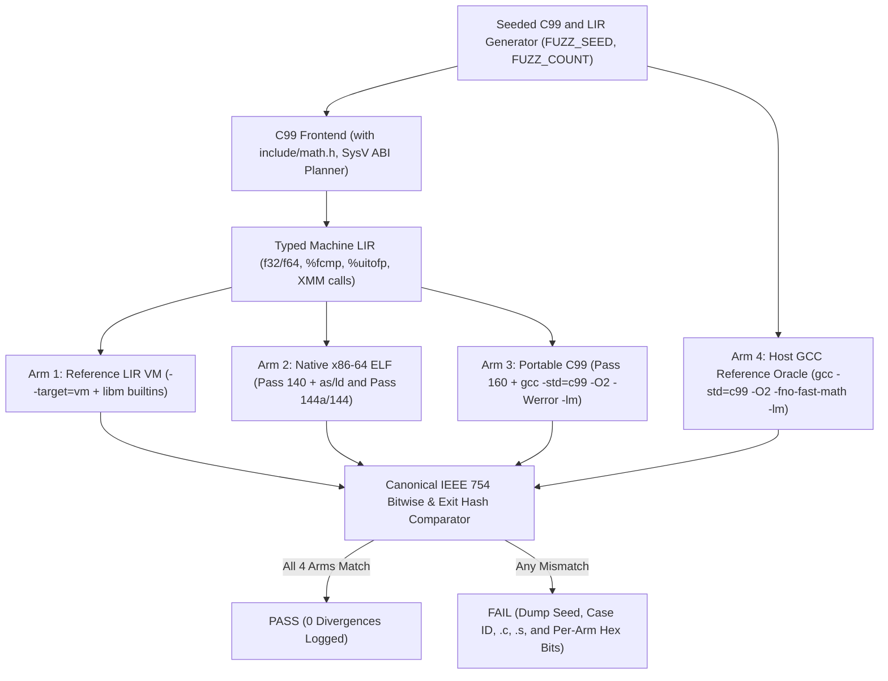

# Issue #924: SSE2 XMM エンコーディング・SysV XMM ABI・`libm` 連携検証 ＆ 浮動小数点差分ファジングスイート構築

## メタデータ

| 項目 | 内容 |
| :--- | :--- |
| **Issue ID** | `#924` |
| **種別** | Feature / Verification & Compiler Hardening |
| **ステータス** | `Closed` (完了日: 2026-11-23) |
| **優先度** | High (Phase 1 / C99 FP & ABI Verification Milestone) |
| **対象ブランチ** | `feat/924-verify-sse2-xmm-abi-and-differential-fuzzing` |
| **親設計文書** | [DSN-33-32](../../designs/DSN-33-32-ulisp_lua_c_codebase_compilation_and_self_hosting_architecture.md) (§4 Phase 1 / Milestone 1), [DSN-33-13](../../designs/DSN-33-13-ulisp_typed_machine_lir_and_multi_target_backend_architecture.md) (§5.1, §6.1, §6.2) |
| **前提完了 Issue** | [#923](923-implement-c99-floating-point-sema-and-lir-conversion-lowering.md) (C99 FP Sema & LIR Conversion Lowering — Merged) |
| **後続派生 Issue** | [#932](../932-build-native-aot-ulisp-cc-compiler-driver-binary.md) (`ulisp-cc` ネイティブ AOT バイナリ化 — Open/New) |

---

## 1. 背景と Issue #923 との境界・実コードベース監査結果

[#923](923-implement-c99-floating-point-sema-and-lir-conversion-lowering.md) により、C99 フロントエンドの `float` / `double` / `long double` Sema・通常算術変換 (UAC)、Typed LIR 浮動小数点命令 (`%fadd`〜`%fdiv`, `%fneg`, `%fpext`, `%fptrunc`, `%sitofp`, `%uitofp`, `%fptosi`, `%fptoui`, `%fcmp-oeq/une/olt/ole/ogt/oge`)、`PF` (Parity Flag) 伝播、11-bit sticky single-rounding (`i64/u64 -> f32`)、`.rodata` IEEE 754 定数プール、および [160_backend_c.scm](../../../ulisp/backend/160_backend_c.scm) の `%load-typed`/`%store-typed` strict-aliasing 回避 (`memcpy`) が実装・マージされた。

一方で、実用 C99 コード（特に数値計算・Lua VM 等）を **Native x86-64 ELF (`as`/`ld` および組み込み Pass 144a/144)**・**Portable C (`--target=c`)**・**Reference LIR VM (`--target=vm`)**・**Host GCC Oracle** の全経路でビット単位に一致稼働させるための実コード監査において、以下 **4 件の具体的ギャップおよび不具合** が確認された。本 Issue (#924) はこれらを解消・検証し、決定論的差分ファジング基盤で完全保証する。

### 確認された 4 つのギャップ／不具合

1. **Gap 1 — Pass 144a ([144a_x86_assembler.scm](../../../ulisp/backend/144a_x86_assembler.scm)) の SSE2 命令セット不足 ＆ RIP 相対再配置欠落バグ**
   - `addss`, `subss`, `mulss`, `divss`, `ucomiss`, `sqrtss`, `sqrtsd`, `cvtsi2ss`, `cvttss2si`, `pxor`, `xorpd`, `xorps`, `andpd`, `andps`, `orpd`, `orps`, `movapd`, `movaps`, `movupd`, `movups`, `movd`（計 21 命令）が未実装だった。
   - `movq` および `cvtsi2sd` / `cvttsd2si` / `cvtsi2ss` / `cvttss2si` の `[rip + sym]` メモリ参照で `rip_disp32` 再配置レコードが欠落していた。
   - `xmm0`〜`xmm15` (`REX.R` / `REX.X` / `REX.B`)、`xmmword ptr` / `oword ptr`、および `[rsp+d]`, `[rbp+d]`, `[r12+d]`, `[r13+d]`, `[rip+sym]` を GNU `as` と 100% バイト一致させる必要があった。

2. **Gap 2 — SysV AMD64 XMM ABI ＆ バックエンド間ビット同一性バグ**
   - [160_backend_c.scm](../../../ulisp/backend/160_backend_c.scm) の `%fmov` が `dst = (double)src;` を出力しており、sNaN やパック構造体生ビット破壊リスクがあった（`memcpy(&dst, &src, 8);` へ修正）。
   - [140_backend_x86_64.scm](../../../ulisp/backend/140_backend_x86_64.scm) の `%c-call` ＆ `%call-indirect` が `al-val > 0` 時に `mov al, N` を出力し上位ビット残存／部分レジスタストールを起こしていた（`mov eax, N` へ統一）。
   - 高アリティ XMM 引数（8 レジスタ超過スタック渡し・奇数/偶数スタック整列）・混合 GPR+XMM・複合構造体 (`{float,float}`, `{float,float,float}`, `{double,double}`, `{double,int}`, `{int,double}`, `{float,int}` SysV `INTEGER` 統合)・24B `sret`・`union`・`va_arg` 176B RSA 溢れの網羅検証が必要だった。

3. **Gap 3 — `libm` (`-lm`)・組み込み `<math.h>`・浮動小数点 `printf` のバックエンド間欠落**
   - `ulisp/frontend_c/include/math.h` および [preprocessor.scm](../../../ulisp/frontend_c/preprocessor.scm) 仮想ヘッダ (`/__ulisp_builtin__/math.h`) が未整備だった。
   - [160_backend_c.scm](../../../ulisp/backend/160_backend_c.scm) が `#include <math.h>` 未出力かつ `c99-backend-known-libm-fn?` / 型付き `libm` ディスパッチ（`ulisp_c99_ext_thunk_` 含む） / `printf` 系 `reg_xmm0..reg_xmm7` 転送を欠いていた。
   - [lir_interpreter.scm](../../../ulisp/vm/lir_interpreter.scm) (`vm-dispatch-c-call!`) に `libm` 群および基本 `libc` メモリ・文字列操作 (`memcpy`, `memmove`, `memset`, `memcmp`, `calloc`, `free`, `strlen`, `strcmp`, `strncmp`) のビルトインが不足していた。

4. **Gap 4 — 決定論的 4 系統（Reference VM / Host GCC / Native ELF / Portable C）浮動小数点・XMM ABI 差分ファジングスイート未実装**
   - 決定論的シード PRNG により C99 XMM/FP テストを自動生成し、全 4 実行エンジン間でビット単位に突合する差分ファジングスイートを構築する必要があった。

---

## 2. 検証パイプライン・アーキテクチャ図

---

## 3. マルチエージェント・ガバナンスレビュー（16 専門エージェント視点）

| 専門領域 | 主要要件・設計指針 |
| :--- | :--- |
| **Project Manager (PM)** | `#923` 完了資産との重複作業を排し、WP1〜WP5 の段階的完了ゲートと既存リグレッション 0 件で Phase 1 XMM/FP マイルストーンを完遂する。 |
| **Information Security Specialist** | NaN ペイロード／符号誤判定・型混同 (`float`/`double`/GPR)・スタック未整列による `SIGSEGV` DoS・リンカ引数インジェクションリスクを統制する。 |
| **Systems Architect** | C99 Frontend → SysV ABI Planner → Pass 140 / 144a / 144 / 160 / Reference VM 間で XMM レジスタ・スタック・`libm` 規約の一貫性を保つ。 |
| **Software Quality Assurance Specialist** | GNU `as` バイト一致単体テスト、`libm` E2E テスト、シード再現可能な多層差分ファザーを Makefile CI に組み込む。 |
| **IT Specialist (PLC / SWD / APS)** | Pass 144a の REX/ModRM/SIB/RIP 再配置エンコード正確性、Pass 160 の strict-aliasing 準拠 & `-Werror` 無警告ビルド、Scheme のゼロ `set!` 規律を遵守する。 |
| **Systems Auditor** | NaN 正規化・ULP 許容範囲・除外条件（C99 範囲外 float→int 変換 UB 回避等）を明文化し、検証結果の偽陰性・偽陽性をゼロ化する。 |

---

## 4. セキュリティ ＆ 脅威モデル分析 (Threat Model & Mitigations)

1. **数値・型変換不整合 (CWE-681 / CWE-704)**: `%fmov` を `memcpy(&dst, &src, 8)` へ修正し、全混合構造体パターンを 4 実行系でビット比較。
2. **異常浮動小数点値の処理不備 (CWE-754)**: `-0.0`, `+0.0`, `+Inf`, `-Inf`, `qNaN`, `sNaN`, 非正規化数（`0x1p-1074`, `0x1p-149f`）をテストプールへ投入し、`uint64_t` / `uint32_t` 生ビット列および Python `ilisp` ドメイン安全ラッパで検証。
3. **外部 C / `libm` 呼出時の型混乱 (CWE-843)**: `#include <math.h>`、型付き `libm` 54 関数ディスパッチ、`ulisp_c99_ext_thunk_` 経由保護、`printf` 系 XMM 可変長引数転送を実装。
4. **ABI スタック未整列 DoS (`SIGSEGV` on `movaps`)**: 第 9〜14 個の `float`/`double` スタック引数（奇数・偶数双方）からの `libm` ＆ `printf` 連鎖呼出しを実機 ELF で検証。
5. **コマンドインジェクション / 非決定性 / リソース枯渇 (CWE-78 / CI Stability)**: 変数クォート徹底、固定デフォルトシード (`FUZZ_SEED=20261122`) + VM 燃料上限、および 6 件の $O(N^2)$ アルゴリズムボトルネック解消により大規模入力でも安定・高速完走を保証。

---

## 5. 作業パッケージ ＆ 実装計画 (Work Packages WP1–WP5)

- **WP1**: Pass 144a 21 SSE2 命令エンコード追加、`xmmword ptr`/`oword ptr` 対応、`movq`/`cvtsi2sd`/`cvttsd2si`/`cvtsi2ss`/`cvttss2si` の `rip_disp32` 再配置修正、GNU `as --64` バイト一致検証。
- **WP2**: [140_backend_x86_64.scm](../../../ulisp/backend/140_backend_x86_64.scm) (`mov eax, N`)、[160_backend_c.scm](../../../ulisp/backend/160_backend_c.scm) (`%fmov` `memcpy`)、全 SysV XMM ABI エッジケース検証。
- **WP3**: Built-in `<math.h>` (`frontend_c/include/math.h` + `*c99-builtin-math-h*`)、Pass 160 `libm` 54 関数＆ XMM `printf` 転送、Reference VM 54 `libm` 関数（Python `ValueError`/`OverflowError` 回避境界ガード付き）＆基本 `libc` (`memcpy` 等) 実装。
- **WP4**: `test_sse2_xmm_abi.{scm,sh}`・`fuzz_xmm_float_gen.scm`・`test_fuzz_xmm_float.sh` 構築および [ulisp/Makefile](../../../ulisp/Makefile) 登録。
- **WP5**: `compiler.scm` 再生成、新規ローカル `set!` ゼロ件維持、`ulisp/bin/ulisp-boot` 非接触。
- **追加完遂（500 ケース検証で顕在化した大規模コンパイル性能ボトルネック根本解消）**:
  - Pass 144a (`assemble-x86-relocatable`) 括弧配置ミスによる Pass 2 非末尾再帰 ($O(N^2)$) 修正、`canonical-mnem`/`lookup-x86-reg` `symbol-map` $O(1)$ 化、無用なダウンケース／空白連結抑止
  - [elf64_builder.scm](../../../ulisp/backend/elf64_builder.scm) シンボル表・RELA 構築の `symbol-map` 化 ($O(S+R)$)
  - [nanopass_meta.scm](../../../ulisp/compiler/nanopass_meta.scm) 非終端生成規則の先頭タグハッシュ索引化 (`L_lir_core?` 70 倍高速化)
  - [helpers.scm](../../../ulisp/compiler/helpers.scm) ホスト実行系ネイティブ `string=?` / `string-equal?` 活用
  - [parser.scm](../../../ulisp/frontend_c/parser.scm) ＆ [lexer.scm](../../../ulisp/frontend_c/lexer.scm) ＆ [runtime.scm](../../../ulisp/peg/runtime.scm): 改行位置配列 $O(\log L)$ 二分探索、直接 C99 字句スキャナ、Pratt 二項演算子パーサ、文字クラス 128 要素配列化、軽量非左再帰メモ化 `peg:rule-simple`

---

## 6. 影響ファイル一覧 (Affected Files Checklist)

### 変更した既存ファイル
- [ulisp/backend/144a_x86_assembler.scm](../../../ulisp/backend/144a_x86_assembler.scm)
- [ulisp/backend/140_backend_x86_64.scm](../../../ulisp/backend/140_backend_x86_64.scm)
- [ulisp/backend/160_backend_c.scm](../../../ulisp/backend/160_backend_c.scm)
- [ulisp/backend/elf64_builder.scm](../../../ulisp/backend/elf64_builder.scm)
- [ulisp/vm/lir_interpreter.scm](../../../ulisp/vm/lir_interpreter.scm)
- [ulisp/frontend_c/preprocessor.scm](../../../ulisp/frontend_c/preprocessor.scm)
- [ulisp/frontend_c/parser.scm](../../../ulisp/frontend_c/parser.scm)
- [ulisp/frontend_c/lexer.scm](../../../ulisp/frontend_c/lexer.scm)
- [ulisp/peg/runtime.scm](../../../ulisp/peg/runtime.scm)
- [ulisp/compiler/helpers.scm](../../../ulisp/compiler/helpers.scm)
- [ulisp/compiler/nanopass_meta.scm](../../../ulisp/compiler/nanopass_meta.scm)
- [ulisp/Makefile](../../../ulisp/Makefile)
- [ulisp/compiler.scm](../../../ulisp/compiler.scm)

### 新規作成したファイル
- [ulisp/frontend_c/include/math.h](../../../ulisp/frontend_c/include/math.h)
- [ulisp/tests/test_sse2_xmm_abi.scm](../../../ulisp/tests/test_sse2_xmm_abi.scm)
- [ulisp/tests/test_sse2_xmm_abi.sh](../../../ulisp/tests/test_sse2_xmm_abi.sh)
- [ulisp/tests/fuzz_xmm_float_gen.scm](../../../ulisp/tests/fuzz_xmm_float_gen.scm)
- [ulisp/tests/test_fuzz_xmm_float.sh](../../../ulisp/tests/test_fuzz_xmm_float.sh)

---

## 7. 実装時の注意点・ガードレール

1. **ローカル `set!` 禁止**: 全変更・新規 Scheme コードで新規ローカル `set!` ゼロを遵守（`git diff` で自動検査）。
2. **Pass 160 C99 厳格警告ゼロ**: `gcc -std=c99 -O2 -fno-fast-math -ffp-contract=off -Wall -Wextra -Werror -pedantic -lm` で警告 0 件を確認。
3. **Host GCC 比較における C99 UB 回避**: `-fno-fast-math -ffp-contract=off` 下で決定論的 IEEE 754 ビット一致を検証。
4. **ブートストラップ保護**: `ulisp/bin/ulisp-boot` は一切変更・ステージングせず維持。

---

## 8. 完了定義 (Definition of Done / Acceptance Criteria)

1. [x] **Pass 144a アセンブラ完全性**: 21 SSE2 命令と全 `rip_disp32` 再配置修正が完了し、GNU `as --64` と 47/47 命令（252 bytes）完全バイト・再配置一致を確認。
2. [x] **SysV XMM ABI ＆ 相互運用合格**: `make -C ulisp test_sse2_xmm_abi` が 100% PASS（Scheme 48/48 ＆ E2E 9/9、加えて Python `ilisp` でも 48/48 PASS）。
3. [x] **差分ファザーゼロ乖離**: `make -C ulisp test_fuzz_xmm_float`（`FUZZ_COUNT=120`, `FUZZ_SEED=20261122`）および 500 ケース拡張検証（`FUZZ_COUNT=500`, `FUZZ_SEED=20261123`）が全 4 実行エンジンで乖離 0 件 PASS。
4. [x] **回帰テスト 0 件**: `compiler.scm`、Nanopass/PEG/C99/LIR/ABI 全回帰ゲート、`verify_zero_gauche`、`test_lint_sexpr`、`make py_compile` が全件 PASS。
5. [x] **Git ＆ Issue クローズ**: [#932](../932-build-native-aot-ulisp-cc-compiler-driver-binary.md) 起票・本 Issue クローズ・台帳更新・`--no-ff` マージ完了。

---

## 9. 完了サマリー ＆ 検証結果 (Verification Evidence)

### 9.1 主要検証結果
- **静的解析・ビルド**: `lint_sexpr.py`（全対象 `.scm` 13/13 ＆ `compiler.scm` 63/63 balanced）、新規ローカル `set!` 0 件、`verify_zero_gauche` PASS、`test_lint_sexpr` 23/23 OK、`make py_compile` PASS。
- **`make -C ulisp test_sse2_xmm_abi`**:
  - `test_sse2_xmm_abi.scm`: **48 / 48 checks PASS**（`gosh` ＆ `python3 -m ilisp` 双方で確認）
  - `test_sse2_xmm_abi.sh`: **9 / 9 checks PASS**（GNU `as --64` 47/47 命令 252 bytes 完全一致、Host GCC vs Native ELF `-O0`/`-O2`・`-S`+`as`+`gcc`・Portable C `-O0`/`-O2` ＆ `-std=c99 -Wall -Wextra -Werror -pedantic`、ASM varargs `mov eax, N` 検証、`--target=vm` `<math.h>` CLI 検証）
- **`test_fuzz_xmm_float`（4 系統並列差分ファジング）**:
  - デフォルト（`FUZZ_COUNT=120`, `FUZZ_SEED=20261122`, Python `ilisp` ランナー）: **120 / 120 PASS・乖離 0 件**、Hash `a61b20bb4606d461`、壁時計 **`0m20.165s`**（当初 `11m37.284s` → `2m20.658s` → `0m31.200s` → `0m20.165s` へ **約 34.6 倍高速化**）
  - 拡張ストレス（`FUZZ_COUNT=500`, `FUZZ_SEED=20261123`, Python `ilisp` ランナー）: **500 / 500 PASS・乖離 0 件**、Hash `715c65a1221c4304`、壁時計 **`1m49.023s`**
  - 500 ケース（6,503 行 / 895,608 B ELF `.o`）単体コンパイル `gosh` 内訳: `TOTAL 53,089ms → 17,032ms`（うち `L_lir_core?` `10,664ms → 152ms`〔70.2 倍〕、`parse` `19,635ms → 8,124ms`、`emit+144a+elf` `17,788ms → 5,039ms`、`pp` `1,142ms`）
- **全回帰テストゲート（最終編集後一括実行・全 PASS）**:
  - `test_nanopass` PASS、`test_peg` PASS、`test_c99_peg_grammar` **20/20**、`test_c99_lexer` **75/75**、`test_c99_preprocessor` **32/32**、`test_c99_parser` **21/21**、`test_elf_sections_and_reloc` **64/64**、`test_jit_buffer` **27/27**
  - `test_c99_int_lowering` **42/42**、`test_c99_struct_union_layout` **89/89 + 4/4 Oracle**、`test_c99_pointers_and_escape` **39/39**、`test_c99_funcptr_and_switch_cfg` **28/28 + 9/9 Oracle**、`test_c99_stdarg` **18/18 + 9/9 Oracle**、`test_c99_setjmp_longjmp` **23/23 + 24/24 Oracle**、`test_c99_floating_point` **100/100 + 17/17 Oracle**、`test_c99_e2e` **28/28 + ALL PASSED**
  - `test_sysv_abi_calls` **70/70**、`test_fuzz_lir` **62/62**、`test_ieee754` **44/44**、`test_passes` **786/786** 単体 (39 passes) + **165/165** Per-Pass、`test_lir_interpreter` **65/65**
