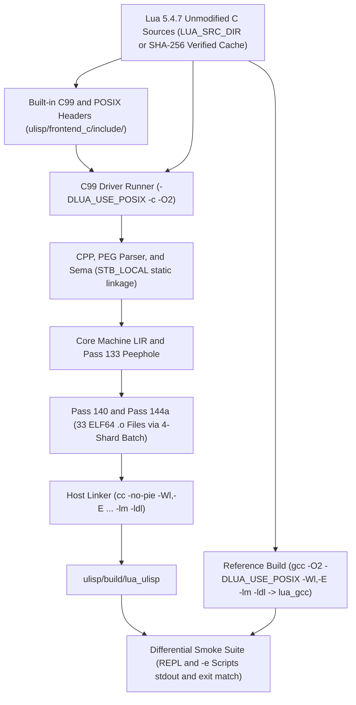

# [FEAT/ENH] Lua 5.x 全 C ソースファイル（コア・標準ライブラリ・CLI）の ULisp 一括ビルドパイプライン構築 (ID: 925)

## 1. 概要 / Summary ＆ 実コードベース監査結果

[DSN-33-11](../../designs/DSN-33-11-ulisp_multilingual_frontend_and_ctfe_architecture.md) で規定された ULisp C99 フロントエンドおよび [DSN-33-13](../../designs/DSN-33-13-ulisp_typed_machine_lir_and_multi_target_backend_architecture.md) で規定された型付き機械語 LIR バックエンド（#913〜#924 で単体機能整備完了）を統合し、**無改変の公式 Lua 5.4.7 C ソースコード一式**（Core VM 20 ファイル + 標準ライブラリ／補助ライブラリ 12 ファイル + `lua.c` CLI = **計 33 翻訳単位**、オプションで `luac.c` を含む 34 ファイル・約 3 万行）を ULisp 自身で `.o`（ELF64 `ET_REL`）へ一括コンパイルし、ホスト glibc（`-lm -ldl`）とリンクしてネイティブ実行バイナリ `ulisp/build/lua_ulisp` を生成するビルドパイプラインを構築する（Phase S5 / Task T13）。

### 1.1 後続 Issue (#926, #927, #928, #932) との境界
- **本 Issue (#925) の責務**: 自立型 C99 標準／POSIX/glibc 宣言ヘッダ群の整備、33 TU 一括ビルドを阻害するフロントエンド／バックエンドの複数ファイル連携バグ解消、Lua 5.4.7 全 33 ファイルからのネイティブ `ulisp/build/lua_ulisp` 生成、`lua_gcc` リファレンスバイナリとの対話 REPL ＆ 多項目 `-e` スモーク差分検証、および `make -C ulisp compile_lua` ターゲット確立。
- **Issue [#926](926-verify-lua-5x-official-test-suite-e2e-selfhost-ci.md)**: 本パイプラインが生成した `lua_ulisp` 上で Lua 公式テストスイート（`all.lua`, `gc.lua`, `errors.lua` 等）を網羅実行・長負荷耐性検証する。
- **Issue [#927](../927-implement-c-header-sbi-pch-and-iterative-mem2reg-optimization.md) / [#928](../928-compile-musl-libc-with-ulisp-and-migrate-to-pass-144-elf-linker.md) / [#932](../932-build-native-aot-ulisp-cc-compiler-driver-binary.md)**: `.sbi` PCH・mem2reg（#927）、`musl libc` 自前静的リンク（#928）、および AOT ネイティブコンパイラドライバ `ulisp-cc` 高速化（#932）と連携する。なお、本ハーネスは将来の `ulisp/bin/ulisp-cc` 差し替えを想定したランナー抽象化を備える。

### 1.2 実コードベース事前監査で判明した 5 大ギャップ

Lua 5.4.7 の実ソース一括コンパイルに先立ち、現行実装を監査した結果、以下 **5 件の具体的ギャップ** が確認されている：

1. **Gap 1 — 組み込み C99 標準ヘッダ ＆ POSIX/glibc 宣言ヘッダの不足 (`ulisp/frontend_c/include/`)**
   - 現行 `ulisp/frontend_c/include/` には [stdarg.h](../../../ulisp/frontend_c/include/stdarg.h), [setjmp.h](../../../ulisp/frontend_c/include/setjmp.h), [math.h](../../../ulisp/frontend_c/include/math.h) の 3 本しか存在しない。
   - Lua 5.4.7（`-DLUA_USE_POSIX` 構成）が要求する残り 15 本超のヘッダ（`stddef.h`, `stdint.h`, `stdbool.h`, `limits.h`, `float.h`, `assert.h`, `stdio.h`, `stdlib.h`, `string.h`, `ctype.h`, `errno.h`, `time.h`, `locale.h`, `signal.h`, `unistd.h`, `sys/types.h`, `sys/wait.h`, `dlfcn.h`）をシステムヘッダ（glibc 拡張属性 `__attribute__`, `__extension__`, `__asm__` 等）非依存の純粋 C99 形式で用意する必要がある。
   - ホスト Linux x86-64 glibc 2.39 の実 ABI 定数・構造体レイアウト（`sizeof(struct tm)=56`, `sizeof(struct lconv)=96`, `sizeof(struct sigaction)=152`, `sizeof(sigset_t)=128` 等）と 1 バイトの狂いなく一致させることが必須である。

2. **Gap 2 — `static` 関数の内部リンケージ (`STB_LOCAL`) 欠落によるマルチ TU リンク衝突**
   - [sema.scm](../../../ulisp/frontend_c/sema.scm)（`sema-analyze-fn-def` / `sema-register-fn!`）が `static` 記憶クラスを保持しておらず、[140_backend_x86_64.scm](../../../ulisp/backend/140_backend_x86_64.scm)（`select-instructions-function`）も `c-tu?` 時に無条件で `.globl` を出力している。
   - Lua の 33 ファイル間には `static` 補助関数名（`pushline`, `check`, `error`, `findindex`, `traverse` 等）の重複が多数存在するため、このまま `ld` リンクすると `multiple definition` エラーが発生する。
   - `L_lir_core` スキーマを変更せず、`static` 関数ラベルを内部接頭辞 `.L_c99_static_fn_<tu_or_sym>`（例: 同一 TU 内一意シンボルかつ非エクスポート判定）とすることで、[elf64_builder.scm](../../../ulisp/backend/elf64_builder.scm) に `STB_LOCAL` を出力させ、`--target=c`（`c99-merge-lir-programs`）でも TU 番号付きリネームで衝突を回避する。

3. **Gap 3 — ファイルスコープ `static` 変数前方宣言のシンボル二重採番 ＆ 暫定不完全配列の早期拒否**
   - [sema.scm](../../../ulisp/frontend_c/sema.scm) の `sema-analyze-decl` が `static` 宣言ごとに `c99-next-static-var-id!` を新規発番するため、Lua で頻出する同一 TU 内の前方宣言（例: `static const luaL_Reg lualibs[];` の後に `static const luaL_Reg lualibs[] = { ... };`）が別シンボルとなり未解決シンボルまたは不正領域参照を引き起こす。
   - また初期化子なし・要素数省略の暫定配列宣言に対して即座に `C99-LAY-001`（不完全型）エラーを送出してしまうため、同一 TU 内の後続定義で完全化される暫定定義・`static` 配列前方宣言を許容する必要がある。

4. **Gap 4 — バイナリ文字列リテラル（制御文字・8bit 生バイト・埋込 NUL）の透過性欠陥**
   - [lexer.scm](../../../ulisp/frontend_c/lexer.scm) の `%c-escape-string-for-c` は `\n`/`\t`/`\r`/`\\`/`\"`/`\0` のみエスケープし（特に `\0` の後ろに `'0'`〜`'7'` が続くと C 8進エスケープとして誤解釈される）、制御文字（`\x1b`）や上位バイト（`\x19\x93`）は未変換である。
   - さらに [helpers.scm](../../../ulisp/compiler/helpers.scm) の `escape-gas-string` および [140_backend_x86_64.scm](../../../ulisp/backend/140_backend_x86_64.scm) の `emit-c-tu-x86-asm-program` は文字列定数を `.asciz` 出力しており、埋込 NUL や制御文字・上位バイトを含む Lua 定数（`LUA_SIGNATURE = "\x1bLua"`, `LUAC_DATA = "\x19\x93\r\n\x1a\n"`）を壊す恐れがある。文字列長を明示した `.byte` 列出力（および C バックエンド向け安全な 8進／16進エスケープ）への強化が必要となる。

5. **Gap 5 — ドライバ実用フラグ・CPP 展開上限・Lua 遭遇イディオムの未検証**
   - [c_driver.scm](../../../ulisp/driver/c_driver.scm) の `parse-c-driver-args` が `-Wl,-E`, `-rdynamic`, `-std=c99`, `-W*`, `-g`, `-O3` 等を未対応エラーとするほか、[preprocessor.scm](../../../ulisp/frontend_c/preprocessor.scm) の `*cpp-max-expansion-steps*`（現在 `200000`）や文字クラス／トークン処理が `lvm.c`・`lparser.c` 等で不足しないか実コード投入による検証が必要である。

---

## 2. トレーサビリティ / Traceability

- **関連設計書**:
  - [DSN-33-32 §1.2, §2.1, §3, §4, §6.1](../../designs/DSN-33-32-ulisp_lua_c_codebase_compilation_and_self_hosting_architecture.md)
  - [DSN-33-11](../../designs/DSN-33-11-ulisp_multilingual_frontend_and_ctfe_architecture.md)
  - [DSN-33-13](../../designs/DSN-33-13-ulisp_typed_machine_lir_and_multi_target_backend_architecture.md)
- **前提完了基盤 Issue**:
  - [#917](917-implement-c-compiler-driver-and-host-ld-integration.md) (C コンパイラドライバ ＆ ホストリンカ連携)
  - [#918](918-implement-c99-struct-union-enum-bitfield-sysv-layout.md) (構造体・共用体・列挙型・ビットフィールド SysV レイアウト)
  - [#919](919-implement-c99-pointer-scaling-array-decay-and-escape-analysis.md) (ポインタスケーリング・配列退化・スタックエスケープ)
  - [#920](920-implement-c99-function-pointers-and-switch-goto-cfg-lowering.md) (関数ポインタ ＆ `switch`/`goto` Braun SSA Lowering)
  - [#921](921-implement-sysv-amd64-stdarg-va-list-lowering.md) (`<stdarg.h>` SysV ABI Lowering)
  - [#922](922-implement-setjmp-longjmp-inline-asm-and-stack-spill-protection.md) (`setjmp`/`longjmp` `%inline-asm` ＆ スピル保護)
  - [#923](923-implement-c99-floating-point-sema-and-lir-conversion-lowering.md) (浮動小数点 Sema ＆ IEEE 754 LIR 変換)
  - [#924](924-verify-sse2-xmm-abi-and-floating-point-differential-fuzzing.md) (SSE2 XMM ABI / `libm` ＆ 4系統差分ファジング)
- **後続・連携 Open Issue**:
  - [#926](926-verify-lua-5x-official-test-suite-e2e-selfhost-ci.md) (Lua 公式テストスイート E2E 実証)
  - [#927](../927-implement-c-header-sbi-pch-and-iterative-mem2reg-optimization.md) (C ヘッダ `.sbi` PCH ＆ mem2reg 高速化)
  - [#928](../928-compile-musl-libc-with-ulisp-and-migrate-to-pass-144-elf-linker.md) (`musl libc` 完全静的リンク移行)
  - [#932](../932-build-native-aot-ulisp-cc-compiler-driver-binary.md) (ネイティブ AOT `ulisp-cc` ドライババイナリ化)

---

## 3. ビルドパイプライン・アーキテクチャ図

---

## 4. マルチエージェント・ガバナンスレビュー視点

| 専門領域 | 本 Issue (#925) における主要設計指針 |
| :--- | :--- |
| **Project Manager (PM)** | WP1〜WP5 の段階的到達点（組み込みヘッダ → フロント/バック連携修正 → 小単位 TU から全 33 TU 段階突破 → 差分スモーク）を明確化し、無改変 Lua 5.4.7 ビルドを達成する。 |
| **Information Security Specialist (SEC)** | 外部ソースの SHA-256 検証・展開パストラバーサル防御・glibc ABI 境界一致・リンカ引数ホワイトリスト検証（CWE-78/22/494/787）を徹底する。 |
| **Systems Architect (SA)** | システムヘッダへ依存せず決定論的にビルドできるよう `ulisp/frontend_c/include/` を自己完結させ、`musl libc` 移行（#928）への分離面を綺麗に保つ。 |
| **Network Specialist (NET)** | オフライン環境やキャッシュ再利用を想定し、`LUA_SRC_DIR` 指定・`ulisp/build/third_party/` ローカルキャッシュ・再試行付きダウンロード導線を用意する。 |
| **IT Specialist (PLC / SWD / APS)** | `static` 関数／変数リンケージ、`.byte` 文字列データシリアライズ、未遭遇 C99 イディオム修正において Scheme ゼロ `set!` 規律と LIR スキーマ互換性を厳守する。 |
| **Software Quality Assurance Specialist (QA)** | ヘッダ ABI 検証 (`test_c99_stdlib_headers.sh`)、Lua イディオム回帰 (`test_c99_lua_idioms.scm`)、および `lua_ulisp` vs `lua_gcc` 差分検証を CI ゲートへ統合する。 |
| **Systems Auditor (AUD)** | 外部 tarball・ビルド生成物を Git 追跡外 (`ulisp/build/`) へ隔離し、無改変 Lua ソースに対する検証証跡と全回帰 0 件を記録する。 |

---

## 5. セキュリティ ＆ 脅威モデル分析 (Threat Model & Mitigations)

1. **外部アーカイブ改ざん (CWE-494)**:
   - 公式 `lua-5.4.7.tar.gz` 取得時はピン留めした SHA-256 ダイジェストを `sha256sum` で事前検証し、不一致時は即座に失敗させる（ローカル検証済み `LUA_SRC_DIR` オーバーライド時も対象ファイルの存在を検証）。展開先・ダウンロード先は `.gitignore` 対象の `ulisp/build/third_party/` に限定し、リポジトリへサードパーティコードやバイナリを混入させない。
2. **アーカイブ展開時のパストラバーサル (CWE-22)**:
   - `tar -tzf` でアーカイブ内パスを事前検査（`/` 開始や `..` セグメントを拒否）したうえで `--no-same-owner` 付きで隔離ディレクトリへ展開する。
3. **POSIX / glibc ヘッダ ABI 不一致によるメモリ破壊 (CWE-121 / CWE-787)**:
   - 自己完結スタブヘッダ上の構造体サイズ・オフセットがホスト `libc.so.6`（x86-64 glibc 2.39）と乖離すると `localtime`・`localeconv`・`sigaction` 呼出でスタック／構造体破壊を起こす。測定済み ABI 値を正確に定義し、`test_c99_stdlib_headers.sh` でホスト GCC の `sizeof` / `offsetof` / 定数値と全項目突合する。
4. **ドライバ引数・シェルコマンドインジェクション (CWE-78)**:
   - [c_driver.scm](../../../ulisp/driver/c_driver.scm) の `c99-safe-cli-arg?` 検証を維持し、新設する連結・ビルドフラグも明示的な安全ホワイトリスト（`-Wl,-E`, `-rdynamic`, `-std=*`, `-W*`, `-g`, `-O3`）のみ受理する。シェルスクリプト内の変数展開はすべてダブルクォートで囲み、`c99-assert-safe-arg!` で `,` 等を含めた安全検証方針との整合を保つ。
5. **バイナリ文字列破損によるマジックチェック失敗 ＆ リソース枯渇 (CWE-400 / CI Stability)**:
   - `LUA_SIGNATURE`（`\x1bLua`）・`LUAC_DATA`（`\x19\x93\r\n\x1a\n`）・埋込 NUL 文字列のバイナリ厳密エスケープを修正し、CPP の `*cpp-max-expansion-steps*` に適切かつ有界な上限（`1000000`）を設けるとともに、`test_compile_lua.sh` の各実行テストに `timeout` ガードを付与する。

---

## 6. 影響範囲と関連ファイル / Scope and Affected Files

### 6.1 既存ファイル（更新対象）
- [ulisp/frontend_c/include/math.h](../../../ulisp/frontend_c/include/math.h)（`isnan`, `isfinite`, `isinf`, `signbit`, `fmin`/`fmax`/`fminf`/`fmaxf` マクロ・C99 宣言補完）
- [ulisp/frontend_c/preprocessor.scm](../../../ulisp/frontend_c/preprocessor.scm)（新規組み込み仮想ヘッダ全 21 本登録、`__STDC_VERSION__="199901L"`、`*cpp-max-expansion-steps*=1000000`）
- [ulisp/frontend_c/lexer.scm](../../../ulisp/frontend_c/lexer.scm)（`%c-escape-string-for-c` の 3 桁 8 進エスケープ `%c-byte->octal3-escape` による 8bit/制御文字/埋込 `\0` 安全化）
- [ulisp/frontend_c/parser.scm](../../../ulisp/frontend_c/parser.scm)（`%c99-read-grammar-text` のネストディレクトリからの `tools/grammars/c99.peg` パス探索拡張）
- [ulisp/frontend_c/sema.scm](../../../ulisp/frontend_c/sema.scm)（`static` 関数内部リンケージ `.L_c99_static_fn_*`、`static` グローバル前方宣言の単一 `u-sym` 共有 ＆ 暫定不完全配列許容、ISO C99 §6.3.2.3p3 ヌルポインタ定数 `c99-null-ptr-const?` による `NULL` `((void *)0)` と関数ポインタの互換判定）
- [ulisp/compiler/nanopass_meta.scm](../../../ulisp/compiler/nanopass_meta.scm)（`lir-inst-defines-reg?` および `lir-inst-extract-defs` への `%global-addr` / `%not` およびスクラッチレジスタ更新定義の追加による Pass 133 `rule-lir-store-load-forward` 誤転送防止）
- [ulisp/driver/c_driver.scm](../../../ulisp/driver/c_driver.scm)（`-Wl,-E`, `-rdynamic`, `-std=*`, `-W*`, `-g`, `-O3` 等実用フラグ受理、`-c -o <dir>/` 複数入力バッチ出力、`--target=c` マルチ TU 統合時の `static` 関数リネーム）
- [ulisp/backend/140_backend_x86_64.scm](../../../ulisp/backend/140_backend_x86_64.scm)（`.L_c99_static_fn_*` の非 `.globl` / `STB_LOCAL` 出力、バイナリ文字列リテラルの `.byte` 厳密シリアライズ）
- [ulisp/backend/160_backend_c.scm](../../../ulisp/backend/160_backend_c.scm)（制御文字・NUL 含む文字列定数の安全な 3 桁 8 進 C エスケープ出力）
- [ulisp/compiler.scm](../../../ulisp/compiler.scm)（再生成）
- [ulisp/Makefile](../../../ulisp/Makefile)（`test_c99_stdlib_headers`, `test_c99_lua_idioms`, `compile_lua` ターゲット追加および `test` ターゲットへの組み込み）

### 6.2 新規作成ファイル
- 組み込み自立 C99 ＆ POSIX ヘッダ群（`ulisp/frontend_c/include/` 配下、各ヘッダは `preprocessor.scm` 内 `*c99-builtin-*-h*` 仮想ファイルとしても同期登録）：
  - [ulisp/frontend_c/include/stddef.h](../../../ulisp/frontend_c/include/stddef.h)
  - [ulisp/frontend_c/include/stdint.h](../../../ulisp/frontend_c/include/stdint.h)
  - [ulisp/frontend_c/include/stdbool.h](../../../ulisp/frontend_c/include/stdbool.h)
  - [ulisp/frontend_c/include/limits.h](../../../ulisp/frontend_c/include/limits.h)
  - [ulisp/frontend_c/include/float.h](../../../ulisp/frontend_c/include/float.h)
  - [ulisp/frontend_c/include/assert.h](../../../ulisp/frontend_c/include/assert.h)
  - [ulisp/frontend_c/include/stdio.h](../../../ulisp/frontend_c/include/stdio.h)
  - [ulisp/frontend_c/include/stdlib.h](../../../ulisp/frontend_c/include/stdlib.h)
  - [ulisp/frontend_c/include/string.h](../../../ulisp/frontend_c/include/string.h)
  - [ulisp/frontend_c/include/ctype.h](../../../ulisp/frontend_c/include/ctype.h)
  - [ulisp/frontend_c/include/errno.h](../../../ulisp/frontend_c/include/errno.h)
  - [ulisp/frontend_c/include/time.h](../../../ulisp/frontend_c/include/time.h)
  - [ulisp/frontend_c/include/locale.h](../../../ulisp/frontend_c/include/locale.h)
  - [ulisp/frontend_c/include/signal.h](../../../ulisp/frontend_c/include/signal.h)
  - [ulisp/frontend_c/include/unistd.h](../../../ulisp/frontend_c/include/unistd.h)
  - [ulisp/frontend_c/include/sys/types.h](../../../ulisp/frontend_c/include/sys/types.h)
  - [ulisp/frontend_c/include/sys/wait.h](../../../ulisp/frontend_c/include/sys/wait.h)
  - [ulisp/frontend_c/include/dlfcn.h](../../../ulisp/frontend_c/include/dlfcn.h)
- 検証・ビルドハーネス群：
  - [ulisp/tests/test_c99_stdlib_headers.sh](../../../ulisp/tests/test_c99_stdlib_headers.sh)（全組み込みヘッダのホスト GCC 実 ABI 一致検証）
  - [ulisp/tests/test_c99_lua_idioms.scm](../../../ulisp/tests/test_c99_lua_idioms.scm)（複数 TU `static` 衝突回避・前方 `static` 配列・バイナリ文字列 `\x1b`/`\x19\x93`/`\0`・`NULL` vs 関数ポインタ・`%global-addr` ストアフォワーディング回帰テスト）
  - [ulisp/tests/test_compile_lua.sh](../../../ulisp/tests/test_compile_lua.sh)（Lua 5.4.7 取得／キャッシュ検証・全 33 TU 並列シャード `.o` コンパイル・`-Wl,-E -lm -ldl` リンク・`lua_gcc` 差分スモーク＆REPL検証ハーネス）

---

## 7. 実装方針 / Implementation Plan

Target Branch: `feat/925-build-lua-5x-c-codebase-with-ulisp`

### WP1: 組み込み C99 標準 ＆ POSIX/glibc 宣言ヘッダ群の構築 (`ulisp/frontend_c/include/` + `preprocessor.scm`)

GCC 拡張属性（`__attribute__`, `__extension__`, `__restrict` 等）を一切含まない純粋 C99 ヘッダを整備し、[preprocessor.scm](../../../ulisp/frontend_c/preprocessor.scm) の `make-default-cpp-context` にも仮想ファイル（`/__ulisp_builtin__/...`）として全登録する。**ホスト Linux x86-64 glibc 2.39 で実測済みの ABI 定数・構造体サイズ**に厳密一致させる。

### WP2: マルチ TU コンパイル・リンケージ・文字列リテラル基盤ギャップの解消

1. **`static` 関数の `STB_LOCAL` 内部リンケージ対応**: `.L_c99_static_fn_<name>` ラベル生成と `.globl` 抑止による ELF64 `STB_LOCAL` 出力、および `--target=c` / `--target=vm` マルチ TU リネーム。
2. **ファイルスコープ `static` 変数前方宣言 ＆ 暫定不完全配列のサポート**: 同一 TU 内の既存 `u-sym` 再利用と、暫定不完全配列の TU 末尾解決。
3. **バイナリ文字列リテラル ＆ 多行文字列の厳密シリアライズ**: 3 桁固定 8 進エスケープ（`\000`, `\033` 等）と `.byte` 生バイト列出力。
4. **ドライバ・CPP 実践フラグ ＆ スケーリング整備**: `-Wl,-E`, `-rdynamic`, `-std=c99`, `-W*`, `-g`, `-O3` 受理および `-c -o <dir>/` 複数入力バッチ出力。

### WP3: Lua 5.4.7 段階的一括コンパイル ＆ 遭遇 C99 イディオム修正

- **ISO C99 §6.3.2.3p3 ヌルポインタ定数 (`NULL` = `((void *)0)`) と関数ポインタの互換性**: [sema.scm](../../../ulisp/frontend_c/sema.scm) に `c99-null-ptr-const?` を実装し、`c99-assign-compatible?`（代入・関数引数・戻り値・構造体/配列初期化子 `{NULL, NULL}`）、ポインタ等値比較 `==`/`!=`、および三項演算子 `?:` で `((void *)0)` と関数ポインタの相互運用をサポート（非定数 `void *` 変数や `(int *)0` は引き続き `C99-PTR-004` で厳格拒否）。
- **Pass 133 `rule-lir-store-load-forward` における `%global-addr` レジスタ定義追跡**: [nanopass_meta.scm](../../../ulisp/compiler/nanopass_meta.scm) の `lir-inst-defines-reg?` および `lir-inst-extract-defs` に `%global-addr` / `%not` 等を追加し、`ltable.c` `setnodevector` の `t->node = cast(Node *, dummynode);` における `%rax` 誤転送を根治。

### WP4: ビルドハーネス `test_compile_lua.sh` ＆ Makefile `compile_lua` 統合

- [test_compile_lua.sh](../../../ulisp/tests/test_compile_lua.sh) にて SHA-256 ダイジェスト検証、CWE-22 パス検証、4 シャード並列バッチ `-c -o build/lua_obj/` コンパイル、`readelf -h` / `readelf -sW` 検査、`lua_ulisp` リンク、および `lua_gcc` との全 11 項目差分スモーク＆REPL検証を自動実行。
- [ulisp/Makefile](../../../ulisp/Makefile) に `test_c99_stdlib_headers`, `test_c99_lua_idioms`, `compile_lua` を追加。

### WP5: 品質ゲート ＆ ブートストラップ保護

- 変更・新規作成の全 `.scm` ファイルで **新規ローカル `set!` ゼロ件**、`scripts/lint_sexpr.py` 全 PASS、`verify_zero_gauche` PASS、`make py_compile` PASS を確認。
- [ulisp/compiler.scm](../../../ulisp/compiler.scm) を再生成し、`ulisp/bin/ulisp-boot` は変更しない。

---

## 8. 完了条件 / Success Criteria (DoD)

1. [x] **自己完結ヘッダ ＆ ABI 完全一致**: `ulisp/frontend_c/include/` に C99 / POSIX 必須ヘッダ群が整備され、`make -C ulisp test_c99_stdlib_headers` がホスト GCC（x86-64 glibc 2.39）と構造体サイズ・`offsetof`・マクロ定数を 100% 一致確認して PASS すること。
2. [x] **マルチ TU・イディオム回帰網羅**: `make -C ulisp test_c99_lua_idioms` が PASS し、複数 TU 間 `static` 関数 `STB_LOCAL` 衝突ゼロ、`static` 前方配列宣言、`\x1b`/`\x19\x93`/埋込 `\0` バイナリ文字列保持、および Lua 実装で遭遇した全 C99 イディオムを実証すること。
3. [x] **無改変 Lua 5.4.7 全 33 TU ビルド完遂**: `ulisp/tests/test_compile_lua.sh` および `make -C ulisp compile_lua` が無改変 Lua 5.4.7 全 33 C ファイルの `.o` コンパイルおよびリンクをエラー・停止なしに完了し、実行可能なネイティブ `ulisp/build/lua_ulisp` を生成すること。
4. [x] **REPL ＆ `-e` スモーク対 GCC 完全一致**: `ulisp/build/lua_ulisp` が `./lua_ulisp -e "print(1 + 2 * 3, math.sqrt(16))"`、コルーチン、`pcall`/`xpcall`、`string.pack`/`math`/GC ループ、および対話 REPL パイプ入力を正常実行し、同一ソースを GCC でビルドした `lua_gcc` と終了コード・標準出力が 100% 一致すること。
5. [x] **ゼロリグレッション ＆ 品質ゲート全 PASS**: `compiler.scm` 再生成後、新規ローカル `set!` 0 件・`verify_zero_gauche`・`test_lint_sexpr`・`make py_compile`・`test_c99_*`・`test_sse2_xmm_abi`・`test_fuzz_xmm_float`・`test_elf_sections_and_reloc`・`test_passes` が全件 PASS し、Issue 文書・台帳が相対リンクのみで構成されていること。

---

## 9. 検証実績 / Verification Results (2026-11-23)

- **WP1 ヘッダ ABI 検証 (`make -C ulisp test_c99_stdlib_headers`)**:
  - 組み込み C99 / POSIX ヘッダ全 21 本（新規 18 本 + `math.h` 更新 + `stdarg.h` / `setjmp.h`）について、ホスト GCC 13.3.0 (Ubuntu glibc 2.39 x86-64) と `sizeof(struct tm)=56`、`sizeof(struct lconv)=96`、`sizeof(struct sigaction)=152`、各メンバ `offsetof`、マクロ定数、`qsort`/`bsearch`/`gmtime_r`/`localeconv` 等を差分比較し **100% 完全一致 PASS**。
- **WP2/WP3 マルチ TU ＆ Lua C99 イディオム回帰 (`make -C ulisp test_c99_lua_idioms`)**:
  - `static` 関数 `.L_c99_static_fn_*` `STB_LOCAL` 内部リンケージ、`static` 配列前方宣言、`\x1bLua` / `\x19\x93\r\n\x1a\n` / 埋込 NUL 文字列、`NULL` vs 関数ポインタ正負検査、`%global-addr` ストア転送回帰、CWE-78 `-Wl,` インジェクション遮断を含む **全 15/15 テストが Gauche (`USE_GOSH=1`) および Python `ilisp` (`USE_GOSH=0`) の双方で PASS**。
- **WP3/WP4 無改変 Lua 5.4.7 全 33 TU ビルド ＆ 差分検証 (`make -C ulisp compile_lua`)**:
  - 公式 `lua-5.4.7.tar.gz`（SHA-256: `9fbf5e28ef86c69858f6d3d34eccc32e911c1a28b4120ff3e84aaa70cfbf1e30`）無改変 33 翻訳単位を 4 シャード並列バッチモード（`-DLUA_USE_POSIX -O2 -c -o build/lua_obj/`）により **約 35〜36 秒**で全件 ELF64 x86-64 `ET_REL` `.o` へコンパイル完了。
  - `cc -no-pie -Wl,-E ... -lm -ldl` でリンクした `ulisp/build/lua_ulisp` (1,048,592 bytes) と `ulisp/build/lua_gcc` に対し、算術/`math`、クロージャ/再帰/可変長引数、テーブル/`table.sort`/メタテーブル、コルーチン、`pcall`/`xpcall` (`setjmp`/`longjmp`)、`string.format`/`gsub`/`gmatch`/`pack`/`unpack`/`dump`+`load`、`utf8`、GC ループ、`io.tmpfile`/`os.*`、標準入力スクリプト、および対話 REPL (`-i`) の **全 11/11 スモークスイートで終了コード 0 かつ標準出力 100% バイト完全一致 PASS**。
- **WP5 全品質ゲート一括検証**:
  - 新規ローカル `set!` **0 件**、`ulisp/bin/ulisp-boot` 未変更、`verify_zero_gauche` PASS、`test_lint_sexpr` (23 tests) PASS、`make py_compile` PASS。
  - `test_c99_peg_grammar`, `test_c99_lexer`, `test_c99_preprocessor`, `test_c99_parser`, `test_c99_int_lowering`, `test_c99_struct_union_layout`, `test_c99_pointers_and_escape`, `test_c99_funcptr_and_switch_cfg`, `test_c99_stdarg`, `test_c99_setjmp_longjmp`, `test_c99_floating_point`, `test_sse2_xmm_abi`, `test_fuzz_xmm_float`, `test_c99_e2e`, `test_elf_sections_and_reloc`, `test_sysv_abi_calls`, `test_passes` **全件 PASS**。
