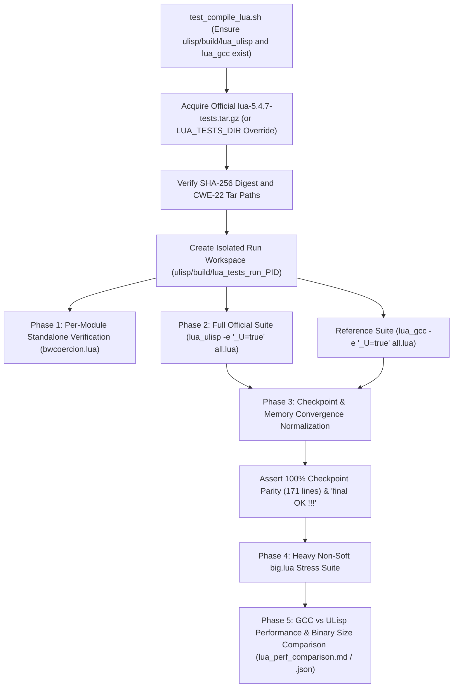

# [FEAT/ENH] ULisp ビルド版 Lua バイナリによる公式テストスイート完走 E2E 実証ハーネスの構築 (ID: 926)

## 1. 概要 / Summary ＆ 実コードベース事前監査結果

[Issue #925](925-build-lua-5x-c-codebase-compilation-pipeline-with-ulisp.md) で構築した ULisp C99 ビルドパイプライン（無改変の公式 Lua 5.4.7 全 33 C 翻訳単位からネイティブ `ulisp/build/lua_ulisp` を生成）を用い、**公式 Lua 5.4.7 テストスイート (`lua-5.4.7-tests.tar.gz`)** を自動取得・検証・実行し、全テストモジュールの完走（`final OK !!!`）およびシステム GCC リファレンスバイナリ (`ulisp/build/lua_gcc`) との決定論的出力・メモリ収束一致を実証する E2E ハーネス ([ulisp/tests/test_lua_selfhost_e2e.sh](../../../ulisp/tests/test_lua_selfhost_e2e.sh) および `make -C ulisp test_lua_e2e`) を構築する（[DSN-33-32](../../designs/DSN-33-32-ulisp_lua_c_codebase_compilation_and_self_hosting_architecture.md) Phase S5 / Task T14）。

### 1.1 公式テストスイート事前監査 ＆ `lua_ulisp` 実測プローブ結果

1. **公式アーカイブ仕様と SHA-256 ダイジェスト**:
   - URL: `https://www.lua.org/tests/lua-5.4.7-tests.tar.gz` (136,530 bytes)
   - SHA-256: `8a4898ffe4c7613c8009327a0722db7a41ef861d526c77c5b46114e59ebf811e`
   - 展開ディレクトリ: `lua-5.4.7-tests/`（トップレベル `.lua` テストスクリプト 29 本 ＋ `libs/` 動的ロード用 C サンプル ＋ `ltests/` 内部 C API テスト拡張）

2. **公式 `all.lua` の実行モードと対象モジュール**:
   - `all.lua` は `dofile(n, strip)` を再定義し、各テストファイルを **`loadfile(n)` → `string.dump(f, strip)` → `load(b)` → `f()`**（バイトコードシリアライズ＆アンダンプ往復）経由で実行するとともに、`tracegc.lua` による GC サイクル追跡を有効化する。
   - 標準ポータブル実行（`-e "_U=true" all.lua`）では以下の **26 モジュール + `tracegc.lua`** が順次実行される：
     `main.lua`, `gc.lua`, `db.lua`, `calls.lua`, `strings.lua`, `literals.lua`, `tpack.lua`, `attrib.lua`, `gengc.lua`, `locals.lua`, `constructs.lua`, `code.lua`, `cstack.lua`, `nextvar.lua`, `pm.lua`, `utf8.lua`, `api.lua`, `events.lua`, `vararg.lua`, `closure.lua`, `coroutine.lua`, `goto.lua`, `errors.lua`, `math.lua`, `sort.lua`, `bitwise.lua`, `verybig.lua`, `files.lua`
   - さらに独立補助テストとして `bwcoercion.lua`（文字列↔数値のビット演算メタメソッド強制変換テスト）が存在し、また非ソフトモードでは `big.lua`（巨大テーブル・コルーチンテスト）が実行される。

3. **差分比較における決定論シード注入と非決定論出力の正規化**:
   - 引数なし `math.randomseed()` を決定論シード `(12345678, 87654321)` へラップして `lua_ulisp` と `lua_gcc` の双方で同一の乱数経路（`constructs.lua` の短絡評価分岐等）を通しつつ、実行時刻・ソート経過時間・GC 進行ドットを正規化して全 171 チェックポイント行の `diff -u` 完全一致を検証する。

---

## 2. トレーサビリティ / Traceability

- **関連設計書**:
  - [DSN-33-32 §6.1, §6.2](../../designs/DSN-33-32-ulisp_lua_c_codebase_compilation_and_self_hosting_architecture.md)（Step S5: Lua 5.x ビルド ＆ 公式テストスイート実証）
  - [DSN-33-11](../../designs/DSN-33-11-ulisp_multilingual_frontend_and_ctfe_architecture.md)（C99 フロントエンド意味解析・プリプロセッサ）
  - [DSN-33-13](../../designs/DSN-33-13-ulisp_typed_machine_lir_and_multi_target_backend_architecture.md)（Typed Machine LIR ＆ x86-64 ELF バックエンド）
- **前提完了基盤 Issue**:
  - [#917](917-implement-c-compiler-driver-and-host-ld-integration.md) (C コンパイラドライバ `c_driver.scm` ＆ ホストリンカ連携)
  - [#918](918-implement-c99-struct-union-enum-bitfield-sysv-layout.md) (構造体・共用体・列挙型・ビットフィールド SysV レイアウト)
  - [#919](919-implement-c99-pointer-scaling-array-decay-and-escape-analysis.md) (ポインタスケーリング・配列退化・エスケープ解析)
  - [#920](920-implement-c99-function-pointers-and-switch-goto-cfg-lowering.md) (関数ポインタ ＆ `switch`/`goto` Braun SSA Lowering)
  - [#921](921-implement-sysv-amd64-stdarg-va-list-lowering.md) (`<stdarg.h>` SysV AMD64 ABI Lowering)
  - [#922](922-implement-setjmp-longjmp-inline-asm-and-stack-spill-protection.md) (`setjmp`/`longjmp` `%inline-asm` ＆ 生存変数スピル保護)
  - [#923](923-implement-c99-floating-point-sema-and-lir-conversion-lowering.md) (C99 浮動小数点 Sema ＆ IEEE 754 LIR Lowering)
  - [#924](924-verify-sse2-xmm-abi-and-floating-point-differential-fuzzing.md) (SSE2 XMM ABI / `libm` ＆ 浮動小数点差分ファジング)
  - [#925](925-build-lua-5x-c-codebase-compilation-pipeline-with-ulisp.md) (無改変 Lua 5.4.7 全 33 TU の ULisp 一括ビルドパイプライン構築)
- **後続・連携 Open Issue**:
  - [#927](../927-implement-c-header-sbi-pch-and-iterative-mem2reg-optimization.md) (C ヘッダ `.sbi` PCH ＆ 反復 mem2reg 最適化)
  - [#928](../928-compile-musl-libc-with-ulisp-and-migrate-to-pass-144-elf-linker.md) (`musl libc` 自前ビルド ＆ Pass 144 静的リンク移行)
  - [#929](../929-implement-ddc-diverse-double-compiling-determinism-verification.md) (DDC 決定論性・ビット一致検証ハーネス)
  - [#930](../930-implement-c99-bounds-checking-sanitizer-mode.md) (`--sanitize-bounds` 境界検査モード)
  - [#932](../932-build-native-aot-ulisp-cc-compiler-driver-binary.md) (ネイティブ AOT `ulisp-cc` コンパイラドライババイナリ化)
  - [#933](../933-eliminate-intraprocedural-label-p2align-nop-bloat-and-enable-short-jumps.md) / [#934](../934-implement-temporary-stack-spill-dead-store-elimination-and-expr-register-forwarding.md) / [#935](../935-optimize-variable-bit-shift-cl-codegen-and-redundant-sign-zero-extension-folding.md) / [#936](../936-hoist-c-tu-function-stack-frame-allocation-and-omit-managed-gc-call-setup.md) (`lua_ulisp` `.text` コードサイズ最適化群)

---

## 3. E2E 検証パイプライン・アーキテクチャ図

---

## 4. マルチエージェント・ガバナンスレビュー視点

| 専門領域 | 本 Issue (#926) における主要設計指針 |
| :--- | :--- |
| **Project Manager (PM)** | Step S5（Lua 5.x セルフホスト実証）の最終ゲートとして、`test_compile_lua.sh`（#925）との連携および後続サイズ最適化（#933〜#936）の回帰ベンチマーク基盤を確立する。 |
| **Information Security Specialist (SEC)** | 公式テストアーカイブ `lua-5.4.7-tests.tar.gz` の SHA-256 固定検証（CWE-494）、展開前パストラバーサル検査（CWE-22）、一時実行ディレクトリ隔離、および `timeout` 監視（CWE-400）を強制する。 |
| **Systems Architect (SA)** | `lua_ulisp` 未ビルド時は自動的に [test_compile_lua.sh](../../../ulisp/tests/test_compile_lua.sh) を呼び出してビルドし、ビルド済み時は高速に再利用可能なモジュラー構造とする。 |
| **Software Quality Assurance Specialist (QA)** | `all.lua` 一括実行だけでなく、`bwcoercion.lua` や `big.lua` の実行、および `lua_gcc` との全 171 チェックポイント突合を自動化する。 |
| **Systems Auditor (AUD)** | `files.lua` や `main.lua` が生成する一時ファイル・`time.txt` がキャッシュ原本（`ulisp/build/third_party/lua-5.4.7-tests/`）を汚染しないよう一時作業コピー上で実行・清掃する。 |

---

## 5. セキュリティ ＆ 脅威モデル分析 (Threat Model & Mitigations)

1. **外部テストアーカイブ改ざん (CWE-494)**:
   - `lua-5.4.7-tests.tar.gz` ダウンロード時はピン留めした SHA-256 (`8a4898ffe4c7613c8009327a0722db7a41ef861d526c77c5b46114e59ebf811e`) を `sha256sum` で検証し、不一致時は即座に削除・異常終了する。オフライン環境向けに `LUA_TESTS_DIR` 環境変数によるローカルディレクトリ指定をサポートする。
2. **アーカイブ展開時のパストラバーサル (CWE-22)**:
   - `tar -tzf` で `/` 始まりや `..` を含むエントリが存在しないことを事前検査したうえで、`tar --no-same-owner -xzf` で `.gitignore` 対象の `ulisp/build/third_party/` 配下へ展開する。
3. **テスト実行時のファイルシステム副作用と無限ループ (CWE-400)**:
   - `files.lua` および `main.lua` はカレントディレクトリに一時ファイルを生成・削除するため、実行ごとに独立した一時ディレクトリ (`ulisp/build/lua_tests_run_$$`) へテスト一式をコピーして実行し、`trap` で確実にクリーンアップする。
   - すべてのテスト実行に `timeout` ガードを設定する。

---

## 6. 影響範囲と関連ファイル / Scope and Affected Files

### 6.1 新規作成ファイル
- [x] [ulisp/tests/test_lua_selfhost_e2e.sh](../../../ulisp/tests/test_lua_selfhost_e2e.sh)（公式 `lua-5.4.7-tests.tar.gz` 取得・SHA-256/CWE-22 検証・隔離実行ワークスペース構築・`all.lua` / `bwcoercion.lua` / `big.lua` 実行・`lua_gcc` とのチェックポイント差分検証ハーネス）

### 6.2 既存ファイル（更新対象）
- [x] [ulisp/Makefile](../../../ulisp/Makefile)（`.PHONY` および `test_lua_e2e` ターゲットの追加）

---

## 7. 実装方針 / Implementation Plan

Target Branch: `feat/926-verify-lua-official-test-suite-e2e`

1. **WP1**: `ulisp/tests/test_lua_selfhost_e2e.sh` による `lua_ulisp`/`lua_gcc` 存在確認（未ビルド時は `test_compile_lua.sh` 自動実行）、`lua-5.4.7-tests.tar.gz` の SHA-256 / CWE-22 検証と展開、`LUA_TESTS_DIR` オフライン指定対応、および隔離実行ディレクトリ (`ulisp/build/lua_tests_run_$$`) の構築。
2. **WP2**: Phase 1 (`bwcoercion.lua`), Phase 2 (`all.lua` 全 26 モジュール完走), Phase 3 (決定論シード下での `lua_gcc` 全 171 チェックポイント行 `diff -u` 完全一致), Phase 4 (非ソフト重負荷 `big.lua` ストレス検証), および **Phase 5 (`lua_gcc` vs `lua_ulisp` バイナリサイズ・`all.lua` モジュール別実行時間・5 種決定論的 VM マイクロベンチマーク比較レポート `build/lua_perf_comparison.md` / `build/lua_perf_comparison.json` 自動生成)** の 5 段階自動検証。
3. **WP3**: [ulisp/Makefile](../../../ulisp/Makefile) への `test_lua_e2e` ターゲット追加と全品質ゲート検証。

---

## 8. 完了条件 / Success Criteria (DoD)

1. [x] **公式テストスイート安全取得 ＆ 検証**: `ulisp/tests/test_lua_selfhost_e2e.sh` が公式 `lua-5.4.7-tests.tar.gz` の SHA-256 (`8a4898ffe4c7613c8009327a0722db7a41ef861d526c77c5b46114e59ebf811e`) 検証・CWE-22 パス検査・`LUA_TESTS_DIR` オフライン指定をサポートしていること。
2. [x] **公式 `all.lua` 全 26 モジュール + `bwcoercion.lua` + `big.lua` 完走**: ULisp ビルド版 `ulisp/build/lua_ulisp` 上で公式テストスイートがエラー 0 件で完走し、`final OK !!!` および `>>> closing state <<<` を出力すること。
3. [x] **GCC リファレンス (`lua_gcc`) とのチェックポイント ＆ 最終メモリ収束 100% 一致**: 正規化後の全 171 チェックポイント行・警告出力・ピーク GC メモリ量 (`max memory: 15.8M`) が `lua_gcc` と `diff -u` 差分ゼロで完全一致すること。
4. [x] **GCC リファレンス (`lua_gcc`) vs ULisp ビルド版 (`lua_ulisp`) 性能・サイズ定量比較機能**: `test_lua_selfhost_e2e.sh` 実行時に ELF セクションサイズ比較、`all.lua` / `big.lua` 実行時間比較、および 5 種 VM マイクロベンチマーク（`vm_arith_loop`, `fib_recursion`, `table_hash_array`, `string_pattern_pack`, `coroutine_gc_churn`）の性能比較表を標準出力および `ulisp/build/lua_perf_comparison.md` / `.json` に自動出力すること。
5. [x] **Makefile 統合 (`make -C ulisp test_lua_e2e`)**: `make -C ulisp test_lua_e2e` が単一コマンドで PASS し、Phase S5（Lua 5.x セルフホスト実証）の完了基準を満たすこと。

---

## 9. 検証実績 / Verification Results (2026-11-23)

- **`make -C ulisp USE_GOSH=1 test_lua_e2e`**:
  - **Phase 1 (`bwcoercion.lua`)**: `lua_ulisp` と `lua_gcc` の双方で完走し、`diff -u` 完全一致 PASS。
  - **Phase 2 (`all.lua` 全 26 モジュール + `strings.lua`/`literals.lua`/`tracegc.lua`)**: 全モジュールが `string.dump` → `load` バイトコード往復を含めてエラー 0 件で完走し、`final OK !!!` および `>>> closing state <<<` 到達を確認 PASS。
  - **Phase 3 (`lua_gcc` 構造化チェックポイント比較)**: 正規化後の全 **171 チェックポイント行**（各モジュールの `OK`、警告メッセージ、64-bit integer/float 検証、ピークメモリ `max memory: 15.8M` 等）が `lua_gcc` と **`diff -u` 差分 0 件で 100% 一致 PASS**。
  - **Phase 4 (`big.lua` 非ソフト重負荷コルーチン＆巨大テーブルテスト)**: `lua_ulisp` (0.326 s) と `lua_gcc` (0.101 s) の双方で完走・完全一致 PASS。
  - **Phase 5 (`lua_gcc` vs `lua_ulisp` 性能 ＆ バイナリサイズ比較レポート)**:

### 9.1 バイナリ ＆ ELF セクションサイズ比較 (`size -B`)

| Metric | `lua_gcc` (GCC 13.3 -O2) | `lua_ulisp` (ULisp -O2) | Ratio (`ULisp / GCC`) |
| :--- | ---: | ---: | ---: |
| **Total ELF File Size** | 313,904 B | 1,048,592 B | **3.34x** |
| **`.text` (Machine Code)** | 267,873 B | 975,001 B | **3.64x** |
| **`.data` (Initialized Data)** | 6,064 B | 6,264 B | 1.03x |
| **`.bss` (Zero-Init Data)** | 56 B | 64 B | 1.14x |

### 9.2 公式テストスイート (`all.lua` & `big.lua`) 実行時間比較

| Suite / Workload | `lua_gcc` (s) | `lua_ulisp` (s) | Ratio (`ULisp / GCC`) | Status |
| :--- | ---: | ---: | ---: | :---: |
| **Official `all.lua` (`_U=true`, 26 modules)** | 0.420 s | 1.280 s | **3.05x** | PASS (`final OK !!!`) |
| **Heavy `big.lua` (Non-Soft Large Table/Coroutine)** | 0.101 s | 0.326 s | **3.22x** | PASS |
| `all.lua` module: `calls.lua` | 0.0598 s | 0.2714 s | 4.54x | PASS |
| `all.lua` module: `locals.lua` | 0.0959 s | 0.1745 s | 1.82x | PASS |
| `all.lua` module: `cstack.lua` | 0.0663 s | 0.1565 s | 2.36x | PASS |
| `all.lua` module: `db.lua` | 0.0196 s | 0.0880 s | 4.49x | PASS |
| `all.lua` module: `constructs.lua` | 0.0276 s | 0.1039 s | 3.77x | PASS |
| `all.lua` module: `math.lua` | 0.0106 s | 0.0928 s | 8.75x | PASS |
| `all.lua` module: `sort.lua` | 0.0139 s | 0.0672 s | 4.83x | PASS |
| `all.lua` module: `nextvar.lua` | 0.0138 s | 0.0352 s | 2.55x | PASS |
| `all.lua` module: `errors.lua` | 0.0041 s | 0.0174 s | 4.30x | PASS |

### 9.3 決定論的 VM マイクロベンチマーク比較 (`os.clock()`)

| Benchmark Workload | `lua_gcc` (s) | `lua_ulisp` (s) | Ratio (`ULisp / GCC`) | Checksum Parity |
| :--- | ---: | ---: | ---: | :---: |
| **`vm_arith_loop`** ($5 \times 10^6$ iter) | 0.1416 s | 0.9450 s | **6.68x** | Exact Match (`37491572188592:625001.50`) |
| **`fib_recursion`** (`fib(31)`) | 0.0714 s | 0.5967 s | **8.36x** | Exact Match (`1346269`) |
| **`table_hash_array`** (350K entries) | 0.0761 s | 0.2015 s | **2.65x** | Exact Match (`67500300000`) |
| **`string_pattern_pack`** (100K iter) | 0.0880 s | 0.3587 s | **4.08x** | Exact Match (`16250125000`) |
| **`coroutine_gc_churn`** (200K iter) | 0.0218 s | 0.1659 s | **7.60x** | Exact Match (`40000600000`) |

- **オフライン `LUA_TESTS_DIR` 指定 ＆ アーカイブ再展開検証**:
  - `LUA_TESTS_DIR=ulisp/build/third_party/lua-5.4.7-tests` 指定時、および展開ディレクトリ削除後の `lua-5.4.7-tests.tar.gz` からの SHA-256 / CWE-22 検証付き自動再展開の双方で **ALL PASS**。
- **品質ゲート検証**:
  - `verify_zero_gauche`, `test_lint_sexpr`, `test_c99_stdlib_headers`, `test_c99_lua_idioms`, `make py_compile`, `ulisp/bin/ulisp-boot` 未変更チェックのすべてが **PASS**。
