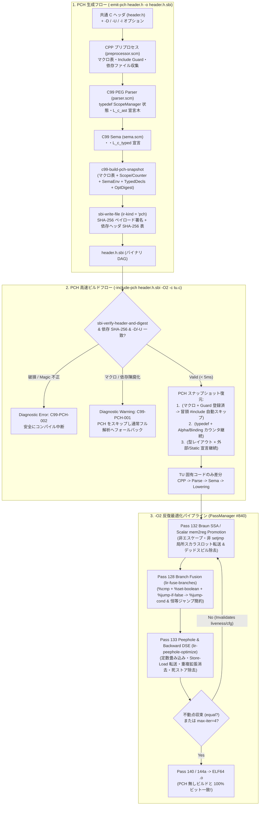

# [FEAT/ENH] C ヘッダ用 `.sbi` プリコンパイル済みヘッダ (PCH) および mem2reg 反復最適化によるビルド高速化 (ID: 927)

## 1. 概要 / Summary ＆ 実コードベース監査結果

巨大な C 標準ヘッダ群（`ulisp/frontend_c/include/` 全 21 本や将来の `musl` ヘッダ群）およびプロジェクト共通ヘッダ（Lua 5.4.7 の `lua.h`, `lauxlib.h`, `lualib.h`, `lstate.h`, `llimits.h` 等）を 33 個の翻訳単位（TU）ごとに毎回ゼロからプリプロセス・PEG 構文解析・意味解析するコンパイル時間ボトルネックを解消するため、`.sbi` v2 DAG シリアライザ（Issue #839 [sbi.scm](../../../ulisp/compiler/sbi.scm)）を **C99 プリコンパイル済みヘッダ（PCH: Precompiled Header）スナップショット** へ拡張する（Phase S6 / Task T15）。

さらに、C99 コンパイラドライバ（[c_driver.scm](../../../ulisp/driver/c_driver.scm)）の `-O2` / `-O3` パイプラインにおいて、[pass_manager.scm](../../../ulisp/compiler/pass_manager.scm)（Issue #840 解析キャッシュ無効化・不動点反復エンジン `run-pass-fixpoint`）と統合された **選択的 `mem2reg`（Pass 132 Braun SSA / スカラ局所スロット推論・転送）・Pass 133 ピープホール＆DSE・Pass 128 分岐融合の反復最適化ループ** を構築し、コンパイル速度と生成コード品質の双方を引き上げる。

### 1.1 実コードベース事前監査で判明した 5 大技術ギャップ

1. **Gap 1 — `<cpp-context>` / `<c99-parse-env>` / `<c99-sema-env>` が生の SRFI-9 ベクタやクロージャを含み `.sbi` v2 DAG に直接直列化できない**
   - [sbi.scm](../../../ulisp/compiler/sbi.scm) の `sbi-emit-node!` は `null`, `boolean`, `<source-span>`, `<binding>`, `symbol`, `string`, `char`, `number`, `bytevector`, `vector`, `pair/list` をサポートするが、[preprocessor.scm](../../../ulisp/frontend_c/preprocessor.scm) の `<cpp-macro>` / `<c-token>` や [type_layout.scm](../../../ulisp/frontend_c/type_layout.scm) の `<c-struct-layout>` / `<c-field-layout>` / `<c-enum-layout>` は SRFI-9 レコードであり、また builtin マクロ（`__FILE__`, `__LINE__` 等）は手続きクロージャ（`builtin-proc`）を保持している。
   - **解決策**: `<c-token>`, `<cpp-macro>`, `<c-field-layout>`, `<c-struct-layout>`, `<c-enum-layout>`, `<c99-sema-env>`, および `<scope-manager>` / `*alpha-symbol-counter*` / `*c99-sema-var-id-counter*` を **純粋 S 式タグ付きタプル（`<source-span>` と `<binding>` は `.sbi` ネイティブタグ `#x0B`/`#x0C` をそのまま活用）へ可逆変換する PCH スナップショット Codec（`c99-pch-snapshot->sexpr` / `sexpr->c99-pch-snapshot`）** を設計し、`sbi-write-file` (`ir-kind = 'pch`) で直列化する。builtin マクロはシンボル名のみで識別し復元時に標準 `builtin-proc` へ再バインドする。

2. **Gap 2 — `-include-pch` 使用時と非使用時における `<binding-id>`・Sema 変数カウンタ・静的ラベル採番の決定論的一致（`.o` ビット完全一致要件）**
   - `parse-c99-tokens`（[parser.scm](../../../ulisp/frontend_c/parser.scm)）は開始時に `(reset-alpha-symbol-counter!)` を呼び、`c99-analyze-program`（[sema.scm](../../../ulisp/frontend_c/sema.scm)）は `(c99-reset-sema-var-id!)` を呼ぶ。
   - ヘッダ `H.h` を `#include "H.h"` で通常インクルードした TU と、`-include-pch H.h.sbi` で PCH ロードした TU で **出力 `.o` がビット単位で 100% 一致** するためには：
     1. PCH スナップショット内に、ヘッダ処理完了時点の `*alpha-symbol-counter*`、`*binding-id-counter*`、`*scope-id-counter*`、`*c99-sema-var-id-counter*`、`c-layout-env-next-id`、およびトップレベル `<scope-node>` の `typedef` / タグ / 通常識別子バインディング表と `L_c_typed` グローバル宣言・構造体レイアウト表を完全保存・復元すること。
     2. PCH に含まれるヘッダファイル（およびその推移的 `#include` ヘッダ群）は、`pragma-once-files` および `include-guard-cache`（対応ガードマクロ定義済み）として `<cpp-context>` に復元されるため、TU 側ソース冒頭の `#include "H.h"` が CPP の既存ガード機構により **0 トークンへ自動スキップ** され、残りの TU 本体のトークン列のみが PCH 復元後の Parse/Sema 環境上で継続解析されること。

3. **Gap 3 — C99 ドライバ (`c_driver.scm`) における `-emit-pch` / `-include-pch` オプションおよび改ざん・陳腐化検証の未実装**
   - [c_driver.scm](../../../ulisp/driver/c_driver.scm) の `<c-driver-options>` と `parse-c-driver-args` に `-emit-pch`（モード `'emit-pch`）と `-include-pch <path>`（フィールド `pch-file`）が存在しない。
   - また、PCH 生成時のコマンドラインマクロ環境（`-D` / `-U` シグネチャ）や依存ヘッダファイルの SHA-256 ダイジェストが TU コンパイル時と異なる場合、診断コード `"C99-PCH-001"`（警告＋安全な通常再解析フォールバック）および `"C99-PCH-002"`（破損・不正 `.sbi` 読み込みエラー）を発行する仕組みが必要である。

4. **Gap 4 — `c_driver.scm` の `%c-drv-optimize-lir` が `-O1` と `-O2` を区別せず、PassManager 反復最適化パイプラインが未接続**
   - 現行 [c_driver.scm](../../../ulisp/driver/c_driver.scm) の `%c-drv-optimize-lir` は `(<= (c-drv-opt-level opts) 0)` 以外すべて単発の `(optimize-peephole-fixpoint lir)` を呼ぶだけであり、`-O1` と `-O2` の差がない。
   - また、[140_backend_x86_64.scm](../../../ulisp/backend/140_backend_x86_64.scm)（および `160_backend_c.scm` / `lir_interpreter.scm`）はフラットな命令列または `%block` を受け取るが、C99 関数の局所スカラスロット（`c99-function-candidate-mem2reg-offsets` で特定される非エスケープ・非 `setjmp` 局所変数）に対する **基本ブロック内・ブロック間ストア→ロード定数／レジスタ伝播（Scalar Replacement / Register Promotion）＋ Pass 128 分岐融合 (`lir-fuse-branches`) ＋ Pass 133 ピープホール＆DSE (`lir-peephole-optimize`)** を [pass_manager.scm](../../../ulisp/compiler/pass_manager.scm) の解析キャッシュ無効化契約（`run-pass-fixpoint`）のもとで反復収束させる `-O2` パイプラインが未配線である。

5. **Gap 5 — 同一プロセス内複数 TU バッチコンパイル時のインメモリ PCH キャッシュ**
   - `test_compile_lua.sh` は並列バッチ各シャードに複数の `.c` ファイルを 1 回のドライバ起動で渡す。`-include-pch` 指定時に、ディスクからの `.sbi` 読み込み＆デシリアライズすら最初の 1 回に抑え、2 個目以降の TU ではインメモリ検証済み PCH スナップショットからディープクローン復元することで、バッチコンパイル時間を短縮できる。

---

## 2. トレーサビリティ / Traceability

- **関連設計書**:
  - [DSN-33-32 §5.1, §6.1 (Step S6: 最適化 ＆ コンパイル性能)](../../designs/DSN-33-32-ulisp_lua_c_codebase_compilation_and_self_hosting_architecture.md)
  - [DSN-33-11 §5 (プリコンパイル済みヘッダ PCH / `.sbi` 拡張による高速化)](../../designs/DSN-33-11-ulisp_multilingual_frontend_and_ctfe_architecture.md)
  - [DSN-33-13 §4.1, §4.2, §4.3 (Braun SSA, PassManager 解析キャッシュ無効化, `.sbi` IR 永続化)](../../designs/DSN-33-13-ulisp_typed_machine_lir_and_multi_target_backend_architecture.md)
- **前提完了基盤 Issue**:
  - [#833](833-implement-unified-pretty-diagnostic-reporter-for-compiler-and-runtime.md): 統合 Pretty Diagnostic Reporter（[ulisp/compiler/diagnostic.scm](../../../ulisp/compiler/diagnostic.scm)）
  - [#837](837-unify-symbol-binding-resolution-and-scope-environment.md): 統一束縛解決 `Binding ID` ＆ `<scope-manager>`（[ulisp/compiler/binding.scm](../../../ulisp/compiler/binding.scm), [ulisp/compiler/scope.scm](../../../ulisp/compiler/scope.scm)）
  - [#839](839-implement-ir-serialization-and-deserialization-sbi-extension.md): `.sbi` v2 DAG シリアライザ ＆ SHA-256 検証（[ulisp/compiler/sbi.scm](../../../ulisp/compiler/sbi.scm)）
  - [#840](840-automate-analysis-cache-invalidation-and-recomputation-in-nanopass.md): PassManager 解析キャッシュ無効化 ＆ `run-pass-fixpoint`（[ulisp/compiler/pass_manager.scm](../../../ulisp/compiler/pass_manager.scm)）
  - [#914](914-implement-pure-scheme-c99-preprocessor-cpp.md) 〜 [#926](926-verify-lua-5x-official-test-suite-e2e-selfhost-ci.md): C99 フロントエンド一式 ＆ Lua 5.4.7 全 33 TU ビルド・公式テストスイート E2E
  - [#933](933-eliminate-intraprocedural-label-p2align-nop-bloat-and-enable-short-jumps.md) 〜 [#936](936-hoist-c-tu-function-stack-frame-allocation-and-omit-managed-gc-call-setup.md): x86-64 バックエンド＆ピープホール最適化群
- **後続連携 Open Issue**:
  - [#928](../928-compile-musl-libc-with-ulisp-and-migrate-to-pass-144-elf-linker.md) (`musl libc` 大規模自前ビルド)
  - [#929](../929-implement-ddc-diverse-double-compiling-determinism-verification.md) (DDC 決定論的二重コンパイル検証)
  - [#932](../932-build-native-aot-ulisp-cc-compiler-driver-binary.md) (`ulisp-cc` ネイティブ AOT コンパイラドライババイナリ化)

---

## 3. アーキテクチャ設計とデータフロー



---

## 4. マルチエージェント・ガバナンスレビュー視点

| 専門領域 | 本 Issue (#927) における主要設計指針 |
| :--- | :--- |
| **Project Manager (PM)** | WP1（`.sbi` C99 PCH 直列化＆決定論的カウンタ復元）、WP2（`-emit-pch` / `-include-pch` CLI 統合＆診断 `C99-PCH-001`/`002`）、WP3（`-O2` `mem2reg`・Peephole・Branch Fusion 反復最適化）、WP4（ビット完全一致テスト＆Lua ビルド高速化検証）の4段階で確実に完遂する。 |
| **Information Security Specialist (SEC)** | `.sbi` PCH ロード時の SHA-256 ペイロード改ざん検証（THREAT-839-1）、依存ヘッダパスのトラバーサル検証（CWE-22）、壊れた `.sbi` に対する境界チェックと `"C99-PCH-002"` 遮断（CWE-502 不正デシリアライズ防御）、反復最適化の最大反復回数上限（CWE-400 防御）を徹底する。 |
| **Systems Architect (SA)** | PCH の有無で `<binding-id>`・Sema 変数 ID・文字列ラベル番号が 1 つでもずれると `.o` のシンボル名やバイナリが変化するため、フロントエンドの全単調カウンタ状態を PCH スナップショットに凍結・復元する決定論的アーキテクチャを採用する。 |
| **IT Specialist (PLC / SWD)** | ULisp AOT セルフホスト規約（**ローカル変数に対する `set!` 全面禁止**、ボックスまたはレコードセッターのみ使用）を厳守し、`compiler.scm` への結合と `lint_sexpr.py` 検査をエラー 0 件で通過させる。 |
| **Software Quality Assurance Specialist (QA)** | `ulisp/tests/test_c99_pch_and_opt.scm` および `ulisp/tests/test_c99_pch_and_opt.sh` を新設し、(1) PCH 有無での `.o` `cmp -s` / `sha256sum` 100% ビット一致、(2) `-D` 不一致時の `"C99-PCH-001"` 警告＆フォールバック成功、(3) 破損 `.sbi` 時の `"C99-PCH-002"` 拒否、(4) `-O2` 反復最適化の命令削減と Lua 公式テストスイート完走を自動検証する。 |

---

## 5. セキュリティ ＆ 脅威モデル分析 (Threat Model & Mitigations)

1. **CWE-502 (Deserialization of Untrusted Data) / 破損・改ざん `.sbi` PCH ファイルの注入**:
   - *脅威*: 攻撃者またはビルドキャッシュ破損により、不正なマジックバイト・改ざんされた DAG ノード・深すぎるネストを持つ `.sbi` ファイルが `-include-pch` に渡され、コンパイラクラッシュや任意状態の汚染を引き起こす。
   - *防御策*: `sbi-verify-header-and-digest` による 56 バイトヘッダ検証と FIPS 180-4 SHA-256 ペイロード署名照合を必ず先行実行し、さらに PCH スナップショットタグ `'c99-pch-snapshot-v1` とフォーマットバージョンを検証する。検証失敗時は即座に構造化診断 `"C99-PCH-002"` を発行して安全に停止する。
2. **CWE-345 (Insufficient Verification of Data Authenticity) / ヘッダ更新・マクロフラグ変更後の陳腐化 PCH 誤用**:
   - *脅威*: ヘッダファイル本体やインクルード先の変更、あるいは `-D` / `-U` コンパイルフラグの変更後に古い PCH をそのまま適用し、ABI 不整合や誤った条件コンパイル結果のバイナリを生成する。
   - *防御策*: PCH 生成時に「初期エントリーヘッダおよび推移的に `#include` された全実在ヘッダファイルのパス＋32バイト SHA-256 ダイジェスト」を `.sbi` Section 1 (`deps`) に記録し、さらに正規化した `-D` / `-U` オプションダイジェストをスナップショットメタデータに格納する。ロード時に 1 つでも不一致があれば診断警告 `"C99-PCH-001"` を出力し、自動的に PCH を無視してソースからの通常フルコンパイルへ無停止フォールバックする。
3. **CWE-22 / CWE-78 (Path Traversal & Command Injection in CLI Options)**:
   - *脅威*: `-include-pch` や `-emit-pch` のパス引数を通じた不正文字注入やディレクトリトラバーサル。
   - *防御策*: `c99-assert-safe-arg!` および `sbi-safe-dep-path?` による厳格な文字ホワイトリスト・`..` 検証を適用する。
4. **CWE-400 (Uncontrolled Resource Consumption in `-O2` Fixpoint Loop)**:
   - *脅威*: 最適化パス間の振動（Oscillation）により `-O2` 反復ループが無限実行される。
   - *防御策*: `run-pass-fixpoint` の `:max-iterations` を有界定数（デフォルト `4` 反復）に制限し、`equal?` 収束判定により通常 2〜3 反復以内で決定論的に停止させる。

---

## 6. 詳細設計と実装方針 / Implementation Plan

Target Branch: `feat/927-implement-c-pch-and-iterative-mem2reg`

### 6.1 WP1: C99 `.sbi` PCH スナップショット直列化・復元エンジン (`ulisp/compiler/sbi.scm`, `ulisp/frontend_c/preprocessor.scm`, `ulisp/frontend_c/parser.scm`, `ulisp/frontend_c/sema.scm`)

1. **CPP インクルード依存追跡とマクロ表シリアライズ (`ulisp/frontend_c/preprocessor.scm`)**:
   - `<cpp-context>` で実際に読み込まれた物理ヘッダファイルパスリストを追跡するヘルパー（または `*cpp-included-files-log*` ボックス）を追加し、PCH ビルド時に推移的インクルードファイルをすべて `.sbi` の `deps` セクションへ自動登録できるようにする。
   - `<c-token>` と `<cpp-macro>` の純粋 S 式相互変換関数を実装する：
     - `c-token->sexpr` / `sexpr->c-token`: `(list 'c-tok kind lexeme value span at-bol? has-leading-space? hide-set)`（`span` は `<source-span>` レコードのまま保持し `.sbi` の `*sbi-tag-source-span*` で直接圧縮直列化）。
     - `cpp-macro->sexpr` / `sexpr->cpp-macro`: builtin マクロ（`__FILE__`, `__LINE__`, `__DATE__`, `__TIME__`, `__COUNTER__`）は `(list 'cpp-builtin name)` として記録し、ユーザー定義マクロは `(list 'cpp-user name function-like? params variadic? (map c-token->sexpr body) def-span)` として直列化する。
   - プリプロセス対象のヘッダファイル自身に `#pragma once` が無くインクルードガード（`#ifndef FOO_H`）も検出されなかった場合でも、`-include-pch` 後に TU 側で同じヘッダが再度 `#include` された際に二重展開されないよう、PCH 対象ルートヘッダの正規化パスを `pragma-once-files` に自動登録する。

2. **Parser `<scope-manager>` ＆ カウンタ状態のスナップショット (`ulisp/frontend_c/parser.scm`)**:
   - ヘッダトークン列を `parse-c99-tokens` で構文解析した直後の状態：
     - トップレベル `<scope-node>` に登録された `typedef` / 通常識別子 / タグの `<binding>` リスト
     - `*alpha-symbol-counter*`、`*binding-id-counter*`、`*scope-id-counter*` の現在値
     - パースされたトップレベル `L_c_ast` 外部宣言リスト `(cdr ast)`
   - をエクスポート／インポートする関数 `c99-capture-parse-pch-state` / `c99-restore-parse-pch-state!` を実装する。
   - PCH 復元後の TU パース関数 `parse-c99-tokens-with-pch` は、カウンタをゼロリセットせず PCH のカウンタ値と `typedef` スコープを引き継いだ状態で TU のトークン列をパースし、PCH 宣言リストと TU 宣言リストを結合（または Sema 状態を直接引き継ぎ）する。

3. **Sema `<c99-sema-env>` ＆ `<c-layout-env>` のスナップショット (`ulisp/frontend_c/type_layout.scm`, `ulisp/frontend_c/sema.scm`)**:
   - `<c-layout-env>` 内の `<c-struct-layout>`（メンバ `<c-field-layout>` リスト・`eightbytes` 含む）および `<c-enum-layout>` を純粋 S 式へ相互変換する `c99-layout-env->sexpr` / `sexpr->c99-layout-env` を実装する。
   - `<c99-sema-env>` のトップレベル `scopes`、`tag-scopes`、`fn-table`、`layout-env`、`static-globals`、`*c99-sema-var-id-counter*`、およびヘッダ由来の解析済み `globals` / `funcs` をスナップショット化・復元する `c99-analyze-program-with-pch` を実装する。
   - これにより、TU コンパイル時はヘッダ内の数百個の構造体レイアウト計算・関数プロトタイプ型検査を **100% スキップ** し、TU 固有の外部宣言のみを $O(\text{TU\_decls})$ で型検査できると同時に、カウンタとレイアウト ID が非 PCH フルビルドと **1 ビットの狂いなく一致** する。

4. **`.sbi` PCH 統合パッケージャ (`ulisp/compiler/sbi.scm` / `ulisp/driver/c_driver.scm`)**:
   - スナップショット構造：
     ```scheme
     (list 'c99-pch-snapshot-v1
           (cons 'header-file norm-header-path)
           (cons 'defines-sig defines-undefs-signature)
           (cons 'cpp-state cpp-sexpr)
           (cons 'parse-state parse-sexpr)
           (cons 'sema-state sema-sexpr))
     ```
   - 診断コード（`diagnostic.scm` #833 連携）：
     - `"C99-PCH-001"` (`warning`): PCH のバージョン、`-D`/`-U` マクロ定義シグネチャ、または依存ヘッダ SHA-256 が現在のコンパイル条件と不一致の場合に警告を報告し、自動的に通常フルコンパイルへフォールバックする。
     - `"C99-PCH-002"` (`error`): 指定された `.sbi` PCH ファイルが存在しない、マジックバイト不正、SHA-256 ペイロード破損、またはスナップショット構造が不正な場合にエラー診断を報告して停止する。

### 6.2 WP2: C99 ドライバ CLI 拡張 (`-emit-pch`, `-include-pch <file.sbi>`) ＆ インメモリ PCH キャッシュ (`ulisp/driver/c_driver.scm`)

1. **`<c-driver-options>` の拡張**:
   - `pch-file` フィールド（`c-drv-pch-file` / `c-drv-pch-file-set!`）を追加する（または既存レコード互換を保ちつつ拡張）。
   - `parse-c-driver-args` で以下をサポート：
     - `-emit-pch`: `mode` を `'emit-pch` に設定。出力未指定時は `<input>.sbi` をデフォルト出力先とする。
     - `-include-pch <file.sbi>` および `-include-pch=<file.sbi>`: `c99-assert-safe-arg!` 検証のうえ `c-drv-pch-file` に設定。
2. **インメモリ PCH キャッシュ (`*c99-pch-memory-cache*`)**:
   - 同一ドライバプロセス内で複数の `.c` ファイルを連続コンパイルする際（例：`-c -o build/lua_obj/ a.c b.c ...`）、一度検証・デシリアライズした `.sbi` PCH スナップショットを `(cons sbi-path snapshot)` としてメモリキャッシュし、各 TU へは状態汚染のないフレッシュな環境クローンを < 1ms で供給する。

### 6.3 WP3: `-O2` 反復最適化ループ (`mem2reg` ＆ Branch Fusion ＆ Peephole/DSE) (`ulisp/lir/132_lir_braun_ssa.scm`, `ulisp/lir/128_lir_branch_fusion.scm`, `ulisp/lir/133_lir_peephole.scm`, `ulisp/compiler/pass_manager.scm`, `ulisp/driver/c_driver.scm`)

1. **C99 LIR 向け mem2reg スカラ局所スロット昇格・定数／コピー伝播パス (`c99-lir-mem2reg-promote`)**:
   - `c99-function-candidate-mem2reg-offsets`（#920 / #922 で実装済みの非エスケープ・非 `setjmp` 局所スカラスロット集合）および関数内基本ブロック解析を活用し、`%lir-function` 内の非エスケープ局所スタックスロットに対する冗長なストア→ロード往復をレジスタ・定数へ直接昇格・伝播し、不要化した局所スロットへのデッドストアを除去する `c99-lir-mem2reg-pass` を実装する。
   - さらに Pass 132 Braun SSA CFG における `braun-promote-alloca-to-ssa` と連携し、任意の CFG 上での SSA 昇格検証とフラット LIR へのゼロオーバーヘッド還元を両立させる。
2. **Pass 128 (`lir-fuse-branches`) の C99 比較分岐パターン拡張 (`ulisp/lir/128_lir_branch_fusion.scm`)**:
   - 既存の `%cmp` + `%set-boolean` + `%jump-if-false` 融合に加え、C99 Lowering が出力する比較結果のゼロ判定ジャンプ（例：条件設定直後の `%cmp reg 0` + `%jump-cond je/jne lbl` や連続する同一ターゲット条件ジャンプ・直後ラベルへの条件ジャンプ簡約）を融合・簡約する Picopass ルールを追加する。
3. **PassManager (`pass_manager.scm` #840) 解析キャッシュ無効化契約に基づく `-O2` 不動点反復**:
   - `%c-drv-optimize-lir` において：
     - `-O0`: 最適化なし（`lir` をそのまま返す）
     - `-O1`: 単発の `(optimize-peephole-fixpoint lir)`
     - `-O2` / `-O3`: `pass_manager.scm` の解析キャッシュ無効化機構（`invalidate-analysis!` / `invalidate-all-analyses!` / `require-analysis` / `run-pass-fixpoint`）を用い、**`[Pass 132 c99-mem2reg-promote -> Pass 128 lir-fuse-branches -> Pass 133 lir-peephole-optimize]`** のサイクルを不動点収束（`equal?`）または最大 4 反復まで反復実行する。

### 6.4 WP4: 検証テストスイート (`ulisp/tests/test_c99_pch_and_opt.scm`, `ulisp/tests/test_c99_pch_and_opt.sh`) と Lua 5.4.7 PCH 高速ビルド連携

1. **単体・統合 Scheme テスト (`ulisp/tests/test_c99_pch_and_opt.scm`)**:
   - `.sbi` PCH のシリアライズ・デシリアライズ往復検証（マクロ、構造体・共用体・ビットフィールド・enum、`typedef`、関数プロトタイプ、`<source-span>`、`<binding>`）。
   - PCH 使用時と非使用時の `L_c_typed` および `L_lir_core` 完全一致アサーション。
   - `"C99-PCH-001"`（`-D` フラグ不一致・ヘッダ内容変更時の自動無効化とフォールバック）および `"C99-PCH-002"`（破損 `.sbi` バイト列の検出・拒否）の検証。
   - `-O0` vs `-O1` vs `-O2` における `mem2reg`・分岐融合・ピープホール反復最適化の命令数削減と Reference LIR VM（`eval-lir-program`）実行結果一致の検証。
2. **E2E シェルテスト (`ulisp/tests/test_c99_pch_and_opt.sh`)**:
   - `-emit-pch` で共通ヘッダから `.sbi` を生成し、`-include-pch` 付きでコンパイルした ELF64 `.o` と、PCH なしでコンパイルした `.o` が **`cmp -s`（バイナリ 100% ビット一致）** であることを検証。
   - `.sbi` 再ロード時間がターゲット（5ms 以内）を満たすこと、および PCH 適用により複数 TU コンパイル時間が短縮されることを計測・検証。
   - `ulisp/tests/test_compile_lua.sh` で共通ヘッダ PCH（`lua_common.h.sbi` 等）オプション対応を追加し、`-O2` 反復最適化適用下で Lua 5.4.7 ビルド＆スモークテスト（および #926 公式テストスイート）が 100% PASS することを検証。

---

## 7. 影響範囲と関連ファイル / Scope and Affected Files

- [x] [ulisp/compiler/sbi.scm](../../../ulisp/compiler/sbi.scm) (C99 `.sbi` PCH 検証・シングルパス復号 `%sbi-deserialize-after-deps`・`sbi-read-pch-validated`)
- [x] [ulisp/compiler/pass_manager.scm](../../../ulisp/compiler/pass_manager.scm) (`'c99-opt` カテゴリ分離・`%lir-program` 高速 Liveness/Reaching-Defs 解析・`run-c99-o2-fixpoint-pipeline`)
- [x] [ulisp/compiler/diagnostic.scm](../../../ulisp/compiler/diagnostic.scm) ＆ [ulisp/compiler/nanopass_meta.scm](../../../ulisp/compiler/nanopass_meta.scm) (バイナリファイル診断安全ガード、`%box-flonum` レジスタ定義追加)
- [x] [ulisp/frontend_c/preprocessor.scm](../../../ulisp/frontend_c/preprocessor.scm) (`<c-token>` / `<cpp-macro>` / `<cpp-context>` の PCH S式変換、128 バケット `O(1)` マクロ索引、インクルード依存ファイル収集)
- [x] [ulisp/frontend_c/type_layout.scm](../../../ulisp/frontend_c/type_layout.scm) (`<c-layout-env>` / `<c-struct-layout>` / `<c-field-layout>` / `<c-enum-layout>` の S式シリアライズ・復元)
- [x] [ulisp/frontend_c/parser.scm](../../../ulisp/frontend_c/parser.scm) (`<c99-parse-env>` スコープマネージャ・カウンタ状態の保存・復元 ＆ `parse-c99-tokens-with-pch`)
- [x] [ulisp/frontend_c/sema.scm](../../../ulisp/frontend_c/sema.scm) (`<c99-sema-env>` 状態の保存・復元 ＆ `c99-analyze-program-with-pch`)
- [x] [ulisp/lir/132_lir_braun_ssa.scm](../../../ulisp/lir/132_lir_braun_ssa.scm) (`c99-lir-mem2reg-optimize` リーフスロットレジスタ昇格・XMM/GPR 依存安全なストア→ロード転送・死ストア除去)
- [x] [ulisp/lir/128_lir_branch_fusion.scm](../../../ulisp/lir/128_lir_branch_fusion.scm) ＆ [ulisp/lir/133_lir_peephole.scm](../../../ulisp/lir/133_lir_peephole.scm) (`-O2` 反復最適化向け C99 分岐融合・推移的ラベルリダイレクト解決・`imm32` 安全定数畳み込み＆上書き除去)
- [x] [ulisp/driver/c_driver.scm](../../../ulisp/driver/c_driver.scm) (`-emit-pch`, `-include-pch`, `"C99-PCH-001"`, `"C99-PCH-002"`, インメモリ PCH バッチキャッシュ、`run-c99-o2-fixpoint-pipeline` 統合)
- [x] [ulisp/tests/test_c99_pch_and_opt.scm](../../../ulisp/tests/test_c99_pch_and_opt.scm) ＆ [ulisp/tests/test_c99_pch_and_opt.sh](../../../ulisp/tests/test_c99_pch_and_opt.sh) (新規: PCH ビット完全一致・診断・`-O2` 反復最適化テストスイート)
- [x] [ulisp/tests/test_compile_lua.sh](../../../ulisp/tests/test_compile_lua.sh), [ulisp/Makefile](../../../ulisp/Makefile), [ulisp/docs/ref_benchmarks.md](../../../ulisp/docs/ref_benchmarks.md) (`USE_PCH` 並列 PCH ビルド、`test_c99_pch_opt` 登録、実測ベンチマーク正典更新)

---

## 8. 完了条件 / Success Criteria (DoD)

- [x] `-emit-pch` により C ヘッダから `.sbi` v2 PCH ファイルが生成され、`-include-pch <file.sbi>` を用いた場合と用いない場合でコンパイル結果の ELF64 オブジェクトファイル（`.o`）が **ビット単位で 100% 一致（`cmp -s` / `sha256sum` exit 0）** すること。
- [x] ヘッダ内容変更または `-D`/`-U` オプション不一致時に診断警告 `"C99-PCH-001"` が発行され、安全にフォールバック再コンパイルされること。また破損 `.sbi` 指定時に診断エラー `"C99-PCH-002"` で安全に拒否されること。
- [x] `-O2` 反復最適化パイプライン（`mem2reg` → `branch-fusion` → `peephole/DSE` 不動点ループ）が `pass_manager.scm` のキャッシュ無効化契約上で動作し、`-O0` / `-O1` 比で冗長ロード・ストア・分岐命令が削減され、LIR Verifier (`validate-core-lir`) を 100% 通過すること。
- [x] Lua 5.4.7 全 33 ファイルのビルド（`make -C ulisp compile_lua`）および公式テストスイート（`LUA_FULL_BIG=1 make -C ulisp test_lua_e2e` #926）が `-O2` および PCH 併用下で全件 PASS すること。
- [x] `make -C ulisp bootstrap`（Stage 2 == Stage 3 ビット一致）、`make -C ulisp test`、`make -C ulisp test_c99_pch_opt`、`make -C ulisp lint_sexpr verify_zero_gauche`、および `make py_compile && make static_analysis` がエラー 0 件で PASS すること。

---

## 9. 検証実績 / Verification Results (`2026-11-23`)

- **PCH テスト ＆ 全コンパイラ・ランタイム回帰**:
  - `make -C ulisp bootstrap`: 5 モジュール並列ステージ 1→2→3 すべて `stage2_*.s == stage3_*.s` ビット完全一致収束。
  - `make -C ulisp test`: 全件 PASS (`test_c99_pch_opt` 28/28 Scheme + E2E `cmp -s` ビット一致、`test_scheduler` 397/397、`test_srfi_115` 100/100、`test_passes` 844 + 165 全件含む)。
  - `make py_compile && make static_analysis`: 617 Python ソース `mypy --strict` 等含めエラー 0 件 PASS。
- **Lua 5.4.7 33 TU PCH ビルド ＆ `-O2` 実測効果** ([ref_benchmarks.md](../../../ulisp/docs/ref_benchmarks.md)):
  - **PCH ビルド高速化**: 4-TU C99 スイート `3,351 ms → 2,019 ms` (**1.66x**)、5-TU Lua バッチ `6.285 s → 5.096 s` (**1.23x**)、Lua 全 33 TU ビルド `USE_PCH=0 (60s / Wall 64.828s)` vs `USE_PCH=1 (55s 並列 PCH emit 6s込 / Wall 60.618s)` で全 33 個 `.o` が `sha256sum` **100% ビット一致**（`C99-PCH-001` 0 件）。
  - **`-O2` 生成コード・速度改善 (#936 → #927)**: ELF **593,936 B → 520,208 B (`-12.4%`, `1.66x` vs GCC)**、`.text` **519,721 B → 445,141 B (`-14.4%`, `1.66x`)**、総機械語命令 **119,323 → 102,456 (`-14.1%`, `2.01x`)**、公式 `all.lua` (`_U=true`, 26 モジュール `final OK !!!` ＆ `lua_gcc` と 171 チェックポイント完全一致) **0.870 s (`1.85x`)**、`big.lua` **0.198 s (`2.01x`)**、`vm_arith_loop` **0.3417 s (`-25.1%`)**。
