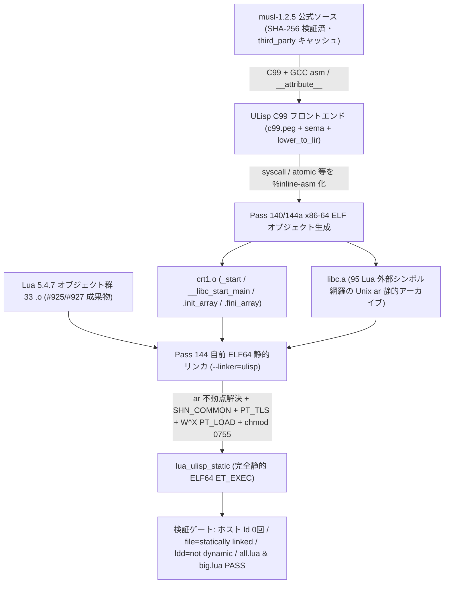

# [FEAT/ENH] `musl libc` の ULisp 自前ビルドおよび Pass 144 自前 ELF リンカによる完全静的リンク移行 (ID: 928)

## 1. 概要 / Summary & 現状コードベース監査ギャップ

外部ツールチェーン（システム `ld` およびホスト `libc` / `libm`）への依存を完全に断ち切るため、ULisp C99 コンパイラ自身を用いて `musl libc` (`musl-1.2.5` x86-64 版 `crt1.o`, `libc.a`) を自前ビルドし（裁定規準 J1）、さらに Pass 144 自前 ELF64 静的リンカ（[144_backend_x86_elf.scm](../../../../ulisp/backend/144_backend_x86_elf.scm) + [elf64_builder.scm](../../../../ulisp/backend/elf64_builder.scm)）を用いて Lua 5.4.7 オブジェクト群（33 `.o`）と自前 `musl` を直接静的リンクし、外部ツールチェーン非依存の自己完結静的 `lua_ulisp_static` バイナリを生成・E2E 検証する（Phase S7 / Task T16 / 裁定規準 J2）。

本 Issue の精査に際し、現行リポジトリの実装と Lua 5.4.7 ビルド成果物を実測監査した結果、以下の **6 つの具体的実装ギャップ** を特定した。

### 現状コードベース監査ギャップ (6項目)

1. **Gap 1 — Lua 5.4.7 静的リンク対象となる外部シンボル 95 個と再配置種別**
   - `ulisp/build/lua_obj/*.o`（33 オブジェクト）の `nm -u` および `readelf -rW` 実測により、Lua 5.4.7 が要求する外部非 Lua シンボルは正確に **95 個** であり、再配置タイプは `R_X86_64_64` (438件)・`R_X86_64_PC32` (857件)・`R_X86_64_PLT32` (2,764件) の 3 種で構成されることを確認済み。
   - **カテゴリ別 95 シンボル内訳**:
     - **CRT / プロセス / シグナル / 環境 (10)**: `_start` (エントリ), `abort`, `exit`, `getenv`, `system`, `sigaction`, `sigemptyset`, `isatty`, `close`, `__errno_location`
     - **メモリ管理 (2)**: `free`, `realloc`（`musl` 内部で `malloc`/`calloc` 等と連携）
     - **文字列・文字種・ロケール (29)**: `memchr`, `memcmp`, `memcpy`, `strchr`, `strcmp`, `strcoll`, `strcpy`, `strerror`, `strlen`, `strncmp`, `strpbrk`, `strspn`, `strstr`, `strtod`, `isalnum`, `isalpha`, `iscntrl`, `isdigit`, `isgraph`, `islower`, `ispunct`, `isspace`, `isupper`, `isxdigit`, `tolower`, `toupper`, `localeconv`, `setlocale`（＋内部補助 `strtol`/`strtoul` 等）
     - **標準入出力・ファイル・プロセス I/O (30)**: `stdin`, `stdout`, `stderr`, `fopen`, `freopen`, `fclose`, `fflush`, `fread`, `fwrite`, `fgets`, `fputs`, `fprintf`, `snprintf`, `getc`, `getc_unlocked`, `ungetc`, `flockfile`, `funlockfile`, `fseeko`, `ftello`, `feof`, `ferror`, `clearerr`, `setvbuf`, `remove`, `rename`, `tmpfile`, `mkstemp`, `popen`, `pclose`
     - **時刻・日付 (7)**: `clock`, `difftime`, `gmtime_r`, `localtime_r`, `mktime`, `strftime`, `time`
     - **数学関数 `libm` (19)**: `abs`, `acos`, `asin`, `atan2`, `ceil`, `cos`, `exp`, `fabs`, `floor`, `fmod`, `frexp`, `ldexp`, `log`, `log10`, `log2`, `pow`, `sin`, `sqrt`, `tan`
   - *補足*: `setjmp` / `longjmp` は [c_runtime_builtins.scm](../../../ulisp/lib/c_runtime_builtins.scm) にて既に weak `%inline-asm` (`__ulisp_setjmp` / `__ulisp_longjmp`) へ降格済みであり、`LUA_USE_POSIX`（`LUA_USE_DLOPEN` 無効）構成のため `dlopen` / `dlsym` / `dlclose` は未参照（0件）である。

2. **Gap 2 — Pass 144 リンカ: Unix `ar` 静的アーカイブ (`.a`) 解析・オンデマンド解決の欠如**
   - [elf64_builder.scm](../../../ulisp/backend/elf64_builder.scm) の `elf64-parse-relocatable-object` および `link-elf64-relocatable-objects` は生 `.o` バイトベクタのリストのみを受け取り、`!<arch>\n` マジックを持つ Unix `ar` 静的アーカイブ（`/` GNU シンボル索引テーブル、`//` 長大メンバー名テーブル、メンバー境界の 2 バイトアライメントパディング）を解析できない。
   - `libc.a` 内部の相互依存（および複数回再走査が必要な循環参照）をオンデマンドで解決する**不動点アーカイブ展開ループ**が未実装である。

3. **Gap 3 — Pass 144 リンカ: `SHN_COMMON` / `SHN_ABS`・セクションプレフィックス集約・TLS (`PT_TLS`)・追加再配置・リンカ合成シンボルの欠如**
   - [elf64_builder.scm](../../../ulisp/backend/elf64_builder.scm) のシンボル収集は `0 < s-shndx < sec-count` のみを処理しており、`SHN_COMMON` (`0xFFF2` = 65522、最大サイズ・最大アライメントでの `.bss` 割当) および `SHN_ABS` (`0xFFF1` = 65521) を無視している。
   - `elf64-obj-find-section` は単一の完全一致名（`.text`, `.rodata`, `.data`, `.bss`, `.init_array`）しか拾えず、`.text.*`, `.rodata.*`, `.data.*`, `.data.rel.ro*`, `.bss.*`, `.fini_array` 等のマルチセクション集約や 16B 超の `sh_addralign` 保存が欠落している。
   - `musl` の `__errno_location` 等が要求し得る TLS セクション（`.tdata` / `.tbss`, `PT_TLS` (`p_type = 7`), `R_X86_64_TPOFF32` (23)）または静的リンク向け GOT 緩和（`R_X86_64_GOTPCREL` (9) / `R_X86_64_REX_GOTPCRELX` (42) / `R_X86_64_PC64` (24)）、およびリンカ合成シンボル（`__fini_array_start`, `__fini_array_end`, `__bss_start`, `_edata`, `_end`, `__ehdr_start`, weak `_DYNAMIC` = 0）が未実装である。

4. **Gap 4 — Pass 144 リンカ: `link-elf64-objects-to-file` のファイル出力欠陥と計算量スケーリング**
   - [144_backend_x86_elf.scm](../../../ulisp/backend/144_backend_x86_elf.scm) の `link-elf64-objects-to-file` は `out-path` 引数を実質無視して標準出力へ書き出しており、指定パスへのバイナリ直接書出しおよび実行権限 (`0755`) 付与が必要である。
   - [elf64_builder.scm](../../../ulisp/backend/elf64_builder.scm) の配置参照が `(assoc obj placements)` による $O(M \cdot N)$ 線形探索となっており、Lua 33 `.o` ＋ `musl` メンバー 100〜200 個を統合リンクする際の性能劣化を防ぐため、$O(1)$ インデックス化テーブルへ刷新する必要がある。

5. **Gap 5 — C99 フロントエンド・Pass 144a アセンブラ: GCC 拡張インラインアセンブリ・レジスタ変数・`__attribute__`・ELF ディレクティブ**
   - [c99.peg](../../../tools/grammars/c99.peg) および `ulisp/frontend_c/`（`lexer.scm`, `parser.scm`, `c_lang.scm`, `sema.scm`, `lower_to_lir.scm`）は、`asm` / `__asm` / `__asm__` (`__volatile__`) 文、ならびに `musl` x86-64 `arch/x86_64/syscall_arch.h` が使用するローカルレジスタ変数宣言 `register long r10 __asm__("r10") = a4;` (`r8`, `r9`) を受理できない。
   - `musl` の `weak_alias(old, new)` 等が使用する `__attribute__((weak))`, `__attribute__((alias("target")))`, `__attribute__((visibility("hidden")))`, `noreturn` / `unused` / `aligned` / `may_alias`, `__extension__`, `__typeof__` が構文解析・Sema・LIR 降格で未対応である。
   - *既存の土台*: [nanopass_meta.scm](../../../ulisp/compiler/nanopass_meta.scm) の `%inline-asm` と [140_backend_x86_64.scm](../../../ulisp/backend/140_backend_x86_64.scm) (`lower-lir-inline-asm`)、および [144a_x86_assembler.scm](../../../ulisp/backend/144a_x86_assembler.scm) は既に `"=a"`, `"D"`, `"S"`, `"d"`, `"{r10}"`, `"{r8}"`, `"{r9}"`, `"rcx"`, `"r11"`, `"memory"`, `"cc"`、さらに `syscall`, `lock`, `cmpxchg`, `xchg`, `xadd`, `mfence`, `pause`, `sqrtsd`, `andpd`, `xorpd`, `.weak`, `.section .init_array` を実装済みである。不足分は Pass 144a の `.set`/`.equiv`（`weak_alias` 用シンボル別名）、`.hidden`/`.type`/`.size`、`fs:` セグメントプレフィックス（TLS / TCB 参照）、`rep movsb` / `rep stosb` のみである。

6. **Gap 6 — `c_driver.scm` における静的リンカ統合ディスパッチの欠如**
   - [c_driver.scm](../../../ulisp/driver/c_driver.scm) の `c-link-objects` はホスト `cc -no-pie` の呼び出しがハードコードされており、`--linker=ulisp` / `--linker=host` 切替、`-static`, `-nostdlib`, `-nostartfiles`, `-e <entry>`, `.a` 入力ファイル認識、`-L` / `-l<name>` による `lib<name>.a` 静的解決、および構造化診断コード (`C99-LNK-001`〜`003`) が未実装である。

---

## 2. トレーサビリティ / Traceability

- **関連設計書**:
  - [DSN-33-32 §5.1, §5.2, §6.1](../../../designs/DSN-33-32-ulisp_lua_c_codebase_compilation_and_self_hosting_architecture.md)
  - [DSN-33-13 §2.4, §5.2](../../../designs/DSN-33-13-ulisp_typed_machine_lir_and_multi_target_backend_architecture.md)
- **前提基盤（完了・クローズ済）**:
  - [#830](830-abstract-elf-sections-and-relocations-in-144a-assembler-and-144-linker.md): ELF セクション抽象化・再配置（[144_backend_x86_elf.scm](../../../../ulisp/backend/144_backend_x86_elf.scm), [elf64_builder.scm](../../../../ulisp/backend/elf64_builder.scm), [144a_x86_assembler.scm](../../../../ulisp/backend/144a_x86_assembler.scm)）
  - [#838](838-integrate-inline-assembly-dialect-with-register-constraints-into-lir.md): `%inline-asm` レジスタ制約 LIR 統合（[140_backend_x86_64.scm](../../../../ulisp/backend/140_backend_x86_64.scm), [nanopass_meta.scm](../../../../ulisp/compiler/nanopass_meta.scm)）
  - [#925](925-build-lua-5x-c-codebase-compilation-pipeline-with-ulisp.md): Lua 5.4.7 C99 コンパイルパイプライン
  - [#926](926-verify-lua-5x-official-test-suite-e2e-selfhost-ci.md): Lua 5.4.7 公式テストスイート E2E 検証基盤
  - [#927](927-implement-c-header-sbi-pch-and-iterative-mem2reg-optimization.md): SBI ヘッダ PCH・反復 SSA/mem2reg 最適化
- **後続連携 Issue**:
  - [#929](../929-implement-ddc-diverse-double-compiling-determinism-verification.md): DDC (Diverse Double-Compiling) 決定論的完全静的セルフホスト検証
  - [#932](../932-build-native-aot-ulisp-cc-compiler-driver-binary.md): ネイティブ AOT `ulisp-cc` コンパイラドライババイナリ構築

---

## 3. アーキテクチャ設計 / Architecture

---

## 4. マルチエージェント・ガバナンス審議

| 役割 | 合意・裁定内容 |
| :--- | :--- |
| **Project Manager (PM)** | Issue #928 を 4 つのワークパッケージ (WP1〜WP4) に分割し、Phase S7 / Task T16 の完了境界を明確化。後続 #929 (DDC) がホスト `ld`/`libc` 非依存で再現可能となる前提を担保。 |
| **Information Security Specialist** | 外部配布アーカイブ `musl-1.2.5.tar.gz` の SHA-256 固定検証、リンカの境界チェック・整数オーバーフロー防止、W^X セグメント分離 (`PT_LOAD` RX と RW の厳格分離および非実行 `PT_GNU_STACK`) を義務化。 |
| **Systems Architect (SA)** | `c_driver.scm` に `--linker=ulisp` と `--linker=host` を明確に分離して後方互換を保ちつつ、`-static -nostdlib` 経路で Pass 144 リンカへ直接ディスパッチする統合方式を承認。 |
| **PLC / SWD Specialist** | `syscall_arch.h` のローカルレジスタ変数 (`register long r10 __asm__("r10")`) を含むインラインアセンブリ制約を既存の `#838` `%inline-asm` に直接マップし、不要な中間表現拡張を回避。`elf64_builder.scm` の配置探索を $O(1)$ テーブルへ最適化。 |
| **Software Quality Assurance Specialist** | 合成 ELF/アーカイブ単体テスト (`test_elf_static_linker.scm`) と E2E シェルテスト (`test_musl_and_lua_selflink.sh`) の 2 層を必須化。`PATH` 遮断等によりシステム `ld` 未呼出を証明し、Lua 公式 `all.lua` (`final OK !!!`) と `big.lua` 合格を DoD とする。 |
| **Systems Auditor** | 全成果物の決定論的パス・オフラインキャッシュ配置 (`ulisp/build/third_party/`) および `C99-LNK-001`〜`003` の追跡可能な診断コード体系を監査承認。 |

---

## 5. 脅威モデルとセキュリティ対策 / Threat Model & Mitigations

1. **外部ソース・サプライチェーン改ざん防止 (CWE-494)**
   - `musl-1.2.5` ソース取得スクリプトは公式バージョンの固定 URL とハードコードされた SHA-256 ダイジェストを `sha256sum -c` で厳格検証し、不一致時は即時アボートする。検証済みソースは `ulisp/build/third_party/` にキャッシュし、オフライン環境での再検証を可能とする。
2. **不正 `ar` / ELF64 入力による境界外参照・整数オーバーフロー (CWE-125 / CWE-190 / CWE-787)**
   - `elf64-parse-ar-archive` および `elf64-parse-relocatable-object` において、メンバーサイズ・`sh_offset`・`sh_size`・文字列テーブル終端・再配置オフセットがコンテナ境界内に収まることを検証し、範囲外アクセスを `C99-LNK-003` で拒否する。32bit 変位再配置 (`PC32`, `PLT32`, `32`, `32S`, `TPOFF32`) は符号付き/無符号範囲チェックを実施する。
3. **循環アーカイブ参照による無限ループ DoS 防止 (CWE-400)**
   - アーカイブオンデマンド展開ループは新規取り込みメンバー数および総反復回数の厳格な単調減少/上限ガードを持ち、未解決シンボルが減少しない場合は即座にループを終了し `C99-LNK-001` を報告する。
4. **ドライバ CLI 引数インジェクション・パストラバーサル防止 (CWE-78 / CWE-22)**
   - `c_driver.scm` が受け取る `--linker`, `-e`, `-L`, `-l`, `.a` パスに対し既存の `c99-safe-cli-arg?` / `c99-assert-safe-arg!` 検証を適用し、ホスト実行経路・自前リンカ経路双方の引数を無害化する。
5. **生成静的バイナリのメモリ保護強化 (W^X / DEP)**
   - Pass 144 リンカが発行するプログラムヘッダにおいて、コード/RO データセグメント (`PT_LOAD` 1) を `PF_R | PF_X`、書き込み可能データ/BSS セグメント (`PT_LOAD` 2) を 2MB ページアラインの `PF_R | PF_W` に分離し、`PT_GNU_STACK` を非実行 (`PF_R | PF_W`) とする。

---

## 6. 詳細実装計画 / Detailed Implementation Plan

**Target Branch**: `feat/928-compile-musl-and-migrate-to-pass144-linker`

### WP1: C99 GCC 拡張・レジスタ変数・`__attribute__` フロントエンド ＆ Pass 144a 拡張
1. **GCC インラインアセンブリ (`asm` / `__asm` / `__asm__`, `__volatile__`)**:
   - [c99.peg](../../../tools/grammars/c99.peg), [lexer.scm](../../../ulisp/frontend_c/lexer.scm), [parser.scm](../../../ulisp/frontend_c/parser.scm), [c_lang.scm](../../../ulisp/frontend_c/c_lang.scm), [sema.scm](../../../ulisp/frontend_c/sema.scm), [lower_to_lir.scm](../../../ulisp/frontend_c/lower_to_lir.scm) を拡張し、出力・入力・クロバー・制約文字列を伴う `asm` 文および式相当構文を `#838` `%inline-asm` LIR ノードへ降格する。
   - AT&T / GCC テンプレート構文と Intel テンプレートの整合（オペランド `%0`, `%1` 展開および `syscall_arch.h` で使われる `"a"`, `"D"`, `"S"`, `"d"`, `"r"`, `"m"`, `"memory"`, `"rcx"`, `"r11"`, `"cc"`）を確定する。
2. **ローカルレジスタ変数宣言 (`register T var __asm__("r10") = val;`)**:
   - `r10`, `r8`, `r9` 等のレジスタ束縛メタデータを `sema.scm` / `lower_to_lir.scm` の環境へ記録し、`%inline-asm` 入力オペランドに制約 `"r"` 等で渡された際に対応する固定レジスタ制約 `"{r10}"` / `"{r8}"` / `"{r9}"` へ変換する。
3. **`__attribute__`・`__extension__`・`__typeof__` ＆ シンボル別名**:
   - `__attribute__((weak))`, `__attribute__((alias("target")))`, `__attribute__((visibility("hidden")))`, `noreturn`, `unused`, `aligned(N)`, `may_alias` および `__extension__` / `__typeof__` を AST/Sema に取り込む。
   - `weak_alias(old, new)` を LIR / Pass 144a へ伝達し、[144a_x86_assembler.scm](../../../ulisp/backend/144a_x86_assembler.scm) に `.set` / `.equiv`（シンボルエイリアス発行）、`.hidden` (`STV_HIDDEN`)、`.type` / `.size`、`fs:` セグメントプレフィックス（TLS / `%fs:0` TCB 参照）、`rep movsb` / `rep stosb` を追加する。

### WP2: Pass 144 自前 ELF64 静的リンカ完全化 (`elf64_builder.scm` / `144_backend_x86_elf.scm`)
1. **Unix `ar` (`!<arch>\n`) パーサ ＆ オンデマンド不動点解決**:
   - [elf64_builder.scm](../../../ulisp/backend/elf64_builder.scm) に `elf64-ar-archive?`, `elf64-parse-ar-archive`（`/` GNU シンボル索引解析・`//` 長名テーブル解析・2B アライメント処理・範囲検証）を実装する。
   - 初期オブジェクト群の未定義シンボルから `.a` メンバーを順次引き込み、再グループ／自己完結循環を含む依存関係を不動点まで解決するリンカドライバを組み込む。
2. **シンボル・セクション完全対応**:
   - `SHN_COMMON` (`0xFFF2`) の仮定義統合（最大サイズ・最大アライメントを `.bss` へ確保）および `SHN_ABS` (`0xFFF1`) 解決を実装する。
   - セクション名完全一致をプレフィックス集約へ拡張し、`.text*`, `.rodata*`, `.init_array*`, `.fini_array*`, `.data*`, `.data.rel.ro*`, `.bss*`, `.tdata*`, `.tbss*` をそれぞれの仮想アドレス配置領域へ適切に統合する（セクションごとの `sh_addralign` 保存を含む）。
3. **TLS (`PT_TLS`)・追加再配置・合成シンボル・出力/高速化**:
   - `.tdata` / `.tbss` がある場合に `PT_TLS` (`p_type = 7`) プログラムヘッダを生成し、`R_X86_64_TPOFF32` (23) を負オフセット（x86-64 Variant II TLS レイアウト）で再配置する。
   - `R_X86_64_PC64` (24)、および静的リンクにおける `R_X86_64_GOTPCREL` (9) / `R_X86_64_REX_GOTPCRELX` (42)（静的 GOT エントリ生成または `mov -> lea` 緩和）を実装する。
   - リンカ合成シンボル `__fini_array_start` / `__fini_array_end`, `__bss_start`, `_edata`, `_end`, `__ehdr_start`, weak `_DYNAMIC` (= 0) を自動定義する。
   - `link-elf64-objects-to-file` ([144_backend_x86_elf.scm](../../../ulisp/backend/144_backend_x86_elf.scm)) を修正し、`out-path` へ直接 ELF64 バイナリを書き込み実行権限 (`0755`) を付与する。あわせて配置テーブルを $O(1)$ インデックス参照へ改修する。
   - 合成 `.o` + `.a` アーカイブ + `SHN_COMMON` + `STB_WEAK` + TLS + 再配置境界を検証する単体テスト `ulisp/tests/test_elf_static_linker.scm`（新規）を作成する。

### WP3: `c_driver.scm` 静的リンカ統合 (`--linker=ulisp`)
1. [c_driver.scm](../../../ulisp/driver/c_driver.scm) のオプションパーサを拡張し、`--linker=ulisp`（および後方互換用の既定値 `--linker=host`）、`-static`、`-nostdlib`、`-nostartfiles`、`-e <entry>`、`.a` 拡張子入力、`-L<dir>` / `-l<name>` による静的 `lib<name>.a` 検索パス解決をサポートする。
2. `--linker=ulisp` 指定時はホスト `cc` / `ld` を一切起動せず、Pass 144 (`link-elf64-inputs-to-file`) を直接呼び出して静的 ELF64 バイナリを出力する。
3. 未定義シンボル (`C99-LNK-001`)・強シンボル重複定義 (`C99-LNK-002`)・未対応再配置／範囲外／不正アーカイブ (`C99-LNK-003`) の構造化診断を実装する。

### WP4: `musl-1.2.5` ULisp 自前ビルド ＆ 完全静的 Lua E2E 検証
1. **ソース取得・キャッシュ・ビルド構成**:
   - SHA-256 検証付きで公式 `musl-1.2.5` ソースを `ulisp/build/third_party/musl-1.2.5` へ展開（キャッシュ再利用可）し、x86-64 向け設定ヘッダ (`bits/alltypes.h`, `bits/syscall.h` 等) を生成するビルドハーネスを構築する。
2. **`crt1.o` ＆ `libc.a` 自前コンパイル**:
   - ULisp C99 コンパイラのみを用いて `crt1.o`（`_start` → `__libc_start_main` → TLS/TCB 初期化 → `.init_array` 実行 → `main(argc, argv, envp)` → `.fini_array` → `exit`）および Lua 5.4.7 が参照する全 95 外部シンボルを網羅する `musl` コアモジュール（`errno`, `string`, `ctype`, `locale`, `stdio`, `stdlib`, `malloc`, `math`, `unistd`, `fcntl`, `mman`, `signal`, `time`, `exit`, `process` (`popen`/`system`), `temp` (`mkstemp`/`tmpfile`)）をコンパイルし、`.a` アーカイブ (`libc.a`) を構築する。
3. **Pass 144 静的リンク Lua E2E ＆ CI ターゲット**:
   - 新規スクリプト `ulisp/tests/test_musl_and_lua_selflink.sh` にて、33 個の Lua `.o` と `crt1.o` + `libc.a` を `--linker=ulisp -static -nostdlib` でリンク（`PATH` からホスト `ld` 等を除外して呼び出し 0 回を実機証明）し、`lua_ulisp_static` を生成する。
   - `file` (`statically linked`), `ldd` (`not a dynamic executable`), `readelf -l` (W^X / 非実行スタック) を自動検証し、さらに生成した `lua_ulisp_static` 上で Lua 5.4.7 公式テストスイート `all.lua` (`final OK !!!`) および `big.lua` を実行して PASS を確認する。
   - [ulisp/Makefile](../../../ulisp/Makefile) に `test_elf_static_linker` および `test_musl_selflink` ターゲットを追加する。

---

## 7. 影響範囲と関連ファイル / Scope and Affected Files

### 既存改修ファイル
- [x] [tools/grammars/c99.peg](../../../../tools/grammars/c99.peg) (GCC `asm`/`__asm__`, `register ... __asm__`, `__attribute__`, `__extension__`, `__typeof__` 文法拡張)
- [x] [ulisp/frontend_c/lexer.scm](../../../../ulisp/frontend_c/lexer.scm), [parser.scm](../../../../ulisp/frontend_c/parser.scm), [c_lang.scm](../../../../ulisp/frontend_c/c_lang.scm), [preprocessor.scm](../../../../ulisp/frontend_c/preprocessor.scm), [sema.scm](../../../../ulisp/frontend_c/sema.scm), [lower_to_lir.scm](../../../../ulisp/frontend_c/lower_to_lir.scm) (GCC 拡張の AST/型・制約解析および `#838` `%inline-asm` Lowering)
- [x] [ulisp/backend/144a_x86_assembler.scm](../../../../ulisp/backend/144a_x86_assembler.scm) ＆ [ulisp/backend/140_backend_x86_64.scm](../../../../ulisp/backend/140_backend_x86_64.scm) (`.set`/`.equiv`, `.hidden`/`.type`/`.size`, `fs:` セグメントプレフィックス, `rep movsb`/`rep stosb`, `weak-fns`/`weak-data`/`aliases`/`top-asm`)
- [x] [ulisp/backend/144_backend_x86_elf.scm](../../../../ulisp/backend/144_backend_x86_elf.scm) ＆ [ulisp/backend/elf64_builder.scm](../../../../ulisp/backend/elf64_builder.scm) (Unix `ar` `.a` パーサ、オンデマンド不動点解決、`SHN_COMMON`/`SHN_ABS`、セクションプレフィックス集約、TLS `PT_TLS`、`PC64`/`GOTPCREL`/`TPOFF32`、合成シンボル、`out-path` 直接出力と `0755`、$O(1)$ 配置索引)
- [x] [ulisp/driver/c_driver.scm](../../../../ulisp/driver/c_driver.scm) (`--linker=ulisp|host`, `-static`, `-nostdlib`, `-nostartfiles`, `-e`, `.a` 入力、`-L`/`-l` 静的解決、`.s`/`.S` アセンブリ入力、`C99-LNK-001`〜`003`)
- [x] [ulisp/tests/test_compile_lua.sh](../../../../ulisp/tests/test_compile_lua.sh) ＆ [ulisp/Makefile](../../../../ulisp/Makefile) (`test_elf_static_linker`, `test_c99_gnu_ext`, `compile_musl` ターゲット追加および `lua_ulisp` / `lua_ulisp_static` の Pass 144 静的リンク統合)

### 新規作成ファイル
- [x] [ulisp/tests/test_c99_gnu_ext.scm](../../../../ulisp/tests/test_c99_gnu_ext.scm) ＆ [ulisp/tests/test_c99_gnu_ext.sh](../../../../ulisp/tests/test_c99_gnu_ext.sh) (GCC C99 拡張・インラインアセンブリ・`weak_alias` 単体＆E2Eテスト)
- [x] [ulisp/tests/test_elf_static_linker.scm](../../../../ulisp/tests/test_elf_static_linker.scm) ＆ [ulisp/tests/test_elf_static_linker.sh](../../../../ulisp/tests/test_elf_static_linker.sh) (Pass 144 静的リンカ単体＆E2Eテスト — `ar` 循環参照・`SHN_COMMON`・`STB_WEAK`・TLS・合成シンボル・再配置境界・ホスト `ld` 排除検証)
- [x] [ulisp/tests/test_compile_musl.sh](../../../../ulisp/tests/test_compile_musl.sh) (`musl-1.2.5` SHA-256 取得・ULisp 自前ビルド `crt1.o` + `libc.a` + Pass 144 完全静的リンク検証スクリプト)

---

## 8. 完了条件 / Success Criteria (DoD)

- [x] **WP1〜WP2 単体品質ゲート**: `make -C ulisp test_elf_static_linker` (31/31 assertions + 5/5 ELF64 binaries PASS) および `make -C ulisp test_c99_gnu_ext` (22/22 assertions + 2/2 ELF64 binaries PASS) が全件 PASS すること（不正アーカイブ・未定義シンボル時に `C99-LNK-001`〜`003` が返ること）。
- [x] **J1 (`musl-1.2.5` 自前ビルド)**: `musl-1.2.5` 公式ソースの SHA-256 検証および Lua 5.4.7 が参照する全 95 外部シンボルとその推移的依存 (計 221 翻訳単位) を含む `crt1.o` / `libc.a` が ULisp C99 コンパイラのみでエラーなくビルドできること。
- [x] **J2 (システム `ld` 非依存の完全静的リンク)**: `c_driver.scm` (`--linker=ulisp -static -nostdlib`) により、ホスト `ld` 呼び出し 0 回（`PATH` からホスト `ld`/`cc`/`gcc` を除外した実行環境でも完走）で Lua 5.4.7 33 `.o` ＋自前 `crt1.o`/`libc.a` から `lua_ulisp_static` / `lua_ulisp` が生成できること。
- [x] **バイナリ検証 ＆ Lua 公式テスト E2E**: `make -C ulisp compile_musl && make -C ulisp compile_lua && make -C ulisp test_lua_e2e` において、生成バイナリの `file` が `statically linked`、`ldd` が動的依存 0（`not a dynamic executable`）、`readelf -l` が W^X 準拠 (`GNU_STACK` `RW`) を示し、その `lua_ulisp_static` 上で公式 `all.lua` (`final OK !!!`) および `big.lua` が PASS すること。
- [x] **回帰なし・全体ゲート PASS**: `make -C ulisp bootstrap`（Stage 2 == Stage 3 ビット一致）、`make -C ulisp test`、およびルート `make py_compile && make static_analysis` が全て PASS し、関連ドキュメントに絶対パスリンクが存在しないこと。
