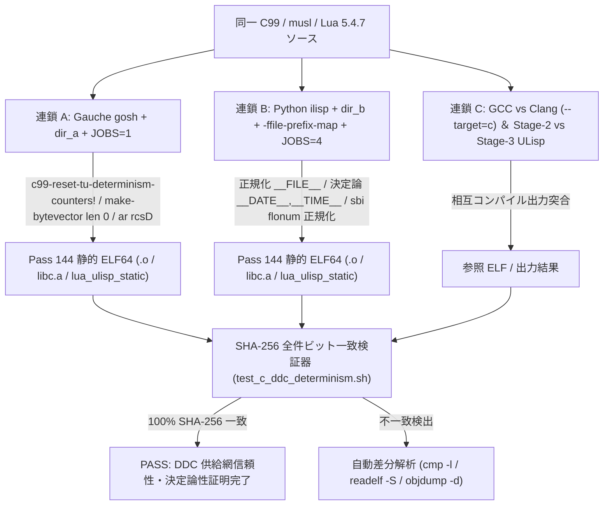

# [FEAT/ENH] DDC (Diverse Double-Compiling) による C コンパイル出力の決定論性・ビット一致検証ハーネスの実装 (ID: 929)

## 1. 概要 / Summary & 現状コードベース監査ギャップ

ULisp による C99 コンパイルパイプラインの決定論性（Deterministic Compilation）および供給網信頼性（Ken Thompson の "Trusting Trust" 攻撃対策 / David A. Wheeler の Diverse Double-Compiling）を証明するため、同一の Lua 5.4.7 および `musl-1.2.5` の C/アセンブリソースコード群を異なるホスト Scheme 処理系（Gauche `gosh` vs Python `ilisp`）・C コンパイラ系統（GCC vs Clang / セルフホスト Stage-2 vs Stage-3 ULisp）・異なるビルドディレクトリ（`-ffile-prefix-map` 正規化）および異なる並列度（`JOBS=1` vs `JOBS=4`）でビルド・突合し、生成 `.o`・`libc.a`・静的 ELF64 バイナリの SHA-256 ハッシュ完全一致を検証する DDC ハーネスを実装する（Phase S8 / Task T17）。

本 Issue の精査に際し、現行リポジトリの C99 フロントエンド・PCH・ELF64 バックエンド・`musl` ビルドスクリプトを実測監査した結果、以下の **6 つの具体的実装ギャップ** を特定した。

### 現状コードベース監査ギャップ (6項目)

1. **Gap 1 — 未初期化 `make-bytevector` による ELF パディング不定値リスク**
   - [144a_x86_assembler.scm](../../../ulisp/backend/144a_x86_assembler.scm)（lines 2137–2139, 2649–2653）および [elf64_builder.scm](../../../ulisp/backend/elf64_builder.scm)（lines 53, 169, 239, 261, 312, 445, 485, 663, 665, 747, 823, 920 等）に、第 2 引数 `0` を省略した `(make-bytevector len)` が残存している。
   - R7RS §6.9 仕様上、初期値省略時のバイトベクタ内容は未規定であるため、異なる Scheme ホスト処理系（Gauche / ILisp / ULisp AOT）間でセクション終端・アライメント余白に非ゼロの不定バイトが混入し、ビット一致を阻害し得る。

2. **Gap 2 — バッチコンパイル時の TU 間カウンタ非リセット**
   - [c_driver.scm](../../../ulisp/driver/c_driver.scm) の `c99-compile-file-to-lir`（lines 476–499）において、同一プロセス内で複数翻訳単位（TU）を連続コンパイルする際、`*source-span-id-counter*`, `*symbol-counter*`, `*label-counter*`, `*string-counter*`, `*cpp-include-skip-counter*` 等が TU 境界でリセットされない。
   - このため、シャード分割順や先行 TU の有無（例: `JOBS=1` vs `JOBS=4`）によって生成ラベル番号や `<source-span>` ID が変動し、出力 `.o` のビット一致が保証されない。

3. **Gap 3 — `__FILE__` 絶対パス埋め込み ＆ `-ffile-prefix-map` / 決定論的 `__DATE__`・`__TIME__` の未実装**
   - [preprocessor.scm](../../../ulisp/frontend_c/preprocessor.scm) の `__FILE__` ビルトイン展開（lines 625–634）は `(span-file sp)` を無変換で文字列リテラル化するため、異なる作業ディレクトリから同一ソースをビルドすると `.rodata` の文字列定数が変化して SHA-256 が一致しない。
   - また、`__DATE__` / `__TIME__` の決定論的展開（環境変数 `SOURCE_DATE_EPOCH` または固定基準値による非壁時計展開）および [c_driver.scm](../../../ulisp/driver/c_driver.scm) における `-ffile-prefix-map=OLD=NEW` CLI オプションが未実装である。

4. **Gap 4 — `test_compile_musl.sh` の `ar rcs` 非決定論タイムスタンプ**
   - [test_compile_musl.sh](../../../ulisp/tests/test_compile_musl.sh) が静的アーカイブ `libc.a` を生成する際、`ar rcs` を使用しているためメンバーヘッダへ現在時刻・UID/GID が埋め込まれ、再実行のたびに `libc.a` の SHA-256 が変化する（`ar rcsD` による決定論アーカイブ生成への切替が必要）。

5. **Gap 5 — PCH (`.sbi`) 利用有無 ＆ ホスト処理系間での決定論性未検証**
   - [c_driver.scm](../../../ulisp/driver/c_driver.scm) の `c99-emit-pch-file`（lines 397–423）と [sbi.scm](../../../ulisp/compiler/sbi.scm) による `.sbi` 生成・復元において、依存パス正規化、浮動小数点数プール文字列表現（`gosh` vs `ilisp` の指数表記・`+inf.0` 差異）、および PCH 復元後の各種カウンタ（`*alpha-symbol-counter*`, `*binding-id-counter*`, `*c99-sema-var-id-counter*`）が完全にビット一致するかの自動検証が未整備である。

6. **Gap 6 — 多様な二重コンパイル (DDC) 検証ハーネス ＆ 差分解析ツールの欠如**
   - 既存の [test_self_hosting_fixed_point.scm](../../../ulisp/tests/test_self_hosting_fixed_point.scm) は Scheme 自己ホスティング不動点のみを検査対象としており、異なるホスト処理系（`gosh` vs `ilisp`）・C コンパイラ系統（GCC vs Clang `--target=c` / セルフホスト Stage-2 vs Stage-3 ULisp）・異ディレクトリ `-ffile-prefix-map`・並列度変更（`JOBS=1` vs `JOBS=4`）を跨いで C99 `.o` / `musl` `libc.a` / `lua_ulisp_static` の SHA-256 ビット一致を検証し、不一致時に `cmp -l` / `readelf` / `objdump` で自動原因特定するハーネス（`test_c_ddc_determinism.scm`, `test_c_ddc_determinism.sh`, `make -C ulisp test_c_ddc`）が存在しない。

---

## 2. トレーサビリティ / Traceability

- **関連設計書**:
  - [DSN-33-32 §6.1, §6.3](../../designs/DSN-33-32-ulisp_lua_c_codebase_compilation_and_self_hosting_architecture.md)
  - [DSN-33-13 §6.3](../../designs/DSN-33-13-ulisp_typed_machine_lir_and_multi_target_backend_architecture.md)
- **前提基盤（完了済）**:
  - `#886`: セルフホスティング不動点検証（[test_self_hosting_fixed_point.scm](../../../ulisp/tests/test_self_hosting_fixed_point.scm)）
  - [#925](925-build-lua-5x-c-codebase-compilation-pipeline-with-ulisp.md): Lua 5.4.7 C99 コンパイルパイプライン
  - [#927](927-implement-c-header-sbi-pch-and-iterative-mem2reg-optimization.md): `.sbi` PCH・反復 mem2reg 最適化
  - [#928](928-compile-musl-libc-with-ulisp-and-migrate-to-pass-144-elf-linker.md): `musl-1.2.5` 自前ビルド ＆ Pass 144 静的 ELF64 リンカ移行
- **後続連携 Issue**:
  - [#930](../930-implement-c99-bounds-checking-sanitizer-mode.md): C99 配列境界検査・NULL ポインタ参照トラップ自動注入モード (`--sanitize-bounds`)
  - [#932](../932-build-native-aot-ulisp-cc-compiler-driver-binary.md): ネイティブ AOT `ulisp-cc` コンパイラドライババイナリ構築

---

## 3. アーキテクチャ設計 / Architecture

---

## 4. マルチエージェント・ガバナンス審議

| 役割 | 合意・裁定内容 |
| :--- | :--- |
| **Project Manager (PM)** | Phase S8 / Task T17 として WP1〜WP3 に分割し、非決定要因の除去（WP1）・単体決定論テスト（WP2）・3 層 DDC ハーネス（WP3）を完了境界として統括する。 |
| **Information Security Specialist** | Wheeler DDC に基づき、独立した複数ホスト系（`gosh` vs `ilisp`、`gcc` vs `clang`）での出力ビット一致検証により "Trusting Trust" 型の潜在バックドア（CWE-494）と未初期化メモリ・ビルドパス情報漏洩（CWE-908 / CWE-200）を遮断する。 |
| **Systems Architect (SA)** | `-ffile-prefix-map` 正規化・TU 境界カウンタ初期化・`make-bytevector` ゼロ充填をコンパイラ既定の不変条件として組み込み、バッチ実行順（`JOBS`）に依存しない再現性を担保する。 |
| **PLC / SWD Specialist** | `c_driver.scm` に `c99-reset-tu-determinism-counters!` を統合し、PCH 使用時と非使用時のカウンタ初期化境界を明確に分離して副作用によるハッシュドリフトを防止する。 |
| **Software Quality Assurance Specialist** | 12 項目以上の Scheme 単体決定論検証（`test_c_ddc_determinism.scm`）と 3 層 E2E DDC ハーネス（`test_c_ddc`）をゲート化し、不一致時のフォレンジック差分出力を必須化する。 |
| **Systems Auditor** | タイムスタンプ・ホスト絶対パス・未規定バイトベクタの 0 件保証および `ar rcsD` によるアーカイブ決定論性を追跡監査項目として承認する。 |

---

## 5. 脅威モデルとセキュリティ対策 / Threat Model & Mitigations

1. **供給網バックドア / 隠蔽悪性コード検知 (Ken Thompson "Trusting Trust" / CWE-494)**
   - 単一処理系の自己コンパイルだけでは発見できない隠蔽バックドアを検出するため、独立系譜のホスト処理系（Gauche `gosh` vs Python `ilisp`）および C コンパイラ（`gcc` vs `clang`）による多様二重コンパイルを実施し、生成機械語および静的 ELF64 バイナリの SHA-256 ビット一致を検証する。
2. **ホスト環境・ビルドパス情報漏洩の防止 (CWE-200)**
   - `__FILE__` マクロ展開へ `-ffile-prefix-map=OLD=NEW` の最長一致プレフィックス置換を適用し、ホスト固有の絶対プレフィックスや一時ディレクトリ名などが生成 `.rodata` や `.sbi` へ混入することを防ぐ。
3. **CLI 引数インジェクション防止 (CWE-78)**
   - 新設する `-ffile-prefix-map=...` 引数に対し [c_driver.scm](../../../ulisp/driver/c_driver.scm) の既存の `c99-assert-safe-arg!` 検証を適用し、`=` 区切りの構文検証とともに制御文字・シェルメタ文字を拒否（`C99-DRV-002`）する。
4. **未初期化メモリ・パディング残留の排除 (CWE-908)**
   - [144a_x86_assembler.scm](../../../ulisp/backend/144a_x86_assembler.scm) および [elf64_builder.scm](../../../ulisp/backend/elf64_builder.scm) の全 `(make-bytevector len)` を `(make-bytevector len 0)` に統一し、ELF セクションおよび余白バイトへのメモリ残渣混入を完全に根絶する。

---

## 6. 詳細実装計画 / Detailed Implementation Plan

**Target Branch**: `feat/929-implement-ddc-determinism-verification`

### WP1: コンパイラ・ELF バックエンド・アーカイブの非決定性完全排除
1. **未初期化バイトベクタのゼロ初期化徹底**:
   - [144a_x86_assembler.scm](../../../ulisp/backend/144a_x86_assembler.scm)（lines 2137–2139, 2649–2653）および [elf64_builder.scm](../../../ulisp/backend/elf64_builder.scm)（16 箇所）の全ての単一引数 `(make-bytevector len)` を `(make-bytevector len 0)` へ置換する。
2. **TU 境界決定論カウンタ初期化 ＆ `-ffile-prefix-map` 解析 ([c_driver.scm](../../../ulisp/driver/c_driver.scm))**:
   - `<c-driver-options>` レコードに `file-prefix-maps` フィールドを追加し、`-ffile-prefix-map=OLD=NEW` オプションを解析（`c99-assert-safe-arg!` で安全性検証し、不正書式は `C99-DRV-002` で拒否）する。
   - `c99-reset-tu-determinism-counters!` を実装し、`c99-compile-file-to-lir`・`c99-emit-pch-file`・`-E` プリプロセスモード開始時に呼び出す。`*source-span-id-counter*`, `*symbol-counter*`, `*label-counter*`, `*string-counter*`, `*cpp-include-skip-counter*` をリセットし、PCH 非使用時には `*alpha-symbol-counter*`, `*binding-id-counter*`, `*c99-sema-var-id-counter*` も初期化する。
3. **パス正規化 `__FILE__` ＆ 決定論的 `__DATE__`/`__TIME__` ([preprocessor.scm](../../../ulisp/frontend_c/preprocessor.scm))**:
   - `<cpp-context>` に 13 番目フィールド `file-prefix-maps`（および `cpp-add-file-prefix-map!`, 最長一致 `cpp-apply-file-prefix-map`）を追加し、PCH 復元後も現在コンテキストを動的参照するよう `cpp-macro-builtin-proc` 呼出しを更新する。
   - `__FILE__` にプレフィックスマップを適用し、`__DATE__` / `__TIME__` は壁時計を読まず `SOURCE_DATE_EPOCH`（未設定時は `"Jan  1 1970"` / `"00:00:00"`）を純粋 Scheme Hinnant `civil-from-days` (`%cpp-epoch->date-time-strings`) で変換する。
4. **ホスト間 `.sbi` 浮動小数点表現の正規化 ([sbi.scm](../../../ulisp/compiler/sbi.scm))**:
   - `%sbi-canonical-flonum-string` により Gauche (`"3.40e38"`, `"+inf.0"`) と ILisp (`"3.40e+38"`, `"inf"`) の浮動小数点シリアライズ文字列表現を統一し、復号時はネイティブ AOT ブートストラップ互換の純 Scheme 反復二乗 `(%sbi-make-pos-inf)` で `+inf.0`/`-inf.0`/`+nan.0` を生成して 3 処理系全互換と SHA-256 ビット一致を両立する。
5. **決定論的静的アーカイブ生成 ([test_compile_musl.sh](../../../ulisp/tests/test_compile_musl.sh))**:
   - `ar rcs "$MUSL_LIB_DIR/libc.a" ...` を決定論的アーカイブモード `ar rcsD` へ変更し、`MUSL_EXTRA_CFLAGS` 転送を追加する。

### WP2: Scheme 決定論性単体テストスイート ([test_c_ddc_determinism.scm](../../../ulisp/tests/test_c_ddc_determinism.scm))
1. [test_c_ddc_determinism.scm](../../../ulisp/tests/test_c_ddc_determinism.scm) を作成し、17 項目のアサーションで単一 TU 連続一致・逆順バッチ一致・`-ffile-prefix-map` クロスディレクトリ `__FILE__` 一致・決定論 `__DATE__`/`__TIME__`・Pass 144 静的リンク決定論性およびゼロ充填・`C99-DRV-002` 負値検証を検証する。

### WP3: DDC 3 層 E2E 検証ハーネス ([test_c_ddc_determinism.sh](../../../ulisp/tests/test_c_ddc_determinism.sh) ＆ [ulisp/Makefile](../../../ulisp/Makefile))
1. [test_c_ddc_determinism.sh](../../../ulisp/tests/test_c_ddc_determinism.sh) を作成し、Tier 1 (`gosh` vs `python3 -m ilisp` 間の `.sbi` / `.o` / `ddc_app_static` 一致)、Tier 2 (`gcc` vs `clang` ＆ Stage-2 vs Stage-3 ULisp 一致)、Tier 3 (Lua 5.4.7 33 TU + `musl-1.2.5` `dir_a JOBS=1` vs `dir_b JOBS=4` 全成果物 SHA-256 一致・不一致時自動ダンプ) を自動検証する。
2. [ulisp/Makefile](../../../ulisp/Makefile) に `test_c_ddc_unit`（`test` へ統合）および `test_c_ddc` を追加する。

---

## 7. 影響範囲と関連ファイル / Scope and Affected Files

### 既存改修ファイル
- [x] [144a_x86_assembler.scm](../../../ulisp/backend/144a_x86_assembler.scm) ＆ [elf64_builder.scm](../../../ulisp/backend/elf64_builder.scm) (全 `(make-bytevector len)` の `0` 充填統一)
- [x] [c_driver.scm](../../../ulisp/driver/c_driver.scm) (`-ffile-prefix-map` 解析・CWE-78 検証・TU 境界カウンタ初期化 `c99-reset-tu-determinism-counters!`)
- [x] [preprocessor.scm](../../../ulisp/frontend_c/preprocessor.scm) (`__FILE__` プレフィックス正規化・決定論的 `__DATE__`/`__TIME__`)
- [x] [sbi.scm](../../../ulisp/compiler/sbi.scm) (`%sbi-canonical-flonum-string` ＆ `%sbi-make-pos-inf` による `gosh` / `ilisp` / ULisp AOT 完全互換 `.sbi` 決定論化)
- [x] [test_compile_musl.sh](../../../ulisp/tests/test_compile_musl.sh) (`ar rcsD` による決定論 `libc.a` 生成・`MUSL_EXTRA_CFLAGS` 転送)
- [x] [ulisp/Makefile](../../../ulisp/Makefile) (`test_c_ddc_unit` ＆ `test_c_ddc` ターゲット追加および `test` 統合)
- [x] [compiler.scm](../../../ulisp/compiler.scm) ＆ `ulisp/bin/ulisp-boot`（`bootstrap` により再生成・固定点検証済み）

### 新規作成ファイル
- [x] [test_c_ddc_determinism.scm](../../../ulisp/tests/test_c_ddc_determinism.scm) (単一/順不同マルチ TU・`-ffile-prefix-map`・Pass 144 ゼロパディング・診断コード単体検証: 17/17 PASS)
- [x] [test_c_ddc_determinism.sh](../../../ulisp/tests/test_c_ddc_determinism.sh) (Tier 1 `gosh` vs `ilisp`・Tier 2 `gcc` vs `clang`・Tier 3 Lua 5.4.7 33 TU + `musl-1.2.5` 異ディレクトリ/異並列度 SHA-256 ビット一致 E2E ハーネス)

---

## 8. 完了条件 / Success Criteria (DoD) ＆ 検証結果サマリ

- [x] **WP1 非決定要因の完全除去**: [144a_x86_assembler.scm](../../../ulisp/backend/144a_x86_assembler.scm) および [elf64_builder.scm](../../../ulisp/backend/elf64_builder.scm) の未初期化 `(make-bytevector len)` 残存 **0 件** を確認。
- [x] **WP2 単体品質ゲート**: `make -C ulisp test_c_ddc_unit` で **17 / 17 PASS**。
- [x] **WP3 DDC 3 層 E2E ビット一致 (`make -C ulisp test_c_ddc`)**:
  - Tier 1 (`gosh` vs `ilisp`): `.sbi` (`3ac0e684...`)・`mod_a.o` (`045c654c...`)・`mod_b.o` (`057fdf04...`)・`ddc_app_static` (`1b2e3e71...`) 全て SHA-256 完全一致（終了コード `42`）。
  - Tier 2 (`gcc` vs `clang` ＆ Stage-2 vs Stage-3): Portable C (`lineage=42`, rc=42) 及び 5 モジュール `*.s` 全て SHA-256 完全一致。
  - Tier 3 (Lua 5.4.7 33 TU + `musl-1.2.5`, `dirA JOBS=1` vs `dirB JOBS=4`): 33 個の全 Lua `.o`・`crt1.o`・`strlen.o`・`snprintf.o`・`ar rcsD`・`lua_ulisp_static` (`1b421b48...`) 全て SHA-256 100% ビット一致（出力 `42`）。
- [x] **回帰なし・全体ゲート PASS**: `make -C ulisp verify_zero_gauche`・`make -C ulisp bootstrap`（Stage 1〜3）・`make -C ulisp test`・`make py_compile`・`make static_analysis`（`xenon` + `mypy --strict src` 617 ファイル）全て **exit 0 PASS**。
