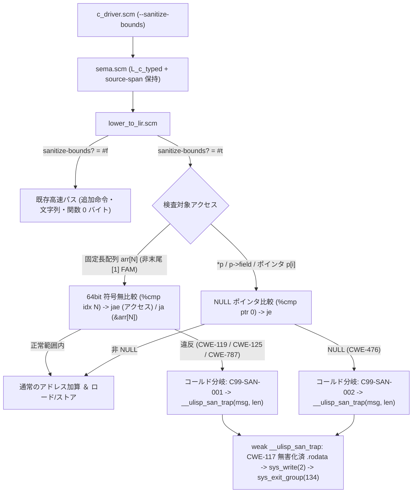

# [FEAT/ENH] C99 配列境界検査・NULL ポインタ参照トラップ自動注入モード (`--sanitize-bounds`) の実装 (ID: 930)

## 1. 概要 / Summary & 現状コードベース監査ギャップ

型付き C AST（`L_c_typed` / [DSN-33-11](../../designs/DSN-33-11-ulisp_multilingual_frontend_and_ctfe_architecture.md)）と Core Machine LIR（[DSN-33-13](../../designs/DSN-33-13-ulisp_typed_machine_lir_and_multi_target_backend_architecture.md)）を活用し、コンパイル時フラグ `--sanitize-bounds` 指定時に、コンパイル時固定長配列の境界外アクセス（OOB: Out-Of-Bounds、負インデックスを含む CWE-119）および NULL ポインタ間接参照（CWE-476）を検知して `<source-span>`（#824）位置情報付き診断メッセージを出力し安全にトラップ停止させるメモリ安全境界検査モードを実装する（Phase S9 / Task T18）。あわせて、`--sanitize-bounds` 未指定時の追加命令・データ・シンボル **0 バイト増加（ゼロオーバーヘッド）** および Lua 5.4.7 公式テストスイートでの誤検知ゼロを保証する。

本 Issue の精査に際し、現行リポジトリの C99 ドライバ・Sema・Lowerer・Lua 5.4.7 ソースコード群を実測監査した結果、以下の **6 つの具体的実装ギャップ** を特定した。

### 現状コードベース監査ギャップ (6項目)

1. **Gap 1 — `--sanitize-bounds` フラグの Lowering 層への未伝播**
   - [c_driver.scm](../../../ulisp/driver/c_driver.scm)（lines 167–169）は既に `--sanitize-bounds` CLI 引数を `(c-drv-sanitize-bounds? opts)` へパースしているが、`c99-compile-file-to-lir`（line 493）が `(c99-lower-to-lir typed)` をオプションなしで呼び出しており、境界検査フラグが下位へ伝達されていない。
   - [lower_to_lir.scm](../../../ulisp/frontend_c/lower_to_lir.scm) の `<c99-lower-ctx>`（lines 17–50）および `c99-lower-to-lir`（line 4264）にも `sanitize-bounds?` / `needs-san-trap?` フィールドとオプション受理機構が存在しない。

2. **Gap 2 — `L_c_typed` (`make-c-typed`) における `<source-span>` の欠落**
   - [sema.scm](../../../ulisp/frontend_c/sema.scm)（lines 18–28）の `(make-c-typed ty inner)` は `(list 'c-typed ty inner)` のみを構築し、`c99-analyze-expr` が入力 `L_c_ast` ノードから取得した `<source-span>`（ファイル名・行番号・列番号）を保持しないため、Lowering 時にエラー報告用の `<file>:<line>:<col>` を復元できない。

3. **Gap 3 — `lower_to_lir.scm` の複数の高速パスによる検査バイパス**
   - [lower_to_lir.scm](../../../ulisp/frontend_c/lower_to_lir.scm) には、`%c99-lower-lvalue-addr!`（line 974）や `%c99-lower-expr!`（line 1973）の標準経路に加え、`%c99-lower-direct-addr-to-reg!`（lines 282–362）、`%c99-lower-direct-scalar-to-reg!`（lines 364–493）、`%c99-lower-direct-fp-to-reg!`（lines 495–585）の 3 つの直接レジスタロード高速パスが存在する。
   - これら高速パスが `c-index`, `c-unop 'deref`, `c-member` (`deref?=#t`) を直接メモリアクセスへ展開するため、単一箇所へのチェック挿入では検査漏れが生じる。`sanitize-bounds?` 有効時は対象アクセスに対する高速パス分岐を `#f` でフォールバックさせ、統合検査経路へ集約する必要がある。

4. **Gap 4 — C99 仕様 ＆ Lua 5.4.7 固有イディオム（`[1]` フレキシブル配列 ＆ `&arr[N]` 終端ポインタ）での誤検知リスク**
   - 実測監査により、Lua 5.4.7 ([lobject.h](../../../ulisp/build/third_party/lua-5.4.7/src/lobject.h)) の 4 大ランタイム構造体が C89/C99 の構造体末尾 `[1]` フレキシブル配列イディオム（struct hack）を使用していることを確認済み：`TString::contents[1]` (line 395), `Udata::uv[1]` (line 465), `CClosure::upvalue[1]` (line 650), `LClosure::upvals[1]` (line 657)。末尾 `[1]` メンバへの配列境界検査を無条件有効化すると `u->uv[i]` 等で即座に誤検知トラップする。
   - また ISO C99 §6.5.6p8 は、配列終端の 1 つ先アドレス `&arr[N]` の算出（非逆参照）を合法と定めており、実アクセス（`idx >= N` でトラップ）とアドレス取得（`idx > N` でトラップ）の境界条件を厳密に区別する必要がある。

5. **Gap 5 — libc 非依存 weak トラップランタイム `__ulisp_san_trap` 未実装**
   - Pass 144 静的 `musl` リンク・ホスト `glibc` リンク・Portable C (`--target=c`)・Reference VM (`--target=vm`) の全バックエンドにおいて、外部リンク追加なしで完結動作する weak ビルトイン `__ulisp_san_trap` が [c_runtime_builtins.scm](../../../ulisp/lib/c_runtime_builtins.scm)、[140_backend_x86_64.scm](../../../ulisp/backend/140_backend_x86_64.scm)、[160_backend_c.scm](../../../ulisp/backend/160_backend_c.scm)、[lir_interpreter.scm](../../../ulisp/vm/lir_interpreter.scm)、[c_driver.scm](../../../ulisp/driver/c_driver.scm) に未実装である。

6. **Gap 6 — 境界検査・ゼロオーバーヘッド・Lua 誤検知ゼロ検証テストの欠如**
   - OOB（正超過 / 負インデックス）・NULL 逆参照・`<file>:<line>:<col>` 診断形式・CWE-117 制御文字無害化・`--sanitize-bounds` 無効時 0 命令差分・Lua 5.4.7 `all.lua` 誤検知ゼロ完走を検証する `ulisp/tests/test_c99_bounds_sanitizer.scm` / `.sh` および [ulisp/Makefile](../../../ulisp/Makefile) の `test_c99_bounds_sanitizer` ターゲットが未実装である。

---

## 2. トレーサビリティ / Traceability

- **関連設計書**:
  - [DSN-33-32 §6.1, §6.4](../../designs/DSN-33-32-ulisp_lua_c_codebase_compilation_and_self_hosting_architecture.md)
  - [DSN-33-11 §3.2, §4.2](../../designs/DSN-33-11-ulisp_multilingual_frontend_and_ctfe_architecture.md)
  - [DSN-33-13 §2.1, §2.4, §5.2](../../designs/DSN-33-13-ulisp_typed_machine_lir_and_multi_target_backend_architecture.md)
- **前提基盤（完了済）**:
  - `#824`: `<source-span>`（[helpers.scm](../../../ulisp/compiler/helpers.scm)）
  - `#833`: 統合診断レポート（[diagnostic.scm](../../../ulisp/compiler/diagnostic.scm)）
  - [#919](919-implement-c99-pointer-scaling-array-decay-and-escape-analysis.md): ポインタ演算 ＆ 配列退化
  - [#922](922-implement-setjmp-longjmp-inline-asm-and-stack-spill-protection.md): weak `%inline-asm` ビルトイン機構（`__ulisp_setjmp` / `__ulisp_longjmp`）
  - [#925](925-build-lua-5x-c-codebase-compilation-pipeline-with-ulisp.md): Lua 5.4.7 C99 ビルドパイプライン
  - [#926](926-verify-lua-5x-official-test-suite-e2e-selfhost-ci.md): Lua 5.4.7 公式テストスイート E2E 検証
  - [#928](928-compile-musl-libc-with-ulisp-and-migrate-to-pass-144-elf-linker.md): `musl-1.2.5` 自前ビルド ＆ Pass 144 静的 ELF64 リンカ移行

---

## 3. アーキテクチャ設計 / Architecture

---

## 4. マルチエージェント・ガバナンス審議

| 役割 | 合意・裁定内容 |
| :--- | :--- |
| **Project Manager (PM)** | Phase S9 / Task T18 として WP1〜WP4 に分割し、`--sanitize-bounds` 無効時のゼロオーバーヘッド不変条件と Lua 5.4.7 公式スイート誤検知ゼロを必須ゲートに定める。 |
| **Information Security Specialist** | CWE-119/125/787（負添字ラップアラウンドを含む符号無一括境界比較）、CWE-476（NULL 逆参照遮断）、CWE-117（コンパイル時ファイル名制御文字除去）、libc/ヒープ非依存 `syscall` 停止（exit 134）を義務化。 |
| **Systems Architect (SA)** | `L_c_typed` の第 4 要素へオプショナル `<source-span>` を後方互換で拡張し、`c_driver.scm` と `lower_to_lir.scm` の 3 バックエンド（x86-64 ELF・Portable C・参照 VM）横断同期を承認。 |
| **PLC / SWD Specialist** | 既存の 3 高速パス（`%c99-lower-direct-*`）を `sanitize-bounds?` 時のみ選択的フォールバックさせ、重複チェックコードの散在を回避。末尾 `[1]` フレキシブル配列と `&arr[N]` 終端ポインタの厳密判定を採用。 |
| **Software Quality Assurance Specialist** | LIR 命令単位差分検証（`0-diff`）・ネイティブ OOB/NULL トラップ検証・Lua 5.4.7 全 33 TU `--sanitize-bounds` ビルド＋`all.lua` 完走を自動テスト（`test_c99_bounds_sanitizer`）化する。 |
| **Systems Auditor** | 構造化エラー識別子 `C99-SAN-001`（境界外アクセス）および `C99-SAN-002`（NULL 逆参照）の出力書式と CWE-117 無害化を監査承認する。 |

---

## 5. 脅威モデルとセキュリティ対策 / Threat Model & Mitigations

1. **固定長バッファ境界外読み書き ＆ 負インデックス悪用 (CWE-119 / CWE-125 / CWE-787)**
   - 符号付きインデックスが負値（例: `-1`）をとる場合でも、64 bit 符号拡張後の値を単一の符号なし比較（`%cmp idx N` ＋ `jae` / `&arr[N]` の場合 `ja`）で検査することで、`UINT64_MAX >= N` として下限・上限違反を一括捕捉する。
2. **NULL ポインタ間接参照による SIGSEGV / 未定義最適化悪用 (CWE-476)**
   - `*p`, `p->field`, ポインタ添字 `p[i]` の逆参照直前に `(%cmp ptr 0)` ＋ `je` ガードを注入し、カーネルページフォルトや未定義動作に委ねる前に決定論的終了コード `134` で即時停止する。
3. **診断ファイル名を経由した端末エスケープ / ログインジェクション防止 (CWE-117)**
   - エラーメッセージに埋め込む `<file>` 文字列から ASCII 制御文字（`< 0x20` および `0x7F`、特に ESC `\x1b`・CR・LF）をコンパイル時に置換除去してから `.rodata` 定数へ格納する。
4. **破損ヒープ / ロック済み stdio に影響されないトラップ実行安全性**
   - トラップ関数 `__ulisp_san_trap(const char *msg, size_t len)` はコンパイル時に事前整形済みの静的 `.rodata` メッセージを受け取り、Linux x86-64 生システムコール（`sys_write(2, msg, len)` ＆ `sys_exit_group(134)`）のみを実行するため、ヒープ確保・書式文字列解析・`stdio` ロックに一切依存しない。

---

## 6. 詳細実装計画 / Detailed Implementation Plan

**Target Branch**: `feat/930-implement-c99-bounds-checking-sanitizer`

### WP1: `<source-span>` 伝播 (`sema.scm`) ＆ CLI オプション配線 (`c_driver.scm`)
1. **型付き AST への `<source-span>` 保持 ([sema.scm](../../../ulisp/frontend_c/sema.scm))**:
   - `make-c-typed` をオプショナル引数対応にするか `make-c-typed-at` を新設し、`(list 'c-typed ty inner sp)` 形式で位置情報を保持できるようにする。併せて `c-typed-span` アクセサを追加し、既存の `c-typed-type` (`cadr`) / `c-typed-inner` (`caddr`) との 100% 後方互換を維持する。
   - `c99-analyze-expr` 内の `c-index`, `c-unop` (`deref`), `c-member` (`->`), `c-assign` 生成箇所で元ノードの `sp` を確実に保存する。
2. **オプション伝播 ＆ マルチ TU weak 重複排除 ([c_driver.scm](../../../ulisp/driver/c_driver.scm))**:
   - `c99-compile-file-to-lir`（line 493）から `c99-lower-to-lir` へ `(c-drv-sanitize-bounds? opts)` を明示的に渡す。
   - `c99-merge-lir-programs`（line 712）の weak ビルトイン重複排除リストへ `'__ulisp_san_trap` を追加する。

### WP2: libc 非依存 weak トラップランタイム `__ulisp_san_trap` の実装
1. **Weak ビルトイン LIR 定義 ([c_runtime_builtins.scm](../../../ulisp/lib/c_runtime_builtins.scm))**:
   - `*c99-builtin-weak-fn-names*` へ `'__ulisp_san_trap` を追加し、`(make-c99-builtin-san-trap-lir)` を実装する。
   - `%inline-asm` を用いて Linux x86-64 `sys_write(2, rdi, rsi)` および `sys_exit_group(134)`（＋ `hlt`）を発行する。
2. **バックエンド 3 系統の同期対応**:
   - [140_backend_x86_64.scm](../../../ulisp/backend/140_backend_x86_64.scm)（line 2418）で `.weak __ulisp_san_trap` を発行する。
   - [160_backend_c.scm](../../../ulisp/backend/160_backend_c.scm)（Portable C: `fwrite(msg, 1, len, stderr); _Exit(134);` 相当）および [lir_interpreter.scm](../../../ulisp/vm/lir_interpreter.scm)（Reference VM: 診断メッセージ付きの明確なトラップ終了）に対応し、全 3 バックエンドの意味論を一致させる。

### WP3: 境界検査 (`C99-SAN-001`) ＆ NULL 逆参照検査 (`C99-SAN-002`) Lowering ([lower_to_lir.scm](../../../ulisp/frontend_c/lower_to_lir.scm))
1. **Lowering コンテキスト拡張 ＆ 条件付きビルトイン出力**:
   - `<c99-lower-ctx>` に `sanitize-bounds?` および `needs-san-trap?` フィールドを追加し、`c99-lower-to-lir` でオプショナル引数／オプション alist から `sanitize-bounds?` を初期化する。
   - `c99-lower-to-lir` 終端（line 4334 付近）では `(lower-ctx-needs-san-trap? ctx)` が `#t` の場合のみ `(make-c99-builtin-san-trap-lir)` を追加し、`#f` の場合は一切追加しない。
2. **診断文字列整形（CWE-117 無害化）＆ トラップ呼び出しヘルパ**:
   - `%c99-san-sanitize-filename` によりファイル名中の制御文字（`< 32` / `127`）を無害化する。
   - `%c99-san-emit-trap-call!` により `"[ulisp-sanitizer] error[<code>]: <detail> at <file>:<line>:<col>\n"` を `.rodata` 文字列リテラルとしてインターンし、アドレス（`%str-ref` 後に既存規約どおり `-3` タグ補正）とバイト長を `(%rdi, %rsi)` へ渡して `(%direct-call __ulisp_san_trap 0)` するコールドブロックを生成する。
3. **誤検知回避判定（Lua `[1]` フレキシブル配列 ＆ ISO C99 `&arr[N]` 終端ポインタ）**:
   - `%c99-san-is-flexible-array-member?` を実装し、`arr-node` が構造体メンバ `c-member` であって、所属構造体レイアウト（`c-struct-layout-fields`）の**末尾フィールド**かつ配列長 `(or (not len) (<= len 1))` に該当する場合は定数サイズ上限チェック対象から除外する（Lua 5.4.7 `TString::contents[1]`, `Udata::uv[1]`, `CClosure::upvalue[1]`, `LClosure::upvals[1]` の誤検知防止）。
   - `%c99-lower-lvalue-addr!` 系へ `one-past-end?` フラグを通し、純粋なアドレス取得 `&arr[idx]`（逆参照なし）では `idx > N`（`ja`）、実際の要素読み書きでは `idx >= N`（`jae`）を適用する。
4. **高速パス選択フォールバックとガード分岐注入**:
   - `(lower-ctx-sanitize-bounds? ctx)` が `#t` のとき、`%c99-lower-direct-addr-to-reg!`, `%c99-lower-direct-scalar-to-reg!`, `%c99-lower-direct-fp-to-reg!` における `c-index`, `c-unop 'deref`, `c-member` (`deref?=#t`) 分岐は `#f` を返して統合チェック経路へ誘導する。
   - **配列境界チェック (`C99-SAN-001`)**: `c-index` において基底が非フレキシブル固定長配列 `arr[N]` (`N > 0`) である場合、スケーリング前の 64bit インデックスに対して `%cmp` ＋ `jae`（または `ja`）分岐を挿入し、違反時は `C99-SAN-001` トラップへ飛ばす。
   - **NULL 逆参照チェック (`C99-SAN-002`)**: `*p`（`c-unop 'deref`）、`p->field`（`c-member` with `deref?=#t`、ビットフィールド更新パスを含む）、および非アドレス取得のポインタ添字 `p[i]`（基底が `c-pointer-type?` の場合）のアドレス解決直前に `(%cmp ptr 0)` ＋ `je` ガードを挿入し、`C99-SAN-002` トラップへ飛ばす。
   - **ゼロオーバーヘッド保証**: `sanitize-bounds?` が `#f` のときは上記ガードも高速パス抑止も一切行わず、未指定時と完全同一の LIR を生成する。

### WP4: 単体テスト・E2E テスト・Lua 5.4.7 誤検知ゼロ検証 (`test_c99_bounds_sanitizer`)
1. 新規ファイル `ulisp/tests/test_c99_bounds_sanitizer.scm` にて LIR 検証（`--sanitize-bounds` OFF 時 0 差分 vs ON 時の `jae`/`ja`/`je`/`__ulisp_san_trap` 生成、`<source-span>` 反映、末尾 `[1]` 免除、`&arr[N]` 合法性、CWE-117 無害化）を検証する。
2. 新規スクリプト `ulisp/tests/test_c99_bounds_sanitizer.sh` にてネイティブ ELF64 実行検証（Pass 144 静的 `musl` リンクおよびホストリンク双方）を行う：
   - 正常系（境界内読み書き、`&arr[N]` ループ番兵、構造体末尾 `[1]` メンバアクセス）が終了コード `0` で通過すること。
   - 正方向 OOB（`arr[N]`, `arr[N+5]`）および負インデックス（`arr[-1]`）が終了コード `134` でトラップし、`stderr` に `[ulisp-sanitizer] error[C99-SAN-001]: ... at <file>:<line>:<col>` を出力すること。
   - NULL 逆参照（`*p`, `p->field`, `p[0]`）が終了コード `134` でトラップし、`stderr` に `C99-SAN-002` と `<file>:<line>:<col>` を出力すること。
   - ゼロオーバーヘッド検証：`--sanitize-bounds` なしのコンパイル出力 `.o` がベースラインと SHA-256 ビット一致し、`__ulisp_san_trap` シンボルを 1 つも含まないこと。
   - Lua 5.4.7 全 33 TU を `--sanitize-bounds` 付きでコンパイルし Pass 144 + `musl` で静的リンクしたバイナリ上で、公式 `all.lua` (`final OK !!!`) が誤検知 0 件で完走すること。
3. [ulisp/Makefile](../../../ulisp/Makefile) に `test_c99_bounds_sanitizer` ターゲットを追加し、`test` スイートへ統合する。

---

## 7. 影響範囲と関連ファイル / Scope and Affected Files

### 既存改修ファイル
- [x] [c_driver.scm](../../../ulisp/driver/c_driver.scm) (`--sanitize-bounds` の `c99-lower-to-lir` 伝播 ＆ `c99-merge-lir-programs` での `__ulisp_san_trap` 重複排除)
- [x] [sema.scm](../../../ulisp/frontend_c/sema.scm) (`L_c_typed` ノードへの `<source-span>` 保持および `c-typed-span` 追加)
- [x] [lower_to_lir.scm](../../../ulisp/frontend_c/lower_to_lir.scm) (`sanitize-bounds?` モード、固定長配列 OOB・NULL 逆参照ガード、高速パス抑止、`[1]` FAM 除外、`&arr[N]` 判定、CWE-117 無害化)
- [x] [c_runtime_builtins.scm](../../../ulisp/lib/c_runtime_builtins.scm) (weak `%inline-asm` ビルトイン `__ulisp_san_trap` 追加)
- [x] [140_backend_x86_64.scm](../../../ulisp/backend/140_backend_x86_64.scm), [160_backend_c.scm](../../../ulisp/backend/160_backend_c.scm), [lir_interpreter.scm](../../../ulisp/vm/lir_interpreter.scm) (`__ulisp_san_trap` の `.weak` 発行 ＆ C/VM バックエンド同期)
- [x] [ulisp/Makefile](../../../ulisp/Makefile) (`test_c99_bounds_sanitizer` ターゲット追加および `test` 統合)

### 新規作成ファイル
- [x] [test_c99_bounds_sanitizer.scm](../../../ulisp/tests/test_c99_bounds_sanitizer.scm) (新規: LIR 0-diff・ガード命令生成・FAM 免除・`&arr[N]`・CWE-117 単体テスト)
- [x] [test_c99_bounds_sanitizer.sh](../../../ulisp/tests/test_c99_bounds_sanitizer.sh) (新規: ネイティブ OOB/NULL トラップ・ゼロオーバーヘッド・Lua 5.4.7 `all.lua` 誤検知ゼロ E2E 検証)

---

## 8. 完了条件 / Success Criteria (DoD)

- [x] **OOB / NULL トラップ ＆ `<source-span>` 報告**: `--sanitize-bounds` 有効時、配列境界外アクセス（正方向超過および負インデックス `C99-SAN-001`）および NULL ポインタ逆参照（`*p`, `p->field`, `p[i]` `C99-SAN-002`）が確実に終了コード `134` でトラップ停止し、`stderr` に `[ulisp-sanitizer] error[C99-SAN-001|002]: ... at <file>:<line>:<col>`（CWE-117 無害化済）を出力すること。
- [x] **ゼロオーバーヘッド保証**: `--sanitize-bounds` 無効時は追加チェック命令・`.rodata` 文字列・`__ulisp_san_trap` が一切出力されず、未指定時との `.o` 出力 SHA-256 差分が 0 であること。
- [x] **C99 適法イディオム・Lua 5.4.7 誤検知ゼロ**: ISO C99 `&arr[N]` 終端ポインタ計算および Lua 5.4.7 の末尾 `[1]` フレキシブル配列メンバが誤検知されず、`--sanitize-bounds` 有効版の Lua 5.4.7 静的バイナリで公式テストスイート `all.lua` (`final OK !!!`) が完走し、`make -C ulisp test_c99_bounds_sanitizer` が PASS すること。
- [x] **回帰なし・全体ゲート PASS**: `make -C ulisp bootstrap`（Stage 2 == Stage 3 ビット一致）、`make -C ulisp test`、およびルート `make py_compile && make static_analysis` が全て PASS し、関連ドキュメントに絶対パスリンクが存在しないこと。
