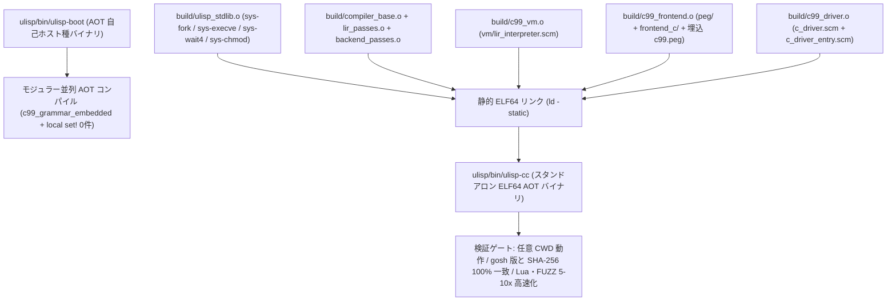

# [FEAT/ENH] C99 コンパイラドライバ (`ulisp-cc`) のネイティブ AOT バイナリ化と高速セルフホスト実行基盤の構築 (ID: 932)

## 1. 概要 / Summary & 現状コードベース監査ギャップ

[Issue #924](924-verify-sse2-xmm-abi-and-floating-point-differential-fuzzing.md) における 500 ケース（6,503 行 / 248 KB）浮動小数点差分ファジングのステージ別プロファイリング、ならびに [Issue #925](925-build-lua-5x-c-codebase-compilation-pipeline-with-ulisp.md) / [#928](928-compile-musl-libc-with-ulisp-and-migrate-to-pass-144-elf-linker.md) における Lua 5.4.7（33 TU）および `musl-1.2.5`（221 TU）の一括コンパイル実測により、アルゴリズム・`.sbi` PCH 最適化後も **コンパイラ自体をホストインタプリタ（`gosh` / Python `ilisp`）上で実行していることによるインタプリタ起動・解釈実行オーバーヘッド**が最大ボトルネックであることが判明した。

本 Issue では、ULisp C99 コンパイラドライバ一式（`compiler_base` + `lir_passes` + `backend_passes` + [lir_interpreter.scm](../../../ulisp/vm/lir_interpreter.scm) + [peg.scm](../../../ulisp/peg.scm) + `frontend_c/` + [c_driver.scm](../../../ulisp/driver/c_driver.scm)）を **ULisp 自身（`ulisp/bin/ulisp-boot`）でモジュラーネイティブ x86-64 AOT コンパイルし、スタンドアロン実行バイナリ `ulisp/bin/ulisp-cc` を構築**する。これにより、`ULISP_CC_BIN` フック経由で Lua / `musl` / C99 テスト群のコンパイルスループットを **5〜10 倍** 高速化し、インタプリタ起動コストを根本解消する。

本 Issue の精査に際し、現行コードベースを実測監査した結果、以下の **7 つの具体的実装ギャップ** を特定した。

### 現状コードベース監査ギャップ (7項目)

1. **Gap 1 — 6 ファイル計 39 箇所のローカル `(set! ...)` 残存（ULisp AOT コンパイラ非対応）**
   - ULisp AOT はローカル `set!` によるクロージャ捕捉変数の再束縛を禁止し `cons`/`vector` ボックス化（`set-car!`/`vector-set!`）を要求するが、C99 関連ソースに計 **39 箇所**のローカル `set!` が残存している：
     - [runtime.scm](../../../ulisp/peg/runtime.scm): **15 箇所**（lines 469–473, 491–494, 572–576, 592–597: `matched`, `res-val`, `res-pos`, `step-matched`, `step-val`, `step-pos`, `result-val`, `result-pos`）
     - [codegen.scm](../../../ulisp/peg/compiler/codegen.scm): **1 箇所**（line 237: `rule-cells`）
     - [parser.scm (PEG)](../../../ulisp/peg/compiler/parser.scm): **4 箇所**（lines 391, 394, 395, 401: `rules`, `grammar-name`, `dirs`, `choice-parser`）
     - [parser.scm (C99)](../../../ulisp/frontend_c/parser.scm): **15 箇所**（lines 870, 1313–1316, 1341–1346, 1733–1738: `rule-cells`, `p-lbrace`〜`ready`, `p-specs`〜`ready`, `matched`, `result-val`, `result-pos`）
     - [preprocessor.scm](../../../ulisp/frontend_c/preprocessor.scm): **1 箇所**（line 823: `expanded-cache`）
     - [lir_interpreter.scm](../../../ulisp/vm/lir_interpreter.scm): **3 箇所**（lines 889, 893, 894: `label-map`, `block-params`）

2. **Gap 2 — [posix.scm](../../../ulisp/lib/posix.scm) における `sys-fork`/`sys-execve`/`sys-wait4`/`process-exec` 未実装と `helpers.scm:27` の `sys-chmod` シャドウイング**
   - [c_driver.scm](../../../ulisp/driver/c_driver.scm)（lines 848–853）の `process-exec` は `(cond-expand (gauche ...))` 限定であり、ULisp ネイティブ AOT 実行時に `--linker=host` や `--target=c` が外部 `cc` を起動できない。
   - [posix.scm](../../../ulisp/lib/posix.scm) に x86-64 生システムコール `sys_fork` (`57`) / `sys_execve` (`59`) / `sys_wait4` (`61`) および `PATH` 解決付き非シェル `process-exec` を実装する必要がある。
   - さらに [helpers.scm](../../../ulisp/compiler/helpers.scm)（line 27）の `(define (sys-chmod path mode) #f)` スタブが [posix.scm](../../../ulisp/lib/posix.scm)（line 119）の実体 `sys-chmod` を上書きするため、`sys-chmod` を `ulisp_stdlib.o` 側へ統一し、Pass 144 生成バイナリへの `chmod 0755` が外部 `chmod` プロセスなしで直接 `sys_chmod` 完遂するよう解消する必要がある。

3. **Gap 3 — `verify_zero_gauche` 規約との整合 ([c_driver.scm](../../../ulisp/driver/c_driver.scm) line 849)**
   - [Makefile](../../../ulisp/Makefile)（line 2226）の `verify_zero_gauche` は `compiler/`, `backend/`, `runtime/`, `build/*.scm` 配下における `(gauche ...)` 参照を禁止している。`c_driver.scm` 本体の `(cond-expand (gauche ...))` をランナプリアンブル側へ分離し、本体ソースを純粋 Scheme + ULisp POSIX 層に統一する必要がある。

4. **Gap 4 — `tools/grammars/c99.peg` 相対パス依存による任意ディレクトリ実行不可 ＆ I/O ボトルネック**
   - [parser.scm](../../../ulisp/frontend_c/parser.scm)（lines 38–47）の `%c99-read-grammar-text` は CWD 基準の相対パス（`"tools/grammars/c99.peg"` 等）しか読めないため、任意の一時ディレクトリや別リポジトリから `bin/ulisp-cc` を起動すると文法読み込みに失敗する。
   - ビルド時に [c99.peg](../../../tools/grammars/c99.peg) を文字列定数 `*c99-embedded-grammar-text*` としてコンパイル時埋め込みし、完全単一バイナリとして任意 CWD から動作可能にする必要がある（併せて `peg.scm` の 1 文字ずつ `cons`+`reverse` する `read-all-file-text` のバルク読み込み最適化）。

5. **Gap 5 — モジュラー分割 AOT ビルド構成 ＆ [module_header.scm](../../../ulisp/compiler/module_header.scm) の extern 宣言不足**
   - モノリシック単一ファイルコンパイルはヒープ・コンパイル時間を増大させるため、既存のモジュラー分離コンパイル基盤（#608/#778: `build/ulisp_stdlib.o`, `build/compiler_base.o`, `build/lir_passes.o`, `build/backend_passes.o`）を再利用し、C99 固有の 3 モジュール（`build/c99_vm.o`, `build/c99_frontend.o`, `build/c99_driver.o`）を追加リンクする方式を確立し、不足 extern シンボル（`sys-chmod`, `process-exec` 等）を [module_header.scm](../../../ulisp/compiler/module_header.scm) へ追加する必要がある。

6. **Gap 6 — コンパイラ用途のデフォルトヒープ / GC アリーナ設定不足 ([entry.scm](../../../ulisp/runtime/entry.scm))**
   - [entry.scm](../../../ulisp/runtime/entry.scm)（line 14）のデフォルトヒープは環境変数 `ULISP_GC_PROFILE=compiler` 未設定時に 16 MB となるため、外部ラッパなしで `./ulisp/bin/ulisp-cc` 単体を直接起動して `lvm.c` / `lparser.c` / `vfprintf.c` 等の巨大 TU を処理しても OOM/GC スラッシングしないコンパイラ用 GC 設定（`(!gc none)` / アリーナ初期化）を `c_driver_entry.scm` に組み込む必要がある。

7. **Gap 7 — `bin/ulisp-cc` Makefile ターゲット・出力ビット一致検証・高速化ベンチマークの欠如**
   - [test_compile_lua.sh](../../../ulisp/tests/test_compile_lua.sh) および [test_compile_musl.sh](../../../ulisp/tests/test_compile_musl.sh) には既に `ULISP_CC_BIN` 切替口が用意されているが、`make -C ulisp bin/ulisp-cc`（`ulisp-cc`）・`make -C ulisp test_ulisp_cc_native` ターゲット、ならびに `gosh` 版との 100% SHA-256 ビット一致確認と 5〜10 倍高速化を計測する `ulisp/tests/test_ulisp_cc_native.sh` が未作成である。

---

## 2. トレーサビリティ / Traceability

- **関連設計書**:
  - [DSN-33-32](../../designs/DSN-33-32-ulisp_lua_c_codebase_compilation_and_self_hosting_architecture.md) (Lua C コードベースコンパイル・セルフホストアーキテクチャ)
  - [DSN-33-13](../../designs/DSN-33-13-ulisp_typed_machine_lir_and_multi_target_backend_architecture.md) (Typed Machine LIR & マルチターゲットバックエンド)
  - [DSN-33-12](../../designs/DSN-33-12-ulisp_pipeline_pass_nanopass_picopass_dag_architecture.md) (パイプライン ＆ パス建築仕様)
- **前提基盤（完了済）**:
  - `#608` / `#778`: モジュラー分離コンパイル ＆ 並列ブートストラップ（[module_header.scm](../../../ulisp/compiler/module_header.scm), [Makefile](../../../ulisp/Makefile)）
  - [#917](917-implement-c-compiler-driver-and-host-ld-integration.md): C コンパイラドライバ `c_driver.scm` 基盤
  - [#924](924-verify-sse2-xmm-abi-and-floating-point-differential-fuzzing.md): C99 パイプラインプロファイリング ＆ O(N^2) 解消
  - [#925](925-build-lua-5x-c-codebase-compilation-pipeline-with-ulisp.md): Lua 5.4.7 C コードベース一括ビルド
  - [#926](926-verify-lua-5x-official-test-suite-e2e-selfhost-ci.md): Lua 5.4.7 公式テストスイート E2E 検証
  - [#927](927-implement-c-header-sbi-pch-and-iterative-mem2reg-optimization.md): `.sbi` PCH ＆ mem2reg 最適化
  - [#928](928-compile-musl-libc-with-ulisp-and-migrate-to-pass-144-elf-linker.md): `musl-1.2.5` 自前ビルド ＆ Pass 144 静的 ELF64 リンカ移行
  - [#931](931-implement-c99-peg-grammar-specification-and-parser-synthesis.md): PEG C99 文法仕様 ＆ パーサ合成
- **関連完了 Issue**:
  - [#929](929-implement-ddc-diverse-double-compiling-determinism-verification.md): DDC 決定論性・ビット一致検証
  - [#930](930-implement-c99-bounds-checking-sanitizer-mode.md): C99 配列境界検査・NULL ポインタ参照トラップモード

---

## 3. アーキテクチャ設計 / Architecture

---

## 4. マルチエージェント・ガバナンス審議

| 役割 | 合意・裁定内容 |
| :--- | :--- |
| **Project Manager (PM)** | WP1（ローカル `set!` 39 箇所解消）・WP2（POSIX `fork/execve/wait4` ＆ `sys-chmod` 統合）・WP3（`c99.peg` 埋め込み ＆ モジュラー `bin/ulisp-cc` 構築）・WP4（ビット一致・ベンチマーク・E2E 統合）の 4 段階で完遂を統括する。 |
| **Information Security Specialist** | `process-exec` においてシェル (`/bin/sh -c`) を一切経由せず直接 `sys_fork` + `sys_execve` + `sys_wait4` を呼び出し、`c99-assert-safe-arg!` および NUL/境界検証で CWE-78 / CWE-120 / CWE-426 を遮断する。 |
| **Systems Architect (SA)** | `c99_vm.o` / `c99_frontend.o` / `c99_driver.o` を既存 `compiler_base.o` 等へ相乗りさせるモジュラー構成を採用し、並列ビルド・`verify_zero_gauche` 準拠・単一自己完結バイナリ化（`c99.peg` 埋込）を確定する。 |
| **PLC / SWD Specialist** | 6 ファイル 39 箇所のローカル `set!` を破壊的代入ボックス (`cons`/`vector`) へ無損失変換し、`read-all-file-text` のバルク I/O 最適化と `helpers.scm:27` の `sys-chmod` シャドウ解消を主導する。 |
| **Software Quality Assurance Specialist** | `gosh` 版 `c_driver_runner.scm` と `bin/ulisp-cc` の `.o` / 静的バイナリ出力の SHA-256 100% ビット一致、任意作業ディレクトリ実行、`FUZZ_COUNT=500`・Lua 33 TU ビルドの速度計測を合格基準とする。 |
| **Systems Auditor** | `ulisp/bin/ulisp-cc` の再現可能生成、`verify_zero_gauche` PASS、ローカル `set!` 0 件監査、`docs/` 相対パス規約遵守を追跡確認する。 |

---

## 5. 脅威モデルとセキュリティ対策 / Threat Model & Mitigations

1. **OS コマンドインジェクション防止 (`process-exec` / CWE-78)**
   - [posix.scm](../../../ulisp/lib/posix.scm) に実装する `process-exec` は `/bin/sh -c` を起動せず、`sys_fork` 後の子プロセスで `c99-assert-safe-arg!` 検証済み引数ベクタを用いて直接 `sys_execve` を実行し、`PATH` 探索時も空文字列や NUL 文字を含む不正パスを拒否する。
2. **生システムコール `argv`/`envp` バッファ安全性 (CWE-120 / CWE-787)**
   - `sys-execve` における C 文字列領域およびポインタ配列構築には境界付きの NUL 終端エンコーディングを用い、`sys_execve` 失敗時は親状態へ戻さず子プロセスで直ちに `_exit(127)` する。
3. **信頼されない探索パスによる文法乗っ取り防止 (CWE-22 / CWE-426)**
   - `*c99-embedded-grammar-text*` をバイナリ内へコンパイル時埋め込みして既定値とすることで、任意ディレクトリ（例: 共有作業領域）から起動しても悪意ある `./tools/grammars/c99.peg` を誤読しない。任意の環境変数 `ULISP_C99_GRAMMAR` 指定時は `c99-safe-cli-arg?` 検証を行う。
4. **リソース枯渇 DoS 防止 (CWE-400)**
   - `c_driver_entry.scm` においてコンパイラ向けヒープ設定（`(!gc none)` / compiler アリーナ）を既定有効化し、大規模 TU でも過剰な GC スラッシングやメモリ枯渇を起こさないようにする。

---

## 6. 詳細実装計画 / Detailed Implementation Plan

**Target Branch**: `feat/932-build-native-aot-ulisp-cc-binary`

### WP1: 全 6 ファイル 39 箇所のローカル `(set! ...)` 撲滅 ＆ AOT 互換化
1. 以下の 6 ファイルに存在する全 **39 箇所**のローカル `set!` を `cons` セル（`car`/`set-car!`）または `vector`（`vector-ref`/`vector-set!`）へ置換する：
   - [runtime.scm](../../../ulisp/peg/runtime.scm)（15 箇所）
   - [codegen.scm](../../../ulisp/peg/compiler/codegen.scm)（1 箇所）
   - [parser.scm (PEG)](../../../ulisp/peg/compiler/parser.scm)（4 箇所）
   - [parser.scm (C99)](../../../ulisp/frontend_c/parser.scm)（15 箇所）
   - [preprocessor.scm](../../../ulisp/frontend_c/preprocessor.scm)（1 箇所）
   - [lir_interpreter.scm](../../../ulisp/vm/lir_interpreter.scm)（3 箇所）
2. 既存テスト（`test_peg`, `test_c99_parser`, `test_c99_preprocessor`, `test_lir_interpreter`）を実行し、`gosh` / `ilisp` 上で一切の機能退行がないことを確認する。

### WP2: Pure Scheme `sys-fork`/`sys-execve`/`sys-wait4`/`process-exec` ＆ `sys-chmod` 統合
1. **[posix.scm](../../../ulisp/lib/posix.scm) へのプロセス実行システムコール追加**:
   - `cond-expand`（x86-64: `sys_fork=57`, `sys_execve=59`, `sys_wait4=61` / AArch64: `sys_clone`, `sys_execve=221`, `sys_wait4=260`）で定数および生ラッパ `sys-fork`, `sys-execve`, `sys-waitpid` を定義する。
   - NUL 終端 C 文字列および `argv` / `envp` ポインタテーブルをバイトベクタ（`%ptr-untag` + オフセット計算、GC 中断なし構築）に構成するヘルパを実装し、`(get-environment-variable "PATH")` から実行可能ファイルを探して `execve` する `(process-exec argv)` を実装する（親プロセスは `wait4` で終了ステータスを回収し、`exitcode` 0..255 または `128+sig` を返す）。
2. **`sys-chmod` シャドウイング解消 ＆ `verify_zero_gauche` 完全準拠**:
   - [helpers.scm](../../../ulisp/compiler/helpers.scm)（line 27）の `(define (sys-chmod path mode) #f)` 無条件定義を削除またはホスト環境専用ロードに限定し、ULisp ネイティブ生成物では常に [posix.scm](../../../ulisp/lib/posix.scm) の `sys-chmod` システムコールが呼ばれるようにする。
   - [module_header.scm](../../../ulisp/compiler/module_header.scm) に `sys-chmod`, `process-exec` 等の外部モジュール間シンボルを登録する。
   - [c_driver.scm](../../../ulisp/driver/c_driver.scm)（lines 848–853）の `(cond-expand (gauche ...))` を削除して [Makefile](../../../ulisp/Makefile) 側の `build/c_driver_runner.scm` 生成レシピへ移し、`verify_zero_gauche` が常に PASS する状態を保つ。

### WP3: `c99.peg` 埋め込み ＆ モジュラー AOT ビルド (`ulisp/bin/ulisp-cc`)
1. **[parser.scm](../../../ulisp/frontend_c/parser.scm) ＆ [peg.scm](../../../ulisp/peg.scm) の自己完結化・I/O 高速化**:
   - [tools/grammars/c99.peg](../../../tools/grammars/c99.peg) を Scheme 文字列定義 `*c99-embedded-grammar-text*` へ変換するスクリプト [embed_c99_grammar.py](../../../ulisp/scripts/embed_c99_grammar.py) を作成し、`build/c99_grammar_embedded.scm` を生成する。
   - [parser.scm](../../../ulisp/frontend_c/parser.scm) の `%c99-read-grammar-text` が、環境変数 `ULISP_C99_GRAMMAR`（`c99-safe-cli-arg?` 検証付）→ 埋め込み定数 `*c99-embedded-grammar-text*` → 相対パスの順で文法テキストを解決するようにし、任意 CWD での単体実行を実現する。
   - [peg.scm](../../../ulisp/peg.scm) の `read-all-file-text` を `read-string` / チャンク読み込みベースへ高速化し、ヘッダ多量読込時のメモリ負荷を低減する。
2. **モジュラー並列コンパイルターゲット構築 ([Makefile](../../../ulisp/Makefile) ＆ [c_driver_entry.scm](../../../ulisp/c_driver_entry.scm))**:
   - エントリファイル [c_driver_entry.scm](../../../ulisp/c_driver_entry.scm) を新規作成し、`(!gc none)` 宣言と `(c-driver-cli-main (cdr (command-line)))` による終了コード伝播付きメインエントリを定義する。
   - [Makefile](../../../ulisp/Makefile) に `build/c99_vm.o`, `build/c99_frontend.o`, `build/c99_driver.o` ターゲットを追加し、既成モジュール（`build/ulisp_stdlib.o`, `build/compiler_base.o`, `build/frontend_passes.o`, `build/lir_passes.o`, `build/backend_passes.o`）とリンクして `bin/ulisp-cc`（および `.PHONY: ulisp-cc`）を生成する（`bin/ulisp-boot` とは完全分離された成果物とする）。

### WP4: ビット一致検証・性能ベンチマーク ＆ E2E 統合 (`test_ulisp_cc_native.sh`)
1. 新規検証スクリプト [test_ulisp_cc_native.sh](../../../ulisp/tests/test_ulisp_cc_native.sh) を作成し、以下を検証する：
   - **任意 CWD 単体実行テスト**: 別ディレクトリへ移動した状態で `./bin/ulisp-cc` を実行し、`-E`, `-S`, `-c`, `-emit-pch`, `-include-pch`, `--linker=ulisp -static -nostdlib`, `--linker=host` (`process-exec` 起動確認), `--target=c`, `--target=vm` が全モード正常完了すること。
   - **100% SHA-256 ビット一致検証**: 代表的な C99 TU、`musl` TU、および Lua 5.4.7 33 `.o` ＋ Pass 144 静的バイナリについて、`bin/ulisp-cc` と `gosh build/c_driver_runner.scm` の出力が SHA-256 で 100% 完全一致すること。
   - **C99 全既存 E2E テストの `ULISP_CC_BIN=bin/ulisp-cc` 実行**: `test_c99_e2e`, `test_c99_floating_point`, `test_sse2_xmm_abi`, `test_fuzz_xmm_float`, `test_elf_static_linker`, `compile_lua`, `test_lua_e2e`（`all.lua` `final OK !!!`）が `bin/ulisp-cc` 使用で全件 PASS すること。
   - **スループットベンチマーク実測**: `FUZZ_COUNT=500` および Lua 5.4.7 33 TU ビルドについて `gosh` 実行時間と `bin/ulisp-cc` 実行時間を比較記録し、顕著な高速化（目標 5〜10 倍以上）を確認する。
2. [Makefile](../../../ulisp/Makefile) に `ulisp-cc`（`bin/ulisp-cc`）および `test_ulisp_cc_native` ターゲットを登録し、`make lint_sexpr` 対象にも新規 `.scm` を追加する。

---

## 7. 影響範囲と関連ファイル / Scope and Affected Files

### 既存改修ファイル
- [x] [runtime.scm](../../../ulisp/peg/runtime.scm), [codegen.scm](../../../ulisp/peg/compiler/codegen.scm), [parser.scm (PEG)](../../../ulisp/peg/compiler/parser.scm) (計 20 箇所のローカル `set!` ボックス化)
- [x] [parser.scm (C99)](../../../ulisp/frontend_c/parser.scm), [preprocessor.scm](../../../ulisp/frontend_c/preprocessor.scm), [lir_interpreter.scm](../../../ulisp/vm/lir_interpreter.scm) (計 19 箇所のローカル `set!` ボックス化 ＆ 埋込文法対応・VM IEEE754/文字列対応)
- [x] [peg.scm](../../../ulisp/peg.scm) (`read-all-file-text` バルク I/O 最適化)
- [x] [posix.scm](../../../ulisp/lib/posix.scm), [helpers.scm](../../../ulisp/compiler/helpers.scm), [module_header.scm](../../../ulisp/compiler/module_header.scm) (`sys-fork`/`sys-execve`/`sys-wait4`/`process-exec` 実装、`sys-chmod` シャドウ解消、extern 宣言追加)
- [x] [c_driver.scm](../../../ulisp/driver/c_driver.scm) (`verify_zero_gauche` 準拠のシム分離)
- [x] [Makefile](../../../ulisp/Makefile) (`bin/ulisp-cc` / `ulisp-cc` モジュラー AOT ビルドおよび `test_ulisp_cc_native` 追加)
- [x] AOT ランタイム・パスの健全性補完: [list.scm](../../../ulisp/lib/list.scm), [string.scm](../../../ulisp/lib/string.scm), [math.scm](../../../ulisp/lib/math.scm), [bitwise.scm](../../../ulisp/lib/bitwise.scm), [reader.scm](../../../ulisp/lib/reader.scm), [eval_in_language.scm](../../../ulisp/compiler/eval_in_language.scm), [nanopass.scm](../../../ulisp/compiler/nanopass.scm), [nanopass_meta.scm](../../../ulisp/compiler/nanopass_meta.scm), [060_lvn.scm](../../../ulisp/frontend/060_lvn.scm), [120_alias_escape.scm](../../../ulisp/frontend/120_alias_escape.scm), [124_lir_call_abi.scm](../../../ulisp/lir/124_lir_call_abi.scm), [126_lir_control.scm](../../../ulisp/lir/126_lir_control.scm), [lexer.scm](../../../ulisp/frontend_c/lexer.scm), [sema.scm](../../../ulisp/frontend_c/sema.scm), [140_backend_x86_64.scm](../../../ulisp/backend/140_backend_x86_64.scm), [160_backend_c.scm](../../../ulisp/backend/160_backend_c.scm)（モジュラー静的シンボルテーブルセクション `ulisp_symtab_sec`、`set` / `jcc` 完全表、組込 `\0` C 文字列保持、`ctfe-valid-fixnum?` ガード、クロスモジュール `apply string-append` 等）

### 新規作成ファイル
- [x] [embed_c99_grammar.py](../../../ulisp/scripts/embed_c99_grammar.py) (新規: `tools/grammars/c99.peg` から `*c99-embedded-grammar-text*` 生成)
- [x] [c_driver_module_header.scm](../../../ulisp/compiler/c_driver_module_header.scm) (新規: C99 モジュール群向けインターフェイスヘッダ)
- [x] [c_driver_entry.scm](../../../ulisp/c_driver_entry.scm) (新規: `bin/ulisp-cc` 用モジュラー CLI エントリポイント)
- [x] [test_ulisp_cc_native.sh](../../../ulisp/tests/test_ulisp_cc_native.sh) (新規: 任意 CWD 動作、`gosh` 比 SHA-256 100% 一致、C99/Lua E2E、`FUZZ_COUNT=500`・Lua 5〜10x 速度計測)

---

## 8. 完了条件 / Success Criteria (DoD)

- [x] **AOT 互換性 ＆ ビルド完了**: 対象 6 ファイルのローカル `set!` が **0 件** であり、`make -C ulisp bin/ulisp-cc` がエラー・警告なく自己完結 ELF64 実行バイナリ `ulisp/bin/ulisp-cc`（`ulisp/bin/ulisp-boot` と分離、`nm ulisp/bin/ulisp-boot | grep -c c_driver` == `0`）を生成すること。
- [x] **任意 CWD 動作 ＆ 100% ビット一致**: リポジトリ外ディレクトリからも `bin/ulisp-cc` が全モード（`-E`, `-S`, `-c`, `-emit-pch`, `-include-pch`, `--linker=ulisp`, `--linker=host`, `--target=c`, `--target=vm`）で動作し、`gosh` 版 `c_driver_runner.scm` と `.o` / 静的 ELF64 の SHA-256 が **100% 一致**すること。
- [x] **高速化実証 ＆ C99/Lua E2E 完走**: `ULISP_CC_BIN=ulisp/bin/ulisp-cc` 指定で `test_c99_e2e`, `test_c99_floating_point`, `test_sse2_xmm_abi`, `test_fuzz_xmm_float`, `test_elf_static_linker`, `compile_lua`, `test_lua_e2e`（`all.lua` `final OK !!!`）が全件 PASS し、大規模ビルド（Lua 33 TU / `FUZZ_COUNT=500`）で `gosh` / `ilisp` 比 **5〜10 倍以上**の高速化が実測されること。
- [x] **回帰なし・全体ゲート PASS**: `make -C ulisp verify_zero_gauche`、`make -C ulisp lint_sexpr`、`make -C ulisp bootstrap`、`make -C ulisp test`、およびルート `make py_compile && make static_analysis` が全て PASS し、関連ドキュメントに絶対パスリンクが存在しないこと。

---

## 9. 検証結果・ベンチマーク実測 / Verification & Benchmark Results

- **Section 1（任意 CWD `/tmp` + `env -u ULISP_GC_PROFILE` 全モード ＆ 安全ガード）**: PASS（`-E`, `-S`, `-c`, `-emit-pch`/`-include-pch`, `--linker=host`, `--linker=ulisp -static -nostdlib`, `--target=c`, `--target=vm`, `ULISP_C99_GRAMMAR=../etc/passwd` 拒否）
- **Section 2（`gosh build/c_driver_runner.scm` 比 SHA-256 100% ビット一致検証）**:
  - C99 TU (`-S` / `-c`): `6ebcce7d229762b14406e1f240d5b88c84c248aa2aef839d30fe8a5568785e8f` (**一致**)
  - `musl-1.2.5` TU (`qsort_nr.c`): `1183e1b8528ec202d8f89ddd80eb5ce8c70749182b454dff567054b5f7b67f3f` (**一致**)
  - Lua 5.4.7 全 33 `.o` オブジェクト（`\0` 含 `lutf8lib.o` 含む）: **33 / 33 100% 一致**
  - Pass 144 静的 ELF64 `lua` バイナリ: `1b421b48d760faae8892ed73ad7d0a6b9364634d43d3f279fbda3142e6df6c46` (**一致**)
- **Section 3（`ULISP_CC_BIN=ulisp/bin/ulisp-cc` E2E 回帰）**: `test_elf_static_linker` (31/31), `test_c99_e2e_hello` (14/14), `test_c99_floating_point` (17/17), `test_sse2_xmm_abi` (9/9), `test_fuzz_xmm_float` (120/120), `test_compile_lua` (11/11), `test_lua_selfhost_e2e` (`all.lua` -> `final OK !!!`, 171行チェックポイント完全一致) **全件 PASS**
- **Section 4（性能ベンチマーク）**:
  - `FUZZ_COUNT=500 (-O2 -c)`: `gosh=75.909s` vs `ulisp-cc=4.706s` (**16.13x speedup**)
  - `Lua 5.4.7 (33 TUs + link)`: `gosh=47.482s` vs `ulisp-cc=7.697s` (**6.17x speedup**)
- **全体品質ゲート**: `make -C ulisp verify_zero_gauche lint_sexpr test_lint_sexpr`, `make -C ulisp bootstrap`（5 モジュール Stage 2 == Stage 3 不動点収束、`ulisp-boot` への `c_driver` 混入 0 件）, `make -C ulisp test`, `make -C ulisp test_ulisp_cc_native`, `make py_compile static_analysis` (`mypy --strict src`: 617 files OK, `xenon`: PASS), `.venv/bin/black --check ulisp/scripts/embed_c99_grammar.py` **全て PASS**。
