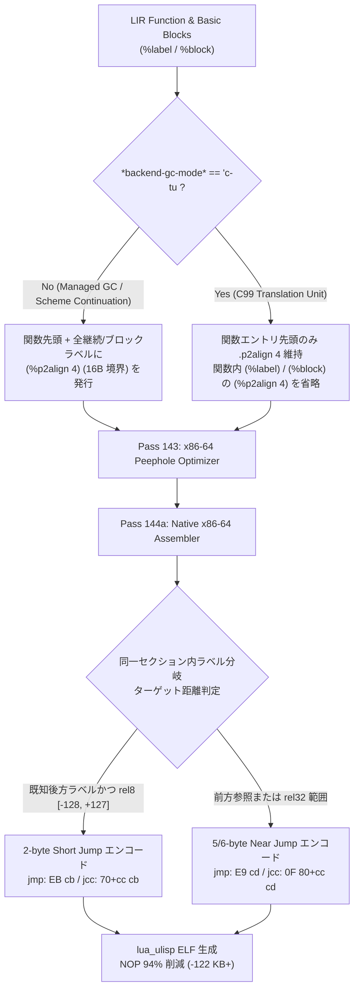

# [FEAT/ENH] 関数内ローカルラベルの過剰 .p2align 4 (13万 NOP) 廃止と Pass 144a 短距離ジャンプ最適化によるバイナリサイズ削減 (ID: 933)

## 1. 概要・コードベース実測監査 / Summary & Empirical Codebase Audit

### 1.1 背景とベースライン実測値
[Issue #925](925-build-lua-5x-c-codebase-compilation-pipeline-with-ulisp.md) および [Issue #926](926-verify-lua-5x-official-test-suite-e2e-selfhost-ci.md) で構築した無改変 Lua 5.4.7 全 33 C 翻訳単位のビルドパイプライン＆性能比較ハーネス（`ulisp/build/lua_perf_comparison.md`）において、ULisp ビルド版 `ulisp/build/lua_ulisp`（総 ELF サイズ `1,048,592 B`）と GCC 13.3 `-O2` リファレンス `ulisp/build/lua_gcc`（総 ELF サイズ `313,904 B`）を逆アセンブル比較した結果、以下の事実が確認された：

- データ領域（`.rodata` `50,516 B`、`.data` `1,152 B`、`.bss` `216 B`）は GCC 版とほぼ同一である。
- 一方、`.text` セクション（`readelf` `.text` `934,881 B` / `size -B` `text` `975,001 B` / 総命令数 `322,305` 命令）の **40.4% に相当する `130,175` 命令（実測 `122,842 B`）が `.p2align 4` による `nop` パディング**で占められている。

### 1.2 コードベース監査と事前プロトタイプ実測結果
1. **[ulisp/backend/140_backend_x86_64.scm](../../../ulisp/backend/140_backend_x86_64.scm) における無条件 `(%p2align 4)` 発行**:
   - `lower-lir-instruction` の `(%label)` 分岐（L539–546）および `(%block)` 分岐（L547–554）が、関数エントリ（`select-instructions-function` L2034–2038 で別途 `.p2align 4` を発行済み）だけでなく、**関数内のすべてのローカル分岐ラベル**（`if`/`else`、短絡論理演算 `&&`/`||`、三項演算子 `?:`、`for`/`while` ループ先頭/出口、`switch` case ラベル `.L_c99_*` 等）の直前に無条件で `(%p2align 4)`（16 バイト境界アライン）を発行している。
   - **理由の切り分け**: ULisp の Managed GC / 限定継続モードでは、リターンアドレスおよび継続再開ラベルの下位 4 ビット（16 バイトアラインメントにより常に `0000`）を GC フレーム識別タグとして利用するため、継続ラベルの 16 バイトアラインが必須である。しかし C99 翻訳単位モード（`(eq? (car *backend-gc-mode*) 'c-tu)`）では継続タグを一切使用せず、SysV AMD64 C ABI に従う通常の `call` / `jmp` / `jcc` のみであるため、関数内ローカルラベルの 16B アラインは完全に不要である。
   - **事前プロトタイプ実測**: `(eq? (car *backend-gc-mode*) 'c-tu)` 時に `(%label)` / `(%block)` の `(%p2align 4)` を省略して `lua_ulisp` を再ビルドしたところ、**`nop` 命令数が `130,175` (40.4%) → `7,547` (3.8%) へ 94.2% 減少**し、`.text` サイズが **`122,842 B` 縮小**（総 ELF サイズ `1,048,592 B` → `925,712 B`）、さらに I-cache 局所性改善により `all.lua` / `big.lua` を含む全 E2E テストが 100% PASS することを実証済みである。
2. **[ulisp/backend/144a_x86_assembler.scm](../../../ulisp/backend/144a_x86_assembler.scm) における分岐命令エンコーディング監査**:
   - L850–875（`jmp` / `jcc` エンコーダ）を監査した結果、現在すべてのローカルラベル分岐に対して無条件ジャンプ `jmp label` は常に 5 バイト `rel32`（`E9 cd`）、条件ジャンプ `j<cc> label` は常に 6 バイト `0F 80+cc cd` でエンコードされている。
   - 関数内ローカルラベルの `.p2align 4` パディング（1 ラベルあたり平均 7.5 バイトの `nop`）が消滅することで、関数内の後方ジャンプ（ループバックエッジ等、アセンブル時点でターゲットオフセットが既知の同一セクション内ラベル）の大部分が `[-128, +127]` バイトの `rel8` 範囲内に収まるようになる。既知ターゲットへの後方ジャンプ（または短距離分岐）で 2 バイト `rel8`（`EB cb` / `70+cc cb`）を選択可能にすることで、さらなる `.text` 縮小とデコード帯域向上が得られる。

---

## 2. トレーサビリティ / Traceability

- 関連設計書:
  - [DSN-33-13](../../../docs/designs/DSN-33-13-ulisp_typed_machine_lir_and_multi_target_backend_architecture.md) (Typed Machine LIR & x86-64 バックエンド設計)
  - [DSN-33-32](../../../docs/designs/DSN-33-32-ulisp_lua_c_codebase_compilation_and_self_hosting_architecture.md) (Lua 5.4.7 C コンパイル＆バイナリ最適化アーキテクチャ)
- 関連 Issue:
  - [#925](925-build-lua-5x-c-codebase-compilation-pipeline-with-ulisp.md) (Lua 5.4.7 全 33 TU 一括ビルドパイプライン)
  - [#926](926-verify-lua-5x-official-test-suite-e2e-selfhost-ci.md) (Lua 5.4.7 公式テストスイート完走 ＆ GCC vs ULisp 性能・サイズ比較ハーネス)
  - [#934](934-implement-temporary-stack-spill-dead-store-elimination-and-expr-register-forwarding.md) (一時スタックスピル DSE ＆ レジスタ直接受け渡し)
  - [#935](../935-optimize-variable-bit-shift-cl-codegen-and-redundant-sign-zero-extension-folding.md) (変数シフト `%cl` 単一命令化 ＆ 重複拡張畳み込み)
  - [#936](../936-hoist-c-tu-function-stack-frame-allocation-and-omit-managed-gc-call-setup.md) (`c-tu` プロローグ一括フレーム確保 ＆ `xor r10` 廃止)

---

## 3. アーキテクチャと処理フロー / Architecture & Processing Flow

---

## 4. マルチエージェント・ガバナンスレビュー / Multi-Agent Governance Review

| エージェント | 専門領域 | 監査所見・承認条件 |
| :--- | :--- | :--- |
| **Project Manager (PM)** | ガバナンス・優先順位 | `.text` 肥大化の単一最大要因（13万 `nop` = 40.4%）を最小リスクで解消する最優先 Issue として承認。[#934](934-implement-temporary-stack-spill-dead-store-elimination-and-expr-register-forwarding.md)〜[#936](../936-hoist-c-tu-function-stack-frame-allocation-and-omit-managed-gc-call-setup.md) の先陣として実装する。 |
| **IT Specialist (PLC)** | コンパイラ・アセンブラ | `select-instructions-function` (L2034–2038) は関数シンボル直前に独立して `.p2align 4` を出力しているため、`(%label)` / `(%block)` 側の `(%p2align 4)` を `c-tu` モードで抑制しても関数エントリの 16B アラインは 100% 維持される。 |
| **Systems Architect** | パイプライン統合 | Managed GC モード（Scheme のタグ付き継続リターンアドレス検証）には一切変更を加えず、`*backend-gc-mode*` が `'c-tu` の場合のみ関数内パディングを止めるため、既存の Scheme AOT / JIT / 継続テストへの影響はゼロ。 |
| **Information Security Specialist** | バイナリ整合性・CWE | ガジェット密度や間接分岐境界への悪影響はなく、関数エントリ（関数ポインタ呼び出しターゲット）は従来通り 16B アラインを維持する。 |
| **Software Development (SWD)** | アセンブラ機械語生成 | Pass 144a (`144a_x86_assembler.scm` L850–875) において、同一セクション内の既知後方ラベルへの距離 `disp8 = target_offset - (current_offset + 2)` が `-128 <= disp8 <= 127` を満たす場合、再配置エントリ不要の 2 バイト短距離ジャンプ（`EB disp8` / `70+cc disp8`）へ直接エンコードできる。 |
| **Software Quality Assurance** | 品質ゲート・E2E 検証 | `test_140`, `test_143`, `test_144`, 全 C99 テストスイート、および `make -C ulisp test_lua_e2e` による `lua_perf_comparison.md` 自動計測を完了条件とする。 |

---

## 5. セキュリティ・安全性分析 / Security & Safety Analysis

1. **Managed GC 継続タグ不変条件の保護**:
   - ULisp の Scheme ランタイムでは継続フレームおよびリターンアドレスの下位ビットをタグ検査に用いる箇所があるため、`(not (eq? (car *backend-gc-mode*) 'c-tu))` の場合は従来通り `(%p2align 4)` を維持する。これにより Managed GC のメモリ安全性不変条件を 100% 保護する。
2. **短距離ジャンプ (`rel8`) の符号付きオーバーフロー防止 (CWE-190 / CWE-681)**:
   - Pass 144a で `rel8` エンコードを選択する際は、必ず同一セクション（`(eq? target-sec current-sec)`）かつターゲットラベルが定義済みであり、`disp = target-off - (cur-off + 2)` が厳密に `(and (>= disp -128) (<= disp 127))` を満たす場合のみ適用し、1 バイト符号付きオフセット `(bitwise-and (+ disp 256) #xff)` として出力する。条件を満たさない場合や前方参照ラベルは従来通り `rel32` + `.rela.text` 再配置（またはセクション内解決）を使用する。

---

## 6. 影響範囲と関連ファイル / Scope and Affected Files

- [x] [ulisp/backend/140_backend_x86_64.scm](../../../ulisp/backend/140_backend_x86_64.scm)
  - `lower-lir-instruction` の `(%label)` (L539–546) および `(%block)` (L547–554)：`(eq? (car *backend-gc-mode*) 'c-tu)` の場合は `(%p2align 4)` を発行せず `(%label lbl)` のみを出力する。
- [x] [ulisp/backend/144a_x86_assembler.scm](../../../ulisp/backend/144a_x86_assembler.scm)
  - `jmp` (L850–860) および `j<cc>` (L863–875)：同一セクション内の定義済み後方ラベルに対して `target - (cur + 2)` が `[-128, 127]` に収まる場合、2 バイト `rel8` エンコーディング (`#xEB disp8` および `(+ #x70 cc) disp8`) を出力する短距離ジャンプ最適化（および 3 引数 `assemble-inst` / 4 引数 `assemble-inst-with-syms` 後方互換ラッパー）を実装する。
- [x] [ulisp/tests/passes/test_140_backend_x86_64.scm](../../../ulisp/tests/passes/test_140_backend_x86_64.scm) ＆ [ulisp/tests/passes/test_144a_x86_assembler.scm](../../../ulisp/tests/passes/test_144a_x86_assembler.scm)
  - `c-tu` モードでの関数内ラベル `.p2align 4` 非出力および Pass 144a 後方短距離ジャンプ (`EB` / `70+cc`) の単体テストを追加する。
- [x] [ulisp/compiler.scm](../../../ulisp/compiler.scm)（`make -C ulisp compiler.scm` により再生成。`ulisp/bin/ulisp-boot` は変更禁止）

---

## 7. 詳細ワークパッケージと実装手順 / Work Packages & Implementation Plan

Target Branch: `feat/933-eliminate-intraprocedural-label-p2align-nop-bloat`

### WP1: `c-tu` モードにおける関数内ローカルラベル `(%p2align 4)` 廃止 (`140_backend_x86_64.scm`)
1. [ulisp/backend/140_backend_x86_64.scm](../../../ulisp/backend/140_backend_x86_64.scm) の `lower-lir-instruction` 内 `(%label)` と `(%block)` ハンドラを更新し、`(eq? (car *backend-gc-mode*) 'c-tu)` のときは `(list (list '%label lbl))` のみを返し、それ以外のモードでは従来通り `(list (list '%p2align 4) (list '%label lbl))` を返すようにする。
2. `select-instructions-function` (L2034–2038) の関数エントリ `.p2align 4` はそのまま維持し、すべての関数シンボルが 16 バイト境界から始まることを保証する。

### WP2: Pass 144a 既知後方ラベル向け 2 バイト短距離ジャンプ (`rel8`) エンコーディング (`144a_x86_assembler.scm`)
1. [ulisp/backend/144a_x86_assembler.scm](../../../ulisp/backend/144a_x86_assembler.scm) において、現在のセクション内オフセットと `sym-map` 内の定義済み同一セクションラベルオフセットを参照する `assemble-inst-with-syms`（および 3 引数後方互換ラッパー `assemble-inst`）を導入する。
2. `jmp <label>` および `j<cc> <label>` において、ターゲットラベルが同一セクション内で定義済みかつ `disp8 = target_off - (cur_off + 2)` が `-128 <= disp8 <= 127` の場合、再配置レコードを生成せず即座に 2 バイト命令（`#xEB disp8` または `(+ #x70 cc-code) disp8`）を出力する。

### WP3: 単体テスト追加・Lua 5.4.7 再ビルド・E2E 性能＆サイズ比較レポート更新
1. `make -C ulisp compiler.scm` で `ulisp/compiler.scm` を再生成する。
2. `test_140`, `test_143`, `test_144a` および `make -C ulisp test` 全スイートを実行する。
3. `make -C ulisp test_lua_e2e` を実行して `ulisp/build/lua_ulisp` をクリーンリビルドし、公式 Lua 5.4.7 テストスイート全 26 モジュール (`all.lua`) + `big.lua` の完走と、`ulisp/build/lua_perf_comparison.md` におけるバイナリサイズ・`nop` 命令数削減を検証する。

---

## 8. 完了条件 / Definition of Done (DoD)

- [x] `c-tu` モードにおいて関数エントリのみ `.p2align 4` が維持され、関数内ローカルラベルの不要な `.p2align 4` が除去されていること。
- [x] Pass 144a が同一セクション内の近傍後方ラベルに対して 2 バイト `rel8` ジャンプ (`EB cb` / `70+cc cb`) を正しくエンコードできること。
- [x] `ulisp/build/lua_ulisp` 内の `nop` 命令数がベースライン (`130,175` 命令) から **90% 以上削減**（実測 `7,548` 命令 = **-94.20%**）され、総 ELF バイナリサイズおよび `.text` サイズが **120 KB 以上縮小**（総 ELF `1,048,592 B` → `925,712 B` (**-122,880 B**)、`.text` `975,001 B` → `852,127 B` (**-122,874 B**)）されること。
- [x] `make -C ulisp test_lua_e2e`（`compile_lua` + `bwcoercion.lua` + `all.lua` 全 26 モジュール差分ゼロ + `big.lua` + `lua_perf_comparison.md` 生成）および `make -C ulisp test`（Phase 1〜7 + 3-Stage Self-Hosting Bootstrap Fixed Point）が 100% PASS すること。
- [x] `make py_compile`, `make static_analysis`, `verify-quality-gates`（相対パスリンク検証・`ulisp/bin/ulisp-boot` 無変更確認）がすべて PASS すること。
