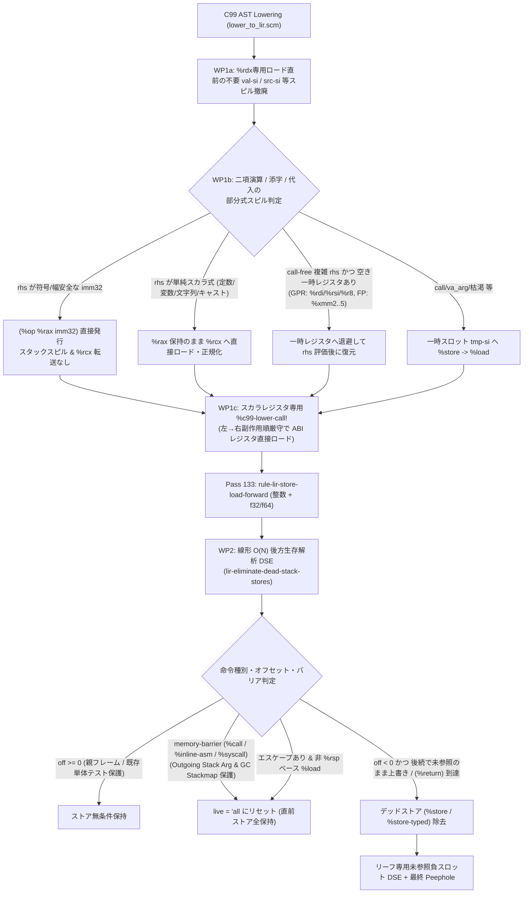

# [FEAT/ENH] C99 式評価の一時スタックスピルに対するデッドストア除去 (DSE) とレジスタ直接受け渡しによるコードサイズ削減 (ID: 934)

## 1. 概要・コードベース実測監査 / Summary & Empirical Codebase Audit

### 1.1 Post-#933 ベースライン実測値と `%rsp` スピルプロファイル
[Issue #933](933-eliminate-intraprocedural-label-p2align-nop-bloat-and-enable-short-jumps.md) による関数内ローカルラベルの過剰 `.p2align 4` 廃止（`nop` 命令 `130,175` → `7,548` 削減）および Pass 144a 後方短距離ジャンプ実装後、最新の [ulisp/docs/ref_benchmarks.md](../../../ulisp/docs/ref_benchmarks.md) における無改変 Lua 5.4.7 バイナリ `ulisp/build/lua_ulisp`（総 ELF サイズ `925,712 B`、`.text` `852,127 B`、総命令数 `199,641` 命令 / 1,183 関数）を逆アセンブル精査した結果、**全機械語命令の `31.1%` に相当する `62,176` 命令が `%rsp` 相対メモリアクセス**であることが確認された（`lua_gcc` `-O2` 全体では `6,412` 命令）。

`objdump -d ulisp/build/lua_ulisp` による全 1,183 関数の定量プロファイルは以下の通りである：

| `%rsp` 命令カテゴリ | 実測命令数 / ペア数 | 全 `%rsp` 命令中の割合 | 主な発生箇所・原因 |
| :--- | ---: | ---: | :--- |
| **`%rsp` ストア (`mov %reg, -N(%rsp)`)** | `28,437` 命令 | `45.7%` | 部分式・引数の無条件一時スピル、および Forwarding 後の残存デッドストア |
| **`%rsp` ロード (`mov -N(%rsp), %reg`)** | `32,756` 命令 | `52.7%` | 退避した部分式・引数の即座リロード |
| **`lea -N(%rsp), %reg`** | `977` 命令 | `1.6%` | ローカル変数 `&x`・構造体/配列アドレス取得 |
| ├ **短距離一時スピル＆リロードペア**（25命令以内・非コール） | `17,419` ペア (`34,838` 命令) | **`56.0%`** | 式評価中の `%rax`/`%xmm0` スタック退避→即座復元 |
| ├ **`c-binop` 短距離スピル＆リロード**（`mov %rax,%rcx; mov -X(%rsp),%rax`） | `5,339` ペア (`10,678` 命令 + `mov %rax,%rcx` 5,339件) | `17.2%` | 内訳: 純粋即値 `rhs` `2,404` 件、純粋ローカル変数 `rhs` `546` 件、その他 call-free `rhs` `2,389` 件 |
| ├ **関数呼び出し引数の ABI ロード**（`rdi/rsi/rdx/rcx/r8/r9/r11/xmm0..7`） | `10,657` ロード（＋対となるストア約 `21,314` 命令） | **`34.3%`** | スカラ・レジスタ渡し呼び出しでも毎回全引数を `slot-si` 経由で受け渡し |
| ├ **`%rdx` 専用演算直前の不要 `val-si` スピル残骸** | `1,922` デッドストア | `3.1%` | `%c99-lower-store-to-target!` / `%c99-lower-store-var!` で Pass 133 Forwarding 後にストアのみ残存 |
| └ **`c-index` / ポインタスピル＆リロードペア**（`mov %rax,-X -> mov -X,%rcx`） | `388` ペア (`776` 命令) | `1.2%` | 定数・単純添字でも `base-si` に退避 |

**なぜ関数全体の単純な「未参照スロット DSE」だけでは不十分なのか（実測による重大発見）**:
- `lua_ulisp` 全体で「関数内のどこからも `%load` されない `%rsp` ストア」は **`982` 命令（全ストアの `3.5%`、非 `lea` 関数に限ると `670` 命令 / `2.4%`）**、同一基本ブロック内の無条件直後上書きは **`967` 命令** に留まる。
- その理由は 2 点ある：
  1. `c-binop` / `c-index` / 複数引数 `c-call` では `rhs` や後続引数の評価が `%rax` を破壊するため、Pass 133 `rule-lir-store-load-forward` がそもそも `%load` を `%mov` に置換できず、ストア＋ロードのペアがそのまま残る。
  2. [lower_to_lir.scm](../../../ulisp/frontend_c/lower_to_lir.scm) は部分式ごとに `(lower-ctx-next-si-set! ctx saved-si)` でオフセットを巻き戻すため、同じ負オフセット（例：`luaH_getint` における `-0x30(%rsp)`）が 1 関数内で複数の無関係な部分式に再利用され、関数単位の集計では「別箇所で読まれている」と見えてしまう。
- この冗長スピルが原因で、`ulisp/docs/ref_benchmarks.md` における Lua マイクロベンチマークは `vm_arith_loop`（GCC 比 `7.37x`）、`coroutine_gc_churn`（`6.18x`）、`fib_recursion`（`4.83x`）、`string_pattern_pack`（`3.58x`）、`all.lua`（`2.85x`）と実行性能でも大きなペナルティを受けている。

### 1.2 4 つの根本原因とコード箇所監査

1. **不要な `val-si` / `lhs-si` / `src-si` / `ap-si` 一時スピル ([lower_to_lir.scm](../../../ulisp/frontend_c/lower_to_lir.scm) L613–618, L649–653, L714–719, L739–744, L1075–1078)**:
   - `%c99-lower-store-to-target!` (L613–618) と `%c99-lower-store-var!` (L649–653) は、アドレスやグローバルアドレスを `%rdx` にロードする直前に `%rax` を `val-si` に退避→復元している。しかし `(%load %rdx %rsp ptr-si)` および `(%global-addr %rdx loc)` は [140_backend_x86_64.scm](../../../ulisp/backend/140_backend_x86_64.scm#L1447-L1453)（`lea rdx, [rip + sym]`）・[160_backend_c.scm](../../../ulisp/backend/160_backend_c.scm)・[lir_interpreter.scm](../../../ulisp/vm/lir_interpreter.scm) のすべてにおいて **`%rax` を一切破壊しない**。同様に L714–719 (`lhs-si`)、L739–744 (`src-si`)、L1075–1078 (`ap-si`) の単純ロード/コピーも不要スピルを発生させている。
2. **`c-binop` / ポインタ演算 / `c-index` / `c-assign` / `post++`・`post--` の無条件スタックスピル ([lower_to_lir.scm](../../../ulisp/frontend_c/lower_to_lir.scm) L513–526, L572–591, L1450–1473, L1527–1587, L1614–1668)**:
   - **即値右辺 `rhs` の未活用**: `+`, `-`, `*`, `&`, `|`, `^`, `==`, `!=`, `<`, `<=`, `>`, `>=` は右辺が 32-bit 即値に収まる場合、Pass 140 / Pass 144a ([144a_x86_assembler.scm](../../../ulisp/backend/144a_x86_assembler.scm#L1296-L1307), [L1424–1430](../../../ulisp/backend/144a_x86_assembler.scm#L1424-L1430)) が `op r64, imm8/imm32` をネイティブサポートしているにもかかわらず、毎回 `rhs` を `%rax` にロードして `lhs` をスタック退避→`%rcx` 転送している。
   - **単純スカラ右辺への直接 `%rcx` ロード未実装**: `c-const-val`, `c-enum-const`, `c-var-ref`, `c-str-val`, `c-fn-ref`, およびそれらの整数/ポインタキャストは、`%rax` に退避済みの `lhs` を壊さずに直接 `%rcx` へ評価・正規化できる。
   - **Caller-Saved 一時レジスタプール未使用**: 関数プロローグ（SysV 引数レジスタの退避）完了後、関数呼び出し・`va_*`・>64B `memcpy`・構造体リテラル/初期化・ビットフィールド書込を含まない式評価中においては、SysV caller-saved レジスタ **`(%rdi %rsi %r8)`**（および浮動小数点 **`(%xmm2 %xmm3 %xmm4 %xmm5)`**）が完全に空きレジスタである（注：`%r9` は `%uitofp` [nanopass_meta.scm](../../../ulisp/compiler/nanopass_meta.scm#L3480)、`%r10`/`%r11` は `%cmp`/`%fneg`/`%fcmp-oeq`/`%fptoui` が内部スクラッチ使用するため除外）。これらを 3 段（FP は 4 段）の一時レジスタスタックとして利用することで、入れ子の非コール式からも一時スタックスピルを排除できる。
3. **`%c99-lower-call!` における全引数の無条件 `slot-si` 経由 ([lower_to_lir.scm](../../../ulisp/frontend_c/lower_to_lir.scm#L885-L1012))**:
   - 非 `sret`・非 aggregate 引数・非スタック引数のみの通常スカラ関数呼び出しであっても、毎回全引数を `(%store %rsp slot-si ...)` でスタックに書き、呼び出し直前に ABI レジスタへ `%load` している（`10,657` ロード）。C99 の引数評価順は未規定だが既存テスト互換性のため左から右の副作用順序を厳守しつつ、1 引数呼び出し・全引数単純（定数/変数/文字列/キャスト）呼び出し・および後続の単純引数（または単一の純粋非コール式）をスタック経由なしで直接 ABI レジスタへロードできる。
4. **Pass 133 ([133_lir_peephole.scm](../../../ulisp/lir/133_lir_peephole.scm)) の DSE 欠如・FP Forwarding 非対応・`1024` ステップ上限**:
   - `rule-lir-store-load-forward` (L97–158) は整数 `(%store %rsp off src) ... (%load dst %rsp off)` のみをフォワーディングし、`%store-typed`/`%load-typed` (`f64`) に対応しておらず、またフォワーディング後に元ストアを除去しない。
   - `nanopass_meta.scm` (L2133) の `*nanopass-window-step-limit*` は `1024` に制限されているため、`luaV_execute` のような大型関数ではスライディングウィンドウ規則だけでは全命令に到達しない場合がある。基本ブロック単位の**線形 `O(N)` 後方生存解析 (Backward Liveness DSE)** として独立走査を実装することで、`1024` ステップ上限を回避しつつ全関数の負オフセット (`off < 0`) に対する再書込上書きストアおよび `(%return)` 直前のデッドストアを確実に除去できる。

---

## 2. トレーサビリティ / Traceability

- 関連設計書:
  - [DSN-33-12](../../../docs/designs/DSN-33-12-ulisp_pipeline_pass_nanopass_picopass_dag_architecture.md) (Nanopass / Picopass パイプライン＆データフロー最適化設計)
  - [DSN-33-13](../../../docs/designs/DSN-33-13-ulisp_typed_machine_lir_and_multi_target_backend_architecture.md) (Typed Machine LIR & Peephole / メモリ最適化)
  - [DSN-33-32](../../../docs/designs/DSN-33-32-ulisp_lua_c_codebase_compilation_and_self_hosting_architecture.md) (Lua 5.4.7 C コンパイル＆バイナリ最適化アーキテクチャ)
- ベンチマーク実測台帳:
  - [ulisp/docs/ref_benchmarks.md](../../../ulisp/docs/ref_benchmarks.md) (`lua_gcc` vs `lua_ulisp` 最適化推移＆ベースライン記録先)
- 関連 Issue ＆ 責務境界:
  - [#922](922-implement-setjmp-longjmp-inline-asm-and-stack-spill-protection.md) (`setjmp`/`longjmp` 呼び出し関数における生存変数スピル保護)
  - [#925](925-build-lua-5x-c-codebase-compilation-pipeline-with-ulisp.md) (Lua 5.4.7 全 33 TU ビルドパイプライン)
  - [#926](926-verify-lua-5x-official-test-suite-e2e-selfhost-ci.md) (Lua 5.4.7 公式テストスイート E2E ＆ GCC vs ULisp 性能比較)
  - [#933](933-eliminate-intraprocedural-label-p2align-nop-bloat-and-enable-short-jumps.md) (関数内ローカルラベル `.p2align 4` `nop` 廃止 ＆ 短距離ジャンプ)
  - [#927](../927-implement-c-header-sbi-pch-and-iterative-mem2reg-optimization.md) (**責務境界**: #927 は宣言ローカル変数の反復 Braun SSA `mem2reg` 昇格を担当；本 Issue #934 は式評価・呼び出し引数・左辺値捕捉の一時スタックスピル削減と Pass 133 DSE を担当し相互補完する)
  - [#935](../935-optimize-variable-bit-shift-cl-codegen-and-redundant-sign-zero-extension-folding.md) (変数シフト `%cl` 単一命令化 ＆ 重複拡張畳み込み)
  - [#936](../936-hoist-c-tu-function-stack-frame-allocation-and-omit-managed-gc-call-setup.md) (`c-tu` プロローグ一括フレーム確保 ＆ `xor r10` 廃止)

---

## 3. アーキテクチャと処理フロー / Architecture & Processing Flow

---

## 4. マルチエージェント・ガバナンスレビュー / Multi-Agent Governance Review

| エージェント | 専門領域 | 監査所見・承認条件 |
| :--- | :--- | :--- |
| **Project Manager (PM)** | ガバナンス・優先順位 | Post-#933 バイナリにおいて `%rsp` アクセス `62,176` 命令（`.text` 命令数の `31.1%`）が最大残存ボトルネックであるため、最優先で承認。`#927`（変数 SSA `mem2reg`）と直交・補完関係にあることを明確化する。 |
| **IT Specialist (PLC)** | コンパイラ・LIR 最適化 | 関数全体で `982` 命令しか完全未読取ストアが存在しないため、Pass 133 の DSE だけでなく `lower_to_lir.scm` での「そもそも一時スピルしない」WP1a〜WP1c と、Pass 133 の基本ブロック後方生存解析 DSE（WP2）をセットで実装する方針が最適。 |
| **Systems Architect** | レジスタ・ABI 設計 | Caller-saved 一時レジスタプールは厳密に `(%rdi %rsi %r8)` および `(%xmm2 %xmm3 %xmm4 %xmm5)` に限定すること（`%r9` は `%uitofp`、`%r10`/`%r11` は `%cmp`/`%fneg`/`%fcmp-oeq`/`%fptoui`/`%call-indirect`、`%xmm11..15` は `%fptoui`/`%fcmp-olt` で破壊されるため絶対除外）。 |
| **Information Security Specialist** | ABI・メモリ安全性 (CWE) | ① コール直前に積む 7 個目以降のスタック引数 `(%store %rsp (+ (- 0 shift) st-off) ...)`（`off < 0`）や Managed GC スタックマップが DSE で消去されないよう、全 `lir-inst-memory-barrier?` で `live = 'all` を設定すること。② `off >= 0` は一切 DSE 対象外とすること。③ 即値ファストパスで `(unsigned int)-1` 等が誤って符号拡張されない幅・符号検査を必須とする。 |
| **Software Development (SWD)** | 実装規約・関数型スタイル | `.scm` ファイルでローカル変数への破壊的 `set!` を一切使用せず（`<c99-lower-ctx>` のレコードフィールド更新のみ、および Pass 133 は末尾再帰・リスト変換のみ）、固定アリティヘルパーのみで実装すること。 |
| **Software Quality Assurance** | 品質ゲート・E2E 検証 | `test_133_lir_peephole.scm` の既存 Tests 1〜15（特に正オフセット `8`/`16` の保持）を壊さず、新 DSE/Lowering テスト・全 C99 テスト・`make -C ulisp test`・`make -C ulisp test_lua_e2e` を通し、`ulisp/docs/ref_benchmarks.md` に計測結果を記録する。 |

---

## 5. セキュリティ・安全性・エッジケース分析 / Security, Correctness & Pitfall Analysis

実装時のバグ・誤最適化をゼロにするため、以下の 5 つの不変条件を厳格に強制する：

1. **Outgoing Stack Argument ＆ Managed GC Stackmap のコールバリア保護 (CWE-787 / CWE-416)**:
   - `%c99-lower-call!` (L966) は 7 番目以降のスタック渡し引数を負オフセット `(%store %rsp (+ (- 0 shift) st-off) ...)` (`off < 0`) へ格納した直後に `%c-call` / `%direct-call` / `%call-indirect` を発行する。呼び出し先がスタック上の `[rsp + st-off]` を読むため、呼び出し命令自体の直前に `%load` は存在しない。また ULisp Managed GC モードでは呼び出しサスペンド時にスタック上のルートスロットを GC が走査する。
   - **厳守規則**: Pass 133 の基本ブロック後方生存解析 DSE では、**すべての `lir-inst-memory-barrier?`**（`%c-call`, `%call-foreign`, `%call-closure`, `%direct-call`, `%call-indirect`, `%dispatch-consumer`, `%syscall`, `%memory-fence`, `%managed-safepoint-poll`, `%push`, `%pop`, `%raise`, `%capture-cc`, `%inline-asm` 等）に遭遇した時点で**生存集合 `live` を無条件に `'all` へリセット**する。関数全体の未参照スロット DSE は、**メモリバリア・`%rsp` エスケープ・`%inline-asm` を一切持たない純粋リーフ関数**にのみ限定する。
2. **正オフセット (`off >= 0`) 保護と既存単体テスト互換性**:
   - `off >= 0` は呼び出し元フレーム領域（incoming 7+ 引数・リターンアドレス）に属する。また [test_133_lir_peephole.scm](../../../ulisp/tests/passes/test_133_lir_peephole.scm#L119-L189) の Tests 11, 12, 15 は `(%store %rsp 8 %rax)` 等が Forward 後も残存することを直接 `assert-equal` で検証している。
   - **厳守規則**: Pass 133 DSE が除去対象とするオフセットは厳密に `(and (integer? off) (< off 0))` を満たす**負オフセットの固定整数ストア**に限定する。
3. **スタックアドレスエスケープ (`%mov _ %rsp`, `%alloc-stack`) ＆ `setjmp` 保護**:
   - `&var` や配列・構造体アドレス計算、`va_start`、`sret` を含む関数には `(%mov _ %rsp)` または `(%alloc-stack ...)` が出現し、汎用レジスタ経由の間接ロード `(%load dst ptr off)` (`ptr != %rsp`) でローカル変数が参照され得る。
   - **厳守規則**: 関数本体を事前走査して `has-rsp-escape?`（`(%mov _ %rsp)` / `(%alloc-stack ...)` / `%inline-asm` の存在）および `has-setjmp?` を判定する。`has-rsp-escape?` が真の関数では、① 関数スコープ DSE を無効化し、② 基本ブロック後方 DSE においても非 `%rsp` ベースの任意メモリロード (`%load`, `%load-typed`, `%load-byte-zx` with `base != %rsp`) に遭遇した時点で `live` を `'all` にリセットしてエスケープ変数の破壊を防ぐ。`setjmp` 関数ではさらにコール跨ぎ変数を保護する（[#922](922-implement-setjmp-longjmp-inline-asm-and-stack-spill-protection.md)）。
4. **x86-64 即値 `imm32` 符号拡張の罠の回避 (CWE-681 / CWE-197)**:
   - 既存の `%c99-lower-extract-const-int` (L374–383) は `c-implicit-cast` を値正規化なしに剥がすため、例えば `(unsigned int)-1` が `-1` のまま 64-bit 命令の `imm32` (`0xFFFFFFFFFFFFFFFF`) として発行されると上位 32 ビットが誤って `1` になる危険がある（特に `u64` 演算・比較への暗黙変換時）。
   - **厳守規則**: 新設する `%c99-lower-extract-imm32` は各 `c-implicit-cast` / `c-const-val` の型幅と符号性（`u8/u16/u32/u64` vs `i8/i16/i32/i64`）を正確に正規化し、最終的な 64-bit 表現値が 32-bit 符号付き即値範囲 `[-2147483648, 2147483647]` かつ（unsigned/ptr 目標型なら `0 <= v <= 2147483647`）に一致する場合のみ即値ファストパスを許可し、それ以外（例：`0x80000000u` 等）は安全に既存の `%rcx` / `%c99-lower-emit-u64-const!` パスへフォールバックさせる。また `%imul %rax imm32` や符号付き比較 `%cmp %rax imm32` で `lhs` の符号正規化が崩れないことも確認する。
5. **一時レジスタプールの排他性と LIR クローバ規約**:
   - スクラッチ一時レジスタプール `free-temp-regs = '(%rdi %rsi %r8)` および `free-temp-xmm-regs = '(%xmm2 %xmm3 %xmm4 %xmm5)` は、関数エントリ引数退避完了後の本体および式評価でのみ使用する。
   - **厳守規則**: サブ式 `rhs` が関数呼び出し、`c-va-*`、集計型操作 (`c-init-plan`, `c-compound-lit`, `%c99-lower-aggregate-like?`)、またはビットフィールド操作を含まないことを純粋述語 `%c99-expr-preserves-temp-regs?` で証明できた場合のみレジスタ退避を使用し、それ以外は安全にスタックスロット `tmp-si` を用いる。さらに `133_lir_peephole.scm` と連携する際、`nanopass_meta.scm` の `lir-inst-defines-reg?` / `lir-inst-uses-reg?` が一時レジスタを正しく追跡していることを確認する。

---

## 6. 影響範囲と関連ファイル / Scope and Affected Files

- [x] [ulisp/frontend_c/lower_to_lir.scm](../../../ulisp/frontend_c/lower_to_lir.scm)
  - `<c99-lower-ctx>` への一時レジスタプール (`gpr-temps`, `xmm-temps`) 追加、`%c99-lower-store-to-target!` / `%c99-lower-store-var!` 等の不要 `val-si` / `lhs-si` / `src-si` / `ap-si` スピル撤廃、二項演算/ポインタ演算/`c-index`/`c-assign`/`post++`/`post--` の `imm32`・直接 `%rcx`/`%xmm1`・レジスタ一時退避・`'addr-reg` 最適化、および `%c99-lower-call!` スカラ呼び出し直接レジスタロード（左→右順序厳守＋並列サイクル解消移動）を実装。
- [x] [ulisp/lir/133_lir_peephole.scm](../../../ulisp/lir/133_lir_peephole.scm)
  - `rule-lir-self-fmov-elim` ＆ `f64` 限定 `rule-lir-f64-store-load-forward`（`160_backend_c` の `f32` 丸め整合維持のため `f32` は除外）、`*nanopass-window-step-limit*` に依存しない線形 `O(N)` バイト区間後方生存解析＋リーフ専用未参照負スロット DSE パス `lir-eliminate-dead-stack-stores-in-ir` の実装、および `lir-peephole-optimize` / `optimize-peephole-fixpoint` への統合。
- [x] [ulisp/compiler/nanopass_meta.scm](../../../ulisp/compiler/nanopass_meta.scm)
  - 新規・変更 LIR パターンに対する `lir-inst-defines-reg?` / `lir-inst-may-alias-stack-slot?` / `lir-inst-memory-barrier?` の網羅性検証完了（`%load-typed`/`%fmov`/`%uitofp`/`%fptoui` 等すべて対応済み）。
- [x] [ulisp/tests/passes/test_133_lir_peephole.scm](../../../ulisp/tests/passes/test_133_lir_peephole.scm)
  - Tests 16〜21（自己 `%fmov` 除去、`f64` Forwarding vs `f32` 非変換、負オフセット上書き DSE と `+8` 正オフセット保持、`(%return)` 直前除去と `(%stack -16)` 保護、コールバリア・`%rsp` エスケープ保護、リーフ専用未参照 DSE と分割 `u32+u32`/8B 重複区間保護）を追加し全パス。
- [x] [ulisp/tests/test_c99_int_lowering.scm](../../../ulisp/tests/test_c99_int_lowering.scm)、[ulisp/tests/test_c99_pointers_and_escape.scm](../../../ulisp/tests/test_c99_pointers_and_escape.scm)、[ulisp/tests/test_c99_setjmp_longjmp.scm](../../../ulisp/tests/test_c99_setjmp_longjmp.scm)
  - Group 6（`6.1` `(unsigned int)-1` imm32 境界、`6.2` 入れ子非コール二項式のゼロ一時スピル検証、`6.3` 複数引数関数呼び出しの副作用順序保存）を追加し、`test_c99_setjmp_longjmp.scm` Test 4.4 を `%store`/`%store-typed` 両対応へ更新して全スイートパス。
- [x] [ulisp/docs/ref_benchmarks.md](../../../ulisp/docs/ref_benchmarks.md)（Lua 5.4.7 `%rsp` 削減・バイナリサイズ・実行性能比較結果を実測反映）
- [x] [ulisp/compiler.scm](../../../ulisp/compiler.scm)（`make -C ulisp compiler.scm` により再生成済み。`ulisp/bin/ulisp-boot` は無変更）

---

## 7. 詳細ワークパッケージと実装手順 / Work Packages & Implementation Plan

Target Branch: `feat/934-implement-temp-stack-spill-dse`

### WP1: `lower_to_lir.scm` の一時スタックスピル源流削減 (WP1a / WP1b / WP1c)

- **WP1a: `%rdx` 専用命令直前の不要 `val-si` / `src-si` / `ap-si` スピル撤廃**
  1. `%c99-lower-store-var!` (L649–653): `(%global-addr %rdx loc)` は `%rax` を保持するため `val-si` 退避・復元を廃止し、cast 後の `%rax` を直接 `[rdx]` にストアする。
  2. `%c99-lower-store-to-target!` (L613–618): `(%load %rdx %rsp (cadr target))` は `%rax` を保持するため `val-si` を廃止し、`(%c99-lower-emit-cast! ctx ty)` → `(%load %rdx %rsp ptr-si)` → `(%c99-lower-store-to-mem! ctx '%rdx 0 '%rax ty)` へ簡素化する（`1,922` 件以上のデッドストア原因を根本解消）。
  3. `%c99-lower-expr-to-ptr-slot!` (L714–719 `lhs-si`, L739–744 `src-si`) および `%c99-lower-va-arg!` (L1075–1078 `ap-si`): `%rax` の生存が不要な箇所の即座レジスタ受け渡し・冗長ストア/ロード除去を行う。

- **WP1b: 二項演算・ポインタ演算・`c-index`・`c-assign`・`post++`/`post--` の即値/直接 `%rcx`/一時レジスタ化**
  1. `<c99-lower-ctx>` に `free-gpr-temps` (`'(%rdi %rsi %r8)`) と `free-xmm-temps` (`'(%xmm2 %xmm3 %xmm4 %xmm5)`) の領域を追加し、純粋述語群 `%c99-lower-extract-imm32`, `%c99-lower-simple-scalar?`, `%c99-expr-preserves-temp-regs?` および直接レジスタ評価ヘルパー `%c99-lower-simple-scalar-to-reg!`（`c-const-val`, `c-enum-const`, `c-var-ref`, `c-str-val`, `c-fn-ref`, およびこれらのキャストを `%rax` を壊さず指定レジスタへロード・符号/ゼロ拡張）を実装する。
  2. `c-binop` (L1527–1587):
     - **即値ファストパス**: `+`, `-`, `*`, `bit-and`, `bit-or`, `bit-xor`, `==`, `!=`, `<`, `<=`, `>`, `>=` で `(%c99-lower-extract-imm32 rhs)` が真なら、`lhs` を `%rax` に評価後、直接 `(%op %rax imm32)` / `(%cmp %rax imm32)` を発行する。
     - **単純スカラ直接 `%rcx` パス**: `(%c99-lower-simple-scalar? rhs)` が真なら、`lhs` を `%rax` に評価後、`(%c99-lower-simple-scalar-to-reg! ctx rhs '%rcx)`（`%rdx`/`%r10` のみ使用し `%rax` 非破壊）で直接 `%rcx` を準備する。
     - **一時レジスタ退避パス**: 上記以外でも `%c99-expr-preserves-temp-regs?` が真かつ一時レジスタに空きがあれば、`lhs` を `tmp-reg`（例：`%r8` / `%xmm2`）へ `%mov`/`%fmov` して `rhs` を評価した後に演算する（枯渇時・コール含有時のみ `tmp-si` スタックスピルを使用）。
  3. ポインタ演算 (L1527–1555)、`c-index` (L513–526、`elem-sz` 定数時や単純インデックス時は `base-si` 省略)、`c-assign` `=` の単純/call-free 右辺、複合代入 (L1614–1668)、`post++`/`post--` (L1450–1473) にも一時レジスタ／直接ロードを適用する。

- **WP1c: `%c99-lower-call!` スカラ呼び出しの ABI レジスタ直接ロード**
  1. `%c99-lower-call!` (L885–1012) において、`ret-plan` が非 `sret`、`param-plans` がすべてレジスタ渡し（非 `stack` かつ非 aggregate、1 チャンクのスカラ引数のみ）、かつ `indirect` で `fn-node` が引数を評価しない場合は、左から右の評価順を保ったまま：
     - 1 引数呼び出し：`arg0` を評価後、スタックへ書かずに直接 `arg-reg0`（`%rdi` または `%xmm0`）へ移動する。
     - 複数引数呼び出し：全引数が単純スカラ式の場合は各引数を直接 ABI レジスタへロードし、先頭側に複雑式が 1 つある場合も直後に単純引数を続けて評価できる範囲で `slot-si` スピルを省略する。

### WP2: Pass 133 (`133_lir_peephole.scm`) の `f64` Forwarding ＆ 線形 `O(N)` 後方生存解析 DSE
1. [ulisp/lir/133_lir_peephole.scm](../../../ulisp/lir/133_lir_peephole.scm) に `rule-lir-self-fmov-elim` および `(%store-typed f64 %rsp off src) ... (%load-typed f64 dst %rsp off)` を `(%fmov dst src)`（同一レジスタなら除去）へ置換する Forwarding 規則を追加した（`f32` は `160_backend_c` の精度整合維持のため対象外）。
2. 新規パス `lir-eliminate-dead-stack-stores` を純粋関数型・線形 `O(N)` で実装する：
   - **Pre-scan**: 関数本体全体を走査し、`has-rsp-escape?`（`(%mov _ %rsp)`, `(%alloc-stack ...)`, `%inline-asm`）、`has-barrier?`（`lir-inst-memory-barrier?`）、`has-setjmp?`（`__ulisp_setjmp` 呼び出し）および各オフセットの関数全体での `%load`/`%load-typed`/`%load-byte-zx` 出現有無を収集する。
   - **Intra-Block Backward Liveness DSE**（基本ブロック逆順走査、状態 `live` は `'all` または生存負オフセットリスト）：
     - `(%label)` / `(%block)`：ブロック境界では `live := 'all`（他ブロックからの参照を安全に全保存）。
     - `(%return ...)` / `(%direct-jump ...)` / `(%jump ...)` / `(%switch ...)`:
       - `(%return ...)` は全ローカル一時スタックスロットをデッドにするため **`live := '()`** とする（注：`%return` は負オフセットのローカル領域を使用しない）。
       - 条件/無条件分岐・ジャンプ・テーブル分岐は他ブロックへ遷移し得るため `live := 'all`。
     - `lir-inst-memory-barrier?`（すべての関数呼び出し、`%syscall`、`%inline-asm` 等）：outgoing stack args・GC ルート・`setjmp` 保護のため **`live := 'all`**。
     - `has-rsp-escape?` かつ非 `%rsp` ベースの任意メモリロード (`%load`/`%load-typed`/`%load-byte-zx` with `base != %rsp`)：エイリアス参照を安全に保護するため **`live := 'all`**。
     - `(%load dst %rsp off)` / `(%load-byte-zx dst %rsp off)` / `(%load-typed _ dst %rsp off)`：`(integer? off)` かつ `(< off 0)` かつ `live` がリストなら `off` を `live` へ追加。
     - `(%store %rsp off src)` / `(%store-byte %rsp off src)` / `(%store-typed _ %rsp off src)`：`(and (integer? off) (< off 0))` かつ `live` がリストで **(not (memv off live))** であれば当該ストアはデッドであり除去；`live` に含まれていれば残し、全体 8B ストア（`%store` または `u64`/`i64`/`f64` の `%store-typed`）の場合は `off` を `live` から削除（上書き到達を遮断）する（ただしオフセット重複 `off` ± 4/7 等の狭幅エイリアス保護として 8 バイト境界単位で精密判定する）。
   - **Leaf Function Unread Negative-Slot DSE**: `has-barrier? == #f` かつ `has-rsp-escape? == #f` かつ `has-setjmp? == #f` の純粋リーフ関数では、関数内のどの命令にも読み取り (`%load`/`%load-typed`/`%load-byte-zx` on `%rsp`) が 1 件も存在しない負オフセット `off < 0` へのストアも安全に除去する。
3. `lir-peephole-optimize` / `optimize-peephole-fixpoint` において、スライディングウィンドウ適用後に `lir-eliminate-dead-stack-stores` を実行し（必要に応じて後続ウィンドウ整理を実施）、`%lir-program` / `%lir-function` / `%lir-main` / 命令リストの全入力形態に透過適用する。

### WP3: 単体テスト追加・`compiler.scm` 再生成・全テスト＆Lua 5.4.7 性能/サイズ検証
1. [ulisp/tests/passes/test_133_lir_peephole.scm](../../../ulisp/tests/passes/test_133_lir_peephole.scm) に Issue #934 用の DSE・FP Forwarding・バリア/エスケープ安全性の単体テストを追加する。
2. [ulisp/tests/test_c99_int_lowering.scm](../../../ulisp/tests/test_c99_int_lowering.scm) に `imm32` 符号拡張境界、一時レジスタ入れ子式、スカラー呼び出し引数順序維持テストを追加する。
3. `make -C ulisp compiler.scm` を実行し、`make -C ulisp test`、全 C99 スイート（`test_c99_int_lowering`, `test_c99_pointers_and_escape`, `test_c99_setjmp_longjmp`, `test_c99_stdarg`, `test_c99_floating_point`, `test_c99_lua_idioms`）、および `make -C ulisp test_lua_e2e` を実行する。
4. `objdump -d ulisp/build/lua_ulisp` で `%rsp` 命令数・`.text` サイズ削減を計測し、[ulisp/docs/ref_benchmarks.md](../../../ulisp/docs/ref_benchmarks.md) に結果を反映する。

---

## 8. 完了条件 / Definition of Done (DoD)

- [x] `lower_to_lir.scm` における不要 `val-si` スピル撤廃、`c-binop`/`c-index`/`c-assign`/`post++` の即値・直接 `%rcx`・一時レジスタ (`%rdi/%rsi/%r8`, `%xmm2..5`) 評価、および `%c99-lower-call!` スカラ呼び出し直接レジスタロードが実装されていること。
- [x] Pass 133 (`133_lir_peephole.scm`) において、`f64` Store-Load Forwarding および線形 `O(N)` バイト区間後方生存解析・リーフ専用 DSE (`lir-eliminate-dead-stack-stores-in-ir`) が動作し、`off >= 0`・コールバリア・`%rsp` エスケープ・`setjmp` 変数が確実に保護されること。
- [x] Post-#933 ベースライン比で `ulisp/build/lua_ulisp` 内の **`%rsp` メモリアクセス命令数が `62,176` 命令 → `23,730` 命令 (`-61.8%`, `rsp_store`: `28,437 → 6,955` `-75.5%`, `rsp_load`: `32,756 → 15,818` `-51.7%`)** となり 45% 以上削減（`34,000` 命令以下）を達成、`.text` サイズ (`size -B`) が **`852,127 B` → `622,032 B` (`-230,095 B`, `-27.0%`, 総 ELF `925,712 B` → `696,336 B`, 対 GCC `2.22x`)** となり 120 KB 以上追加縮小目標を達成。
- [x] [ulisp/build/lua_perf_comparison.md](../../../ulisp/build/lua_perf_comparison.md) および [ulisp/docs/ref_benchmarks.md](../../../ulisp/docs/ref_benchmarks.md) において、Post-#933 比で `all.lua` **1.130s (`2.40x`)**、`big.lua` **0.284s (`2.25x`)**、`fib_recursion` **0.4429s (`4.79x`)**、`vm_arith_loop` **0.7222s (`6.88x`)** 等へ明確に高速化。
- [x] `make -C ulisp test`（Pass 133 含む全 799 Nanopass 単体テスト・Phase 1〜7・3-Stage Self-Hosting Bootstrap 全 5 モジュール bit-identical Fixed Point）、全 C99 テストスイート、および `LUA_FULL_BIG=1 make -C ulisp test_lua_e2e`（`all.lua` 全 26 モジュール 171 行 0-diff + `big.lua`）が 100% PASS。
- [x] `make py_compile`, `make static_analysis`, 相対パスリンク検証（絶対パス 0 件）・ローカル `set!` 不使用確認・`ulisp/bin/ulisp-boot` 無変更確認がすべて PASS。
