# [FEAT/ENH] C99 変数ビットシフトの x86-64 `%cl` 単一命令化および重複ゼロ・符号拡張 (`%zext`/`%sext`/`%trunc`) の畳み込み最適化 (ID: 935)

## 1. 概要・コードベース実測監査 / Summary & Empirical Codebase Audit

### 1.1 Post-#934 ベースライン実測値と残存ボトルネック
[Issue #933](933-eliminate-intraprocedural-label-p2align-nop-bloat-and-enable-short-jumps.md)（関数内 `.p2align 4` 廃止＆短距離ジャンプ）および [Issue #934](934-implement-temporary-stack-spill-dead-store-elimination-and-expr-register-forwarding.md)（一時スピル DSE＆即値/レジスタ直渡し）完了後の最新ベースライン（[ulisp/docs/ref_benchmarks.md](../../../ulisp/docs/ref_benchmarks.md) 記録、`main` の `ulisp/build/lua_ulisp`）は **総 ELF サイズ `696,336 B`、`size -B` `.text` `622,032 B`、総命令数 `148,632` 命令（`objdump -d` 全 `1,183` 関数）** まで縮小していた。

Post-#934 版 `ulisp/build/lua_ulisp` に対して全命令逆アセンブル監査を実施した結果、次に削減可能な最大ボトルネックが以下の 2 カテゴリ（合計 **約 `20,000` 命令 / `.text` の約 13〜14%**）であることが定量特定された：

1. **変数ビットシフト (`<<` / `>>`) の 5段・6段バレルシフタ分岐展開 (`473` 箇所 / 約 `14,304` 命令、全 `.text` の `9.6%`)**:
   - [ulisp/frontend_c/lower_to_lir.scm](../../../ulisp/frontend_c/lower_to_lir.scm#L863-L873) の `%c99-lower-emit-var-shift!` が、非定数シフト量を x86-64 の単一命令 `shl`/`shr`/`sar rax, cl`（3 バイト: `48 D3 E0/E8/F8`）ではなく、`bit_val = 1, 2, 4, 8, 16`（32-bit 時: `454` 箇所、1 箇所あたり約 30 命令 + 5 ラベル）および `1, 2, 4, 8, 16, 32`（64-bit 時: `19` 箇所、1 箇所あたり約 36 命令 + 6 ラベル）の条件分岐列に展開していた（事前シフト命令合計: `shl=2,178`, `shr=1,429`, `sar=43`）。
   - Lua 5.4.7 ではハッシュサイズ計算 (`twoto`, `sizenode`, `luaO_ceillog2`)、GC ビットマップ、文字列ハッシュ、および Lua VM 命令 (`OP_SHL` / `OP_SHR`) で変数シフトが高頻度実行されるため、コードサイズだけでなく分岐予測ミスによる実行性能ペナルティも大きかった。

2. **レジスタ拡張命令の過剰発行 (`14,980` 命令、全 `.text` の `10.1%`) と大量の冗長畳み込み余地 (`~6,000+` 命令)**:
   - Post-#934 の `lua_ulisp` にはレジスタ間拡張命令が **`14,980` 命令**（`movsxd r64, r32` `10,814`、`mov r32, r32` 自己ゼロ拡張 `3,016`、`movzx` `1,003`、`movsx` `147`）存在し、型付きメモリロードも **`5,275` 命令**存在した。
   - **隣接重複パターン実測（Post-#934 `objdump -d` 実測、互いに排他的な命令ペア）**:
     | パターン | 実測件数 | 内訳・具体例（上位） |
     | :--- | ---: | :--- |
     | **A. 連続レジスタ間拡張ペア（同一対象レジスタ）** | **`3,210` 件** | うち**完全同一拡張の重複が `2,473` 件**（`movsxd rax,eax`×2: `1,580`, `mov eax,eax`×2: `462`, `movzx eax,al`×2: `321`, `movsx rax,al`×2: `53`）。残る `737` 件も `mov eax,eax → movsxd rax,eax` (`308`), `movsxd rax,eax → movzx eax,al` (`248`), `movzx eax,al → movsxd rax,eax` (`104`) など包含・上書き関係。 |
     | **B. 型付きロード直後のレジスタ拡張ペア** | **`2,662` 件** | `movsxd [mem] → movsxd rax,eax` (`933`), `movzx [mem] → movsxd rax,eax` (`769`: u8/u16 は `[0,65535]` で既に 32-bit 符号非負のため不要), `movsxd [mem] → movsxd rsi,esi` (`218`), `movsx [mem] → movsxd rax,eax` (`139`), `movzx [mem] → movzx eax,al` (`108`), `mov32 [mem] → mov eax,eax` (`101`), `movsxd [mem] → movsxd r8,r8d` (`86`), `movzx [mem] → movsxd rcx,ecx` (`51`) 等。 |
     | **C. 即値代入 (`mov imm` / `xor r32,r32`) 直後の拡張** | **`1,309` 件** | `movsxd rax,eax` (`816`), `mov eax,eax` (`370`), `movzx eax,al` (`71`), `movsx rax,al` (`35`), `mov ecx,ecx` (`12`) 等。定数即値の範囲検証により不要拡張を消滅または定数畳み込み可能。 |

### 1.2 全コンパイラ・パイプライン監査（確定行番号・契約ギャップ発見）
全中間言語定義・検証器・メタデータ・各バックエンドを精査した結果、以下の契約ファイルと重要アーキテクチャ事項が確定した：

| コンポーネント | ファイル・行番号 | 監査結果と Issue #935 での変更 |
| :--- | :--- | :--- |
| **LIR 言語仕様 (Nanopass)** | [ulisp/lir/lir_lang.scm](../../../ulisp/lir/lir_lang.scm#L126-L133), [L348–355](../../../ulisp/lir/lir_lang.scm#L348-L355) | `L_lir_core` および `L_lir_raw`/`L_lir_canonical` 双方に `(%shl opnd %rcx)`, `(%shr opnd %rcx)`, `(%shr reg opnd %rcx)`, `(%sar opnd %rcx)` を追加（リテラル `%rcx` 指定により `L_lir_canonical?` の既存不正レジスタ拒否テストも完全両立）。 |
| **LIR Verifier** | [ulisp/lir/lir_verifier.scm](../../../ulisp/lir/lir_verifier.scm#L588-L614) | `%shl` / `%sar` / 2・3 引数 `%shr` のシフト量に整数即値または `'%rcx` を許可し、浮動小数点レジスタを拒否するよう拡張。 |
| **Nanopass Meta (Use/Def 解析)** | [ulisp/compiler/nanopass_meta.scm](../../../ulisp/compiler/nanopass_meta.scm#L3647-L3670) | 2 引数 `(%shl/%sar/%shr dst src)` に加え、**3 引数 `(%shr dst src count)`** (`length = 4`) で `dst` を誤って use 扱いせず `src` とレジスタ `count` のみを `uses` 抽出するよう修正。 |
| **x86-64 アセンブリ言語定義** | [ulisp/backend/backend_lang.scm](../../../ulisp/backend/backend_lang.scm#L16-L19) | `L_asm_x86` の `Register` 非終端記号へ `cl` を追加し、`(shl/shr/sar rax cl)` を正当な `L_asm_x86` として受理。 |
| **Pass 140 x86-64 Backend** | [ulisp/backend/140_backend_x86_64.scm](../../../ulisp/backend/140_backend_x86_64.scm#L101-L102), [L1203–1242](../../../ulisp/backend/140_backend_x86_64.scm#L1203-L1242), [L2190–2207](../../../ulisp/backend/140_backend_x86_64.scm#L2190-L2207) | `lower-lir-instruction` で `'%rcx` を `'cl` へ写像し、`emit-x86-asm-inst` で `"cl"` を出力。なお `%load-typed`, `%trunc`, `%zext`, `%sext` は `%raw-asm` 文字列出力のため、拡張畳み込みは Pass 143 ではなく **Pass 133 の型付き LIR レベル**へ集約。 |
| **Pass 144a x86-64 アセンブラ** | [ulisp/backend/144a_x86_assembler.scm](../../../ulisp/backend/144a_x86_assembler.scm#L51), [L1443–1460](../../../ulisp/backend/144a_x86_assembler.scm#L1443-L1460) | `shl`/`shr`/`sar reg, cl` の `#xD3 /ext` (`48 D3 E0/E8/F8`) 3 バイトエンコードをテストで回帰固定。 |
| **Pass 150 AArch64 Backend** | [ulisp/backend/150_backend_aarch64.scm](../../../ulisp/backend/150_backend_aarch64.scm#L876-L910) | `%shl`/`%shr`/`%sar` において非数値シフトカウントを `arm-reg->str` 経由の `lsl`/`lsr`/`asr` として出力。 |
| **Pass 160 Portable C Backend** | [ulisp/backend/160_backend_c.scm](../../../ulisp/backend/160_backend_c.scm#L1131-L1163) | 非数値カウントを `((uint64_t)<count> & 63)` で出力し、`%shl` に `(uint64_t)` キャストを付与して C 符号付左シフト UB を遮断。 |
| **Reference LIR VM** | [ulisp/vm/lir_interpreter.scm](../../../ulisp/vm/lir_interpreter.scm#L1377-L1420) | 2 引数および 3 引数 `(%shr dst src cnt-op)` の双方で `(bitwise-and ... 63)` によるレジスタシフト評価に対応。 |
| **C99 LIR Lowering** | [ulisp/frontend_c/lower_to_lir.scm](../../../ulisp/frontend_c/lower_to_lir.scm#L863-L870), [L1393–1402](../../../ulisp/frontend_c/lower_to_lir.scm#L1393-L1402) | `%c99-lower-emit-var-shift!` の 5/6 段分岐ループを撤廃し、32-bit 時の `(%bit-and %rcx 31)` ＋右シフト事前正規化＋単一 `(%shl/%shr/%sar %rax %rcx)` へ刷新。 |
| **Pass 133 LIR Peephole** | [ulisp/lir/133_lir_peephole.scm](../../../ulisp/lir/133_lir_peephole.scm#L577-L885), [nanopass_meta.scm](../../../ulisp/compiler/nanopass_meta.scm#L2133) | `*nanopass-window-step-limit* = 1024` 制限を回避する純粋関数型線形 `O(N)` 拡張畳み込みパス `lir-fold-redundant-extensions-in-ir`（ローカル `set!` ゼロ・セルフホスト `ulisp_stdlib` 互換 `lir-ext-shr-nonneg` 採用）を実装し `lir-peephole-optimize` に統合。 |

---

## 2. トレーサビリティ / Traceability

- 関連設計書:
  - [DSN-33-12](../../designs/DSN-33-12-ulisp_pipeline_pass_nanopass_picopass_dag_architecture.md) (Nanopass / Picopass パイプライン＆線形データフロー最適化アーキテクチャ)
  - [DSN-33-13](../../designs/DSN-33-13-ulisp_typed_machine_lir_and_multi_target_backend_architecture.md) (Typed Machine LIR 命令仕様・全バックエンド意味論同期)
  - [DSN-33-32](../../designs/DSN-33-32-ulisp_lua_c_codebase_compilation_and_self_hosting_architecture.md) (Lua 5.4.7 C コンパイル＆バイナリ最適化アーキテクチャ)
- ベンチマーク実測台帳:
  - [ulisp/docs/ref_benchmarks.md](../../../ulisp/docs/ref_benchmarks.md) (`lua_gcc` vs `lua_ulisp` Post-#935 実測記録済み)
- 関連 Issue:
  - [#831](831-synchronize-typed-lir-semantics-in-c-backend-and-enable-differential-fuzzing.md) (Typed LIR セマンティクス同期)
  - [#916](916-implement-c99-sema-core-and-integer-subset-lir-lowering.md) (C99 整数昇格・シフト演算 Lowering)
  - [#925](925-build-lua-5x-c-codebase-compilation-pipeline-with-ulisp.md) (Lua 5.4.7 全 33 TU ビルドパイプライン)
  - [#926](926-verify-lua-5x-official-test-suite-e2e-selfhost-ci.md) (Lua 5.4.7 公式テストスイート E2E ＆ GCC vs ULisp 性能比較)
  - [#933](933-eliminate-intraprocedural-label-p2align-nop-bloat-and-enable-short-jumps.md) (関数内ローカルラベル `.p2align 4` 廃止 ＆ 短距離ジャンプ)
  - [#934](934-implement-temporary-stack-spill-dead-store-elimination-and-expr-register-forwarding.md) (一時スタックスピル DSE ＆ レジスタ直接渡し)
  - [#936](../936-hoist-c-tu-function-stack-frame-allocation-and-omit-managed-gc-call-setup.md) (`c-tu` プロローグ一括フレーム確保 ＆ `xor r10` 廃止)

---

## 3. アーキテクチャと処理フロー / Architecture & Processing Flow

```mermaid
flowchart TD
    subgraph VarShift["1. C99 変数ビットシフト (%cl 単一命令化 & 32-bit 互換正規化)"]
        A1["%c99-lower-emit-binop! << / >><br/>lhs in %rax, rhs in %rcx"] --> A2{"mask-64? (#t: 64-bit / #f: <=32-bit)"}
        A2 -->|"#t (64-bit)"| A5["単一命令発行:<br/>(%shl / %shr / %sar %rax %rcx)"]
        A2 -->|"#f (<=32-bit, 454/473箇所)"| A3["カウント下位 5-bit 化:<br/>(%bit-and %rcx 31)"]
        A3 --> A4{"右シフト (%shr/%sar)?"}
        A4 -->|Yes| A4b["CWE-681 事前正規化:<br/>(%zext u32 / %sext i32 %rax %rax)"]
        A4 -->|No| A5
        A4b --> A5
        A5 --> A6["末尾正規化 (%c99-lower-emit-cast! res-ty)<br/>-> Pass 140/144a: REX.W D3 /ext (3B)"]
    end

    subgraph ExtFold["2. Pass 133 線形 O(N) 型/値域拡張畳み込み (1024 上限回避)"]
        B1["基本ブロック単位の前方抽象状態 env:<br/>各レジスタ r -> unknown | int-fact | (const . imm)"] --> B2{"整数限定チェック<br/>(f32/f64 は絶対除外)"}
        B2 -->|"load-typed(i8..i32) -> fact 記録"| B3["後続の自己拡張 ext(target, r, r)"]
        B2 -->|"mov(r, imm) -> const 記録"| B3
        B2 -->|"ext1(ty1, r, r) -> ext2(ty2, r, r)"| B4{"代数判定"}
        B3 -->|"fact が target に包含 (subsumed)"| B5["冗長拡張を除去<br/>(自己なら削除 / 非自己なら %mov)"]
        B4 -->|"width(ty2) <= width(ty1) かつ直前非参照"| B6["前の ext1 を上書き破棄し ext2 のみ保持"]
        B4 -->|"fact が target に包含"| B5
        B5 --> B7["後続 DSE & ウィンドウ融合と相互増幅"]
        B6 --> B7
    end
```

---

## 4. マルチエージェント・ガバナンスレビュー / Multi-Agent Governance Review

| エージェント | 専門領域 | 監査所見・承認条件 |
| :--- | :--- | :--- |
| **Project Manager (PM)** | ガバナンス・優先順位 | 変数シフト 473 箇所（約 `14,304` 命令）の 473 件への圧縮、および重複/包含拡張削減による ~67 KB 削減・実行高速化を達成完了。 |
| **IT Specialist (PLC)** | LIR 文法・Dataflow・意味論 | `lir_lang.scm` (`L_lir_core`, `L_lir_raw`/`L_lir_canonical`) と `backend_lang.scm` (`L_asm_x86` の `cl`) をリテラル `%rcx` ベースで同期更新し、`L_lir_canonical?` / `L_asm_x86?` 契約と 3 引数 `%shr` use 解析を整合。 |
| **Systems Architect** | パス配置・1024 ステップ・セルフホスト | 拡張畳み込みを **Pass 133 線形 `O(N)` パス**へ配置して `*nanopass-window-step-limit* = 1024` 制限を回避。また `make -C ulisp bootstrap` でリンク未包含の `arithmetic-shift`/`caddar` 依存を検知し、純粋関数型ヘルパ `lir-ext-shr-nonneg` へ置換して 3 段階不動点収束を達成。 |
| **Information Security Specialist** | C99 幅・CWE-197/681・UB 防御 | 32-bit 右シフト前の `u32`/`i32` 正規化（CWE-681 防御）、`mask-64? == #f` での `(%bit-and %rcx 31)` 互換マスク、`f32`/`f64` 除外ガード、`%bit-and imm <= 2147483647` 上限（`imm32` 符号拡張回避）、および `160_backend_c.scm` の `(uint64_t)` キャスト適用をすべて実装・検証。 |
| **Software Development (SWD)** | 純粋関数型実装制約 | `133_lir_peephole.scm` 内の線形拡張畳み込みパスは末尾再帰と連想リストで実装し、ローカル `set!` ゼロを維持。 |
| **Software Quality Assurance** | 品質ゲート・全量検証 | 単体テスト強化、`make -C ulisp bootstrap` 3 段階不動点検証、`make -C ulisp test`、および `LUA_FULL_BIG=1 make -C ulisp test_lua_e2e`（`all.lua` 全 26 モジュール + `big.lua`）の全量 PASS を完了。 |

---

## 5. セキュリティ・意味論的安全性分析 / Security & Semantic Safety Analysis

1. **32-bit (`& 31`) vs 64-bit (`& 63`) シフトカウント意味論の完全互換 (CWE-681)**:
   - x86-64 `REX.W D3 /ext` は hardware mask `& 63` を用いるため、32-bit 型シフト (`mask-64? == #f`) では直前に `(%bit-and %rcx 31)` を発行して ISO C99 / 旧バレルシフタ互換を維持。
2. **32-bit 右シフトにおける上位ビット流入防止 (CWE-681)**:
   - 右シフト直前に `%rax` を `u32` (`%zext`) または `i32` (`%sext`) で正規化し、左辺既正規化時は Pass 133 拡張畳み込みが事前拡張を自動削除する。
3. **Pass 133 整数正規化格子の代数的健全性＆`f32`/`f64` 除外**:
   - `{i8, u8, i16, u16, i32, u32}` のみを対象とし、`f32`/`f64`（`cvtsd2ss`/`cvtss2sd`）を厳格除外。
   - `%bit-and dst imm` の非負範囲推論は x86 `and r64, imm32` の符号拡張を避けるため `0 <= imm <= 2147483647` (`'u31` 上限) に限定。
   - 隣接即値畳み込み (`%mov imm` + `ext`) は `zero-xor` EFLAGS 破壊を避けるため `nv != 0` かつ signed `imm32` 範囲内で適用。

---

## 6. 影響範囲と関連ファイル / Scope and Affected Files

- [x] [ulisp/lir/lir_lang.scm](../../../ulisp/lir/lir_lang.scm#L126-L133) ([L348–355](../../../ulisp/lir/lir_lang.scm#L348-L355))
- [x] [ulisp/lir/lir_verifier.scm](../../../ulisp/lir/lir_verifier.scm#L588-L614)
- [x] [ulisp/compiler/nanopass_meta.scm](../../../ulisp/compiler/nanopass_meta.scm#L3647-L3670)
- [x] [ulisp/backend/backend_lang.scm](../../../ulisp/backend/backend_lang.scm#L16-L19)
- [x] [ulisp/backend/140_backend_x86_64.scm](../../../ulisp/backend/140_backend_x86_64.scm#L101-L102), [L1203–1242](../../../ulisp/backend/140_backend_x86_64.scm#L1203-L1242), [L2190–2207](../../../ulisp/backend/140_backend_x86_64.scm#L2190-L2207)
- [x] [ulisp/backend/150_backend_aarch64.scm](../../../ulisp/backend/150_backend_aarch64.scm#L876-L910)
- [x] [ulisp/backend/160_backend_c.scm](../../../ulisp/backend/160_backend_c.scm#L1131-L1163)
- [x] [ulisp/vm/lir_interpreter.scm](../../../ulisp/vm/lir_interpreter.scm#L1377-L1420)
- [x] [ulisp/frontend_c/lower_to_lir.scm](../../../ulisp/frontend_c/lower_to_lir.scm#L863-L870)
- [x] [ulisp/lir/133_lir_peephole.scm](../../../ulisp/lir/133_lir_peephole.scm#L577-L885)
- [x] テストスイート拡張（[test_133_lir_peephole.scm](../../../ulisp/tests/passes/test_133_lir_peephole.scm), [test_140_backend_x86_64.scm](../../../ulisp/tests/passes/test_140_backend_x86_64.scm), [test_144a_x86_assembler.scm](../../../ulisp/tests/passes/test_144a_x86_assembler.scm), [test_160_backend_c.scm](../../../ulisp/tests/passes/test_160_backend_c.scm), [test_lir_verifier.scm](../../../ulisp/tests/test_lir_verifier.scm), [test_c99_int_lowering.scm](../../../ulisp/tests/test_c99_int_lowering.scm), [test_c99_lua_idioms.scm](../../../ulisp/tests/test_c99_lua_idioms.scm)）
- [x] [ulisp/compiler.scm](../../../ulisp/compiler.scm)（`make -C ulisp compiler.scm` で再生成済み。`ulisp/bin/ulisp-boot` は無変更）
- [x] [ulisp/docs/ref_benchmarks.md](../../../ulisp/docs/ref_benchmarks.md)（Post-#935 実測値を追記更新）

---

## 7. 詳細ワークパッケージ / Work Packages (All Completed)

- Branch: `feat/935-optimize-variable-shift-cl-and-ext-folding`
- **WP1 (完了)**: 全 LIR / Verifier / Nanopass / Backend (`x86_64`, `aarch64`, `c`) / Reference VM で `'%rcx`/`cl` シフトカウント解禁＆ `%c99-lower-emit-var-shift!` 単一命令化。
- **WP2 (完了)**: Pass 133 線形 `O(N)` 代数拡張畳み込みパス `lir-fold-redundant-extensions-in-ir` 実装（セルフホスト環境 `ulisp_stdlib.o` 互換 `lir-ext-shr-nonneg` 実装・ローカル `set!` ゼロ）。
- **WP3 (完了)**: 単体・結合テスト拡充、`make -C ulisp bootstrap` 3 段階ビット完全一致、`make -C ulisp test`、`LUA_FULL_BIG=1 make -C ulisp test_lua_e2e`、`objdump -d` 監査、および [ulisp/docs/ref_benchmarks.md](../../../ulisp/docs/ref_benchmarks.md) 更新完了。

---

## 8. 完了条件 / Definition of Done (DoD)

- [x] `ulisp/build/lua_ulisp` において `%c99-lower-emit-var-shift!` 由来のバレルシフタ展開（`473` 箇所）が **`0` 箇所**となり、`shl`/`shr`/`sar *, cl` **`473` 箇所**へ完全置換された。
- [x] Pass 133 線形拡張畳み込みにより、レジスタ間拡張命令が `14,980 → 7,651`（`-7,329` / **`-48.9%`**）、隣接拡張ペア `3,210 → 72`（**-97.8%**）、ロード後続拡張 `2,662 → 169`（**-93.7%**）、即値後続拡張 `1,309 → 122`（**-90.7%**）へ激減し、`.text` (`size -B`) が `622,032 B → 555,073 B`（**`-66,959 B` / `-65.4 KB` / `-10.8%`**, 総 ELF **`630,800 B`** = GCC 比 `2.01x`）まで縮小した。
- [x] `make -C ulisp bootstrap`（全 5 モジュール Stage 2 == Stage 3 ビット完全一致＋スモークテスト `42`）、`make -C ulisp test`、および `LUA_FULL_BIG=1 make -C ulisp test_lua_e2e`（`bwcoercion.lua` + `all.lua` 全 26 モジュール 171 行完全一致 `1.010 s` = GCC 比 **`1.98x`** + `big.lua` + 5 種マイクロベンチマーク）が 100% PASS した。
- [x] `ulisp/docs/ref_benchmarks.md` に Post-#935 の ELF/`.text`/命令数/テスト＆マイクロベンチマーク比較結果が記録された。
- [x] `make py_compile`、`make static_analysis`（617 ファイル異常なし）、相対パスリンク検証（リンク切れ `0` 件・絶対パス `0` 件）、ローカル `set!` 不使用確認、および `ulisp/bin/ulisp-boot` 無変更確認がすべて PASS した。

---

## 9. 実装結果・実測検証サマリー / Implementation Results & Verification Summary

### 9.1 `lua_ulisp` (Post-#934 vs Post-#935) 実測比較
| 実測項目 | Post-#934 (`main`) | Post-#935 (実測) | 削減量 / 変化 | GCC 比 (`lua_gcc`) |
| :--- | ---: | ---: | ---: | ---: |
| **総 ELF サイズ** | `696,336 B` | **`630,800 B`** | **`-65,536 B (-9.4%)`** | **`2.01x`** |
| **`.text` サイズ (`size -B`)** | `622,032 B` | **`555,073 B`** | **`-66,959 B (-10.8%)`** | **`2.07x`** |
| **総命令数 (`objdump -d` 全アドレス行)** | `148,632 命令` | **`132,959 命令`** | **`-15,673 命令 (-10.5%)`** | **`2.61x`** |
| **バレルシフタ展開 (`sh_skip` 群)** | `473` 箇所 | **`0` 箇所** | **`-473 箇所 (-100%)`** | `—` |
| **レジスタシフト (`shl/shr/sar *, cl`)** | `0` 件 | **`473` 件** | **完全置換** | `—` |
| **レジスタ間拡張命令数** | `14,980` 命令 | **`7,651` 命令** | **`-7,329 命令 (-48.9%)`** | `—` |
| **公式 `all.lua` (`_U=true`, 26 モジュール)** | `1.130 s` | **`1.010 s`** | **`-10.6%`** | **`1.98x`** |
| **`vm_arith_loop` (マイクロベンチ)** | `0.7222 s` | **`0.5087 s`** | **`-29.6%`** | **`5.50x`** |

### 9.2 セルフホスト Bootstrap (`make -C ulisp bootstrap`) 検証＆修正
- 初回検証時に `lir_passes` で `arithmetic-shift` 未定義リンクエラー (`undefined reference to ulisp_fn_arithmetic_shift`) を検出・修正し、純粋関数型ヘルパ `lir-ext-shr-nonneg` へ置換。
- 修正後、`make -C ulisp bootstrap` の全 5 モジュール (`compiler_base`, `frontend_passes`, `lir_passes`, `backend_passes`, `compiler_driver`) において Stage 2 / Stage 3 アセンブリのビット完全一致およびスモークテスト（出力 `42`）を確認し、最後に追跡ファイル `ulisp/bin/ulisp-boot` を原状復帰した上で全テスト・Lua E2E を再実行して 100% 合格を確認した。
