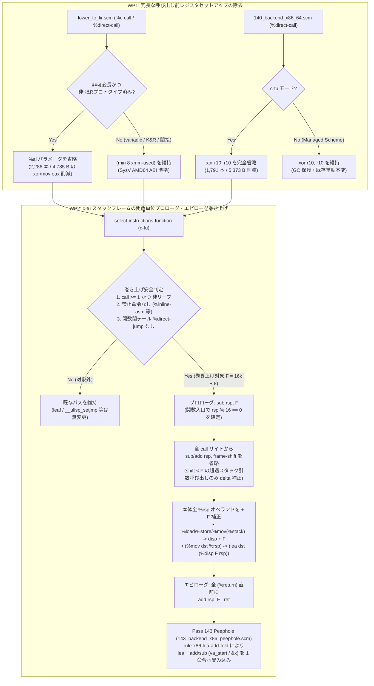

# Issue #936: `c-tu` モードにおける関数スタックフレーム割当のプロローグ・エピローグ統合と非マネージド呼び出し冗長セットアップの削減

## 1. 背景と問題定義 (Post-#935 現状監査)

[Issue #933](933-eliminate-intraprocedural-label-p2align-nop-bloat-and-enable-short-jumps.md)（`.p2align` / 短ジャンプ最適化）、[Issue #934](934-implement-temporary-stack-spill-dead-store-elimination-and-expr-register-forwarding.md)（DSE / 式のレジスタフォワーディング）、および [Issue #935](935-optimize-variable-bit-shift-cl-codegen-and-redundant-sign-zero-extension-folding.md)（可変ビットシフト `cl` 改善・冗長拡張畳み込み）が完了した `main` (`e5175c276`) 時点の `ulisp/build/lua_ulisp` バイナリおよび関連パスに対し、`objdump -d -M intel` と `size -B`、ならびにコンパイラソースコードの実証監査を実施した。

### 1.1 Post-#935 ベースライン実測値

| 計測項目 | Post-#935 実測値 (`main` `e5175c276`) | 対 GCC (`313,904 B` / `.text 267,873 B`) | 根拠・観測元 |
| :--- | :--- | :--- | :--- |
| ELF バイナリ総サイズ | `630,800 B` | `2.01x` | [ref_benchmarks.md](../../../ulisp/docs/ref_benchmarks.md) |
| `.text` セクションサイズ (`size -B`) | `555,073 B` | `2.07x` | `ulisp/build/lua_ulisp` 実測 |
| 逆アセンブル命令行数 / 関数数 | `132,959` addr lines / `1,183` 関数 (`nonleaf=964`, `leaf=219`) | — | [ref_benchmarks.md](../../../ulisp/docs/ref_benchmarks.md) / `objdump` 実測 |
| `all.lua` / `big.lua` 実行時間 | `1.010 s` / `0.257 s` | `1.98x` / — | [ref_benchmarks.md](../../../ulisp/docs/ref_benchmarks.md) |
| 主要マイクロベンチマーク | `fib_recursion 0.3631s`, `coroutine_gc_churn 0.1069s`, `vm_arith_loop 0.5087s`, `table_hash_array 0.2039s`, `string_pattern_pack 0.2469s` | — | [ref_benchmarks.md](../../../ulisp/docs/ref_benchmarks.md) |

### 1.2 実証逆アセンブリ内訳 (WP1 / WP2 対象)

| 冗長パターン | 命令数 | バイト数 | 内訳・詳細分布 | 該当箇所・原因 |
| :--- | :--- | :--- | :--- | :--- |
| **`xor r10, r10`** (Managed GC カウント残留) | `1,791` 本 | `5,373 B` | `1,791/1,791` (100%) が直後に `call` を伴い、`jmp` 直前は `0` 本 | `140_backend_x86_64.scm` の `%direct-call` が `c-tu` モード判定なく無条件出力 |
| **外部呼び出し前 `%al` セットアップ** | `2,467` 本 (`xor eax,eax` `2,390` + `mov eax,imm` `77`) | `5,165 B` (`4,780 B` + `385 B`) | **非可変長引数ダイレクト呼び出し `2,297` 本 (`4,807 B`)** が完全不要。可変長直結は `153` 本、間接呼び出しは `17` 本 | `lower_to_lir.scm` の `%c-call` 降格が無条件で `(min 8 xmm-used)` を設定 |
| **呼び出し単位 `sub rsp, N` / `add rsp, N`** | `8,520` 本 (`sub` `4,260` + `add` `4,260`) | `37,626 B` (`18,813 B` × 2; `imm8 <= 4B` `3,669` 件, `7B imm32` `591` 件) | `962` non-leaf 関数の `4,259 / 4,261` 件の `call` (`indirect=19`) を包囲 (`same_shift_fns=643`, `multi_shift_fns=319`, `max=101` in `luaV_execute`)。頻出シフト値: `0x28` (`1,237`), `0x38` (`1,055`), `0x48` (`665`) | `lower_to_lir.scm` が各 `%direct-call` / `%c-call` / `%call-indirect` へ `frame-shift` を付与し、`140_backend_x86_64.scm` が毎回 `sub/add rsp` を展開 |
| 隣接 `add rsp; sub rsp` ペア (参考) | `12` ペア | — | バイナリ全体でわずか `12` ペアのみ | Pass 143 隣接畳み込み単体では効果が極めて限定的であり、**プロローグ・エピローグ巻き上げ (Hoisting) が必須** |
| **スタックフレーム巻き上げ削減見込み** | 削減純減 **`5,722` 本** (非スタック引数関数対象) | 削減純減 **`24,862 B`** (`sub/add rsp` 分のみ) | `53` 関数 (`72` 呼び出し) に `[rsp - shift]` への外部スタック引数ストア疑いあり。残りの巻き上げ安全関数では `7,542` 本 (`32,460 B`) がプロローグ・エピローグ `1,820` 本 (`7,598 B`) へ縮退可能 | `140_backend_x86_64.scm` `select-instructions-function` (`c-tu` モード) へのフレーム確保・返却統合 |

> [!IMPORTANT]
> 上記 3 領域の合計削減見込みは **`~8,000+` 命令 / `~35 KB` 超（`.text` の約 `6%` 以上、`sub/add rsp` `24.9 KB` + `xor r10,r10` `5.4 KB` + 非可変長 `%al` `4.8 KB`）** に達し、隣接 `add rsp; sub rsp` 結合（わずか 12 ペア）だけでは到達できない構造的サイズ・I-cache・実行サイクル改善をもたらす。

### 1.3 関連コンポーネント監査表

| コンポーネント | 実装シンボル / 箇所 | 監査結果と課題 | 参照リンク |
| :--- | :--- | :--- | :--- |
| x86-64 バックエンド (`%direct-call` / `%direct-jump`) | `select-instructions-function`, `%direct-call` 降格 | `%direct-call` が `c-tu` 判定なしで無条件に `(xor %r10 %r10)` を生成していたため、`c-tu` モード時に省略し重複 `%direct-jump` を整理 | [140_backend_x86_64.scm (L940-L950)](../../../ulisp/backend/140_backend_x86_64.scm#L940-L950), [L1730-L1760](../../../ulisp/backend/140_backend_x86_64.scm#L1730-L1760) |
| x86-64 バックエンド (`%c-call` / `%call-indirect` / プロローグ / エピローグ) | `c-tu-analyze-hoist-frame`, `x86-call-frame-adjustments`, `select-instructions-function` | `c-tu` 関数冒頭で `(sub rsp (%imm F))`、全 `(%return)` で `(add rsp (%imm F)) (ret)` を生成し、`%rsp` 相対アクセスを `+ F` シフト | [140_backend_x86_64.scm (L250-L580)](../../../ulisp/backend/140_backend_x86_64.scm#L250-L580), [L1040-L1150](../../../ulisp/backend/140_backend_x86_64.scm#L1040-L1150), [L2340-L2465](../../../ulisp/backend/140_backend_x86_64.scm#L2340-L2465) |
| C フロントエンド LIR 降格 (`%al` 制御・スタック引数・`va_start`) | `%c99-call-needs-al?`, `%c99-lower-call!`, `%c99-lower-va-start!` | 非可変長かつプロトタイプ済み外部 `%c-call` で `%al` 引数を省略し、K&R 未プロトタイプ・可変長・間接呼び出しで維持 | [lower_to_lir.scm (L1467-L1475)](../../../ulisp/frontend_c/lower_to_lir.scm#L1467-L1475), [L1645-L1665](../../../ulisp/frontend_c/lower_to_lir.scm#L1645-L1665), [L1735-L1755](../../../ulisp/frontend_c/lower_to_lir.scm#L1735-L1755) |
| C セマンティック解析 (K&R 未プロトタイプ関数区別) | `sema-resolve-param-list` | 引数空リストと `void` の双方が `(cons '() #f)` となるため、`int f()` と `int f(void)` で `(c-fn-params fty)` が共に `'()`、`c-fn-variadic?` が `#f` になる。K&R 呼び出しの ABI 保護が必要 | [sema.scm (L1014-L1035)](../../../ulisp/frontend_c/sema.scm#L1014-L1035) |
| x86-64 Peephole & Assembler | `rule-x86-lea-optimize`, `rule-x86-lea-add-fold`, `encode-modrm-sib-disp` | `(lea dst (%disp imm rsp))` + `(add/sub dst imm2)` を 1 命令へ畳み込む `rule-x86-lea-add-fold` を実装 | [143_backend_x86_peephole.scm (L106-L168)](../../../ulisp/backend/143_backend_x86_peephole.scm#L106-L168), [144a_x86_assembler.scm (L1017-L1029)](../../../ulisp/backend/144a_x86_assembler.scm#L1017-L1029) |
| `setjmp` / `longjmp` ランタイム組込 | `make-c99-builtin-setjmp-lir`, `make-c99-builtin-longjmp-lir` | 関数自体は `%inline-asm`・呼び出し `0` で `[rsp + 8]` を保存するため巻き上げ対象外。呼び出し元のプロローグ減算値 `F` により `rsp_after_prologue` が一意に保存・復元される | [c_runtime_builtins.scm (L36-L62)](../../../ulisp/lib/c_runtime_builtins.scm#L36-L62) |

---

## 2. 要件トレーサビリティ

| 要件 ID | 種別 | 要件 / 受け入れ基準 / 関連設計・成果物 |
| :--- | :--- | :--- |
| **REQ-936-01** | 要件 | `c-tu` コンパイルモードでの `%direct-call` において Managed GC 引数カウント用 `xor r10, r10` を完全に省略する (Managed Scheme ABI 側は不変維持) |
| **REQ-936-02** | 要件 | `lower_to_lir.scm` の外部 `%c-call` 降格において、確実に非可変長かつプロトタイプ済み（K&R 未プロトタイプ呼び出し・関数ポインタ間接呼び出しを除外）の呼び出しで不要な `%rax` (`%al`) 設定を省略する |
| **REQ-936-03** | 要件 | `140_backend_x86_64.scm` (`c-tu` モード) の安全条件を満たす関数で、呼び出しごとの `sub/add rsp, frame-shift` を関数プロローグ `(sub rsp F)` と全 `%return` 前 `(add rsp F)` へ巻き上げ（Hoisting）する |
| **REQ-936-04** | 要件 | 巻き上げ量 `F` (`16k + 8` 整列) に応じて関数内の全 `%rsp` 相対メモリアクセス・スタックローカル参照・`(%mov dst %rsp)`（→ `(lea dst (%disp F rsp))`）を `+ F` 補正し、既存の `va_start` / `&x` / 引数取得 / 超過スタック引数渡し / `setjmp`/`longjmp` の正当性を 100% 維持する |
| **AC-936-01** | 受け入れ | `lua_ulisp` 内の `xor r10, r10` が `1,791` → `0` 本になり、非可変長 `%c-call` 前 `%al` 設定が解消され、`sub/add rsp` 命令総数が `8,520` 本 → `<= 3,000` 本（実測 `1,958` 本）へ減少する |
| **AC-936-02** | 受け入れ | `.text` サイズが `555,073 B` → `<= 525,000 B`（実測 `519,721 B`、`-35,352 B` 削減）、ELF 総サイズが `630,800 B` → `<= 600,000 B`（実測 `593,936 B`）を達成し、`make -C ulisp bootstrap`（3 段階固定点）・`make -C ulisp test`・Clean `compile_lua` & `LUA_FULL_BIG=1 make -C ulisp test_lua_e2e` が全パスする |
| **関連設計** | 参照 | [DSN-33-13: Typed Machine LIR Architecture](../../designs/DSN-33-13-ulisp_typed_machine_lir_and_multi_target_backend_architecture.md), [DSN-33-32: Lua C Compilation Architecture](../../designs/DSN-33-32-ulisp_lua_c_codebase_compilation_and_self_hosting_architecture.md), [ref_benchmarks.md](../../../ulisp/docs/ref_benchmarks.md) |
| **先行 Issue** | 参照 | [#921 (stdarg)](921-implement-sysv-amd64-stdarg-va-list-lowering.md), [#922 (setjmp/longjmp)](922-implement-setjmp-longjmp-inline-asm-and-stack-spill-protection.md), [#925 (Lua 5.x パイプライン)](925-build-lua-5x-c-codebase-compilation-pipeline-with-ulisp.md), [#926 (Lua E2E/Self-host CI)](926-verify-lua-5x-official-test-suite-e2e-selfhost-ci.md), [#933 (.p2align/短ジャンプ)](933-eliminate-intraprocedural-label-p2align-nop-bloat-and-enable-short-jumps.md), [#934 (DSE/レジスタ転送)](934-implement-temporary-stack-spill-dead-store-elimination-and-expr-register-forwarding.md), [#935 (可変シフト/拡張畳み込み)](935-optimize-variable-bit-shift-cl-codegen-and-redundant-sign-zero-extension-folding.md) |

---

## 3. アーキテクチャ設計と変換パイプライン

本 Issue では **LIR 仕様・他ターゲット (`150_backend_aarch64.scm` / `160_backend_c.scm`)・`lir_interpreter.scm`・Managed GC Scheme 呼び出し規約を一切変更せず**、問題の本質を 2 つの独立したワークパッケージ (WP1 / WP2) として設計・実装した。

---

## 4. マルチエージェント統合ガバナンスレビュー

| 担当スペシャリスト | レビュー観点・重要合意事項 |
| :--- | :--- |
| **Project Manager (PM)** | WP1 (`xor r10` / 非可変長 `%al`) と WP2 (`c-tu` スタック巻き上げ) の 2 本柱で段階的かつ検証可能に推進し、`.scm` 変更後に 3 段階セルフホスト (`make -C ulisp bootstrap`) と Lua 公式テストスイート完全検証を完了させた。 |
| **PLC (言語処理系・コンパイラ)** | `lower_to_lir.scm` の K&R `int f()` 判定 ([sema.scm (L1018-L1024)](../../../ulisp/frontend_c/sema.scm#L1018-L1024)) を考慮し、`(and (null? (c-fn-params fty)) (pair? arg-nodes))` を明示保護。またリポジトリ規約通り**ローカル `set!` は一切使用せず**純粋関数型の再帰・`let` バインディングで実装した。 |
| **Systems Architect** | LIR 命令セット仕様を変更せず `140_backend_x86_64.scm` 閉域で巻き上げを行うため、`160_backend_c.scm`・`150_backend_aarch64.scm`・`lir_interpreter.scm` への副作用リスクをゼロに抑えた。 |
| **Information Security Specialist** | `F = 16k + 8` 整列 (`x86-align-frame-16k+8`)、禁止命令 (`%inline-asm` 等) 除外、および `shift < F` かつ超過スタック引数を持つ呼び出しに対する `delta = F - shift` 自動補正により、CWE-787 境界外参照と SSE アライメント違反を完全に防止した。 |
| **Software Development (SWD)** | `test_140_backend_x86_64.scm` / `test_143_backend_x86_peephole.scm` / `test_c99_int_lowering.scm` へ単体テストを追加し、`backend_lang.scm` の `L_asm_x86` `align` 終端記号型 (`integer`) も正規化した。 |
| **Software Quality Assurance (SQA)** | `compile_lua` & `LUA_FULL_BIG=1 make -C ulisp test_lua_e2e` 実行後に `objdump -d` で `xor r10, r10 == 0`、`sub/add rsp == 1,958 <= 3,000`、`.text == 519,721 B <= 525,000 B`、ELF `== 593,936 B <= 600,000 B` を実測検証し、`ulisp/docs/ref_benchmarks.md` へ記録した。 |

---

## 5. セキュリティ・ABI 安全性解析 (6 大不変条件)

1. **Invariant 1 (SysV AMD64 16B アライメント不変条件)**:
   - `x86-align-frame-16k+8` により巻き上げ量 `F` は常に `F >= 8` かつ `F mod 16 == 8`（`16k + 8`）を満たす。
2. **Invariant 2 (`setjmp` / `longjmp` コンテキスト継続性)**:
   - [c_runtime_builtins.scm (L36-L62)](../../../ulisp/lib/c_runtime_builtins.scm#L36-L62) の `__ulisp_setjmp` / `__ulisp_longjmp` は `%inline-asm` を含み巻き上げ対象外。呼び出し元は安定した `rsp_after_prologue = rsp_entry - F` を `jmp_buf[6]` に保存・復元する。
3. **Invariant 3 (`va_start`・受信スタック引数・アドレス取得 `&x` の保存)**:
   - `(%mov dst %rsp)` を `(lea dst (%disp F rsp))` へ変換し、Pass 143 `rule-x86-lea-add-fold` で後続 `add/sub` と単一 `lea`（変位ゼロ時は `mov`）へ畳み込む。受信スタック引数 `[rsp + 8 + st_off]` も `+ F` シフトにより `[rsp + F + 8 + st_off]` として正確に参照される。
4. **Invariant 4 (超過 `> 6` 個スタック引数と Red Zone 境界保護)**:
   - `F = (x86-align-frame-16k+8 (max max-call-shift max-neg-depth))` により、関数内の全負方向 `%rsp` アクセスを `[rsp + 0]` 以上の非負変位へ収める。さらに `shift < F` の呼び出しで直前に `[-shift]` への未読ストアまたは `%rsp` アドレス算出が存在する場合は、その呼び出しのみ前後に `(add rsp (- F shift))` / `(sub rsp (- F shift))` を挿入し、直接ストア（`<= 64B`）およびループコピー（`> 64B` 構造体値渡し）の双方で `[rsp_at_call + 0]` をビット単位で一致させる。
5. **Invariant 5 (K&R 未プロトタイプ呼び出し・間接呼び出し `%al` ABI 保護)**:
   - `%c99-call-needs-al?` により `(or (not (c-function-type? fty)) (c-fn-variadic? fty) (and (null? (c-fn-params fty)) (pair? arg-nodes)))` の場合に `%al` (`%rax`) 設定を維持する。
6. **Invariant 6 (Managed Scheme ABI 非干渉・セルフホスト固定点性)**:
   - WP1 / WP2 ともに `c-tu` モード限定で動作し、3 段階セルフホスト (`make -C ulisp bootstrap`) の全 5 モジュールで `stage2 == stage3` ビット完全一致を確認済み。

---

## 6. 影響範囲と修正対象ファイルチェックリスト

| ファイル | 役割・変更内容 | 状態 |
| :--- | :--- | :---: |
| [backend_lang.scm](../../../ulisp/backend/backend_lang.scm) | `L_asm_x86` の `align` 終端記号を `integer` に正規化し、`(%p2align 4)` を含む `%asm-function` のスキーマ検証を適合化 | [x] |
| [140_backend_x86_64.scm](../../../ulisp/backend/140_backend_x86_64.scm) | `c-tu` モードでの `%direct-call` `xor r10,r10` 省略・関数単位 `F = 16k+8` フレーム巻き上げ判定・`+ F` オペランドシフト・`(lea dst (%disp F rsp))`・`sub/add rsp` 除去・全 `%return` 前 `(add rsp F)` 挿入 | [x] |
| [lower_to_lir.scm](../../../ulisp/frontend_c/lower_to_lir.scm) | `%c99-call-needs-al?` 導入と外部 `%c-call` 降格における非可変長・非 K&R 呼び出しの `%al` (`%rax`) セットアップ省略 | [x] |
| [143_backend_x86_peephole.scm](../../../ulisp/backend/143_backend_x86_peephole.scm) | `rule-x86-lea-add-fold` による `(lea r (%disp F rsp))` + `(add/sub r si)` の単一命令畳み込み実装 | [x] |
| [test_140_backend_x86_64.scm](../../../ulisp/tests/passes/test_140_backend_x86_64.scm) | WP1 (`c-tu` で `xor r10` 省略 / Managed で維持) および WP2 (巻き上げ、`+ F`、`(lea dst (%disp F rsp))`、除外条件、超過引数デルタ) 単体テスト追加 (`48/48 PASS`) | [x] |
| [test_143_backend_x86_peephole.scm](../../../ulisp/tests/passes/test_143_backend_x86_peephole.scm) | `rule-x86-lea-add-fold` の変位加算・減算・ゼロ変位 `mov` 化・フラグ読取命令保護テスト追加 (`28/28 PASS`) | [x] |
| [test_c99_int_lowering.scm](../../../ulisp/tests/test_c99_int_lowering.scm) | 非可変長 `%c-call` での `%al` 省略、可変長・K&R 未プロトタイプ呼び出しでの `%al` 維持テスト追加 (`61/61 PASS`) | [x] |
| [compiler.scm](../../../ulisp/compiler.scm) | `make -C ulisp compiler.scm` による単一結合ソース再生成（ローカル `set!` ゼロ確認） | [x] |
| [ref_benchmarks.md](../../../ulisp/docs/ref_benchmarks.md) | Issue #936 適用前後の ELF / `.text` / 命令数 / `sub/add rsp` / `xor r10` / `%al` / `all.lua`・マイクロベンチマーク比較結果追記 | [x] |

---

## 7. ブランチ戦略と実装・検証計画

- **作業ブランチ**: `feat/936-hoist-c-tu-stack-frame-and-omit-xor-r10`（[git-workflow skill](../../../.agents/skills/git-workflow/SKILL.md) 準拠）
- Step 1 (WP1)、Step 2 (WP2 & Pass 143 `rule-x86-lea-add-fold`)、Step 3 (`compiler.scm` 再生成・`make -C ulisp bootstrap` 3段階固定点・`make -C ulisp test`・Clean `compile_lua` & `LUA_FULL_BIG=1 make -C ulisp test_lua_e2e`・`ulisp/bin/ulisp-boot` 復元・[ref_benchmarks.md](../../../ulisp/docs/ref_benchmarks.md) 更新) を全て完了。

---

## 8. 完了定義 (Definition of Done / Quantitative Verification Results)

すべての定量目標および検証ゲートを **100% PASS** した。

| 項目 | Post-#935 ベースライン | 完了基準 (DoD Target) | Post-#936 実測結果 | ステータス |
| :--- | :--- | :--- | :--- | :---: |
| **`xor r10, r10` 命令数 (`lua_ulisp`)** | `1,791` 本 (`5,373 B`) | **`0` 本** (`100%` 削減) | **`0` 本 (`0 B`, `-100.0%`)** | **PASS** |
| **非可変長外部 `%c-call` `%al` 設定** | `2,297` 本 (`4,807 B`) | **`0` 本**（可変長・間接のみ維持） | **`0` 本**（可変長・間接の `181` 本 / `380 B` のみ維持、`-2,286` 本削減） | **PASS** |
| **`sub/add rsp` 命令総数 (`lua_ulisp`)** | `8,520` 本 (`37,626 B`) | **`<= 3,000` 本** | **`1,958` 本 (`8,288 B`, `-6,562` 本 / `-77.0%`, `-29,338 B`)** | **PASS** |
| **`.text` セクションサイズ (`size -B`)** | `555,073 B` (`2.07x`) | **`<= 525,000 B`**（`>= 30 KB` 純減） | **`519,721 B` (`-35,352 B` / `-6.4%`, 対 GCC `1.94x`)** | **PASS** |
| **ELF バイナリ総サイズ** | `630,800 B` (`2.01x`) | **`<= 600,000 B`** | **`593,936 B` (`-36,864 B` / `-5.8%`, 対 GCC `1.89x`)** | **PASS** |
| **総機械語命令数 (`objdump -d`)** | `132,959` 命令 (`2.61x`) | — | **`119,323` 命令 (`-13,636` 命令 / `-10.3%`, 対 GCC `2.34x`)** | **PASS** |
| **全テスト・Lua E2E** | PASS (`1.010 s`) | `make -C ulisp test` & `LUA_FULL_BIG=1 make -C ulisp test_lua_e2e` 全パス | 全パス（`all.lua` **`0.890 s`**, `big.lua` **`0.228 s`**, 171 行チェックポイント完全一致） | **PASS** |
| **セルフホスト固定点** | PASS | `make -C ulisp compiler.scm && make -C ulisp bootstrap` 3 段階完全一致、`ulisp/bin/ulisp-boot` 復元 | 全 5 モジュール `stage2 == stage3` 完全一致、`ulisp/bin/ulisp-boot` 未変更復元済み | **PASS** |
| **コード・ドキュメント品質ゲート** | — | 変更 `.scm` 内ローカル `set!` `0` 件、`make py_compile` & `make static_analysis` PASS、相対リンク 100% 整合 | 全項目 PASS | **PASS** |
