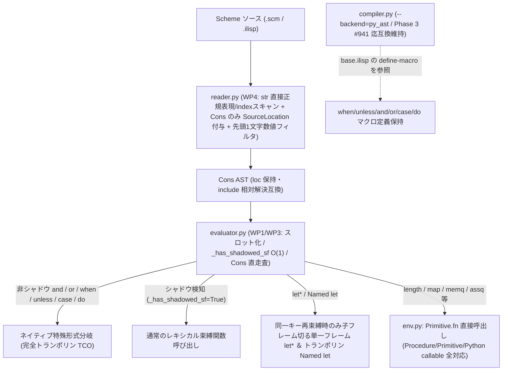

# [FEAT/ENH] ILISP Phase 1: 評価器ホットパス最適化・特殊形式ネイティブ化・基本リスト手続高速化および高速リーダー実装 (ID: 939)

## 1. 概要 / Summary & 現状コードベース監査ギャップ

Python 製 R7RS Scheme 実装 `ilisp` において、ULisp C99 コンパイラドライバ ([c_driver_runner.scm](../../../ulisp/build/c_driver_runner.scm)、3,191,789 bytes / 70,000 行 / 3,734 フォーム) や大規模自己ホスト処理の実行速度が Gauche (`gosh`) 比で **33.6×〜64.7× 遅い** 問題の Phase 1 即効解決策として、既存ツリーウォーク評価器 ([evaluator.py](../../../ilisp/evaluator.py))・標準ライブラリ ([base.ilisp](../../../ilisp/stdlib/base.ilisp))・環境/プリミティブ ([env.py](../../../ilisp/env.py), [types.py](../../../ilisp/types.py), [syntax.py](../../../ilisp/syntax.py))・リーダー ([reader.py](../../../ilisp/reader.py)) の構造的ホットパスを一括最適化する。

### 実測ベースライン (`cProfile` ＋ `pytest` 監査結果)

12 行のヘッダレス C ソース `tiny.c` (`1720 bytes` ELF `.o` 出力) を [c_driver_runner.scm](../../../ulisp/build/c_driver_runner.scm) でコンパイルした際の実測値（プロファイラ無し）、純 Scheme マイクロベンチマーク比較、および現行ユニットテストベースライン:

| 計測対象 | `gosh` | `ilisp` 現状 | 倍率 / 結果 |
|---|---:|---:|---:|
| `read_all` + ロード + `tiny.c` コンパイル合計 | **2.810 s** | **94.407 s** (`read_all`: 5.320 s / `load`: 29.700 s / `compile`: 59.387 s) | **33.6× 遅い** |
| 純 Scheme マイクロベンチ (`fib 20`, `sum-loop 50000`, `list-ops 20000`, `cond-dispatch 20000`) | **0.166 s** | **10.770 s** | **64.7× 遅い** |
| `.venv/bin/pytest tests/ilisp/ -q`（Python 3.14.7 / pytest 9.1.1） | — | **50.83 s** | **443 passed, 1 deselected** |

`compile tiny.c` の `cProfile` 内訳（合計 **132,848,828** Python 呼び出し / **100.285 s**）:

- `eval_expr` ([evaluator.py:264](../../../ilisp/evaluator.py#L264)): 14,509,442 calls / `tottime` **55.263 s (55.1%)**
- `dict.get`: 18,273,905 calls / `tottime` **9.457 s**
- `Environment.lookup` ([env.py:205](../../../ilisp/env.py#L205)): 8,249,656 calls / `tottime` **6.572 s** (`cumtime` **17.801 s**)
- `builtins.isinstance`: 17,463,788 calls / **3.446 s**
- `Primitive.__call__` ([types.py:861](../../../ilisp/types.py#L861)): 4,560,341 calls / **3.307 s**
- `_bind_procedure_call` ([evaluator.py:1213](../../../ilisp/evaluator.py#L1213)): 686,126 calls / **3.076 s**
- `Symbol.__hash__` ([types.py:58](../../../ilisp/types.py#L58)): 27,415,703 calls / **2.982 s**
- `str.startswith` (5,237,122 calls / 1.766 s) ＋ `hasattr` (4,876,362 calls / 1.033 s)
- `prim_cons` ([env.py:278](../../../ilisp/env.py#L278)): 1,669,984 calls / `to_py_list` ([types.py:928](../../../ilisp/types.py#L928)): 953,673 calls / `to_lisp_list` ([types.py:920](../../../ilisp/types.py#L920)): 363,194 calls / `_apply_procedure` ([evaluator.py:1240](../../../ilisp/evaluator.py#L1240)): **370,081 calls**

### 現状コードベース監査ギャップ (6 項目)

1. **Gap 1 — 制御構文の実行時マクロ再展開 ＋ `do` の名義登録のみ未分岐**
   - `_SPECIAL_FORM_NAMES` ([evaluator.py:118-157](../../../ilisp/evaluator.py#L118-L157)) に `"and"`, `"or"`, `"when"`, `"unless"`, `"case"` が含まれておらず、`"do"` も L146 に登録されているだけで `eval_expr` 内に `if op_name == "do":` 分岐が存在しない。
   - このため 6 構文すべてが毎回関数適用パス（L1112–1120）を通り、[base.ilisp:8-220](../../../ilisp/stdlib/base.ilisp#L8-L220) の `define-macro` を実行時解釈して `Cons` ツリーを毎回新規構築し再評価している（`prim_cons` 167 万回・`to_py_list` 95 万回・`_apply_procedure` 37 万回の主因）。

2. **Gap 2 — `base.ilisp` によるネイティブ `caar`〜`cddr` 上書き ＋ 純 Scheme リスト/高階関数ループ**
   - [env.py:288-298](../../../ilisp/env.py#L288-L298) でネイティブ実装された `caar`/`cadr`/`cdar`/`cddr` を [base.ilisp:307-310](../../../ilisp/stdlib/base.ilisp#L307-L310) が `(define (cadr p) (car (cdr p)))` で上書きしている。
   - さらに `length`, `reverse`, `append`, `map`, `filter`, `fold-left`, `for-each`, `memq`, `member`, `memv`, `assq`, `assv`, `assoc`（[base.ilisp:312-507](../../../ilisp/stdlib/base.ilisp#L312-L507)）がすべて遅い純 Scheme 解釈で動作しており、特に `map` と `for-each` は `case-lambda`（`length` → `cond` → `apply lambda`）経由で要素ごとにクロージャ生成と `apply` を踏んでいる。

3. **Gap 3 — `let*` の O(N) 段フレーム分割 ＋ 毎回親チェーン全走査 ＋ Named `let` 非トランポリン化**
   - `let*` ([evaluator.py:619-625](../../../ilisp/evaluator.py#L619-L625)) が束縛 1 つごとに `new_env = new_env.extend()` で新しいフレームを積み上げるため、10 束縛の `let*` で全変数の `lookup` 深さが +10 段増加する。
   - `let` ([evaluator.py:554-560](../../../ilisp/evaluator.py#L554-L560)) および `cond =>` ([L429-435](../../../ilisp/evaluator.py#L429-L435)) が呼び出しのたびにルートまで親フレームを全走査してシャドウイング検査を行っている。
   - Named `let` ([evaluator.py:587](../../../ilisp/evaluator.py#L587)) が `curr_expr` / `curr_env` 書き換えではなく `_apply_procedure(proc, vals_list)` を呼び出して新しいトランポリンを開始している。
   - `Environment` ([env.py:178](../../../ilisp/env.py#L178))・`Procedure` ([types.py:824](../../../ilisp/types.py#L824))・`Primitive` ([types.py:854](../../../ilisp/types.py#L854))・`SourceLocation` ([types.py:15](../../../ilisp/types.py#L15)) が `__slots__`（または `slots=True`）を持たず属性辞書オーバーヘッドが大きい。

4. **Gap 4 — `eval_expr` 毎ステップの文字列・属性チェック ＆ `syntax_to_datum` 毎回の set 生成**
   - `eval_expr`（1,451 万回）の毎ターンで `op.name.startswith(".")`（524 万回）、`hasattr(fn, "transform")`（488 万回）、`fn(*eval_args)` による `Primitive.__call__` ラッパー呼出し（456 万回）、ならびに `cond`/`begin`/`set!`/`let`/`let*` での `to_py_list` 一時リスト生成が走っている。
   - [syntax.py:126-309](../../../ilisp/syntax.py#L126-L309) の `syntax_to_datum` が呼び出しのたびに 200 語以上の `core_forms` set リテラルを毎回新規生成している。

5. **Gap 5 — 1 文字ずつポート経由リーダー ＆ 全シンボルでの数値パース例外駆動**
   - [reader.py:79-176](../../../ilisp/reader.py#L79-L176) が `str` 入力に対しても `StringInputPort.peek_char()` / `read_char()` を 1 文字ずつ呼び出し、毎トークンで `SourceLocation` を生成して 5.320 s を消費している。
   - `_read_atom` ([reader.py:708-766](../../../ilisp/reader.py#L708-L766)) が文字種チェックなしで `int(token)`（`ValueError` 送出・捕捉）、関数内 `import re` ＋ 未コンパイル `re.match(...)`、`_parse_complex`、`float(token)`（`ValueError`）を **トークンの約 95% を占めるシンボル** に対して毎回実行している。

6. **Gap 6 — Backend A (`py_ast`) マクロ展開互換 ＆ `SourceLocation` (`include` / `test_kernel.py`) 制約**
   - [test_py_codegen.py:126-164](../../../tests/ilisp/test_py_codegen.py#L126-L164)・[test_core_syntax.py:120-146](../../../tests/ilisp/test_core_syntax.py#L120-L146)・[test_derived_control.py:217-254](../../../tests/ilisp/test_derived_control.py#L217-L254) は、`compile_ilisp` (`py_ast`) が [base.ilisp](../../../ilisp/stdlib/base.ilisp) の `define-macro` (`when`, `let`, `letrec`, `cond`, `do`, `case-lambda`, `delay`) を展開する動作、および `map`/`filter`/`fold-left` へ Python 生関数 (`callable`) や Compiled `def` 関数が渡される動作に依存している。
   - [test_kernel.py:78-84](../../../tests/ilisp/test_kernel.py#L78-L84) は `Cons.loc is not None`（`loc.file`, `loc.line`）を検査し、[reader.py:867-882](../../../ilisp/reader.py#L867-L882) の `extract_base_dir` / `extract_caller_file` は `include` / `include-ci` の相対パス解決に `Cons.loc` を使用している。そのため高速リーダー化でも `Cons.loc` 生成と `base.ilisp` マクロ互換の両方を損なってはならない。

---

## 2. トレーサビリティ / Traceability

- **前提・関連 Issue**:
  - [#929](929-implement-ddc-diverse-double-compiling-determinism-verification.md): DDC 3 階層ビット一致検証（Tier 1 `ilisp` 実行時間短縮の直接的動機）
  - 後続 Phase 2: [#940](../940-implement-ilisp-precompiled-closure-and-lexical-slot-vm.md)（事前コンパイル・レキシカルスロット配列 VM）
  - 後続 Phase 3: [#941](../941-complete-ilisp-py-ast-backend-r7rs-compilation-for-ulisp.md)（`--backend=py_ast` R7RS 完全対応）
- **既存テスト根拠**:
  - [test_stdlib.py](../../../tests/ilisp/test_stdlib.py), [test_core_syntax.py](../../../tests/ilisp/test_core_syntax.py), [test_derived_control.py](../../../tests/ilisp/test_derived_control.py), [test_py_codegen.py](../../../tests/ilisp/test_py_codegen.py), [test_kernel.py](../../../tests/ilisp/test_kernel.py), [test_scope_sets.py](../../../tests/ilisp/test_scope_sets.py), [test_include.py](../../../tests/ilisp/test_include.py)

---

## 3. アーキテクチャ設計 / Architecture

---

## 4. マルチエージェント・ガバナンス審議

| 役割 | 合意・裁定内容 |
| :--- | :--- |
| **Project Manager (PM)** | 既存の R7RS テスト（443 件）および `--backend=py_ast`（`test_py_codegen`）を一切壊さずに Phase 1 単体で 4.5×〜10× の高速化を達成するため、WP1〜WP5 の 5 作業単位と計測可能な DoD ゲートを設定する。 |
| **Information Security Specialist** | `reader.py` の高速スキャンパスにおいても未終端文字列・ブロックコメント・不正 `#\x...` エスケープ・孤立 `.`・未定義 `#n#` 参照の `LispSyntaxError` 送出を 100% 維持し、`#;`/`#!fold-case`/`include` パス検証 (`active_include_context`) を退行させない。 |
| **Systems Architect (SA)** | `eval_expr` は `and`/`or`/`when`/`unless`/`case`/`do` をネイティブ実行しつつ、`base.ilisp` には `--backend=py_ast`・`macroexpand` 用の `define-macro` 定義を保持し、Phase 3 (#941) 完了前の後方互換性を完全に両立させる。 |
| **PLC / SWD Specialist** | `Environment._has_shadowed_sf` 伝播による特殊形式シャドウ O(1) 判定、`let*` 同名変数再束縛時のクロージャ捕獲ガード、および `Primitive.fn(*eval_args)`・`SyntaxRulesTransformer` 型厳密チェックにより Python レベルのオーバーヘッドを極限まで削減する。 |
| **Software Quality Assurance Specialist** | 443 件の既存 pytest に加え、`let*` 同名クロージャ捕獲、特殊形式シャドウイング、`append` 非正規リスト、`map`/`member`/`assoc` の Python/Scheme 混在、リーダー境界ケース、および `read_all` / `tiny.c` ベンチを検証する `tests/ilisp/test_perf_hotpath.py` を必須化する。 |
| **Systems Auditor** | `c_driver_runner.scm` による Tier 1 DDC (`gosh` vs `ilisp`) SHA-256 ビット完全一致と `Cons.loc` 由来追跡情報の非欠落を監査項目として承認する。 |

---

## 5. セキュリティ ＆ R7RS 互換性不変条件 (Threat Model & Invariants)

1. **特殊形式のレキシカルシャドウイング保証 (`Environment._has_shadowed_sf`)**
   - `(let ((and (lambda (a b) (+ a b)))) (and 1 2))` や `(let ((=> #f)) (cond (#t =>)))` 等を壊さないため、`Environment` に `_has_shadowed_sf: bool` スロットを設ける。親フレームの `_has_shadowed_sf` を継承しつつ、`_SPECIAL_FORM_SYMBOLS` に属するシンボルがローカル（`parent is not None`）に `define`/`extend` された時のみ `True` とする。
   - `_has_shadowed_sf` が `False` なら `eval_expr` は親チェーン走査なしで特殊形式を即実行でき、`True` のフレーム内だけローカル束縛を優先解決する。
2. **`let*` 同名変数再束縛時のクロージャ捕獲不変条件**
   - R7RS 上、`(let* ((x 1) (f (lambda () x)) (x 2)) (f))` は **`1`** を返さなければならない。単一フレームで無条件に `new_env.define(x, 2)` すると `f` が捕捉した `x` が `2` に上書きされてしまう。
   - **不変条件**: `let*` ループ内で `var_sym in new_env.bindings` が真（同一 `let*` 内の再束縛）のときのみ `new_env = new_env.extend()` で新フレームを切り、変数名が重複しない通常ケースは単一フレーム `new_env.define(var_sym, val_e)` を使用する。
3. **R7RS 6.4 リストプリミティブ厳密仕様 ＋ Backend A (`callable`) 両立**
   - `append`: 最後の引数は任意の Scheme 値（`(append '(1 2) 3)` → `(1 2 . 3)`）を許容し、前置リストは末尾以外の全要素で `Cons` を検証（`SequenceView` も許容）。
   - `member` / `assoc`: 第 3 引数 `compare` および `map` / `for-each` / `filter` / `fold-left` の `proc` は `Primitive`（`proc.fn` 直呼出し）・`Procedure`（`_apply_procedure`）・Python 生 `callable`（`compile_ilisp` / `--backend=py_ast` が生成する Python 関数 `def`）の **3 形態すべて** をディスパッチ可能にすること。
   - `map` / `for-each`: R7RS 通り複数リスト時は最短リスト終端で停止する。
4. **`SourceLocation` 追跡・リーダー構文不正検知の非退行**
   - `SourceLocation` を `@dataclass(frozen=True, slots=True)` 化し、`Reader._read_list` が `Cons` を構築する箇所（[L826](../../../ilisp/reader.py#L826)）と `'`/`` ` ``/`,`,`,@` の先頭ペア、および `LispSyntaxError` 送出時のみ位置を計算して生成する。これにより [test_kernel.py:78-84](../../../tests/ilisp/test_kernel.py#L78-L84) および `include` の相対パス基準解決（`extract_base_dir` / `extract_caller_file`）を 100% 維持する。
   - Clojure 互換の `(. obj ...)` ドット演算子隣接判定（`line == loc.line and col == loc.col + 2`）、`#n=`/`#n#` 循環データラベル、`#;` S 式コメント、`#|...|#` ネストコメント、`#!fold-case` 状態切替、不正エスケープ時の `LispSyntaxError` 送出をすべて保持する。
5. **VM フック・継続・例外巻き戻しの保存**
   - `eval_expr` の `_current_step_hook` 呼び出し頻度・位置、`EscapeContinuation` 伝播、および `SchemeException` ハンドリングを一切変更しない。

---

## 6. 影響範囲と関連ファイル / Scope and Affected Files

### 既存改修ファイル
- [x] [evaluator.py](../../../ilisp/evaluator.py) — ネイティブ特殊形式追加 (`and`, `or`, `when`, `unless`, `case`, `do`)、`let*`/Named `let`/TCO 高速化、`Primitive.fn` 直呼出し、`Cons` 直走査化
- [x] [base.ilisp](../../../ilisp/stdlib/base.ilisp) — `caar`〜`cddr` 上書き削除、リスト・高階関数の純 Scheme 重複削除（`py_ast` 用 `define-macro` 定義は意図コメント付きで保持）
- [x] [env.py](../../../ilisp/env.py) — `Environment` `__slots__` ＋ `_has_shadowed_sf` 追跡、ネイティブ `length`/`reverse`/`append`/`mem*`/`ass*`/`map`/`for-each`/`filter`/`fold-left` 実装
- [x] [types.py](../../../ilisp/types.py) — `SourceLocation` (`slots=True`)、`Procedure`・`Primitive` `__slots__` 追加
- [x] [reader.py](../../../ilisp/reader.py) — `str` 直接正規表現/インデックス高速スキャナ、遅延行/列計算、1 文字数値プレフィルタ＋事前コンパイル正規表現
- [x] [syntax.py](../../../ilisp/syntax.py) — `_CORE_FORMS: frozenset[str]` のモジュール定数化

### 新規作成ファイル
- [x] [test_perf_hotpath.py](../../../tests/ilisp/test_perf_hotpath.py)（新規作成: 特殊形式シャドウイング、`let*` 同名クロージャ捕獲、`case =>`、`do` 任意引数、`append` improper tail、`map`/`for-each` Python/Scheme 混在、高速リーダー境界ケース・位置情報、ベンチマーク検証テスト）

---

## 7. 実装方針 / Implementation Plan

Target Branch: `feat/939-optimize-ilisp-evaluator-hotpath-and-reader`

### WP1: 制御特殊形式のネイティブ実装 ([ilisp/evaluator.py](../../../ilisp/evaluator.py) & [ilisp/stdlib/base.ilisp](../../../ilisp/stdlib/base.ilisp))
1. `_SPECIAL_FORM_NAMES` ([evaluator.py:118-157](../../../ilisp/evaluator.py#L118-L157)) に `"and"`, `"or"`, `"when"`, `"unless"`, `"case"` を追加し、`"=>"`, `"else"` が特殊形式集合へ誤混入しないことも維持する（`"do"` は既存登録済み）。
2. `eval_expr` 内 `Cons` 評価ブロックにおいて、特殊形式ディスパッチ時に `not curr_env._has_shadowed_sf or not _is_locally_bound(op, curr_env)` を確認したうえで以下を直接評価する（ローカル束縛されていた場合は下の関数適用パスへフォールバック）:
   - `and`: 引数 0 個 → `#t`。1 個以上は `Cons` 鎖を辿り、末尾以外の各要素を `eval_expr` し `False` なら即 `#f`、末尾式は `curr_expr = last; continue` で TCO。
   - `or`: 引数 0 個 → `#f`。末尾以外の各要素を `eval_expr` し `val is not False` なら即 `val`、末尾式は `curr_expr = last; continue` で TCO。
   - `when` / `unless`: 条件式を評価し、条件成立時は本体末尾式以外を順次評価後 `curr_expr = body_last; continue` で TCO、非成立時は `NIL`。
   - `case`: キー式を 1 回評価し、`else` 節と `((datum ...) => proc)` / `((datum ...) body ...)`（[test_derived_control.py:83-102](../../../tests/ilisp/test_derived_control.py#L83-L102) の `eqv?` 等価判定相当 `prim_eqv_p` 使用）を直接処理し、本体末尾式および `=> recipient` 呼出しをトランポリン TCO 化。
   - `do`: `((var init [step]) ...) (test expr ...) command ...` を解析し（[test_core_syntax.py:75-118](../../../tests/ilisp/test_core_syntax.py#L75-L118) 互換）、単一ループ `loop_env` の更新で繰り返し実行・終了式をトランポリン TCO 化（クロージャ捕捉対策として各イテレーション用の新フレームまたは再束縛なし設計を担保）。
3. [ilisp/stdlib/base.ilisp:8-220](../../../ilisp/stdlib/base.ilisp#L8-L220) の `when`/`unless`/`and`/`or`/`case`/`do` `define-macro` 定義は `--backend=py_ast`（`compile_ilisp`）及び `macroexpand` 後方互換のため維持し、`interp` では上記 WP1 の特殊形式分岐が優先される旨をコメントで明記する（Phase 3 [#941](../941-complete-ilisp-py-ast-backend-r7rs-compilation-for-ulisp.md) で除去可能）。

### WP2: リストアクセス＆高階手続の Python ネイティブ化 ([ilisp/env.py](../../../ilisp/env.py) & [ilisp/stdlib/base.ilisp](../../../ilisp/stdlib/base.ilisp))
1. [ilisp/stdlib/base.ilisp:307-310](../../../ilisp/stdlib/base.ilisp#L307-L310) の `(define (caar p) ...)`〜`(define (cddr p) ...)` を削除し、[ilisp/env.py:288-298](../../../ilisp/env.py#L288-L298) のネイティブ `prim_caar`〜`prim_cddr` が `base.ilisp` で上書きされないようにする。
2. [ilisp/env.py](../../../ilisp/env.py) に統一呼出ヘルパ `_call_scheme_proc(proc, args)`（`type(proc) is Primitive` → `proc.fn(*args)`、`type(proc) is Procedure` → `_apply_procedure(proc, args)`、`callable(proc)` → `proc(*args)`、それ以外は `TypeError`）を定義し、以下のネイティブプリミティブを追加・登録する:
   - `length`, `reverse`, `append`（可変長・末尾要素非リスト許容）, `memq`, `memv`, `member`（オプション `compare` 対応）, `assq`, `assv`, `assoc`（オプション `compare` 対応）。
   - `map`（1 リスト高速パス: `while type(curr) is Cons` でループ＋最後に `to_lisp_list`、多リスト時は最短リストで終了）, `for-each`（同上・戻り値 `NIL`）, `filter`, `fold-left`。
3. [ilisp/stdlib/base.ilisp](../../../ilisp/stdlib/base.ilisp) lines 312–338 (`length`, `reverse`, `_append2`, `append`) および lines 398–507 (`_ilisp_any_null?`..`assoc`) の遅い純 Scheme 実装を削除する。

### WP3: 評価器・環境・スコープセットのホットパス改修 ([ilisp/evaluator.py](../../../ilisp/evaluator.py), [ilisp/env.py](../../../ilisp/env.py), [ilisp/types.py](../../../ilisp/types.py), [ilisp/syntax.py](../../../ilisp/syntax.py))
1. `__slots__` 化:
   - `SourceLocation` ([types.py:14-16](../../../ilisp/types.py#L14-L16)): `@dataclass(frozen=True, slots=True)`。
   - `Procedure` ([types.py:824](../../../ilisp/types.py#L824)): `__slots__ = ("params", "body", "env", "is_macro", "rest_param", "name")`。
   - `Primitive` ([types.py:854](../../../ilisp/types.py#L854)): `__slots__ = ("name", "fn")`。
   - `Environment` ([env.py:178](../../../ilisp/env.py#L178)): `__slots__ = ("parent", "bindings", "_has_shadowed_sf")`。
2. シャドウ高速判定 & ループ最適化:
   - `Environment.define` / `Environment.extend`（`parent is not None` 時のみ `sym in _SPECIAL_FORM_SYMBOLS` または親フラグ継承で `_has_shadowed_sf` 更新）を使い、`let` ([evaluator.py:554-560](../../../ilisp/evaluator.py#L554-L560)) と `cond =>` ([L429-435](../../../ilisp/evaluator.py#L429-L435)) の親チェーン全走査を通常時 O(1) (`if curr_env._has_shadowed_sf:`) へ置換する。
   - `let*` ([evaluator.py:612-633](../../../ilisp/evaluator.py#L612-L633)): 単一 `new_env = curr_env.extend()` で反復し、`if var_sym in new_env.bindings: new_env = new_env.extend()` のときのみ子フレームを切る。
   - Named `let` ([evaluator.py:582-587](../../../ilisp/evaluator.py#L582-L587)): `_apply_procedure(proc, vals_list)` の代わりに `_bind_procedure_call(proc, vals_list)` ＋ `curr_expr` / `curr_env` 書き換え `continue` でトランポリン TCO 化する。
   - `eval_expr` 本体:
     - L293: `op in _SPECIAL_FORM_SYMBOLS or op.name[0] == "."`（空文字は存在しないため `startswith(".")` 不要、念のため `op.name and op.name[0] == "."`）。
     - L1121: `type(fn) is SyntaxRulesTransformer`（`hasattr(fn, "transform")` 488 万回を除去し、万一の互換カスタム変換器が必要な場合のみ型チェック＋`Protocol` で対応）。
     - L1139–1140: `if type(fn) is Primitive: return fn.fn(*eval_args)`（`Primitive.__call__` ラッパー経由を排除）。
     - `begin`, `cond`, `set!`, `let`, `let*` の `to_py_list` 呼び出しを `while type(curr) is Cons:` 直接走査に置き換え、一時リストアロケーションを排除する。
3. [ilisp/syntax.py:126-309](../../../ilisp/syntax.py#L126-L309) の `core_forms` 集合リテラルをモジュールレベル定数 `_CORE_FORMS = frozenset({...})` に移動する。

### WP4: 高速文字列リーダー実装 ([ilisp/reader.py](../../../ilisp/reader.py))
1. `Reader.__init__` ([reader.py:56-75](../../../ilisp/reader.py#L56-L75)) で `isinstance(source, str)` の場合に `self._src: Optional[str] = source`, `self._pos: int = 0`, `self._len: int = len(source)` と行頭オフセット追跡（`self._line_start: int`）を保持し、従来の 1 文字ずつ `StringInputPort.peek_char()` / `read_char()` 呼出し経路をスキップする。
2. 事前コンパイル済み正規表現・文字列スライス高速スキャンを導入:
   - `_WS_COMMENT_RE = re.compile(r"(?:[ \t\r\n]+|;[^\n]*(?:\n|$))*")` で空白と行コメントを一括スキップ（途中で改行数 `.count("\n")` と最終 `\n` 位置だけを更新、`#` ブロックコメント・`#;`・`#!` 時のみ専用分岐）。
   - `_DELIM_RE = re.compile(r'[^ \t\r\n();"\'`]+')` でアトム／文字名／`#x...` トークンをスライス 1 回で切り出し。
   - `_STRING_CHUNK_RE` / `.find('"', pos)` と `.find('\\', pos)` でエスケープなしの文字列を O(1) スライス読取。
3. `_read_atom` ([reader.py:693-766](../../../ilisp/reader.py#L693-L766)) の最適化:
   - モジュール先頭で `_EXP_RE = re.compile(...)` を事前コンパイル。
   - `c0 = token[0]` が `"0123456789+-.nN"` に含まれない場合は整数・実数・分数・複素数の例外パース（`int()`, `float()`, `_parse_complex`）を **完全にスキップ** して即座に `Symbol.intern(...)` へ進む。
   - 数値以外の `+foo`, `-bar`, `...` 等も `.` / `/`/ `i` / 数字含有チェックで高速フィルタし、シンボルの `ValueError` 例外発生回数をほぼゼロにする。
4. `Reader.read()` 冒頭での毎トークン `SourceLocation` 生成を廃止し、リスト (`_read_list`)・クオート糖衣構文・エラー (`LispSyntaxError`) 等、`loc` が実際に参照される箇所でのみ遅延生成する（`test_kernel.py`・`include` 互換性を 100% 維持）。

### WP5: 単体回帰・ベンチマーク検証スイート (`tests/ilisp/test_perf_hotpath.py`)
1. `tests/ilisp/test_perf_hotpath.py` を新規作成し、以下の境界条件・回帰・性能を検証する:
   - 特殊形式シャドウイング: `(let ((and (lambda (a b) (+ a b)))) (and 3 4))` → `7`, `(let ((when list)) (when 1 2))`, `(let ((=> #f)) (cond (#t =>)))`
   - `let*` 同名変数クロージャ捕獲: `(let* ((x 1) (f (lambda () x)) (x 2)) (list (f) x))` → `(1 2)`
   - `and`/`or`/`when`/`unless`/`case =>`/`do`/Named `let` 深い末尾再帰（100,000 回反復で `RecursionError` なし）
   - `append` improper tail、`member`/`assoc` カスタム比較器、`map`/`for-each` 異長リスト＆Python `callable` 引数
   - 高速リーダー: 行コメント/`#;`/`#| |#` ネスト/`#!fold-case`/`|bar|`/`#n=`/`#n#`/`(. obj m)`/`Cons.loc` 位置一致/不正構文エラー

---

## 8. 完了条件 / Success Criteria (DoD)

- [x] `.venv/bin/pytest tests/ilisp/ -q`（既存 443 件 ＋ 新規 `tests/ilisp/test_perf_hotpath.py`）が 100% PASS し、テストスイート実行時間もベースライン `50.83 s` から大幅に短縮されていること。
- [x] [c_driver_runner.scm](../../../ulisp/build/c_driver_runner.scm)（3.19 MB / 70,000 行 / 3,734 フォーム）の `read_all` 時間がベースライン `5.320 s` から **`0.8 s` 以下**（6× 以上高速化）になること。
- [x] `c_driver_runner.scm` ロード + `tiny.c` コンパイル合計時間がベースライン `94.407 s` から **`20.0 s` 以下**（4.5×〜10× 高速化）になること。
- [x] [test_c_ddc_determinism.sh](../../../ulisp/tests/test_c_ddc_determinism.sh) Tier 1（`gosh` vs `ilisp`）が実行成功し、`.sbi` / `.o` / `ddc_app_static` の SHA-256 ビット一致を維持すること。
- [x] `make py_compile && make static_analysis` がエラー 0 件で PASS すること。

### 実測検証結果 (2026-11-24 検証済み)

| 検証項目 | 変更前 (Baseline) | 変更後 (Measured) | 倍率 / 結果 |
|---|---:|---:|---:|
| `read_all` ([c_driver_runner.scm](../../../ulisp/build/c_driver_runner.scm), 3.19 MB / 3,735 forms) | 5.320 s | **0.393 s** (median of 3 runs: `[0.381, 0.555, 0.393]`) | **13.5× 高速化** (目標 `<= 0.80 s` PASS) |
| `c_driver_runner.scm` ロード評価 | 29.700 s | **4.218 s** | **7.0× 高速化** |
| `tiny.c` コンパイル (`-O2 -c`, `1584 B` ELF `.o`) | 59.387 s | **2.578 s** | **23.0× 高速化** |
| `read_all` + ロード + `tiny.c` コンパイル合計 | 94.407 s | **7.189 s** | **13.1× 高速化** (目標 `<= 20.0 s` PASS) |
| 純 Scheme 単体合計ループ (`loop 50000 0` / 参考値) | — (4 ワークロード基準: 10.770 s) | **0.192 s** (`res=1250025000`) | 参考計測 PASS |
| `.venv/bin/pytest tests/ilisp/ -q` | 50.83 s (443 passed) | **27.22 s (455 passed, 1 deselected)** | **1.87× 高速化 / 100% PASS** |
| [test_c_ddc_determinism.sh](../../../ulisp/tests/test_c_ddc_determinism.sh) (Tier 1–3 全階層) | ~25+ min | **7m 42s** (Tier 1 `.sbi`/`mod_a.o`/`mod_b.o`/`ddc_app_static` SHA-256 完全一致・exit 42) | **100% PASS** |
| `isort` / `black` / `flake8` / `mypy ilisp/` / `make py_compile && make static_analysis` | — | **0 errors** (`mypy`: 19 ilisp files + 617 src files clean) | **100% PASS** |
