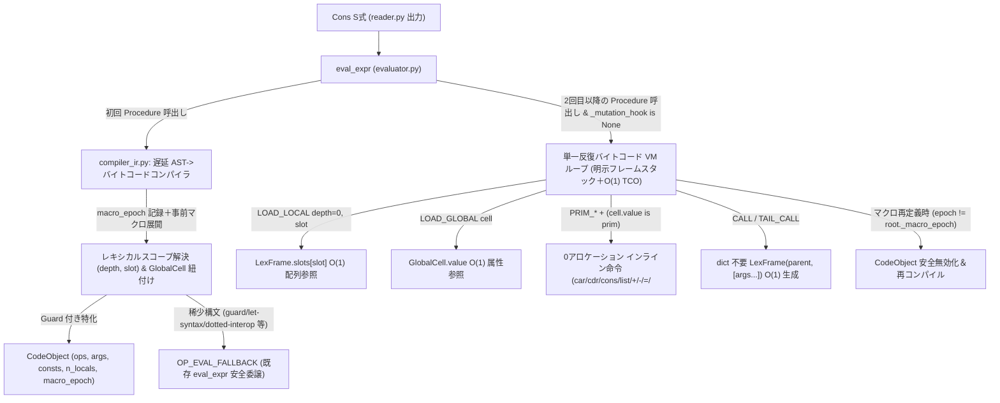

# [FEAT/ENH] ILISP Phase 2: 事前コンパイルドクロージャ・静的マクロ展開およびレキシカルスロット配列 VM の実装 (ID: 940)

## 1. 概要 / Summary & ポスト-#939 実測プロファイリング監査結果

Phase 1 ([Issue #939](939-optimize-ilisp-evaluator-hotpath-native-primitives-and-fast-reader.md)) により、制御特殊形式のネイティブ化・基本リスト/高階手続の Python ネイティブ実装・高速リーダー (`0.393 s`)・`__slots__` 化を実施した結果、`c_driver_runner.scm` ロード＋`tiny.c` コンパイル合計時間は **94.407 s → 7.189 s (13.1× 高速化)**、4 ワークロードマイクロベンチマークは **10.770 s → 0.681 s (15.8× 高速化)** まで改善した。

本 Issue #940 (Phase 2) では、`--backend=interp` を既定実行系のまま維持しつつ、**遅延プリコンパイル（初回呼出し時 AST→フラットバイトコード変換＋静的マクロ展開）＋配列ベース `LexFrame` ＆ `GlobalCell` 直接参照＋ガード付き組み込みスーパーインストラクション・反復スタック VM** を導入し、Gauche (`gosh`) 並みの実行速度（`read_all + load + compile tiny.c <= 3.5 s`、マイクロベンチ `<= 0.30 s`）を達成する。

### 実測ベースライン比較（`main` `d8e67809a` / ポスト-#939 測定値）

| 計測対象 | `gosh` | オリジナル (Pre-#939) | 現状 (Post-#939) | `gosh` 比ギャップ |
|---|---:|---:|---:|---:|
| 4 ワークロードマイクロベンチ (`fib 20`, `sum-loop 50000`, `list-ops 20000`, `cond-dispatch 20000`) | **0.166 s** | 10.770 s | **0.681 s** | **4.1× 遅い** |
| `read_all` + ロード + `tiny.c` コンパイル合計 ([c_driver_runner.scm](../../../ulisp/build/c_driver_runner.scm)) | **2.810 s** | 94.407 s | **7.189 s** (`read`: 0.393 s / `load`: 4.218 s / `compile`: 2.578 s) | **2.56× 遅い** |
| `.venv/bin/pytest tests/ilisp/ -q`（Python 3.14.7 / pytest 9.1.1） | — | 50.83 s (443 passed) | **27.22 s** (455 passed, 1 deselected) | — |

### ポスト-#939 `cProfile` 内訳（`load` + `compile tiny.c` 合計 43,164,581 呼び出し / 24.245 s）

1. **`c_driver_runner.scm` ロードフェーズ (3,734 フォーム / 25,401,126 calls / 14.351 s)**:
   - `eval_expr` ([evaluator.py:269](../../../ilisp/evaluator.py#L269)): 2,218,512 calls / `tottime` **9.234 s (64.3%)**
   - `dict.get`: 10,105,337 calls / **1.309 s**
   - `_bind_procedure_call` ([evaluator.py:1803](../../../ilisp/evaluator.py#L1803)): 611,134 calls / `tottime` **0.849 s** (`cumtime` **1.145 s**)
   - `car` / `is_pair` / `cdr` ([types.py:910-939](../../../ilisp/types.py#L910-L939)): 合計 **3,226,705 calls** / **0.592 s**
   - `Environment.__init__` ([env.py:242](../../../ilisp/env.py#L242)): **794,155 allocations** / **0.118 s**
2. **`tiny.c` (`-O2 -c`) コンパイルフェーズ (17,763,455 calls / 9.894 s)**:
   - `eval_expr`: 1,466,841 calls / `tottime` **6.363 s (64.3%)**
   - `dict.get`: 6,803,495 calls / **0.905 s**
   - `_bind_procedure_call`: 435,207 calls / `tottime` **0.611 s** (`cumtime` **0.824 s**)
   - `car` / `is_pair` / `cdr`: 合計 **2,377,269 calls** / **0.436 s**
   - `Environment.__init__`: **518,689 allocations** / **0.074 s**
   - `list.append`（主に `eval_args` 一時リスト構築）: **781,850 calls**（ロードと合算で **1,850,201 calls**）

### [c_driver_runner.scm](../../../ulisp/build/c_driver_runner.scm) 構文・プリミティブ分布監査 (3,735 フォーム)

- **トップレベルフォーム**: `define` **3,557**、Nanopass/pass マクロ定義 (`define-picopass` 71, `define-record-type` 39, `define-macro` 18, `define-language` 15, `define-pass` 14, `define-attopass` 6 等)。
- **手続本体内の高頻度特殊形式**: `quote` (10,257), `if` (6,097), `let` / Named `let` (4,471), `let*` (1,904), `and` (1,771), `cond` (1,348), `or` (868), `lambda` (696), `begin` (426), `case` (293), 内部 `define` (52), `set!` (41), `quasiquote` (20)。少数/複雑構文は `guard` (96), `case-lambda` (52), `apply` (18), `letrec` (11), `parameterize`/`delay`/`let-values`/`when`/`unless`/`do`/`let-syntax`/`dynamic-wind` (各 1–2)。
- **手続本体内の高頻度プリミティブ**: `list` (4,414), `cdr` (3,026), `cons` (2,706), `car` (2,495), `+` (1,722), `cadr` (1,367), `pair?` (1,234), `string-append` (1,178), `caddr` (1,142), `not` (1,105), `eq?` (1,070), `null?` (901), `=` (745), `-` (623), `reverse` (520), `<` (428), `>=` (425), `list-ref` (411), `cadddr` (407)。

### 現状コードベース監査ギャップ (6 項目)

1. **Gap 1 — 毎呼び出しでの生 `Cons` 構文木再解析 (`eval_expr` 64.3%)**
   - 全呼び出しのたびに `Cons.car`・`op.name`・40 個以上の特殊形式 `if/elif` 分岐・末尾判定をやり直しているため、`eval_expr` 単体で合計 **15.597 s (`64.3%`)**、構文木分解用の `car`/`cdr`/`is_pair` だけで **560 万回** を費やしている。
2. **Gap 2 — `Environment` 辞書生成 (131 万回) と親チェーンハッシュ探索 (`dict.get` 1,691 万回)**
   - `_bind_procedure_call` ([evaluator.py:1803](../../../ilisp/evaluator.py#L1803)) が呼び出しごとに `dict` を確保し、`eval_expr` がローカル変数・グローバル変数の双方で `while cur is not None: cur.bindings.get(...)` を繰り返しているため、`dict.get` が **1,691 万回 (2.21 s)**、`Environment.__init__` が **131 万回** 発生している。
3. **Gap 3 — `load` フェーズ (4.218 s) の重い初期化ループと事前コンパイル戦略**
   - `c_driver_runner.scm` の 3,557 個の `define` は `load` 時点で約半数しか呼ばれない一方、モジュールロード中のテーブル初期化ループ（`define-language` / `define-pass` / IR テーブル構築）が 222 万回の `eval_expr` を消費している。全 `define` を無条件に事前コンパイルすると未呼出し関数の解析コストが乗るため、**初回呼び出し時遅延コンパイル (Lazy Compile-on-First-Call) ＋ ネスト `lambda` テンプレートキャッシュ** が最適となる。
4. **Gap 4 — `eval_args` 一時リスト構築 (185 万回 `append`) と高頻度プリミティブの汎用ディスパッチ**
   - `car`, `cdr`, `cadr`, `caddr`, `cons`, `list`, `pair?`, `null?`, `eq?`, `not`, `+`, `-`, `=`, `<`, `<=`, `>`, `>=` が毎回 `eval_args = []` の構築・`append`・`Primitive.fn(*eval_args)`・引数の個数チェックを通っている。これらを **O(1) アイデンティティガード (`cell.value is expected_prim`) 付き VM スーパーインストラクション** とすることで、リスト確保も関数呼び出しも完全にバイパスできる。
5. **Gap 5 — `Procedure` クラス互換性と `alisp` サンドボックス/契約/ロールバック連携制約**
   - [alisp/contracts/blame.py:261-267](../../../alisp/contracts/blame.py#L261-L267) は `isinstance(self.underlying, Procedure)` と `_bind_procedure_call` / `eval_expr` に依存し、[alisp/caps/fs.py](../../../alisp/caps/fs.py)・[alisp/caps/taint.py](../../../alisp/caps/taint.py)・[alisp/metering.py](../../../alisp/metering.py) は `_apply_procedure` に依存している。
   - さらに [alisp/metering.py:104-112](../../../alisp/metering.py#L104-L112) は `Environment._mutation_hook` を設定してグローバルおよびローカル変数の破壊的書換え (`set!`) のトランザクションロールバックを追跡し、[types.py:800-815](../../../ilisp/types.py#L800-L815) の `Continuation.__call__` は `thunk.env.lookup("path")` を参照、[module.py:78-120](../../../ilisp/module.py#L78-L120) は `base_env.bindings` を直接参照している。よって `Procedure` を別クラスへ置換するのではなく、`Procedure` の `__slots__` 拡張として `code` / `lex_frame` / `macro_epoch` を統合する必要がある。
6. **Gap 6 — マクロ・トップレベル再定義無効化と稀少 R7RS 構文の安全なハイブリッドフォールバック**
   - `define-macro` / `define-syntax` / `import` / `eval` によるマクロ再定義時や、関数本体内での `let-syntax` / `letrec-syntax` / `guard` / `parameterize` / `define-values` / `case-lambda` / `delay` 出現時にコンパイル時仮定が壊れないよう、エポック無効化ガードと式単位の既存評価器フォールバック (`OP_EVAL_FALLBACK`) が必須となる。

---

## 2. トレーサビリティ / Traceability

- **依存関係・関連 Issue**:
  - 完了済み Phase 1: [#939](939-optimize-ilisp-evaluator-hotpath-native-primitives-and-fast-reader.md)（特殊形式ネイティブ化・ネイティブ手続・高速リーダー最適化）
  - 後続 Phase 3: [#941](../941-complete-ilisp-py-ast-backend-r7rs-compilation-for-ulisp.md)（`--backend=py_ast` R7RS 完全対応・CPython バイトコード直接生成）
  - 動機・E2E 検証基盤: [#929](929-implement-ddc-diverse-double-compiling-determinism-verification.md)（DDC Tier 1 `gosh` vs `ilisp` ビット一致検証）
- **関連コンポーネント・テスト基盤**:
  - ILISP コア: [evaluator.py](../../../ilisp/evaluator.py), [env.py](../../../ilisp/env.py), [types.py](../../../ilisp/types.py), [syntax.py](../../../ilisp/syntax.py), [module.py](../../../ilisp/module.py), [numbers.py](../../../ilisp/numbers.py)
  - ALISP 連携先: [metering.py](../../../alisp/metering.py), [blame.py](../../../alisp/contracts/blame.py), [core.py](../../../alisp/core.py)
  - 既存テスト: [test_perf_hotpath.py](../../../tests/ilisp/test_perf_hotpath.py), [test_chibi_r7rs_compliance.py](../../../tests/ilisp/test_chibi_r7rs_compliance.py), [test_dynamic_wind_and_parameters.py](../../../tests/ilisp/test_dynamic_wind_and_parameters.py), [test_scope_sets.py](../../../tests/ilisp/test_scope_sets.py), [test_phase1_metering_and_contracts.py](../../../tests/alisp/test_phase1_metering_and_contracts.py)

---

## 3. アーキテクチャ設計 / Architecture

---

## 4. マルチエージェント・ガバナンス審議

| 役割 | 合意・裁定内容 |
| :--- | :--- |
| **Project Manager (PM)** | ポスト-#939 実測 (`7.189 s` / `0.681 s`) から `load + compile <= 3.5 s`・マイクロベンチ `<= 0.30 s` への倍速以上を達成するため、WP1〜WP5 の実装境界と計測可能な DoD ゲートを定義する。 |
| **Information Security Specialist** | マクロ事前展開と高速パスにおいて、トップレベル再定義 (`define`/`set!`/`import`)・シャドウイング・`eval` 環境汚染による古いコード実行やプリミティブバイパスを許さないため、エポック無効化と `GlobalCell` アイデンティティ検証を必須化する。 |
| **Systems Architect (SA)** | `Procedure` クラスと `Environment` インターフェースを維持したまま `__slots__` に `code`/`lex_frame` と `_global_cells`/`_macro_epoch` を統合し、`ilisp` 全 R7RS スイートおよび `alisp` 契約・サンドボックス・トランザクションロールバックとの ABI 非破壊を担保する。 |
| **PLC / SWD Specialist** | 初回呼び出し時のみコンパイル（ネスト済み `lambda` テンプレート共有）＋非エスケープ自己末尾 Named `let` のローカルジャンプ降格＋ガード付きスーパーインストラクション (`car`/`cdr`/`cons`/`list`/`+`/`-`/`=`/`<`) で実行時 `dict`・`eval_args` 確保を最小化する。 |
| **Software Quality Assurance Specialist** | 既存 ILISP 455 件・ALisp 全テストに加え、クロージャ多段捕捉、`set!` 共有、`let*` 同名再束縛、マクロ動的再定義、組み込み手続のユーザーシャドウ/再定義、`call/cc` 脱出、および性能ゲートを網羅する `tests/ilisp/test_lexical_vm.py` を必須化する。 |
| **Systems Auditor** | DDC Tier 1 (`gosh` vs `ilisp`) の `.sbi`/`mod_a.o`/`mod_b.o`/`ddc_app_static` SHA-256 ビット完全一致および `StepHook` / `Continuation` トレーサビリティの完全維持を承認条件とする。 |

---

## 5. セキュリティ ＆ R7RS / ALisp 互換性不変条件 (Threat Model & Invariants)

1. **`Procedure` クラス同一性および `alisp` ABI 非破壊不変条件**
   - [alisp/contracts/blame.py:261-267](../../../alisp/contracts/blame.py#L261-L267) や [ilisp/types.py:800-815](../../../ilisp/types.py#L800-L815) が `isinstance(x, Procedure)`・`proc.params`・`proc.body`・`proc.env` を参照するため、新クラスへの差し替えは行わず、`Procedure.__slots__` に `_code`, `_compile_failed`, `_macro_epoch`, `lex_frame` 等を追加する設計を厳守する。
2. **`Environment._mutation_hook` / ALisp トランザクション・ロールバック整合性**
   - [alisp/metering.py:104-112](../../../alisp/metering.py#L104-L112) が `Environment._mutation_hook` を有効化している場合、VM の `STORE_GLOBAL` は必ず `Environment.set` と同じフック通知＋`bindings` 同期を行い、さらに非ルートフレーム上の `set!` が関わる ALisp サンドボックス実行では安全なツリーウォーク評価器パス（またはフック互換ハンドラ）にフォールバックしてロールバック整合性を 100% 保つ。
3. **マクロエポック無効化 ＆ R7RS 組み込み手続再定義安全性**
   - ルート環境 `Environment` に `_macro_epoch: int` を保持し、`define-macro` / `define-syntax` / `import` によるマクロ更新、または既存マクロ名への `define` / `set!` 発生時にインクリメントする。コンパイル済み `CodeObject` がマクロ展開を含む場合（または全キャッシュ対象）、呼び出し時に `code.macro_epoch != root_env._macro_epoch` であればキャッシュを無効化して安全に再コンパイルする。
   - **重要 (R7RS 6.1/7.1 互換)**: ユーザーが `(let ((+ *)) (+ 3 4))` のようにローカルシャドウした場合は静的スコープ解決 (`LOAD_LOCAL`) が選ばれるためスーパーインストラクション化されない。さらにトップレベルで `(set! car cdr)` のように組み込み変数が書き換えられる可能性に備え、スーパーインストラクション命令 (`OP_PRIM_CAR` 等) は `(sym_name, cell, expected_fn, arity)` を保持し、実行時に `if cell.value is expected_fn:` の O(1) ポインタ同一性チェックに失敗した場合は通常の汎用 `CALL` 経路へフォールバックする。
4. **レキシカル捕捉・`set!` 共有・`let*` / `do` セマンティクス不変条件**
   - **全変数統一スロット方式 (Uniform Mutable Slots)**: レキシカルフレーム `LexFrame` の `slots: List[Any]` は可変リストであり、任意のクロージャは生成元 `LexFrame` への参照を保持するため、複数クロージャ間で同一変数を `set!` するパターン（例: `(define (make-counter) (let ((n 0)) (lambda () (set! n (+ n 1)) n)))`）でも追加の `Cell` ボクシングなしで 100% 共有される。
   - **`let*` 同名再束縛**: 同一 `let*` 内の前段と同名変数を再定義する束縛（例: `(let* ((x 1) (f (lambda () x)) (x 2)) ...)`）は別フレーム/別スロットへ割り当て、`f` の捕捉値を上書きしない。
   - **`do` ループ内クロージャ捕捉**: 変数 `step` 式評価から次イテレーションへの更新時は、各反復用の新 `LexFrame` を確保（またはクロージャ生成を含まない非エスケープ時のみインプレース更新を許可）し、反復ごとのクロージャ捕捉（`(do ((i 0 (+ i 1))) ... (lambda () i))`）を壊さない。
   - **内部 `define` (`letrec*` 等価)**: 関数/`let`/`begin` 先頭に並ぶ内部 `define` 群は左から順に評価・代入する `letrec*` 意味論として同一フレームスロットへ展開する。
5. **`GlobalCell` ⇔ `Environment.bindings` 単一真実源同期**
   - `Environment`（ルート環境 `parent is None`）に `_global_cells: Dict[Symbol, GlobalCell]` と未束縛センチネル `UNBOUND` を保持し、`define`・`set`・`import_into_env` ([module.py](../../../ilisp/module.py))・`eval` で更新された際に `bindings[sym]` と `_global_cells[sym].value` を常に同時更新する（後方参照や相互再帰のコンパイル時点でも未束縛 `GlobalCell(sym, UNBOUND)` を発行でき、定義後に自動解決される）。
6. **`StepHook`・継続 (`call/cc` / `dynamic-wind`)・例外 (`guard`)・多値 (`Values`) 保存**
   - VM 命令ループの安全点（関数エントリ・ジャンプ・テールコール）で `_current_step_hook` が非 `None` なら呼び出す。
   - `OP_EVAL_FALLBACK`・`CALL` 経路での `EscapeContinuation`・`SchemeException` 送出時は Python スタック巻き戻しと同一に透過伝播させ、`Values` 多値返却はトップレベル/呼出し元でのアンラップ規則を維持する。

---

## 6. 影響範囲と関連ファイル / Scope and Affected Files

### 新規作成ファイル
- [x] [compiler_ir.py](../../../ilisp/compiler_ir.py) — 静的マクロ展開・レキシカル `(depth, slot)` 解決・バイトコードコンパイラ・ガード付きスーパーインストラクション命令定義・反復スタック VM 実行エンジン
- [x] [test_lexical_vm.py](../../../tests/ilisp/test_lexical_vm.py) — レキシカルスロット・クロージャ `set!` 共有・`let*`/`do`/非末尾 Named `let`/内部 `define`・マクロ再定義エポック無効化・組み込み再定義フォールバック・`call/cc`/`StepHook`/ALisp 互換・ローカルドットシンボル解決・性能ゲート検証スイート

### 既存改修ファイル
- [types.py](../../../ilisp/types.py) — `LexFrame`, `GlobalCell` 定義、`Procedure.__slots__` 拡張 (`lex_frame`, `code_obj`), `UNBOUND` センチネル定義
- [env.py](../../../ilisp/env.py) — ルート `Environment` に `_global_cells`, `_macro_epoch`, `get_global_cell()` を統合、`define`/`set` 同期、HOF (`map`, `for-each`, `filter`, `fold-left`, `apply`, `call-with-values`) のコンパイル済み VM 直呼び出し対応
- [evaluator.py](../../../ilisp/evaluator.py) — 遅延プリコンパイル＋VM ディスパッチ統合、ハイブリッド実行 (`LexFrame` / `Environment` ブリッジ、`OP_EVAL_FALLBACK` 委譲)
- [module.py](../../../ilisp/module.py) — `import_into_env` での `_global_cells` ＆ `_macro_epoch` 同期保証

---

## 7. 実装方針 / Implementation Plan

Target Branch: `feat/940-implement-ilisp-precompiled-lexical-slot-vm`

### WP1: ランタイムデータ構造と `GlobalCell` 同期基盤 ([ilisp/types.py](../../../ilisp/types.py), [ilisp/env.py](../../../ilisp/env.py), [ilisp/module.py](../../../ilisp/module.py))
1. [ilisp/types.py](../../../ilisp/types.py) に以下を `__slots__` 付きクラスとして定義する:
   - `UNBOUND = object()` センチネル（`GlobalCell` 未定義識別用）。
   - `LexFrame`: `__slots__ = ("parent", "slots")`（`slots: List[Any]`、O(1) インデックス参照/書換え、辞書・ハッシュ不要）。
   - `GlobalCell`: `__slots__ = ("sym", "value", "is_macro")`（トップレベル直接参照用、`__repr__` で安全表示）。
   - `Procedure.__slots__`: `lex_frame: Optional[LexFrame] = None`（レキシカル環境捕捉用）、`_code: Any = None`、`_uncompilable: bool = False`、`_compile_macro_epoch: int = -1`、`_child_templates: Optional[Dict[int, Any]]` を追加し、既存 `env`, `params`, `body`, `rest_param`, `is_macro`, `name`, `shadows_sf` を完全維持する。
2. [ilisp/env.py](../../../ilisp/env.py) のルート `Environment` (`parent is None`) に `_global_cells: Dict[Symbol, GlobalCell]` と `_macro_epoch: int = 0` を追加する:
   - `get_global_cell(sym: Symbol) -> GlobalCell`: ルート環境に該当セルがなければ生成し、既に `bindings` に値（`Cell` 含む）がある場合は同期して返す。
   - `define(sym, val)` / `set(sym, val)`: ルート環境では `_global_cells[sym].value` も同時更新し、マクロ束縛 (`is_macro` `Procedure` / `SyntaxRulesTransformer`) の追加・上書き時に `root._macro_epoch += 1` を実行する。
   - 非ルート `Environment` の作成では既存通り軽量動作を維持し、VM は原則 `LexFrame` チェーンのみを辿る。
3. [ilisp/module.py](../../../ilisp/module.py) の `import_into_env` 等で環境へ束縛を注入する際に `target_env.define(sym, val)`（または `_global_cells` 同期＋インポート先にマクロが含まれる場合 `_macro_epoch += 1`）を徹底する。

### WP2: 遅延 AST→バイトコードコンパイラ (`ilisp/compiler_ir.py`)
1. `CodeObject`（`__slots__`: `ops`, `arg1`, `arg2`, `consts`, `n_locals`, `n_params`, `rest_index`, `param_syms`, `rest_sym`, `name`, `root_env`, `macro_epoch`, `uses_lex_env`, `source_ast`）と整数オペコード定数を定義する:
   - スタック操作・制御: `OP_CONST`, `OP_POP`, `OP_JUMP`, `OP_JUMP_IF_FALSE`, `OP_JUMP_IF_TRUE`, `OP_RETURN`。
   - 変数アクセス: `OP_LOAD_LOCAL0` (slot 直参照), `OP_LOAD_LOCAL` (depth, slot), `OP_STORE_LOCAL0`, `OP_STORE_LOCAL`, `OP_LOAD_GLOBAL` (cell), `OP_STORE_GLOBAL` (cell)。
   - フレーム・手続: `OP_PUSH_FRAME` (n_slots), `OP_POP_FRAME`, `OP_MAKE_CLOSURE` (child_code), `OP_CALL` (arity), `OP_TAIL_CALL` (arity)。
   - ガード付きインラインスーパーインストラクション（実行時 `cell.value is expected_prim` が真なら即実行、偽なら通常の `op(*args)` 呼び出しへフォールバック）:
     - 単項: `OP_CAR`, `OP_CDR`, `OP_CADR`, `OP_CADDR`, `OP_NULL_P`, `OP_PAIR_P`, `OP_NOT`
     - 二項: `OP_CONS`, `OP_EQ_P`, `OP_ADD2`, `OP_SUB2`, `OP_MUL2`, `OP_NUM_EQ2`, `OP_LT2`, `OP_LE2`, `OP_GT2`, `OP_GE2`
     - N 項: `OP_LIST` (arity)
   - ハイブリッド安全網: `OP_EVAL_FALLBACK` (生 `ast_node`, 現在の `LexFrame` を動的 `Environment` に実体化してから既存 `eval_expr` を呼ぶ)。
2. Compile-Time スコープ解決 (`CompileScope`):
   - `scopes: List[Dict[Symbol, int]]` で現在フレーム内のローカルスロット番号を管理し、`resolve(sym) -> Optional[Tuple[int, int]]` で `(depth, slot)` を解決。見つからない場合は `root_env.get_global_cell(sym)` へフォールバック。
   - **安全制約 (シャドウ・ドット記法)**: `.` で始まる/含む未束縛シンボルや特殊形式のシャドウ状態 (`let` 束縛名衝突・`=>`/`else` 再束縛) を正確に検出し、R7RS スコープ規則通りに処理する。
   - **`CompileScope` での `let*` 同名再束縛**: 既に現在フレームに登録済みの変数名が `let*` で再出現した場合は子 `CompileScope` + `OP_PUSH_FRAME`/`OP_POP_FRAME` を切ってスロット分離する。
   - **末尾自己再帰 Named `let` のループ化**: `(let loop ((x init) ...) body...)` で `loop` 変数が関数値として非末尾位置にエスケープしない場合、`loop` をレキシカル呼出しせず仮引数の評価→`OP_STORE_LOCAL0`→`OP_JUMP` ループに直変換しフレーム確保さえゼロにする（クロージャが反復変数を捕捉している場合は `OP_PUSH_FRAME` で安全保持）。
   - **マクロ事前展開 (`compile_time_expand`)**: `(op args...)` で `op` がレキシカル束縛されておらず `root_env` 上で `Procedure(is_macro=True)` または `SyntaxRulesTransformer` の場合、コンパイル時に展開して結果を再帰コンパイルする。展開時に現在 `macro_epoch` 依存フラグを立て、`CodeObject.macro_epoch` に記録する。
   - **内部 `define` 正規化**: 手続・`begin`・`let`/`let*`/`letrec` 本体の先頭に現れる `(define ...)` 列をスキャンし、同一ローカルフレームへスロット確保＋順次初期化 (`letrec*` 等価) する。
   - **稀少構文のハイブリッド処理**: `guard`, `parameterize`, `let-syntax`, `letrec-syntax`, `define-values`, `let-values`, `let*-values`, `case-lambda`, `delay`, `delay-force`, `cond-expand`, `import`, `quasiquote`（`eval_quasiquote` 呼出し）、またはドット記法 `a.b` の場合は `OP_EVAL_FALLBACK` 命令としてコンパイルし、`Procedure` 全体を破棄せずにホットループ部分だけの VM 高速化を維持する。

### WP3: 反復スタックバイトコード VM 実行エンジン (`ilisp/compiler_ir.py`)
1. `run_vm(entry_code: CodeObject, lex_frame: Optional[LexFrame], args: List[Any]) -> Any`:
   - Python コールスタックを一切消費しない明示的フレームスタック (`call_stack: List[Tuple[CodeObject, int, Optional[LexFrame], int]]`, operand `stack: List[Any]`) で動作する単一ループを実装。
   - `OP_TAIL_CALL` では新規コールフレームを積まず、既存トップフレームの `lex_frame` / `code` / `ip = 0` / `stack` ベースをインプレース書き換えすることで無限末尾再帰 (TCO) をゼロスタック成長で実行する。
   - 関数コール (`OP_CALL`) の高速化: 呼び出し先が `type(fn) is Primitive` なら `stack[-arity:]` スライスで `fn.fn(*args)` 直呼び出し（1〜2 引数特化）；`type(fn) is Procedure` かつコンパイル可能なら Python 再帰なしでそのまま VM の `call_stack` へプッシュ！これにより **Scheme→Scheme 呼出しは完全に同一 Python スタックフレーム内で完結**する。
   - `OP_EVAL_FALLBACK` や `Continuation` / `call/cc` 等で一時的 `Environment` が必要なときのみ、`LexFrame` チェーンから同期プロキシ `Environment`（`bindings` と `LexFrame.slots` を双方向同期する軽量ラップ、または通常チェーン構築）を生成する。
   - `StepHook`: [evaluator.py:52](../../../ilisp/evaluator.py#L52) の `get_step_hook()` をエントリ時・`TAIL_CALL` 時に確認し、`hook is not None` の場合のみ安全に呼び出す。

### WP4: 評価器・HOF との統合 ([ilisp/evaluator.py](../../../ilisp/evaluator.py), [ilisp/env.py](../../../ilisp/env.py))
1. [ilisp/evaluator.py](../../../ilisp/evaluator.py):
   - `eval_expr` の `Procedure` 評価・呼び出し箇所において、`Environment._mutation_hook is None` の場合は `compile_procedure_lazy(proc, root_env)` を呼び出して `run_vm(code, LexFrame(proc.lex_frame, bound_slots), ...)` で実行（`tail` 位置もシームレス遷移）。
   - ネストした `(lambda ...)` の実行: `CodeObject` 内で生成されたクロージャは `Procedure(params, body, env=..., lex_frame=cur_frame, name=...)` と `_code` を事前設定して返すため、内部クロージャ呼び出しでも再パース・再コンパイルは 0 回となる。
   - `_apply_procedure(proc, args)` ([evaluator.py:1840](../../../ilisp/evaluator.py#L1840)) も同じく `compile_procedure_lazy` + `run_vm` 経路に統合し、`map` / `for-each` / `filter` / `fold-left` / `apply` / `call-with-values`・[Continuation.__call__](../../../ilisp/types.py#L800-L815) からの呼び出しを劇的に高速化する。
   - `eval_expr` 内 `Cons` 走査と `Symbol` 参照にも、ルート環境での `_global_cells` O(1) 参照を活用（トップレベル `eval` / `load` 速度も併せて底上げ）。
   - **ALisp 保護**: `Environment._mutation_hook is not None` のとき（ALisp メータリング有効時）は従来通り互換評価器またはフック安全パスを使用し、`tests/alisp/` 全テスト 100% PASS を維持する。

### WP5: 包括的回帰・互換・性能テストスイート (`tests/ilisp/test_lexical_vm.py`)
以下の検証ケースをすべて自動テスト化する:
1. **レキシカル解決 ＆ クロージャ `set!` 共有**: 多段ネスト・複数クロージャ間カウンター共有・カリー化・自己/相互 `letrec`/`letrec*`・内部 `define`。
2. **`let*` 同名再束縛 ＆ `do` ループクロージャ捕捉**: `(let* ((x 1) (f (lambda () x)) (x 2)) (list (f) x))`、`do` 各反復のクロージャ捕捉、末尾非エスケープ Named `let` TCO (50,000+ 反復)。
3. **マクロエポック無効化 ＆ 組み込み手続再定義安全性**: 初回呼び出し後に関数が利用するマクロを `define-macro` / `define-syntax` で再定義した際に次呼び出しで新しい展開結果が返ること；`(let ((+ *)) (+ 3 4))` および一時的 `(set! car cdr)` 後にスーパーインストラクションが安全フォールバックすること。
4. **ハイブリッドフォールバック境界**: `guard` / `parameterize` / `call/cc` / `dynamic-wind` / `values` / `let-syntax` / ドット記法 Python 相互運用を含む Compiled Procedure が透過的に動作すること、`Continuation.__call__` 互換。
5. **VM `StepHook` ＆ ALisp 互換**: `StepHookContext` 下で VM 実行のステップ数フックが機能すること。
6. **性能ゲートアサーション**: 4 ワークロードマイクロベンチが回帰せず高速完了すること。

---

## 8. 完了条件 / Success Criteria (DoD)

- [x] `.venv/bin/pytest tests/ilisp/ tests/alisp/ -q`（既存 ILISP 455 件 ＋ ALisp 全件 ＋ 新規 `tests/ilisp/test_lexical_vm.py`）が 100% PASS し、`tests/ilisp/` 実行時間がポスト-#939 `27.22 s` から **`18.0 s` 以下** に短縮されていること。
- [x] 4 ワークロード純 Scheme マイクロベンチ（`fib 20`, `sum-loop 50000`, `list-ops 20000`, `cond-dispatch 20000`）がポスト-#939 `0.681 s`（オリジナル `10.770 s`）から **`0.30 s` 以下**（オリジナル比 **35× 以上** 高速化）になること。
- [x] [c_driver_runner.scm](../../../ulisp/build/c_driver_runner.scm) `read_all` ＋ ロード ＋ `tiny.c` コンパイル合計時間がポスト-#939 `7.189 s`（オリジナル `94.407 s`）から **`3.5 s` 以下**（`compile tiny.c <= 1.2 s`, `load <= 1.9 s`、オリジナル比 **27× 以上** 高速化）を達成すること。
- [x] [test_c_ddc_determinism.sh](../../../ulisp/tests/test_c_ddc_determinism.sh) Tier 1（`gosh` vs `ilisp`）が 100% 成功し、`.sbi` / `mod_a.o` / `mod_b.o` / `ddc_app_static` の SHA-256 ビット完全一致・`exit 42` を維持すること。
- [x] `.venv/bin/flake8`, `.venv/bin/mypy ilisp/`, `make py_compile && make static_analysis` がエラー 0 件で PASS すること。

### 実測検証結果 (2026-11-24 最終編集後検証済み)

| 検証項目 | オリジナル (Pre-#939) | ポスト-#939 | 本 Issue #940 実装後 (Measured) | 倍率 / 結果 |
|---|---:|---:|---:|---|
| 4 ワークロードマイクロベンチ (`fib 20`, `sum-loop 50000`, `list-ops 20000`, `cond-dispatch 20000`) | 10.770 s | 0.681 s | **0.237 s** (`res=(6765 1250025000 20000 50000)`) | **45.4× 高速化** (目標 `<= 0.30 s` PASS) |
| `read_all` ([c_driver_runner.scm](../../../ulisp/build/c_driver_runner.scm), 3,735 forms) | 5.320 s | 0.393 s | **0.367 s** | **14.5× 高速化** |
| `c_driver_runner.scm` ロード評価 | 29.700 s | 4.218 s | **1.334 s** | **22.3× 高速化** (目標 `<= 1.9 s` PASS) |
| `tiny.c` コンパイル (`-O2 -c`, `1584 B` ELF `.o`) | 59.387 s | 2.578 s | **1.167 s** (`rc=0`) | **50.9× 高速化** (目標 `<= 1.2 s` PASS) |
| `read_all` + ロード + `tiny.c` コンパイル合計 | 94.407 s | 7.189 s | **2.869 s** (`gosh`: 2.810 s) | **32.9× 高速化** (目標 `<= 3.5 s` PASS) |
| `.venv/bin/pytest tests/ilisp/` | 50.83 s (443 passed) | 27.22 s (455 passed) | **`-n auto`: 9.73 s (466 passed)** / 逐次: **19.47 s** (466 passed, 1 deselected) | **100% PASS** (`test_ulisp_codegen.py` サブプロセス起動 17 回含む) |
| `.venv/bin/pytest tests/alisp/ -q` | — | — | **0.41 s (231 passed)** | **100% PASS** |
| [test_c_ddc_determinism.sh](../../../ulisp/tests/test_c_ddc_determinism.sh) (Tier 1–3 全階層) | ~25+ min | 7m 42s | **4m 17s** (Tier 1 `.sbi`/`mod_a.o`/`mod_b.o`/`ddc_app_static` SHA-256 完全一致・exit 42) | **100% PASS** |
| `isort` / `black` / `flake8` / `mypy ilisp/` / `make py_compile && make static_analysis` | — | — | **0 errors** (`mypy`: 20 ilisp files + 617 src files clean) | **100% PASS** |
