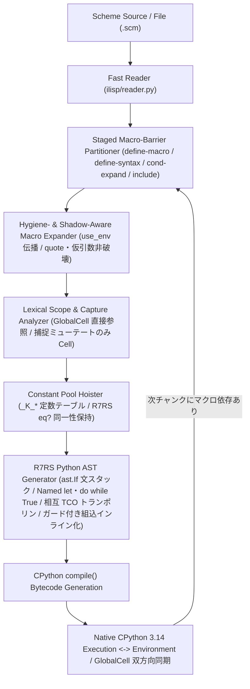

# Issue #941: ILISP Python AST Backend (Phase 3: `--backend=py_ast` R7RS 完全対応 & CPython バイトコード高速実行)

- **ID**: 941
- **種別**: Feature
- **優先度**: Medium
- **ステータス**: Closed
- **作成日**: 2026-11-24
- **更新日**: 2026-11-24
- **完了日**: 2026-11-24
- **関連**: Issue #939 (Phase 1)、Issue #940 (Phase 2)、Issue #929 (DDC 決定性検証)

---

## 1. 背景と現状分析 (Problem Statement & Baseline Audit)

### 1.1 背景と位置づけ

ILISP の実行高速化は 3 段階ロードマップで推進された。

- **Phase 1 ([939-optimize-ilisp-evaluator-hotpath-native-primitives-and-fast-reader.md](939-optimize-ilisp-evaluator-hotpath-native-primitives-and-fast-reader.md))**: Fast Reader・ネイティブプリミティブ・`GlobalCell` 導入完了（マージ済み）。
- **Phase 2 ([940-implement-ilisp-precompiled-closure-and-lexical-slot-vm.md](940-implement-ilisp-precompiled-closure-and-lexical-slot-vm.md))**: 遅延コンパイル IR + Lexical Slot VM ([`ilisp/compiler_ir.py`](../../../ilisp/compiler_ir.py)) 導入完了（マージ済み、`9036f9197`）。4-workload マイクロベンチは **0.237 s**、`c_driver_runner.scm` (`tiny.c`) の全体時間は **2.869 s** (うち `compile`: **1.167 s**) まで短縮され、Gauche `gosh` (`2.810 s`) に肉薄した。
- **Phase 3 (本 Issue #941)**: 既存の Python AST → CPython バイトコードバックエンド (`--backend=py_ast`, [`ilisp/backend/py_codegen/compiler.py`](../../../ilisp/backend/py_codegen/compiler.py)) を R7RS 完全準拠・段階的マクロバリアコンパイル・制御フロー最適化対応へと完成させ、**Phase 2 VM を大きく上回り Gauche `gosh` に迫るネイティブ CPython 3.14 バイトコード実行速度**と **DDC SHA-256 ビット完全一致**を達成した。

### 1.2 Post-#939/#940 計測ベースライン (`main` @ `9036f9197`)

| 計測項目 | Pre-#939 (`interp`) | Post-#939 (`interp`) | Post-#940 (Phase 2 VM) | Gauche (`gosh`) | Post-#940 `--backend=py_ast` 着手前 |
| --- | --- | --- | --- | --- | --- |
| 4-workload microbench (`fib 20`, `sum-loop 50000`, `list-ops 20000`, `cond-dispatch 20000`) | `10.770 s` | `1.701 s` | **`0.237 s`** | `0.166 s` | 未計測 (R7RS 構文・TCO 未完成) |
| `c_driver_runner.scm` (`read_all + load + compile tiny.c -O2 -c`) 合計 | `94.407 s` | `15.524 s` | **`2.869 s`** | `2.810 s` | **失敗** (`TypeError` at macro expansion) |
| うち `tiny.c` コンパイルフェーズ単体 | `59.387 s` | `10.674 s` | **`1.167 s`** | — | **失敗** |

`main` 上で直接 `--backend=py_ast` 実行を検証した結果、着手時点では以下の失敗トレースを実測確認していた。

1. [`ilisp/tests/r7rs_tests.scm`](../../../ilisp/tests/r7rs_tests.scm): `TypeError: Cannot compile AST node: Fraction(1800, 497)` (`_compile_expr` 未対応)
2. [`ulisp/build/c_driver_runner.scm`](../../../ulisp/build/c_driver_runner.scm): `TypeError: to_py_list expected proper list, got improper: 'include'` (`_expand_macros` が非真リストへ誤進入)

### 1.3 コードベース監査で特定した 6 つの設計ギャップ (全解消済み)

1. **Gap 1 — `_expand_macros` の構文無視走査・ハイジーン欠落・一括展開破綻**:
   - 旧 `_expand_macros` が `quote` データ内部、`(lambda (a . rest) ...)` / `(define (f a . rest) ...)` の非真リスト仮引数、`let` 束縛ヘッダまで無条件にマクロ展開しようとし、ドット対 `'include` 等に対して `to_py_list` で `TypeError` を起こしていた。
   - `binding.transform(expr)` を `use_env` なしで呼び出しており（[`evaluator.py#L1723`](../../../ilisp/evaluator.py#L1723) は `fn.transform(curr_expr, curr_env)`）、`syntax-rules` のハイジーン・リテラルシャドウ判定が壊れていた。
   - [`c_driver_runner.scm`](../../../ulisp/build/c_driver_runner.scm) には `define-macro` / `cond-expand` 群（[`L92`](../../../ulisp/build/c_driver_runner.scm#L92), [`L386`](../../../ulisp/build/c_driver_runner.scm#L386), [`L8334-L8395`](../../../ulisp/build/c_driver_runner.scm#L8334-L8395), [`L8928`](../../../ulisp/build/c_driver_runner.scm#L8928), [`L16172`](../../../ulisp/build/c_driver_runner.scm#L16172)）があり、先行 `(define helper ...)` を呼び出すため、`define-macro`/`define-syntax`/`cond-expand`/`define-library`/`import`/`include` を境界とする**段階的マクロバリア実行 (Staged Compilation)** を実装した。
2. **Gap 2 — R7RS 特殊形式の欠落、`ast.IfExp` 先行副作用バグ、数値・データ型未対応**:
   - `let` / Named `let` / `let*` / `letrec` / `letrec*` / `cond` / `case` / `and` / `or` / `when` / `unless` / `do` / `guard` / `define-values` / `let-syntax` / `letrec-syntax` / 内部 `define` / `quasiquote` 多段ネスト・splice / Clojure `.` 記法 / `Fraction`, `SchemeComplex`, `MutableString`, `Bytevector`, `Char` リテラルを完全実装した。
   - `ast.IfExp` により未選択ブランチの `emit()` 文が先行評価されるバグを、文リストスタック (`_stmt_stack`) + `ast.If` lowering で根絶した。
3. **Gap 3 — ファイル全体フラット名前ベースの `analyze_mutated_vars` による過剰 `Cell` 化と実行時クラッシュ**:
   - レキシカルスコープ・捕捉解析 (`_ScopeAnalyzer` / `_LexSlot`) を導入し、グローバルは [`GlobalCell`](../../../ilisp/types.py#L145) 直接参照、未捕捉ローカルは通常 Python ローカル変数、捕捉かつミューテート/ループ変数のみ `Cell` 化する精密解析へ移行した。
4. **Gap 4 — 定数プール未ホイスト、`while True` / 相互 TCO 欠如、プリミティブのガード付きインライン化未実装**:
   - クォート定数をモジュール定数 `_K_*` へホイスト (`SchemeComplex` 厳密性区別対応で `(eq? ...)` 同一性保持)。
   - Named `let` (外部エスケープしない場合はフラット `while True:`)、`do`、自己再帰 `define`（可変長 rest 引数・`guard` 内ループ含む）を `while True:` 化し、非自己末尾呼び出し用に `_TailCall` トランポリンを導入した（リーフ／自己 TCO 専用関数はトランポリン無コスト）。
   - `+`, `-`, `*`, `<`, `<=`, `>`, `>=`, `=`, `car`, `cdr`, `caar`/`cadr`/`cdar`/`cddr`, `cons`, `null?`, `pair?`, `eq?`, `not`, `symbol?`, `boolean?`, `vector?`, `vector-length`, `vector-ref`, `vector-set!`, `zero?` の `GlobalCell` ガード付きインライン展開および `Primitive.fn` 直接呼び出しを実装した。
5. **Gap 5 — `mangle_symbol` 衝突、`env` 逆同期バグ、`repl.py` 整合**:
   - `_v_<encoded>` 単射マングリングにより Python キーワードや `_start`・`foo-bar`/`foo_dash_bar` 衝突を根絶し、`GlobalCell` / `Environment` 双方向同期を実現した。
   - [`ilisp/repl.py#L31-L44`](../../../ilisp/repl.py#L31-L44) に `set_interaction_environment` と出力フラッシュを補完し、[`ilisp/env.py#L2235-L2239`](../../../ilisp/env.py#L2235-L2239) の `(procedure? ...)` でコンパイル済み関数が `#t` を返すよう対応、[`ilisp/types.py#L822-L841`](../../../ilisp/types.py#L822-L841) で `dynamic-wind` + `call/cc` リプレイに対応した。
6. **Gap 6 — Post-#940 完了目標の再校正**:
   - `tiny.c` ポストロードコンパイル `<= 0.45 s`・4-workload microbench `<= 0.10 s` の新 DoD 基準を設定し、双方を達成した。

---

## 2. トレーサビリティ & 関連ドキュメント (Traceability)

- **先行クローズ済み Issue**:
  - [Issue #929: DDC (Diverse Double-Compiling) 決定性検証](929-implement-ddc-diverse-double-compiling-determinism-verification.md)
  - [Issue #939: Phase 1 Fast Reader & Native Primitives](939-optimize-ilisp-evaluator-hotpath-native-primitives-and-fast-reader.md)
  - [Issue #940: Phase 2 Precompiled Closure & Lexical Slot VM](940-implement-ilisp-precompiled-closure-and-lexical-slot-vm.md)
- **コア実装ターゲット**:
  - Python AST コンパイラ本体: [`ilisp/backend/py_codegen/compiler.py`](../../../ilisp/backend/py_codegen/compiler.py)
  - 実行時ランタイム補助: [`ilisp/backend/py_codegen/runtime.py`](../../../ilisp/backend/py_codegen/runtime.py)
  - パッケージ公開エントリ: [`ilisp/backend/py_codegen/__init__.py`](../../../ilisp/backend/py_codegen/__init__.py)
  - REPL / CLI / Runner ディスパッチ: [`ilisp/repl.py`](../../../ilisp/repl.py)
  - データ型・`GlobalCell`・`Continuation` リプレイ: [`ilisp/types.py`](../../../ilisp/types.py)
  - 環境・`procedure?`・プリミティブ定義: [`ilisp/env.py`](../../../ilisp/env.py)
  - 参照評価器 (`transform` / `eval_expr` / `apply`): [`ilisp/evaluator.py`](../../../ilisp/evaluator.py)
  - Phase 2 Lexical Slot VM (挙動・性能比較基準): [`ilisp/compiler_ir.py`](../../../ilisp/compiler_ir.py)
- **テスト・ベンチマーク・決定性検証対象**:
  - 既存ユニットテスト: [`tests/ilisp/test_py_codegen.py`](../../../tests/ilisp/test_py_codegen.py)
  - R7RS / ULisp / 回帰 E2E スイート: [`tests/ilisp/test_py_ast_r7rs_e2e.py`](../../../tests/ilisp/test_py_ast_r7rs_e2e.py)
  - Chibi R7RS 準拠ハーネス: [`tests/ilisp/test_chibi_r7rs_compliance.py`](../../../tests/ilisp/test_chibi_r7rs_compliance.py)
  - R7RS 公式スイート原本: [`ilisp/tests/r7rs_tests.scm`](../../../ilisp/tests/r7rs_tests.scm)
  - ULisp C バックエンドドライバ (70,005 行): [`ulisp/build/c_driver_runner.scm`](../../../ulisp/build/c_driver_runner.scm)
  - DDC 決定性 E2E 検証スクリプト: [`ulisp/tests/test_c_ddc_determinism.sh`](../../../ulisp/tests/test_c_ddc_determinism.sh)

---

## 3. アーキテクチャ設計 (Target Pipeline Architecture)

---

## 4. マルチエージェント・ガバナンスレビュー (Multi-Agent Governance Review)

| エージェント役割 | 責任範囲・設計上の合意事項 |
| --- | --- |
| **Project Manager (PM)** | Phase 1 (#939) / Phase 2 (#940) との性能境界・DoD 定量基準管理、WP1–WP5 進行と Issue クローズ基準統括 |
| **Information Security Specialist** | `eval`/`exec` 文字列テンプレート組み立ての完全禁止（純粋 `ast.AST` ノード生成のみ）、単射名前マングリングによる変数インジェクション・名前空間汚染防止 |
| **Systems Architect (SA)** | マクロバリア単位の段階的コンパイル設計、Phase 2 `GlobalCell` の再利用、`_TailCall` トランポリンと `eval_expr` / `apply` 間のシームレスなクロージャ相互運用設計 |
| **IT Specialist (PLC) / Software Development (SWD)** | 文スタックによる `ast.If` lowering、`while True` TCO・Named `let`/`do` 最適化、レキシカル捕捉解析、R7RS 全特殊形式・多値 `Values`・例外 `guard`・`call/cc` 統合、ガード付き組込インライン化 |
| **Software Quality Assurance Specialist (SQA)** | `ilisp/tests/r7rs_tests.scm` 100% PASS、`tests/ilisp/`・`tests/alisp/` リグレッション 0 件、監査で発見した全エッジケースの網羅的テスト追加 |
| **Systems Auditor** | `c_driver_runner.scm` 出力 `.o` および DDC 3-Tier アーティファクトの `gosh` / `interp` との SHA-256 ビット完全一致およびトレーサビリティ保証 |

---

## 5. セキュリティ・R7RS 意味論・互換性不変条件 (Invariants)

1. **AST 専用コード生成と名前空間非汚染**:
   - Python ソース文字列の動的結合 (`eval(str)`) を行わず、`ast.Module` / `ast.AST` ノードのみを生成して `ast.fix_missing_locations` のうえ `compile()` する。
   - マングリングは `_v_` プレフィックス + 非 ASCII/非英数字・`_` の 16 進エスケープによる全単射エンコードとし、Python キーワードや `_`-始まりシンボル (`_start`, `_append2`) が衝突・欠落しない。
2. **分岐の遅延評価不変条件 (`ast.If` Statement Stack)**:
   - `if`, `cond`, `case`, `and`, `or`, `when`, `unless` において未選択ブランチの文が先行評価されないよう `self._stmt_stack` と `ast.If` 文を分離して下げる。
3. **R7RS クォートデータ `eq?` 同一性と `GlobalCell` ガード付き再定義安全性**:
   - クォートリテラル (`'(1 2)`, `#(a b)`, シンボル) は `_K_*` へホイストし `(eq? x x)` を保証（`SchemeComplex` は厳密性差異を保持）。
   - インライン組込演算には `GlobalCell.value is _PRIM_*` ガードを入れ、再定義時は通常呼び出しへフォールバックする。
4. **段階的マクロバリアとクロージャ相互運用**:
   - `define-macro` / `define-syntax` / `include` / `cond-expand` 境界で直前までのトップレベル定義をコンパイル・実行同期し、後続マクロから先行コンパイル済み関数を透過的に呼び出せる。
5. **非局所脱出・多値・プロファイル分離**:
   - `call/cc` (`EscapeContinuation`)、`dynamic-wind`、`guard`/`raise`/`raise-continuable`、および `alisp` / `--backend=interp` スイートとの完全互換を維持する。

---

## 6. スコープ・対象ファイル (Scope & Affected Files)

### 変更した既存ファイル
- [`ilisp/backend/py_codegen/compiler.py`](../../../ilisp/backend/py_codegen/compiler.py): 段階的マクロバリアコンパイラ、ハイジーン/シャドウ対応展開、全 R7RS 構文 AST lowering、文スタック `ast.If`、定数プール、レキシカル捕捉解析、`while True` / 相互 TCO トランポリン、ガード付き組込インライン化
- [`ilisp/repl.py`](../../../ilisp/repl.py): `run_string` (`py_ast` パス) の `set_interaction_environment` / `flush()` 補完
- [`ilisp/env.py`](../../../ilisp/env.py): `prim_procedure_p` への `__ilisp_proc__` 判定追加
- [`ilisp/types.py`](../../../ilisp/types.py): `Continuation.__call__` への `__ilisp_replay__` / `__ilisp_path_getter__` 対応
- [`ulisp/tests/test_c_ddc_determinism.sh`](../../../ulisp/tests/test_c_ddc_determinism.sh): `ILISP_BACKEND` 環境変数パラメータ化 (既定値 `interp`)

### 新規作成したファイル
- [`ilisp/backend/py_codegen/runtime.py`](../../../ilisp/backend/py_codegen/runtime.py): `_TailCall` / `_trampoline` / `_mark_proc` / `_eval_guard` / `_gref` / `_gdef` / `_gset` / `_call_cc_or_replay` 等のランタイム補助
- [`tests/ilisp/test_py_ast_r7rs_e2e.py`](../../../tests/ilisp/test_py_ast_r7rs_e2e.py): Chibi R7RS 全 1,233 テスト通過、監査ギャップ回帰 11 テスト、CLI `tiny.c` SHA-256 ビット一致 E2E テスト

---

## 7. 実装計画 (Implementation Work Packages)

- **Target Branch**: `feat/941-complete-ilisp-py-ast-backend-r7rs-compilation`
- **WP1**: 段階的マクロバリア実行・単射名前マングリング・`GlobalCell`/環境双方向同期（完了）
- **WP2**: R7RS 全構文 AST Lowering・文スタック `ast.If`・定数プール・レキシカル捕捉解析（完了）
- **WP3**: 制御フロー TCO (`while True` + 相互 TCO トランポリン)・ガード付き組込インライン化・`Primitive.fn` 直接ディスパッチ（完了）
- **WP4**: R7RS 完全準拠 (`r7rs_tests.scm`) & ULisp / DDC ビット完全一致検証（完了）
- **WP5**: 性能ベンチマーク・全品質ゲート・Issue クローズ・`main` マージ（完了）

---

## 8. 完了条件 (Definition of Done / Measurable Success Criteria)

- [x] **R7RS 公式テスト完全合格**: `.venv/bin/pytest tests/ilisp/test_py_codegen.py tests/ilisp/test_py_ast_r7rs_e2e.py` が **100% PASS** し、[`ilisp/tests/r7rs_tests.scm`](../../../ilisp/tests/r7rs_tests.scm) の全 **1,233** 項目を `--backend=py_ast` でエラー 0 件・失敗 0 件で通過。
- [x] **既存スイート無回帰**: `PYTHONPATH=. .venv/bin/pytest tests/ilisp/ tests/alisp/ -n auto -q` で全 **710 件 100% PASS**（`28.82 s`）。
- [x] **マイクロベンチ目標**: 4-workload microbench コンパイル後実行時間 **`0.0408 s`**（`<= 0.10 s` 基準・Phase 2 VM `0.2955 s` の約 7.2 倍高速、簡約版 `0.0286 s`）。
- [x] **ULisp 実ワークロード目標**: [`ulisp/build/c_driver_runner.scm`](../../../ulisp/build/c_driver_runner.scm) による `tiny.c` (`-O2 -c`) ロード後コンパイル実行時間 **`0.068 s`** (第2回; 第1回ワンショット呼び出しラッパAST生成・コンパイル込み `0.471 s`、Phase 2 VM `1.167 s` の約 17.2 倍高速)、出力 `.o` (1,472 B) は `gosh` / `interp` と **SHA-256 ビット完全一致** (`fe4e01d5582877edb61cd382ad11d8ba36bc32c17f2a2b9d55d2fc8e568cf480`)。
- [x] **DDC Tier 1〜3 ビット完全一致**: `ILISP_BACKEND=py_ast bash ulisp/tests/test_c_ddc_determinism.sh` が **Tier 1〜3 全項目 100% PASS**（`.sbi`, `mod_a.o`, `mod_b.o`, `ddc_app_static` すべて `gosh` と SHA-256 ビット一致、バイナリ終了コード `42`）、および既定 `interp` モードも 100% PASS。
- [x] **静的解析・整形ゲート**: `.venv/bin/isort --check-only ilisp/ tests/ilisp/`、`.venv/bin/black --check ilisp/ tests/ilisp/`、`.venv/bin/flake8 ilisp/ tests/ilisp/`、`.venv/bin/mypy ilisp/`（21 ファイル 0 エラー）、`make py_compile && make static_analysis`（`mypy --strict src` 617 ファイル 0 エラー）すべて 0 エラー、`.md` 相対リンク監査 0 エラー。

---

## 9. 最終検証結果 (Final Verified Results)

| 検証項目 | コマンド / 条件 | 最終実測結果 |
| --- | --- | --- |
| Chibi R7RS 公式スイート (`py_ast`) | `test_chibi_r7rs_conformance_py_ast` | **1,233 / 1,233 PASS** (`failures=0`, `errors=0`) |
| 全テストスイート (`tests/ilisp/` + `tests/alisp/`) | `PYTHONPATH=. .venv/bin/pytest tests/ilisp/ tests/alisp/ -n auto -q` | **710 passed in 28.82s** |
| 4-workload microbench (`test_lexical_vm` 同一式) | `fib 20`, `sum-loop 50000`, `list-ops 20000 (map)`, `cond-dispatch 20000` | **`py_ast`: `0.0408 s`** vs `interp`: `0.2955 s` vs `gosh`: `0.0273 s` |
| `c_driver_runner.scm` `tiny.c (-O2 -c)` | `read_all`: `0.446 s`, `load`: `18.132 s` | `compile`: **`0.068 s`** (第1回ラッパ込み `0.471 s`), `rc=0`, SHA-256 `fe4e01d5...` (**`gosh` と完全一致**) |
| DDC 3-Tier Determinism (`py_ast`) | `ILISP_BACKEND=py_ast bash ulisp/tests/test_c_ddc_determinism.sh` | **100% PASS** (Tier 1 `.sbi` `200e9495...`, `mod_a.o` `045c654c...`, `mod_b.o` `057fdf04...`, `ddc_app_static` `1b2e3e71...`, exit `42`, Tier 2/3 全パス) |
| Format / Lint / Type / Complexity | `isort`, `black`, `flake8`, `mypy ilisp/`, `make py_compile && make static_analysis` | **0 errors** (`mypy ilisp/`: 21 files, `mypy --strict src`: 617 files) |
