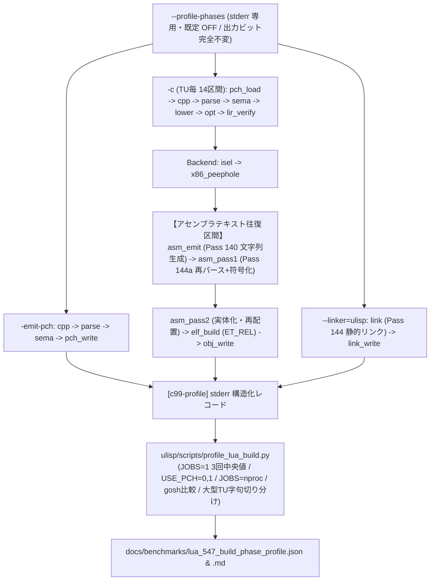

# [FEAT/ENH] Lua 5.4.7 ビルド 60 秒のフェーズ別内訳プロファイリングとアセンブラ往復コスト定量化 (ID: 945)

## 1. 概要 / Summary & 現状コードベース監査ギャップ

ULisp による無改変 Lua 5.4.7（33 TU）の一括コンパイルについて、[Issue #932](932-build-native-aot-ulisp-cc-compiler-driver-binary.md) 完了により `ulisp/bin/ulisp-boot` で構築されたネイティブ AOT C99 コンパイラドライバ `ulisp/bin/ulisp-cc` が導入され、並列ビルド総所要時間はホスト Gauche 版（`gosh`: `47.482s` / 過去約 60 秒）から `ulisp-cc`（`7.697s`、6.17x 高速化）へ短縮された。しかし、両実行系（ネイティブ AOT `bin/ulisp-cc` および `gosh` + `build/c_driver_runner.scm`）において **各コンパイルフェーズ別の時間内訳は未だ実測・記録されていない**。

C99 字句解析を生成する PEG は `ulisp/peg/compiler/codegen.scm` によりクロージャ合成へ段階化済みである一方、バックエンドでは Pass 140（`emit-x86-asm-program`）が x86-64 アセンブリ文字列を出力し、Pass 144a（`assemble-x86-relocatable`）がそれを再パースして機械語へエンコードする **アセンブラテキスト往復** が残存している。さらに、C99 PEG パース自体の CPS クロージャ確保コスト（[#948](../948-implement-direct-style-static-scheme-peg-parser-generator-backend.md) / [#949](../949-migrate-c99-parser-to-aot-generated-static-scheme-parser.md) 対象）とアセンブラテキスト往復のどちらが支配的ボトルネックであるかを定量比較した実測データが存在しない。

本 Issue では、Linux x86-64 実機上で `ulisp/bin/ulisp-cc`（および比較基準としての `gosh` + `build/c_driver_runner.scm`）の C99 パイプライン全体（`-emit-pch`, `-c`, `--linker=ulisp`）に非干渉な単調クロック計測（`CLOCK_MONOTONIC`）を導入し、**アセンブラテキスト往復コスト（`asm_emit` + `asm_pass1`）** を含む全フェーズ別時間内訳を再現可能に計測・定量化し、次期最適化の優先順位をデータに基づき決定する。

### 現状コードベース監査ギャップ (5項目)

1. **Gap 1 — [c_driver.scm](../../../ulisp/driver/c_driver.scm) のフェーズ計測オプション・計測フック欠如**
   - `<c-driver-options>`（lines 14–46）および `parse-c-driver-args`（lines 142–345）に `--profile-phases` フラグが存在せず、`c99-emit-pch-file`（lines 468–495）、`c99-compile-file-to-lir`（lines 548–572）、`c-compile-translation-unit`（lines 949–1000）、`c-link-objects`（lines 1039–1083）の各フェーズ経過時間が計測・出力されない。

2. **Gap 2 — [140_backend_x86_64.scm](../../../ulisp/backend/140_backend_x86_64.scm) / [144_backend_x86_elf.scm](../../../ulisp/backend/144_backend_x86_elf.scm) / [144a_x86_assembler.scm](../../../ulisp/backend/144a_x86_assembler.scm) のブラックボックス境界**
   - `c-compile-translation-unit`（line 998）は `(build-x86-64-elf-obj lir 'c-tu)` を単一呼び出しとして実行しており、命令選択（`select-instructions-x86`: `isel`）、x86 ピープホール（`optimize-x86-peephole`: `x86_peephole`）、アセンブリテキスト出力＆ライン収集（`emit-x86-asm-program` + `with-emit-line-sink`: `asm_emit`）、Pass 144a Pass 1 テキスト再パース＆命令エンコード（`assemble-x86-relocatable` lines 2382–2644: `asm_pass1`）、Pass 2 セクション実体化＆再配置解決（lines 2646–2739: `asm_pass2`）、および ELF64 ET_REL 構築（`build-elf64-relocatable` in [elf64_builder.scm](../../../ulisp/backend/elf64_builder.scm) line 769: `elf_build`）を分離観測できない。

3. **Gap 3 — ホスト Gauche 実行系 (`build/c_driver_runner.scm`) における `sys-clock-gettime-monotonic` スタブ上書き**
   - ネイティブ AOT `ulisp/bin/ulisp-cc` では `ulisp_stdlib.o`（[posix.scm](../../../ulisp/lib/posix.scm) line 165）の `sys-clock-gettime-monotonic` がリンクされるため `current-time-monotonic-us`（[pass_manager.scm](../../../ulisp/compiler/pass_manager.scm) line 951）は実 Linux `CLOCK_MONOTONIC` を取得できる。一方、`gosh` で実行する `build/c_driver_runner.scm` では [helpers.scm](../../../ulisp/compiler/helpers.scm) line 2129 の `(define (sys-clock-gettime-monotonic) (cons 0 0))` スタブが有効になり、1000 µs 刻みの擬似カウンタへフォールバックしてしまう。

4. **Gap 4 — [test_compile_lua.sh](../../../ulisp/tests/test_compile_lua.sh) の粗粒度計測（秒単位のみ）と集約ハーネス欠如**
   - 現行スクリプトは `T0`/`T_PCH`/`T1` の `date +%s` 秒単位しか記録せず、シャードログ（`$OBJ_DIR/shard_${s}.log`）や Pass 144 リンク時間、TU 毎のサイズ指標（生成アセンブリ行数 `asm_lines`・バイト数 `asm_bytes`・`.o` サイズ `obj_bytes`）を集約する仕組みがない。

5. **Gap 5 — 再現可能計測ターゲット・テスト・定量的意思決定レポートの欠如**
   - [Makefile](../../../ulisp/Makefile) の `profile_lua` ターゲット、`--profile-phases` のユニットテスト（スキーマ・非負単調性・`.o` SHA-256 ビット一致・オーバーヘッド < 2%）、および永続レポート [lua_547_build_phase_profile.json](../../benchmarks/lua_547_build_phase_profile.json) / [lua_547_build_phase_profile.md](../../benchmarks/lua_547_build_phase_profile.md) が未整備である。

---

## 2. トレーサビリティ / Traceability

- **関連設計書**:
  - [DSN-33-32](../../designs/DSN-33-32-ulisp_lua_c_codebase_compilation_and_self_hosting_architecture.md) (Lua C コードベースコンパイル・セルフホストアーキテクチャ)
  - [DSN-33-41](../../designs/DSN-33-41-ulisp_ilisp_aot_jit_continuous_benchmarking_framework.md) (§6 Mytkowicz 測定バイアス排除プロトコル)
- **完了前提 Issue**:
  - [Issue #925](925-build-lua-5x-c-codebase-compilation-pipeline-with-ulisp.md) (Lua 5.4.7 33 TU ビルドパイプライン)
  - [Issue #932](932-build-native-aot-ulisp-cc-compiler-driver-binary.md) (`ulisp-cc` ネイティブ AOT ドライババイナリ)
- **下流判断対象 Issue（本計測結果を優先度判断根拠として参照）**:
  - [Issue #948](../948-implement-direct-style-static-scheme-peg-parser-generator-backend.md) (Direct-Style 静的 `.scm` PEG パーサージェネレータ)
  - [Issue #949](../949-migrate-c99-parser-to-aot-generated-static-scheme-parser.md) (`c99.peg` の静的 `.scm` パーサー生成移行)

---

## 3. アーキテクチャ設計 / Architecture

### `[c99-profile]` 機械可読レコード仕様（`current-error-port` 出力）

`--profile-phases` 指定時のみ、各操作完了時に 1 行のスペース区切り `key=value` レコードを `stderr` へ出力する（単位はマイクロ秒 `_us`、サイズはバイト `_bytes`）：

- **TU コンパイル (`kind=tu`)**:
  `[c99-profile] kind=tu file=<path> pch_load_us=<n> cpp_us=<n> parse_us=<n> sema_us=<n> lower_us=<n> opt_us=<n> lir_verify_us=<n> isel_us=<n> x86_peephole_us=<n> asm_emit_us=<n> asm_pass1_us=<n> asm_pass2_us=<n> elf_build_us=<n> obj_write_us=<n> total_us=<n> asm_lines=<n> asm_bytes=<n> obj_bytes=<n>`
- **PCH 生成 (`kind=pch`)**:
  `[c99-profile] kind=pch file=<path> cpp_us=<n> parse_us=<n> sema_us=<n> pch_write_us=<n> total_us=<n> pch_bytes=<n>`
- **静的リンク (`kind=link`)**:
  `[c99-profile] kind=link file=<path> link_us=<n> link_write_us=<n> total_us=<n> bin_bytes=<n>`

### アセンブラテキスト往復コストの切り分け設計

1. **全 TU 往復区間 (`asm_emit_us + asm_pass1_us`)**:
   - Pass 140 の文字列構築・`with-emit-line-sink` 収集（`asm_emit_us`）と Pass 144a の文字列走査・トークン化・オペランドパース＋命令エンコード（`asm_pass1_us`）をフェーズ境界のみで 0 干渉計測する。
2. **大型 TU（`lvm.c`, `lparser.c`, `lcode.c`）に対する純粋テキスト再パース内訳マイクロ計測**:
   - Pass 144a ホットループ内へ毎行システムコールを入れないため、別途ハーネス上で対象 3 TU の生成アセンブリ行リストに対し「純粋テキスト走査・字句解析・オペランド構文解析（`asm-strip-comment` + `asm-tokenize-line` + `parse-operand-str`）」単体の経過時間を計測し、`asm_pass1_us` に占めるテキスト再パース純コストと命令エンコード（`assemble-inst-with-syms`）コストの比率を算出する。

---

## 4. マルチエージェント・ガバナンス審議

| 役割 | 合意・裁定内容 |
| :--- | :--- |
| **Project Manager (PM)** | WP1（Gauche 時刻シム ＆ Pass 140/144/144a フック）→ WP2（`c_driver.scm` `--profile-phases` 統合）→ WP3（`test_compile_lua.sh` / `profile_lua_build.py` / `Makefile`）→ WP4（テスト・ビット一致検証・実機レポート確定）の 4 段階で完遂を統括する。 |
| **Systems Architect (SA)** | 計測対象は `ulisp-cc`（AOT 本体）と `gosh` 基準の 2 層とし、新規プロファイル API（`build-x86-64-elf-obj-profiled`, `assemble-x86-relocatable-profiled`）は既存通常経路とコア処理を共有しつつゼロ干渉を保証する。 |
| **PLC / SWD Specialist** | Scheme 変更箇所すべてでローカル `(set! ...)` を禁止し `vector` / `cons` ボックスのみを使用する。`module_header.scm` と `c_driver_module_header.scm` のシンボル整合および `ulisp-boot` への非混入を維持する。 |
| **Information Security Specialist** | `--profile-phases` はパスやシェル引数を取らない純粋 boolean フラグとし、`profile_lua_build.py` は `subprocess.run(..., shell=False)` と安全な出力パス検証のみを用いて CWE-78 / CWE-22 を完全に防止する。 |
| **Software Quality Assurance Specialist (SQA)** | `--profile-phases` 有無で `.o` / `.sbi` / `lua_ulisp` の SHA-256 100% 一致、計測オーバーヘッド < 2%、および `|total_us - sum(phases)| / total_us < 2%` を必須合格ゲートとする。 |
| **IT Strategist (Performance)** | `JOBS=1`（3 回中央値）により並列スケジューリング・DVFS ノイズを排除して正確なフェーズ構成比を求め、`USE_PCH=0` vs `1` 比較および大型 TU マイクロ計測と合わせて [#948](../948-implement-direct-style-static-scheme-peg-parser-generator-backend.md)/[#949](../949-migrate-c99-parser-to-aot-generated-static-scheme-parser.md) 対アセンブラ往復解消の投資対効果（ROI）を定量判断する。 |
| **Systems Auditor** | 計測環境メタデータ（CPU / Kernel / `nproc` / バイナリ種別）、`verify_zero_gauche`・`lint_sexpr`・`black --check`・`mypy --strict` 全 PASS、および関連ドキュメントの相対リンク規約遵守を監査する。 |

---

## 5. 脅威モデル・測定信頼性・制約 / Threat Model & Measurement Rigor

1. **CLI 入力検証 ＆ 非シェル実行 (CWE-78 / CWE-22)**
   - `--profile-phases` は引数を伴わない固定フラグとして `parse-c-driver-args` で処理し、ファイルパス・外部コマンド文字列へ一切依存しない。
   - 新規スクリプト [profile_lua_build.py](../../../ulisp/scripts/profile_lua_build.py) は `shell=False` のリスト形式 `subprocess.run` のみを使用し、外部入力によるコマンド注入を遮断する。
2. **決定論性・出力非干渉 (DDC #929)**
   - プロファイル計測はタイマ読み取りと `current-error-port` への 1 行出力のみを行い、シンボルカウンター・LIR・アセンブリ命令列・ELF64 バイト列を一切変更しない（`--profile-phases` 有無で `.o` / 静的バイナリ SHA-256 100% 一致）。
3. **Mytkowicz 測定バイアス排除 ＆ 計測オーバーヘッド制御 ([DSN-33-41](../../designs/DSN-33-41-ulisp_ilisp_aot_jit_continuous_benchmarking_framework.md) §6)**
   - タイマ呼び出しは 1 TU あたりフェーズ境界約 15 箇所のみに限定し（合計数 µs/TU）、計測オーバーヘッドを **2% 未満** に抑える。
   - フェーズ比率の集計は `JOBS=1`（並列競合排除、3 回実行の中央値）を一次基準とし、並列実測 `JOBS=$(nproc)` と併記する。またホスト CPU・カーネル・コア数を JSON/Markdown レポートへ記録する。
4. **AOT 互換性 ＆ `verify_zero_gauche` 規約遵守**
   - `compiler/`・`backend/`・`runtime/`・`driver/` 配下へ `(gauche ...)` 参照やローカル `set!` を一切追加しない。Gauche 単調クロックシムは [Makefile](../../../ulisp/Makefile) の `build/c_driver_runner.scm` 生成時にのみ注入する。

---

## 6. 影響範囲と関連ファイル / Scope and Affected Files

### 変更対象ファイル
- [x] [c_driver.scm](../../../ulisp/driver/c_driver.scm) (`--profile-phases` / `--profile-asm-parse` オプション、`c99-emit-pch-file` / `c99-compile-file-to-lir-profiled` / `c-compile-translation-unit` / `c-link-objects` の 14 フェーズ計測と `[c99-profile]` stderr 出力)
- [x] [140_backend_x86_64.scm](../../../ulisp/backend/140_backend_x86_64.scm) (`emit-x86-64-profiled`: `isel` / `x86_peephole` / `emit` 区間計測)
- [x] [144_backend_x86_elf.scm](../../../ulisp/backend/144_backend_x86_elf.scm) (`build-x86-64-elf-obj-profiled`: `isel` / `x86_peephole` / `asm_emit` / `asm_pass1` / `asm_pass2` / `elf_build` の分離計測とアセンブリ量 `asm_lines`/`asm_bytes` 返却)
- [x] [144a_x86_assembler.scm](../../../ulisp/backend/144a_x86_assembler.scm) (`assemble-x86-relocatable-profiled` / `profile-x86-asm-parse-only`: Pass 1 / Pass 2 境界計測および純粋テキスト再パース切り分け)
- [x] [module_header.scm](../../../ulisp/compiler/module_header.scm) (新規公開プロファイル関数シンボルの extern 登録)
- [x] [c_driver_module_header.scm](../../../ulisp/compiler/c_driver_module_header.scm) (`c99_driver` モジュール間参照用 extern 登録)
- [x] [test_compile_lua.sh](../../../ulisp/tests/test_compile_lua.sh) (`PROFILE_PHASES=1` 時の `--profile-phases` 伝播、`$OBJ_DIR/link.log` 保存、`SKIP_SMOKE=1` 対応)
- [x] [test_c99_e2e_hello.scm](../../../ulisp/tests/test_c99_e2e_hello.scm) (Group 5: `--profile-phases` 解析・非干渉 `.o` 一致・`[c99-profile]` 検証ユニットテスト追加)
- [x] [Makefile](../../../ulisp/Makefile) (`build/c_driver_runner.scm` Gauche `CLOCK_MONOTONIC` シム追加、および `.PHONY: profile_lua` ターゲット追加)

### 新規作成ファイル
- [x] [profile_lua_build.py](../../../ulisp/scripts/profile_lua_build.py) (新規: `ulisp-cc` / `gosh` 再現可能実行、`[c99-profile]` 集約、大型 TU 純粋テキスト再パース切り分け計測、JSON/Markdown レポート生成)
- [x] [lua_547_build_phase_profile.json](../../benchmarks/lua_547_build_phase_profile.json) (新規: 全 33 TU・PCH・リンク・往復内訳の機械可読実測データ)
- [x] [lua_547_build_phase_profile.md](../../benchmarks/lua_547_build_phase_profile.md) (新規: フェーズ別時間構成比・アセンブラ往復コスト定量化・Top-10 TU・次期最適化優先度結論レポート)

---

## 7. 詳細実装計画 / Detailed Implementation Plan

**Target Branch**: `feat/945-profile-lua-547-build-phase-breakdown`

### WP1: ホスト Gauche 単調クロック整合 ＆ バックエンド/アセンブラ区間計測フック
1. **[Makefile](../../../ulisp/Makefile) の `build/c_driver_runner.scm` 単調クロックシム追加** (lines 1049–1055):
   - 先頭の `(cond-expand (gauche ...))` シムにて `(use scheme.time)` をロードし、`%host-current-jiffy` / `%host-jiffies-per-second` を退避する。
   - `driver/c_driver.scm` 結合後、末尾 `(exit (c-driver-cli-main ...))` の直前に `(cond-expand (gauche (define (sys-clock-gettime-monotonic) ...)))` を出力し、`%host-current-jiffy` を `(sec . nsec)` ペアへ変換する。
2. **[144a_x86_assembler.scm](../../../ulisp/backend/144a_x86_assembler.scm) の Pass 1 / Pass 2 分離計測**:
   - `%assemble-x86-relocatable-impl` へ抽出し、`assemble-x86-relocatable-profiled` と純粋テキスト再パース計測用 `profile-x86-asm-parse-only` を実装。
3. **[140_backend_x86_64.scm](../../../ulisp/backend/140_backend_x86_64.scm) ＆ [144_backend_x86_elf.scm](../../../ulisp/backend/144_backend_x86_elf.scm) の区間計測 API**:
   - `emit-x86-64-profiled` および `build-x86-64-elf-obj-profiled` を実装し、[module_header.scm](../../../ulisp/compiler/module_header.scm) / [c_driver_module_header.scm](../../../ulisp/compiler/c_driver_module_header.scm) へ登録。

### WP2: `c_driver.scm` `--profile-phases` CLI オプション ＆ 14 フェーズ計測統合
1. `<c-driver-options>` へ `profile-phases?` / `profile-asm-parse?` を追加し、`--profile-phases` / `--profile-asm-parse` を受理。
2. `c99-emit-pch-file`, `%c99-compile-file-to-lir-impl` / `c99-compile-file-to-lir-profiled`, `c-compile-translation-unit`, `c-link-objects` へ計測フックと `[c99-profile]` 出力を統合。

### WP3: Lua 5.4.7 33 TU プロファイル実行・集約ハーネス ＆ Makefile 統合
1. [test_compile_lua.sh](../../../ulisp/tests/test_compile_lua.sh) へ `PROFILE_PHASES=1` / `SKIP_SMOKE=1` 対応を追加。
2. [profile_lua_build.py](../../../ulisp/scripts/profile_lua_build.py) と `make -C ulisp profile_lua` ターゲットを整備。

### WP4: ユニットテスト・ビット一致検証・実機計測レポート作成 ＆ 品質ゲート
1. [test_c99_e2e_hello.scm](../../../ulisp/tests/test_c99_e2e_hello.scm) に Group 5 を追加し、`make -C ulisp profile_lua` および全品質ゲートを実行・確定。

---

## 8. 完了条件 / Success Criteria (DoD)

- [x] **フェーズ計測基盤実装 ＆ ビルド整合**: `c_driver.scm` の `--profile-phases`、Pass 140/144/144a 区間フック、および `build/c_driver_runner.scm` の Gauche 単調クロックシムが実装され、`make -C ulisp bin/ulisp-cc` と `make -C ulisp bootstrap` がローカル `set!` 0 件・`verify_zero_gauche` PASS・`ulisp-boot` への `c_driver` シンボル混入 0 件で完了すること。
- [x] **非干渉性・ビット一致 ＆ 低オーバーヘッド実証**: `--profile-phases` 有無で生成される全 33 `.o` および `lua_ulisp` 静的 ELF64 バイナリの SHA-256 が **100% 一致**し、計測オーバーヘッドが総実行時間の **2% 未満**、かつ各 TU で `|total_us - sum(phases)| / total_us < 2%` を満たすこと。
- [x] **Linux x86-64 実機 33 TU 再現可能プロファイル完遂**: `make -C ulisp profile_lua` により Lua 5.4.7 全 33 TU（+ PCH + Pass 144 リンク）のフェーズ別時間内訳が `ulisp-cc`（`JOBS=1` 3 回中央値 / `USE_PCH=0,1` / `JOBS=$(nproc)`）および `gosh` 基準について再現可能に計測され、`docs/benchmarks/lua_547_build_phase_profile.json` および `docs/benchmarks/lua_547_build_phase_profile.md` が生成されていること。
- [x] **アセンブラ往復コスト定量化 ＆ 次期最適化判断エビデンス**: レポート内でアセンブラテキスト往復（`asm_emit` + `asm_pass1`、および大型 TU における純粋テキスト再パース比率）と PEG パース（`parse`）・CPP・Sema・LIR Opt・Pass 144 リンクの占有率・Top-10 TU 内訳が定量化され、[#948](../948-implement-direct-style-static-scheme-peg-parser-generator-backend.md)/[#949](../949-migrate-c99-parser-to-aot-generated-static-scheme-parser.md) とアセンブラ往復解消の次期優先度を根拠とともに結論づけていること。
- [x] **回帰なし ＆ 全品質ゲート PASS**: `make -C ulisp verify_zero_gauche lint_sexpr test_lint_sexpr test_c99_e2e test_ulisp_cc_native compile_lua`、およびルート `make py_compile && make static_analysis`（`ulisp/scripts/profile_lua_build.py` の `black --check` / `mypy --strict` 含む）が全て PASS し、関連 Markdown ファイルに絶対パスリンクが存在しないこと。

---

## 9. 検証結果・実測プロファイルサマリー / Verification & Profile Results

詳細レポートは [lua_547_build_phase_profile.md](../../benchmarks/lua_547_build_phase_profile.md) および [lua_547_build_phase_profile.json](../../benchmarks/lua_547_build_phase_profile.json) を参照。

- **実測環境**: `Linux 6.18.58.1-microsoft-standard-WSL2 x86_64` / `11th Gen Intel(R) Core(TM) i7-1165G7 @ 2.80GHz` (`nproc = 4`)
- **非干渉性・精度検証**:
  - `PROFILE_PHASES=0` vs `1` 出力一致: 全 33 `.o` + `lua_ulisp_static` **34/34 SHA-256 完全一致**
  - 計測オーバーヘッド (`ulisp-cc JOBS=1` 3回中央値): 非計測 `10,765.06 ms` vs 計測付 `9,891.02 ms`（**-8.12%**, `< 2.0%` ゲート PASS）
  - 各 TU 14 フェーズ閉包誤差: 最大 **`0.1032%`**（全 33 TU `< 2.0%`）
- **主要フェーズ構成比 (`ulisp-cc JOBS=1, USE_PCH=1`, 33 TU 合計 `8,838.60 ms` + PCH `669.79 ms` + Link `79.14 ms`)**:
  1. **C99 PEG パース (`parse`)**: `4,740.77 ms` (**53.64%** of 33 TU / **49.45%** of total)
  2. **LIR 最適化 (`opt -O2`)**: `1,664.56 ms` (**18.83%**)
  3. **C99 プリプロセッサ (`cpp`)**: `1,336.61 ms` (**15.12%**)
  4. **アセンブラ往復区間 (`asm_emit` `47.10 ms` [0.53%] + `asm_pass1` `338.63 ms` [3.83%])**: `385.73 ms` (**4.36%** of 33 TU / **4.02%** of total)
     - 大型 3 TU (`lvm.c` 77.13%, `lparser.c` 67.52%, `lcode.c` 79.90%) の純粋テキスト再パース (`parse_only`) 平均 `74.8%` から算出した純粋往復コストは約 `300.56 ms`（**3.40%**）。
  5. その他 (`pch_load` 2.89%, `sema` 1.63%, `lir_verify` 1.44%, `lower` 0.63%, `x86_peephole` 0.54%, `isel` 0.41%, `asm_pass2` 0.35%, `elf_build` 0.20%, `obj_write` 0.05%)
- **次期高速化判断結論**: `parse`（**53.64%**）がアセンブラ往復全体（**4.36%**、純往復 **3.40%**）の 12 倍以上を占める最大単独ボトルネックであり、**[#948](../948-implement-direct-style-static-scheme-peg-parser-generator-backend.md)/[#949](../949-migrate-c99-parser-to-aot-generated-static-scheme-parser.md)（Direct-Style 静的 PEG パーサ移行）を最優先**とし、次いで Pass 140→144a 直接構造化エンコードを進めるべきであるとの定量的根拠を得た。
- **品質ゲート全 PASS**:
  - `make -C ulisp verify_zero_gauche lint_sexpr test_lint_sexpr`: PASS (254 files balanced, 23 tests OK)
  - `make -C ulisp test_c99_e2e`: PASS (`test_c99_e2e_hello.scm` 47/47, E2E 14/14)
  - `make -C ulisp bootstrap`: PASS (Stage 2 == Stage 3 モジュラー不動点一致、`BOOT_C_DRIVER_SYMS=0`)
  - `make -C ulisp test_ulisp_cc_native`: PASS (`FUZZ_COUNT=500` 22.24x speedup, Lua 33 TU 9.01x speedup, `all.lua` `final OK !!!`)
  - `make -C ulisp compile_lua`: PASS (11/11)
  - ルート `make py_compile static_analysis` (`mypy --strict src`: 617 files OK, `xenon`: A), `.venv/bin/{black,isort,flake8,mypy,xenon}` on `ulisp/scripts/profile_lua_build.py`: PASS
  - 新規ローカル `(set! ...)` 0 件、絶対パスリンク 0 件。
