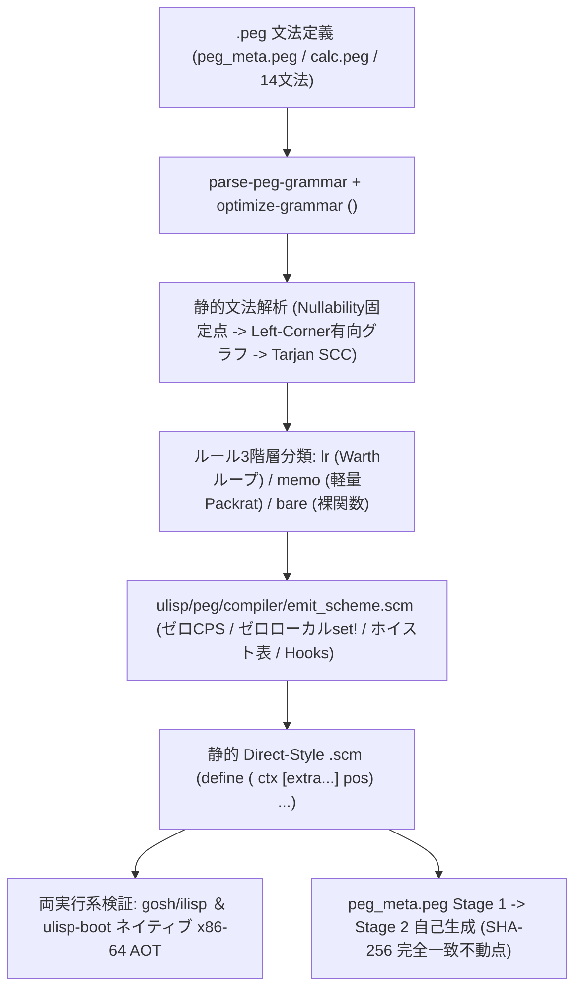

# [FEAT/ENH] Direct-Style 静的 `.scm` PEG パーサージェネレータバックエンド (`emit_scheme.scm`) の実装と `peg_meta.peg` ソース自己ホスト不動点実証 (ID: 948)

## 1. 概要 / Summary & 現状コードベース監査ギャップ

現行の ULisp PEG（[codegen.scm](../../../ulisp/peg/compiler/codegen.scm) + [runtime.scm](../../../ulisp/peg/runtime.scm)）は、実行時に二重 CPS クロージャ網を合成するインメモリ型であり、`peg:seq`/`peg:alt`/`peg:star` の各ステップで継続クロージャ（`sk` / `fk`）を大量確保するため、ULisp AOT コンパイラによる静的最適化（直接関数呼び出し・ループ化・インライン展開）の恩恵を受けられない。[Issue #945](945-profile-lua-547-c99-build-phase-breakdown-on-linux.md) の Linux 実機プロファイリング（[lua_547_build_phase_profile.md](../../benchmarks/lua_547_build_phase_profile.md)）により、Lua 5.4.7（33 TU）コンパイル時間の **53.64%（4,740.77 ms / 8,838.60 ms）** を `parse` フェーズが占める最大ボトルネックであることが定量実証された。

本 Issue では、`.peg` 文法 AST（`<peg-grammar-def>`）から Direct-Style（非 CPS）・ゼロクロージャ確保呼び出し規約（`(parse-<rule> ctx [extra-params...] pos)` → 成功時は整数 `next-pos` を返却し結果値を `(parse-ctx-res-val ctx)` に格納、失敗時は `#f` を返却）の独立した `.scm` ソースコードを生成する静的コード生成バックエンド [emit_scheme.scm](../../../ulisp/peg/compiler/emit_scheme.scm) を実装する。静的 Nullability・Left-Corner・Tarjan SCC 解析により、左再帰ルールのみ Warth シード成長ループ（`peg-ds:rule-lr`）、非左再帰メモ化ルールは軽量メモ化（`peg-ds:rule-memo`）、字句葉／除外ルールは裸関数（`bare`）として出し分け、[peg_meta.peg](../../../tools/grammars/peg_meta.peg) のソースレベル自己ホスト不動点（Stage 1 生成 `.scm` == Stage 2 生成 `.scm`）および `ulisp/bin/ulisp-boot` によるネイティブ AOT コンパイル実行を実証する。

### 現状コードベース監査ギャップ (6項目)

1. **Gap 1 — [runtime.scm](../../../ulisp/peg/runtime.scm) の Direct-Style スロット・`cut` 状態・非 CPS プリミティブ欠如**
   - `<parse-context>`（lines 11–28）は 10 フィールドのみで `res-val` と `cut?` スロットを持たず、`peg:lit` / `peg:char-class` / `peg:any-char` / `peg:line-start` / `peg:rule` / `peg:rule-simple` はすべて `(ctx pos sk fk)` 二重 CPS 固定である。既存 CPS API との完全後方互換を維持したまま、非 CPS 版 `peg-ds:*` プリミティブ群を追加する必要がある。
2. **Gap 2 — 静的文法解析（Nullability 固定点・Left-Corner 依存グラフ・Tarjan SCC・ルール分類）の欠如**
   - 現行 [codegen.scm](../../../ulisp/peg/compiler/codegen.scm)（lines 237–256）は全ルールを一律にフル Warth `peg:rule` で包んでおり、非左再帰ルールや字句葉ルールにも毎呼び出し `in-progress` / `lr-detected` / `touched-lr` / `make-memo-entry` のオーバーヘッドを課している。Nullable 集合 → Left-Corner 有向グラフ → Tarjan SCC により `lr` / `memo` / `bare` を静的決定し、間接左再帰依存（`in-progress` 非空時の `lr-deps` 伝播）も健全に扱う必要がある。
3. **Gap 3 — Direct-Style 静的 `.scm` コード生成器 ([emit_scheme.scm](../../../ulisp/peg/compiler/emit_scheme.scm)) の不在**
   - [ast.scm](../../../ulisp/peg/compiler/ast.scm) の全 16 種ノードを CPS クロージャ・コンビネータ・ローカル `(set! ...)` ゼロの直接 `let` / `let loop` / 直接関数呼び出し `.scm` へ展開する決定論的エミッタ、文字クラステーブルのトップレベルホイスト、および後続 [Issue #949](949-migrate-c99-parser-to-aot-generated-static-scheme-parser.md) 向けフックオプション（`prefix`, `entry`, `extra-params`, `memo-mode`, `no-memo`, `overrides`, `decorators`）が未実装である。
4. **Gap 4 — [peg_meta.peg](../../../tools/grammars/peg_meta.peg) ソースレベル自己ホスト不動点基盤の欠如**
   - 現行 [test_peg_self_hosting.scm](../../../ulisp/tests/test_peg_self_hosting.scm) はインメモリ CPS クロージャによる受理確認のみで、ローカル `set!`（lines 65–69）も残存している。さらに `peg_meta.peg` の正規表現トークン（`regex_tok`, `char_class_tok`, `action_piece`, `raw_str_dq/sq`）、先頭 `|` 許容（[codegen.scm](../../../ulisp/peg/compiler/codegen.scm) lines 243–248）、および生成 Direct-Style パーサ出力から正規化 `<peg-grammar-def>` を再構成する `peg-meta-cst->ast` 変換器を整備し、`Stage 1 .scm == Stage 2 .scm` を実証する必要がある。
5. **Gap 5 — [peg.scm](../../../ulisp/peg.scm) 公開 API・[c_driver_module_header.scm](../../../ulisp/compiler/c_driver_module_header.scm) extern 登録・[Makefile](../../../ulisp/Makefile) 統合の欠如**
   - `emit-peg-grammar->scheme` / `emit-peg-string->scheme` / `emit-peg-file->scheme` / `write-peg-file->scheme!` の公開ファサード、`PEG_SOURCES`（[Makefile](../../../ulisp/Makefile) line 923）への `peg/compiler/emit_scheme.scm` 追加、および `bin/ulisp-cc` モジュラービルド用シンボル登録が必要である。
6. **Gap 6 — CPS 差分検証・全 14 文法エミッション検査・`ulisp-boot` ネイティブ AOT コンパイル検証の欠如**
   - 既存 CPS エンジンをオラクルとした差分テスト（直接/間接/Nullable 前置左再帰・`cut`・`gather`・先読み・エラー位置 `max-pos`/`expected`）、`tools/grammars/*.peg` 全 14 ファイルの `.scm` 生成＆ `lint_sexpr.py` 合格検証、および生成 `.scm` を `ulisp/bin/ulisp-boot` でネイティブ AOT コンパイル＆実行する自動検証が未整備である。

---

## 2. トレーサビリティ / Traceability

- **関連設計書**:
  - [DSN-25](../../designs/DSN-25-pure_python_packrat_peg_parser_engine.md) (Pure Python Packrat PEG パーサエンジン仕様)
  - [DSN-33-22](../../designs/DSN-33-22-ulisp_language_workbench_interpreter_generator_and_guest_runtime_architecture.md) (ULisp 言語ワークベンチ・構文解析フロントエンド設計書)
- **前提 Issue ＆ 定量エビデンス**:
  - [Issue #894](894-implement-pure-scheme-compile-time-peg-parser-generator.md) (Pure Scheme Compile-Time PEG 基盤)
  - [Issue #945](945-profile-lua-547-c99-build-phase-breakdown-on-linux.md) / [Lua 5.4.7 ビルドプロファイル](../../benchmarks/lua_547_build_phase_profile.md) (`parse` = 53.64% 実証)
- **後続連携 Issue**:
  - [Issue #949](949-migrate-c99-parser-to-aot-generated-static-scheme-parser.md) (`c99.peg` の静的 `.scm` パーサ生成移行・CPS 全廃)
  - [Issue #950](../950-verify-first-futamura-projection-peg-staging-via-mix-against-emit-scheme.md) (`mix` 射影パーサとの双対検証オラクル)

---

## 3. アーキテクチャ設計 / Architecture

### Direct-Style 呼び出し規約 ＆ コード生成規則

1. **`<parse-context>` 拡張 ([runtime.scm](../../../ulisp/peg/runtime.scm))**:
   - 既存 10 フィールドの後方に 2 フィールドを追加（`make-parse-context` 初期値はいずれも `#f`）：
     - `(res-val parse-ctx-res-val parse-ctx-res-val-set!)`
     - `(cut?    parse-ctx-cut?    parse-ctx-cut?-set!)`
   - 既存 `%make-parse-context` を直接呼ぶ箇所がない前提を維持しつつ、`make-parse-context` の後方互換シグネチャを保つ。
2. **パーサ手続きシグネチャ**:
   - `(define (<prefix><rule> ctx [extra-params...] pos) ...)`
   - **成功時**: `(parse-ctx-res-val-set! ctx val)` を設定し、非負整数 `next-pos` を返す（ボックス・ペアのヒープ確保なし）。
   - **失敗時**: `#f` を返す（エラー記録は `parse-ctx-update-max-pos!` が担当）。
3. **ルール種別ごとのラッパ出し分け（Tarjan SCC 分類）**:

| ルール種別 | 静的判定条件 | 生成ラッパ | 挙動 |
| :--- | :--- | :--- | :--- |
| **`lr`** | Left-Corner SCC サイズ ≥ 2 または自己辺あり | `(peg-ds:rule-lr ctx 'rule pos body-proc)` | Warth シード成長ループ・`max-depth`・`lr-deps` クリーンアップ |
| **`memo`** | 非左再帰かつ `memoize?` かつ非 `bare` | `(peg-ds:rule-memo ctx 'rule pos body-proc)` | 軽量 Packrat 参照/登録（`in-progress` 非空時のみ `lr-deps` 伝播） |
| **`bare`** | 他ルール非参照の字句葉、または `no-memo` 指定 | ラッパなし（本体式を直接展開） | メモテーブル探索・クロージャ生成を完全省略 |

4. **全 15 式ノードの Direct-Style 展開（ローカル `set!` ゼロ・CPS ゼロ）**:
   - `lit` / `char-class` / `any-char` / `line-start` / `cut`: それぞれ `peg-ds:lit`（1文字時は `peg-ds:lit1`）、トップレベルにホイストした文字クラス述語への `peg-ds:char-class`、`peg-ds:any-char`、`peg-ds:line-start`、`peg-ds:cut` へ展開。
   - `regex`: 既存 `compile-regex-pattern` 相当の特殊パターン（空白/コメント、識別子、単/二重引用符文字列、`[spec]+`、`[spec]*`、`[spec]`、`.`、リテラル）を非 CPS スキャナ / `let loop` へ展開。
   - `seq`: 要素毎に直列ネストした `let` で `next-pos` を受け渡し、各要素の `(parse-ctx-res-val ctx)` を蓄積して `(reverse vals)` を設定（`named` 要素は `(cons 'name val)`）。
   - `choice`: 外側の `saved-cut = (parse-ctx-cut? ctx)` を退避し、各枝の先頭で `(parse-ctx-cut?-set! ctx #f)` にリセットして試行；失敗時に `(parse-ctx-cut? ctx)` が `#t` なら後続枝をスキップして即座に `#f` を返し、最終返却時に `(parse-ctx-cut?-set! ctx saved-cut)` を復元。
   - `repeat` (`*` / `+`): `(let loop ((curr-pos ...) (vals ...)))` で展開し、進捗ガード `(<= next-pos curr-pos)` で 0 幅マッチ無限ループを遮断。
   - `opt` / `pred` (`&` / `!`) / `gather` (`gather+` / `gather*`) / `named` / `rule-ref` / `action`: すべてコンビネータ呼出なしの直接 `let` / `let loop` / `(parse-<target> ctx [extra...] pos)` 呼び出しへ展開。
5. **拡張オプション alist（#949 互換フック仕様）**:
   - `(emit-peg-grammar->scheme grammar . maybe-opts)` は以下の連想リストオプションを受理する：
     - `(prefix . "peg-meta-")`: 生成関数・エントリ名・ホイスト述語名の接頭辞
     - `(entry . <symbol>)`: 既定エントリルール名（未指定時は先頭ルール）
     - `(extra-params . (env))`: 全生成ルール引数の `ctx` と `pos` の間に追加する引数リスト
     - `(memo-mode . auto)` (`auto` | `all` | `none`): SCC による自動分類 / 全メモ化 / 無効化
     - `(no-memo . (<sym> ...))`: メモ化から明示除外するルールリスト
     - `(overrides . ((rule . <expr-or-lambda-str>) ...))`: 特定ルール本体の差し替えフック
     - `(decorators . ((rule . <fn-name-str>) ...))`: 特定ルール結果のデコレートフック

---

## 4. マルチエージェント・ガバナンス審議

| 役割 | 合意・裁定内容 |
| :--- | :--- |
| **Project Manager (PM)** | WP1（Direct-Style ランタイム `peg-ds:*`）→ WP2（Tarjan SCC 解析 ＆ `emit_scheme.scm` + `peg.scm` API）→ WP3（`peg_meta.peg` Stage 1 == Stage 2 不動点 ＆ `ulisp-boot` AOT 実証）→ WP4（差分・全 14 文法テスト ＆ 品質ゲート）の 4 段階で完遂を統括する。 |
| **Systems Architect (SA)** | 既存 CPS エンジンと `peg-ds:*` を `<parse-context>` 拡張の上で安全に共存させ、#949 がそのまま差し込めるフック仕様（`extra-params`, `overrides`, `decorators`, `no-memo`）を初期設計から確定する。 |
| **PLC / SWD Specialist** | `emit_scheme.scm` 本体および生成される `.scm` コード双方でローカル `(set! ...)` を完全に禁止する（ループ状態・蓄積はすべて末尾再帰引数または `vector`/`cons` ボックスを使用）。 |
| **Information Security Specialist** | 生成する識別子へ厳格なホワイトリスト検証を課し、文字列・文字クラスは完全エスケープする。`.peg` 内の生 Python アクション文字列を実行可能 Scheme コードとして展開しない（CWE-94 防止）。全ランタイム走査は境界チェック（CWE-125）および進捗・深度ガード（CWE-400/674）を必須とする。 |
| **Software Quality Assurance Specialist (SQA)** | CPS 版との差分オラクル（直接/間接/Nullable 前置左再帰、`cut`、`gather`、エラー位置）、全 14 文法 `lint_sexpr.py` 合格、`peg_meta.peg` Stage 1 == Stage 2 SHA-256 完全一致、および `ulisp-boot` AOT 実行一致を合格ゲートとする。 |
| **Systems Auditor** | `verify_zero_gauche`、`c_driver_module_header.scm` 整合、`ulisp/bin/ulisp-cc`・`test_ulisp_cc_native`・`test_c99_e2e` の無退行、および関連ドキュメントの相対リンク規約遵守を確認する。 |

---

## 5. 脅威モデルとセキュリティ対策 / Threat Model & Mitigations

1. **コードインジェクション防止（CWE-94）**
   - `.peg` ルール名・文法名から Scheme シンボルを生成する際は `[A-Za-z_][A-Za-z0-9_-]*` のみに制限し、不正文字を含む識別子は即座にエラー送出する。
   - 文字列リテラルや文字クラス仕様の埋め込みには完全エスケープ関数（`"`, `\`, 制御文字をエスケープ）を適用し、`.peg` の `{ ... }` 生アクションテキストは評価可能な Scheme 式として絶対に出力しない。
2. **無限ループ・ReDoS・スタック枯渇防止（CWE-400 / CWE-674）**
   - すべての生成 `*` / `+` / `gather` ループに `(<= next-pos curr-pos)` 進捗ガードを組み込み、0 幅マッチによる無限ループを防止する。
   - `peg-ds:rule-lr` / `peg-ds:rule-memo` は `parse-ctx-max-depth`（既定 10000）による再帰深度上限検査を行う。
   - Nullability 固定点 + Left-Corner 有向グラフの Tarjan SCC により、直接・間接・Nullable 前置の左再帰サイクルを漏れなく検出して `peg-ds:rule-lr` へ振り分ける。
3. **文字列境界外参照防止（CWE-125）**
   - すべての `peg-ds:*` スキャナは `(< pos total-len)` および `(<= (+ pos lit-len) total-len)` 検査を通過した場合のみ `string-ref` / `substring` を行う。
4. **パストラバーサル防止（CWE-22）**
   - `write-peg-file->scheme!` は空文字列・NUL バイト・`..` を含む不正出力パスを拒否する。
5. **ULisp AOT 互換性 ＆ `verify_zero_gauche`**
   - 変更・生成するすべての `.scm` ファイルでローカル `set!` および `(gauche ...)` 参照を 0 件に保つ。

---

## 6. 影響範囲と関連ファイル / Scope and Affected Files

### 変更対象ファイル
- [x] [runtime.scm](../../../ulisp/peg/runtime.scm) (`<parse-context>` への `res-val` / `cut?` スロット追加、非 CPS スキャナ群 `peg-ds:*`・`peg-ds:rule-memo`・`peg-ds:rule-lr`・`peg-ds:parse` / `peg-ds:parse-partial` 実装)
- [x] [codegen.scm](../../../ulisp/peg/compiler/codegen.scm) (`meta-regex-lit` / `meta-char-class` / `\\.` / `new_rule_head` 補完による `peg_meta.peg` EOF 自己解析修正)
- [x] [peg.scm](../../../ulisp/peg.scm) (`emit-peg-grammar->scheme`, `emit-peg-string->scheme`, `emit-peg-file->scheme`, `write-peg-file->scheme!` ファサード追加)
- [x] [c_driver_module_header.scm](../../../ulisp/compiler/c_driver_module_header.scm) (`peg-ds:*` および新規公開シンボルの extern 登録)
- [x] [test_peg_self_hosting.scm](../../../ulisp/tests/test_peg_self_hosting.scm) (ローカル `set!` 解消 ＆ `peg_meta.peg` Stage 1 == Stage 2 ソース不動点検証追加)
- [x] [Makefile](../../../ulisp/Makefile) (`PEG_SOURCES`, `lint_sexpr`, `test_peg_emit_scheme`, `test_peg_self_hosting_aot` ターゲット追加)

### 新規作成ファイル
- [x] [emit_scheme.scm](../../../ulisp/peg/compiler/emit_scheme.scm) (新規: 静的 Nullability / Left-Corner Tarjan SCC 解析、Direct-Style `.scm` エミッタ、`peg-meta-cst->ast` 自己ホスト変換器)
- [x] [test_peg_emit_scheme.scm](../../../ulisp/tests/test_peg_emit_scheme.scm) (新規: SCC 分類・全構文要素・CPS 差分オラクル・全 14 文法エミッション＆ `lint_sexpr` 検査テスト)
- [x] [test_peg_self_hosting_aot.sh](../../../ulisp/tests/test_peg_self_hosting_aot.sh) (新規: `peg_meta.peg` Stage 1 == Stage 2 SHA-256 ソース不動点検証 ＆ `ulisp/bin/ulisp-boot` ネイティブ AOT コンパイル実行検証)

### 参照・検証対象文法
- [peg_meta.peg](../../../tools/grammars/peg_meta.peg), [calc.peg](../../../tools/grammars/calc.peg), [c99.peg](../../../tools/grammars/c99.peg)（ほか `tools/grammars/*.peg` 全 14 文法）

---

## 7. 詳細実装計画 / Detailed Implementation Plan

**Target Branch**: `feat/948-implement-direct-style-static-scheme-peg-generator`

### WP1: Direct-Style ランタイム拡張 ([runtime.scm](../../../ulisp/peg/runtime.scm))
1. **`<parse-context>` スロット拡張 (lines 11–28)**:
   - `(res-val parse-ctx-res-val parse-ctx-res-val-set!)` と `(cut? parse-ctx-cut? parse-ctx-cut?-set!)` を追加し、`make-parse-context` で `#f` 初期化する。
2. **非 CPS 葉スキャナ ＆ `peg_meta` トークンスキャナ追加**:
   - 基本葉スキャナ: `peg-ds:lit`, `peg-ds:lit1`, `peg-ds:char-class`, `peg-ds:any-char`, `peg-ds:line-start`, `peg-ds:cut`, `peg-ds:scan-char-class-plus`, `peg-ds:scan-char-class-star`
   - メタ文法用 Direct-Style スキャナ: `peg-ds:meta-ws`, `peg-ds:meta-ident`, `peg-ds:meta-string-lit`, `peg-ds:meta-action-block`, `peg-ds:meta-regex-lit`, `peg-ds:meta-char-class`, `peg-ds:meta-new-rule-head`, `peg-ds:meta-opt-lead-pipe`, `peg-ds:escape-pair`
3. **非 CPS メモ化・左再帰・ドライバ実装**:
   - `peg-ds:rule-memo`: メモヒット時は即座に `res-val` と `end-pos` を復元し、未ヒット時は `body-thunk` を実行して `done` / `fail` を記録（`(pair? (parse-ctx-in-progress ctx))` 時のみ `lr-deps` 伝播）。
   - `peg-ds:rule-lr`: `in-progress` 検出・`lr-detected` 記録・Warth シード成長ループ（`let grow ((curr-val ...) (curr-pos ...))`）・`parse-ctx-clear-lr-dependent-memo!`・`max-depth` ガードをローカル `set!` ゼロで実装。
   - `peg-ds:parse-partial` (`case-lambda`) / `peg-ds:parse`: Direct-Style エントリポイント。

### WP2: 静的 SCC 解析 ＆ Direct-Style `.scm` エミッタ ([emit_scheme.scm](../../../ulisp/peg/compiler/emit_scheme.scm))
1. **静的文法解析パス**:
   - `peg-compute-nullable-rules`: 各ルールが 0 文字消費で成功し得るかを固定点反復で算出（`cut`, `line-start`, `opt`, `star`, `pred`, `gather*`, 空 `seq`, いずれかが nullable な `choice`, 全要素が nullable な `seq`）。
   - `peg-compute-left-corner-graph`: `seq` では先頭要素が nullable なら後続要素も Left-Corner 辺として張る有向グラフを構築。
   - `peg-compute-tarjan-scc` / `peg-classify-rules`: 決定論的（文法記述順）な Tarjan SCC により、SCC サイズ ≥ 2 または自己ループを持つルールを `'lr`、それ以外でルール参照や再帰を含むルールを `'memo`、他ルール非参照の字句葉または `no-memo` 指定ルールを `'bare` に分類。
2. **Direct-Style `.scm` コード生成器**:
   - 安全な識別子検証、文字列エスケープ、トップレベル文字クラス述語ホイスト（重複排除・決定論的命名）、決定論的連番採番を実装。
   - 全 15 AST 式ノード（`lit`, `regex`, `char-class`, `any-char`, `cut`, `line-start`, `seq`, `choice`, `repeat`, `opt`, `pred`, `gather`, `named`, `rule-ref`, `action`）を CPS コンビネータゼロ・ローカル `set!` ゼロの Scheme コード文字列へ展開。
   - オプション alist（`prefix`, `entry`, `extra-params`, `memo-mode`, `no-memo`, `overrides`, `decorators`）および公開関数 `emit-peg-grammar->scheme` を実装し、生成コード先頭へヘッダコメント・ホイスト定義・各ルール関数・エントリラッパ `<prefix>parse` / `<prefix>parse-partial` を決定論的順序で出力。
3. **ファサード・モジュールヘッダ・Makefile 統合**:
   - [peg.scm](../../../ulisp/peg.scm) へ `emit-peg-grammar->scheme`, `emit-peg-string->scheme`, `emit-peg-file->scheme`, `write-peg-file->scheme!` を追加。
   - [c_driver_module_header.scm](../../../ulisp/compiler/c_driver_module_header.scm) に新規 `peg-ds:*` と `emit-peg-*` シンボルを登録し、[Makefile](../../../ulisp/Makefile) の `PEG_SOURCES`（line 923）と `lint_sexpr` へ `peg/compiler/emit_scheme.scm` を追加。

### WP3: `peg_meta.peg` ソースレベル自己ホスト不動点（Stage 1 == Stage 2）＆ `ulisp-boot` AOT 実証
1. **`peg-meta-cst->ast` ＆ 自己ホスト生成設定**:
   - Stage 0 AST（[parser.scm](../../../ulisp/peg/compiler/parser.scm) の `parse-peg-grammar`）から `build/peg_meta_stage1.scm` を生成し、それをロードした `peg-meta-parse` で `tools/grammars/peg_meta.peg` 自体をパース（4987/4987 bytes EOF）して `peg-meta-cst->ast` + `optimize-grammar` を通し、Stage 2 コード `build/peg_meta_stage2.scm` を生成して **バイト単位完全一致（SHA-256 一致）** を検証する。
2. **[test_peg_self_hosting.scm](../../../ulisp/tests/test_peg_self_hosting.scm) 更新**:
   - Group 3 内のローカル `set!`（lines 65–69）を `vector` ボックスへ置換し、EOF 到達検査と Group 4 として `peg_meta.peg` の Stage 1 == Stage 2 ソース一致テストを追加する。
3. **[test_peg_self_hosting_aot.sh](../../../ulisp/tests/test_peg_self_hosting_aot.sh) 新設**:
   - `build/peg_meta_stage1.scm` / `build/peg_meta_stage2.scm` に対する `scripts/lint_sexpr.py` 合格、SHA-256 完全一致、CPS シンボル 0 件 ＆ ローカル `(set! ` 0 件を検証。
   - 生成した `calc.peg` パーサおよび `build/peg_meta_stage1.scm` を `ulisp/bin/ulisp-boot` でネイティブ x86-64 ELF64 バイナリへ AOT コンパイル → リンク → 実行し、期待結果と一致することを検証する。

### WP4: 網羅的ユニット・差分・全 14 文法テスト ＆ 品質ゲート
1. **[test_peg_emit_scheme.scm](../../../ulisp/tests/test_peg_emit_scheme.scm) 新設**:
   - 静的解析・CPS 差分・フック・CWE-94/CWE-22・全 14 文法 `.scm` エミッションを検証。
2. **[Makefile](../../../ulisp/Makefile) テスト統合 ＆ 全ゲート検証**:
   - `test_peg_emit_scheme` および `test_peg_self_hosting_aot` ターゲットを追加して `test_peg` に統合。

---

## 8. 完了条件 / Success Criteria (DoD)

- [x] **Direct-Style ランタイム ＆ 静的 SCC `.scm` エミッタ完成**: [emit_scheme.scm](../../../ulisp/peg/compiler/emit_scheme.scm) および [runtime.scm](../../../ulisp/peg/runtime.scm) / [peg.scm](../../../ulisp/peg.scm) 拡張がローカル `set!` 0 件で実装され、`seq`/`alt`/`star`/`plus`/`opt`/`pred`/`gather`/`lit`/`char-class`/`any-char`/`cut`/`line-start`/`named`/`rule-ref` を CPS コンビネータゼロ・クロージャ確保ゼロの Direct-Style `.scm` として出力でき、静的 Tarjan SCC により `lr`/`memo`/`bare` を正確に出し分けられること。
- [x] **CPS 差分一致 ＆ 全 14 文法生成 PASS**: `make -C ulisp test_peg_emit_scheme` が PASS し、直接・間接・Nullable 前置左再帰や `cut`/`gather`/エラー位置を含む全テストケースで既存 CPS パーサーと結果が 100% 一致し、`tools/grammars/*.peg` 全 14 ファイル（`c99.peg`, `peg_meta.peg` 含む）の生成 `.scm` がすべて `lint_sexpr.py` を 0 エラーで通過すること。
- [x] **`peg_meta.peg` ソース自己ホスト不動点実証**: Stage 1 生成 `.scm` をロード・実行して `peg_meta.peg` を再解析し、Stage 2 生成 `.scm` を生成した結果、`Stage 1 .scm` と `Stage 2 .scm` の SHA-256 が **100% バイト一致**すること。
- [x] **ULisp ネイティブ AOT コンパイル実行実証**: 生成された Direct-Style `.scm` パーサー（`calc.peg` および `peg_meta_stage1.scm`）が `ulisp/bin/ulisp-boot` でネイティブ x86-64 バイナリへコンパイル・実行でき、期待結果と完全一致すること。
- [x] **回帰なし ＆ 全品質ゲート PASS**: `make -C ulisp verify_zero_gauche lint_sexpr test_lint_sexpr test_peg bin/ulisp-cc test_ulisp_cc_native test_c99_e2e`、およびルート `make py_compile && make static_analysis` が全て PASS し、関連 Markdown ファイルに絶対パスリンクが存在しないこと。

---

## 9. 検証結果 / Verification Results

1. **自己ホスト不動点検証 (`test_peg_self_hosting` + `test_peg_self_hosting_aot`)**:
   - Stage 0 解析（`parse-peg-grammar` on `tools/grammars/peg_meta.peg`）: 37 ルール・4987 / 4987 バイト完全受理。
   - `peg-meta-cst->ast` による正規化 AST が Stage 0 最適化済み AST と `equal?` 完全一致。
   - `build/peg_meta_stage1.scm`（37,557 バイト）および `build/peg_meta_stage2.scm` の SHA-256 ダイジェストが `98be96cf0574799eda24315ee1c04e7378ad20c9142b006b516cb05b9445f020` で **完全バイト一致**。
2. **ネイティブ x86-64 AOT コンパイル実行 (`test_peg_self_hosting_aot.sh`)**:
   - `calc.peg` 生成パーサ（`ulisp-boot` ビルド）: `CALC_AOT_OK 11 13 2`（PASS）
   - `peg_meta_stage1.scm`（`ulisp-boot` ビルド）: `META_AOT_OK 7 37 4987`（`calc.peg` 7 ルール ＆ `peg_meta.peg` 37 ルール 4987 バイト完全解析 PASS）
3. **全品質ゲート実行結果**:
   - `make -C ulisp verify_zero_gauche`: PASS
   - `make -C ulisp lint_sexpr`: PASS（263 ファイル、および生成済み Stage 1/2・全 14 文法 `.scm` 16 ファイル 0 エラー）
   - `make -C ulisp test_lint_sexpr`: PASS（23 tests OK）
   - `make -C ulisp test_peg`: PASS（`test_peg_runtime`, `test_peg_compiler`, `test_peg_self_hosting`, `test_peg_emit_scheme`, `test_peg_self_hosting_aot`, `test_peg_cpython_e2e`, `test_peg_grammars`, `test_c99_peg_grammar` 全項目合格）
   - `make -C ulisp -j$(nproc) bin/ulisp-cc && make -C ulisp test_c99_e2e test_ulisp_cc_native`: PASS
   - `make check_format && make py_compile && make static_analysis`: PASS（`mypy --strict src`: 617 ファイルエラー 0 件）
