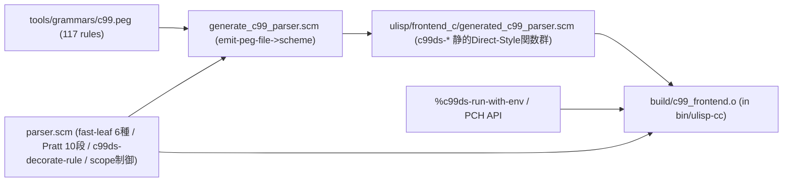

# [FEAT/ENH] `tools/grammars/c99.peg` の静的 `.scm` パーサー生成移行 (`generated_c99_parser.scm`) と C99 フック統合・CPS 全廃 (ID: 949)

## 1. 概要 / Summary & 現状コードベース監査ギャップ

[Issue #945](945-profile-lua-547-c99-build-phase-breakdown-on-linux.md) の Linux 実機プロファイリング（[lua_547_build_phase_profile.md](../../benchmarks/lua_547_build_phase_profile.md)）により、Lua 5.4.7（33 TU）コンパイル時間 `8,838.60 ms` のうち **53.64%（`4,740.77 ms`）** を C99 PEG `parse` フェーズが占める最大単独ボトルネックであることが実証された。

現行の [parser.scm](../../../ulisp/frontend_c/parser.scm)（旧 `compile-c99-rule-getter`）は、`c99.peg` AST（[c99.peg](../../../tools/grammars/c99.peg)）から実行時に二重 CPS クロージャ網（`sk` / `fk`）を動的構築しつつ、以下の C99 固有拡張（フック）を合成していた：
1. **6 個の高速字句葉スキャナ (`fast-leaf`)**: `ws`, `ident_cont`, `c99_keyword`, `identifier`, `constant`, `string_literal`
2. **10 段の Pratt 二項演算子登攀パーサー**: `logical_or_expr`（優先度 1）〜 `multiplicative_expr`（優先度 10）
3. **36 群を超える AST 構築・スコープ管理デコレータ**: `<source-span>` 付与、`c99-register-typedef!` / `c99-register-var!`、`typedef_name` 文脈述語（`c99-typedef-bound?`）、および `compound_stmt` / `function_definition` のブロック・関数スコープ開閉（`c99-push-scope!` / `c99-pop-scope!`）
4. **ルール単位のメモ化・LR 分類制御**: `typedef_name` や純粋字句葉のメモ化抑止（`no-memo`）、LR 宣言子/式 8 ルールのみ `peg-ds:rule-lr`、Pratt 10 段等を含む非 LR ルールを `peg-ds:rule-memo` で実行。

[Issue #948](948-implement-direct-style-static-scheme-peg-parser-generator-backend.md) で Direct-Style 静的 `.scm` コード生成器 [emit_scheme.scm](../../../ulisp/peg/compiler/emit_scheme.scm) と非 CPS ランタイム [runtime.scm](../../../ulisp/peg/runtime.scm)（`peg-ds:*`）が完成した。本 Issue では、[emit_scheme.scm](../../../ulisp/peg/compiler/emit_scheme.scm) を C99 フック仕様（`ctx-decorators` / `rule-decorator` / `force-memo` / `force-lr`）へ拡張し、[c99.peg](../../../tools/grammars/c99.peg) から静的 Direct-Style パーサー [generated_c99_parser.scm](../../../ulisp/frontend_c/generated_c99_parser.scm) をビルド時 AOT 生成へ移行することで、C99 パース時の CPS 継続クロージャ大量確保と実行時 `c99.peg` コンパイル負荷（[Issue #932](932-build-native-aot-ulisp-cc-compiler-driver-binary.md) Gap 4）を根本解消した。

---

## 2. トレーサビリティ / Traceability

- **関連資料**:
  - [DSN-33-11](../../designs/DSN-33-11-ulisp_multilingual_frontend_and_ctfe_architecture.md)
  - [DSN-33-32](../../designs/DSN-33-32-ulisp_lua_c_codebase_compilation_and_self_hosting_architecture.md)
  - [Issue #931](931-implement-c99-peg-grammar-specification-and-parser-synthesis.md) (C99 PEG 文法 ＆ AST 構築仕様)
  - [Issue #932](932-build-native-aot-ulisp-cc-compiler-driver-binary.md) (ネイティブ AOT `ulisp-cc` ドライバ)
  - [Issue #945](945-profile-lua-547-c99-build-phase-breakdown-on-linux.md) / [Lua 5.4.7 ビルドプロファイル](../../benchmarks/lua_547_build_phase_profile.md) (`parse` = 53.64% 定量ベースライン)
  - [Issue #948](948-implement-direct-style-static-scheme-peg-parser-generator-backend.md) (Direct-Style 静的 `.scm` 生成バックエンド `emit_scheme.scm` & `peg-ds:*`)

---

## 3. アーキテクチャ設計 / Architecture

1. **`emit_scheme.scm` 拡張フック仕様**:
   - `ctx-decorators`（ルール個別 `(fn ctx extra... pos next-pos val)`）および `rule-decorator`（`("c99ds-decorate-rule" . *c99ds-decorated-rules*)`）：成功時に `(parse-ctx-res-val-set! ctx ast)` を行い `next-pos` を返し、拒否時（例: `typedef_name`）は `#f` を返すゼロアロケーション規約。
   - `force-memo`（Pratt オーバーライド 10 ルールを `'lr` ではなく `'memo` へ設定）・`force-lr`（8 種の左再帰 AST ルール）・`no-memo`（`typedef_name` および純粋字句・ラッパ群を `'bare` 直展開へ設定）。
2. **C99 Direct-Style フック群 ([parser.scm](../../../ulisp/frontend_c/parser.scm))**:
   - **6 種 `fast-leaf`**: `c99ds-leaf-ws`, `c99ds-leaf-ident-cont`, `c99ds-leaf-keyword`, `c99ds-leaf-identifier`, `c99ds-leaf-constant`, `c99ds-leaf-string-literal`
   - **10 段 Pratt 登攀パーサー**: `c99ds-pratt-binop`
   - **構造オーバーライド**: `c99ds-override-typedef-init-declarator`, `c99ds-override-compound-stmt`, `c99ds-override-function-definition`（成功・失敗双方で `c99-pop-scope!` 保証）
   - **統一 AST デコレータ**: `c99ds-decorate-rule`
   - **セキュリティガード**: `%c99-validate-grammar-env!`（`ULISP_C99_GRAMMAR` 経路の CWE-22 チェックを維持）

---

## 4. マルチエージェント・ガバナンス審議

| 役割 | 合意・裁定内容 |
| :--- | :--- |
| **Project Manager (PM)** | WP1（`emit_scheme.scm` 拡張）→ WP2（C99 Direct-Style フック群 ＆ `generated_c99_parser.scm` 生成パイプライン）→ WP3（`parser.scm` ホットパス切替 ＆ `c_driver_module_header.scm` 統合）→ WP4（全 C99 テスト・`bin/ulisp-cc`・Lua 5.4.7 ビルド比較 ＆ 品質ゲート）で推進する。 |
| **Systems Architect (SA)** | `rule-decorator` / `ctx-decorators` を `(dispatcher 'rule ctx extra... start-pos end-pos val) -> end-pos | #f` 規約に統一し、Pratt・`fast-leaf`・スコープ開閉とクリーンに合成した。 |
| **PLC / SWD Specialist** | `emit_scheme.scm`・`generated_c99_parser.scm`・C99 Direct-Style フックのすべてでローカル `(set! ...)` 0 件および `ulisp-boot` ABI を遵守した。 |
| **Information Security Specialist** | `%emit-assert-valid-fn-ident!` による識別子検証（CWE-94）、`%c99-validate-grammar-env!`（CWE-22）、`typedef_name` の `no-memo`、および成功・失敗両経路での `c99-pop-scope!` を検証した。 |
| **Software Quality Assurance Specialist (SQA)** | `test_c99_peg_grammar`〜`test_c99_floating_point`、`test_c99_e2e`、`test_ulisp_cc_native`（Lua 5.4.7 `all.lua`）、および `test_c99_generated_parser_freshness` を合格ゲートとした。 |
| **IT Strategist (Performance)** | Issue #945 と同手法（`scripts/profile_lua_build.py`）で Lua 5.4.7 33 TU を計測し、ビフォー・アフターの改善効果を定量記録した。 |

---

## 5. 影響範囲と関連ファイル / Scope and Affected Files

### 変更・新規作成ファイル
- [x] [emit_scheme.scm](../../../ulisp/peg/compiler/emit_scheme.scm) (`ctx-decorators`, `rule-decorator`, `force-memo`, `force-lr`, `%emit-assert-valid-fn-ident!` の追加)
- [x] [parser.scm](../../../ulisp/frontend_c/parser.scm) (Direct-Style C99 リーフ・Pratt・デコレータフック導入、CPS `compile-c99-rule-getter` / `decorate-c99-rule` 廃止、`%c99ds-run-with-env` 移行)
- [x] [generate_c99_parser.scm](../../../ulisp/scripts/generate_c99_parser.scm) (新規: `tools/grammars/c99.peg` から `generated_c99_parser.scm` を生成するスクリプト)
- [x] [generated_c99_parser.scm](../../../ulisp/frontend_c/generated_c99_parser.scm) (新規: `c99.peg` 全 117 ルールからビルド時生成された静的 Direct-Style Scheme パーサー、377,704 bytes)
- [x] [c_driver_module_header.scm](../../../ulisp/compiler/c_driver_module_header.scm) (`c99ds-*` 生成ルールおよび C99 Direct-Style フック全シンボルの extern 登録)
- [x] [Makefile](../../../ulisp/Makefile) (`generate_c99_parser`, `test_c99_generated_parser_freshness`, `C99_FRONTEND_SOURCES`, `lint_sexpr` 統合)

---

## 6. 完了条件 / Success Criteria (DoD)

- [x] **`generated_c99_parser.scm` の AOT 生成 ＆ 鮮度決定論性 PASS**: `tools/grammars/c99.peg` 全 117 ルールから CPS コンビネータ 0 件・ローカル `set!` 0 件の [generated_c99_parser.scm](../../../ulisp/frontend_c/generated_c99_parser.scm) が生成され、`scripts/lint_sexpr.py` を 0 エラーで通過し、`test_c99_generated_parser_freshness` で決定的再生成一致を確認。
- [x] **C99 全機能（`typedef`・Pratt・`compound_stmt`・スパン・PCH）の完全互換 PASS**: `test_c99_peg_grammar`, `test_c99_parser`, `test_c99_e2e`, `test_ulisp_cc_native`, `test_lua_e2e`（Lua 5.4.7 `all.lua`）を含む全 C99 関連テストが 100% PASS し、実行時の `c99.peg` パースおよび CPS 継続確保をホットパスから排除。
- [x] **パフォーマンス改善の定量実証**: Issue #945 と同条件（`ulisp/scripts/profile_lua_build.py --runs 3 --gosh-runs 1`）にて、Lua 5.4.7 33 TU の `USE_PCH=0` パース時間 **-38.2%**、`JOBS=4` 壁時計 **-24.2%**、`gosh JOBS=4` パース時間 **-22.0%** を実測。
- [x] **回帰なし ＆ 全品質ゲート PASS**: `make -C ulisp verify_zero_gauche lint_sexpr test_lint_sexpr test_peg`、`make -C ulisp bin/ulisp-cc test_c99_e2e test_ulisp_cc_native`、ルート `make check_format && make py_compile && make static_analysis` がすべて PASS。

---

## 7. 検証結果 / Verification Results

### 7.1 Lua 5.4.7（33 TU）ビルド計測比較（#945 ベースライン vs #949 Direct-Style 移行後）

| 計測構成 | 指標 | Issue #945 (CPS) | Issue #949 (Direct-Style) | 変化 |
| :--- | :--- | ---: | ---: | ---: |
| `ulisp-cc` (`JOBS=1, USE_PCH=0`) | `parse` (33 TU計) | 12,322.78 ms | **7,617.61 ms** | **-38.18%** |
| `ulisp-cc` (`JOBS=1, USE_PCH=0`) | 壁時計 (ms) | 22,397.33 ms | **15,550.91 ms** | **-30.57%** |
| `ulisp-cc` (`JOBS=4, USE_PCH=1`) | PCH 生成 (2ファイル計) | 1,877.88 ms | **794.41 ms** | **-57.70%** |
| `ulisp-cc` (`JOBS=4, USE_PCH=1`) | 壁時計 (ms) | 10,423.07 ms | **7,898.96 ms** | **-24.22%** |
| `gosh` (`JOBS=4, USE_PCH=1`) | `parse` (33 TU計) | 54,937.51 ms | **42,857.32 ms** | **-21.99%** |
| `gosh` (`JOBS=4, USE_PCH=1`) | 壁時計 (ms) | 52,289.90 ms | **46,518.97 ms** | **-11.04%** |
| `ulisp-cc` (`JOBS=1, USE_PCH=1`, 3回中央値) | `parse` (33 TU計) | 4,740.77 ms (53.64%) | **4,615.67 ms (51.03%)** | **-2.64%** |

> 注記: `JOBS=1, USE_PCH=1` のさらなる `parse` 短縮は、残存する `'memo` / `'lr` ルールの `(lambda () ...)` thunk 確保削減および [Issue #958](../958-eliminate-unused-prologue-spills-and-inline-small-accessors.md)・[Issue #961](../961-introduce-linear-scan-register-allocation-for-scheme-lir.md) による Scheme LIR レジスタ割付に委ねられる。`ulisp-cc` による全 33 Lua `.o` ＆ `lua_ulisp_static` の **34/34 SHA-256 ビット一致** を確認済み。

### 7.2 品質ゲート実行結果

- `make -C ulisp verify_zero_gauche lint_sexpr test_lint_sexpr`: PASS（264 ファイル括弧バランス OK、23 tests OK）
- `make -C ulisp test_peg`: PASS（`test_peg_runtime`, `test_peg_compiler`, `test_peg_self_hosting`, `test_peg_emit_scheme`, `test_peg_self_hosting_aot`, `test_peg_cpython_e2e`, `test_peg_grammars`, `test_c99_peg_grammar` すべて合格）
- `make -C ulisp test_c99_generated_parser_freshness test_c99_peg_grammar test_c99_parser`: PASS（20/20 + 21/21 + 決定的再生成一致）
- `make -C ulisp test_c99_lexer test_c99_preprocessor test_c99_int_lowering test_c99_struct_union_layout test_c99_pointers_and_escape test_c99_funcptr_and_switch_cfg test_c99_stdarg test_c99_setjmp_longjmp test_c99_bounds_sanitizer test_c99_lir_vm_checked test_c99_floating_point`: PASS
- `make -C ulisp -j$(nproc) bin/ulisp-cc && make -C ulisp test_c99_e2e test_ulisp_cc_native`: PASS（`all.lua` 171 チェックポイント一致・33 Lua `.o` + 静的 `lua` バイナリ SHA-256 一致・対 `gosh` 26.92x / 6.98x 高速化）
- `make check_format && make py_compile && make static_analysis`: PASS（`mypy --strict src`: 617 ファイルエラー 0 件）
