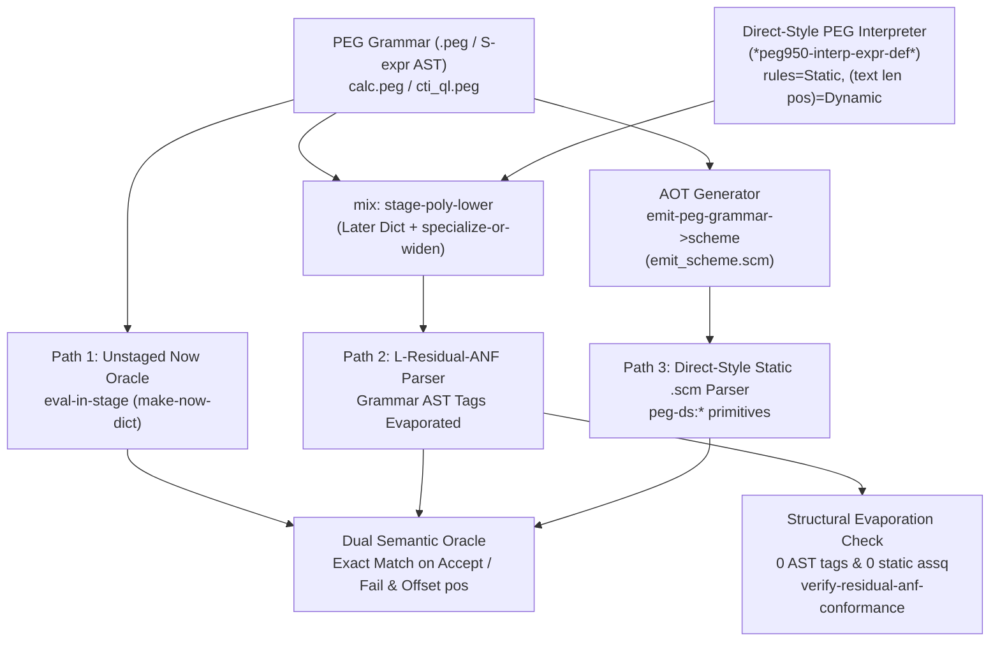

# [FEAT/ENH] Direct-Style PEG インタプリタ × `mix`（第1二村射影）による小規模文法自動段階化と `emit_scheme.scm` 生成パーサーとの双対検証 (ID: 950)

## 1. 概要 (Executive Summary)

現行の [runtime.scm](../../../ulisp/peg/runtime.scm) における従来の解釈エンジンは二重 CPS クロージャと破壊的循環ボックス `rule-cells` を前提とするため、そのままでは [Issue #942](942-connect-specialize-or-widen-in-eval-in-stage-apply-for-futamura-mix.md) および [Issue #965](965-support-backward-jump-loops-and-case-letrec-named-let-in-futamura-mix.md) で構築した混合器 `mix`（`stage-poly-lower` / `eval-in-stage` + `specialize-or-widen`）へ投入して部分評価することができない。

一方、[Issue #948](948-implement-direct-style-static-scheme-peg-parser-generator-backend.md) と [Issue #949](949-migrate-c99-parser-to-aot-generated-static-scheme-parser.md) によって、手書き Direct-Style 静的 `.scm` コード生成器 [emit_scheme.scm](../../../ulisp/peg/compiler/emit_scheme.scm) および Direct-Style 状態機械プリミティブ `peg-ds:*` が確立された。そこで本 Issue #950 では、純粋・第一階の再帰表現で記述した **Direct-Style S 式 PEG インタプリタ**（ルール表は連想リスト・ローカル `set!` ゼロ・CPS ゼロ）を定義し、小規模文法（[calc.peg](../../../tools/grammars/calc.peg) および [cti_ql.peg](../../../ulisp/workbench/examples/cti_ql.peg)）の文法 AST を静的入力として `mix(peg-interp, grammar-ast)` による **第1二村射影** を実行した。

生成された `L-Residual-ANF` 残余パーサーから文法 AST 解釈ディスパッチ記号（`'seq`, `'choice`, `'star`, `'plus`, `'opt`, `'char`, `'char-class`, `'range`, `'single`, `'pred-and`, `'pred-not`, `'rule-ref`, `assq`, `peg-match-cc`, `peg-interp-expr` 等）が完全に蒸発（Tower Collapse）したことを構造検査で実証した上で、以下 3 経路の **双対検証（Dual Verification）** を通じて意味等価性および残余コード品質を確定させた：

1. **Unstaged Now 解釈経路**: `(eval-in-stage (make-now-dict) ...)` による Direct-Style PEG インタプリタの直接実行。
2. **第1二村射影 `mix` 残余パーサー経路**: `(stage-poly-lower ...)` で特殊化された `L-Residual-ANF` パーサーの `(eval-residual-anf-expr ...)` 実行。
3. **手書き AOT コード生成器経路**: [emit_scheme.scm](../../../ulisp/peg/compiler/emit_scheme.scm)（`emit-peg-grammar->scheme`）が生成した静的 Direct-Style パーサーの実行。

---

## 2. 背景・現状の課題 (Codebase Audit Findings)

[eval_in_language.scm](../../../ulisp/compiler/eval_in_language.scm)、[emit_scheme.scm](../../../ulisp/peg/compiler/emit_scheme.scm)、および [test_futamura_projection.scm](../../../ulisp/tests/test_futamura_projection.scm) のコード監査の結果、以下 6 件の具体的ギャップが確認され、すべて本 Issue で解決した。

- **Gap 1 (リンクおよび参照モジュールの不整合)**: 初期ドラフトではクローズ済み [Issue #942](942-connect-specialize-or-widen-in-eval-in-stage-apply-for-futamura-mix.md) の相対パスに `closed/` が欠落しており、ソース実体である [eval_in_language.scm](../../../ulisp/compiler/eval_in_language.scm) ではなく生成物 `ulisp/compiler.scm` を直接参照していた。
- **Gap 2 (Direct-Style S 式 PEG インタプリタの未実装)**: [test_futamura_projection.scm](../../../ulisp/tests/test_futamura_projection.scm) に `*peg950-match-cc-def*` と `*peg950-interp-expr-def*` を実装し、`stage-poly-lower` で文法 AST（`rules` 連想リスト＋ノード式）を静的、入力 `(text len pos)` を動的として段階化できるようにした。
- **Gap 3 (`eval_in_language.scm` における文字列/文字プリミティブおよび Capture-Avoiding 置換ギャップ)**: [eval_in_language.scm](../../../ulisp/compiler/eval_in_language.scm) において `string-ref` を `now-dict-apply-prim-2` に配置し、`string-length`/`string-ref`/`substring`/`string=?`/`char=?`/`char<?`/`char<=?`/`char>?`/`char>=?`/`char->integer`/`integer->char`/`memq` を `Now`・`ctfe-apply-primitive`・`eval-residual-anf-expr` に統合した。さらに、特殊化ビルダー内 `let-anf` の一意変数生成・Capture-Avoiding な `stage-subst-params`・複合動的引数の単一 `let-anf` 束縛 (`stage-inline-specialized-body`)・`if-anf` テスト式正規化を実装した。
- **Gap 4 (特殊化インスタンス上限・深度上限の固定値制約)**: 既定の `*max-spec-instances* = 8` / `*max-spec-depth* = 4`（Group 6 互換）を維持したまま、`with-spec-limits` および [module_header.scm](../../../ulisp/compiler/module_header.scm) 公開 API を導入し、多規則 PEG 文法の全ノード特殊化に対応した。
- **Gap 5 (残余 PEG パーサーの文法 AST 完全蒸発検証の欠如)**: `peg950-assert-evaporation` により、`verify-residual-anf-conformance`、`verify-letrec-contifiable-guarantees`、および 17 個の文法 AST / ディスパッチ記号 0 件検査を常設化した。
- **Gap 6 (`emit_scheme.scm` との双対検証スイートの未整備)**: [calc.peg](../../../tools/grammars/calc.peg)（Group 7, 12入力ケース）および [cti_ql.peg](../../../ulisp/workbench/examples/cti_ql.peg)（Group 8, 12入力ケース）について、`Now` 解釈・`mix` 残余実行・[emit_scheme.scm](../../../ulisp/peg/compiler/emit_scheme.scm) 生成パーサーの 3 経路完全一致検証ハーネスを構築した。

---

## 3. アーキテクチャ設計 (Architecture & Dual Verification Contract)

### 3.1 3経路双対検証フロー (Mermaid)

---

## 4. 16エージェント統治レビュー (Multi-Agent Governance Review Table)

| # | エージェント役割 | 本 Issue における実施・検証観点 |
| :---: | --- | --- |
| 1 | **Project Manager (PM)** | WP1〜WP4 完遂、ブランチ `feat/950-verify-peg-futamura-staging-via-mix`、品質ゲート・Issue クローズ統合統治 |
| 2 | **Information Security Specialist (ISS)** | `with-spec-limits` 有界上限、`star`/`plus` ゼロ長進行ガード (`next > cur`)、`string-ref` 境界チェック (CWE-125/400/674) |
| 3 | **Systems Architect (SA)** | `mix` 第1二村射影と手書き AOT [emit_scheme.scm](../../../ulisp/peg/compiler/emit_scheme.scm) の二系統対称性実証 |
| 4 | **Software Quality Assurance Specialist (SQA)** | `L-Residual-ANF` 適合性・3重双対オラクル・Group 1〜8 全テスト PASS |
| 5 | **Database / Data Infrastructure Specialist** | `peg950-grammar-ast->stage-rules` による正規化文法 S 式スキーマとテスト入力コーパス管理 |
| 6 | **Network Specialist** | 完全オフライン環境でのビルド・検証完遂 |
| 7 | **IT Specialist (NLP & Info Retrieval)** | [calc.peg](../../../tools/grammars/calc.peg) / [cti_ql.peg](../../../ulisp/workbench/examples/cti_ql.peg) の正常系・構文誤り系テスト網羅 |
| 8 | **IT Strategist** | Direct Cogen × PEG 自動コンパイラ生成に向けた第1二村射影の基盤確立 |
| 9 | **IT Service Manager** | `make -C ulisp compiler`、`test_futamura_projection`、`lint_sexpr`、`verify_zero_gauche` の継続運用統合 |
| 10 | **Embedded Systems Specialist** | ローカル `set!` ゼロ・単一整数位置返却コントラクトによるゼロ継続アロケーション実行 |
| 11 | **Systems Auditor** | 残余 AST 内 17 種の文法解釈記号・`assq` 0 件証明および全ゲート実行ログ追跡 |
| 12 | **UI/UX & Documentation Designer** | Mermaid 図と構造化チェックリストによる追跡可能な設計文書整備 |
| 13 | **Education Specialist** | 二村射影（Tower Collapse）と手書きジェネレータの等価性対比の明確化 |
| 14 | **Software Development (SWD)** | [eval_in_language.scm](../../../ulisp/compiler/eval_in_language.scm) プリミティブ・Capture-Avoiding 置換・`with-spec-limits` 実装 |
| 15 | **Application Specialist (APS)** | [cti_ql.peg](../../../ulisp/workbench/examples/cti_ql.peg) 実文法に対する 3 経路一致確認 |
| 16 | **IT Specialist (Programming Languages & Compilers / PLC)** | `specialize-or-widen`・`verify-letrec-contifiable-guarantees`・`stage-normalize-to-residual-anf` 完遂 |

---

## 5. スコープ・対象ファイル・ブランチ (Scope, Affected Files & Branch)

- **ターゲットブランチ**: `feat/950-verify-peg-futamura-staging-via-mix`
- **更新・検証ファイル**:
  - [x] [eval_in_language.scm](../../../ulisp/compiler/eval_in_language.scm) — `string-ref` 2 引数配置修正、文字列/文字プリミティブの `Now`/`CTFE`/`eval-residual-anf-expr` 対応、`with-spec-limits` 導入、Capture-Avoiding `stage-subst-params` ＆ Hygienic `let-anf` 生成、`stage-inline-specialized-body` 単一評価束縛、および `if-anf` テスト式正規化
  - [x] [module_header.scm](../../../ulisp/compiler/module_header.scm) — `with-spec-limits`, `current-max-spec-instances`, `current-max-spec-depth` エクスポート追加
  - [x] [ulisp/compiler.scm](../../../ulisp/compiler.scm) — `make -C ulisp compiler` により再生成・同期済み
  - [x] [ulisp/Makefile](../../../ulisp/Makefile) — `test_futamura_projection` へ `$(PEG_SOURCES)` 配線、`lint_sexpr` へ `tests/test_futamura_projection.scm` 登録
  - [x] [test_futamura_projection.scm](../../../ulisp/tests/test_futamura_projection.scm) — Group 7 (`calc.peg`)・Group 8 (`cti_ql.peg`) の Direct-Style PEG インタプリタ、`mix` 段階化、文法記号蒸発チェック、および `emit_scheme.scm` 双対検証スイート追加

---

## 6. 完了条件 (Definition of Done - DoD)

- [x] `eval_in_language.scm` において `string-ref` を含む文字列/文字プリミティブが `Now` と `eval-residual-anf-expr` の双方で一貫動作し、既存 `test_futamura_projection.scm` Group 1〜6 が 100% PASS すること。
- [x] `calc`（[calc.peg](../../../tools/grammars/calc.peg) 準拠 AST）および `cti_ql`（[cti_ql.peg](../../../ulisp/workbench/examples/cti_ql.peg) 準拠 AST）に対し、`stage-poly-lower`（`mix`）が生成した残余プログラムから静的 PEG 文法 AST タグおよび静的 `assq` ルックアップが完全に蒸発（0 件）し、`verify-residual-anf-conformance` および `verify-letrec-contifiable-guarantees` を PASS すること。
- [x] `Unstaged Now`・`mix 残余パーサー`・[emit_scheme.scm](../../../ulisp/peg/compiler/emit_scheme.scm) 生成パーサーの 3 経路が、両文法の正常入力・異常入力テストコーパス全件（各 12 件・計 24 ケース）で成否および消費位置を 100% 一致させること。
- [x] `ulisp/tools/lint_sexpr.py`（全 63 ファイル・ローカル `set!` 0 件）および `verify_zero_gauche`・関連テストスイート・コンパイラ品質ゲートがすべて PASS し、絶対パスリンク 0 件で Issue クローズ手続きが完了すること。

---

## 7. 検証結果・実績サマリー (Verification Results)

- **コンパイラ再生成**: `make -C ulisp compiler`（63 ファイル括弧整合 PASS → `ulisp/compiler.scm` 更新）
- **二村射影 & PEG 段階化検証 (`make -C ulisp test_futamura_projection`)**:
  - Group 1〜6（既存 Tower Collapse・後方ジャンプループ・Widening 終了保証）: **PASS**
  - Group 7（`calc.peg` First Futamura Projection vs `emit_scheme.scm`）: 17 個の AST/ディスパッチ記号完全蒸発（0 件）、`L-Residual-ANF` 適合・Contification 保証 PASS、正常/部分一致/異常 12 入力すべてで 3 経路（`Now` / `mix` / `emit_scheme.scm`）の成否および終了オフセット 100% 一致 **PASS**
  - Group 8（`cti_ql.peg` First Futamura Projection vs `emit_scheme.scm`）: 17 個の AST/ディスパッチ記号完全蒸発（0 件）、`L-Residual-ANF` 適合・Contification 保証 PASS、複合クエリ/未閉文字列/不正トークン等 12 入力すべてで 3 経路の成否および終了オフセット 100% 一致 **PASS**
- **関連ステージング・PEG 回帰スイート**:
  - `test_eval_in_stage`, `test_stage_poly_lower`, `test_specialization_widening`, `test_residual_contification`, `test_stage_dict`, `test_single_source_oracle`, `test_eval_in_language`, `test_bta_lattice`, `test_speculative_trap_demotion`, `test_csp_boundary_validator`, `test_grammar_conformance_assertion`, `test_peg_emit_scheme` すべて **PASS** (exit 0)
- **静的・衛生ゲート**:
  - `make -C ulisp lint_sexpr verify_zero_gauche`: **PASS**
  - `make py_compile static_analysis` (`xenon` / `radon` / `mypy --strict src` 617 ファイル): **PASS**
