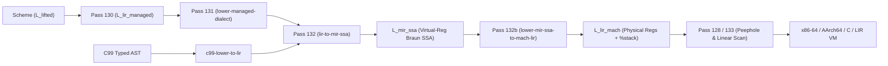

# [FEAT/ENH] L_mir_ssa（仮想レジスタ SSA）と L_lir_mach（物理レジスタ機械 LIR）の 2 層分離と Scheme/C99 共通ミドルエンド統合 (ID: 966)

## 1. 概要 / Summary

### 現状の課題

現在、[lir_lang.scm](../../../ulisp/lir/lir_lang.scm) における `L_lir_core` には以下の 3 種類の異なる抽象度が 1 つの文法定義内に混在している。

1. **仮想レジスタ表現**: `(%reg x)` / `(%reg mty x)` / `(%freg x)`
2. **構造化 Braun SSA ブロック**: `(%block lbl (x ...) inst ...)` およびブロック引数付き分岐（`%jump` / `%jump-if` / `%jump-if-false` / `%switch`）
3. **物理マシンレジスタ・スタックスロット**: `%rax`..`%r15` / `%xmm0`..`%xmm15` および `(%stack offset)`

この混在により、Scheme 経路（[130_lir.scm](../../../ulisp/lir/130_lir.scm) → [131_lower_managed_dialect.scm](../../../ulisp/lir/131_lower_managed_dialect.scm)）と C99 経路（[lower_to_lir.scm](../../../ulisp/frontend_c/lower_to_lir.scm) → [132_lir_braun_ssa.scm](../../../ulisp/lir/132_lir_braun_ssa.scm)）がそれぞれ部分的に物理レジスタと仮想レジスタ／SSA 形式を混用し、次の問題が生じている。

- ミドルエンドの共通最適化（定数伝播・GVN・DCE・Braun SSA 変換等）が「仮想レジスタ SSA 形式 (`L_mir_ssa`)」と「物理レジスタ確定後の機械 LIR (`L_lir_mach`)」の境界を持たない。
- バックエンド（x86-64 / AArch64 / Portable C / LIR VM）の直前で「未割付の仮想レジスタや未展開の SSA ブロック引数が残存していないか」を言語契約（Nanopass Dialect + Fail-Closed Verifier）として構造的に保証できていない。

### 目的と 2 層分離アーキテクチャ

本 Issue では `L_lir_core` の上下構造を次の **2 層** へ明確に分離し、Scheme（`L_lifted`）と C99（C99 Typed AST）の双方を共通のミドルエンド中間表現 **`L_mir_ssa`** へ合流させた上で **`L_lir_mach`** へ Lowering する基盤を構築する。

1. **`L_mir_ssa`（Virtual-Register Braun SSA Middle-End IR）**:
   - Managed Runtime 擬似命令（`*managed-dialect-opcodes*`）を一切含まない中位 SSA 中間言語。
   - 仮想レジスタ（`(%reg x)`, `(%reg mty x)`, `(%freg x)`）および ABI 境界レジスタ、`(%block lbl (x ...) inst ...)`、ブロック引数付き分岐を正式サポートする。
   - Scheme 側（`pass-130-lir` → `pass-131-lower-managed-dialect` → `pass-132-mir-ssa`）と C99 側（`c99-lower-to-lir` → `c99-braun-ssa-transform-fn` / `lir-to-mir-ssa`）の双方が本方言へ合流する。
2. **`L_lir_mach`（Physical-Register Machine LIR）**:
   - `L_mir_ssa` から SSA ブロック引数展開・仮想レジスタ割付／スタックスロット化（`lower-mir-ssa-to-mach-lir`）を完了した物理機械 LIR 方言。
   - `Register (reg)` を物理レジスタ（`%rax`..`%r15`, `%al`, `%xmm0`..`%xmm15`）のみに限定し、`(%reg x)` / `(%reg mty x)` / `(%freg x)`（非物理レジスタ記号）の存在を **Nanopass 文法（`L_lir_mach?`）と `validate-mach-lir` の双方で構造的に禁止** する。

---

## 2. トレーサビリティ & 16 エージェント合議 / Traceability & Governance

- 関連資料・前提／後続 Issue:
  - [Issue #835](835-separate-core-machine-lir-from-managed-runtime-dialect.md)（Core Machine LIR と Managed Dialect 分離）
  - [Issue #827](827-generalize-pass-132-braun-ssa-for-arbitrary-cfg-and-goto.md)（Pass 132 Braun SSA 任意 CFG / goto 対応）
  - [Issue #979](979-tighten-lir-language-compatibility-and-reconcile-lir-dialects.md)（LIR パス言語契約是正・`nanopass-language-compatible?` 厳格化）
  - [Issue #961](961-introduce-linear-scan-register-allocation-for-scheme-lir.md)（Scheme 経路の Linear-Scan レジスタ割付・CFG DSE）
  - [Issue #969](../969-implement-general-parallel-move-resolver-for-ssa-destruction-and-loops.md)（後続: 汎用 Parallel Move Resolver）
  - [Issue #973](../973-implement-ssa-sccp-gvn-adce-and-decompose-lir-peephole.md)（後続: `L_mir_ssa` 上の SCCP / SSA-GVN / ADCE）
  - [Issue #981](../981-unify-lir-core-fixpoint-optimization-for-scheme-and-c99.md)（後続: 共通ミドルエンド不動点最適化ループ統合）
  - [BASELINE.md](../../../ulisp/benchmarks/BASELINE.md)

### 16 エージェント多角的レビュー要点
- **PLC / SA (コンパイラ・方式設計)**: `L_mir_ssa`（仮想レジスタ許容・Managed 命令禁止）と `L_lir_mach`（物理レジスタ限定・仮想レジスタ禁止）を `define-language` の正式な方言として定義し、`L_lir_core` との段階的移行互換性を維持する。
- **ISS / Systems Auditor (安全性・追跡性)**: `L_lir_mach` 境界および `pass_manager.scm` の `nanopass-language-compatible?` で、未 Lowering の仮想レジスタ・Managed 命令の流入を Fail-Closed 拒否する。
- **SWD / SQA (実装・品質保証)**: `setjmp`（`returns_twice`）を含む関数での不安全な昇格抑止、並列エッジコピー時のスクラッチ退避による値破壊防止、および 3-Stage ブートストラップ不動点維持を検証ゲートとする。

---

## 3. 脅威モデリングと安全性不変条件 / Threat Modeling & Safety Invariants

1. **THREAT-966-1: 未割付仮想レジスタのバックエンド漏洩 (CWE-704 / CWE-843)**
   - **リスク**: `(%reg tmp)` や `(%freg ftmp)` を含む IR が `L_lir_mach` 境界やネイティブバックエンドへ流出すると不正機械語／アセンブラエラー／未定義レジスタ参照を引き起こす。
   - **対策**: `L_lir_mach` の `Register (reg)` 生成規則から `(%reg x)` / `(%reg mty x)` / `(%freg x)` を除外し、`lir-check-no-virtual-regs` および `validate-mach-lir` で記号的仮想レジスタ残存を完全拒否（Fail-Closed）する。
2. **THREAT-966-2: Managed Runtime 擬似命令のミドルエンド／バックエンド漏洩 (CWE-843)**
   - **リスク**: `%alloc` / `%managed-alloc` / `%box-*` 等が `pass-131` を経ずに `L_mir_ssa` や `L_lir_mach` へ渡ると誤った命令選択や GC 破綻が生じる。
   - **対策**: `L_mir_ssa`・`L_lir_mach` の双方が `L_lir_core` 系（Managed 擬似命令を除外）を継承・遵守し、`lir-verify-core-purity` + `nanopass-language-compatible?` で `L_lir_managed` からの直接遷移を禁止する。
3. **THREAT-966-3: SSA ブロック引数コピー・`setjmp` 境界での値破損 (CWE-682)**
   - **リスク**: `lower-mir-ssa-to-mach-lir` における複数ブロック引数の並列代入（例: `(a, b) <- (b, a)`）での上書き破壊、および `setjmp`（`__ulisp_setjmp`）後復帰でのレジスタ巻き戻り。
   - **対策**: スクラッチレジスタ（`%r10` / `%r11`）または専用一時スロットを用いた衝突安全コピー展開を実装し、`braun-cfg-has-returns-twice?` が真の関数では危険な SSA スタック昇格を行わない。
4. **THREAT-966-4: Exact GC スタックマップおよびフレーム境界不整合 (CWE-119)**
   - **リスク**: 仮想レジスタのスピル用スタックスロット割り当てで `frame-size` や既存の局所変数スロット `[rsp - N]` と衝突すると GC スタックマップが壊れる。
   - **対策**: `lower-mir-ssa-to-mach-lir` は既存関数の最小使用負オフセット（`-8`, `-16`, ...）および `frame-size` を走査して非重複の 8 バイト境界オフセットを新規割り当てし、`frame-size` を 8 バイト整列値へ更新する。

---

## 4. 影響範囲と関連ファイル / Scope and Affected Files

- [x] [lir_lang.scm](../../../ulisp/lir/lir_lang.scm)（`L_mir_ssa` および `L_lir_mach` の `define-language` 定義追加）
- [x] [lir_verifier.scm](../../../ulisp/lir/lir_verifier.scm)（`lir-virtual-register?`, `lir-check-no-virtual-regs`, `validate-mir-ssa`, `verify-mir-ssa`, `validate-mach-lir`, `verify-mach-lir`, `validate-lir` の `'mir-ssa` / `'mach` 分岐追加）
- [x] [verifier.scm](../../../ulisp/compiler/verifier.scm)（`verify-pass-output` に `mir-ssa` / `mach-lir` フェーズ追加）
- [x] [130_lir.scm](../../../ulisp/lir/130_lir.scm) & [131_lower_managed_dialect.scm](../../../ulisp/lir/131_lower_managed_dialect.scm)（`L_lir_managed` → `L_mir_ssa` 入力互換・境界整合確認）
- [x] [132_lir_braun_ssa.scm](../../../ulisp/lir/132_lir_braun_ssa.scm)（Scheme/C99 共通 `lir-to-mir-ssa` / `braun-ssa-transform-program` および `lower-mir-ssa-to-mach-lir` 実装）
- [x] [133_lir_peephole.scm](../../../ulisp/lir/133_lir_peephole.scm)（`L_lir_mach` 互換性・Linear-Scan / ピープホール接続確認）
- [x] [lower_to_lir.scm](../../../ulisp/frontend_c/lower_to_lir.scm) & [c_driver.scm](../../../ulisp/driver/c_driver.scm)（C99 Lowering の `L_mir_ssa` / `L_lir_mach` 経路整合）
- [x] [pass_manager.scm](../../../ulisp/compiler/pass_manager.scm)（`pass-132-mir-ssa` / `pass-132b-lower-mir-to-mach` 登録、および `nanopass-language-compatible?` 更新）
- [x] [module_header.scm](../../../ulisp/compiler/module_header.scm), [c_driver_module_header.scm](../../../ulisp/compiler/c_driver_module_header.scm), [helpers.scm](../../../ulisp/compiler/helpers.scm)（新規言語・述語・パス関数のエクスポートとマングリング）
- [x] [test_lir_dialect_separation.scm](../../../ulisp/tests/test_lir_dialect_separation.scm) & [test_pass_manager.scm](../../../ulisp/tests/test_pass_manager.scm)（`L_mir_ssa` / `L_lir_mach`・Lowering・遷移拒否テスト追加）

---

## 5. 実装方針 / Implementation Plan

Target Branch: `refactor/966-separate-mir-ssa-and-machine-lir`

### Phase 1: `L_mir_ssa` と `L_lir_mach` の言語契約定義 ([lir_lang.scm](../../../ulisp/lir/lir_lang.scm))

1. **`L_mir_ssa` の定義**:
   - `L_lir_core` をベース（または継承）とし、仮想レジスタ（`(%reg x)`, `(%reg mty x)`, `(%freg x)`）および物理 ABI レジスタ、ならびに `%block` 構造化 SSA 命令を正式サポートする中位 IR 言語として `L_mir_ssa` を定義する。Managed Runtime 擬似命令（`*managed-dialect-opcodes*`）は含めない。
2. **`L_lir_mach` の定義**:
   - `L_mir_ssa` / `L_lir_core` から仮想レジスタ生成規則 `(%reg x)`, `(%reg mty x)`, `(%freg x)` を除外（物理レジスタのみを `Register` として許容）した機械 LIR 方言 `L_lir_mach` を定義する。これにより、未割付の仮想レジスタが存在する限り `(L_lir_mach? prog)` が `#f` となることを保証する。
3. **モジュール公開**:
   - [helpers.scm](../../../ulisp/compiler/helpers.scm) のシンボルマングリングテーブルおよび [module_header.scm](../../../ulisp/compiler/module_header.scm)・[c_driver_module_header.scm](../../../ulisp/compiler/c_driver_module_header.scm) へ `L_mir_ssa`, `L_mir_ssa?`, `L_lir_mach`, `L_lir_mach?` と検証関数群を登録する。

### Phase 2: 境界 Verifier と不変条件検査の実装 ([lir_verifier.scm](../../../ulisp/lir/lir_verifier.scm), [verifier.scm](../../../ulisp/compiler/verifier.scm))

1. **仮想レジスタ判定ヘルパーの実装**:
   - `lir-virtual-register?`: `(%reg x)`・`(%reg mty x)`・`(%freg x)` の内側シンボルが `*canonical-lir-registers*` / `*canonical-lir-float-registers*` に含まれる純物理ラッパーでなければ `#t`（仮想レジスタ）と判定する。
   - `lir-check-no-virtual-regs`: 命令列・`%block`・`%inline-asm` 句を再帰走査し、仮想レジスタが残存していれば即座に `lir-report-error` で拒否する。
2. **`L_mir_ssa` Verifier (`validate-mir-ssa` / `verify-mir-ssa`)**:
   - `validate-lir`, `lir-verify-core-purity`（Managed 命令 0 件）、`verify-ssa-ast`（`%block` パラメータ・`%jump` 引数整合）を検証し、`verifier-level >= 3` では `(nanopass-ast-valid? 'L_mir_ssa prog)` を確認する。
3. **`L_lir_mach` Verifier (`validate-mach-lir` / `verify-mach-lir`)**:
   - `validate-core-lir` と `lir-check-no-virtual-regs` を実行し、`verifier-level >= 3` では `(nanopass-ast-valid? 'L_lir_mach prog)` を検証する。
4. **ディスパッチャ統合**:
   - `validate-lir` の `(prog dialect)` 拡張に `'mir-ssa` / `'mach` を追加し、`verify-pass-output`（[verifier.scm](../../../ulisp/compiler/verifier.scm)）に `'mir-ssa` / `'mach-lir` フェーズを追加する。

### Phase 3: Scheme / C99 共通 `L_mir_ssa` 合流と `L_mir_ssa` → `L_lir_mach` Lowering ([132_lir_braun_ssa.scm](../../../ulisp/lir/132_lir_braun_ssa.scm))

1. **共通 `L_mir_ssa` 変換 API (`lir-to-mir-ssa`)**:
   - `pass-131` 出力（Scheme Unmanaged LIR）および `c99-lower-to-lir` 出力（C99 LIR）の双方を入力として受け取り、安全条件下で局所スタックスロット・一時値を仮想レジスタ／Braun SSA ブロック引数へと正規化・統合する共通入口 `lir-to-mir-ssa`（およびプログラム全体の変換器）を実装する。
   - すでに SSA ブロックまたは `returns_twice`（`setjmp`）や複雑なエスケープを含む関数は安全側にフォールバックし、意味等価性を壊さない。
2. **`L_mir_ssa` → `L_lir_mach` Lowering (`lower-mir-ssa-to-mach-lir`)**:
   - 各関数および `%lir-main` の本体走査し、残存するすべての仮想レジスタ（`(%reg sym)` / `(%reg mty sym)` / `(%freg sym)`）と `%block` 仮引数に対して、空いている物理レジスタまたは一意の 8 バイト整列スタックスロット `(%stack offset)` を決定論的に割り当てる。
   - ブロック間の `%jump` / `%jump-if` / `%jump-if-false` / `%switch` に付与されたブロック引数を、ターゲット `%block` のパラメータ割付先への衝突安全コピー列（必要時はスクラッチ `%r10` / `%r11` 経由）へ展開する。
   - 新規スピルスロットに合わせて `(frame-size N)` を 8 バイト整列で更新し、出力が必ず `(and (L_lir_mach? out) (validate-mach-lir out))` を満たすことを保証する。

### Phase 4: Pass Manager パイプライン統合と言語契約厳格化 ([pass_manager.scm](../../../ulisp/compiler/pass_manager.scm), [c_driver.scm](../../../ulisp/driver/c_driver.scm))

1. **パス登録**:
   - `pass-132-mir-ssa`: `L_lir_core` → `L_mir_ssa` (`verifier-phase`: `'mir-ssa`)
   - `pass-132b-lower-mir-to-mach`: `L_mir_ssa` → `L_lir_mach` (`verifier-phase`: `'mach-lir`)
   - `L_mir_ssa` から `L_lir_mach` を経て `pass-128-lir-branch-fusion` / `pass-133-lir-peephole` へ繋ぐ共通ミドルエンドパス構成を登録する（既存 `aot-native-pipeline` の安定性と 3-Stage 自己コンパイル互換性を損なわないよう、`*aot-native-pipeline-passes*` 互換の遷移契約および新規統合パイプライン `unified-middle-end-pipeline` を両立整備する）。
2. **`nanopass-language-compatible?` の更新**:
   - `L_lir_managed` → `L_mir_ssa` / `L_lir_mach` / `L_lir_core` の直接遷移を禁止（`#f`、`pass-131` 必須）。
   - `L_mir_ssa` → `L_lir_mach` の直接遷移を禁止（`#f`、`pass-132b-lower-mir-to-mach` 必須）。
   - `L_lir_mach` → `L_lir_core` は物理機械 LIR が純 Core LIR の部分集合であるため互換（`#t`）とし、既存 `pass-128` / `pass-133` との接続を維持する。

### Phase 5: テスト・差分検証・3-Stage Bootstrap

1. [test_lir_dialect_separation.scm](../../../ulisp/tests/test_lir_dialect_separation.scm) に `L_mir_ssa` / `L_lir_mach` の登録、継承チェーン、仮想レジスタ拒否（`L_lir_mach?` / `validate-mach-lir`）、Managed 命令拒否（`L_mir_ssa?` / `validate-mir-ssa`）、および `lir-to-mir-ssa` → `lower-mir-ssa-to-mach-lir` のラウンドトリップ検証テストを追加する。
2. [test_pass_manager.scm](../../../ulisp/tests/test_pass_manager.scm) に `pass-132-mir-ssa` → `pass-132b-lower-mir-to-mach` の連続性検証、不正スキップ拒否（`L_mir_ssa` → `L_lir_mach` 直接遷移 `#f`）、および Scheme/C99 共通ミドルエンド動作テストを追加する。

---

## 6. 完了条件 / Success Criteria (DoD)

- [x] `lir_lang.scm` に `L_mir_ssa` と `L_lir_mach` が定義され、`L_mir_ssa?` が仮想レジスタ SSA を受理し、`L_lir_mach?` が未割付仮想レジスタ（`(%reg tmp)` / `(%freg ftmp)` 等）と Managed 擬似命令を構造的に拒否（`#f`）すること。
- [x] `lir_verifier.scm` に `validate-mir-ssa` / `verify-mir-ssa` / `validate-mach-lir` / `verify-mach-lir` が実装され、`nanopass-language-compatible?` が `L_mir_ssa` → `L_lir_mach` の無変換遷移を拒否すること。
- [x] `132_lir_braun_ssa.scm` の `lir-to-mir-ssa` と `lower-mir-ssa-to-mach-lir` が Scheme・C99 双方の LIR を正しく `L_mir_ssa` → `L_lir_mach` へ変換でき、x86-64 / C バックエンドで正しく実行可能コードを生成すること。
- [x] `make -C ulisp compiler test_lir_dialect_separation test_pass_manager test_lir_verifier test_passes test_backend test_c test_lir_suite test_c99_funcptr_and_switch_cfg test_c99_int_lowering` が全 PASS すること。
- [x] `make -C ulisp bootstrap` で Stage 2 == Stage 3 のビット単位不動点（SHA-256 一致）を維持すること。
- [x] `make check_format` / `make static_analysis` / `make -C ulisp lint_sexpr` および `verify-quality-gates`（相対リンクのみ・絶対パス 0 件）が全 PASS すること。

---

## 7. 実装サマリー・検証結果 / Implementation & Verification Summary (2026-11-28)

### 7.1 主な実装・付随修正
1. **2 層 LIR 文法分離 ([lir_lang.scm](../../../ulisp/lir/lir_lang.scm), [helpers.scm](../../../ulisp/compiler/helpers.scm))**:
   - `L_mir_ssa`（`extends L_lir_core`、仮想レジスタ `(%reg x)` / `(%reg mty x)` / `(%freg x)` 許容・Managed 擬似命令除外）と `L_lir_mach`（`extends L_mir_ssa`、仮想レジスタ規則を構造的に除外）を追加。
2. **境界 Verifier 整備 ([lir_verifier.scm](../../../ulisp/lir/lir_verifier.scm), [verifier.scm](../../../ulisp/compiler/verifier.scm))**:
   - `lir-physical-register-sym?`, `lir-virtual-register?`, `lir-tree-has-virtual-reg?`, `lir-block-param-physical?`, `lir-check-no-virtual-regs`, `lir-verify-mach-purity`, `validate-mir-ssa`/`verify-mir-ssa`, `validate-mach-lir`/`verify-mach-lir` を実装し、`validate-lir` の `'mir-ssa` / `'mach` ダイアレクト判定および `verify-pass-output` の `'mir-ssa` / `'mach-lir` フェーズを追加。
3. **共通 MIR SSA 変換・Lowering エンジン ([132_lir_braun_ssa.scm](../../../ulisp/lir/132_lir_braun_ssa.scm))**:
   - `lir-to-mir-ssa` / `braun-ssa-transform-program`（Scheme/C99 共通入口）および `lower-mir-ssa-to-mach-lir`（非呼出関数の空き物理レジスタ割当、呼出跨ぎ仮想レジスタの安全な 8 バイト境界 `%stack` スロット退避、スクラッチ `%r10`/`%r11` による閉路安全並列 `%block` 引数展開、`frame-size` 8 バイト整列更新）を実装。
4. **Pass Manager & C99 ドライバ統合 ([pass_manager.scm](../../../ulisp/compiler/pass_manager.scm), [c_driver.scm](../../../ulisp/driver/c_driver.scm), [module_header.scm](../../../ulisp/compiler/module_header.scm), [c_driver_module_header.scm](../../../ulisp/compiler/c_driver_module_header.scm))**:
   - `pass-132-mir-ssa` (`L_lir_core` -> `L_mir_ssa`) と `pass-132b-lower-mir-to-mach` (`L_mir_ssa` -> `L_lir_mach`) を登録し、`nanopass-language-compatible?` で `L_mir_ssa` から `L_lir_mach`/`L_lir_core` への未変換遷移を禁止（`L_lir_mach` -> `L_lir_core` のみ互換）。
   - `c99-compile-file-to-lir` 出力に対して `lower-mir-ssa-to-mach-lir` および `L_lir_mach?` / `validate-mach-lir` 検証を統合。
5. **CFG `%switch` / `%jump-if` 後続ブロック解決修正 ([133_lir_peephole.scm](../../../ulisp/lir/133_lir_peephole.scm), [test_133_lir_peephole.scm](../../../ulisp/tests/passes/test_133_lir_peephole.scm))**:
   - `test_c99_funcptr_and_switch_cfg.sh` (`-O2` Duff's device `duff_sum_copy`) の検証で発覚した `lir-dse-block-succs` / `lir-regalloc-compute-global-reg-masks` / `lir-regalloc-global-callfree` の `%switch` ラップ形式 `((0 . L) ...)` および `%jump-if` 両分岐ターゲット抽出欠落を `lir-extract-switch-cases` / `lir-extract-switch-case-label` で是正し、Test 24 を追加。

### 7.2 検証サマリー
- `make -C ulisp lint_sexpr compiler.scm test_passes`: PASS（`265` ファイル均衡、1:1 単体テスト `934/934`〔Pass 133: `46/46`〕、Pass 1-7 `157/157`）
- `make -C ulisp test_lir_dialect_separation test_pass_manager test_lir_verifier`: PASS（Group 6 `6.1`〜`6.24` 含む全項目 PASS、`Unified Pass Manager` `149/149`）
- `make -C ulisp test_c99_funcptr_and_switch_cfg test_c99_int_lowering`: PASS（Scheme `28/28` + GCC Oracle `-O0`/`-O2`/C/Cross-Link E2E PASS、Issue #916 `61/61`）
- `make -C ulisp bootstrap`: PASS（Stage 2 == Stage 3 全 5 モジュールビット単位不動点、スモークテスト `42`）
- `make -C ulisp test_backend test_c test_lir_suite test_gc_stress test_gc_hybrid test_bignum test_ieee754 test_split_link test_pure_bootstrap test_builtin_as test_builtin_ld test_differential_elf`: 全 PASS（`backend 3/3`, `lir_suite 9/9`, `gc-stress 16/16`, `gc-hybrid 17/17`, `bignum 161/161`, `ieee754 44/44`, `pure_bootstrap 42`）
- `.venv/bin/pytest -q tests/ilisp/test_ulisp_codegen.py tests/test_bare_metal_ulisp.py`: `30 passed, 1 deselected`
- `make py_compile check_format static_analysis`: PASS（`xenon`, `mypy --strict src` 618 ファイルエラー 0 件）
