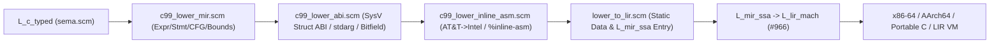

# [FEAT/ENH] C99 フロントエンド lower_to_lir.scm（5,009行）の責務別パス分割（MIR 生成・SysV ABI 展開・Inline Asm 正規化） (ID: 967)

## 1. 概要 / Summary

### 現状の課題

現在、C99 フロントエンドの中核である [lower_to_lir.scm](../../../ulisp/frontend_c/lower_to_lir.scm)（**5,009 行**, Sections 1〜10）が単一ファイルへ肥大化しており、以下に示す性質の異なる 4 つの責務が密結合していた（関連: [sema.scm](../../../ulisp/frontend_c/sema.scm) 2,967 行）。

1. **MIR / 制御フロー・式／文・左辺値・Sanitizer 生成**: コンテキスト管理 (`<c99-lower-ctx>`)、定数・型幅・直接レジスタ評価、単一評価左辺値アドレス解決、`--sanitize-bounds` 境界／NULL／UAF 検査、式／文 Lowering、および Braun SSA 変換 (`c99-lir-fn->braun-cfg`, `c99-braun-ssa-transform-fn`)。
2. **SysV AMD64 構造体 ABI・`<stdarg.h>`・ビットフィールド展開**: ビットフィールド読書き、8 バイト単位レジスタ分割 (`INTEGER` / `SSE` / `MEMORY` 隠れ `sret`)、可変長引数 `%al` 計算、`va_start` / `va_arg` / `va_copy`（176 バイト `reg_save_area` 走査）、関数プロローグ／エピローグ。
3. **インライン／トップレベルアセンブリ変換**: AT&T → Intel 構文変換 (`c99-att-asm->intel-asm`)、幅修飾子 (`%b`/`%w`/`%k`/`%q`)、メモリ制約・スクラッチレジスタプール割当 (`%c99-lower-inline-asm!`)。
4. **静的グローバルデータ直列化とトップレベルオーケストレーション**: `.data` / `.bss` / リロケーション出力と [Issue #966](966-separate-mir-ssa-and-machine-lir-for-unified-middle-end.md) で確立した `L_mir_ssa` / `L_lir_mach` 境界への接続。

### 目的と 4 モジュール分割設計

本 Issue では `lower_to_lir.scm`（5,009 行）を責務別 4 ファイル（＋独立パスエントリポイント）へ分割し、`L_mir_ssa` 合流と保守性・増分ビルド性・AOT モジュール並列コンパイル性を両立させた。

| ファイル | 分割後規模 | 担当セクション（旧 `lower_to_lir.scm`） | 主な公開 API / パス |
| --- | ---: | --- | --- |
| [c99_lower_mir.scm](../../../ulisp/frontend_c/c99_lower_mir.scm) | **3,034 行** | Sections 1, 2, 4, 5, 7, 8, 8.1, 8.2 | `make-c99-lower-ctx`, `%c99-lower-expr!`, `%c99-lower-stmt!`, `c99-braun-ssa-transform-fn`, `c99-lower-mir-unit`, `c99-lower-mir-run` |
| [c99_lower_abi.scm](../../../ulisp/frontend_c/c99_lower_abi.scm) | **840 行** | Sections 3, 6, 6b, 8.3 | `%c99-lower-load-bitfield!`, `%c99-lower-call!`, `%c99-lower-va-arg!`, `%c99-lower-function`, `c99-lower-abi-fn`, `c99-lower-abi-run` |
| [c99_lower_inline_asm.scm](../../../ulisp/frontend_c/c99_lower_inline_asm.scm) | **693 行** | Section 8.0, 8.0b | `c99-att-asm->intel-asm`, `%c99-lower-inline-asm!`, `c99-lower-inline-asm-ir` |
| [lower_to_lir.scm](../../../ulisp/frontend_c/lower_to_lir.scm) | **572 行** | Sections 9, 10 | `%c99-eval-static-val`, `c99-lower-to-mir-ssa`, `c99-compile-string-to-mir-ssa`, `c99-lower-to-lir`, `c99-compile-string-to-lir` |

---

## 2. トレーサビリティ & 16 エージェント合議 / Traceability & Governance

- 関連資料:
  - [Issue #966](966-separate-mir-ssa-and-machine-lir-for-unified-middle-end.md)（`L_mir_ssa` / `L_lir_mach` 2 層分離と共通ミドルエンド統合）
  - [Issue #916](916-implement-c99-sema-core-and-integer-subset-lir-lowering.md)（C99 Sema コア・整数サブセット LIR Lowering）
  - [Issue #918](918-implement-c99-struct-union-enum-bitfield-sysv-layout.md)（C99 構造体・共用体・ビットフィールド・SysV Aggregate ABI）
  - [Issue #920](920-implement-c99-function-pointers-and-switch-goto-cfg-lowering.md)（関数ポインタ・間接呼出・Switch/Goto CFG）
  - [Issue #921](921-implement-sysv-amd64-stdarg-va-list-lowering.md)（`<stdarg.h>`・`va_list` Lowering）
  - [Issue #973](../973-implement-ssa-sccp-gvn-adce-and-decompose-lir-peephole.md)（後続: `L_mir_ssa` 上の SCCP / SSA-GVN / ADCE）
  - [Issue #981](../981-unify-lir-core-fixpoint-optimization-for-scheme-and-c99.md)（後続: 共通ミドルエンド不動点最適化統合）
  - [c_driver.scm](../../../ulisp/driver/c_driver.scm)
  - [pass_manager.scm](../../../ulisp/compiler/pass_manager.scm)

### 16 エージェント多角的レビュー要点
- **SA / PLC**: C99 Lowering のロード順（`c99_lower_mir.scm` → `c99_lower_abi.scm` → `c99_lower_inline_asm.scm` → `lower_to_lir.scm`）とフック変数 (`*c99-lower-mir-hook*` / `*c99-lower-abi-hook*` / `*c99-lower-inline-asm-hook*`) を整理し、ULisp AOT 自己ホスト制約（ローカル `set!` / 内部 `define` / 可変長 lambda 禁止）を全分割ファイルで厳守した。
- **ISS / Embedded Systems**: `--sanitize-bounds`・`%inline-asm`（`THREAT-838-1..3`）および `setjmp`（`returns_twice`）抑止ガードが分割境界で欠落しないことを検証した。
- **IT Service Manager / SWD**: [Makefile](../../../ulisp/Makefile) の `C99_FRONTEND_SOURCES`、`lint_sexpr` および各 `test_c99_*` 個別ターゲットが全 4 ファイルを漏れなく参照・検証する構成を更新した。

---

## 3. 脅威モデリングと安全性不変条件 / Threat Modeling & Safety Invariants

1. **THREAT-967-1: SysV AMD64 ABI レジスタ分類・`va_arg` 退避領域不整合 (CWE-682 / CWE-119)**
   - **リスク**: 構造体値渡し (`sret` / 16B 超 `MEMORY`)、8 バイト境界オフセット計算、可変長呼出時の `%al`、`va_list` の `reg_save_area`（176 バイト）オフセット計算が分割時に食い違うと ABI 破壊が生じる。
   - **対策**: [c99_lower_abi.scm](../../../ulisp/frontend_c/c99_lower_abi.scm) に関数プロローグ／エピローグ・呼出・`<stdarg.h>`・ビットフィールドを集約し、`test_c99_struct_union_layout` / `test_c99_stdarg` / `test_sse2_xmm_abi` 全件で GCC Oracle パリティを検証した。
2. **THREAT-967-2: `%inline-asm` 構文・制約破壊と `%rsp` 保護違反 (CWE-704 / THREAT-838-1..3)**
   - **リスク**: AT&T → Intel 変換・幅修飾子変換・メモリ制約レジスタ割当のヘルパーが分割で不整合になると不正命令や `%rsp` 誤破壊を招く。
   - **対策**: [c99_lower_inline_asm.scm](../../../ulisp/frontend_c/c99_lower_inline_asm.scm) に Section 8.0 を一括抽出し、`c99-att-asm->intel-asm`・`%c99-lower-inline-asm!`・`c99-lower-inline-asm-ir` を配置し、`test_c99_gnu_ext` / `test_inline_asm` の全合格を確認した。
3. **THREAT-967-3: 単一評価左辺値・`--sanitize-bounds` トラップ検査の欠落 (CWE-125 / CWE-787)**
   - **リスク**: 左辺値アドレス計算（`%c99-lower-lvalue-addr!`）と境界／NULL／UAF 検査（`%c99-san-*`）が式 Lowering と乖離すると二重評価やメモリ破壊見逃しが発生する。
   - **対策**: [c99_lower_mir.scm](../../../ulisp/frontend_c/c99_lower_mir.scm) に `<c99-lower-ctx>`・`%c99-san-*`・左辺値・式／文 Lowering を同一モジュールで維持し、`test_c99_pointers_and_escape` / `test_c99_bounds_sanitizer` で検証した。
4. **THREAT-967-4: `setjmp` (`returns_twice`) 関数に対する不安全 mem2reg 昇格 (CWE-682)**
   - **対策**: `c99-fn-has-setjmp?` と `braun-cfg-has-returns-twice?` を [c99_lower_mir.scm](../../../ulisp/frontend_c/c99_lower_mir.scm) 側 CFG 変換に保持し、`test_c99_setjmp_longjmp` で検証した。

---

## 4. 影響範囲と関連ファイル / Scope and Affected Files

- [x] [c99_lower_abi.scm](../../../ulisp/frontend_c/c99_lower_abi.scm)（新規 840 行: Bit-field / SysV ABI 呼出・返却・`<stdarg.h>`・関数プロローグ/エピローグ・`c99-lower-abi-run`）
- [x] [c99_lower_inline_asm.scm](../../../ulisp/frontend_c/c99_lower_inline_asm.scm)（新規 693 行: AT&T → Intel 変換・`%inline-asm` 制約正規化・`c99-lower-inline-asm-ir`）
- [x] [c99_lower_mir.scm](../../../ulisp/frontend_c/c99_lower_mir.scm)（新規 3,034 行: Lowering コンテキスト・スカラ/左辺値/Sanitizer/式/文/CFG・Braun SSA 生成・`c99-lower-mir-run`）
- [x] [lower_to_lir.scm](../../../ulisp/frontend_c/lower_to_lir.scm)（Section 9 静的データ初期化・Section 10 `c99-lower-to-mir-ssa` / `c99-compile-string-to-mir-ssa` / `c99-lower-to-lir` オーケストレーション 572 行へ縮減）
- [x] [pass_manager.scm](../../../ulisp/compiler/pass_manager.scm)（`c99-fe` カテゴリで `pass-c99-lower-mir` / `pass-c99-lower-abi` / `pass-c99-lower-inline-asm` と `*c99-lower-*-hook*` を登録、`build-pipeline` フィルタ更新）
- [x] [module_header.scm](../../../ulisp/compiler/module_header.scm) & [c_driver_module_header.scm](../../../ulisp/compiler/c_driver_module_header.scm)（新規フック・パス関数・`L_mir_ssa` エントリシンボルをエクスポート）
- [x] [lir_interpreter.scm](../../../ulisp/vm/lir_interpreter.scm)（ネイティブ AOT `bin/ulisp-cc` リンク時に露呈した静的定数ロード部 `ca-tbl` 未束縛バグ修正）
- [x] [Makefile](../../../ulisp/Makefile)（`C99_FRONTEND_SOURCES`、`lint_sexpr`、および個別 `test_c99_*` 依存・リントリスト更新）
- [x] [test_pass_manager.scm](../../../ulisp/tests/test_pass_manager.scm) & [test_c99_int_lowering.scm](../../../ulisp/tests/test_c99_int_lowering.scm)（分割パス登録契約 `12.24`–`12.33` および `c99-lower-to-mir-ssa` / `c99-lower-inline-asm-ir` テスト `6.6a`–`6.6k` 追加）

---

## 5. 実装方針 / Implementation Plan

Target Branch: `refactor/967-split-c99-lower-to-lir`

### Phase 1: `c99_lower_abi.scm` と `c99_lower_inline_asm.scm` の抽出
1. [c99_lower_inline_asm.scm](../../../ulisp/frontend_c/c99_lower_inline_asm.scm) の作成と冪等 IR 正規化パス `c99-lower-inline-asm-ir` の実装。
2. [c99_lower_abi.scm](../../../ulisp/frontend_c/c99_lower_abi.scm) の作成（Bit-field・SysV ABI・`<stdarg.h>`・`%c99-lower-function`・`c99-lower-abi-fn`・`c99-lower-abi-run`）。

### Phase 2: `c99_lower_mir.scm` の抽出と `lower_to_lir.scm` のスリム化
1. [c99_lower_mir.scm](../../../ulisp/frontend_c/c99_lower_mir.scm) の作成（`<c99-lower-ctx>`・Sanitizer・単一評価左辺値・式/文/Switch・Escape/Braun SSA CFG・`c99-lower-mir-unit`・`c99-lower-mir-run`）。
2. [lower_to_lir.scm](../../../ulisp/frontend_c/lower_to_lir.scm) の 572 行化（Section 9 静的データ直列化と Section 10 `c99-lower-to-lir` / `c99-lower-to-mir-ssa` / `c99-compile-string-to-mir-ssa`）。

### Phase 3: Build・Pass Manager・Module Header 統合
1. [Makefile](../../../ulisp/Makefile) の `C99_FRONTEND_SOURCES`、`lint_sexpr` および各 `test_c99_*` 更新。
2. [pass_manager.scm](../../../ulisp/compiler/pass_manager.scm)・[module_header.scm](../../../ulisp/compiler/module_header.scm)・[c_driver_module_header.scm](../../../ulisp/compiler/c_driver_module_header.scm) 更新。

### Phase 4: テスト拡充・全 C99 スイート・3-Stage Bootstrap 検証
1. [test_pass_manager.scm](../../../ulisp/tests/test_pass_manager.scm) へ `12.24`–`12.33` 追加。
2. [test_c99_int_lowering.scm](../../../ulisp/tests/test_c99_int_lowering.scm) へ `6.6a`–`6.6k` 追加。

---

## 6. 完了条件 / Success Criteria (DoD)

- [x] `lower_to_lir.scm`（旧 5,009 行）が `c99_lower_mir.scm` (3,034 行) / `c99_lower_abi.scm` (840 行) / `c99_lower_inline_asm.scm` (693 行) / `lower_to_lir.scm` (572 行 < 700 行) の 4 ファイルへ責務分離され、`lint_sexpr` エラー 0 件であること。
- [x] `pass_manager.scm` に 3 つの C99 分割パスが登録され、`c99-lower-to-mir-ssa` が `validate-mir-ssa` を通過する `L_mir_ssa` を生成すること。
- [x] 全 C99 テストスイート（`test_c99_int_lowering`, `test_c99_struct_union_layout`, `test_c99_pointers_and_escape`, `test_c99_funcptr_and_switch_cfg`, `test_c99_stdarg`, `test_c99_setjmp_longjmp`, `test_c99_bounds_sanitizer`, `test_c99_lir_vm_checked`, `test_c99_floating_point`, `test_sse2_xmm_abi`, `test_c99_gnu_ext`, `test_c99_e2e`, `test_c99_lua_idioms`, `test_c99_pch_opt`, `ulisp-cc`）が全 PASS すること。
- [x] `make -C ulisp test_passes test_pass_manager test_lir_dialect_separation bootstrap` で Stage 2 == Stage 3 不動点（ビット完全一致）を維持すること。
- [x] `make check_format` / `make static_analysis` / `make py_compile` および品質ゲート（相対リンクのみ・絶対パス 0 件）が全 PASS すること。

---

## 7. 検証結果 / Verification Results

- **ファイル規模と括弧整合**: `c99_lower_mir.scm` 3,034 行、`c99_lower_abi.scm` 840 行、`c99_lower_inline_asm.scm` 693 行、`lower_to_lir.scm` 572 行。`make -C ulisp lint_sexpr` で 285 ファイル全件エラー 0 件。
- **コンパイラコア & Pass Manager**: `make -C ulisp test_pass_manager`（159 passed）、`test_lir_dialect_separation`（ALL TESTS PASSED）、`test_passes`（全 34 スイート + Nanopass 157 passed）、3段階モジュラー `bootstrap`（5 モジュールすべて Stage 2 == Stage 3 ビット完全一致）。
- **C99 全スイート & ネイティブドライバ**: `test_c99_int_lowering`（72 passed）、`test_c99_struct_union_layout`（89 passed + GCC Oracle）、`test_c99_pointers_and_escape`、`test_c99_funcptr_and_switch_cfg`、`test_c99_stdarg`、`test_c99_setjmp_longjmp`、`test_c99_bounds_sanitizer`、`test_c99_lir_vm_checked`、`test_c99_floating_point`、`test_sse2_xmm_abi`、`test_c99_gnu_ext`、`test_c99_e2e`、`test_c99_lua_idioms`、`test_c99_pch_opt`、`test_c_ddc_unit`、`test_inline_asm`（38/38 passed）、`test_fuzz_xmm_float`（120/120 4-way oracle match, `a61b20bb4606d461`）、および `make -C ulisp ulisp-cc test_ulisp_cc_native`（Lua 5.4.7 33 TU SHA-256 ビット完全一致、Pass 144 static `lua` 一致、FUZZ_COUNT=500 & 速度 >= 5x）全 PASS。
- **品質ゲート & Python 検証**: `make py_compile check_format static_analysis`（`mypy --strict` 618 ファイル 0 件、`xenon`/`isort`/`black`/`ruff` PASS）、`PYTHONPATH=. .venv/bin/pytest tests/alisp/ ulisp/tests/test_lint_sexpr.py -q`（254 passed）。
