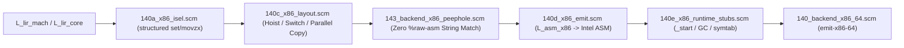

# [FEAT/ENH] x86-64 バックエンド 140_backend_x86_64.scm（4,177行）のモジュール分割と 143 ピープホールの %raw-asm 文字列依存解消 (ID: 968)

## 1. 概要 / Summary

### 現状の課題

従来、x86-64 バックエンドの中核である [140_backend_x86_64.scm](../../../ulisp/backend/140_backend_x86_64.scm)（旧 **4,177 行**）に、以下の性質の異なる 5 つの責務が単一ファイルへ混在していた。

1. **命令選択 (Stage 1: LIR -> `L_asm_x86` AST)**: 出力シンク・レジスタ／オペランド文字列化とキャッシュ (`reg->str`, `reg8->str`, `reg16->str`, `reg32->str`, `operand->str`)、`lower-lir-reg` / `lower-lir-opnd`、命令選択 (`lower-lir-instruction`, `lower-lir-inline-asm`)。
2. **ブロック配置・C-TU フレーム巻き上げ・Switch テーブル生成**: SSA `%block` パラレルコピー (`scan-x86-blocks!`, `select-x86-parallel-copy`)、C-TU スタック巻き上げ (`c-tu-analyze-hoist-frame`, `x86-call-frame-adjustments`)、`%switch` ジャンプテーブル／二分探索木 (`x86-switch-emit-bst`, `emit-x86-switch-jump-tables!`)、関数／プログラム単位選択 (`select-instructions-function`, `select-instructions-main`, `select-instructions-x86`)。
3. **アセンブリテキスト出力 (Stage 2: `L_asm_x86` AST -> GNU Intel Syntax)**: `emit-x86-asm-inst`、`emit-x86-function`、`emit-x86-asm-function`、`emit-c-tu-x86-asm-program`（`.rodata` / `.data` / `.bss` / `weak` / `aliases`）。
4. **Freestanding 起動・ランタイム・GC スタブ生成**: `_start` / `scheme_entry` / モジュール初期化、環境変数判定 (`ULISP_GC_PROFILE`, `ULISP_COMPILER_ARENA_MB`)、スタックマップ・シンボルテーブル出力、`ulisp_safepoint_slow_trampoline`、`emit-gc-stats-printer` (`emit-x86-asm-program`)。
5. **Pass 140 トップレベルオーケストレーション**: `emit-x86-64`、`emit-x86-64-profiled`。

さらに、[143_backend_x86_peephole.scm](../../../ulisp/backend/143_backend_x86_peephole.scm) のピープホール最適化規則（`x86-asm-reads-flags?`, `rule-x86-overflow-branch-fuse`, `rule-x86-and-cmp-zero-branch-fuse`）が、`(set cc opnd)` / `(movzx dst src)` の代わりに `(%raw-asm "    seto dl")`・`(%raw-asm "    movzx rdx, dl")`・`(%raw-asm "    sete al")` 等の**空白を含む生アセンブリ文字列一致**に依存しており、空白やレジスタ名変更に脆弱であった。

### 目的と 5 モジュール分割＋構造化 AST 統一設計

本 Issue では `140_backend_x86_64.scm`（旧 4,177 行）を責務別 5 ファイルへ分割し、同時に [backend_lang.scm](../../../ulisp/backend/backend_lang.scm) の `L_asm_x86` 定義と Pass 140/143 の構造化命令生成・マッチングを統一して `%raw-asm` 文字列依存を撤廃した。

| ファイル | 分割後規模 | 主なシンボル / 内容 |
| --- | ---: | --- |
| [140a_x86_isel.scm](../../../ulisp/backend/140a_x86_isel.scm) | **1,876 行** | 状態変数定義・`*emit-line-sink*`, `reg->str`/`reg8->str`/`reg32->str`, `lower-lir-reg`, `lower-lir-reg8`, `canonical-x86-set-cc`, `lower-lir-opnd`, `lower-lir-instruction`（構造化 `set`/`movzx` 発行）, `lower-lir-inline-asm` |
| [140c_x86_layout.scm](../../../ulisp/backend/140c_x86_layout.scm) | **748 行** | `c-tu-analyze-hoist-frame`, `x86-hoist-*`, `x86-switch-*`, `select-x86-parallel-copy`, `select-instructions-function`, `select-instructions-main`, `select-instructions-x86` |
| [140d_x86_emit.scm](../../../ulisp/backend/140d_x86_emit.scm) | **507 行** | `x86-extract-imm-int`, `emit-x86-asm-inst`, `emit-lir-instruction`, `emit-x86-function`, `emit-x86-asm-function`, `emit-c-tu-x86-asm-program` |
| [140e_x86_runtime_stubs.scm](../../../ulisp/backend/140e_x86_runtime_stubs.scm) | **1,086 行** | `emit-x86-asm-program`（`_start`, `scheme_entry`, TLS, mmap, symtab, BSS, safepoint/gc-stats stubs）, `emit-gc-stats-printer` |
| [140_backend_x86_64.scm](../../../ulisp/backend/140_backend_x86_64.scm) | **35 行** | `emit-x86-64`, `emit-x86-64-profiled` |

---

## 2. トレーサビリティ & 16 エージェント合議 / Traceability & Governance

- 関連資料:
  - [Issue #955](955-fuse-overflow-branch-to-jo-and-fold-constant-tag-checks.md)（オーバーフロー分岐融合・定数タグ検査畳み込み）
  - [Issue #960](960-eliminate-unreferenced-functions-via-reachability-or-gc-sections.md)（関数毎セクション・`SHF_GNU_RETAIN` メタデータ分離）
  - [Issue #961](961-introduce-linear-scan-register-allocation-for-scheme-lir.md)（Linear Scan レジスタ割付と RFLAGS 保護）
  - [Issue #967](967-split-c99-lower-to-lir-into-modular-nanopasses.md)（前段例: `lower_to_lir.scm` の 4 モジュール分割）
  - [backend_lang.scm](../../../ulisp/backend/backend_lang.scm)
  - [140_backend_x86_64.scm](../../../ulisp/backend/140_backend_x86_64.scm)
  - [143_backend_x86_peephole.scm](../../../ulisp/backend/143_backend_x86_peephole.scm)
  - [150_backend_aarch64.scm](../../../ulisp/backend/150_backend_aarch64.scm)（比較対象: AArch64 側は既に構造化 `cset`/`b.cc` のみを使用）
  - [compiler_entry.scm](../../../ulisp/compiler_entry.scm) & [Makefile](../../../ulisp/Makefile)

### 16 エージェント多角的レビュー要点
- **SA / PLC**: `140a`〜`140e` + `140` の連結・インクルード順とグローバル状態変数（`*emit-line-sink*`, `*backend-gc-mode*`, `*x86-c-tu-hoist-frame*`, `*x86-switch-jump-tables*` 等）の定義位置を [140a_x86_isel.scm](../../../ulisp/backend/140a_x86_isel.scm) 先頭に統一し、ローカル `set!`・内部 `define` 禁止の ULisp AOT 制約を維持した。
- **SWD / SQA**: `L_asm_x86` の `Register` 終端集合へ 8-bit レジスタ (`al bl cl dl sil dil bpl spl r8b..r15b`) および 32-bit レジスタ (`eax ebx ecx edx esi edi ebp esp r8d..r15d`) を正式登録し、`L_asm_x86?` スキーマ検証を 100% 維持した。また [module_header.scm](../../../ulisp/compiler/module_header.scm) と [c_driver_module_header.scm](../../../ulisp/compiler/c_driver_module_header.scm) に `lower-lir-reg8`, `canonical-x86-set-cc`, `x86-reg8->reg64`, `x86-set-overflow-cc?`, `x86-set-eq-ne-cc?` をエクスポートした。
- **ISS / IT Service Manager**: [Makefile](../../../ulisp/Makefile) の `BACKEND_PASSES`・各 `lint_sexpr.py` リストおよび [compiler_entry.scm](../../../ulisp/compiler_entry.scm) を漏れなく更新し、3 段階モジュラーブートストラップ不動点とネイティブ `ulisp-cc` SHA-256 パリティを維持した。

---

## 3. 脅威モデリングと安全性不変条件 / Threat Modeling & Safety Invariants

1. **THREAT-968-1: RFLAGS 生存区間の誤破壊 (CWE-682)**
   - **リスク**: `x86-asm-reads-flags?` が `(%raw-asm "    set...")` や `set` / `jcc` を取りこぼすと、`rule-x86-zero-xor`・`rule-x86-lea-optimize`・`rule-x86-lea-add-fold` が RFLAGS を破壊し、比較結果やオーバーフロー判定が狂う。
   - **対策**: Pass 140 が発行する条件セットをすべて構造化 `(set cc r8)` へ統一し、`x86-asm-reads-flags?` は `(and (pair? inst) (memq (car inst) '(jcc set)))` へ単純化（`143_backend_x86_peephole.scm` 内の `%raw-asm` 記述 0 件）。`test_143_backend_x86_peephole`（39 passed）および `test_bignum`（161 passed）で検証した。
2. **THREAT-968-2: 8-bit / 32-bit レジスタ幅とゼロ拡張の取り違え (CWE-704 / CWE-190)**
   - **リスク**: `(set o r8)` + `(movzx dst r8)` に構造化する際、64-bit 名 (`rdx`) と 8-bit 名 (`dl`) や `(movzx eax al)` が食い違うと上位ビット汚染やアセンブラエラーを起こす。
   - **対策**: `lower-lir-reg8`・`x86-reg8->reg64`・`canonical-x86-set-cc` と `emit-x86-asm-inst` の `(movzx ...)` / `(set ...)` を厳密一致させ、`test_140_backend_x86_64`（66 passed）・`test_143_backend_x86_peephole`（39 passed）・`test_builtin_as`（6/6 passed）で機械語生成パリティを確認した。
3. **THREAT-968-3: 分割ファイル間のセクション復帰漏れおよび C-TU フレーム状態破損 (CWE-665)**
   - **リスク**: `.text.<fn>` や `*x86-c-tu-hoist-frame*` が `140c` / `140d` / `140e` にまたがる際、状態リセット順序や `.text` 復帰がズレると `--gc-sections` で誤削除や不正オフセットが発生する。
   - **対策**: `test_c99_e2e`（14/14）、`ulisp-cc`（Lua 5.4.7 33 TU SHA-256 パリティ＆`all.lua` 完走）、および 3 段階モジュラー `bootstrap` で不変性を確認した。

---

## 4. 影響範囲と関連ファイル / Scope and Affected Files

- [x] [backend_lang.scm](../../../ulisp/backend/backend_lang.scm)（`L_asm_x86` の `Register` 定義へ 8-bit/32-bit サブレジスタ追加）
- [x] [140a_x86_isel.scm](../../../ulisp/backend/140a_x86_isel.scm)（新規 1,876 行: 出力基盤・状態変数・レジスタ変換・Stage 1 命令選択 + 構造化 `set`/`movzx` 発行）
- [x] [140c_x86_layout.scm](../../../ulisp/backend/140c_x86_layout.scm)（新規 748 行: C-TU フレーム巻き上げ・`%switch` 配置・SSA パラレルコピー・`select-instructions-*`）
- [x] [140d_x86_emit.scm](../../../ulisp/backend/140d_x86_emit.scm)（新規 507 行: Stage 2 `L_asm_x86` AST -> GNU Intel アセンブリ出力・C-TU `.rodata`/`.data`/`.bss` 出力）
- [x] [140e_x86_runtime_stubs.scm](../../../ulisp/backend/140e_x86_runtime_stubs.scm)（新規 1,086 行: `_start` / `scheme_entry` / Freestanding GC 初期化・サフポイント＆統計出力ルーチン）
- [x] [140_backend_x86_64.scm](../../../ulisp/backend/140_backend_x86_64.scm)（`emit-x86-64`, `emit-x86-64-profiled` トップレベル 35 行へ縮減）
- [x] [143_backend_x86_peephole.scm](../../../ulisp/backend/143_backend_x86_peephole.scm)（`rule-x86-overflow-branch-fuse`, `rule-x86-and-cmp-zero-branch-fuse`, `x86-asm-reads-flags?` の `%raw-asm` 文字列マッチ撤廃、構造化 `(set ...)`/`(movzx ...)` 対応、`%raw-asm` 0 件化）
- [x] [module_header.scm](../../../ulisp/compiler/module_header.scm) & [c_driver_module_header.scm](../../../ulisp/compiler/c_driver_module_header.scm)（新規ヘルパーシンボルをモジュールヘッダへ公開）
- [x] [Makefile](../../../ulisp/Makefile) & [compiler_entry.scm](../../../ulisp/compiler_entry.scm)（`BACKEND_PASSES`・`lint_sexpr`・個別ターゲットのファイル一覧更新）
- [x] [test_140_backend_x86_64.scm](../../../ulisp/tests/passes/test_140_backend_x86_64.scm), [test_143_backend_x86_peephole.scm](../../../ulisp/tests/passes/test_143_backend_x86_peephole.scm), [test_lir_overflow_and_unsigned.scm](../../../ulisp/tests/test_lir_overflow_and_unsigned.scm)（構造化 `set`/`movzx` 検証・ピープホール任意レジスタ融合テスト追加、および C バックエンド `%shr` 括弧表現との整合修正）

---

## 5. 実装方針 / Implementation Plan

Target Branch: `refactor/968-split-x86-64-backend`

### Phase 1: `backend_lang.scm` の `L_asm_x86` 拡張と構造化 `set` / `movzx` 命令正規化
1. **[backend_lang.scm](../../../ulisp/backend/backend_lang.scm)**:
   - `L_asm_x86` の `(Register (reg) ...)` に 8-bit レジスタ (`al bl cl dl sil dil bpl spl r8b..r15b`) および 32-bit レジスタ (`eax ebx ecx edx esi edi ebp esp r8d..r15d`) を追加。
2. **構造化 `set` / `movzx` 発行**:
   - Stage 1 (`lower-lir-instruction`) で `%atomic-cas!`, `%add-overflow`, `%sub-overflow`, `%mul-overflow`, `%setb`..`%setae`, `%set-boolean` を構造化 `(list 'set ...)` / `(list 'movzx ...)` として生成。

### Phase 2: `143_backend_x86_peephole.scm` の `%raw-asm` 文字列依存完全解消
1. **[143_backend_x86_peephole.scm](../../../ulisp/backend/143_backend_x86_peephole.scm)**:
   - `x86-asm-reg?` の 8-bit/32-bit 対応、`x86-reg8->reg64`, `x86-set-overflow-cc?`, `x86-set-eq-ne-cc?` 追加。
   - `x86-asm-reads-flags?`, `rule-x86-overflow-branch-fuse`, `rule-x86-and-cmp-zero-branch-fuse` から `%raw-asm` 文字列照合を完全撤廃（0 件）。

### Phase 3: `140_backend_x86_64.scm`（4,177 行）の 5 モジュール分割とビルド統合
1. `140a_x86_isel.scm` (1,876 行), `140c_x86_layout.scm` (748 行), `140d_x86_emit.scm` (507 行), `140e_x86_runtime_stubs.scm` (1,086 行), `140_backend_x86_64.scm` (35 行) へ分割。
2. `Makefile`, `compiler_entry.scm`, `module_header.scm`, `c_driver_module_header.scm` を更新。

### Phase 4: テスト更新・全スイート & 3-Stage Bootstrap 検証
1. `test_143_backend_x86_peephole.scm` の Test 16/17 更新および Test 19（`al`/`rax` 汎用レジスタ融合）追加。
2. `test_140_backend_x86_64.scm` に Test 13 (`13.1`–`13.6`)、および `test_lir_overflow_and_unsigned.scm` に構造化 AST 検証と Group 5 C バックエンド `%shr` 括弧整合修正を反映し、全スイート・3-Stage Bootstrap を検証。

---

## 6. 完了条件 / Success Criteria (DoD)

- [x] `140_backend_x86_64.scm`（旧 4,177 行）が `140a_x86_isel.scm` / `140c_x86_layout.scm` / `140d_x86_emit.scm` / `140e_x86_runtime_stubs.scm` / `140_backend_x86_64.scm`（35 行 < 100 行）の 5 ファイルへ責務分離され、`lint_sexpr` エラー 0 件であること。
- [x] `backend_lang.scm` の `L_asm_x86` が 8-bit/32-bit サブレジスタ上の `set` / `movzx` 命令を許容し、`143_backend_x86_peephole.scm` 内の `%raw-asm` 記述が 0 件であること。
- [x] `make -C ulisp test_passes test_pass_manager test_lir_dialect_separation test_lir_overflow_and_unsigned test_elf64 test_backend test_builtin_as test_builtin_ld test_bignum test_ieee754 test_c99_int_lowering test_c99_e2e ulisp-cc test_ulisp_cc_native bootstrap` が全 PASS すること。
- [x] `make check_format` / `make static_analysis` / `make py_compile` / `pytest` および相対パスリンク規則が全 PASS すること。

---

## 7. 検証結果 / Verification Results

- **モジュール規模と括弧整合**: `140a_x86_isel.scm` 1,876 行、`140c_x86_layout.scm` 748 行、`140d_x86_emit.scm` 507 行、`140e_x86_runtime_stubs.scm` 1,086 行、`140_backend_x86_64.scm` 35 行（100 行未満）。`make -C ulisp lint_sexpr` で 289 ファイル全件括弧整合 PASS。`grep -c '%raw-asm' ulisp/backend/143_backend_x86_peephole.scm` = `0`。
- **LIR / Pass スイート**:
  - `make -C ulisp test_passes`: 全 39 スイート PASS（Pass 140: 66 passed、Pass 141: 20 passed、Pass 142: 8 passed、Pass 143: 39 passed 等、コンパイラパス計 943 passed ＋ Nanopass/External Symbols 全 PASS）
  - `make -C ulisp test_pass_manager`: PASS
  - `make -C ulisp test_lir_dialect_separation`: `ALL TESTS PASSED!`
  - `make -C ulisp test_lir_overflow_and_unsigned`: 78 passed（ALL PASS）
- **x86-64 / ELF / ランタイム / C99 / 3-Stage Bootstrap**:
  - `make -C ulisp bootstrap`: 5 モジュールすべて Stage 2 == Stage 3 ビット完全一致、Stage 3 スモークテスト (`42`) PASS、ローカルシード `ulisp/bin/ulisp-boot` 更新
  - `make -C ulisp test_elf64 test_backend`: ELF64 binary (4,516 bytes) & Direct LIR backend suite 3/3 passed
  - `make -C ulisp test_builtin_as test_builtin_ld test_bignum test_ieee754`: `test_builtin_as` 6/6 passed、`test_builtin_ld` 9/9 passed、`bignum` 161 passed、`ieee754` 44 passed
  - `make -C ulisp test_c99_int_lowering test_c99_e2e`: `test_c99_int_lowering` 72 passed、`test_c99_e2e`（ドライバ 47 passed + E2E 14/14 PASS）
  - `make -C ulisp ulisp-cc test_ulisp_cc_native`: Pass 144 static linker 31 passed、FP shell oracle 17/17、SSE2 XMM ABI 9/9、Fuzz 120/120、`Lua 5.4.7` 33 TU SHA-256 パリティ ＆ 公式 `all.lua`/`big.lua` 完走、FUZZ_COUNT=500 (28.56x) / Lua 33 TUs (9.87x) 全 PASS
- **Python テスト & 品質ゲート**:
  - `PYTHONPATH=. .venv/bin/pytest tests/alisp/ ulisp/tests/test_lint_sexpr.py -q`: 254 passed in 0.52s
  - `make py_compile check_format static_analysis`: `xenon` / `isort` / `black` / `ruff` / `mypy --strict`（618 files, 0 issues）全 PASS
