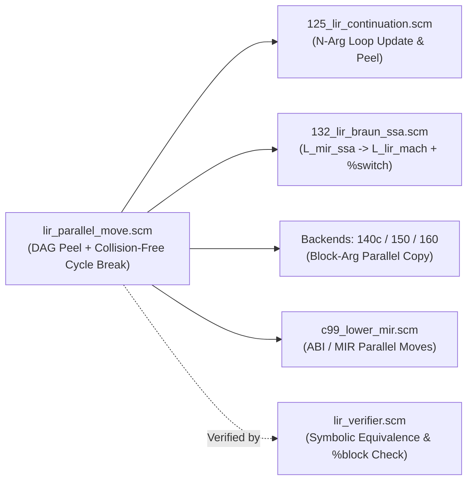

# [FEAT/ENH] 汎用 Parallel Move Resolver（並列コピー解析・トポロジカルシャッフル）の実装と SSA 解除・継続化ループ更新の統合 (ID: 969)

## 1. 概要 / Summary

### 現状の課題

従来、リポジトリ内の LIR／ミドルエンド／バックエンド／C99 フロントエンドの 4 箇所に、不完全または重複した並列コピー（Parallel Move）展開ロジックが分散していた。

1. **[125_lir_continuation.scm](../../../ulisp/lir/125_lir_continuation.scm)** (`lir-compile-in-place-cont-call`):
   - `(= num-args 2)` 専用の Case 1〜4 手動シャッフル分岐と `(= num-args 1)` 専用分岐、さらに `>= 3` 引数では**全引数を無条件に一時スタックスロットへ退避→再ロード**するナイーブなフォールバックに分断されていた。
   - このため、3 引数以上の純粋な順列（例: `(loop b c a)`）や依存 DAG 更新（例: `(loop (+ i 1) (+ acc i) (+ total acc))`）でもレジスタ間インプレース更新が行われず、不要なスタックメモリアクセスが発生していた。
2. **[132_lir_braun_ssa.scm](../../../ulisp/lir/132_lir_braun_ssa.scm)** (`%mir-emit-move` / `%mir-emit-parallel-moves`, `%mir-lower-inst`):
   - 閉路切断用スクラッチに `%r11`、スタック間コピー用スクラッチに `%r10` を固定ハードコードしており、`dsts` または `srcs` に `%r10` / `%r11` が含まれる場合に生存値を破壊するリスクがあった。
   - 浮動小数点（FPR: `%xmm0`..`%xmm15`）に対して整数命令 `%mov` / `%load` / `%store` を発行しており、`%fmov` / `%load-typed f64` / `%store-typed f64` に対応していなかった。また `%mir-analyze-body` の `add-vreg!` が `(%block lbl (p q) ...)` の untyped パラメータを `'gpr` 固定していたため、`(%freg p)` 使用時も FPR 昇格しない不具合があった。
   - `%mir-lower-inst` に `%switch`（5 引数形式のデフォルト／ケースブロック引数）の並列コピー展開が欠落していた。
3. **バックエンド 3 種のブロック引数コピー** ([140c_x86_layout.scm](../../../ulisp/backend/140c_x86_layout.scm) `select-x86-parallel-copy`、[150_backend_aarch64.scm](../../../ulisp/backend/150_backend_aarch64.scm) `emit-arm-parallel-copy`、[160_backend_c.scm](../../../ulisp/backend/160_backend_c.scm) `emit-c-parallel-copy`):
   - いずれも `params` と `args` を先頭から順番に逐次転送しており、依存関係ソートや閉路切断を行わないため、物理レジスタ／スタックを共有するブロック引数（例: `(a, b) <- (b, a)`）で先行代入が生存ソースを上書き破壊していた。
4. **[c99_lower_mir.scm](../../../ulisp/frontend_c/c99_lower_mir.scm)** (`%c99-lower-emit-parallel-moves!`):
   - 独自の閉路切断ループが第 4 の重複実装として併存しており、呼び出し側指定の単一固定スクラッチのみに依存していた。

### 目的と統一アーキテクチャ

本 Issue では、Rideau–Serpette–Leroy (2008) / Briggs–Cooper–Torczon (1998) の並列コピー解決アルゴリズムに基づく単一の共通コアモジュール [lir_parallel_move.scm](../../../ulisp/lir/lir_parallel_move.scm) を新設し、以下を実現した。

1. **理論最小命令列生成 ($m + c$ 転送)**:
   - 自己代入除去 → 有向依存グラフによる DAG 部分の逆トポロジカル剥離 → ドメイン適合（GPR/FPR）かつ無衝突スクラッチレジスタ（枯渇時はスタックスロットフォールバック）1 個の再利用による閉路切断を行い、非自己代入 $m$ 件・非自明閉路数 $c$ に対して理論最小 $m + c$ 転送へ変換する。
2. **記号実行ベースの計画検証と LIR 契約強化 ([lir_verifier.scm](../../../ulisp/lir/lir_verifier.scm))**:
   - 生成された転送計画が元の並列代入意味論と等価であることを記号実行で検証する `lir-verify-parallel-move-plan` を追加し、`%block` の仮引数重複および `%rsp` への書込みを Fail-Closed で拒否した。
3. **4 経路の完全統合**:
   - `125_lir_continuation.scm` の 2 引数手動シャッフル分岐を廃止して任意 $N \ge 1$ 引数へ一般化し、`132_lir_braun_ssa.scm`（`%switch` 含む SSA 解除）、3 バックエンド（`140c` / `150` / `160`）、および `c99_lower_mir.scm` を共通リゾルバへ一本化した。

---

## 2. トレーサビリティ & 16 エージェント合議 / Traceability & Governance

- 関連資料:
  - [Issue #827](827-generalize-pass-132-braun-ssa-for-arbitrary-cfg-and-goto.md)（Pass 132 Braun SSA 任意 CFG / goto 対応）
  - [Issue #966](966-separate-mir-ssa-and-machine-lir-for-unified-middle-end.md)（`L_mir_ssa` / `L_lir_mach` 2 層分離と共通ミドルエンド）
  - [Issue #968](968-split-x86-64-backend-and-eliminate-raw-asm-peephole-matching.md)（x86-64 バックエンド 5 分割と構造化 AST 統一）
  - [BASELINE.md](../../../ulisp/benchmarks/BASELINE.md)

### 16 エージェント多角的レビュー要点
- **PLC / SA（言語仕様・方式設計）**: [lir_parallel_move.scm](../../../ulisp/lir/lir_parallel_move.scm) は ULisp 自己ホスト制約（可変長 `define` 禁止、内部 `define` 禁止、レキシカル `set!` 禁止、`max`/`min`・2 引数 `make-vector` 禁止、第一級 `car*` 使用）を厳守し、`LIR_PASSES` の `lir/lir_verifier.scm` 直後に配置した。公開シンボル群は [module_header.scm](../../../ulisp/compiler/module_header.scm) および [c_driver_module_header.scm](../../../ulisp/compiler/c_driver_module_header.scm) の双方に登録した。
- **ISS / Systems Auditor（安全性・追跡性）**: ヒープバンプポインタ `%r12` およびスタックポインタ `%rsp` をスクラッチプールおよび書込み先から厳格に除外し、部分レジスタエイリアシング（`%rax`/`%al`, `%rcx`/`%cl`）と `(%mem base offset)` 基底レジスタ読み取りを干渉判定に含めた。
- **SWD / SQA（実装・品質保証）**: 4 変数全 24 順列の記号実行網羅検証に加え、継続化ループ 3 引数循環・DAG テスト、Braun SSA `%switch` 閉路の Reference VM 実行テスト、および 3-Stage ブートストラップ不動点維持を検証ゲートとして合格させた。

---

## 3. 脅威モデリングと安全性不変条件 / Threat Modeling & Safety Invariants

1. **THREAT-969-1 (CWE-682): スクラッチレジスタ衝突・部分レジスタエイリアスによる生存値破壊**
   - **リスク**: 固定の `%r11`/`%r10` をスクラッチに使うと、並列コピー集合内に `%r11`・`%r10` や部分レジスタ（`%rax`/`%al`, `%rcx`/`%cl`）、あるいは `(%mem base offset)` の基底レジスタが含まれる場合に生存ソースを上書き破壊する。また FPR `%xmm*` 閉路に GPR スクラッチを使うと型・レジスタクラスが破綻する。
   - **対策**: ドメイン適合プール（`*lir-pmov-gpr-scratch-pool*` / `*lir-pmov-fpr-scratch-pool*`、いずれも `%rsp`・`%r12` を除外）から、残存する全コピーの `dst`/`src`/`%mem` 基底レジスタとエイリアスしない最初の候補を動的選択し、枯渇時は `fallback-slot`（`(%stack off)`）へ退避する。
2. **THREAT-969-2 (CWE-682 / CWE-362): 継続化ループ複合式サイクルでの揮発レジスタ破壊および副作用評価順序違反**
   - **リスク**: `125_lir_continuation.scm` において複合式を `lir-compile-expr` で評価すると呼び出し規約上 `%rax`/`%rcx`/`%rdx`/`%r10`/`%r11` 等の揮発レジスタが破壊される。また副作用を含む引数式を依存順で並べ替えると評価順序意味論が壊れる。
   - **対策**: `cont-expr-pure?` で純粋式のみを依存グラフ剥離の対象とし、複合式閉路では 1 要素だけ新しい一時スタックスロット `curr-si`（`track-lir-si!`）へ評価・退避して依存サイクルを切断した。
3. **THREAT-969-3 (CWE-682 / CWE-843): バックエンド `%block` 並列コピーの閉路破壊・`%switch` エッジ未展開・浮動小数点型混同**
   - **リスク**: `140c` / `150` / `160` の逐次コピーは物理 `%block` 引数の閉路を破壊し、`132_lir_braun_ssa.scm` の `%switch` エッジ未展開および `%xmm*` への整数 `%mov` 発行は型・制御フロー破壊を招く。
   - **対策**: `132_lir_braun_ssa.scm` の全エッジ命令（`%jump`, `%jump-if`, `%jump-if-false`, `%switch`）と 3 バックエンドの `*-parallel-copy` を `lir-parallel-move-plan` へ統一し、FPR には `%fmov` / `%load-typed f64` / `%store-typed f64` を発行した。また `%mir-analyze-body` の `add-vreg!` で untyped `%block` パラメータが `(%freg ...)` として使用された際に `'fpr` へ昇格するよう是正した。
4. **THREAT-969-4 (CWE-119 / CWE-787): `%rsp` 書込み・重複 `%block` 仮引数によるフレーム破壊**
   - **リスク**: 並列代入の書込み先や `%block` 仮引数リストに重複があると意味論が不定となり、`%rsp` への書込みはスタックフレーム破壊を引き起こす。
   - **対策**: `lir-parallel-move-plan` および `lir_verifier.scm` の双方で、重複書込み先・重複 `%block` 仮引数・`%rsp` 書込み先を Fail-Closed で拒否した。

---

## 4. 影響範囲と関連ファイル / Scope and Affected Files

- [x] [lir_parallel_move.scm](../../../ulisp/lir/lir_parallel_move.scm)（新規: 汎用 Parallel Move Resolver コア、干渉判定、無衝突スクラッチ選択、ドメイン別 LIR 命令発行）
- [x] [lir_verifier.scm](../../../ulisp/lir/lir_verifier.scm)（`lir-verify-parallel-move-plan` 記号実行等価性検証器、`%block` 仮引数の重複・`%rsp` 拒否、`(%stack offset)` 互換化）
- [x] [125_lir_continuation.scm](../../../ulisp/lir/125_lir_continuation.scm)（`lir-compile-in-place-cont-call` の 1/2/3+ 分岐を廃止し、任意 $N$ 引数依存グラフ剥離＋純粋並列コピー統合へ置換）
- [x] [132_lir_braun_ssa.scm](../../../ulisp/lir/132_lir_braun_ssa.scm)（`%mir-emit-move`/`%mir-emit-parallel-moves` を共通リゾルバへ置換、FPR 昇格・スピル対応、フォールバックスロットによる `frame-size` 更新、`%mir-lower-inst` への `%switch` 展開追加）
- [x] [140c_x86_layout.scm](../../../ulisp/backend/140c_x86_layout.scm)（`select-x86-parallel-copy` の閉路安全化・共通プランナ利用）
- [x] [150_backend_aarch64.scm](../../../ulisp/backend/150_backend_aarch64.scm)（`emit-arm-parallel-copy` の閉路安全化・共通プランナ利用）
- [x] [160_backend_c.scm](../../../ulisp/backend/160_backend_c.scm)（`emit-c-parallel-copy` の閉路安全化・共通プランナ利用）
- [x] [c99_lower_mir.scm](../../../ulisp/frontend_c/c99_lower_mir.scm)（`%c99-lower-emit-parallel-moves!` の共通プランナ委譲）
- [x] [compiler_entry.scm](../../../ulisp/compiler_entry.scm), [Makefile](../../../ulisp/Makefile), [module_header.scm](../../../ulisp/compiler/module_header.scm), [c_driver_module_header.scm](../../../ulisp/compiler/c_driver_module_header.scm)（`LIR_PASSES` / `lint_sexpr` / `test_parallel_move_resolver` 登録および公開シンボルエクスポート）
- [x] [test_parallel_move_resolver.scm](../../../ulisp/tests/test_parallel_move_resolver.scm)（新規単体・網羅・Reference VM テスト）、[test_125_lir_continuation.scm](../../../ulisp/tests/passes/test_125_lir_continuation.scm)、[test_132_lir_braun_ssa.scm](../../../ulisp/tests/passes/test_132_lir_braun_ssa.scm)、[test_lir_verifier.scm](../../../ulisp/tests/test_lir_verifier.scm)、[test_lir_dialect_separation.scm](../../../ulisp/tests/test_lir_dialect_separation.scm)

---

## 5. 実装方針 / Implementation Plan

Target Branch: `feat/969-general-parallel-move-resolver`

### Phase 1: 汎用 Parallel Move Resolver コア実装 ([lir_parallel_move.scm](../../../ulisp/lir/lir_parallel_move.scm)) & ビルド統合
1. `*lir-pmov-gpr-scratch-pool*` (`(%r10 %r11 %rax %rdx %rcx %r8 %r9)`) および `*lir-pmov-fpr-scratch-pool*` (`(%xmm15 %xmm14 %xmm13 %xmm12)`)、`lir-pmov-loc-equal?`, `lir-pmov-reg-aliases?`, `lir-pmov-loc-reads?`, `lir-pmov-select-scratch` を実装。
2. `lir-parallel-move-plan` による重複/`%rsp` 拒否、自己代入除去、DAG 逆トポロジカル剥離、ドメイン別単一スクラッチ再利用閉路切断を実装。
3. `lir-emit-single-move`, `lir-emit-parallel-moves`, `lir-emit-parallel-moves-with-usage` を実装し、`Makefile` / `compiler_entry.scm` / モジュールヘッダへ統合。

### Phase 2: 記号実行検証器と LIR Verifier 強化 ([lir_verifier.scm](../../../ulisp/lir/lir_verifier.scm))
1. `lir-verify-parallel-move-plan` を実装（最終状態の記号等価性、宣言外レジスタへの書込み禁止、非宛先・非スクラッチ生存値保持を検証）。
2. `lir-valid-inst?` / `lir-sp-check-block-params` で `(%stack offset)` を許容しつつ重複 `%block` 仮引数・`%rsp` 指定を拒否。

### Phase 3: 継続化ループ変数更新の汎用化 ([125_lir_continuation.scm](../../../ulisp/lir/125_lir_continuation.scm))
1. `cont-expr-pure?`, `cont-emit-expr-into-reg!`, `cont-find-ready-work-item` を実装し、`lir-compile-in-place-cont-call` を任意 $N \ge 1$ 統合パイプライン（DAG 剥離＋純粋レジスタ閉路高速パス＋複合式サイクル切断）へ置換。

### Phase 4: Braun SSA 解除 ([132_lir_braun_ssa.scm](../../../ulisp/lir/132_lir_braun_ssa.scm)) およびバックエンド・C99 並列コピー統合
1. `132_lir_braun_ssa.scm` の `%mir-emit-move`/`%mir-emit-parallel-moves` 統合、FPR スピル／`add-vreg!` 昇格修正、フォールバックスロットによる `frame-size` 8 バイト拡張、および 5 引数 `%switch` エッジ展開を実装。
2. `140c_x86_layout.scm`, `150_backend_aarch64.scm`, `160_backend_c.scm`, `c99_lower_mir.scm` を `lir-parallel-move-plan` ベースへ統合。

### Phase 5: テストスイート拡充と全品質ゲート検証
1. [test_parallel_move_resolver.scm](../../../ulisp/tests/test_parallel_move_resolver.scm)（$N=0..8$、4 変数全 $4! = 24$ 順列、衝突回避、FPR/スタック、Reference VM E2E）を新設し、既存 4 スイートを拡張。

---

## 6. 完了条件 / Success Criteria (DoD)

- [x] [lir_parallel_move.scm](../../../ulisp/lir/lir_parallel_move.scm) が実装され、任意個数（$N \ge 1$）の循環・連鎖・ファンアウト・自己代入・FPR／スタック混在の並列コピーが、理論最小転送数（非自己代入 $m$ 件・閉路数 $c$ に対し $m + c$ 転送、1 スクラッチ再利用）かつ `lir-verify-parallel-move-plan` による記号実行正しさ検証付きで展開されること（4 変数全 24 順列＋境界ケース 100% PASS）。
- [x] `125_lir_continuation.scm` の 2 引数限定手動シャッフル分岐が廃止され、任意 $N$ 引数の継続化ループ更新が共通リゾルバ＋依存グラフ剥離へ統合され、3 引数純粋循環・DAG ループで不要スタックスピルが 0 件となること。
- [x] `132_lir_braun_ssa.scm` の SSA 解除（`%jump` / `%jump-if` / `%jump-if-false` / `%switch`）、バックエンド 3 種（`140c` / `150` / `160`）、および `c99_lower_mir.scm` が共通リゾルバへ統合され、`%r10`/`%r11` 衝突や FPR 閉路が安全に解決されること。
- [x] `make -C ulisp lint_sexpr test_parallel_move_resolver test_passes test_lir_verifier test_lir_dialect_separation test_pass_manager test_braun_ssa_arbitrary_cfg test_backend test_c test_lir_suite test_c99_funcptr_and_switch_cfg test_c99_int_lowering test_c99_e2e ulisp-cc test_ulisp_cc_native bootstrap` が全 PASS すること（Stage 2 == Stage 3 ビット完全一致）。
- [x] `make py_compile check_format static_analysis` および `verify-quality-gates`（相対パスリンクのみ・絶対パス 0 件）が全 PASS すること。

---

## 7. 検証結果 / Verification Results (2026-11-28)

- **LIR 並列コピー & Verifier / パススイート**:
  - `make -C ulisp lint_sexpr`: `290` ファイル括弧・構文均衡 PASS
  - `make -C ulisp test_parallel_move_resolver`: **40 passed**（$N=0..8$ 境界・衝突回避・FPR/スタック・4 変数全 24 順列の $m+c$ 最小性＆記号実行・Reference VM 4 件）
  - `make -C ulisp test_passes`: 全 39 1:1 Nanopass スイート（Pass 125: `17/17`, Pass 132: `15/15`, Pass 140: `66/66`, Pass 150: `24/24`, Pass 160: `19/19` 等）＋ `test_passes` 全 PASS
  - `make -C ulisp test_lir_verifier`: **57/57** PASS
  - `make -C ulisp test_lir_dialect_separation`: ALL TESTS PASSED（Group 6 `6.25`〜`6.30` 3-cycle・FPR swap・`%switch` 閉路 VM 実行含む）
  - `make -C ulisp test_pass_manager`: **159/159** PASS
  - `make -C ulisp test_braun_ssa_arbitrary_cfg`: **55/55** PASS
- **バックエンド・C99 E2E・ネイティブ `ulisp-cc`・3-Stage Bootstrap**:
  - `make -C ulisp test_backend test_c test_lir_suite test_c99_funcptr_and_switch_cfg test_c99_int_lowering test_c99_e2e test_c99_floating_point test_sse2_xmm_abi`: ALL PASS（Direct LIR `3/3`、FP Oracle `17/17`、SSE2 XMM `48/48` + `9/9`）
  - `make -C ulisp ulisp-cc test_ulisp_cc_native`: ALL PASS（120/120 Fuzz、Lua 5.4.7 33 TU 100% SHA-256 ビット一致、Pass 144 静的 `lua` バイナリ SHA-256 一致、公式 Lua テストスイート E2E ALL PASS、FUZZ_COUNT=500 `24.51x` / Lua 33 TUs `10.71x`）
  - `make -C ulisp bootstrap`: PASS（全 5 モジュールの Stage 2 == Stage 3 ビット完全一致、Stage 3 スモークテスト `42` PASS）
- **Python テスト & 品質ゲート**:
  - `PYTHONPATH=. .venv/bin/pytest tests/alisp/ ulisp/tests/test_lint_sexpr.py -q`: **254 passed** in 0.45s
  - `make py_compile check_format static_analysis`: PASS（`mypy --strict src`: `Success: no issues found in 618 source files`）
  - 相対パスリンク検査: `docs/issues/closed/969-implement-general-parallel-move-resolver-for-ssa-destruction-and-loops.md` 内の全リンク実在確認・絶対パス 0 件 PASS
