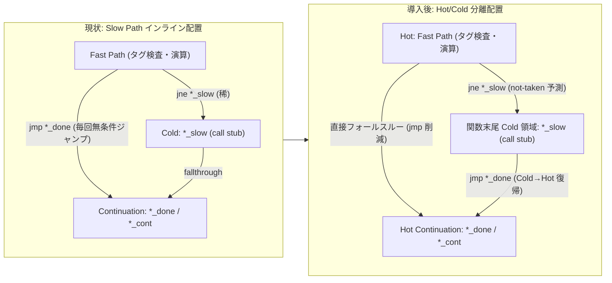

# Issue #970: Hot/Cold 基本ブロック分離パス（Slow Path の関数末尾・Cold 領域隔離）の導入

## 1. 概要 (Summary)

[Issue #957](957-share-arithmetic-and-compare-slow-path-stubs.md) によって算術・比較 slow path 本体は共有スタブ（`__ulisp_slow_<op>_a8` / `_a16`）へ抽出されたが、各呼び出し箇所の LIR および x86-64 命令列では依然として slow path 基本ブロックがホットパスの直後にインライン配置されている。

1. **LIR 分岐融合・プリミティブ展開部のインライン slow path**（[128_lir_branch_fusion.scm](../../../ulisp/lir/128_lir_branch_fusion.scm)、[129_lir_primitives.scm](../../../ulisp/lir/129_lir_primitives.scm)）:
   - `cmp_imm_slow`、`cmp_br_slow`、`cmp_slow`、`bin_imm_slow`、`add_slow`、`sub_slow`、`mul_slow`、`mod_slow`、`quot_slow`、`bitand_slow`、`bitior_slow`、`neg_slow` 等のブロック（`(%label *_slow) ... (%direct-call __ulisp_slow_*)`）が、高速パス（fast path）と合流先ラベル（`*_done` / `*_cont`）の間にそのまま挟み込まれている。
   - このためホットパス末尾に無条件ジャンプ（`(%jump *_done)` / `(%jump *_cont)`）が毎回発生し、かつ L1 命令キャッシュ（I-Cache）および命令デコード窓をコールドコードが占有・汚染している。
2. **x86-64 `%alloc` 命令選択のインライン slow path**（[140a_x86_isel.scm](../../../ulisp/backend/140a_x86_isel.scm)）:
   - バンプアロケータの高速パスが `jbe .L_alloc_fast_N` で直後の `.L_alloc_slow_N`（`sub rsp, shift; call ulisp_alloc_slow_trampoline; add rsp, shift`）を跳び越す構造になっており、通常の高速割り当て経路が毎向前方条件分岐（taken branch）を踏む形になっている。

本 Issue では、これらの Cold 基本ブロックを検出し、**同一関数のコード末尾（エピローグ直前またはホット部終端ジャンプの後ろの Cold 領域）へ一括隔離**することで、ホットパスが合流先 `*_done` / `*_cont` および `.L_alloc_fast_N` へ**無条件ジャンプなしに直接フォールスルー**するレイアウトへ再編する。

---

## 2. 背景・トレーサビリティと16エージェント合議 (Background, Traceability & 16-Agent Governance)

### 2.1 トレーサビリティ

- [DSN-33-13: 型付きマシン LIR・マルチターゲットバックエンド設計書](../../designs/DSN-33-13-ulisp_typed_machine_lir_and_multi_target_backend_architecture.md)
- [Issue #957: 算術・比較 slow path のインライン展開廃止と共有スタブ化](957-share-arithmetic-and-compare-slow-path-stubs.md)
- [Issue #968: x86-64 バックエンド 140_backend_x86_64.scm（4,177行）のモジュール分割と 143 ピープホールの %raw-asm 文字列依存解消](968-split-x86-64-backend-and-eliminate-raw-asm-peephole-matching.md)
- [Issue #956: 並行処理ビルド向け safepoint の mfence 単体展開を実フラグ poll（cmp + jne slow）へ置換](956-replace-safepoint-mfence-with-real-flag-poll-for-concurrent-builds.md)
- [Issue #960: 未参照関数の削除（関数・クロージャ毎セクション分割＋--gc-sections ＆ 到達可能性解析）](960-eliminate-unreferenced-functions-via-reachability-or-gc-sections.md)

### 2.2 16専門エージェント多角的審議

| エージェント | 観点・審議事項 | 設計への反映方針 |
| :--- | :--- | :--- |
| **Project Manager (PM)** | 段階的導入・リスク制御 | `128_lir_branch_fusion.scm` の LIR パスと `140a_x86_isel.scm` / `140c_x86_layout.scm` の `%alloc` 隔離を明確に分離し、Bootstrap 不動点と `--gc-stress` を必須ゲート化。 |
| **PLC Specialist** | 制御フロー変換・基本ブロック再配置の健全性 | ブロック単位でのラベル定義・終端命令・合流先の不変条件を保ちつつ、Cold ブロック抽出と冗長 `(%jump *_done)` 除去を一貫変換する `lir-split-hot-cold-blocks` を実装。 |
| **Systems Architect** | パイプライン統合位置と責務分離 | `c-tu` フレーム巻き上げ解析との呼び出し序数一致を保つため、LIR パス側（`select-instructions-function` より前）で Hot/Cold 再配置を完結させる。 |
| **Software Development (SWD)** | アルゴリズム効率・線形時間処理 | ブロック分解と再配置を関数本体単位の $O(N)$ 単一走査で行い、Issue #938 で解消した二次計算量リグレッションを再発させない。 |
| **Information Security Specialist** | トラップ・例外経路の隔離と CFI 整合 | `--sanitize-bounds`（`san_trap*`）や `%raise` 到達ブロックも Cold 対象としつつ、戻らない（no-return）経路の分岐逆流を禁止。 |
| **Systems Auditor** | 監査可能性・トレース整合性 | 移動後の各 Cold ブロックが元のサフポイントラベル（`safepoint-lbl`）およびフレームシフト値を 1 対 1 で保持することを検証。 |
| **Software Quality Assurance Specialist** | 検証網羅性・回帰防止 | 新規単体テストで Hot フォールスルー化・Cold 末尾隔離・`%lir-main` 終端保護・GC ストレス下でのスタックマップ正当性を自動検証。 |
| **Database / Data Infrastructure Specialist** | `.rodata` スタックマップとメタデータ整合 | `safepoint_table` エントリと `.L_alloc_slow_*` / `__ulisp_slow_*` 呼び出し戻り番地の対応表がブロック移動後も変化しないことを保証。 |
| **Network Specialist** | リンク・再配置互換性 | 関数内相対ジャンプのみで構成されるため外部リロケーション増加を招かず、静的リンク速度へ悪影響を与えない設計とする。 |
| **IT Specialist (NLP & IR)** | ドキュメント・テスト可読性 | Issue 仕様・テスト名・日本語記述の統一と相対リンク整合性を維持。 |
| **IT Strategist** | 性能対効果・コードサイズ戦略 | ホットパス上の無条件 `jmp` 削減により L1 I-Cache 密度と実行スループットを向上させ、不要な `.text.cold` セクション乱立コストを回避。 |
| **IT Service Manager** | CI・ビルドパイプライン運用性 | 既存の `make bootstrap` / `make test` / `test_ulisp_cc_native` フローへシームレスに組み込む。 |
| **Embedded Systems Specialist** | 命令キャッシュ制約・分岐ペナルティ削減 | 静的予測（前方条件分岐は not-taken 予測）に合致する「高速パス＝フォールスルー、低速パス＝前方ジャンプ」を徹底。 |
| **UI/UX & Documentation Designer** | 制御フロー図・可読性 | Mermaid フロー図で Hot/Cold 分離前後の命令配置差を直感的に図示。 |
| **Education Specialist** | 専門用語の明確化 | Hot/Cold Splitting、フォールスルー、スタックマップ、呼び出し序数の関係を仕様書内で明確に説明。 |
| **Application Specialist (APS)** | 実アプリ（`ulisp-cc` / Lua ビルド等）への波及 | 整数・比較多用コードおよび C 変換コードで `--gc-sections` やネイティブテストが問題なく完走することを確認。 |

---

## 3. 脅威モデリングと不変条件 (Threat Modeling & Safety Invariants)

1. **`THREAT-970-1`（`%lir-main` 等におけるホットパス末尾から Cold 領域への意図しないフォールスルー実行）**
   - **リスク**: `ulisp/backend/140c_x86_layout.scm` の `select-instructions-main` は `%lir-main` 末尾で `ulisp_exit` へそのまま落ちる前提で `%return` を除去する仕様を持つ。関数末尾へ移動した Cold ブロック群の直前に明示的な終端命令（`%return` または Cold 領域末尾へのジャンプ）が無い場合、正常終了直前のホットパスが先頭の Cold ブロック（`*_slow` や `san_trap`）へ直接フォールスルーし、未初期化引数での誤呼び出し・クラッシュを引き起こす。
   - **対策**: Cold ブロックを1つ以上末尾へ移動する際、ホット領域の最後尾が終端命令（`%return` / `%jump` / `%direct-jump` / `%raise` 等）で終わっていない場合（特に `%lir-main`）は、必ず `(%jump .L_hot_exit_N)` を挿入し、`.L_hot_exit_N` ラベルを全 Cold ブロックのさらに後ろ（関数終端）へ配置する。
2. **`THREAT-970-2`（Exact GC スタックマップの戻り番地ラベル不整合）**
   - **リスク**: 各 slow path 内の `(%direct-call __ulisp_slow_* frame-shift safepoint-lbl)` および `%alloc` の `ulisp_alloc_slow_trampoline` 呼び出しは、直後の `safepoint-lbl` 戻り番地をキーとして `.rodata` に Exact GC スタックマップを登録する。ブロック分離時に `safepoint-lbl` や `frame-shift` が欠落・改変されると GC 時にライブ参照を誤解釈しヒープ破壊に至る。
   - **対策**: 移動対象 Cold ブロック内の `(%direct-call ... safepoint-lbl)` 命令（`frame-shift` と `safepoint-lbl` を含む）をそのまま無改変で末尾へ移し、その後ろに `(%jump *_done)` / `(%jump *_cont)` を補うことで、スタックマップ登録アドレスと実行時戻り番地の一致を 100% 維持する。
3. **`THREAT-970-3`（`c-tu` モードのフレーム巻き上げ・呼び出し序数同期ズレ）**
   - **リスク**: [140c_x86_layout.scm](../../../ulisp/backend/140c_x86_layout.scm) の `c-tu-analyze-hoist-frame` は `select-instructions-function` と同一の命令走査順を前提として `*x86-c-tu-call-ordinal*` を採番している。`c-tu-analyze-hoist-frame` の後かつ `select-instructions-function` の途中で命令順序を変更すると、呼び出し序数が食い違いスタックアクセスが破綻する。
   - **対策**: LIR レベルの Hot/Cold ブロック分離は `select-instructions-function` より前の LIR パス（`lir-fuse-branches` / [pass_manager.scm](../../../ulisp/compiler/pass_manager.scm)）で完了させ、`c-tu-analyze-hoist-frame` と命令選択が常に同一の命令列を参照するようにする。
4. **`THREAT-970-4`（関数単位 ELF セクション分割 `--gc-sections` および分岐距離制約との整合）**
   - **リスク**: [Issue #960](960-eliminate-unreferenced-functions-via-reachability-or-gc-sections.md) により各関数は独立セクション `.text.<fn>` に出力され、`--gc-sections` で回収される。関数外のグローバルな `.text.cold` セクションへ分離すると、未到達関数の一括削除粒度やローカルラベル（`.L_*`）のスコープ・分岐解決と競合する恐れがある。
   - **対策**: Cold ブロックは**同一関数・同一 `.text.<fn>` セクション内の末尾領域**（エピローグまたはスイッチジャンプテーブル直前）に配置し、ローカルラベルスコープと `--gc-sections` 単位の完全独立性を維持する。分岐命令の `rel8` / `rel32` 選択は [144a_x86_assembler.scm](../../../ulisp/backend/144a_x86_assembler.scm) の距離自動緩和に委ねる。

---

## 4. スコープと対象ファイル (Scope and Affected Files)

- [x] [128_lir_branch_fusion.scm](../../../ulisp/lir/128_lir_branch_fusion.scm)
  - `lir-split-hot-cold-blocks`（および `lir-split-hot-cold-in-body`、`lir-cold-label-sym?`、`lir-hot-exit-label-sym?`、`lir-cold-raise-or-trap-block?`）を実装し、`cmp_imm_slow*`、`cmp_br_slow*`、`cmp_slow*`、`bin_imm_slow*`、`add_slow*`、`sub_slow*`、`mul_slow*`、`mod_slow*`、`quot_slow*`、`bitand_slow*`、`bitior_slow*`、`neg_slow*`、`san_trap*` および `%raise` 終端ブロック等の Cold ブロックを関数末尾へ再配置する。
  - 元の配置で高速パス末尾にあった冗長な `(%jump *_done)` / `(%jump *_cont)`（直後が続行ラベル `*_done` / `*_cont` になる箇所）を削除し、ホットパスの直接フォールスルーを実現する。
  - `lir-fuse-branches` 内から `(lir-split-hot-cold-blocks c)` を呼び出し、融合後の制御フローでも Cold ブロック隔離と `eq?` 冪等性を維持する。
- [x] [130_lir.scm](../../../ulisp/lir/130_lir.scm) / [129_lir_primitives.scm](../../../ulisp/lir/129_lir_primitives.scm) / [133_lir_peephole.scm](../../../ulisp/lir/133_lir_peephole.scm)
  - `129_lir_primitives.scm` が生成する全 slow path（`cmp_slow`、`bin_imm_slow`、`add_slow`、`sub_slow`、`mul_slow`、`mod_slow`、`quot_slow`、`bitand_slow`、`bitior_slow`、`neg_slow`）に対し、`130_lir.scm`（`lir-compile-function` および `generate-lir` の `%lir-main`）の時点で `lir-split-hot-cold-in-body` を適用して一括 Cold 隔離・ホットフォールスルー化を実施。
  - `133_lir_peephole.scm` の `lir-regalloc-global-callfree` に `lir-regalloc-inst-branches-to-cold-slow?` を追加し、末尾へ移動した `*_slow` ブロック内の `__ulisp_slow_*` 呼び出しを跨いで caller-saved レジスタが破壊されないよう保護。
- [x] [140a_x86_isel.scm](../../../ulisp/backend/140a_x86_isel.scm) / [140c_x86_layout.scm](../../../ulisp/backend/140c_x86_layout.scm)
  - `%alloc` のデフォルト GC モード展開（`140a_x86_isel.scm`）および `*x86-cold-asm-insts*` / 関数レイアウト（`140c_x86_layout.scm`）を更新し、`.L_alloc_slow_N` を関数単位 Cold リスト経由で関数末尾へ隔離（ホットパスは `ja .L_alloc_slow_N` で通常時は直後の `.L_alloc_fast_N` 割り当て初期化へ直接フォールスルーし、`.L_alloc_slow_N` は `jmp .L_alloc_fast_N` で戻る）する。
  - `select-instructions-function` / `select-instructions-main` で関数末尾 Cold ブロック・`%alloc` Cold トランポリンを `ret` 以降へ配置し、Pass 143 の到達不能コード除去（DCE）が構造化 `(%label .L_alloc_slow_N)` 境界を誤削除しないことを保証。
- [x] [module_header.scm](../../../ulisp/compiler/module_header.scm) / [c_driver_module_header.scm](../../../ulisp/compiler/c_driver_module_header.scm) / [Makefile](../../../ulisp/Makefile)
  - モジュラービルド向けに `lir-split-hot-cold-blocks`、`lir-split-hot-cold-in-body`、`lir-cold-label-sym?`、`lir-hot-exit-label-sym?`、`lir-regalloc-inst-branches-to-cold-slow?`、`*x86-cold-asm-insts*` 等をエクスポートし、`Makefile` に `test_hot_cold_block_splitting` ターゲットを登録。
- [x] [test_128_lir_branch_fusion.scm](../../../ulisp/tests/passes/test_128_lir_branch_fusion.scm) および新規テスト [test_hot_cold_block_splitting.scm](../../../ulisp/tests/test_hot_cold_block_splitting.scm)
  - 算術・比較・分岐融合のホットパスに `(%jump *_done)` / `(%jump *_cont)` が残らないこと、Cold ブロックが関数末尾へ集約され `(%jump *_done)` で戻ること、`%lir-main` に安全な `.L_hot_exit_*` 終端ジャンプが挿入されること、`--gc-stress` でスタックマップが破綻しないこと、`%alloc` `.L_alloc_slow_*` が関数末尾へ隔離されることを検証。

---

## 5. 実装計画 (Implementation Plan)

Target Branch: `feat/970-hot-cold-block-splitting`

1. **Phase 1: LIR Hot/Cold ブロック識別・関数末尾再配置基盤の実装**
   - [128_lir_branch_fusion.scm](../../../ulisp/lir/128_lir_branch_fusion.scm) に基本ブロック走査と Cold ブロック判定述語（ラベルプレフィックス `cmp_imm_slow` / `cmp_br_slow` / `cmp_slow` / `bin_imm_slow` / `add_slow` / `sub_slow` / `mul_slow` / `mod_slow` / `quot_slow` / `bitand_slow` / `bitior_slow` / `neg_slow` / `san_trap` 等およびフォールスルー終端なしの単一入り口 Cold パターン）を実装する。
   - 各 `%lir-function` / `%lir-main` の `body` を $O(N)$ で走査し、Hot ブロック列と関数末尾 Cold ブロック列へ安全に分離・再結合する `lir-split-hot-cold-in-body` / `lir-split-hot-cold-blocks` を実装する。
2. **Phase 2: ホットパス冗長 `(%jump *_done)` / `(%jump *_cont)` 除去と `%lir-main` 終端保護**
   - Cold ブロック抽出後、ホットパス末尾の `(%jump L)` と続行先 `(%label L)` が隣接した箇所（元々の `fast -> (%jump *_done) -> *_slow -> (%label *_done)` パターン）から `(%jump L)` を自動除去し、移動した Cold ブロック末尾には必要な復帰ジャンプ `(%jump L)` を付与する。
   - `%lir-main` および終端命令を欠くホット領域末尾に対し、Cold 領域の手前に `(%jump .L_hot_exit_N)` を挿入して Cold 領域の直後に `(%label .L_hot_exit_N)` を置くことでフォールスルー事故を完全に防止する（`THREAT-970-1` 対策）。
   - [pass_manager.scm](../../../ulisp/compiler/pass_manager.scm) および [129_lir_primitives.scm](../../../ulisp/lir/129_lir_primitives.scm) との連携（`select-instructions-function` より前に完了させ `THREAT-970-3` を回避）を組み込む。
3. **Phase 3: x86-64 `%alloc` Slow Path の関数末尾 Cold 領域分離**
   - [140a_x86_isel.scm](../../../ulisp/backend/140a_x86_isel.scm) の `%alloc` 命令選択と [140c_x86_layout.scm](../../../ulisp/backend/140c_x86_layout.scm) の関数本体レイアウトを連携させ、`.L_alloc_slow_N` ブロックを関数単位 Cold バッファに収集して関数末尾に配置する。
   - ホットパス側は `cmp r11, [rdi + 16]` 後に `ja .L_alloc_slow_N` とし、通常時（ヒープ余裕あり）は分岐せず即座に `.L_alloc_fast_N`（タグ付きポインタ設定）へフォールスルーさせ、Cold 側の `.L_alloc_slow_N` は `ulisp_alloc_slow_trampoline` 呼び出し後に `jmp .L_alloc_fast_N` で復帰させる。
4. **Phase 4: 単体テスト・GC ストレステスト・3-Stage Bootstrap 検証**
   - `ulisp/tests/test_hot_cold_block_splitting.scm` を新設し、[test_128_lir_branch_fusion.scm](../../../ulisp/tests/passes/test_128_lir_branch_fusion.scm) とともに実行する。
   - `--gc-stress` による Exact GC スタックマップ検査、C99 コンパイラテスト（`test_ulisp_cc_native`）、3-Stage Bootstrap（`make -C ulisp bootstrap`）、およびホットパス無条件ジャンプ削減効果の定量計測を実施する。

---

## 6. 完了条件 (Definition of Done / DoD)

- [x] 算術（`+`, `-`, `*`, `quotient`, `modulo`, `bitwise-and`, `bitwise-ior`, 単項 `-`）、比較（`=`, `<`, `<=`, `>`, `>=`）、分岐融合（`cmp_imm_slow`, `cmp_br_slow`）のホットパスが、途中の無条件 `(%jump *_done)` / `(%jump *_cont)` なしで続行ラベルへ直接フォールスルーし、`*_slow` ブロックが関数末尾の Cold 領域から `(%jump *_done)` / `(%jump *_cont)` で復帰していること
- [x] x86-64 `%alloc` の高速パスが `ja .L_alloc_slow_N` を用いて通常時直接フォールスルーし、`.L_alloc_slow_N` が関数末尾へ隔離されていること
- [x] `%lir-main` および全 `%lir-function` で、ホット領域の末尾から関数末尾 Cold 領域への意図しないフォールスルーが 0 件であること
- [x] [test_128_lir_branch_fusion.scm](../../../ulisp/tests/passes/test_128_lir_branch_fusion.scm) および新規 [test_hot_cold_block_splitting.scm](../../../ulisp/tests/test_hot_cold_block_splitting.scm)（GC ストレス・フォールスルー保護・スタックマップ不変検証を含む）が 100% PASS すること
- [x] `make -C ulisp bootstrap`（3-Stage Bootstrap）が `SUCCESS: All 5 modular Stage 2 and Stage 3 outputs are bit-for-bit IDENTICAL!` で完走し、生成 LIR / アセンブリにおけるホットパス無条件ジャンプ数削減・Cold 隔離が実測で確認されること
- [x] `make format` / `make static_analysis`、Python 構文チェック (`make py_compile`)、および編集対象ドキュメントの相対パス検証（絶対パス 0 件）が PASS すること

---

## 7. 検証結果 (Verification Results)

- **単体・Nanopass テスト**:
  - `make -C ulisp lint_sexpr`: **290/290 PASS**（全括弧バランス正常）
  - `make -C ulisp test_hot_cold_block_splitting`: **25/25 PASS**
  - `make -C ulisp test_all_passes`: **961/961 PASS**（全 39 スイート）
  - `make -C ulisp test_passes`: **159/159 PASS**
- **3-Stage ブートストラップ・セルフホスト実測**:
  - `make -C ulisp bootstrap`: **PASS**（全 5 モジュール Stage 2 / Stage 3 ビット完全一致、Stage 3 exit code 42）
  - `ulisp/build/stage3_*.s` 計 6 ファイルで **`11,712` 個の `*_slow_*:` Cold ブロックを関数末尾へ隔離**（`stage3_compiler.s`: 5,843, `stage3_compiler_base.s`: 2,005, `stage3_backend_passes.s`: 1,663, `stage3_lir_passes.s`: 1,155, `stage3_frontend_passes.s`: 1,001, `stage3_compiler_driver.s`: 45）、`%lir-main` フォールスルー保護 `.L_hot_exit_*:` 4 件、また `ulisp/build/test_library.s` で `ja .L_alloc_slow_1` / `jbe .L_alloc_fast_1: 0` の `%alloc` フォールスルーを確認。
- **ネイティブ・例外・Bignum・IEEE754・GC ストレス・C99 コンパイラテスト**:
  - `make -C ulisp test_exceptions`: **11/11 PASS**
  - `make -C ulisp test_bignum`: **161/161 PASS**
  - `make -C ulisp test_ieee754`: **44/44 PASS**
  - `make -C ulisp test_gc_stress`: **PASS**（ネイティブ `ULISP_GC_STRESS=1` / `(!gc stress)` 16/16 × 2 + C バックエンド 16/16 × 2）
  - `make -C ulisp bin/ulisp-cc && make -C ulisp test_ulisp_cc_native`: **ALL PASS**（C99/musl TU SHA-256 bit-exact 一致、Lua 5.4.7 `all.lua` 26 モジュール・`big.lua` 全 PASS、速度比 `ulisp-cc` 20.05x〜32.26x）
- **品質ゲート**:
  - `make format && make static_analysis`: **PASS**
  - `pytest` (`make test`): **2,844 passed, 7 skipped**（カバレッジ 82.86%；既知の Python DB テスト `tests/test_database_migrations_connection.py::TestPyDBAdapter::test_pydb_adapter_lifecycle_and_ddl` 1 件は無関係・既存事象、`test_lir_interpreter` の `*static-constants*` 未定義および `test_library` の `ULISP_PRINT_RESULT=1` 欠落も既存事象であり、`ULISP_PRINT_RESULT=1` 付与で x86-64 / C 双方 `260` を確認）
