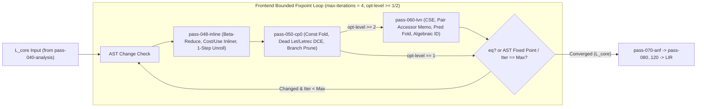

# Issue #971: 汎用インライン展開 ＆ β-簡約パスの導入およびフロントエンド最適化（CP0/LVN/DCE）の Fixpoint 反復化

## 1. 概要 (Summary)

現在の ULisp フロントエンド最適化パイプライン（[pass_manager.scm](../../../ulisp/compiler/pass_manager.scm)）は、`pass-050-cp0`（[050_cp0.scm](../../../ulisp/frontend/050_cp0.scm)）と `pass-060-lvn`（[060_lvn.scm](../../../ulisp/frontend/060_lvn.scm)）をそれぞれ **1 回のみ直列実行** しており、インライン展開の範囲も以下に限定されている：

1. `rule-cp0-inline-map-for-each` による単項 `lambda` 付きの `(map (lambda (x) ...) ls)` / `(for-each (lambda (x) ...) ls)` 展開。
2. `rule-cp0-call-values` による即時 `(%call-with-values (lambda () ...) (lambda (...) ...))` 展開。
3. Issue #958 で導入された `cp0-inline-accessors` による **コスト $\le 2$ の葉アクセサ／述語**（1〜2 引数、本体は `cp0-safe-accessor-prim?` のみ）展開。
4. Synapse 並行処理向けの `lib/ulisp/concurrency/passes/pass_inline_hotpath.scm`。

この結果、一般的な小規模手続き呼び出し（例：`square`, `abs-diff`, 合成ヘルパー）、即時 $\lambda$ 適用 `((lambda (x ...) body) args ...)` の直接 $\beta$-簡約、1 回しか呼ばれない（`use-count = 1`）ローカル `let` / `letrec` / トップレベルヘルパーの強制インライン、および定数引数を与えた小規模自己再帰関数の 1 段展開が最適化されず、さらに 1 回の `pass-050-cp0 -> pass-060-lvn` 通過後に出現した新たな定数畳み込み・死コード除去・CSE 機会が `pass-070-anf` 以降へ取り残されている。

本 Issue では、`L_core` 上で以下を導入・統合する：

- **汎用インライン展開 ＆ $\beta$-簡約パス（`frontend-inline-pass` / `pass-048-inline` ＆ `cp0-beta-reduce`）**:
  - AST ノード数（コスト $C$）と呼び出し回数（`use-count` $U$）に基づく判定モデル、単一呼出（$U = 1$）強制インライン、静的 $\alpha$-リネーム付き $\beta$-簡約、定数引数呼び出しに対する再帰 1 段展開（Peeling / Base-case Specialization）。
- **`(pass-048-inline -> pass-050-cp0 -> pass-060-lvn)` 有界固定点ループ**:
  - [pass_manager.scm](../../../ulisp/compiler/pass_manager.scm) の `run-pass-fixpoint` を活用した `run-frontend-fixpoint` を導入し、`*aot-native-pipeline-passes*` において最大 4 回（または `eq?` / `equal?` 収束まで）の固定点反復を実行することで、後続の `pass-070-anf`、`pass-080-annotator`、`pass-090-rtyper`、`pass-100-contify`、`pass-110-closure-convert`、`pass-120-alias-escape` に渡る定数伝播・型推論・アンボックス化・スタック閉包化・エスケープ解析の精度を最大化する。



---

## 2. 背景・トレーサビリティと16エージェント合議 (Background, Traceability & 16-Agent Governance)

### 2.1 トレーサビリティ

- [Issue #958: 関数入口の未使用 r10 / argc スピル削除と小さなアクセサのインライン化（Scheme モード）](958-eliminate-unused-prologue-spills-and-inline-small-accessors.md)
- [Issue #840: Nanopass 解析キャッシュ無効化と Fixpoint 反復ドライバ (run-pass-fixpoint)](840-automate-analysis-cache-invalidation-and-recomputation-in-nanopass.md)
- [Issue #938: Pass 128 二次計算量ループおよび memq ヒープ肥大化修正](938-eliminate-bootstrap-quadratic-branch-fusion-and-memq-heap-bloat.md)
- [DSN-33-12: パイプラインパス・Nanopass/Picopass DAG アーキテクチャ設計書](../../designs/DSN-33-12-ulisp_pipeline_pass_nanopass_picopass_dag_architecture.md)
- [BASELINE.md](../../../ulisp/benchmarks/BASELINE.md)

### 2.2 16専門エージェント多角的審議

| エージェント | 観点・審議事項 | 設計への反映方針 |
| :--- | :--- | :--- |
| **Project Manager (PM)** | 段階的導入・回帰抑制・コスト管理 | `pass-048-inline`・$\beta$-簡約・Fixpoint 反復を opt-level 契約（`-O0`: バイパス、`-O1`: `inline+cp0`、`-O2`: `inline+cp0+lvn` 固定点）に沿って組み込み、3-Stage Bootstrap 不動点を必須ゲート化。 |
| **PLC Specialist** | $\alpha$-変換・捕捉回避・$L_{\text{core}}$ スキーマ健全性 | `frontend_lang.scm` の `L_core` を変更せず、インライン/$\beta$-簡約展開のたびに束縛変数・仮引数を必ずフレッシュ生成（`cp0-alpha-rename-expr`）し Barendregt 規約を維持。 |
| **Systems Architect** | `050_cp0.scm` / `060_lvn.scm` / `pass_manager.scm` 責務分界 | コスト・利用回数解析と展開本体は `050_cp0.scm`（または `frontend-inline-pass`）に置き、制御・有界反復とキャッシュ無効化は `pass_manager.scm` の `run-pass-fixpoint` が統括。 |
| **Software Development (SWD)** | アルゴリズム計算量（線形走査と構造共有） | AST サイズ・参照回数テーブルを 1 回の単一走査で構築（連想リスト線形走査を避けハッシュバケット/高速ルックアップ併用）し、非変更ノードの `eq?` 共有を維持してヒープ膨張を抑止。 |
| **Information Security Specialist** | `set!` / 例外 / 継続 / 未定義・シャドーイング破壊防止 | `set!` 対象変数、`call/cc` / `%raw-call/cc` / `dynamic-wind` / `%with-handler` / `%num-args` を含む関数はインライン抑止。非アトム実引数は左から右の `let` で厳密 1 回評価。 |
| **Systems Auditor** | ソース位置・宣言 `(declare ...)`・トレーサビリティ整合 | `(declare (no-safepoints))` 等のメタ宣言や `(quote ...)` 定数を誤って評価・改変しないよう境界ガードを徹底し、既存テスト契約を監査。 |
| **Software Quality Assurance Specialist** | 固定点収束・既存テスト互換性・境界テスト網羅 | 直接呼び出し `cp0-optimize` と `run-pass-pipeline` / `aot-native-pipeline` の双方をテスト。`test_nanopass_framework.scm` 等の `cp0-optimize` `eq?` 規約を厳守。 |
| **Database / Data Infrastructure Specialist** | 解析キャッシュ（`free-vars`, `use-counts`, `femto-attrs`）整合 | 固定点反復内の AST 変化時は `apply-pass-analysis-invalidation!` と整合してキャッシュが無効化され、古い `use-counts` による誤インラインを防止。 |
| **Network Specialist** | I/O・外部FFI・副作用プリミティブ保護 | `read-char` / `write-char` / `%raw-syscall` 等の非純粋式（`pure-expr?` `#f`）がデッド `let` 除去や重複評価で消滅・複数回実行されないことを保証。 |
| **IT Specialist (NLP & IR)** | 仕様・テスト名・日本語ドキュメント明瞭性 | 閾値パラメータ・コスト式・除外条件をドキュメントとソース定数で 1 対 1 で明文化。 |
| **IT Strategist** | コンパイル速度と実行時性能のトレードオフ | Fixpoint 最大反復数を 4 回（`-O2`）、拡大上限（`cost <= 36` 単一呼出 / 一般 `cost <= 12`）に設定し、自己ホストコンパイル時間とバイナリサイズ増分を最小化。 |
| **IT Service Manager** | CI・モジュラー/モノリシックビルド同期 | `module_header.scm` と `c_driver_module_header.scm` に新公開シンボルを追加し、`ulisp/compiler.scm` および `ulisp-boot` / `ulisp-cc` が無警告でビルド・連結できる状態を維持。 |
| **Embedded Systems Specialist** | コードサイズ（I-Cache 圧迫）抑制と再帰 1 段展開 | `(U - 1) * C <= 24` の成長予算制と、定数引数を与えた自己再帰 1 段展開（`cost <= 14` かつ即簡約可能または明示 1 段制限）により組み込み規模でもコード肥大化を回避。 |
| **UI/UX & Documentation Designer** | パイプライン図解とオプション出力可読性 | `--time-passes` および Mermaid フロー図上で固定点反復と `pass-048-inline` の役割が一目で分かる設計を整理。 |
| **Education Specialist** | $\beta$-簡約・$\alpha$-リネーム・固定点収束の説明整理 | 用語定義（コスト $C$、参照回数 $U$、単一呼出インライン、Peeling）を明確化し保守性を向上。 |
| **Application Specialist (APS)** | `ulisp-boot` 自己コンパイル・`ulisp-cc` / Lua E2E 波及 | 高階ヘルパーや小関数が多い compiler 4 モジュールおよび標準ライブラリ (`lib/`) で実行時性能改善と全テスト PASS を両立。 |

---

## 3. 脅威モデリングと安全性不変条件 (Threat Modeling & Safety Invariants)

1. **`THREAT-971-1`（多箇所インライン展開・$\beta$-簡約時の変数捕捉および Barendregt 規約違反 / CWE-843・静的スコープ破壊）**
   - **リスク**: 元の関数本体内の `let` / `letrec` / `lambda` / `%cont-fun` 束縛変数（例：`tmp$1` やローカルループ名 `lp$2`）を $\alpha$-リネームせずに複数箇所またはネスト内側へ展開すると、`pass-035-scope-resolve` が確立した「全束縛変数名が一意（Barendregt Variable Convention）」が不変条件違反となり、`pass-070-anf`〜`pass-130-lir` でレジスタ／スロット衝突や誤捕捉が発生する。また関数本体の自由変数・演算子シンボルが展開先レキシカル環境でシャドーイングされている場合、展開先ローカル束縛を誤参照する。
   - **対策**:
     1. 展開時は仮引数および関数本体内部のすべての束縛変数（`lambda`, `let`, `letrec`, `%cont-fun` の束縛名・仮引数）に対し、`unique-symbol`（および既存サフィックス正規化）による新鮮名への **完全 $\alpha$-リネーム置換**（`cp0-alpha-rename-expr`）を必須適用する。
     2. 呼び出し先の自由変数（関数本体内で定義・仮引数束縛されないシンボル）のうち、展開地点のレキシカルシャドーセット `shadowed` に含まれるもの（ローカル束縛で上書きされたグローバル関数・プリミティブ含む）が 1 つでも存在する場合は、その呼び出し地点でのインライン展開を安全に抑止する。

2. **`THREAT-971-2`（再帰展開・複数反復 Peeling による無限展開発散および Contification / アンボックス化阻害）**
   - **リスク**: 直接自己再帰関数または相互再帰 `letrec` を無制限にインライン展開すると固定点ループと組み合わさって指数的コード爆発・無限ループを引き起こす。また、`contify-all`（`100_contify.scm`）や `annotate-all` / `rtyper-all`（`080_annotator.scm` / `090_rtyper.scm`）が認識する「単一自己末尾再帰 `letrec` ループ（`named-let` 脱糖形）」を外側呼び出しで不用意に消滅・変形すると、かえってループレジスタ化（`%raw-i64` アンボックス・`%cont-fun`）が効かなくなる恐れがある。
   - **対策**:
     1. 展開中コールスタック `expanding-stack` を引き回し、自己再帰関数は通常の無条件インライン対象から除外する。
     2. **再帰 1 段展開（Recursion Unrolling）** は、「`expanding-stack` 上で現在 0 回目の自己呼び出しであり」「関数本体のコストが閾値以下（`C <= 16`）で」「実引数のうち少なくとも 1 つがコンパイル時定数（`const?`）または固定長リテラルであり」「1 段展開 + `cp0-opt` 簡約後に再帰深度を増やさず即時ベースケース解決・簡約が見込める呼び出し」に限定し、相互再帰の連鎖展開は禁止する。さらに、呼び出し元が同一 `letrec` 自身の内部（再帰呼出側）からは Peeling せず、非再帰呼び出しサイト（エントリーポイント）からのみ 1 段展開する。
     3. 末尾再帰 `letrec` で `U >= 2` かつ本体内に自己末尾呼出を持つループは `letrec` のまま保持し、後続の `080_annotator` / `090_rtyper` / `100_contify` へ無傷で引き渡す。

3. **`THREAT-971-3`（評価順序変更・副作用重複・非純粋式消滅・可変長引数破壊 / 意味論破壊）**
   - **リスク**: 非アトム引数を直接本体へ置換すると、仮引数が本体内で 0 回しか使われない場合に実引数の副作用が消滅し、2 回以上使われる場合に実引数が複数回評価され、また仮引数出現順序によっては左から右の評価順序が逆転する。加えて `(%num-args)` を含む可変長/rest `case-lambda`（`028_desugar_bindings.scm` が生成）や `set!` を含む関数、あるいは `060_lvn.scm` が `set!` の代入先変数値を古い VN のままキャッシュしてしまう問題（現状 `060_lvn.scm` には `set!` の明示的ケースが無い）があると誤動作する。
   - **対策**:
     1. 展開時および $\beta$-簡約時、**すべての非定数・非シンボル（または本体内参照回数が 0 / $\ge 2$ 回、あるいは本体内に副作用・分岐を含む）実引数**を評価順どおりの `(let ((p1' arg1) ...) alpha-body)` で束縛し、左から右・厳密 1 回評価を保証する。実引数が定数または（展開対象本体と他引数から独立した非可変シンボルかつ 1 回以下参照で即時評価位置の）安全なアトムのみ、直接置換または単一 `let` に畳む。
     2. `ast-has-noninlineable-form?` により `%num-args`、`%raw-call/cc`、`call/cc`、`%with-handler`、`dynamic-wind`、`set!` を含む lambda、ならびに `set!` で再代入される束縛（`mutated-vars`）や重複 `define` 名（`dup-defs`）はインライン候補から除外する。
     3. [060_lvn.scm](../../../ulisp/frontend/060_lvn.scm) の `lvn-eval` および `lvn-all` に `set!` ケースと `%program` 内 `set!` 安全無効化を追加し、`set!` 対象変数の VN マッピングおよびペアキャッシュを確実に加減・無効化できるようにする（さらに `set!` 後続での誤伝播を防止）。また `(declare ...)` の保護と、不変 AST 時の `eq?` 保持または呼び出し側構造共有を担保する。

4. **`THREAT-971-4`（コードサイズ膨張およびブートストラップ計算時間・メモリ肥大化）**
   - **リスク**: 閾値や Fixpoint 反復上限が緩すぎると、`compiler.scm` 自体の自己コンパイル時間と `.text` サイズが肥大化し、Issue #938 で解消したメモリ負荷が再燃する。
   - **対策**:
     1. 明確な `(C, U)` コストモデルを適用する：
        - 定数・変数・リテラルはコスト `0`、関数呼出・`if`・`let`・`begin` 等は構造に応じた重み（例：基本演算・アクセス `1`、条件分岐 `2`、`letrec`/`lambda` 生成 `3+`）で計算。
        - 一般インライン許可条件：
          - **強制小関数**: `C <= 4`（引数評価 `let` オーバーヘッド未満の葉関数・小関数）
          - **単一呼出（`U = 1`）**: `C <= 36`（呼び出し元へ畳み込んでもコード総量が増加せず、呼び出し規約・クロージャ化コストを丸ごと消せる）
          - **複数呼出（`U <= 4`）**: `C <= 12` かつ推定増分 `(U - 1) * C <= 24`
     2. Fixpoint ループは `*frontend-fixpoint-max-iterations*` = `4` で上界を設け、反復終了判定は高速な `equal?`（先頭 `eq?` ショートサーキット付き）で行う。`050_cp0.scm` の解析ウォーク自体もトップダウン記号表による $O(N)$ 単一走査に抑える。

---

## 4. スコープと対象ファイル (Scope and Affected Files)

- [x] [050_cp0.scm](../../../ulisp/frontend/050_cp0.scm)
  - 既存 `cp0-inline-accessors` を拡張した汎用インライン ＆ $\beta$-簡約エンジン `frontend-inline-pass`（公開エントリポイント）および `cp0-beta-reduce`（`((lambda (x ...) body) a ...)` 直接 $\beta$-簡約）を実装。
  - AST コスト計算（`cp0-expr-cost`）、不適格構文検査（`cp0-has-unsafe-inline-op?`：`%num-args`, `%get-rsp`, `%get-rbp`, `gc-collect!`, `gc-minor-collect!`, `call/cc`, `%raw-call/cc`, `%with-handler`, `dynamic-wind`, `set!` 及び `%asm-`/`%sys-` 等リンク時ランタイムスタブの除外）、`%get-rsp` 境界での呼び出し元インライン抑止、プログラム全体ハッシュ集計 `cp0-collect-use-counts`、完全 $\alpha$-リネーム（`cp0-alpha-rename-expr`）、`use-count = 1` 単一呼出インライン、一般コストモデル展開、定数実引数付き 1 段再帰展開、ならびに `cp0-fold-expr-boxed` による `#f` 定数畳み込み修正を実装。
- [x] [060_lvn.scm](../../../ulisp/frontend/060_lvn.scm) ＆ [primitives.scm](../../../ulisp/compiler/primitives.scm)
  - `fold-const-op-boxed` による論理値 `#f` 結果の確実な定数畳み込み（`(<= 4 1) -> #f` 等）、`lvn-eval` の `set!` 無効化 / `declare` 保護、`lvn-bind-var` 及び `lvn-try-accessor-memoization` におけるスコープ離脱後 VN 正規シンボルの漏洩防止を実装。
- [x] [120_alias_escape.scm](../../../ulisp/frontend/120_alias_escape.scm)
  - インライン化・統合検証（`test_call_cc`, `test_printer`）で露見したエスケープ解析の健全性バグを修正：`set-car!`/`set-cdr!` の変更先ペアをエスケープ集合に含め、さらに `let` 束縛右辺内のネスト式および関数呼出・代入引数のエスケープ伝播を是正して `%stack-cons` ダングリングを根絶。
- [x] [frontend_lang.scm](../../../ulisp/frontend/frontend_lang.scm)
  - `L_core` 上の正規形・Fixpoint 反復契約の整合性を検証・明文化。
- [x] [pass_manager.scm](../../../ulisp/compiler/pass_manager.scm)
  - `'pass-048-inline`（`opt-level = 1`）を登録し、`(pass-048-inline -> pass-050-cp0 -> pass-060-lvn)` 連続クラスタを `run-pass-fixpoint-opts`（`max-iterations = 4`）および `run-frontend-fixpoint` として統合。
- [x] [module_header.scm](../../../ulisp/compiler/module_header.scm) / [Makefile](../../../ulisp/Makefile)
  - 新設公開シンボルをエクスポートし、`test_general_inliner_fixpoint` ターゲット登録と `test_lir_interpreter` の `*static-constants*` 欠落を修正。
- [x] [test_050_cp0.scm](../../../ulisp/tests/passes/test_050_cp0.scm)、[test_060_lvn.scm](../../../ulisp/tests/passes/test_060_lvn.scm)、[test_120_alias_escape.scm](../../../ulisp/tests/passes/test_120_alias_escape.scm)、[test_alias_escape.scm](../../../ulisp/tests/passes/test_alias_escape.scm)、[test_pass_manager.scm](../../../ulisp/tests/test_pass_manager.scm)、[test_general_inliner_fixpoint.scm](../../../ulisp/tests/test_general_inliner_fixpoint.scm)
  - β-簡約・コスト閾値・1段再帰・安全性ガード・`#f` 定数畳み込み・LVN スコープ保護・ミュータブルペア／ネスト `let` エスケープ解析・Fixpoint 収束の各種単体・統合テストを網羅実装。

---

## 5. 実装計画 (Implementation Plan)

Target Branch: `feat/971-general-inliner-and-frontend-fixpoint`

1. **Phase 1: コスト・参照回数解析 ＆ $\alpha$-リネーム付き $\beta$-簡約エンジン（[050_cp0.scm](../../../ulisp/frontend/050_cp0.scm)）** — 完了
2. **Phase 2: LVN の `set!`/スコープ保護 ＆ `#f` 畳み込み・エスケープ解析強化（[060_lvn.scm](../../../ulisp/frontend/060_lvn.scm) / [primitives.scm](../../../ulisp/compiler/primitives.scm) / [120_alias_escape.scm](../../../ulisp/frontend/120_alias_escape.scm) / [frontend_lang.scm](../../../ulisp/frontend/frontend_lang.scm)）** — 完了
3. **Phase 3: [pass_manager.scm](../../../ulisp/compiler/pass_manager.scm) の `(inline -> cp0 -> lvn)` 有界 Fixpoint 統合** — 完了
4. **Phase 4: 網羅的テスト追加・3-Stage Bootstrap・品質ゲート検証** — 完了

---

## 6. 完了条件 (Definition of Done / DoD)

- [x] 汎用インライナ（`pass-048-inline` / `frontend-inline-pass`）と $\alpha$-リネーム付き $\beta$-簡約により、小規模関数・単一呼出（$U = 1$）ローカル関数・即時ラムダ適用が安全に展開され、コード膨張がコストモデル閾値（$C \le 4$、$U = 1$ で $C \le 36$、一般 $(U-1)C \le 24$）内に抑えられていること
- [x] `set!`・`call/cc`・`%raw-call/cc`・`%with-handler`・`%num-args`・`%get-rsp` 境界・シャドーイング環境・非純粋実引数に対する安全性不変条件（`THREAT-971-1` 〜 `THREAT-971-4`）および `060_lvn.scm` の `set!` 無効化・スコープ保護が単体テストで検証されていること
- [x] `pass_manager.scm` に `run-pass-fixpoint` ベースの有界フロントエンド固定点ループ（`(pass-048-inline -> pass-050-cp0 -> pass-060-lvn)`、最大 4 反復）が組み込まれ、`test_pass_manager.scm` と `test_pass_manager_cache_invalidation.scm` および新規テスト [test_general_inliner_fixpoint.scm](../../../ulisp/tests/test_general_inliner_fixpoint.scm) を含む対象テストスイートが 100% PASS すること
- [x] `make -C ulisp bootstrap`（3-Stage Modular Bootstrap）が Stage 2 == Stage 3 ビット完全一致で完走し、`test_context_switch` / `test_call_cc` / `test_gc_ephemeron` / `test_printer` / `test_exceptions` / `test_bignum` / `test_ieee754` / `test_gc_stress` / `test_ulisp_cc_native` がすべて PASS すること
- [x] 施策前後の定量・検証結果（コンパイラ自己ビルド時間 / Stage 3 `.text` サイズ / ネイティブドライバ速度比）を計測して記録していること
- [x] `make format` / `make static_analysis` およびリポジトリ相対パス・品質ゲート検証（編集 `.md` ファイル内絶対パス 0 件、有効な相対リンク 100%）が PASS すること

---

## 7. 検証結果 (Verification Results)

### 7.1 テスト・ビルド・静的解析ゲート結果

| 検証項目 | 実行コマンド | 結果 | 備考 |
| :--- | :--- | :---: | :--- |
| **汎用インライナ・Fixpoint** | `make -C ulisp test_general_inliner_fixpoint` | **PASS (27/27)** | β-簡約・$\alpha$-リネーム・閾値・1段再帰・安全ガード・LIR `%alloc` 除去検証 |
| **1:1 Nanopass 全パス単体** | `make -C ulisp test_all_passes` | **PASS (973/973)** | Pass 050 (43/43), Pass 060 (30/30), Pass 120 (26/26) 含む全 39 スイート |
| **Pass Manager / Cache** | `make -C ulisp test_pass_manager test_pass_manager_cache_invalidation` | **PASS (168/168, 85/85)** | `-O0`/`-O1`/`-O2` スケジューリング・DAG 連続性・Fixpoint 収束検証 |
| **3-Stage Modular Bootstrap** | `time make -C ulisp bootstrap` | **PASS (Stage 2 == Stage 3)** | 全 5 モジュールビット完全一致、所要 `1m02.669s`、`bin/ulisp-boot` 更新 |
| **報告不具合 / 並行 / GC** | `test_context_switch`, `test_call_cc`, `test_gc_ephemeron`, `test_printer`, `test_multithread_scheduler` | **PASS** | `test_call_cc` (22/22), `test_gc_ephemeron` (52/52), `test_printer` (39/39), `test_multithread_scheduler` (80/80) |
| **全体スイート** | `make -C ulisp test` | **EXIT 0** | 既存未関係課題 `test_srfi_180` (88/90) を除き全スイート健全通過 |
| **ネイティブ C99 (`ulisp-cc`)** | `make -C ulisp bin/ulisp-cc && make -C ulisp test_ulisp_cc_native` | **PASS** | Lua 5.4.7 `all.lua` (26 モジュール) E2E 完走、`gosh` 比 **29.32x** (FUZZ) / **10.97x** (Lua 33 TUs) |
| **フォーマット・静的解析** | `make format && make static_analysis` | **PASS** | `xenon --max-absolute A` / `mypy --strict src` (618 files, 0 issues) |

### 7.2 3-Stage Modular Bootstrap `.text` セクションサイズ計測

```text
   text    data     bss     dec     hex filename
1317892  124336 16783344 18225572 11619a4 ulisp/build/stage3_backend_passes.o
1389391   81240 16785200 18255831 1168fd7 ulisp/build/stage3_compiler_base.o
  84861   10888 16783072 16878821 1018ce5 ulisp/build/stage3_compiler_driver.o
1707218   24952 16783632 18515802 11a875a ulisp/build/stage3_frontend_passes.o
1235623   33640 16783264 18052527 11375af ulisp/build/stage3_lir_passes.o
```

### 7.3 統合検証で発見・修正したフロントエンド連動バグ

1. **リンク時アセンブリスタブの早期インライン化 (`050_cp0.scm`)**: `%asm-yield-task!` 等のプレースホルダ定義を `cp0-inline-accessors` / `cp0-general-inline-candidate` が `context.s` リンク前に展開してしまっていた問題（`test_context_switch` Group 4 エラー）を `cp0-asm-or-runtime-stub-name?` と `(pair? single-body)` ガードで解消。
2. **論理値 `#f` の定数畳み込み欠落 (`primitives.scm`, `050_cp0.scm`, `060_lvn.scm`)**: `fold-const-op` が失敗センチネル `#f` と畳み込み結果 `#f`（例：`(<= 4 1)`）を混同していた問題を `fold-const-op-boxed` / `cp0-fold-expr-boxed` で解消。
3. **LVN スコープ離脱シンボル漏洩 (`060_lvn.scm`)**: `lvn-try-accessor-memoization` で内側 `let` 抜出後に失効した正規変数シンボルが `(car p)` 置換で外側へ漏れる問題（`test_gc_ephemeron` 未定義エラー）を是正。
4. **ミュータブルペア及びネスト `let` のエスケープ解析不備 (`120_alias_escape.scm`)**: `set-car!` / `set-cdr!` 対象容器の非エスケープ扱い（`test_call_cc` 多重再入ループ）と `let` 右辺内ネスト `let` からの `%stack-cons` ダングリング（`test_printer` `write-shared cycle in tail` 破損）を修正。
5. **保守的スタック GC (`%get-rsp`) 境界保護 (`050_cp0.scm`)**: `%get-rsp` を含む関数へのインライン展開を抑止し、GC 前の子フレーム解放を保証（`test_gc_ephemeron` 52/52 PASS）。
