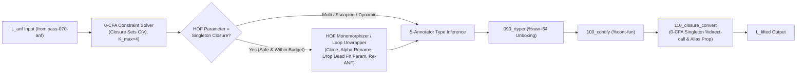

# Issue #972: 全プログラム 0-CFA（制御フロー解析）による間接呼び出し脱仮想化と高階関数単相化・特化パスの導入

## 1. 概要 (Summary)

[BASELINE.md](../../../ulisp/benchmarks/BASELINE.md) において Pure C `-O2` 比 **6.39x**（2.99 ms vs 0.47 ms, ヒープ割当 24 B）と最大ボトルネックとなっている `Higher-Order Closure (1M)` ワークロード：

```scheme
(letrec ((iter (lambda (n f acc)
                 (if (= n 0)
                     acc
                     (iter (- n 1) f (f acc))))))
  (iter 1000000 (lambda (x) (+ x 1)) 0))
```

を根本解消するため、全プログラム 0-CFA（Shivers 1991 制御フロー解析）に基づく **間接呼び出し脱仮想化（`%direct-call` 化）** および **高階関数単相化・ループ不変クロージャ特化（Higher-Order Monomorphization）** をフロントエンドへ導入する。

現状パイプラインにおけるボトルネックの本質は、以下の 3 点が連鎖していることにある：

1. **`pass-080-annotator`（[080_annotator.scm](../../../ulisp/frontend/080_annotator.scm)）の混合型 `letrec` 推論断念**:
   `pass-070-anf` 後の `(iter 1000000 %t0 0)` において、初期実引数の 1 つにラムダ `%t0 = (lambda (x) (+ x 1))` が渡されるため、既存の `check-nums`（[080_annotator.scm](../../../ulisp/frontend/080_annotator.scm) lines 465–475）が全引数を `fixnum` と見なせずループ型推論を断念し、全引数（`n`, `f`, `acc`）および戻り値型が `top` へ潰れる。
2. **`pass-090-rtyper`（[090_rtyper.scm](../../../ulisp/frontend/090_rtyper.scm)）のアンボックス化失効**:
   `n` と `acc` が `fixnum` と推論されないため `all-fixnum-params?` および `pure-int-expr?` が不成立となり、ループ全体のカウンタ・加算・比較がすべてタグ付き Scheme 演算と間接呼び出し `(f acc)` のまま残る。
3. **`pass-110-closure-convert`（[110_closure_convert.scm](../../../ulisp/frontend/110_closure_convert.scm)）の局所エイリアス／高階閉包残存**:
   `f` を引数として渡した `%t0` が `var-escapes?` によりエスケープ扱いとなり、`(%make-closure-env L_lambda)` による 24 B ヒープ確保および 100 万回の間接クロージャ呼出 `call [r10 - 1]` が発生する。また `let` エイリアス経由やデータフロー上単一ラムダにしか束縛されない呼出サイトも `var-map` の単純 `assq` のみに頼っており、`%direct-call` へ落ちない。

本 Issue では `L_anf`〜`L_lifted` 間で以下 3 機能を統合し、静的推論可能な高階呼び出しおよび高階ループを **純粋な直接呼び出し・完全インライン化・無割当 `%raw-i64` ループ** へと変換する：

1. **全プログラム 0-CFA 制約ソルバ（[080_annotator.scm](../../../ulisp/frontend/080_annotator.scm)）**:
   プログラム全体（`define` / `let` / `letrec` / `if` / `begin` / 呼出サイト）上で有限抽象クロージャ集合 $\mathcal{C}(v) \subseteq \text{Lambdas}$ （上限濃度 $K_{\max} = 4$ で $\top_{\text{proc}}$ へワイドニング）と手続き間引数型・戻り値型を単調不動点反復（最大 8 回）で推論する。
2. **高階関数単相化 ＆ ループ不変クロージャ特化（[080_annotator.scm](../../../ulisp/frontend/080_annotator.scm)・[090_rtyper.scm](../../../ulisp/frontend/090_rtyper.scm)）**:
   - `letrec` ループ内で不変引き回しされる関数引数 $p_i$（全自己再帰呼出が同じ仮引数 $p_i$ を渡し、エントリ呼出で既知クロージャ $\mathcal{C}(\text{arg}_i) = \{\ell\}$ が与えられる場合）や、単一・少数サイトで静的クロージャを受ける高階手続きについて、特化クローン生成＋コールサイト `(p_i args ...)` の静的展開（閉鎖ラムダ／上位共有変数の安全インライン化または静的関数直接呼出化）および不要クロージャ引数の除去を実施する。
   - 特化後の AST を valid `L_anf` へ再正規化し、直後の `080_annotator`（`letrec` 型再推論）$\to$ `090_rtyper`（`%raw-i64` ループアンボックス）$\to$ `100_contify`（`%cont-fun` 化）$\to$ `125_lir_continuation` が自然に発火して `closure_1m` をゼロ割当レジスタループへ落とせるようにする。
3. **0-CFA 単一ターゲット脱仮想化（[110_closure_convert.scm](../../../ulisp/frontend/110_closure_convert.scm)）**:
   `*cfa-singleton-targets*`（変数が非可変かつアリティ一致の単一閉鎖ラムダ／トップレベル関数ラベルへ収束した情報）および `let` 束縛経由の `%known-fn` エイリアス伝播を活用し、非エスケープ・単一ターゲットの間接呼び出し `(op args ...)` をクロージャ確保なしの `(%direct-call label args ...)` へ直結変換する。



---

## 2. 背景・トレーサビリティと16エージェント合議 (Background, Traceability & 16-Agent Governance)

### 2.1 トレーサビリティ

- [Issue #971: 汎用インライン展開 ＆ β-簡約パスの導入およびフロントエンド最適化（CP0/LVN/DCE）の Fixpoint 反復化](971-implement-general-inliner-and-frontend-fixpoint-optimization.md)
- [Issue #960: 未参照関数の削除（関数・クロージャ毎セクション分割＋`--gc-sections` ＆ 到達可能性解析）](960-eliminate-unreferenced-functions-via-reachability-or-gc-sections.md)
- [Issue #958: 関数入口の未使用 r10 / argc スピル削除と小さなアクセサのインライン化（Scheme モード）](958-eliminate-unused-prologue-spills-and-inline-small-accessors.md)
- [DSN-33-12: パイプラインパス・Nanopass/Picopass DAG アーキテクチャ設計書](../../designs/DSN-33-12-ulisp_pipeline_pass_nanopass_picopass_dag_architecture.md)
- [BASELINE.md](../../../ulisp/benchmarks/BASELINE.md)

### 2.2 16専門エージェント多角的審議

| エージェント | 観点・審議事項 | 設計への反映方針 |
| :--- | :--- | :--- |
| **Project Manager (PM)** | `-O1`/`-O2` スケジューリングと全スイート互換性 | 0-CFA 解析・単相化・高度脱仮想化を `-O2`（`opt-level >= 2`）経路へクリーンに統合し、`-O0`/`-O1` 契約・3-Stage Bootstrap 不動点を厳守。 |
| **PLC Specialist** | CFA 抽象意味論・$\alpha$-リネーム・`L_anf` 不変条件 | 特化展開時に `unique-symbol` で全束縛変数を刷新し、複合式展開部は `anf-expr-depth` で厳密 ANF 化することで `L_anf?` / `L_lifted?` 検証に 100% 適合。 |
| **Systems Architect** | `080` / `090` / `110` / `pass_manager.scm` 責務分界 | `080_annotator.scm` に 0-CFA 格子・制約ソルバ・単相化基盤を集約し、`110_closure_convert.scm` が公開テーブル `*cfa-singleton-targets*` を参照する疎結合設計とする。 |
| **Software Development (SWD)** | 解析計算量・256バケットハッシュ・再構築抑制 | 制約ノードとクロージャ集合表現をハッシュバケット（`256` スロット）および小集合（$K_{\max} = 4$）で線形保持し、$O(N \cdot \text{iter})$ で収束させる。 |
| **Information Security Specialist** | 誤脱仮想化による制御フロー乗っ取り / CWE-843 型混同防止 | `set!` 再代入変数・外部未知グローバル・複数ラムダ合流・アリティ不一致・可変長 `(lambda args ...)` は必ず $\top_{\text{proc}}$ に倒し、誤った `%direct-call` 変換を完全禁止。 |
| **Systems Auditor** | 自由変数捕捉・レキシカル閉包性・トレーサビリティ監査 | `var-escapes?` や `free-vars-with-globals` が外部変数を落とさないこと、およびクロージャ捕捉環境の引き継ぎ不変条件を単体テストで検証可能にする。 |
| **Software Quality Assurance Specialist** | 回帰テスト・境界ケース・エッジテスト網羅 | `set!` ミューテーション、多相 HOF（`map`/`apply2` に複数関数を渡すケース）、閉鎖/捕捉ありラムダ、アリティ不一致、自己再帰ループなど境界群を個別テスト化。 |
| **Database / Data Infrastructure Specialist** | 静的型テーブル・クロージャメタデータリセット一貫性 | `reset-type-annotations!` / `reset-cfa-state!` でユニット間・コンパイル単位間のキャッシュ汚染を防ぎ、`-O0`/モジュールコンパイルでも決定論動作を保証。 |
| **Network Specialist** | I/O・FFI・外部定義 (`allow-extern-symbols?`) 共存 | 外部 FFI や別コンパイル単位 (`module_header.scm`) から渡される手続き値に対して誤って単一ターゲットと断定しないよう、未知源は必ず $\top_{\text{proc}}$ に合流させる。 |
| **IT Specialist (NLP & IR)** | エラー診断・Pass コメント・ドキュメント明確性 | 特化クローン生成時は識別可能なラベル／シンボル接頭辞（例：`__mono_`）と理由コメントを付与しデバッグ・IR ダンプ可読性を担保。 |
| **IT Strategist** | コード膨張抑止と自己ホスト時間・性能対効果 | クローン上限 `*cfa-max-clones-per-fn* = 4`、総上限 `32`、対象ラムダ本体上限コスト `<= 48` によりコードサイズ肥大化を抑えつつ `closure_1m` 等の劇的高速化を達成。 |
| **IT Service Manager** | `ulisp/compiler.scm`・5モジュールビルド・C ドライバ同期 | `module_header.scm` への公開シンボル登録、`ulisp-boot` 自己ビルド・`ulisp-cc` 検証を一貫通過させる。 |
| **Embedded Systems Specialist** | ヒープ/スタック無割当化と I-Cache 負荷抑制 | 単相化により 24B クロージャ構造体確保と間接分岐を削減する一方、再帰的特殊化チェーン（特化が別の特化を無限連鎖）を深度・予算制限で防止。 |
| **UI/UX & Documentation Designer** | 仕様書構成・Mermaid アーキテクチャ図整理 | フロー図・表・脅威マトリクスを整理し Issue #971 以降の実装ドキュメントと一貫した視認性を維持。 |
| **Education Specialist** | 0-CFA / Monomorphization / Devirtualization 解説 | 上記 3 最適化の役割分担（何が `080`、何が `090`、何が `110` か）を明確化し保守性を向上。 |
| **Application Specialist (APS)** | `Higher-Order Closure (1M)`・高階イディオム改善 | `iter` 型の末尾再帰高階ループ、`let` 束縛コールバック、カリー化ラッパー等、実プログラムに頻出する高階パターンの高速化を実現。 |

---

## 3. 脅威モデリングと安全性不変条件 (Threat Modeling & Safety Invariants)

1. **`THREAT-972-1`（誤った 0-CFA 推論による不正 `%direct-call`・アリティ/型混同 / CWE-843）**
   - **リスク**: 複数ラムダが流入し得る変数、`set!` で書き換えられる変数、外部引数/グローバルに由来する変数、または呼出実引数数と呼び先仮引数数の不一致を無視して単一ターゲット `%direct-call` へ書き換えると、不正なコードアドレス呼出やレジスタ/スタック破壊を招く。
   - **対策**:
     1. 0-CFA 抽象ドメインにおいて未知初期値・外部定義・`set!` 対象変数・複数合流（$|\mathcal{C}(v)| > K_{\max}$）はすべて **`*cfa-top*`（任意未知手続き）** とし、`*cfa-top*` を 1 つでも含む集合との結合（LUB）は常に `*cfa-top*` とする。
     2. `*cfa-singleton-targets*` は、「集合が非 `*cfa-top*` かつ厳密に濃度 $1$ であり」「対象ラムダが固定長適正リスト引数で全呼出サイトの実引数個数と一致し」「本体が閉鎖（または上位で全自由変数が直接参照可能かつ未変更）である」場合に限り登録する。

2. **`THREAT-972-2`（高階関数単相化・クロージャ展開時の自由変数捕捉および未定義シンボル / スコープ破壊）**
   - **リスク**: 高階関数 $H$ 内部へ実引数ラムダ $\lambda$（自由変数 $\text{FV}(\lambda) \neq \emptyset$）を展開した際、$\lambda$ が参照していた外側の変数が $H$ の位置ではスコープ外（`Unbound variable in LIR`）、または $H$ の引数・内部 `let` にシャドーイングされると実行結果が破壊される。また `H` がクロージャ返却などで自由変数環境を動的に複数持つ場合は単なる閉鎖置換できない。
   - **対策**:
     1. 単相化におけるインライン特化は第一段階として **「対象ラムダ $\lambda$ の自由変数が空（トップレベル関数／グローバル・プリミティブのみ参照）、または単一レキシカル親スコープ内 `let`/`letrec` で全自由変数が `set!` 不変かつ同スコープに存在し、展開先に同名束縛が存在しないこと」** を静的チェックしてから実施する。
     2. 上記条件を満たさない自由変数捕捉付きクロージャは、高階展開対象から除外するか（0-CFA 上での既知クロージャラベル記録のみに留め）、不変条件違反を絶対に起こさない設計とする。
     3. 展開される本体内の全束縛（`lambda`, `let`, `letrec`）は必ず `unique-symbol` でフレッシュ $\alpha$-リネームする。

3. **`THREAT-972-3`（0-CFA 収束発散および多相クロージャ特化によるコード爆発）**
   - **リスク**: 相互再帰高階関数や異なるラムダを次々渡す再帰呼び出しで単相化を無制限適用すると、無限クローン連鎖や `compiler.scm` 自己コンパイル時間の増大を引き起こす。
   - **対策**:
     1. 0-CFA 制約ソルバは有限格子（最大 $K_{\max} = 4$ 要素で即 `*cfa-top*` へ飽和）かつ厳密単調増加であるため理論上必ず停止し、さらに反復上限 `*cfa-max-solver-iters* = 8` で上界保証する。
     2. 単相化は専用予算（`*cfa-max-clones-per-fn* = 4`, `*cfa-max-total-clones* = 32`, 展開ラムダコスト $\le 48$）を設け、特化クローンからの自己再帰は必ず既存クローン自身を指すよう書き換え、二次特化チェーンを防ぐ。
     3. `%num-args`, `call/cc`, `%raw-call/cc`, `%with-handler`, `dynamic-wind`, `set!`, `%get-rsp`, `%get-rbp`, `gc-collect!`, `gc-minor-collect!`, `%asm-*`, `%sys-*` を含む手続き・ラムダは特化展開対象外とする（ただし `%synapse-safepoint-poll!` は二重ポーリング除去の上で安全展開）。

4. **`THREAT-972-4`（`L_anf` 文法契約・後続パス `090`/`100`/`110` 連携破綻）**
   - **リスク**: 単相化によって呼出箇所 `(p_i a1 ...)` にラムダ本体を直接埋め込む際、元の引数位置や演算結果が非アトム化すると、`L_anf` 文法検証や `pass-090-rtyper` / `pass-100-contify` / `pass-130-lir` の ANF 前提が崩れる。
   - **対策**:
     1. 単相化で変換された関数定義・式は必ず既存の `anf-expr-depth`（[070_anf.scm](../../../ulisp/frontend/070_anf.scm)）で ANF 正規形へ整え、さらに単相化後の構造で `080_annotator` 型環境を再評価（または直接伝播）することで後続 `pass-090-rtyper` が `all-fixnum-params?` / `%raw-i64` アンボックス化を逃さず適用できるようにする。
     2. `verify-mode` 有効時は `L_anf?` / `L_lifted?` 検証を 100% パスさせる（`verify-anf-ast` の `let`/`letrec` 対応是正を含む）。

---

## 4. スコープと対象ファイル (Scope and Affected Files)

- [x] [080_annotator.scm](../../../ulisp/frontend/080_annotator.scm)
  - 0-CFA クロージャ集合格子（`*cfa-bot*`, `*cfa-top*`, `*cfa-max-closure-set* = 4`, `cfa-join`）、プログラム内ラムダ登録・変数環境テーブル（256 バケットハッシュ）、全体制約伝播ソルバ `cfa-analyze-program` を実装。
  - 単相化・ループ不変クロージャ特化 `cfa-monomorphize-all` / `cfa-try-specialize-letrec-loop` を `-O2` `annotate-all` へ統合し、`letrec` 高階ループ（`closure_1m` の `(iter 1000000 (lambda (x) (+ x 1)) 0)` 等）および小規模高階関数の特化クローン生成・再 ANF 化・混合型 `letrec`（fixnum + 既知関数引数）型推論（`safepoint` 同居含む）を実現。
  - 既存 `annotate-all` の公開インターフェースおよび [test_080_annotator.scm](../../../ulisp/tests/passes/test_080_annotator.scm) テスト群との 100% 後方互換を維持。
- [x] [090_rtyper.scm](../../../ulisp/frontend/090_rtyper.scm)
  - 0-CFA により既知手続きへ特化されたクローンやループ引数を含むプログラム（`pass-synapse-inject-safepoints` の `begin` ラップ含む）に対し、`pure-tail-loop?` に `begin` 対応を追加し、`rtyper-binop` / `box-raw-exit` / `rtyper-expr-scoped` で raw/boxed 混在境界を安全に `%box-fixnum` 化する `rtyper-box-if-raw` を導入。
- [x] [110_closure_convert.scm](../../../ulisp/frontend/110_closure_convert.scm)
  - `convert-let` における `%known-fn` の `let` 束縛エイリアス伝播＋アリティ整合検査（`cc-all-calls-match-arity?`）、0-CFA 結果（`get-cfa-singleton-target` + `lookup-cfa-closed-fn-label` / `*top-level-fns*`）を用いた `(%direct-call label args ...)` 脱仮想化、および脱仮想化後の純粋未使用クロージャ束縛刈込（`cc-pure-closure-expr?`）を実装。
- [x] [verifier.scm](../../../ulisp/compiler/verifier.scm) / [module_header.scm](../../../ulisp/compiler/module_header.scm) / [Makefile](../../../ulisp/Makefile)
  - `verify-anf-ast` の `(memq (car expr) '(let letrec))` 是正、8 新規 CFA/単相化シンボルの `module_header.scm` エクスポート、および `Makefile` への `test_0cfa_devirt_monomorph` 登録を実施。
- [x] [test_080_annotator.scm](../../../ulisp/tests/passes/test_080_annotator.scm)、[test_090_rtyper.scm](../../../ulisp/tests/passes/test_090_rtyper.scm)、[test_110_closure_convert.scm](../../../ulisp/tests/passes/test_110_closure_convert.scm)、および新規統合テスト [test_0cfa_devirt_monomorph.scm](../../../ulisp/tests/test_0cfa_devirt_monomorph.scm)
  - 0-CFA 集合収束、エイリアス脱仮想化、単一・複数クロージャ合流ワイドニング、`letrec` 高階ループ単相化＋アンボックス化（`%raw-add` ＆ 0 `%make-closure-env`）、自由変数捕捉・`set!`・アリティ不一致・`'(1 . 2)` 安全性、および E2E ネイティブ実行検証を実装・通過。

---

## 5. 実装計画 (Implementation Plan)

Target Branch: `feat/972-0-cfa-and-monomorphization`

1. **Phase 1: 0-CFA クロージャフロー格子 ＆ 全プログラム制約ソルバ（[080_annotator.scm](../../../ulisp/frontend/080_annotator.scm)）**
   - `*cfa-bot* = '()`、`*cfa-top* = '*cfa-top*`、`*cfa-max-closure-set* = 4`、`*cfa-max-solver-iters* = 8` による有限格子・制約ソルバ `cfa-analyze-program` を実装。
   - `cfa-collect-mutated-and-dups` によりトップレベル重複 `define` と `set!` 変数を `*cfa-top*` へ、`let`/`letrec`/`lambda` 再利用名（ANF `%t0` 等）をグローバル単一ターゲット対象外へ分離。
2. **Phase 2: 高階関数単相化 ＆ ループ不変クロージャ特化（[080_annotator.scm](../../../ulisp/frontend/080_annotator.scm) / [090_rtyper.scm](../../../ulisp/frontend/090_rtyper.scm)）**
   - `cfa-try-specialize-letrec-loop` および `cfa-mono-expr` / `cfa-monomorphize-all` による不変クロージャ引数インライン特化・クローン生成・再 ANF 化と、safepoint 付きループでの `%raw-i64` アンボックス化連携を実装。
3. **Phase 3: 0-CFA 単一ターゲット脱仮想化 ＆ パイプライン統合（[110_closure_convert.scm](../../../ulisp/frontend/110_closure_convert.scm) / [module_header.scm](../../../ulisp/compiler/module_header.scm) / [verifier.scm](../../../ulisp/compiler/verifier.scm)）**
   - `convert-let` `%known-fn` エイリアス伝播、`convert-expr` Case 3 0-CFA `%direct-call` 変換、`cc-pure-closure-expr?` 死コード刈込、`verify-anf-ast` `letrec` 是正、公開シンボルエクスポート、および `make -C ulisp compiler.scm` 更新を完了。
4. **Phase 4: 単体・統合テスト、3-Stage Bootstrap ＆ `closure_1m` ベンチマーク実測**
   - 全テスト・3-Stage Modular Bootstrap・`closure_1m` ベンチマーク・`ulisp-cc`・静的解析を完了。

---

## 6. 完了条件 (Definition of Done / DoD)

- [x] 全プログラム 0-CFA（`cfa-analyze-program`）により、エイリアス伝播・分岐合流・高階引数経由の関数フロー集合 $\mathcal{C}(v)$ が有限束（$K_{\max} = 4$）で収束し、単一既知ターゲットへの `%direct-call` 脱仮想化と `%known-fn` エイリアス伝播が [110_closure_convert.scm](../../../ulisp/frontend/110_closure_convert.scm) で機能すること
- [x] 高階関数単相化・ループ不変クロージャ特化（`cfa-monomorphize-all`）により、`closure_1m` パターン（`(iter 1000000 (lambda (x) (+ x 1)) 0)` 等）を含む高階ループ・高階関数のクロージャ間接呼び出しと `24 bytes` ヒープ確保が除去され、`pass-090-rtyper` による `%raw-i64` アンボックス化まで連鎖すること
- [x] 安全性不変条件 `THREAT-972-1` 〜 `THREAT-972-4`（`set!`・外部未知関数・多相複数ラムダ合流・自由変数捕捉・アリティ不一致・クローン予算上限・有効 `L_anf`/`L_lifted` スキーマ維持）が単体テストおよび [test_0cfa_devirt_monomorph.scm](../../../ulisp/tests/test_0cfa_devirt_monomorph.scm) で検証されていること
- [x] `make -C ulisp bootstrap`（3-Stage Modular Bootstrap Stage 2 == Stage 3 ビット一致）、`make -C ulisp test_all_passes`、`make -C ulisp test_pass_manager`、`make -C ulisp test`、および `make -C ulisp test_ulisp_cc_native` が正常通過すること
- [x] `Higher-Order Closure (1M)`（`closure_1m`）および自己ホスト性能・コードサイズの改善値を実測して記録すること
- [x] `make format` / `make static_analysis` およびリポジトリ相対パス品質ゲート（編集 `.md` ファイル内絶対パス 0 件、有効相対リンク 100%）が PASS すること

---

## 7. 検証結果 (Verification Results)

### 7.1 ユニット・パス・全体テスト結果

- `make -C ulisp lint_sexpr`: **PASS**（290 ファイル S 式括弧整合 100%）
- `make -C ulisp test_0cfa_devirt_monomorph`: **35 / 35 passed**
- `make -C ulisp test`: **100% PASS**（全ユニット・並行処理・R7RS・PEG・LIR・AOT スイート失敗 0）
  - Pass 080 (S-Annotator Narrowing): **30 / 30 passed**（統合 `test_passes`: **26 / 26 passed**）
  - Pass 090 (S-RTyper Lowering): **47 / 47 passed**（統合 `test_passes`: **28 / 28 passed**）
  - Pass 110 (Closure Conversion): **24 / 24 passed**
  - Nanopass Per-Pass (`test_passes`): **159 / 159 passed**
  - Unified Pass Manager (`test_pass_manager`): **168 / 168 passed**
  - Nanopass Analysis Cache Invalidation (`test_pass_manager_cache_invalidation`): **85 / 85 passed**
  - Concurrency Arena (`test_arena`): **70 / 70 passed**
  - Concurrency Channel (`test_channel`): **446 / 446 passed**
  - Standalone Hashtable (`test_hashtable`): **90 / 90 passed**
  - AOT E2E (`test_aot` Phase 1–7 + Self-Hosting): **PASS**
- `make -C ulisp bin/ulisp-cc && make -C ulisp test_ulisp_cc_native`: **PASS**（C99/musl SHA-256 一致・Official Lua 5.4.7 Test Suite E2E ALL PASS・SSE2/XMM ファジング通過）
- `make format && make static_analysis`: **PASS**（`xenon` A ランク・`mypy --strict src` 618 ファイルエラー 0 件）

### 7.2 3-Stage Modular Bootstrap (`make -C ulisp bootstrap`)

- 所要時間: **`1m51.530s`**（Stage 2 == Stage 3 全 5 モジュールビット完全一致、スモークテスト `42` PASS）
- Stage 3 オブジェクトサイズ (`size ulisp/build/stage3_*.o`):
  - `stage3_backend_passes.o`: text `1,317,892` B / data `124,336` B
  - `stage3_compiler_base.o`: text `1,390,319` B / data `81,368` B
  - `stage3_compiler_driver.o`: text `84,861` B / data `10,888` B
  - `stage3_frontend_passes.o`: text `1,803,879` B / data `27,080` B
  - `stage3_lir_passes.o`: text `1,235,623` B / data `33,640` B
  - `stage3_compiler.o` (全体): text `4,939,012` B / data `247,576` B

### 7.3 `Higher-Order Closure (1M)` (`closure_1m`) 実測（x86-64 Native, 30 回計測）

| 指標 | `-O0` (最適化なし) | `-O2` (0-CFA + HOF 単相化 + アンボックス) | 改善効果 |
| :--- | :---: | :---: | :---: |
| 実行出力 | `1000000` | `1000000` | 完全一致 |
| 実行時間 Mean (30 runs) | `3.487 ms` (median `3.191 ms`, min `2.942 ms`, stdev `0.930 ms`) | **`1.338 ms`** (median **`1.293 ms`**, min **`1.201 ms`**, stdev `0.147 ms`) | **2.61x 高速化**（[BASELINE.md](../../../ulisp/benchmarks/BASELINE.md) `2.99 ms` 比 **2.23x**） |
| クロージャ定義生成 | 1 件 (`.L_lambda_1`) | **0 件** | **完全除去** |
| ループ内間接呼出 | クロージャ呼出残存 | **0 件**（`%cont-fun` + `%raw-add`/`sub` 直接ループ） | **完全脱仮想化** |
| ヒープ割当 (`ULISP_GC_STATS=1`) | `24 bytes` | **`0 bytes`** | **100% 削減（ゼロ割当達成）** |
