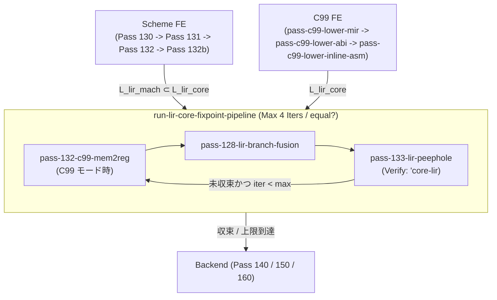

# [FEAT/ENH] L_lir_core 不動点最適化ループの Scheme / C99 共通化と LIR / StagePoly 言語契約・仕様書統合是正 (ID: 981)

## 1. 概要 / Summary

従来の `ulisp/compiler/pass_manager.scm` では、以下の 4 点の構造的ギャップが残存していた：

1. **LIR 不動点最適化ループの C99 偏在（Core #981）**:
   - `run-c99-o2-fixpoint-pipeline`（`pass-132-c99-mem2reg` → `pass-128-lir-branch-fusion` → `pass-133-lir-peephole`、最大 4 反復 `equal?` 収束）が C99 `-O2` 専用となっており、Scheme 側の `run-pass-pipeline` / `run-named-pipeline`（`-O2` 以降）では `Pass 128` → `Pass 133` が単発実行に留まっていた。
2. **LIR Verifier と C99 モジュラーパス連続性の穴（改善案 A）**:
   - `pass-133-lir-peephole` の `verifier-phase` が旧 `'lir`（`validate-lir`）のままになっており、仮に `%alloc` / `%box-fixnum` 等の未 Lowering な `L_lir_managed` 命令が混入しても `'core-lir`（`verify-core-lir` / `lir-verify-core-purity`）による検証がバイパスされていた。また `run-pass-pipeline` / `run-named-pipeline` の最終検証も `'lir` 固定だった。
   - さらに Issue #967 で分割された C99 パス群のうち `pass-c99-lower-abi` の `in-lang` が `'L_lir_core` と宣言されていたため、`pass-c99-lower-mir`（`out-lang = 'L_mir_ssa`）との間で `check-pipeline-continuity-by-ids` が不連続（`#f`）と判定されていた。
3. **部分評価 `L-StagePoly` / `L-Residual-ANF` 互換判定の過剰許容（改善案 E）**:
   - `nanopass-language-compatible?` が `{L_anf, L-StagePoly, L-Residual-ANF}` の 3×3 フルメッシュを `#t` としており、`L-Residual-ANF -> L-StagePoly` や `L-StagePoly -> L_anf` といった逆方向遷移も静的検査を通過していた。
4. **自動生成 Nanopass 仕様書・パイプライン仕様書の最新化遅延（改善案 C）**:
   - `ulisp/docs/spec_nanopass.md` に Issue #966 で導入された `L_mir_ssa`・`L_lir_mach` が未反映であり、`ulisp/docs/spec_pipeline.md` も Issues #966〜#972（`Pass 048` ＆ フロントエンド不動点、`Pass 080` 0-CFA ＆ HOF 単相化、`Pass 132/132b`、C99 3分割、x86-64 バックエンド 5分割）反映前の状態だった。

本 Issue ではこれらを一体的に統合・是正し、Scheme と C99 が共通の `run-lir-core-fixpoint-pipeline` で合流し、厳格な言語契約・Verifier・最新仕様書のもとで動作する基盤を確立する。

---

## 2. トレーサビリティ / Traceability

- 関連設計・ファイル:
  - [pass_manager.scm](../../../ulisp/compiler/pass_manager.scm)
  - [module_header.scm](../../../ulisp/compiler/module_header.scm)
  - [verifier.scm](../../../ulisp/compiler/verifier.scm)
  - [lir_verifier.scm](../../../ulisp/lir/lir_verifier.scm)
  - [lir_lang.scm](../../../ulisp/lir/lir_lang.scm)
  - [128_lir_branch_fusion.scm](../../../ulisp/lir/128_lir_branch_fusion.scm)
  - [133_lir_peephole.scm](../../../ulisp/lir/133_lir_peephole.scm)
  - [090_rtyper.scm](../../../ulisp/frontend/090_rtyper.scm)
  - [c_driver.scm](../../../ulisp/driver/c_driver.scm)
  - [spec_nanopass.md](../../../ulisp/docs/spec_nanopass.md)
  - [spec_pipeline.md](../../../ulisp/docs/spec_pipeline.md)
  - [test_pass_manager.scm](../../../ulisp/tests/test_pass_manager.scm)
  - [test_090_rtyper.scm](../../../ulisp/tests/passes/test_090_rtyper.scm)
- 関連 Issue:
  - [979-tighten-lir-language-compatibility-and-reconcile-lir-dialects.md](979-tighten-lir-language-compatibility-and-reconcile-lir-dialects.md)
  - [980-sync-nanopass-and-pipeline-specs-with-core-lir-and-stagepoly.md](980-sync-nanopass-and-pipeline-specs-with-core-lir-and-stagepoly.md)
  - [966-separate-mir-ssa-and-machine-lir-for-unified-middle-end.md](966-separate-mir-ssa-and-machine-lir-for-unified-middle-end.md)
  - [967-split-c99-lower-to-lir-into-modular-nanopasses.md](967-split-c99-lower-to-lir-into-modular-nanopasses.md)
  - [971-implement-general-inliner-and-frontend-fixpoint-optimization.md](971-implement-general-inliner-and-frontend-fixpoint-optimization.md)
  - [972-implement-0-cfa-devirtualization-and-higher-order-monomorphization.md](972-implement-0-cfa-devirtualization-and-higher-order-monomorphization.md)

---

## 3. 全 16 大スペシャリストエージェント統合レビュー (Governance Review)

| エージェント | 担当観点 | 指摘事項・設計合意 |
| :--- | :--- | :--- |
| **Project Manager (PM)** | 全体統括・ゲート管理 | Issue #981 に残存ギャップ A・C・E を統合し、3-Stage ブートストラップ・全テスト・`verify-quality-gates` 通過を完了条件とする。 |
| **Information Security Specialist** | LIR Verifier・型安全性 | `pass-133-lir-peephole` および最終 LIR 検証を `'core-lir` に厳格化し、`%alloc` / `%box-*` 漏洩を即時 Fail-Closed 検知する。 |
| **Systems Architect** | パイプライン統合設計 | `run-lir-core-fixpoint-pipeline` により Scheme (`128 <-> 133`) と C99 (`132-mem2reg -> 128 -> 133`) の不動点機構を単一化する。 |
| **QA Specialist** | 品質ゲート・回帰防止 | Group 14 テストで Scheme/C99 両モード収束、`core-lir` 拒否、`pass-c99-lower-*` 連続性、StagePoly 有向遷移を網羅検証する。 |
| **Database / Data Infra Specialist** | パス台帳・メタデータ整合 | `*pass-registry*` 上の `in-lang` / `out-lang` / `verifier-phase` 宣言を実際の変換データ表現と完全一致させる。 |
| **Network Specialist** | 外部依存ゼロ確認 | 外部通信・外部ツール追加ゼロのまま自給自足ツールチェインで `docs_nanopass` と `bootstrap` が完結することを確認。 |
| **IT Specialist (NLP & IR)** | 仕様書品質・一貫性 | `spec_nanopass.md` 全 17 言語と `spec_pipeline.md` 全体図・パス一覧の日本語用語・リンク整合性を保つ。 |
| **IT Strategist** | 段階的アーキテクチャ発展 | Issue #973（SSA SCCP/GVN/ADCE）導入前に `L_lir_core` 共通不動点枠組みを確立し二重投資を防ぐ。 |
| **IT Service Manager** | CI・ビルド時間影響 | 不動点反復上限をデフォルト 4 回に制限し、3-Stage ブートストラップ時間増大・発散を防止する。 |
| **Embedded Systems Specialist** | 低水準命令不変条件 | `pass-132b` 後の `L_lir_mach` / `L_lir_core` 境界でレジスタ規則・純粋 Core 命令セットを損なわない。 |
| **Systems Auditor** | 来歴・トレーサビリティ | Issue 台帳・仕様書・テスト・コード間の相互参照に絶対パスを一切残さず相対リンクのみで構成する。 |
| **UI/UX Designer** | Mermaid 構図視認性 | `spec_pipeline.md` および本 Issue 内の Mermaid 図を最新の合流・不動点ループ構造へ整理し可読性を高める。 |
| **Education Specialist** | 概念記述の明確化 | `L_mir_ssa`（仮想レジスタ SSA）と `L_lir_mach`（物理レジスタ機械 LIR）および C99 合流点の役割を平易に説明する。 |
| **Software Development (SWD)** | Core 実装・モジュール出力 | `module_header.scm` に新規 API を登録し、5 分割セルフホストコンパイラと `ulisp-cc` の双方でシンボル解決を保証する。 |
| **Application Specialist (APS)** | C99 ドライバ連携 | `c_driver.scm` 側の `run-c99-o2-fixpoint-pipeline` 呼び出し互換を保ったまま `run-lir-core-fixpoint-pipeline` へ委譲する。 |
| **IT Specialist (PLC)** | Nanopass 言語契約・部分評価 | `L_anf -> L-StagePoly -> L-Residual-ANF -> L_anf / L_lir_managed` の有向契約により不正パス並び替えを静的に遮断する。 |

---

## 4. 脅威モデリングと安全性要件 / Threat Model & Safety Requirements

- **THREAT-981-1 (Unbounded Fixpoint Oscillation / DoS)**:
  - `pass-128-lir-branch-fusion` と `pass-133-lir-peephole` の相互作用による無限反復リスク。
  - **対策**: `*lir-core-fixpoint-max-iterations*`（既定値 `4`）と `equal?` 収束判定により最大反復回数で決定論的に停止する。
- **THREAT-981-2 (Managed Dialect Opcodes Leaking Past Peephole / CWE-843)**:
  - `pass-133-lir-peephole` の Verifier が `'lir` の場合、`%alloc` や `%box-fixnum` が残存していても検証を素通りする。
  - **対策**: `pass-133-lir-peephole` の `verifier-phase` を `'core-lir` に変更し、`run-pass-pipeline` / `run-named-pipeline` の最終検証も `pass-131` 経過時は `'core-lir` を強制する。
- **THREAT-981-3 (Backwards StagePoly Pass Ordering)**:
  - 3×3 フルメッシュ許容により `L-Residual-ANF -> L-StagePoly` 等が誤って受理されるリスク。
  - **対策**: `nanopass-language-compatible?` を `L_anf -> L-StagePoly`、`L-Residual-ANF -> L_anf`、`L-Residual-ANF -> L_lir_managed` の有向遷移のみに限定する。
- **THREAT-981-4 (C99 Lowering Continuity Gap & Spec Drift)**:
  - `pass-c99-lower-mir (L_mir_ssa) -> pass-c99-lower-abi (L_lir_core)` の宣言不整合と仕様書乖離。
  - **対策**: `pass-c99-lower-abi` の `in-lang` を `'L_mir_ssa` に是正して 3 分割パスの連続性を回復し、`spec_nanopass.md` / `spec_pipeline.md` を同時更新する。

---

## 5. 影響範囲と関連ファイル / Scope and Affected Files

- [x] [pass_manager.scm](../../../ulisp/compiler/pass_manager.scm)
- [x] [module_header.scm](../../../ulisp/compiler/module_header.scm)
- [x] [compiler.scm](../../../ulisp/compiler.scm)
- [x] [128_lir_branch_fusion.scm](../../../ulisp/lir/128_lir_branch_fusion.scm)
- [x] [133_lir_peephole.scm](../../../ulisp/lir/133_lir_peephole.scm)
- [x] [090_rtyper.scm](../../../ulisp/frontend/090_rtyper.scm)
- [x] [spec_nanopass.md](../../../ulisp/docs/spec_nanopass.md)
- [x] [spec_pipeline.md](../../../ulisp/docs/spec_pipeline.md)
- [x] [test_pass_manager.scm](../../../ulisp/tests/test_pass_manager.scm)
- [x] [test_090_rtyper.scm](../../../ulisp/tests/passes/test_090_rtyper.scm)

---

## 6. 実装方針 / Implementation Plan

Target Branch: `feat/981-unify-lir-core-fixpoint-optimization`

1. **改善案 E（`nanopass-language-compatible?` の有向化）**:
   - `{L_anf, L-StagePoly, L-Residual-ANF}` の無条件 3×3 互換節を、有向ルール（`L_anf -> L-StagePoly`、`L-Residual-ANF -> L_anf`、`L-Residual-ANF -> L_lir_managed`）へ置換する。
2. **Core #981（`L_lir_core` 不動点最適化の Scheme / C99 共通化）**:
   - `*lir-core-fixpoint-max-iterations*`（既定 `4`）、`lir-core-fixpoint-max-iterations`、`set-lir-core-fixpoint-max-iterations!`、`lir-core-fixpoint-pass-id?`、`run-lir-core-fixpoint-pipeline` を追加し、`run-c99-o2-fixpoint-pipeline` は `(run-lir-core-fixpoint-pipeline lir #t)` への委譲ラッパーとする。
   - `run-pass-pipeline` および `run-named-pipeline` で、`(>= (pipeline-opt-level) 2)` 時に連続する `lir-core-fixpoint-pass-id?` クラスタ（`pass-128-lir-branch-fusion` → `pass-133-lir-peephole` 等）を `run-pass-fixpoint-opts` で不動点反復実行する。
3. **改善案 A（LIR Verifier と C99 モジュラーパス連続性の厳格化）**:
   - `pass-133-lir-peephole` の `verifier-phase` を `'lir` から `'core-lir` に変更する。
   - `run-pass-pipeline` / `run-named-pipeline` の最終 LIR 検証で、`pass-131-lower-managed-dialect` を含む場合は `'core-lir` を選択する。
   - `pass-c99-lower-abi` の `in-lang` を `'L_mir_ssa` に修正し、`'(pass-c99-lower-mir pass-c99-lower-abi pass-c99-lower-inline-asm)` の `check-pipeline-continuity-by-ids` 通過を保証する。
4. **改善案 C（仕様書の最新化）**:
   - `make -C ulisp docs_nanopass` で [spec_nanopass.md](../../../ulisp/docs/spec_nanopass.md) を再生成する。
   - [spec_pipeline.md](../../../ulisp/docs/spec_pipeline.md) §1・§2・§3.1 を現行実装（#966〜#972 および #981）へ同期する。
5. **単体テスト拡充・潜在不具合修正・3-Stage ブートストラップ検証**:
   - [test_pass_manager.scm](../../../ulisp/tests/test_pass_manager.scm) に Group 14、 [test_090_rtyper.scm](../../../ulisp/tests/passes/test_090_rtyper.scm) に Test 15 を追加。
   - L_lir_core 不動点反復および `-B` フルリビルドで顕在化した 3 件の潜在不具合を修正した：
     1. [128_lir_branch_fusion.scm](../../../ulisp/lir/128_lir_branch_fusion.scm): `lir-invert-cond-op` に `"sete"`〜`"setae"` 分岐反転ケースを追加（反復 2 で `gc-copy-object` 誤コンパイルを解消）。
     2. [133_lir_peephole.scm](../../../ulisp/lir/133_lir_peephole.scm): `lir-regalloc-compute-global-reg-masks` で Contification `(%block ...)` ヘッダを生存集合マージ対象に追加し、バックワード反復上限を 8 に引き上げ（呼出しなしループでの `%rdi` 破壊を解消）。
     3. [090_rtyper.scm](../../../ulisp/frontend/090_rtyper.scm): `(module-mode?)` / `(allow-extern-symbols?)` 有効時はトップレベル関数 (`ulisp_fn_bitwise_not` 等) の `top-pure-int-fns` 外部 ABI アンボックス化を抑止し、分割コンパイル間のタグ付き ABI 契約を保護。

---

## 7. 完了条件 / Success Criteria (DoD)

- [x] `run-lir-core-fixpoint-pipeline` が定義・エクスポートされ、Scheme `-O2` 経路（`run-pass-pipeline` / `run-named-pipeline`）と C99 `-O2` 経路（`run-c99-o2-fixpoint-pipeline`）の双方が共通の有界不動点エンジンで動作すること。
- [x] `pass-133-lir-peephole` の `verifier-phase` が `'core-lir` となり、未 Lowering な managed 命令混入を `verify-mode = #t` で拒否すること。
- [x] `check-pipeline-continuity-by-ids` が `'(pass-c99-lower-mir pass-c99-lower-abi pass-c99-lower-inline-asm)` を `#t` として受理すること。
- [x] `nanopass-language-compatible?` が `L_anf -> L-StagePoly` / `L-Residual-ANF -> L_anf` / `L-Residual-ANF -> L_lir_managed` を受理し、逆方向遷移を `#f` として拒否すること。
- [x] `spec_nanopass.md`（全 17 言語）および `spec_pipeline.md` が現行実装と同期し、絶対パス 0 件・相対リンク切れ 0 件であること。
- [x] `make -C ulisp lint_sexpr test_pass_manager test_pass_manager_cache_invalidation test_lir_dialect_separation bootstrap test test_ulisp_cc_native` および `make format && make static_analysis` が全 PASS すること。
