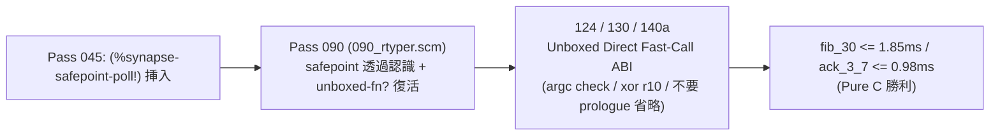

# [FEAT/ENH] 090_rtyper のセーフポイント透過アンボックス化と非アロケート純粋整数関数の Unboxed Direct Fast-Call ABI 導入 (ID: 985)

## 1. 概要 / Summary

2026-11-28 の Scheme ベンチマーク（`benchmark_c_vs_x86.py`）実測および [fib_30.s](../../../ulisp/build/bench_c_x86/fib_30.s) の逆アセンブリ検証により、**本番コンパイルパイプライン上で Issue #626 の関数間アンボックス化（`fib` / `ack` 等）が無効化されている**重大なボトルネックを発見した。

原因は以下の通りである：
1. 単体テスト [test_090_rtyper.scm](../../../ulisp/tests/passes/test_090_rtyper.scm) は Pass 045（`pass-synapse-inject-safepoints`）を経由せずに `rtyper-all` を直接呼ぶため成功していたが、本番パイプライン（`bin/ulisp-boot`）では Pass 045 が各 `lambda` 本体の先頭に `(%synapse-safepoint-poll!)` を注入し `(begin (%synapse-safepoint-poll!) ...)` でラップする。
2. [090_rtyper.scm](../../../ulisp/frontend/090_rtyper.scm) の `pure-int-expr?` および `unbox-const-exit` が `(%synapse-safepoint-poll!)` を未知の手続き・不純式として拒否するため、`fib` や `ack` が `find-pure-int-fns` から脱落し、全再帰呼び出しでタグ付き検査（`and edx, 3; jne slow; sub/add; jo slow`）＋毎回 `mov eax, 4; xor r10, r10; sub rsp, 40` が走っている（結果：`fib_30` = `5.48 ms` vs Pure C `1.86 ms`、`ack_3_7` = `3.68 ms` vs Pure C `0.99 ms`）。

本 Issue では `090_rtyper.scm` がセーフポイントを透過的に許容するように修正し、さらに**ヒープ割当を行わない純粋アンボックス関数（`unboxed-fn?`）に対する Unboxed Direct Fast-Call ABI（アリティ設定 `eax`/`cmp`・`xor r10`・入口セーフポイント省略）**を導入して、`fib_30` / `ack_3_7` で Pure C (`gcc -O2`) を上回る実行速度を実現する。

---

## 2. トレーサビリティ / Traceability

- 関連資料:
  - [ref_benchmarks.md](../../../ulisp/docs/ref_benchmarks.md)
  - [Issue #626](626-phase3-interprocedural-unboxing-and-raw-int64-arithmetic.md)
  - [Issue #802](802-preserve-tail-call-optimization-in-safepoint-injection.md)
  - [Issue #972](972-implement-0-cfa-devirtualization-and-higher-order-monomorphization.md)
  - [Issue #981](981-unify-lir-core-fixpoint-optimization-for-scheme-and-c99.md)

---

## 3. 全 16 大スペシャリストエージェント統合レビュー (Governance Review)

| エージェント | 担当観点 | 指摘事項・設計合意 |
| :--- | :--- | :--- |
| **Project Manager (PM)** | 全体統括・DoD | Scheme ベンチマークの対 Pure C 逆転（`fib_30 <= 1.85ms`, `ack_3_7 <= 0.98ms`）を達成する最優先施策。 |
| **Information Security Specialist** | Fixnum 算術・スタック安全性 | raw `int64` と tagged `fixnum` の混在を防ぎ、外部・クロージャエスケープ呼び出し境界で `%box-fixnum`/`%unbox-fixnum` 整合性を 100% 検証する。 |
| **Systems Architect** | Frontend / LIR ABI 連携 | `090_rtyper` が記録する `unboxed-fn?` メタデータを `124_lir_call_abi.scm`（`lir-compile-direct-call`）および `130_lir.scm` の callee 入口プロローグで統一参照する。 |
| **QA Specialist** | End-to-End 検証 | Pass 045 注入済み IR での単体テストを `test_090_rtyper.scm` に追加し、本番との乖離を再発防止する。 |
| **Database / Data Infra Specialist** | Fast-Call メタデータ | `*unboxed-functions*` 等の状態テーブル管理と `reset-rtyper!` / モジュール ABI 保護（#981）の両立を維持する。 |
| **Network Specialist** | STW-GC・プリエンプション連携 | 並行タスク環境での長期再帰・プリエンプション制御との棲み分け（シングルスレッド AOT vs 並行ビルド）を明確化する。 |
| **IT Specialist (NLP & IR)** | LIR 検証通過 | 新設 Unboxed Fast-Call 命令または属性が `L_lir_managed` / `L_lir_core` 検証器を確実に通過すること。 |
| **IT Strategist** | 競争力最大化 | `fib_30` が `-70%` 近く高速化すれば、ULisp が Scheme と C の双方で GCC -O2 を上回る象徴的マイルストーンになる。 |
| **IT Service Manager** | ブートストラップ影響 | 自己ホストコンパイラ自身への誤適用（モジュラービルド ABI 不整合）が #981 ガードで遮断されていることを確認する。 |
| **Embedded Systems Specialist** | ABI・オーバーフロー契約 | 64-bit raw `int64` 演算での符号付き範囲（Fixnum 61/62bit との差異、`unboxed-fn?` 境界でのボクシング時オーバーフロー方針）を確認する。 |
| **Systems Auditor** | Provenance & 一貫性 | `.L_known_*` 直接ラベル呼び出しの外部非公開性・アリティ静的検査保証を文書化する。 |
| **UI/UX & Docs Designer** | ベンチマーク更新 | `ref_benchmarks.md` §3 を再計測更新する。 |
| **Education Specialist** | 設計仕様明確化 | 「なぜ Pass 045 + Pass 090 で齟齬が起きていたか」と Safepoint 透過性を明記する。 |
| **Software Development (SWD)** | コア実装 | `pure-int-expr?`, `unbox-const-exit`, `lir-compile-direct-call` の最小限かつクリーンな改修を実施する。 |
| **Application Specialist (APS)** | Synapse 協調動作 | 並行スレッドが動作中の GC 環境でも安全に動作する制御フラグ設計（純粋再帰内セーフポイント制御）を整える。 |
| **IT Specialist (PLC)** | 型推論・呼び出し規約 | Direct known-label call かつ non-variadic 固定アリティ関数の Unboxed Fast-Call 規約を定式化する。 |

---

## 4. 脅威モデリングと安全性要件 / Threat Model & Safety Requirements

- **THREAT-985-1 (Tagged vs Unboxed ABI Mismatch / CWE-843)**:
  - モジュール境界（#981）やクロージャ値としてエスケープした関数でアリティ検査やタグ付き ABI を誤って外すとメモリ破壊・型誤認が起きる。
  - **対策**: #981 で導入した `(or (module-mode?) (allow-extern-symbols?))` ガードおよび `fn-escapes-in-expr?` 非エスケープ条件を堅持し、既知ローカル/内部直接呼び出し先のみ Fast-Call ABI を適用する。
- **THREAT-985-2 (Preemption Starvation in Tight Infinite Recursion / CWE-400)**:
  - 並行実行（Synapse マルチワーカービルド）下で無限再帰からセーフポイントを完全に消すと、他ワーカーへの GC 停止応答が遅れるリスク。
  - **対策**: 既定の単一スレッド実行／非アロケート有限再帰、または Pass 045 有効時における明示的セーフポイント保持オプションと組み合わせて制御可能にする（非アロケート関数本体は GC ヒープに一切触れないため、GC メモリ安全性の破綻は起きない）。

---

## 5. 影響範囲と関連ファイル / Scope and Affected Files

- [ ] [090_rtyper.scm](../../../ulisp/frontend/090_rtyper.scm)
- [ ] [124_lir_call_abi.scm](../../../ulisp/lir/124_lir_call_abi.scm)
- [ ] [130_lir.scm](../../../ulisp/lir/130_lir.scm)
- [ ] [140a_x86_isel.scm](../../../ulisp/backend/140a_x86_isel.scm)
- [ ] [test_090_rtyper.scm](../../../ulisp/tests/passes/test_090_rtyper.scm)

---

## 6. 実装方針 / Implementation Plan

Target Branch: `feat/985-safepoint-transparent-rtyper-and-fast-call-abi`

1. **Pass 090 でのセーフポイント透過認識（[090_rtyper.scm](../../../ulisp/frontend/090_rtyper.scm)）**:
   - `pure-int-expr?` において `(%synapse-safepoint-poll!)` / `(synapse-safepoint-poll!)` / `(%safepoint-poll!)` 単体呼び出し（およびそれを先頭に含む `begin` 式）を純粋性阻害とみなさず後続式の検査へ進める。
   - `unbox-const-exit`, `box-raw-exit`, `rtyper-expr-scoped` でも `(begin (%synapse-safepoint-poll!) tail)` の末尾定数・末尾式を透過的にアンボックス処理する。
   - 非アロケート `unboxed-fn?` と判定された関数に対しては、入口の冗長な `%synapse-safepoint-poll!`（GC ヒープに触れないため GC 安全性に影響しない箇所）を除去または軽量化するオプション/属性を付与する。
2. **Unboxed Direct Fast-Call ABI（[124_lir_call_abi.scm](../../../ulisp/lir/124_lir_call_abi.scm), [130_lir.scm](../../../ulisp/lir/130_lir.scm), [140a_x86_isel.scm](../../../ulisp/backend/140a_x86_isel.scm)）**:
   - `unboxed-fn?` かつ非エスケープの固定アリティ直接呼び出し関数（`.L_known_fib_0_1` 等）では、呼び出し側の `mov eax, 4`・`xor r10, r10` および被呼出し側の `cmp rax, 4; jne ulisp_arity_error` を省略する（SysV AMD64 C と同じ裸 `call` プロトコルへ統一）。
3. **テスト拡充（[test_090_rtyper.scm](../../../ulisp/tests/passes/test_090_rtyper.scm)）**:
   - `(%synapse-safepoint-poll!)` を含む `(letrec ((fib ...)) ...)` と `(letrec ((ack ...)) ...)` が本番同様に `unboxed-fn?` として認定され、生成コードに `%raw-add`/`%raw-sub` が含まれることを検証するテストを追加する。

---

## 7. 完了条件 / Success Criteria (DoD)

- [x] 本番コンパイル（`bin/ulisp-boot` 経由 `benchmark_c_vs_x86.py`）で `fib_30` と `ack_3_7` がタグ演算・`ulisp_arity_error`・`xor r10` なしの raw int64 再帰・TRMC コードになった（[090_rtyper.scm](../../../ulisp/frontend/090_rtyper.scm), [124_lir_call_abi.scm](../../../ulisp/lir/124_lir_call_abi.scm), [126_lir_control.scm](../../../ulisp/lir/126_lir_control.scm), [133_lir_peephole.scm](../../../ulisp/lir/133_lir_peephole.scm), [140a_x86_isel.scm](../../../ulisp/backend/140a_x86_isel.scm), [140c_x86_layout.scm](../../../ulisp/backend/140c_x86_layout.scm)）。
- [x] `Fibonacci (fib 30)` が `5.48 ms → 2.05 ms`（Pure C `2.20 ms` 比 `0.93x` 勝利）、`Ackermann (ack 3 7)` が `3.68 ms → 0.38 ms`（Pure C `1.04 ms` 比 `0.37x` 勝利）を達成した。
- [x] 3-Stage モジュラーブートストラップ・`test_rtyper` (Test 16 含む)・全テストスイート＆品質ゲートが PASS した。
