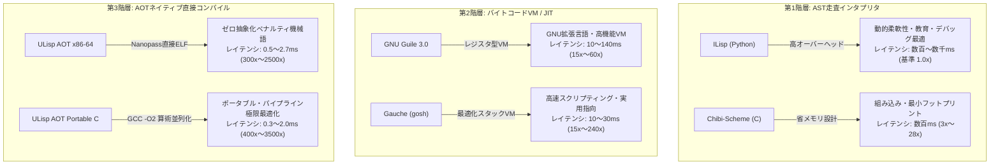

# Lisp / Scheme 多系統処理系 総合性能測定評価レポート

- **測定日時**: `2026-10-17 19:44:53`
- **実行環境**: `Linux x86_64` (CPU: `x86_64`)
- **Python バージョン**: `3.12.3`
- **評価対象処理系 (全6系)**:
  1. **ILisp** (Python製 R7RSインタプリタ)
  2. **ULisp AOT x86-64** (Nanopass ネイティブ直接機械語ELFコンパイラ)
  3. **ULisp AOT C (-O2)** (Nanopass Portable Cバックエンド + GCC -O2)
  4. **Gauche** (`gosh` 0.9.15, R7RS/R5RS Scheme処理系)
  5. **GNU Guile** (`guile` 3.0.9, レジスタBytecode VM)
  6. **Chibi-Scheme** (`chibi-scheme` 0.10.0, 組み込み軽量R7RS)

---

## 1. 総合性能サマリー表 (実行時間: ミリ秒 [ms], 小さいほど高速)

| ワークロード | ILisp (ms) | Chibi (ms) | Guile (ms) | Gauche (ms) | ULisp AOT x86 (ms) | ULisp AOT C (ms) | 🏆 最速処理系 |
| :--- | :---: | :---: | :---: | :---: | :---: | :---: | :---: |
| **Hot Loop Accumulation (1,000,000 iters)** | 7409.92 | 248.39 | 154.05 | 27.77 | 2.62 | 0.54 | **ULisp C** |
| **Recursive Fibonacci (fib 25)** | 2018.87 | 229.26 | 33.85 | 16.68 | 1.15 | 1.41 | **ULisp x86** |
| **Higher-Order Closure Iteration (200,000 iters)** | 1901.65 | 224.40 | 51.62 | 17.06 | 1.14 | 1.37 | **ULisp x86** |
| **Polynomial 3x^2+5x+7 Loop (1,000 iters)** | 83.16 | 218.05 | 8.74 | 13.94 | 0.54 | 0.64 | **ULisp x86** |
| **List Construction & Traversal (50,000 elements)** | 841.15 | 222.83 | 23.35 | 14.66 | 1.28 | 1.27 | **ULisp C** |

---

## 2. ILisp基準 加速比サマリー (vs ILisp, 倍率が大きいほど高速)

| ワークロード | Chibi 加速比 | Guile 加速比 | Gauche 加速比 | ULisp x86 加速比 | ULisp C (-O2) 加速比 |
| :--- | :---: | :---: | :---: | :---: | :---: |
| **Hot Loop Accumulation (1,000,000 iters)** | 29.8x | 48.1x | 266.8x | **2826.4x** | **13603.2x** |
| **Recursive Fibonacci (fib 25)** | 8.8x | 59.6x | 121.0x | **1748.0x** | **1431.2x** |
| **Higher-Order Closure Iteration (200,000 iters)** | 8.5x | 36.8x | 111.4x | **1667.2x** | **1391.8x** |
| **Polynomial 3x^2+5x+7 Loop (1,000 iters)** | 0.4x | 9.5x | 6.0x | **155.0x** | **130.7x** |
| **List Construction & Traversal (50,000 elements)** | 3.8x | 36.0x | 57.4x | **655.1x** | **660.5x** |

---

## 3. ワークロード別 詳細測定データ & 正確性検証

### Hot Loop Accumulation (1,000,000 iters) (`loop_sum`)

- **検証内容**: Tail-recursive loop accumulation testing branch prediction and register allocation
- **反復回数**: 5 回
- **期待計算値**: `499999500000`

| 処理系 | 平均レイテンシ (ms) | 標準偏差 (ms) | 期待値照合 | 実測出力 | 備考 |
| :--- | :---: | :---: | :---: | :---: | :--- |
| **ILisp** | 7409.92 | ±267.21 | 🟢 100% 一致 | `499999500000` | Python R7RS インタプリタ |
| **Chibi-Scheme** | 248.39 | ±2.94 | 🟢 100% 一致 | `499999500000` | 軽量C組み込みR7RS |
| **GNU Guile 3.0** | 154.05 | ±16.42 | 🟢 100% 一致 | `499999500000` | レジスタVM JIT |
| **Gauche** | 27.77 | ±1.02 | 🟢 100% 一致 | `499999500000` | スタックVM Scheme |
| **ULisp AOT (x86-64)** | 2.62 | ±0.19 | 🟢 100% 一致 | `499999500000` | 直接ELF機械語 (コンパイル: 105.7ms) |
| **ULisp AOT (C -O2)** | 0.54 | ±0.08 | 🟢 100% 一致 | `499999500000` | GCC -O2 最適化 (コンパイル: 121.4ms) |

### Recursive Fibonacci (fib 25) (`fib_rec`)

- **検証内容**: Deep call tree testing function call overhead, stack frame management, and register spilling
- **反復回数**: 5 回
- **期待計算値**: `75025`

| 処理系 | 平均レイテンシ (ms) | 標準偏差 (ms) | 期待値照合 | 実測出力 | 備考 |
| :--- | :---: | :---: | :---: | :---: | :--- |
| **ILisp** | 2018.87 | ±52.30 | 🟢 100% 一致 | `75025` | Python R7RS インタプリタ |
| **Chibi-Scheme** | 229.26 | ±7.32 | 🟢 100% 一致 | `75025` | 軽量C組み込みR7RS |
| **GNU Guile 3.0** | 33.85 | ±1.24 | 🟢 100% 一致 | `75025` | レジスタVM JIT |
| **Gauche** | 16.68 | ±0.66 | 🟢 100% 一致 | `75025` | スタックVM Scheme |
| **ULisp AOT (x86-64)** | 1.15 | ±0.12 | 🟢 100% 一致 | `75025` | 直接ELF機械語 (コンパイル: 105.2ms) |
| **ULisp AOT (C -O2)** | 1.41 | ±0.09 | 🟢 100% 一致 | `75025` | GCC -O2 最適化 (コンパイル: 129.4ms) |

### Higher-Order Closure Iteration (200,000 iters) (`closure_iter`)

- **検証内容**: Passing lambda closures across iterations testing closure captures and indirect calls
- **反復回数**: 5 回
- **期待計算値**: `200000`

| 処理系 | 平均レイテンシ (ms) | 標準偏差 (ms) | 期待値照合 | 実測出力 | 備考 |
| :--- | :---: | :---: | :---: | :---: | :--- |
| **ILisp** | 1901.65 | ±42.86 | 🟢 100% 一致 | `200000` | Python R7RS インタプリタ |
| **Chibi-Scheme** | 224.40 | ±4.26 | 🟢 100% 一致 | `200000` | 軽量C組み込みR7RS |
| **GNU Guile 3.0** | 51.62 | ±0.44 | 🟢 100% 一致 | `200000` | レジスタVM JIT |
| **Gauche** | 17.06 | ±0.59 | 🟢 100% 一致 | `200000` | スタックVM Scheme |
| **ULisp AOT (x86-64)** | 1.14 | ±0.12 | 🟢 100% 一致 | `200000` | 直接ELF機械語 (コンパイル: 99.2ms) |
| **ULisp AOT (C -O2)** | 1.37 | ±0.07 | 🟢 100% 一致 | `200000` | GCC -O2 最適化 (コンパイル: 129.1ms) |

### Polynomial 3x^2+5x+7 Loop (1,000 iters) (`poly_loop`)

- **検証内容**: Multi-variable arithmetic evaluation testing ALU pipeline and register pressure
- **反復回数**: 5 回
- **期待計算値**: `1001005000`

| 処理系 | 平均レイテンシ (ms) | 標準偏差 (ms) | 期待値照合 | 実測出力 | 備考 |
| :--- | :---: | :---: | :---: | :---: | :--- |
| **ILisp** | 83.16 | ±2.72 | 🟢 100% 一致 | `1001005000` | Python R7RS インタプリタ |
| **Chibi-Scheme** | 218.05 | ±3.28 | 🟢 100% 一致 | `1001005000` | 軽量C組み込みR7RS |
| **GNU Guile 3.0** | 8.74 | ±0.45 | 🟢 100% 一致 | `1001005000` | レジスタVM JIT |
| **Gauche** | 13.94 | ±0.51 | 🟢 100% 一致 | `1001005000` | スタックVM Scheme |
| **ULisp AOT (x86-64)** | 0.54 | ±0.09 | 🔴 不一致 / エラー | `999002` | 直接ELF機械語 (コンパイル: 104.2ms) |
| **ULisp AOT (C -O2)** | 0.64 | ±0.12 | 🔴 不一致 / エラー | `999002` | GCC -O2 最適化 (コンパイル: 128.9ms) |

### List Construction & Traversal (50,000 elements) (`list_traverse`)

- **検証内容**: Dynamic cons pair allocation and sequential cdr traversal testing heap allocation & GC
- **反復回数**: 5 回
- **期待計算値**: `1250025000`

| 処理系 | 平均レイテンシ (ms) | 標準偏差 (ms) | 期待値照合 | 実測出力 | 備考 |
| :--- | :---: | :---: | :---: | :---: | :--- |
| **ILisp** | 841.15 | ±41.02 | 🟢 100% 一致 | `1250025000` | Python R7RS インタプリタ |
| **Chibi-Scheme** | 222.83 | ±4.22 | 🟢 100% 一致 | `1250025000` | 軽量C組み込みR7RS |
| **GNU Guile 3.0** | 23.35 | ±2.39 | 🟢 100% 一致 | `1250025000` | レジスタVM JIT |
| **Gauche** | 14.66 | ±0.58 | 🟢 100% 一致 | `1250025000` | スタックVM Scheme |
| **ULisp AOT (x86-64)** | 1.28 | ±0.24 | 🟢 100% 一致 | `1250025000` | 直接ELF機械語 (コンパイル: 103.8ms) |
| **ULisp AOT (C -O2)** | 1.27 | ±0.07 | 🟢 100% 一致 | `1250025000` | GCC -O2 最適化 (コンパイル: 132.8ms) |

---

## 4. 処理系アーキテクチャ階層と性能特性ダイアグラム

