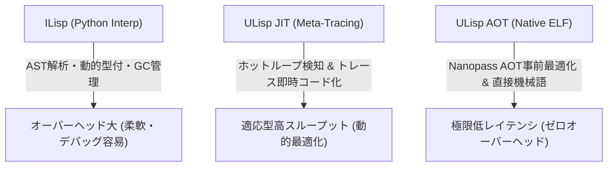

# ILisp vs ULisp AOT vs ULisp JIT 3種実行系 性能評価レポート

- **測定日時**: `2026-11-21 18:50:16`
- **実行環境**: `Linux x86_64` (CPU: `x86_64`)
- **Python バージョン**: `3.14.7`
- **バイアス排除ハーネス**: Mytkowicz 4KB 環境変数パディング適用 (`BENCHMARK_ENV_PAD`)
- **評価対象**: ILisp (Interp), ULisp AOT (Native ELF), ULisp JIT (Meta-Tracing JIT)

---

## 1. 総合評価サマリー

| ワークロード | ILisp [Interp] (ms) | ULisp AOT (ms) | ULisp JIT (ms) | AOT加速比 (vs ILisp) | JIT加速比 (vs ILisp) | 整合性検証 |
| :--- | :---: | :---: | :---: | :---: | :---: | :---: |
| Iterative Fibonacci (fib 20) | 85.11 ± 5.39 | 0.64 ± 0.38 | 8.10 ± 0.30 | **132.5x** | **10.5x** | 🟢 100% PASS |
| Iterative Factorial (fact 12) | 75.74 ± 4.82 | 0.46 ± 0.14 | 8.28 ± 0.64 | **164.3x** | **9.1x** | 🟢 100% PASS |
| Hot Loop Accumulation (5,000 iters) | 150.75 ± 66.89 | 0.40 ± 0.08 | 23.61 ± 2.86 | **380.5x** | **6.4x** | 🟢 100% PASS |
| Polynomial Loop 3x^2+5x+7 (1,000 iters) | 103.00 ± 6.74 | 0.45 ± 0.10 | 22.28 ± 14.48 | **226.4x** | **4.6x** | 🟢 100% PASS |
| Triangular Sum (tri 500) | 90.66 ± 16.00 | 0.41 ± 0.13 | 11.98 ± 0.90 | **222.8x** | **7.6x** | 🟢 100% PASS |

---

## 2. ワークロード別詳細分析

### Iterative Fibonacci (fib 20) (`fib_loop`)

- **概要**: Multi-variable state transition and sequential additions
- **反復回数**: 5 回
- **期待値 / 実測値**: `6765` (ILisp: `6765`, AOT: `6765`, JIT: `6765`)
- **AOT コンパイル所要時間**: `81.17 ms`

| 実行系 | 平均時間 (ms) | 最小値 (ms) | 最大値 (ms) | 標準偏差 (ms) |
| :--- | :---: | :---: | :---: | :---: |
| **ILisp** (Python) | 85.11 | 80.02 | 92.92 | 5.39 |
| **ULisp AOT** (Native ELF) | 0.64 | 0.32 | 1.24 | 0.38 |
| **ULisp JIT** (Meta-Tracing) | 8.10 | 7.75 | 8.44 | 0.30 |

### Iterative Factorial (fact 12) (`fact_loop`)

- **概要**: 64-bit integer multiplication and accumulator updates
- **反復回数**: 5 回
- **期待値 / 実測値**: `479001600` (ILisp: `479001600`, AOT: `479001600`, JIT: `479001600`)
- **AOT コンパイル所要時間**: `80.23 ms`

| 実行系 | 平均時間 (ms) | 最小値 (ms) | 最大値 (ms) | 標準偏差 (ms) |
| :--- | :---: | :---: | :---: | :---: |
| **ILisp** (Python) | 75.74 | 70.19 | 83.47 | 4.82 |
| **ULisp AOT** (Native ELF) | 0.46 | 0.36 | 0.70 | 0.14 |
| **ULisp JIT** (Meta-Tracing) | 8.28 | 7.71 | 9.36 | 0.64 |

### Hot Loop Accumulation (5,000 iters) (`sum_loop`)

- **概要**: Named-let hot loop: tests JIT loop trace recording & branch prediction
- **反復回数**: 5 回
- **期待値 / 実測値**: `12497500` (ILisp: `12497500`, AOT: `12497500`, JIT: `12497500`)
- **AOT コンパイル所要時間**: `181.00 ms`

| 実行系 | 平均時間 (ms) | 最小値 (ms) | 最大値 (ms) | 標準偏差 (ms) |
| :--- | :---: | :---: | :---: | :---: |
| **ILisp** (Python) | 150.75 | 109.13 | 268.53 | 66.89 |
| **ULisp AOT** (Native ELF) | 0.40 | 0.34 | 0.53 | 0.08 |
| **ULisp JIT** (Meta-Tracing) | 23.61 | 20.79 | 27.71 | 2.86 |

### Polynomial Loop 3x^2+5x+7 (1,000 iters) (`poly_loop`)

- **概要**: Heavy arithmetic instruction pipeline, register allocation, and loop optimization
- **反復回数**: 5 回
- **期待値 / 実測値**: `1001005000` (ILisp: `1001005000`, AOT: `1001005000`, JIT: `1001005000`)
- **AOT コンパイル所要時間**: `81.16 ms`

| 実行系 | 平均時間 (ms) | 最小値 (ms) | 最大値 (ms) | 標準偏差 (ms) |
| :--- | :---: | :---: | :---: | :---: |
| **ILisp** (Python) | 103.00 | 95.18 | 111.52 | 6.74 |
| **ULisp AOT** (Native ELF) | 0.45 | 0.38 | 0.56 | 0.10 |
| **ULisp JIT** (Meta-Tracing) | 22.28 | 12.91 | 46.93 | 14.48 |

### Triangular Sum (tri 500) (`tri_loop`)

- **概要**: Linear iteration counter decrement and accumulator addition
- **反復回数**: 5 回
- **期待値 / 実測値**: `125250` (ILisp: `125250`, AOT: `125250`, JIT: `125250`)
- **AOT コンパイル所要時間**: `80.77 ms`

| 実行系 | 平均時間 (ms) | 最小値 (ms) | 最大値 (ms) | 標準偏差 (ms) |
| :--- | :---: | :---: | :---: | :---: |
| **ILisp** (Python) | 90.66 | 77.56 | 118.22 | 16.00 |
| **ULisp AOT** (Native ELF) | 0.41 | 0.31 | 0.64 | 0.13 |
| **ULisp JIT** (Meta-Tracing) | 11.98 | 10.82 | 13.19 | 0.90 |

---

## 3. アーキテクチャ階層と性能特性ダイアグラム

