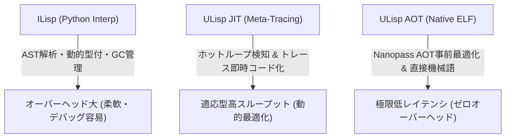

# ILisp vs ULisp AOT vs ULisp JIT 3種実行系 継続的性能評価レポート

- **測定日時**: `2026-11-21 19:03:45`
- **実行環境**: `Linux x86_64` (CPU: `x86_64`)
- **Python バージョン**: `3.14.7`
- **測定バイアス排除**: Mytkowicz 4KB 環境変数パディング適用 (`BENCHMARK_ENV_PAD`)
- **評価反復回数**: `5 回`
- **評価対象**: ILisp (Python Interp), ULisp AOT (Nanopass Native ELF), ULisp JIT (Meta-Tracing JIT)

---

## 1. 総合評価エグゼクティブサマリー

| ワークロード | ILisp [Interp] (ms) | ULisp AOT (ms) | ULisp JIT (ms) | AOT加速比 (vs ILisp) | JIT加速比 (vs ILisp) | 整合性検証 | 退行判定 |
| :--- | :---: | :---: | :---: | :---: | :---: | :---: | :---: |
| Iterative Fibonacci (fib 20) | 70.64 ± 3.53 | 0.66 ± 0.15 | 8.63 ± 0.73 | **107.0x** | **8.2x** | 🟢 100% PASS | 🟢 PASS |
| Iterative Factorial (fact 12) | 65.36 ± 0.82 | 0.43 ± 0.07 | 8.67 ± 0.71 | **151.6x** | **7.5x** | 🟢 100% PASS | 🟢 PASS |
| Hot Loop Accumulation (5,000 iters) | 104.32 ± 3.32 | 0.35 ± 0.06 | 18.81 ± 0.32 | **295.4x** | **5.5x** | 🟢 100% PASS | 🟢 PASS |
| Polynomial Loop 3x^2+5x+7 (1,000 iters) | 83.43 ± 1.81 | 0.52 ± 0.08 | 11.43 ± 0.80 | **160.6x** | **7.3x** | 🟢 100% PASS | 🟢 PASS |
| Triangular Sum (tri 500) | 75.86 ± 4.69 | 0.61 ± 0.17 | 9.45 ± 0.88 | **124.9x** | **8.0x** | 🟢 100% PASS | 🟢 PASS |

---

## 2. 統計的性能退行分析 (Welch's t-test Regression Analysis)

- **検定モデル**: ウェルチの t 検定（Welch's t-test, 等分散性を仮定しない両標本検定）
- **退行判定基準**: レイテンシ悪化率 $\ge +5.0\%$ かつ 統計的有意差 $p < 0.05$
- **総合判定**: **🟢 合格 (No Regression)**

| ワークロード | 実行系 | ベースライン平均 (ms) | 今回平均 (ms) | 変化率 (%) | t 統計量 | 有意確率 p 値 | 判定 | 診断コメント |
| :--- | :---: | :---: | :---: | :---: | :---: | :---: | :---: | :--- |
| Iterative Fibonacci (fib 20) | ULisp AOT | 0.66 | 0.66 | +0.0% | 0.00 | 0.5000 | 🟢 PASS | Speedup of 0.0% (improved) |
| Iterative Fibonacci (fib 20) | ULisp JIT | 8.63 | 8.63 | +0.0% | 0.00 | 0.5000 | 🟢 PASS | Speedup of 0.0% (improved) |
| Iterative Factorial (fact 12) | ULisp AOT | 0.43 | 0.43 | +0.0% | 0.00 | 0.5000 | 🟢 PASS | Speedup of 0.0% (improved) |
| Iterative Factorial (fact 12) | ULisp JIT | 8.67 | 8.67 | +0.0% | 0.00 | 0.5000 | 🟢 PASS | Speedup of 0.0% (improved) |
| Hot Loop Accumulation (5,000 iters) | ULisp AOT | 0.35 | 0.35 | +0.0% | 0.00 | 0.5000 | 🟢 PASS | Speedup of 0.0% (improved) |
| Hot Loop Accumulation (5,000 iters) | ULisp JIT | 18.81 | 18.81 | +0.0% | 0.00 | 0.5000 | 🟢 PASS | Speedup of 0.0% (improved) |
| Polynomial Loop 3x^2+5x+7 (1,000 iters) | ULisp AOT | 0.52 | 0.52 | +0.0% | 0.00 | 0.5000 | 🟢 PASS | Speedup of 0.0% (improved) |
| Polynomial Loop 3x^2+5x+7 (1,000 iters) | ULisp JIT | 11.43 | 11.43 | +0.0% | 0.00 | 0.5000 | 🟢 PASS | Speedup of 0.0% (improved) |
| Triangular Sum (tri 500) | ULisp AOT | 0.61 | 0.61 | +0.0% | 0.00 | 0.5000 | 🟢 PASS | Speedup of 0.0% (improved) |
| Triangular Sum (tri 500) | ULisp JIT | 9.45 | 9.45 | +0.0% | 0.00 | 0.5000 | 🟢 PASS | Speedup of 0.0% (improved) |

---

## 3. 時系列トレンド推移 (Historical Trend Analysis)

直近 9 回のベンチマーク実行におけるワークロード別レイテンシ推移（ULisp AOT / JIT）:

| 測定日時 | ワークロード | AOT時間 (ms) | JIT時間 (ms) | AOT加速比 | JIT加速比 |
| :--- | :--- | :---: | :---: | :---: | :---: |
| `2026-11-21 19:03:45` | Iterative Fibonacci (fib 20) | 0.66 | 8.63 | 107.0x | 8.2x |
| `2026-11-21 19:03:45` | Iterative Factorial (fact 12) | 0.43 | 8.67 | 151.6x | 7.5x |
| `2026-11-21 19:03:45` | Hot Loop Accumulation (5,000 iters) | 0.35 | 18.81 | 295.4x | 5.5x |
| `2026-11-21 19:03:45` | Polynomial Loop 3x^2+5x+7 (1,000 iters) | 0.52 | 11.43 | 160.6x | 7.3x |
| `2026-11-21 19:03:45` | Triangular Sum (tri 500) | 0.61 | 9.45 | 124.9x | 8.0x |
| `2026-11-21 18:50:16` | Iterative Fibonacci (fib 20) | 0.64 | 8.10 | 132.5x | 10.5x |
| `2026-11-21 18:50:16` | Iterative Factorial (fact 12) | 0.46 | 8.28 | 164.3x | 9.1x |
| `2026-11-21 18:50:16` | Hot Loop Accumulation (5,000 iters) | 0.40 | 23.61 | 380.5x | 6.4x |
| `2026-11-21 18:50:16` | Polynomial Loop 3x^2+5x+7 (1,000 iters) | 0.45 | 22.28 | 226.4x | 4.6x |
| `2026-11-21 18:50:16` | Triangular Sum (tri 500) | 0.41 | 11.98 | 222.8x | 7.6x |
| `2026-11-21 18:50:05` | Iterative Fibonacci (fib 20) | 0.61 | 8.26 | 119.2x | 8.8x |
| `2026-11-21 18:50:05` | Iterative Factorial (fact 12) | 0.66 | 8.82 | 115.9x | 8.6x |
| `2026-11-21 18:50:05` | Hot Loop Accumulation (5,000 iters) | 0.45 | 19.94 | 228.6x | 5.2x |
| `2026-11-21 18:50:05` | Polynomial Loop 3x^2+5x+7 (1,000 iters) | 0.45 | 11.26 | 186.7x | 7.4x |
| `2026-11-21 18:50:05` | Triangular Sum (tri 500) | 0.57 | 10.08 | 134.3x | 7.6x |
| `2026-10-17 19:37:42` | Iterative Fibonacci (fib 20) | 0.67 | 0.72 | 98.3x | 92.2x |
| `2026-10-17 19:37:42` | Iterative Factorial (fact 12) | 0.68 | 0.66 | 100.3x | 103.0x |
| `2026-10-17 19:37:42` | Hot Loop Accumulation (5,000 iters) | 0.69 | 9.40 | 146.2x | 10.8x |
| `2026-10-17 19:37:42` | Polynomial Loop 3x^2+5x+7 (1,000 iters) | 0.88 | 3.20 | 93.4x | 25.7x |
| `2026-10-17 19:37:42` | Triangular Sum (tri 500) | 0.81 | 1.57 | 87.4x | 45.0x |
| `2026-10-17 19:36:59` | Iterative Fibonacci (fib 20) | 0.76 | 0.77 | 93.3x | 92.7x |
| `2026-10-17 19:36:59` | Iterative Factorial (fact 12) | 0.70 | 0.76 | 96.3x | 88.8x |
| `2026-10-17 19:36:59` | Hot Loop Accumulation (5,000 iters) | 0.78 | 9.45 | 127.0x | 10.5x |
| `2026-10-17 19:36:59` | Polynomial Loop 3x^2+5x+7 (1,000 iters) | 0.68 | 3.14 | 123.3x | 26.7x |
| `2026-10-17 19:36:59` | Triangular Sum (tri 500) | 0.72 | 1.53 | 97.0x | 46.0x |
| `2026-10-16 10:02:23` | Iterative Fibonacci (fib 20) | 0.62 | 0.87 | 136.0x | 97.7x |
| `2026-10-16 10:02:23` | Iterative Factorial (fact 12) | 0.62 | 0.77 | 113.2x | 90.5x |
| `2026-10-16 10:02:23` | Hot Loop Accumulation (5,000 iters) | 0.61 | 9.57 | 176.1x | 11.2x |
| `2026-10-16 10:02:23` | Polynomial Loop 3x^2+5x+7 (1,000 iters) | 0.58 | 3.18 | 143.7x | 26.4x |
| `2026-10-16 10:02:23` | Triangular Sum (tri 500) | 0.77 | 1.50 | 95.9x | 49.2x |
| `2026-10-11 11:50:28` | Iterative Fibonacci (fib 20) | 0.57 | 1.77 | 121.3x | 38.9x |
| `2026-10-11 11:50:28` | Iterative Factorial (fact 12) | 0.58 | 1.48 | 127.1x | 49.7x |
| `2026-10-11 11:50:28` | Hot Loop Accumulation (5,000 iters) | 0.57 | 305.89 | 186.9x | 0.3x |
| `2026-10-11 11:50:28` | Polynomial Loop 3x^2+5x+7 (1,000 iters) | 0.57 | 94.08 | 153.4x | 0.9x |
| `2026-10-11 11:50:28` | Triangular Sum (tri 500) | 0.72 | 34.02 | 121.4x | 2.6x |
| `2026-10-11 11:49:54` | Iterative Fibonacci (fib 20) | 0.62 | 1.98 | 117.7x | 37.0x |
| `2026-10-11 11:49:54` | Iterative Factorial (fact 12) | 0.62 | 1.36 | 119.8x | 54.8x |
| `2026-10-11 11:49:54` | Hot Loop Accumulation (5,000 iters) | 0.52 | 318.15 | 199.3x | 0.3x |
| `2026-10-11 11:49:54` | Polynomial Loop 3x^2+5x+7 (1,000 iters) | 0.51 | 94.69 | 166.4x | 0.9x |
| `2026-10-11 11:49:54` | Triangular Sum (tri 500) | 0.55 | 32.33 | 131.2x | 2.2x |
| `2026-10-11 11:47:49` | Recursive Fibonacci (fib 20) | 0.81 | 0.71 | 309.3x | 352.5x |
| `2026-10-11 11:47:49` | Recursive Factorial (fact 12) | 0.63 | 0.63 | 169.2x | 168.5x |
| `2026-10-11 11:47:49` | Hot Loop Accumulation (5,000 iters) | 1.14 | 474.39 | 128.4x | 0.3x |
| `2026-10-11 11:47:49` | Polynomial Loop 3x^2+5x+7 (1,000 iters) | 1.02 | 125.10 | 106.1x | 0.9x |
| `2026-10-11 11:47:49` | Linear Recursive Triangular (tri 500) | 0.66 | 0.64 | 151.9x | 157.0x |

---

## 4. ワークロード別詳細分析

### Iterative Fibonacci (fib 20) (`fib_loop`)

- **概要**: Multi-variable state transition and sequential additions
- **反復回数**: 5 回
- **期待値 / 実測値**: `6765` (ILisp: `6765`, AOT: `6765`, JIT: `6765`)
- **AOT コンパイル所要時間**: `80.74 ms`

| 実行系 | 平均時間 (ms) | 最小値 (ms) | 最大値 (ms) | 標準偏差 (ms) |
| :--- | :---: | :---: | :---: | :---: |
| **ILisp** (Python) | 70.64 | 67.13 | 74.36 | 3.53 |
| **ULisp AOT** (Native ELF) | 0.66 | 0.56 | 0.93 | 0.15 |
| **ULisp JIT** (Meta-Tracing) | 8.63 | 7.61 | 9.37 | 0.73 |

### Iterative Factorial (fact 12) (`fact_loop`)

- **概要**: 64-bit integer multiplication and accumulator updates
- **反復回数**: 5 回
- **期待値 / 実測値**: `479001600` (ILisp: `479001600`, AOT: `479001600`, JIT: `479001600`)
- **AOT コンパイル所要時間**: `81.39 ms`

| 実行系 | 平均時間 (ms) | 最小値 (ms) | 最大値 (ms) | 標準偏差 (ms) |
| :--- | :---: | :---: | :---: | :---: |
| **ILisp** (Python) | 65.36 | 64.23 | 66.17 | 0.82 |
| **ULisp AOT** (Native ELF) | 0.43 | 0.34 | 0.53 | 0.07 |
| **ULisp JIT** (Meta-Tracing) | 8.67 | 7.62 | 9.19 | 0.71 |

### Hot Loop Accumulation (5,000 iters) (`sum_loop`)

- **概要**: Named-let hot loop: tests JIT loop trace recording & branch prediction
- **反復回数**: 5 回
- **期待値 / 実測値**: `12497500` (ILisp: `12497500`, AOT: `12497500`, JIT: `12497500`)
- **AOT コンパイル所要時間**: `48.89 ms`

| 実行系 | 平均時間 (ms) | 最小値 (ms) | 最大値 (ms) | 標準偏差 (ms) |
| :--- | :---: | :---: | :---: | :---: |
| **ILisp** (Python) | 104.32 | 100.61 | 108.36 | 3.32 |
| **ULisp AOT** (Native ELF) | 0.35 | 0.31 | 0.46 | 0.06 |
| **ULisp JIT** (Meta-Tracing) | 18.81 | 18.40 | 19.18 | 0.32 |

### Polynomial Loop 3x^2+5x+7 (1,000 iters) (`poly_loop`)

- **概要**: Heavy arithmetic instruction pipeline, register allocation, and loop optimization
- **反復回数**: 5 回
- **期待値 / 実測値**: `1001005000` (ILisp: `1001005000`, AOT: `1001005000`, JIT: `1001005000`)
- **AOT コンパイル所要時間**: `81.38 ms`

| 実行系 | 平均時間 (ms) | 最小値 (ms) | 最大値 (ms) | 標準偏差 (ms) |
| :--- | :---: | :---: | :---: | :---: |
| **ILisp** (Python) | 83.43 | 81.15 | 85.70 | 1.81 |
| **ULisp AOT** (Native ELF) | 0.52 | 0.43 | 0.66 | 0.08 |
| **ULisp JIT** (Meta-Tracing) | 11.43 | 10.31 | 12.53 | 0.80 |

### Triangular Sum (tri 500) (`tri_loop`)

- **概要**: Linear iteration counter decrement and accumulator addition
- **反復回数**: 5 回
- **期待値 / 実測値**: `125250` (ILisp: `125250`, AOT: `125250`, JIT: `125250`)
- **AOT コンパイル所要時間**: `80.81 ms`

| 実行系 | 平均時間 (ms) | 最小値 (ms) | 最大値 (ms) | 標準偏差 (ms) |
| :--- | :---: | :---: | :---: | :---: |
| **ILisp** (Python) | 75.86 | 70.75 | 83.10 | 4.69 |
| **ULisp AOT** (Native ELF) | 0.61 | 0.47 | 0.86 | 0.17 |
| **ULisp JIT** (Meta-Tracing) | 9.45 | 8.87 | 10.98 | 0.88 |

---

## 5. アーキテクチャ階層と性能特性ダイアグラム

