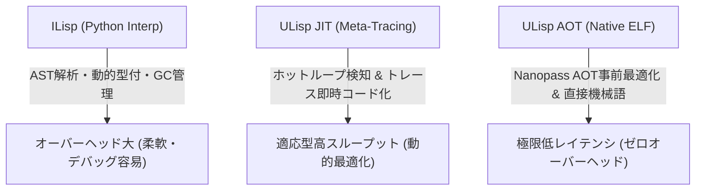

# ILisp vs ULisp AOT vs ULisp JIT 3種実行系 性能評価レポート

- **測定日時**: `2026-10-17 19:37:42`
- **実行環境**: `Linux x86_64` (CPU: `x86_64`)
- **Python バージョン**: `3.12.3`
- **バイアス排除ハーネス**: Mytkowicz 4KB 環境変数パディング適用 (`BENCHMARK_ENV_PAD`)
- **評価対象**: ILisp (Interp), ULisp AOT (Native ELF), ULisp JIT (Meta-Tracing JIT)

---

## 1. 総合評価サマリー

| ワークロード | ILisp [Interp] (ms) | ULisp AOT (ms) | ULisp JIT (ms) | AOT加速比 (vs ILisp) | JIT加速比 (vs ILisp) | 整合性検証 |
| :--- | :---: | :---: | :---: | :---: | :---: | :---: |
| Iterative Fibonacci (fib 20) | 66.18 ± 1.70 | 0.67 ± 0.12 | 0.72 ± 0.06 | **98.3x** | **92.2x** | 🟢 100% PASS |
| Iterative Factorial (fact 12) | 68.41 ± 1.44 | 0.68 ± 0.15 | 0.66 ± 0.07 | **100.3x** | **103.0x** | 🟢 100% PASS |
| Hot Loop Accumulation (5,000 iters) | 101.14 ± 0.13 | 0.69 ± 0.10 | 9.40 ± 0.85 | **146.2x** | **10.8x** | 🟢 100% PASS |
| Polynomial Loop 3x^2+5x+7 (1,000 iters) | 82.15 ± 1.03 | 0.88 ± 0.05 | 3.20 ± 0.11 | **93.4x** | **25.7x** | 🟢 100% PASS |
| Triangular Sum (tri 500) | 70.56 ± 0.55 | 0.81 ± 0.24 | 1.57 ± 0.05 | **87.4x** | **45.0x** | 🟢 100% PASS |

---

## 2. ワークロード別詳細分析

### Iterative Fibonacci (fib 20) (`fib_loop`)

- **概要**: Multi-variable state transition and sequential additions
- **反復回数**: 2 回
- **期待値 / 実測値**: `6765` (ILisp: `6765`, AOT: `6765`, JIT: `6765`)
- **AOT コンパイル所要時間**: `104.50 ms`

| 実行系 | 平均時間 (ms) | 最小値 (ms) | 最大値 (ms) | 標準偏差 (ms) |
| :--- | :---: | :---: | :---: | :---: |
| **ILisp** (Python) | 66.18 | 64.98 | 67.39 | 1.70 |
| **ULisp AOT** (Native ELF) | 0.67 | 0.58 | 0.76 | 0.12 |
| **ULisp JIT** (Meta-Tracing) | 0.72 | 0.67 | 0.76 | 0.06 |

### Iterative Factorial (fact 12) (`fact_loop`)

- **概要**: 64-bit integer multiplication and accumulator updates
- **反復回数**: 2 回
- **期待値 / 実測値**: `479001600` (ILisp: `479001600`, AOT: `479001600`, JIT: `479001600`)
- **AOT コンパイル所要時間**: `107.20 ms`

| 実行系 | 平均時間 (ms) | 最小値 (ms) | 最大値 (ms) | 標準偏差 (ms) |
| :--- | :---: | :---: | :---: | :---: |
| **ILisp** (Python) | 68.41 | 67.39 | 69.42 | 1.44 |
| **ULisp AOT** (Native ELF) | 0.68 | 0.57 | 0.79 | 0.15 |
| **ULisp JIT** (Meta-Tracing) | 0.66 | 0.61 | 0.72 | 0.07 |

### Hot Loop Accumulation (5,000 iters) (`sum_loop`)

- **概要**: Named-let hot loop: tests JIT loop trace recording & branch prediction
- **反復回数**: 2 回
- **期待値 / 実測値**: `12497500` (ILisp: `12497500`, AOT: `12497500`, JIT: `12497500`)
- **AOT コンパイル所要時間**: `100.63 ms`

| 実行系 | 平均時間 (ms) | 最小値 (ms) | 最大値 (ms) | 標準偏差 (ms) |
| :--- | :---: | :---: | :---: | :---: |
| **ILisp** (Python) | 101.14 | 101.05 | 101.23 | 0.13 |
| **ULisp AOT** (Native ELF) | 0.69 | 0.62 | 0.76 | 0.10 |
| **ULisp JIT** (Meta-Tracing) | 9.40 | 8.80 | 10.00 | 0.85 |

### Polynomial Loop 3x^2+5x+7 (1,000 iters) (`poly_loop`)

- **概要**: Heavy arithmetic instruction pipeline, register allocation, and loop optimization
- **反復回数**: 2 回
- **期待値 / 実測値**: `1001005000` (ILisp: `1001005000`, AOT: `1001005000`, JIT: `1001005000`)
- **AOT コンパイル所要時間**: `102.97 ms`

| 実行系 | 平均時間 (ms) | 最小値 (ms) | 最大値 (ms) | 標準偏差 (ms) |
| :--- | :---: | :---: | :---: | :---: |
| **ILisp** (Python) | 82.15 | 81.43 | 82.88 | 1.03 |
| **ULisp AOT** (Native ELF) | 0.88 | 0.84 | 0.91 | 0.05 |
| **ULisp JIT** (Meta-Tracing) | 3.20 | 3.12 | 3.28 | 0.11 |

### Triangular Sum (tri 500) (`tri_loop`)

- **概要**: Linear iteration counter decrement and accumulator addition
- **反復回数**: 2 回
- **期待値 / 実測値**: `125250` (ILisp: `125250`, AOT: `125250`, JIT: `125250`)
- **AOT コンパイル所要時間**: `100.92 ms`

| 実行系 | 平均時間 (ms) | 最小値 (ms) | 最大値 (ms) | 標準偏差 (ms) |
| :--- | :---: | :---: | :---: | :---: |
| **ILisp** (Python) | 70.56 | 70.17 | 70.95 | 0.55 |
| **ULisp AOT** (Native ELF) | 0.81 | 0.64 | 0.98 | 0.24 |
| **ULisp JIT** (Meta-Tracing) | 1.57 | 1.53 | 1.61 | 0.05 |

---

## 3. アーキテクチャ階層と性能特性ダイアグラム

