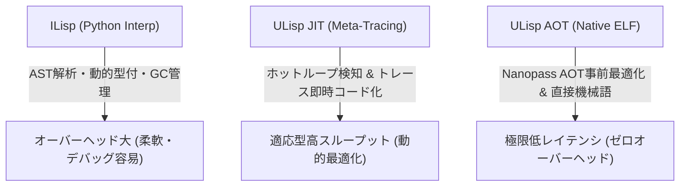

# ILisp vs ULisp AOT vs ULisp JIT 3種実行系 性能評価レポート

- **測定日時**: `2026-10-16 10:02:23`
- **実行環境**: `Linux x86_64` (CPU: `x86_64`)
- **Python バージョン**: `3.12.3`
- **バイアス排除ハーネス**: Mytkowicz 4KB 環境変数パディング適用 (`BENCHMARK_ENV_PAD`)
- **プロファイリング**: Linux `perf stat` 動的命令数 (`instructions`) & 分岐ミス計測有効
- **評価対象**: ILisp (Interp), ULisp AOT (Native ELF), ULisp JIT (Meta-Tracing JIT)

---

## 1. 総合評価サマリー

| ワークロード | ILisp [Interp] (ms) | ULisp AOT (ms) | ULisp JIT (ms) | AOT命令数 (inst) | JIT命令数 (inst) | AOT加速比 | JIT加速比 | 整合性検証 |
| :--- | :---: | :---: | :---: | :---: | :---: | :---: | :---: | :---: |
| Iterative Fibonacci (fib 20) | 84.74 ± 28.92 | 0.62 ± 0.13 | 0.87 ± 0.13 | 734,321 | 1,383,103 | **136.0x** | **97.7x** | 🟢 100% PASS |
| Iterative Factorial (fact 12) | 70.09 ± 1.52 | 0.62 ± 0.12 | 0.77 ± 0.14 | 730,372 | 1,170,187 | **113.2x** | **90.5x** | 🟢 100% PASS |
| Hot Loop Accumulation (5,000 iters) | 107.11 ± 6.61 | 0.61 ± 0.08 | 9.57 ± 0.65 | 884,242 | 83,013,069 | **176.1x** | **11.2x** | 🟢 100% PASS |
| Polynomial Loop 3x^2+5x+7 (1,000 iters) | 83.97 ± 1.08 | 0.58 ± 0.11 | 3.18 ± 0.40 | 799,079 | 24,395,951 | **143.7x** | **26.4x** | 🟢 100% PASS |
| Triangular Sum (tri 500) | 74.04 ± 1.67 | 0.77 ± 0.14 | 1.50 ± 0.12 | 766,169 | 9,385,305 | **95.9x** | **49.2x** | 🟢 100% PASS |

---

## 2. ワークロード別詳細分析

### Iterative Fibonacci (fib 20) (`fib_loop`)

- **概要**: Multi-variable state transition and sequential additions
- **反復回数**: 5 回
- **期待値 / 実測値**: `6765` (ILisp: `6765`, AOT: `6765`, JIT: `6765`)
- **AOT コンパイル所要時間**: `101.61 ms`

| 実行系 | 平均時間 (ms) | 最小値 (ms) | 最大値 (ms) | 標準偏差 (ms) |
| :--- | :---: | :---: | :---: | :---: |
| **ILisp** (Python) | 84.74 | 67.35 | 136.24 | 28.92 |
| **ULisp AOT** (Native ELF) | 0.62 | 0.52 | 0.85 | 0.13 |
| **ULisp JIT** (Meta-Tracing) | 0.87 | 0.65 | 1.00 | 0.13 |

#### Mytkowicz ハードウェア性能カウンタ (perf stat)
| 指標 | ULisp AOT (Native) | ULisp JIT (Meta-Tracing) |
| :--- | :---: | :---: |
| **動的実行命令数 (instructions)** | 734,321 | 1,383,103 |
| **分岐予測ミス (branch-misses)** | 6,211 | 7,210 |
| **実行サイクル数 (cycles)** | 1,434,962 | 1,434,440 |
| **ページフォールト (page-faults)** | 60 | 77 |

### Iterative Factorial (fact 12) (`fact_loop`)

- **概要**: 64-bit integer multiplication and accumulator updates
- **反復回数**: 5 回
- **期待値 / 実測値**: `479001600` (ILisp: `479001600`, AOT: `479001600`, JIT: `479001600`)
- **AOT コンパイル所要時間**: `103.56 ms`

| 実行系 | 平均時間 (ms) | 最小値 (ms) | 最大値 (ms) | 標準偏差 (ms) |
| :--- | :---: | :---: | :---: | :---: |
| **ILisp** (Python) | 70.09 | 68.78 | 72.52 | 1.52 |
| **ULisp AOT** (Native ELF) | 0.62 | 0.52 | 0.82 | 0.12 |
| **ULisp JIT** (Meta-Tracing) | 0.77 | 0.62 | 1.00 | 0.14 |

#### Mytkowicz ハードウェア性能カウンタ (perf stat)
| 指標 | ULisp AOT (Native) | ULisp JIT (Meta-Tracing) |
| :--- | :---: | :---: |
| **動的実行命令数 (instructions)** | 730,372 | 1,170,187 |
| **分岐予測ミス (branch-misses)** | 4,809 | 7,331 |
| **実行サイクル数 (cycles)** | 973,035 | 1,319,758 |
| **ページフォールト (page-faults)** | 61 | 70 |

### Hot Loop Accumulation (5,000 iters) (`sum_loop`)

- **概要**: Named-let hot loop: tests JIT loop trace recording & branch prediction
- **反復回数**: 5 回
- **期待値 / 実測値**: `12497500` (ILisp: `12497500`, AOT: `12497500`, JIT: `12497500`)
- **AOT コンパイル所要時間**: `102.56 ms`

| 実行系 | 平均時間 (ms) | 最小値 (ms) | 最大値 (ms) | 標準偏差 (ms) |
| :--- | :---: | :---: | :---: | :---: |
| **ILisp** (Python) | 107.11 | 101.20 | 118.29 | 6.61 |
| **ULisp AOT** (Native ELF) | 0.61 | 0.54 | 0.73 | 0.08 |
| **ULisp JIT** (Meta-Tracing) | 9.57 | 8.71 | 10.17 | 0.65 |

#### Mytkowicz ハードウェア性能カウンタ (perf stat)
| 指標 | ULisp AOT (Native) | ULisp JIT (Meta-Tracing) |
| :--- | :---: | :---: |
| **動的実行命令数 (instructions)** | 884,242 | 83,013,069 |
| **分岐予測ミス (branch-misses)** | 5,953 | 16,088 |
| **実行サイクル数 (cycles)** | 1,340,156 | 39,813,730 |
| **ページフォールト (page-faults)** | 60 | 3,383 |

### Polynomial Loop 3x^2+5x+7 (1,000 iters) (`poly_loop`)

- **概要**: Heavy arithmetic instruction pipeline, register allocation, and loop optimization
- **反復回数**: 5 回
- **期待値 / 実測値**: `1001005000` (ILisp: `1001005000`, AOT: `1001005000`, JIT: `1001005000`)
- **AOT コンパイル所要時間**: `101.53 ms`

| 実行系 | 平均時間 (ms) | 最小値 (ms) | 最大値 (ms) | 標準偏差 (ms) |
| :--- | :---: | :---: | :---: | :---: |
| **ILisp** (Python) | 83.97 | 82.86 | 85.07 | 1.08 |
| **ULisp AOT** (Native ELF) | 0.58 | 0.50 | 0.75 | 0.11 |
| **ULisp JIT** (Meta-Tracing) | 3.18 | 2.76 | 3.74 | 0.40 |

#### Mytkowicz ハードウェア性能カウンタ (perf stat)
| 指標 | ULisp AOT (Native) | ULisp JIT (Meta-Tracing) |
| :--- | :---: | :---: |
| **動的実行命令数 (instructions)** | 799,079 | 24,395,951 |
| **分岐予測ミス (branch-misses)** | 6,655 | 10,912 |
| **実行サイクル数 (cycles)** | 1,023,640 | 12,329,471 |
| **ページフォールト (page-faults)** | 60 | 968 |

### Triangular Sum (tri 500) (`tri_loop`)

- **概要**: Linear iteration counter decrement and accumulator addition
- **反復回数**: 5 回
- **期待値 / 実測値**: `125250` (ILisp: `125250`, AOT: `125250`, JIT: `125250`)
- **AOT コンパイル所要時間**: `97.36 ms`

| 実行系 | 平均時間 (ms) | 最小値 (ms) | 最大値 (ms) | 標準偏差 (ms) |
| :--- | :---: | :---: | :---: | :---: |
| **ILisp** (Python) | 74.04 | 71.80 | 76.23 | 1.67 |
| **ULisp AOT** (Native ELF) | 0.77 | 0.61 | 0.97 | 0.14 |
| **ULisp JIT** (Meta-Tracing) | 1.50 | 1.35 | 1.69 | 0.12 |

#### Mytkowicz ハードウェア性能カウンタ (perf stat)
| 指標 | ULisp AOT (Native) | ULisp JIT (Meta-Tracing) |
| :--- | :---: | :---: |
| **動的実行命令数 (instructions)** | 766,169 | 9,385,305 |
| **分岐予測ミス (branch-misses)** | 6,126 | 9,754 |
| **実行サイクル数 (cycles)** | 1,263,681 | 8,347,451 |
| **ページフォールト (page-faults)** | 60 | 402 |

---

## 3. アーキテクチャ階層と性能特性ダイアグラム

