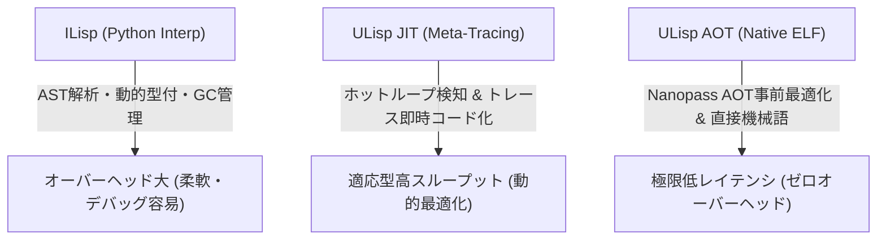

# ILisp vs ULisp AOT vs ULisp JIT 3種実行系 性能評価レポート

- **測定日時**: `2026-10-11 11:50:28`
- **実行環境**: `Linux x86_64` (CPU: `x86_64`)
- **Python バージョン**: `3.14.7`
- **評価対象**: ILisp (Interp), ULisp AOT (Native ELF), ULisp JIT (Meta-Tracing JIT)

---

## 1. 総合評価サマリー

| ワークロード | ILisp [Interp] (ms) | ULisp AOT (ms) | ULisp JIT (ms) | AOT加速比 (vs ILisp) | JIT加速比 (vs ILisp) | 整合性検証 |
| :--- | :---: | :---: | :---: | :---: | :---: | :---: |
| Iterative Fibonacci (fib 20) | 68.96 ± 1.49 | 0.57 ± 0.12 | 1.77 ± 0.04 | **121.3x** | **38.9x** | 🟢 100% PASS |
| Iterative Factorial (fact 12) | 73.65 ± 2.88 | 0.58 ± 0.09 | 1.48 ± 0.03 | **127.1x** | **49.7x** | 🟢 100% PASS |
| Hot Loop Accumulation (5,000 iters) | 106.96 ± 2.49 | 0.57 ± 0.07 | 305.89 ± 20.45 | **186.9x** | **0.3x** | 🟢 100% PASS |
| Polynomial Loop 3x^2+5x+7 (1,000 iters) | 87.84 ± 4.68 | 0.57 ± 0.07 | 94.08 ± 1.59 | **153.4x** | **0.9x** | 🟢 100% PASS |
| Triangular Sum (tri 500) | 87.54 ± 20.05 | 0.72 ± 0.17 | 34.02 ± 1.95 | **121.4x** | **2.6x** | 🟢 100% PASS |

---

## 2. ワークロード別詳細分析

### Iterative Fibonacci (fib 20) (`fib_loop`)

- **概要**: Multi-variable state transition and sequential additions
- **反復回数**: 5 回
- **期待値 / 実測値**: `6765` (ILisp: `6765`, AOT: `6765`, JIT: `6765`)
- **AOT コンパイル所要時間**: `90.46 ms`

| 実行系 | 平均時間 (ms) | 最小値 (ms) | 最大値 (ms) | 標準偏差 (ms) |
| :--- | :---: | :---: | :---: | :---: |
| **ILisp** (Python) | 68.96 | 67.75 | 71.51 | 1.49 |
| **ULisp AOT** (Native ELF) | 0.57 | 0.48 | 0.76 | 0.12 |
| **ULisp JIT** (Meta-Tracing) | 1.77 | 1.74 | 1.84 | 0.04 |

### Iterative Factorial (fact 12) (`fact_loop`)

- **概要**: 64-bit integer multiplication and accumulator updates
- **反復回数**: 5 回
- **期待値 / 実測値**: `479001600` (ILisp: `479001600`, AOT: `479001600`, JIT: `479001600`)
- **AOT コンパイル所要時間**: `92.90 ms`

| 実行系 | 平均時間 (ms) | 最小値 (ms) | 最大値 (ms) | 標準偏差 (ms) |
| :--- | :---: | :---: | :---: | :---: |
| **ILisp** (Python) | 73.65 | 70.41 | 77.80 | 2.88 |
| **ULisp AOT** (Native ELF) | 0.58 | 0.51 | 0.71 | 0.09 |
| **ULisp JIT** (Meta-Tracing) | 1.48 | 1.44 | 1.52 | 0.03 |

### Hot Loop Accumulation (5,000 iters) (`sum_loop`)

- **概要**: Named-let hot loop: tests JIT loop trace recording & branch prediction
- **反復回数**: 5 回
- **期待値 / 実測値**: `12497500` (ILisp: `12497500`, AOT: `12497500`, JIT: `12497500`)
- **AOT コンパイル所要時間**: `87.13 ms`

| 実行系 | 平均時間 (ms) | 最小値 (ms) | 最大値 (ms) | 標準偏差 (ms) |
| :--- | :---: | :---: | :---: | :---: |
| **ILisp** (Python) | 106.96 | 104.09 | 110.59 | 2.49 |
| **ULisp AOT** (Native ELF) | 0.57 | 0.51 | 0.70 | 0.07 |
| **ULisp JIT** (Meta-Tracing) | 305.89 | 291.56 | 341.37 | 20.45 |

### Polynomial Loop 3x^2+5x+7 (1,000 iters) (`poly_loop`)

- **概要**: Heavy arithmetic instruction pipeline, register allocation, and loop optimization
- **反復回数**: 5 回
- **期待値 / 実測値**: `1001005000` (ILisp: `1001005000`, AOT: `1001005000`, JIT: `1001005000`)
- **AOT コンパイル所要時間**: `90.13 ms`

| 実行系 | 平均時間 (ms) | 最小値 (ms) | 最大値 (ms) | 標準偏差 (ms) |
| :--- | :---: | :---: | :---: | :---: |
| **ILisp** (Python) | 87.84 | 84.69 | 95.90 | 4.68 |
| **ULisp AOT** (Native ELF) | 0.57 | 0.49 | 0.68 | 0.07 |
| **ULisp JIT** (Meta-Tracing) | 94.08 | 91.42 | 95.75 | 1.59 |

### Triangular Sum (tri 500) (`tri_loop`)

- **概要**: Linear iteration counter decrement and accumulator addition
- **反復回数**: 5 回
- **期待値 / 実測値**: `125250` (ILisp: `125250`, AOT: `125250`, JIT: `125250`)
- **AOT コンパイル所要時間**: `92.27 ms`

| 実行系 | 平均時間 (ms) | 最小値 (ms) | 最大値 (ms) | 標準偏差 (ms) |
| :--- | :---: | :---: | :---: | :---: |
| **ILisp** (Python) | 87.54 | 71.77 | 121.55 | 20.05 |
| **ULisp AOT** (Native ELF) | 0.72 | 0.54 | 0.92 | 0.17 |
| **ULisp JIT** (Meta-Tracing) | 34.02 | 32.23 | 37.29 | 1.95 |

---

## 3. アーキテクチャ階層と性能特性ダイアグラム

