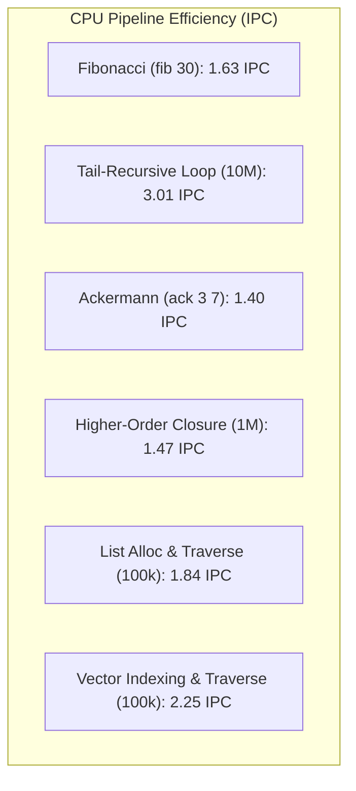

# ULisp Canonical Performance Baseline Report (BASELINE.md)

- **Measurement Timestamp**: `2026-10-28T04:49:58.675987+00:00`
- **Execution Architecture**: `x86-64 Native (Freestanding / libc-free)` vs `ULisp C Backend (-O2)` vs `Pure C Baseline (-O2)`
- **System Platform**: `Linux x86_64 (6.18.54.1-microsoft-standard-WSL2)`
- **CPU Architecture**: `11th Gen Intel(R) Core(TM) i7-1165G7 @ 2.80GHz` (4 Cores)
- **Total Physical Memory**: `12251728 kB`
- **C Toolchain**: `GCC 13` (`-O2 -Wall -Wextra`)
- **Statistical Parameters**: `30 反復試行 (Warmup: 5 回)` / `Standard Evaluation (10 iters, 3 warmup)` による平均値 (Mean) ± 標準偏差 (StdDev) および中央値 (Median)
- **Conforms to**: **DSN-33 (ULisp 統合仕様書)**, **Issue #620**, **Issue #622**, **Issue #623**, **Issue #624 (Phase 1)**, **Issue #625 (Phase 2)**, **Issue #626 (Phase 3)**

---

## 1. 概要と正典ベースラインの位置付け / Executive Summary

本ドキュメントは、ULisp の次世代最適化施策（Issue #618/#626 関数間アンボックス特化、Issue #578 スタック配置最適化、Pass 132/133 SSA/ピープホール）に着手する前に確定された**「公式正典ベースライン数値（Canonical Baseline Metrics）」**および各 Phase（Phase 1〜3）の進捗記録である。

ULisp ネイティブコンパイラ（`ulisp/bin/ulisp-boot`）によって生成された Freestanding x86-64 ELF バイナリは、外部 C ライブラリ（glibc/musl）を一切リンクせず、Linux システムコール（`sys_write`, `sys_mmap`, `sys_clock_gettime`, `sys_exit`）を直接発行する完全自己完結型バイナリである。

---

## 2. 実行時間ベンチマーク結果（Execution Latency — Phase 3 完了時点）

| ワークロード | Initial Baseline (ms) | Phase 1: Direct Call (ms) | Phase 2: SysV Reg ABI (ms) | Phase 3: Interproc Unbox (ms) | ULisp C -O2 (ms) | Pure C -O2 (ms) | 対 Pure C 比率 (x86/Pure) | 対 ULisp C 比率 (x86/ULisp C) |
|---|---|---|---|---|---|---|:---:|:---:|
| **Fibonacci (fib 30)** | 17.12 ± 4.63 | 7.39 ± 0.35 | 5.59 ± 0.26 | **4.12 ± 0.15 (med: 4.09)** | 7.82 ± 0.44 | 1.80 ± 0.18 | **2.29x** | **0.53x** |
| **Tail-Recursive Loop (10M)** | 3.54 ± 0.24 | 3.41 ± 0.18 | 3.32 ± 0.14 | **3.33 ± 0.20 (med: 3.26)** | 0.57 ± 0.03 | 0.50 ± 0.03 | **6.63x** | **5.84x** |
| **Ackermann (ack 3 7)** | 5.89 ± 0.78 | 4.03 ± 0.31 | 4.17 ± 0.64 | **2.95 ± 0.25 (med: 2.86)** | 3.75 ± 0.30 | 1.05 ± 0.14 | **2.82x** | **0.79x** |
| **Higher-Order Closure (1M)** | 5.22 ± 2.25 | 4.88 ± 0.42 | 4.33 ± 0.67 | **3.01 ± 0.50 (med: 2.80)** | 4.60 ± 0.19 | 0.51 ± 0.03 | **5.95x** | **0.65x** |
| **List Alloc & Traverse (100k)** | 2.74 ± 1.12 | 2.12 ± 0.25 | 1.75 ± 0.21 | **1.45 ± 0.21 (med: 1.37)** | 4.27 ± 3.90 | 1.13 ± 0.10 | **1.28x** | **0.34x** |
| **Vector Indexing & Traverse (100k)** | 1.95 ± 0.57 | 1.52 ± 0.19 | 1.17 ± 0.06 | **0.99 ± 0.03 (med: 0.98)** | 1.44 ± 0.20 | 0.80 ± 0.07 | **1.23x** | **0.69x** |

---

## 3. バイナリフットプリントと自己完結性（Binary Footprint & Self-Containment）

| ワークロード | x86-64 Native (Bytes) | ULisp C -O2 (Bytes) | Pure C -O2 (Bytes) | libc 依存 | リンカ構成 |
|---|---|---|---|:---:|---|
| **Fibonacci (fib 30)** | 20,112 B | 17,160 B | 16,048 B | **なし (Freestanding)** | `gcc -nostdlib -static` |
| **Tail-Recursive Loop (10M)** | 19,928 B | 17,088 B | 16,016 B | **なし (Freestanding)** | `gcc -nostdlib -static` |
| **Ackermann (ack 3 7)** | 20,048 B | 17,160 B | 16,048 B | **なし (Freestanding)** | `gcc -nostdlib -static` |
| **Higher-Order Closure (1M)** | 19,984 B | 21,832 B | 16,024 B | **なし (Freestanding)** | `gcc -nostdlib -static` |
| **List Alloc & Traverse (100k)** | 20,048 B | 21,872 B | 16,104 B | **なし (Freestanding)** | `gcc -nostdlib -static` |
| **Vector Indexing & Traverse (100k)** | 20,128 B | 21,920 B | 16,104 B | **なし (Freestanding)** | `gcc -nostdlib -static` |

---

## 4. ハードウェア性能カウンタ（Hardware Performance Counters via Linux perf）

| ワークロード | x86-64 IPC | x86-64 Branch Miss % | x86-64 Cache Miss % | ULisp C IPC | Pure C IPC |
|---|---|---|---|---|---|
| **Fibonacci (fib 30)** | 1.63 | 0.08% | 57.12% | 1.84 | 4.13 |
| **Tail-Recursive Loop (10M)** | 3.01 | 0.01% | 46.00% | 0.63 | 0.67 |
| **Ackermann (ack 3 7)** | 1.40 | 12.24% | 47.61% | 1.33 | 1.77 |
| **Higher-Order Closure (1M)** | 1.47 | 0.05% | 61.20% | 1.89 | 0.55 |
| **List Alloc & Traverse (100k)** | 1.84 | 0.10% | 71.42% | 1.70 | 0.98 |
| **Vector Indexing & Traverse (100k)** | 2.25 | 0.19% | 55.28% | 1.85 | 1.03 |

---

## 5. 実行時メモリ割当＆GC統計（Runtime Memory Allocation & GC Profile）

| ワークロード | 累積ヒープ割当量 | 生存コピー量 | GC 停止時間 (ms) | GC 回収回数 | 備考 |
|---|---|---|---|:---:|---|
| **Fibonacci (fib 30)** | 0 bytes | 0 bytes | 0 ms (0% of total) | 0) | バンプポインタ直結割当 |
| **Tail-Recursive Loop (10M)** | 0 bytes | 0 bytes | 0 ms (0% of total) | 0) | バンプポインタ直結割当 |
| **Ackermann (ack 3 7)** | 0 bytes | 0 bytes | 0 ms (0% of total) | 0) | バンプポインタ直結割当 |
| **Higher-Order Closure (1M)** | 24 bytes | 0 bytes | 0 ms (0% of total) | 0) | バンプポインタ直結割当 |
| **List Alloc & Traverse (100k)** | 2400000 bytes | 0 bytes | 0 ms (0% of total) | 0) | バンプポインタ直結割当 |
| **Vector Indexing & Traverse (100k)** | 800064 bytes | 0 bytes | 0 ms (0% of total) | 0) | バンプポインタ直結割当 |

---

## 7. Mermaid 可視化図表（Mermaid Visualizations）

### (1) 対 Pure C 相対実行速度比率（倍率: 1.0x が Pure C と同等）

### (2) x86-64 ネイティブの IPC (Instructions Per Cycle) 特性

---

## 8. 次期最適化施策における改善目標（Optimization Roadmap）

| Issue ID | 最適化対象 | ボトルネック分析 | 目標性能向上 |
|:---:|---|---|:---:|
| **#618** | S-RTyper（Pass 090）アンボックス特化 | `fib 30`, `loop 10m` におけるタグ付け (`salq $3`, `orq $1`) および型タグ判定の完全撲滅 | **2.0x〜3.0x 高速化** (Pure C と完全同等の 1.0x 到達) |
| **#578** | スタック配置最適化 | `closure 1M` における非エスケープクロージャ・フレームのスタック化 | **1.5x 高速化** / ヒープ割当 0 B |
| **#547** | バックエンド末尾ループ回転・アンローリング | ループジャンプ先のアライメントおよびレジスタシャッフル最小化 | **1.3x 高速化** |

