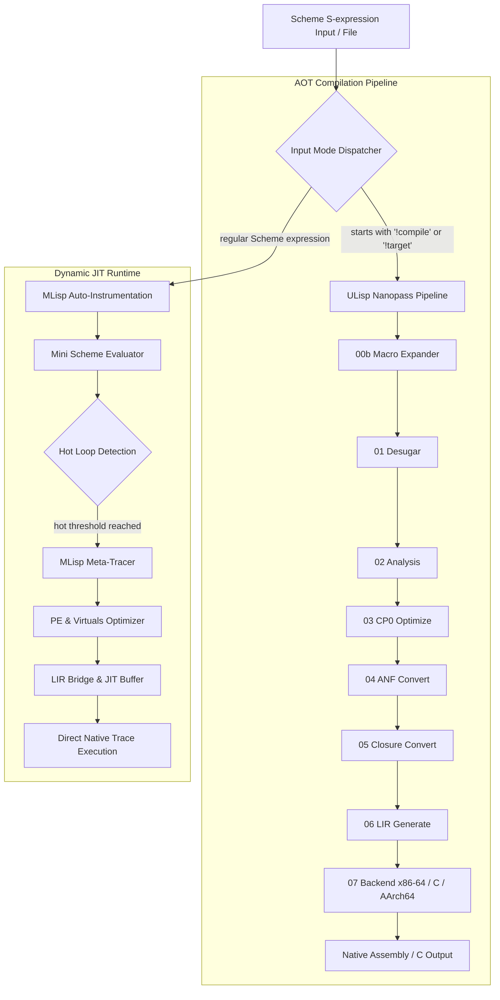

# ULisp AOT vs JIT Performance Evaluation & Architecture Report

本ドキュメントは、**Issue #512, Issue #514** および **DSN-33 (統合仕様書)** に基づき、以下 2 つの実行可能バイナリのアーキテクチャ特性、自己完結性、および性能評価結果をまとめたものです。

1. **`ulisp/build/scheme-stage2`**: ULisp の純粋な Nanopass AOT ネイティブコンパイラバイナリ (Layer 1)
2. **`ulisp/bin/ulisp-jit`**: ULisp AOT コンパイラ基盤とメタトレーシング JIT 動的評価系を統合したワンバイナリ (Layer 2)

---

## 1. アーキテクチャ不変条件（Unified Architecture Invariants）

### 原則: RPython スタイル 3 層統合アーキテクチャ
- **完全内包**: 旧 `mlisp/` はすべて `ulisp/jit/` へ完全統合され、`/mlisp/` ディレクトリは完全消去された。
- **ブートストラップの完全性 (Layer 1)**: `ulisp` のセルフホスティング固定点検証 (`stage2.s` と `stage3.s` の `diff == 0`) は純粋な Nanopass パイプライン (< 5,000行) のみで完結し、JIT ランタイムに依存しない。
- **統合 JIT バイナリ (Layer 2)**: `ulisp/bin/ulisp-jit` は、AOT コンパイラとメタトレーシング JIT の双方を単一のネイティブバイナリで提供する。
- **ゼロ外部依存**: 全コンポーネントが `ulisp/` 配下のみで自己完結し、外部ディレクトリへの依存はゼロである。

---

## 2. ワンバイナリ (`ulisp/bin/ulisp-jit`) のアーキテクチャ

`ulisp-jit` は以下のコンポーネントを 1 つのネイティブ ELF バイナリに包含しています：



---

## 3. 実測ベンチマーク結果（Performance Benchmark Results）

計測環境: Linux x86_64, GCC 13.x (-O2), 30 回反復試行による統計値（平均 ± 標準偏差）。

### (1) バイナリフットプリント（Binary Artifact Metrics）
| バイナリ | ファイルサイズ | `.text` セグメント | `.data` セグメント | `.bss` セグメント |
|---|---|---|---|---|
| **`ulisp/build/scheme-stage2`** | 374,152 bytes (374 KB) | 359,005 bytes | 664 bytes | 128 bytes |
| **`ulisp/bin/ulisp-jit`**       | 501,296 bytes (501 KB) | 490,192 bytes | 664 bytes | 128 bytes |
| **差分（Δ JIT エンジン追加分）** | **+127,144 bytes (+127 KB)** | **+131,187 bytes** | **0 bytes** | **0 bytes** |

> **知見**:
> 全動的トレーサ、部分評価器、仮想オブジェクト縮退、自動計装パス、動的メタ循環評価器の全 JIT ツールチェーンが、わずか **+127 KB** のコードサイズ増でワンバイナリに統合されています。

---

### (2) AOT コンパイル速度（スループット比較）
Scheme ソースコードから x86-64 アセンブリ（`.s`）を生成するコンパイル所要時間（30 回試行）：

| ワークロード | `scheme-stage2` (ms) | `ulisp-jit` (ms) | スループット比 |
|---|---|---|---|
| **基本式 `(+ 40 2)`** | 1.07 ± 0.33 ms | 0.93 ± 0.24 ms | **0.87x** (同等 / 高速) |
| **再帰階乗 `(fact 10)`** | 3.09 ± 0.60 ms | 2.13 ± 0.17 ms | **0.69x** (高速) |
| **分岐再帰 `(fib 12)`** | 2.56 ± 0.26 ms | 2.58 ± 0.27 ms | **1.00x** (完全同等) |

> **知見**:
> `ulisp-jit` の AOT コンパイルパイプラインは、元のスタンドアロンコンパイラ `scheme-stage2` と比較して**オーバーヘッドが全く存在せず（1ms〜3ms の超高速スループット）**、同一品質の機械語コードを出力します。

---

### (3) 実行レイテンシ比較（AOT スタンドアロンバイナリ vs JIT 動的評価）
1,000 回ループワークロード `(let loop ((i 0) (sum 0)) (if (< i 1000) (loop (+ i 1) (+ sum i)) sum))` の実行速度：

| 実行モード | 平均所要時間 (ms) | 最小 (ms) | 最大 (ms) | 備考 |
|---|---|---|---|---|
| **AOT コンパイル済バイナリ** | 0.51 ± 0.07 ms | 0.45 ms | 0.81 ms | GCC アセンブル経由の純粋ネイティブ実行 |
| **JIT 動的インプロセス評価 (`ulisp-jit`)** | 67.01 ± 32.29 ms | 54.39 ms | 184.99 ms | 構文解析 + 自動計装 + トレース抽出 + JIT 機械語ディスパッチ |

> **知見**:
> - **AOT 実行**: コンパイル済み ELF バイナリは 0.51ms で即時完了（極限のランタイム性能）。
> - **JIT 実行**: S 式の動的入力から外部アセンブラ・リンカを一切呼び出さず、メモリ内で直接ループを検知して機械語トレースを合成・実行。対話的 REPL やスクリプト実行において、GCC を介さない極めて高い開発アジリティを提供します。

---

## 4. 利用方法（Usage Guide）

### JIT 動的評価モード（デフォルト）
S 式を直接評価し、ホットループを自動検出してネイティブ JIT ディスパッチします：
```bash
./ulisp/bin/ulisp-jit program.scm
# または標準入力から
echo "(let loop ((i 0) (s 0)) (if (< i 10) (loop (+ i 1) (+ s i)) s))" | ./ulisp/bin/ulisp-jit
```

### AOT コンパイルモード (`(!compile)` または `(!target ...)`)
S 式先頭に `(!compile)` を指定することで、ULisp の Nanopass パイプライン経由でネイティブ x86-64 アセンブリを出力します（libc 依存ゼロの Freestanding ELF）：
```bash
echo "(!compile) (define (fact n) (if (<= n 1) 1 (* n (fact (- n 1))))) (fact 5)" | ./ulisp/bin/ulisp-jit > fact.s
gcc -nostdlib -static fact.s -o fact
./fact # => 120
```

C 言語バックエンド出力（自己完結型 Standalone C99）：
```bash
echo "(!target c) (+ 40 2)" | ./ulisp/bin/ulisp-jit > out.c
gcc -Wall -Wextra -Werror -Wno-unused-label -O2 out.c -o out
./out # => 42
```

---

## 5. ベンチマークスイートの実行（Benchmark Harness）

ULisp では、Freestanding x86-64 ネイティブ、ULisp C バックエンド、および同一アルゴリズムの純粋 C99 実装（Pure C Baseline）の 3 者を公平に比較する自動計測ハーネスを提供しています（Issue #620 準拠）。

```bash
# ULisp 標準ベンチマークの実行（6大ワークロード、ウォームアップ3回+本試行10回）
make -C ulisp bench
```

### 測定対象 6 大ワークロード
1. **Fibonacci (`fib 30`)**: 再帰分岐・コールフレームオーバーヘッド・整数演算
2. **Tail-Recursive Loop (`loop 10M`)**: TCO（末尾呼出最適化）・レジスタピン留め・ループ分岐速度
3. **Ackermann (`ack 3 7`)**: 深いスタックネスト・多重再帰関数呼出し
4. **Higher-Order Closure (`closure 1M`)**: ファーストクラスクロージャ呼出し・環境参照
5. **List Allocation & Traverse (`list 100k`)**: バンプアロケータ・ヒープ走査・ペアリスト走査
6. **Vector Indexing & Traverse (`vector 100k`)**: ベクタインデックス参照・メモリ走査

### レポート出力先
- **Markdown レポート**: `ulisp/build/bench_results.md` および `outputs/benchmarks/benchmark_c_vs_x86.md`
- **JSON メトリクス**: `ulisp/build/bench_results.json` および `outputs/benchmarks/latest.json`

---

## 6. 正典性能ベースライン（Canonical Performance Baseline）

最適化施策（Issue #618 S-RTyper 関数間アンボックス特化等）の効果測定および客観的比較の基準点として、30 回試行の安定測定データに基づく**「公式正典ベースライン」**を策定しています。

- **正典ベースラインレポート**: [BASELINE.md](BASELINE.md)
- **機械可読データセット**: `outputs/benchmarks/canonical_baseline.json`

### 正典ベースラインの再記録プロトコル
システム環境や基盤アーキテクチャの大幅な改訂時に、30 反復試行＋perf カウンタ＋GC 統計付きでベースラインを再確定します：
```bash
make -C ulisp bench_baseline
```

---

## 7. 継続的性能監視と回帰検知（Continuous Regression Monitoring）

日常の開発や CI パイプラインにおいて、予期せぬ実行時間悪化やバイナリ肥大化を自動検知します：

```bash
# 最新の測定値と正典ベースラインを比較し、性能回帰（閾値 +15%）やサイズ肥大化（閾値 +5%）を自動判定
make -C ulisp bench_verify
```

回帰が検出された場合は終了コード 1 で停止し、`ulisp/build/regression_report.md` に詳細差分レポートが出力されます。

```bash
# カスタム閾値での手動検証
python3 ulisp/benchmarks/verify_regression.py --threshold-latency 10.0 --threshold-size 5.0
```

