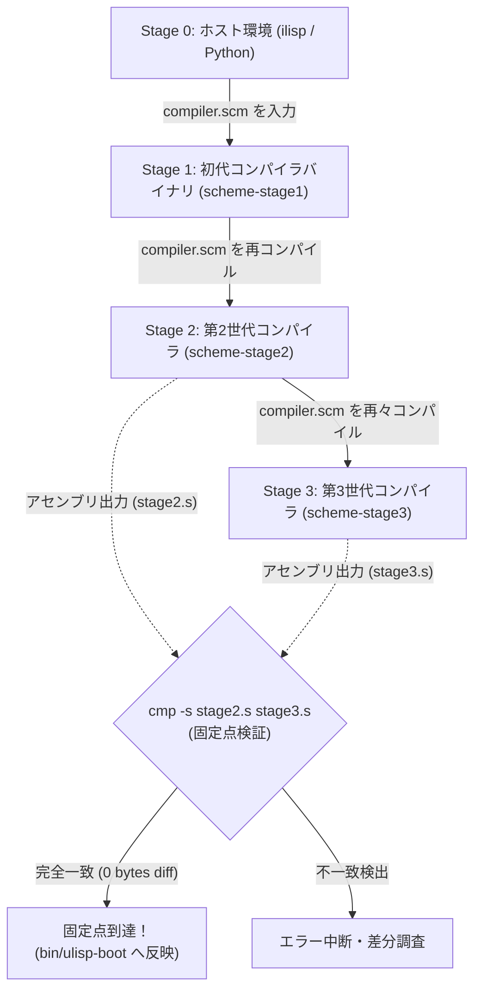

# ULisp 3-Stage Bootstrap & Fixed-Point Verification Protocol

## 1. 概要 (Overview)

uLisp は、コンパイラ自身が Scheme (uLisp) 自身によって記述された自己記述型・自己ホスト型（Self-Hosting）AOT コンパイラである。
プログラミング言語のコンパイラが真に自己完結し、意味論的閉包性（Semantic Closure）を保持していることを数学的・機械的に証明するためには、**「固定点到達（Fixed-Point Convergence / 不動点到達）」** の検証が不可欠である。

本ドキュメントは、uLisp における **3-Stage Bootstrap プロトコル** の数学的背景、ビルドステージ設計、固定点自動判定メカニズム（`make bootstrap_verify`）、および運用の手順を定義する。

---

## 2. 数学的背景と不動点理論 (Mathematical Foundations)

### 2.1 コンパイラの自己適用と不動点

形式言語理論および META II (Val Schorre, 1964) / CompCert の系譜において、コンパイラ $C$ をソースコード $S$ からターゲット言語コード $T$ への変換写像と捉える：

$$T = C(S)$$

コンパイラ $C$ のソースコード自身を $S_C$ とすると、コンパイラが自分自身をコンパイルする操作（自己適用）は次のように表現される：

$$C_1 = C_0(S_C)$$

ここで：
- $C_0$: 初期ホスト環境（Stage 0: ホスト言語上のインタプリタまたは既存のシードコンパイラ）
- $S_C$: uLisp コンパイラのソースコード (`compiler.scm` + 標準ライブラリ群)
- $C_1$: 第1世代コンパイラ (Stage 1 Executable)

さらに、$C_1$ を用いて自分自身のソースコード $S_C$ を再コンパイルする：

$$C_2 = C_1(S_C)$$

$C_0$ の言語処理系特性（浮動小数点丸め、辞書順序、ガベージコレクション動作、データレイアウトなど）による影響が完全に払拭され、uLisp の意味論のみによってコンパイラが自律生成された場合、$C_2$ が出力するコードは $C_2$ 自身の生成物と完全に一致する：

$$C_3 = C_2(S_C)$$
$$C_2 \equiv C_3 \quad (\text{Fixed Point reached: } \operatorname{diff}(C_2, C_3) = \emptyset)$$

このとき、コンパイラ変換関数 $F(X) = X(S_C)$ における不動点（Fixed Point）に到達したと判定される。



---

## 3. 3-Stage パイプライン構成 (Pipeline Stages)

| ステージ | 入力ソース | 実行エンジン | 出力物 | 目的・検証項目 |
| :---: | :---: | :---: | :---: | :---: |
| **Stage 0** | `compiler.scm` + `lib/*.scm` | Python `ilisp` または `bin/ulisp-boot` | `build/stage1.s` → `build/scheme-stage1` | ブートストラップシードによる初期ネイティブコード生成 |
| **Stage 1** | `build/ulisp_core.scm` | `build/scheme-stage1` | `build/stage2.s` → `build/scheme-stage2` | 初代自己ホストバイナリによる自己コンパイル |
| **Stage 2** | `build/ulisp_core.scm` | `build/scheme-stage2` | `build/stage3.s` → `build/scheme-stage3` | 外部依存を完全に排除した純粋ネイティブコード生成 |
| **Stage 3** | `build/ulisp_core.scm` | `build/scheme-stage3` | スモークテストバイナリ | 固定点成立確認、スモークテスト（Exit Code 42 検証） |

---

## 4. 検証コマンドと Makefile ターゲット (Verification Commands)

### 4.1 ワンコマンド固定点自動検証 (`bootstrap_verify`)

```bash
make -C ulisp bootstrap_verify
```

実行フロー：
1. `build/ulisp_core.scm` の統合（標準ライブラリ + コンパイラパス群）
2. `build/scheme-stage1`（Stage 1）のビルド
3. `build/scheme-stage2`（Stage 2）のビルド
4. `build/scheme-stage3`（Stage 3）のビルド
5. `cmp -s build/stage2.s build/stage3.s` によるバイト単位一致検査
6. 一致時：`build/scheme-stage3` を `bin/ulisp-boot` に更新し、正常終了 (Exit Code 0)
7. 不一致時：`diff -u` を表示して直ちに異常終了 (Exit Code 1)

### 4.2 独立ステージビルド

```bash
# Stage 1 単体ビルド
make -C ulisp stage1

# Stage 2 単体ビルド
make -C ulisp stage2

# Stage 3 単体ビルド
make -C ulisp stage3
```

### 4.3 スクリプト直接実行

```bash
# 全段ブートストラップ検証
./ulisp/bootstrap.sh

# Python ilisp からのフルスクラッチ・ブートストラップ強制
FULL_BOOTSTRAP=1 ./ulisp/bootstrap.sh
```

---

## 5. トラブルシューティング (Troubleshooting)

### 5.1 不一致（Discrepancy）が発生した場合の診断手順

Stage 2 と Stage 3 で生成コードに差分が生じる場合、主に以下の要因が考えられる：

1. **非決定論的なハッシュマップ/テーブル順序**:
   - シンボルテーブルや自由変数リストの走査順序が、ポインタアドレスや実行時ハッシュシードに依存していないか調査する（`ulisp/compiler/helpers.scm` の辞書走査ロジック確認）。
2. **中間表現（IR）のステートリーク**:
   - Pass 間のグローバル状態・カウンタ（ラベル ID や一時レジスタ ID）が、コンパイル単位ごとに正しく初期化されているか確認する。
3. **未定義変数の参照や末尾呼出しスタック破壊**:
   - `grep -q "^\*\*\* ERROR:" build/stage*.s` で Scheme 例外が出力途中に混入していないか確認する。

### 5.2 差分調査用ワンライナー

```bash
diff -u ulisp/build/stage2.s ulisp/build/stage3.s | colordiff | head -n 100
```
