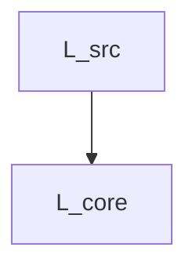

# ULisp Nanopass Framework 言語仕様書 (Language Specifications)

本書は `ulisp/tools/generate_nanopass_docs.scm` により、登録済みの中間言語メタ情報から完全自動生成された仕様ドキュメントです。

## 1. 言語継承・構文遷移図 (Language Derivation Graph)



## 2. 各言語の詳細定義 (Language Definitions)

### 言語: `L_core`

- **親言語 (Parent)**: `L_src`
- **エントリ非終端記号 (Entry)**: `Expr`
- **Nongenerative ID**: `L_src->L_core`

#### 終端記号 (Terminals)

| 述語 (Predicate) | メタ変数パターン (Meta-Variables) |
| :--- | :--- |
| `symbol` | `(x)` |
| `constant` | `(c)` |

#### 非終端記号とプロダクション規則 (Nonterminals & Productions)

##### `Expr` (e)

```scheme
  x
  c
  (quote datum)
  (if e1 e2 e3)
  (if e1 e2)
  (begin e |...|)
  (lambda (x |...|) e |...|)
  (set! x e)
  (let ((x e1) |...|) e |...|)
  (letrec ((x e1) |...|) e |...|)
  (%program defs main)
  (e0 e1 |...|)
```

#### 削除・排除された不変条件 (Removed Invariants)

本言語では以下の構文が明示的に禁止・脱糖済みとして排除されています：

- `parameterize`
- `let*-values`
- `let-values`
- `guard`
- `string-append`
- `bytevector-append`
- `vector-append`
- `bytevector`
- `vector`
- `list`
- `or`
- `and`
- `do`
- `let*`
- `case`
- `cond`

---

### 言語: `L_src`

- **親言語 (Parent)**: (ルート言語)
- **エントリ非終端記号 (Entry)**: `Expr`
- **Nongenerative ID**: `#f`

#### 終端記号 (Terminals)

| 述語 (Predicate) | メタ変数パターン (Meta-Variables) |
| :--- | :--- |
| `symbol` | `(x)` |
| `constant` | `(c)` |

#### 非終端記号とプロダクション規則 (Nonterminals & Productions)

##### `Expr` (e)

```scheme
  x
  c
  (quote datum)
  (if e1 e2 e3)
  (if e1 e2)
  (begin e |...|)
  (lambda (x |...|) e |...|)
  (set! x e)
  (let ((x e1) |...|) e |...|)
  (letrec ((x e1) |...|) e |...|)
  (let* ((x e1) |...|) e |...|)
  (do ((x e1 e2) |...|) (e_test e_res |...|) e_cmd |...|)
  (cond (e1 e2) |...| (else e_else))
  (case key (dat e |...|) |...| (else e_else))
  (and e |...|)
  (or e |...|)
  (list e |...|)
  (vector e |...|)
  (bytevector e |...|)
  (vector-append e |...|)
  (bytevector-append e |...|)
  (string-append e |...|)
  (guard (x c |...|) e |...|)
  (let-values (((x |...|) e1) |...|) e |...|)
  (let*-values (((x |...|) e1) |...|) e |...|)
  (parameterize ((x e1) |...|) e |...|)
  (%program defs main)
  (e0 e1 |...|)
```

---

