# ULisp ベンチマーク・性能実測リファレンス (`ref_benchmarks.md`)

- **最終計測・更新日**: `2026-11-23`
- **関連設計仕様書**:
  - [DSN-33 (ULisp 包括設計仕様書)](../../docs/designs/DSN-33-ulisp_underlying_x86_native_aot_compiler_architecture_specification.md)
  - [DSN-33-13 (Typed Machine LIR & マルチターゲットバックエンド設計)](../../docs/designs/DSN-33-13-ulisp_typed_machine_lir_and_multi_target_backend_architecture.md)
  - [DSN-33-32 (Lua 5.x C コードベース一括コンパイル＆セルフホスト設計)](../../docs/designs/DSN-33-32-ulisp_lua_c_codebase_compilation_and_self_hosting_architecture.md)
- **関連 Issue**:
  - [#925 (Lua 5.4.7 全 33 C 翻訳単位一括ビルドパイプライン)](../../docs/issues/closed/925-build-lua-5x-c-codebase-compilation-pipeline-with-ulisp.md)
  - [#926 (Lua 5.4.7 公式テストスイート E2E ＆ GCC vs ULisp 性能比較ハーネス)](../../docs/issues/closed/926-verify-lua-5x-official-test-suite-e2e-selfhost-ci.md)
  - [#933 (関数内ローカルラベルの過剰 `.p2align 4` 廃止と Pass 144a 短距離ジャンプ最適化)](../../docs/issues/closed/933-eliminate-intraprocedural-label-p2align-nop-bloat-and-enable-short-jumps.md)
  - [#934 (C99 式評価の一時スタックスピル DSE ＆ レジスタ直接受け渡し)](../../docs/issues/closed/934-implement-temporary-stack-spill-dead-store-elimination-and-expr-register-forwarding.md)
  - [#935 (C99 変数ビットシフト `%cl` 単一命令化 ＆ 重複拡張畳み込み)](../../docs/issues/closed/935-optimize-variable-bit-shift-cl-codegen-and-redundant-sign-zero-extension-folding.md)
  - [#936 (`c-tu` プロローグ一括フレーム確保 ＆ `xor r10`・非可変長 `%al` 廃止)](../../docs/issues/closed/936-hoist-c-tu-function-stack-frame-allocation-and-omit-managed-gc-call-setup.md)
  - [#927 (C ヘッダ `.sbi` プリコンパイル済みヘッダ PCH ＆ `-O2` 反復 `mem2reg`/分岐融合/Peephole 最適化)](../../docs/issues/closed/927-implement-c-header-sbi-pch-and-iterative-mem2reg-optimization.md)

---

## 1. 概要 / Overview

本ドキュメントは、ULisp コンパイラ基盤における以下の **2 大ベンチマーク体系**の実測結果と最適化推移を `ulisp/docs/` 配下に一元管理する正典リファレンスである：

1. **C99 フロントエンド & ネイティブ x86-64 バックエンドによる Lua 5.4.7 実アプリケーション・ベンチマーク (`lua_gcc` vs `lua_ulisp`)**:
   - 無改変の公式 Lua 5.4.7 全 33 C 翻訳単位（約 30,000 行）を ULisp (`-O2`) でネイティブ ELF64 コンパイルした `lua_ulisp` と、ホスト GCC 13.3 (`-O2`) でビルドしたリファレンス `lua_gcc` のバイナリサイズ、機械語命令内訳、公式テストスイート（全 26 モジュール `all.lua` + `big.lua`）実行時間、および決定論的 VM マイクロベンチマーク比較。
   - `make -C ulisp test_lua_e2e`（[tests/test_lua_selfhost_e2e.sh](../tests/test_lua_selfhost_e2e.sh)）により自動計測・検証される。
2. **Scheme ネイティブ AOT & Portable C バックエンド正典ベースライン ([benchmarks/BASELINE.md](../benchmarks/BASELINE.md))**:
   - Freestanding x86-64 ネイティブバイナリ（libc 非依存）、Portable C バックエンド (`-O2`)、Pure C (`-O2`)、Chez Scheme、Gauche 間の実行レイテンシ・IPC・GC 統計比較。

---

## 2. Lua 5.4.7 実アプリケーション・ベンチマーク (`lua_gcc` vs `lua_ulisp`)

### 2.1 バイナリサイズ・ELF セクション・機械語命令数の比較と最適化推移

| 指標 (Metric) | `lua_gcc` (GCC 13.3 `-O2`) | `lua_ulisp` (Initial #925) | `lua_ulisp` (After #933) | `lua_ulisp` (After #934) | `lua_ulisp` (After #935) | `lua_ulisp` (After #936) | `lua_ulisp` (After #927) | #936 → #927 改善量 | 現在の対 GCC 比率 |
| :--- | ---: | ---: | ---: | ---: | ---: | ---: | ---: | ---: | ---: |
| **Total ELF File Size** | 313,904 B | 1,048,592 B (`3.34x`) | 925,712 B (`2.95x`) | 696,336 B (`2.22x`) | 630,800 B (`2.01x`) | 593,936 B (`1.89x`) | **520,208 B** | **-73,728 B (-12.4%)** | **1.66x** |
| **`.text` (Machine Code, `size -B`)** | 267,873 B | 975,001 B (`3.64x`) | 852,127 B (`3.18x`) | 622,032 B (`2.32x`) | 555,073 B (`2.07x`) | 519,721 B (`1.94x`) | **445,141 B** | **-74,580 B (-14.4%)** | **1.66x** |
| **`.data` (Initialized Data)** | 6,064 B | 6,264 B (`1.03x`) | 6,264 B (`1.03x`) | 6,264 B (`1.03x`) | 6,264 B (`1.03x`) | 6,264 B (`1.03x`) | **6,264 B** | ±0 B | **1.03x** |
| **`.bss` (Zero-Init Data)** | 56 B | 64 B (`1.14x`) | 64 B (`1.14x`) | 64 B (`1.14x`) | 64 B (`1.14x`) | 64 B (`1.14x`) | **64 B** | ±0 B | **1.14x** |
| **総機械語命令数 (`objdump -d`)** | 50,975 命令 | 322,305 命令 (`6.32x`) | 199,641 命令 (`3.92x`) | 148,632 命令 (`2.92x`) | 132,959 命令 (`2.61x`) | 119,323 命令 (`2.34x`) | **102,456 命令** | **-16,867 命令 (-14.1%)** | **2.01x** |
| **`sub/add rsp` 命令数** | — | — | — | — | 8,520 命令 (`37,626 B`) | **1,958 命令 (`8,288 B`)** | — | — | — |
| **`xor r10, r10` (Managed GC カウント)** | 0 命令 | — | — | — | 1,791 命令 (`5,373 B`) | **0 命令 (`0 B`)** | **0 命令 (`0 B`)** | ±0 命令 | **1.00x** |
| **呼び出し直前 `%al` セットアップ (`xor/mov eax`)** | — | — | — | — | 2,467 命令 (`5,165 B`) | **181 命令 (`380 B`)** | — | — | — |
| **`%rsp` 相対命令数 (`[rsp...]`)** | 2,319 命令 (`objdump -M intel`) | — | 62,176 命令 (`31.1%`) | 23,730 命令 (`16.0%`) | 23,717 命令 (`17.8%`) | 23,717 命令 (`19.9%`) | **22,020 命令 (`21.5%`)** | **-1,697 命令 (-7.2%)** | — |
| ├ `%rsp` ストア命令数 (`rsp_store`) | 1,009 命令 (`objdump -M intel`) | — | 28,437 命令 | 6,955 命令 | 6,954 命令 | 6,954 命令 | **6,802 命令** | **-152 命令 (-2.2%)** | — |
| **`nop` パディング命令数** | 2,116 命令 (`objdump -M intel`) | 130,175 命令 (`40.39%`) | 7,548 命令 (`3.78%`) | 8,084 命令 (`5.44%`) | 8,091 命令 (`6.09%`) | 7,926 命令 (`6.64%`) | **7,584 命令 (`7.40%`)** | **-342 命令 (-4.3%)** | — |

```mermaid
xychart-beta
    title "Lua 5.4.7 ELF Binary & .text Section Size (KB)"
    x-axis ["lua_gcc (GCC -O2)", "Initial #925", "After #933", "After #934", "After #935", "After #936", "After #927"]
    y-axis "Size (KB)" 0 --> 1100
    bar [306.5, 1024.0, 904.0, 680.0, 616.0, 580.0, 508.0]
    bar [261.6, 952.1, 832.2, 607.5, 542.1, 507.5, 434.7]
```



---

### 2.2 公式テストスイート (`all.lua` 全 26 モジュール & `big.lua`) 実行時間比較

`LUA_FULL_BIG=1 make -C ulisp test_lua_e2e` における公式 Lua 5.4.7 テストスイート（171 チェックポイント行・GC メモリ収束が `lua_gcc` と差分ゼロで完全一致）の実測実行時間：

| スイート / モジュール | `lua_gcc` (GCC `-O2`) | `lua_ulisp` (#933) | `lua_ulisp` (After #934) | `lua_ulisp` (After #935) | `lua_ulisp` (After #936) | `lua_ulisp` (After #927) | 対 GCC 比率 (After #927) | 検証ステータス |
| :--- | ---: | ---: | ---: | ---: | ---: | ---: | ---: | :---: |
| **Official `all.lua` (`_U=true`, 全 26 モジュール合計)** | 0.470 s | 1.170〜1.310 s | 1.130 s | 1.010 s | 0.890 s | **0.870 s** | **1.85x** | PASS (`final OK !!!`) |
| **Heavy `big.lua` (非 soft 大規模テーブル＆コルーチン)** | 0.099 s | 0.269〜0.297 s | 0.284 s | 0.257 s | 0.228 s | **0.198 s** | **2.01x** | PASS |
| `all.lua` module: `calls.lua` | 0.0596 s | 0.2626 s | 0.2378 s | 0.2248 s | 0.1874 s | **0.2011 s** | **3.38x** | PASS |
| `all.lua` module: `locals.lua` | 0.1016 s | 0.1459 s | 0.2131 s | 0.1574 s | 0.1380 s | **0.1266 s** | **1.25x** | PASS |
| `all.lua` module: `cstack.lua` | 0.0694 s | 0.1249 s | 0.1172 s | 0.1089 s | 0.0998 s | **0.0942 s** | **1.36x** | PASS |
| `all.lua` module: `constructs.lua` | 0.0315 s | 0.0963 s | 0.0783 s | 0.0768 s | 0.0814 s | **0.0618 s** | **1.96x** | PASS |
| `all.lua` module: `db.lua` | 0.0215 s | 0.0776 s | 0.0743 s | 0.0641 s | 0.0622 s | **0.0507 s** | **2.36x** | PASS |
| `all.lua` module: `math.lua` | 0.0122 s | 0.0800 s | 0.0664 s | 0.0538 s | 0.0467 s | **0.0410 s** | **3.36x** | PASS |
| `all.lua` module: `sort.lua` | 0.0162 s | 0.0546 s | 0.0496 s | 0.0470 s | 0.0408 s | **0.0388 s** | **2.40x** | PASS |
| `all.lua` module: `nextvar.lua` | 0.0152 s | 0.0270 s | 0.0267 s | 0.0246 s | 0.0213 s | **0.0221 s** | **1.45x** | PASS |
| `all.lua` module: `errors.lua` | 0.0044 s | 0.0176 s | 0.0132 s | 0.0125 s | 0.0110 s | **0.0096 s** | **2.18x** | PASS |

---

### 2.3 決定論的 Lua VM マイクロベンチマーク比較 (`os.clock()`)

5 種類の代表的な VM ワークロードにおける `lua_gcc` vs `lua_ulisp` の実行時間および出力チェックサム完全一致検証：

| ワークロード | 内容・反復回数 | `lua_gcc` (s) | `lua_ulisp` (After #933) | `lua_ulisp` (After #934) | `lua_ulisp` (After #935) | `lua_ulisp` (After #936) | `lua_ulisp` (After #927) | 対 GCC 比率 (After #927) | チェックサム完全一致検証 |
| :--- | :--- | ---: | ---: | ---: | ---: | ---: | ---: | ---: | :---: |
| **`table_hash_array`** | 配列 25万件 + ハッシュ表 10万件 挿入＆探索 | 0.0830 s | 0.1723 s | 0.1822 s | 0.2039 s | 0.1422 s | **0.1229 s** | **1.48x** | Exact Match (`67500300000`) |
| **`string_pattern_pack`** | `string.format` + `match` + `pack`/`unpack` 10万回 | 0.0985 s | 0.3203 s | 0.3045 s | 0.2469 s | 0.2085 s | **0.1924 s** | **1.95x** | Exact Match (`16250125000`) |
| **`fib_recursion`** | 再帰関数呼び出し `fib(31)` (2,692,537 回呼び出し) | 0.0884 s | 0.4718 s | 0.4429 s | 0.3631 s | 0.2851 s | **0.2809 s** | **3.18x** | Exact Match (`1346269`) |
| **`coroutine_gc_churn`** | コルーチン `resume`/`yield` + 短命テーブル 20万個 GC | 0.0261 s | 0.1531 s | 0.1334 s | 0.1069 s | 0.0822 s | **0.0774 s** | **2.97x** | Exact Match (`40000600000`) |
| **`vm_arith_loop`** | 整数ビット演算 + IEEE754 浮動小数点ループ 500万回 | 0.0862 s | 0.7253 s | 0.7222 s | 0.5087 s | 0.4564 s | **0.3417 s** | **3.96x** | Exact Match (`37491572188592:625001.50`) |

---

### 2.4 C99 `.sbi` PCH プリコンパイル済みヘッダによるビルド高速化実測 (#927)

| ビルド対象 | PCH なし (`USE_PCH=0`) | PCH あり (`USE_PCH=1` / `-include-pch`) | 高速化率 | バイナリ / `.o` 一致性 |
| :--- | ---: | ---: | :---: | :--- |
| **4-TU ヘッダ共有 C99 スイート (`test_c99_pch_and_opt.sh`)** | 3,351 ms | **2,019 ms** | **1.66x (-39.7%)** | 全 4 TU `.o` `cmp -s` 100% ビット一致 |
| **5-TU Lua 5.4.7 コアバッチ (`lctype`, `lzio`, `lmem`, `lfunc`, `lstate`)** | 6.285 s | **5.096 s** | **1.23x (-18.9%)** | 単一プロセス内 `-include-pch` バッチキャッシュ適用 |
| **Lua 5.4.7 全 33 TU ビルド (`make -C ulisp compile_lua`, `JOBS=4`)** | 60 s (Wall 64.828 s) | **55 s (並列 PCH emit 6 s 込 / Wall 60.618 s)** | **1.07x (TUコンパイルのみ 49s: 1.22x)** | 全 33 TU `.o` `sha256sum` 100% ビット一致 (`C99-PCH-001` 0件) |

---

### 2.5 残存ボトルネックの命令内訳と最適化ロードマップ (#933〜#936, #927)

`lua_ulisp` の `.text` 命令構成分析に基づく段階的最適化ロードマップ：

| Issue | 最適化項目 | 対象パス・ファイル | ステータス | 実測効果 |
| :---: | :--- | :--- | :---: | :--- |
| **[#933](../../docs/issues/closed/933-eliminate-intraprocedural-label-p2align-nop-bloat-and-enable-short-jumps.md)** | 関数内ローカルラベルの過剰 `.p2align 4` 廃止 ＆ Pass 144a 後方短距離ジャンプ (`rel8`) | [140_backend_x86_64.scm](../backend/140_backend_x86_64.scm), [144a_x86_assembler.scm](../backend/144a_x86_assembler.scm) | **完了 (Closed)** | `nop` 命令 **130,175 → 7,548 (-94.2%)**、バイナリ **-122.9 KB**、`fib_recursion` 等高速化 |
| **[#934](../../docs/issues/closed/934-implement-temporary-stack-spill-dead-store-elimination-and-expr-register-forwarding.md)** | C99 式評価の一時スタックスピルに対する Dead Store Elimination (DSE) ＆ 単純右辺 Spill-Free 評価 | [lower_to_lir.scm](../frontend_c/lower_to_lir.scm), [133_lir_peephole.scm](../lir/133_lir_peephole.scm) | **完了 (Closed)** | `%rsp` 命令 **62,176 → 23,730 (-61.8%)**（`rsp_store` -75.5%）、`.text` **-230.1 KB (-27.0%)**、ELF **696,336 B (`2.22x`)**、`all.lua` **1.130s (`2.40x`)** |
| **[#935](../../docs/issues/closed/935-optimize-variable-bit-shift-cl-codegen-and-redundant-sign-zero-extension-folding.md)** | 変数ビットシフトの `shl/shr/sar reg, cl` 単一命令化（分岐廃止）＆ Pass 133 線形 `O(N)` 整数拡張畳み込み | [lower_to_lir.scm](../frontend_c/lower_to_lir.scm), [133_lir_peephole.scm](../lir/133_lir_peephole.scm), [140_backend_x86_64.scm](../backend/140_backend_x86_64.scm) | **完了 (Closed)** | バレルシフタ **473 → 0 箇所**（`cl` シフト 473 件）、レジスタ間拡張 **14,980 → 7,651 (-48.9%)**、`.text` **-67.0 KB (-10.8%, `2.07x`)**、ELF **630,800 B (`2.01x`)**、`all.lua` **1.010 s (`1.98x`)** |
| **[#936](../../docs/issues/closed/936-hoist-c-tu-function-stack-frame-allocation-and-omit-managed-gc-call-setup.md)** | `c-tu` プロローグ・エピローグへのスタックフレーム巻き上げ、`xor r10, r10` 廃止、および非可変長 `%c-call` `%al` 省略 | [140_backend_x86_64.scm](../backend/140_backend_x86_64.scm), [143_backend_x86_peephole.scm](../backend/143_backend_x86_peephole.scm), [lower_to_lir.scm](../frontend_c/lower_to_lir.scm) | **完了 (Closed)** | `xor r10, r10` **1,791 → 0 (-100%)**、非可変長 `%al` **2,297 → 0 (-100%)**、`sub/add rsp` **8,520 → 1,958 (-77.0%)**、`.text` **519,721 B (-35.4 KB / -6.4%, `1.94x`)**、ELF **593,936 B (`1.89x`)**、`all.lua` **0.890 s** |
| **[#927](../../docs/issues/closed/927-implement-c-header-sbi-pch-and-iterative-mem2reg-optimization.md)** | C99 `.sbi` v2 PCH（128バケット `O(1)` マクロ索引＆バッチキャッシュ）および `-O2` PassManager 反復固定小数点（`mem2reg`・分岐融合・定数畳み込み Peephole） | [sbi.scm](../compiler/sbi.scm), [pass_manager.scm](../compiler/pass_manager.scm), [preprocessor.scm](../frontend_c/preprocessor.scm), [parser.scm](../frontend_c/parser.scm), [sema.scm](../frontend_c/sema.scm), [128_lir_branch_fusion.scm](../lir/128_lir_branch_fusion.scm), [132_lir_braun_ssa.scm](../lir/132_lir_braun_ssa.scm), [133_lir_peephole.scm](../lir/133_lir_peephole.scm) | **完了 (Closed)** | `.text` **445,141 B (-74.6 KB / -14.4%, `1.66x`)**、ELF **520,208 B (`1.66x`)**、命令数 **102,456 (-14.1%, `2.01x`)**、`all.lua` **0.870 s (`1.85x`)**、`vm_arith_loop` **0.3417 s (-25.1%)**、4-TU PCH **1.66x**・33 TU 全 `.o` SHA-256 ビット一致 |

---

## 3. Scheme ネイティブ AOT コンパイラ正典ベースライン要約

Scheme コア言語（R7RS）の AOT ネイティブコンパイル性能（詳細は [benchmarks/BASELINE.md](../benchmarks/BASELINE.md) を参照）：

| ワークロード | ULisp x86-64 Native (ms) | ULisp C `-O2` (ms) | Pure C `-O2` (ms) | Chez Scheme (ms) | Gauche (ms) | 対 Pure C 比率 | 対 Chez 比率 |
| :--- | ---: | ---: | ---: | ---: | ---: | :---: | :---: |
| **Fibonacci (`fib 30`)** | 4.17 ± 0.23 | 7.91 ± 0.37 | 1.81 ± 0.20 | 50.82 ± 1.92 | 80.61 ± 3.51 | **2.30x** | **0.08x** (12.2倍高速) |
| **Tail-Recursive Loop (10M)** | 1.75 ± 0.16 | 0.50 ± 0.07 | 0.48 ± 0.09 | 61.36 ± 2.31 | 200.96 ± 7.70 | **3.67x** | **0.03x** (35.1倍高速) |
| **Ackermann (`ack 3 7`)** | 2.92 ± 0.29 | 3.70 ± 0.26 | 0.98 ± 0.07 | 49.17 ± 4.82 | 59.64 ± 2.08 | **2.98x** | **0.06x** (16.8倍高速) |
| **Higher-Order Closure (1M)** | 2.99 ± 0.21 | 4.89 ± 0.35 | 0.47 ± 0.05 | 52.64 ± 6.09 | 59.41 ± 2.10 | **6.39x** | **0.06x** (17.6倍高速) |
| **List Alloc & Traverse (100k)** | 2.17 ± 0.61 | 1.60 ± 0.20 | 1.14 ± 0.15 | 48.02 ± 1.40 | 45.37 ± 1.52 | **1.90x** | **0.05x** (22.1倍高速) |
| **Vector Indexing & Traverse (100k)** | 0.99 ± 0.11 | 1.47 ± 0.22 | 0.80 ± 0.10 | 52.45 ± 3.10 | 47.90 ± 5.45 | **1.25x** | **0.02x** (53.0倍高速) |

---

## 4. ベンチマーク再現コマンド一覧 / Reproduction Commands

```bash
# 1. Lua 5.4.7 全 33 TU ビルド + 公式テストスイート (all.lua / big.lua) + GCC vs ULisp 性能・サイズ比較計測
make -C ulisp test_lua_e2e
# -> 最新計測テーブルが ulisp/build/lua_perf_comparison.md に出力される

# 2. Scheme ネイティブ AOT vs Portable C vs Pure C ベンチマーク実行
(cd ulisp && bash benchmarks/run_bench_c_vs_x86.sh)
```
