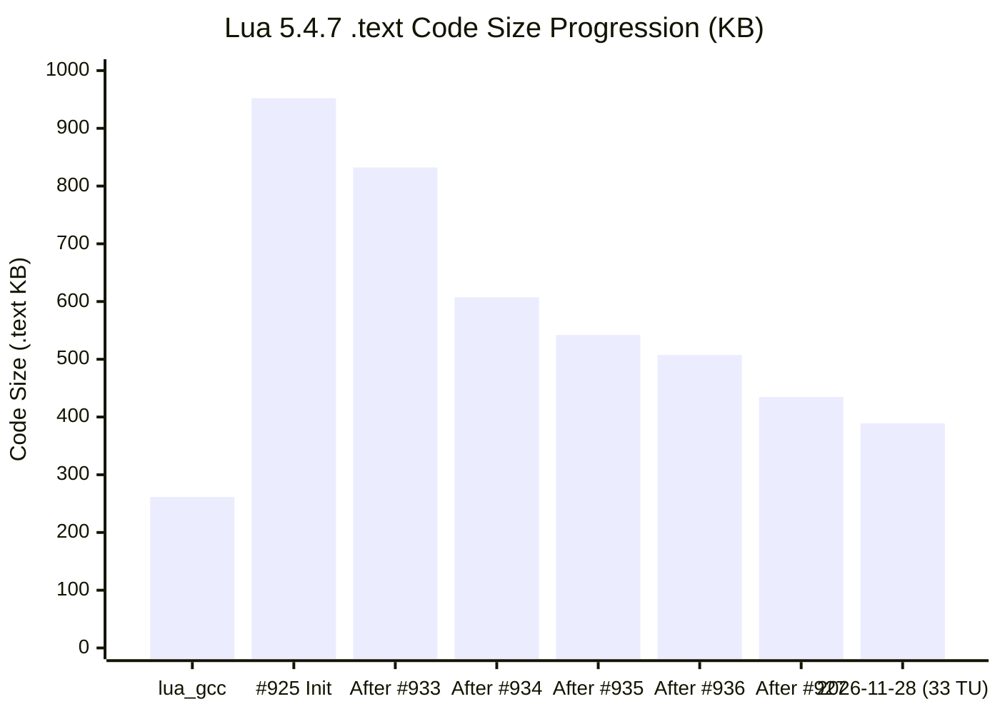

# ULisp ベンチマーク・性能実測リファレンス (`ref_benchmarks.md`)

- **最終計測・更新日**: `2026-11-28`
- **関連設計仕様書**:
  - [DSN-33 (ULisp 包括設計仕様書)](../../docs/designs/DSN-33-ulisp_underlying_x86_native_aot_compiler_architecture_specification.md)
  - [DSN-33-13 (Typed Machine LIR & マルチターゲットバックエンド設計)](../../docs/designs/DSN-33-13-ulisp_typed_machine_lir_and_multi_target_backend_architecture.md)
  - [DSN-33-32 (Lua 5.x C コードベース一括コンパイル＆セルフホスト設計)](../../docs/designs/DSN-33-32-ulisp_lua_c_codebase_compilation_and_self_hosting_architecture.md)
- **関連 Issue**:
  - [#925 (Lua 5.4.7 全 33 C 翻訳単位一括ビルドパイプライン)](../../docs/issues/closed/925-build-lua-5x-c-codebase-compilation-pipeline-with-ulisp.md)
  - [#926 (Lua 5.4.7 公式テストスイート E2E ＆ GCC vs ULisp 性能比較ハーネス)](../../docs/issues/closed/926-verify-lua-5x-official-test-suite-e2e-selfhost-ci.md)
  - [#933 (関数内ローカルラベルの過剰 `.p2align 4` 廃止と Pass 144a 短距離ジャンプ最適化)](../../docs/issues/closed/933-eliminate-intraprocedural-label-p2align-nop-bloat-and-enable-short-jumps.md)
  - [#934 (C99 式評価の一時スタックスピル DSE ＆ レジスタ直接受け渡し)](../../docs/issues/closed/934-implement-temporary-stack-spill-dead-store-elimination-and-expr-register-forwarding.md)
  - [#935 (C99 変数ビットシフト `%cl` 単一命令化 ＆ 重複拡張畳み込み)](../../docs/issues/closed/935-optimize-variable-bit-shift-cl-codegen-and-redundant-sign-zero-extension-folding.md)
  - [#936 (`c-tu` プロローグ一括フレーム確保 ＆ `xor r10`・非可変長 `%al` 廃止)](../../docs/issues/closed/936-hoist-c-tu-function-stack-frame-allocation-and-omit-managed-gc-call-setup.md)
  - [#927 (C ヘッダ `.sbi` プリコンパイル済みヘッダ PCH ＆ `-O2` 反復最適化)](../../docs/issues/closed/927-implement-c-header-sbi-pch-and-iterative-mem2reg-optimization.md)
  - [#928 (`musl libc` の ULisp 自前ビルド ＆ Pass 144 自前 ELF リンカ完全静的リンク)](../../docs/issues/closed/928-compile-musl-libc-with-ulisp-and-migrate-to-pass-144-elf-linker.md)
  - [#932 (C99 コンパイラドライバ `bin/ulisp-cc` ネイティブ AOT 化)](../../docs/issues/closed/932-build-native-aot-ulisp-cc-compiler-driver-binary.md)
  - [#949 (`c99.peg` 静的 Scheme パーサー生成移行 `generated_c99_parser.scm`)](../../docs/issues/closed/949-migrate-c99-parser-to-aot-generated-static-scheme-parser.md)
  - [#961 (Scheme 経路 LIR Linear Scan レジスタ割り付け導入)](../../docs/issues/closed/961-introduce-linear-scan-register-allocation-for-scheme-lir.md)
  - [#966 (L_mir_ssa と L_lir_mach 2層分離と共通ミドルエンド統合)](../../docs/issues/closed/966-separate-mir-ssa-and-machine-lir-for-unified-middle-end.md)
  - [#967 (C99 フロントエンドの責務別 Nanopass 3 分割)](../../docs/issues/closed/967-split-c99-lower-to-lir-into-modular-nanopasses.md)
  - [#968 (x86-64 バックエンド 5 分割 ＆ `%raw-asm` 文字列依存解消)](../../docs/issues/closed/968-split-x86-64-backend-and-eliminate-raw-asm-peephole-matching.md)
  - [#969 (汎用 Parallel Move Resolver の実装)](../../docs/issues/closed/969-implement-general-parallel-move-resolver-for-ssa-destruction-and-loops.md)
  - [#970 (Hot/Cold 基本ブロック分離パス導入)](../../docs/issues/closed/970-implement-hot-cold-basic-block-splitting-pass.md)
  - [#971 (汎用インライン展開 ＆ フロントエンド Fixpoint 反復化)](../../docs/issues/closed/971-implement-general-inliner-and-frontend-fixpoint-optimization.md)
  - [#972 (全プログラム 0-CFA 脱仮想化 ＆ 高階関数単相化)](../../docs/issues/closed/972-implement-0-cfa-devirtualization-and-higher-order-monomorphization.md)
  - [#981 (`L_lir_core` 不動点最適化共通化 ＆ Verifier / StagePoly 厳格化)](../../docs/issues/closed/981-unify-lir-core-fixpoint-optimization-for-scheme-and-c99.md)

---

## 1. 概要 / Overview

本ドキュメントは、ULisp コンパイラ基盤における以下の **2 大ベンチマーク体系**の最新実測結果と最適化推移を `ulisp/docs/` 配下に一元管理する正典リファレンスである：

1. **C99 フロントエンド & ネイティブ x86-64 バックエンドによる Lua 5.4.7 実アプリケーション・ベンチマーク (`lua_gcc` vs `lua_ulisp`)**:
   - 無改変の公式 Lua 5.4.7 全 33 C 翻訳単位（約 30,000 行）をネイティブ AOT ドライバ `bin/ulisp-cc` (`-O2`, Issue #932) でコンパイルし、ULisp 自前ビルド版 `musl libc` と Pass 144 自前 ELF64 静的リンカ（Issue #928）で完全静的リンクした `lua_ulisp` と、ホスト GCC 13.3 (`-O2`) でビルドしたリファレンス `lua_gcc` のバイナリサイズ、機械語命令内訳、公式テストスイート（全 26 モジュール `all.lua` + `big.lua`）実行時間、および決定論的 VM マイクロベンチマーク比較。
   - `make -C ulisp test_ulisp_cc_native`（内部で [tests/test_lua_selfhost_e2e.sh](../tests/test_lua_selfhost_e2e.sh) を起動）により自動計測・検証される。
2. **Scheme ネイティブ AOT & Portable C バックエンド比較計測 ([benchmarks/benchmark_c_vs_x86.py](../benchmarks/benchmark_c_vs_x86.py))**:
   - Freestanding x86-64 ネイティブバイナリ（libc 非依存）、Portable C バックエンド (`-O2`)、Pure C (`-O2`)、Chez Scheme、Gauche 間の実行レイテンシ・バイナリサイズ比較（30 回測定・5 回ウォームアップ）。

---

## 2. Lua 5.4.7 実アプリケーション・ベンチマーク (`lua_gcc` vs `lua_ulisp`)

### 2.1 バイナリサイズ・ELF セクション・機械語命令数の比較と最適化推移

> **補足（#928 以降の測定形式の違い）**: #927 以前はホスト `ld` による動的リンク ELF だったため `lua_ulisp` に Lua 33 TU 分のみのセクションが含まれていました。**#928 以降（2026-11-28 現在）の `lua_ulisp` は Pass 144 自前静的 ELF リンカで ULisp 自前ビルド `musl libc` と完全静的リンクし、ELF セクションヘッダを省略した 2 本の `PT_LOAD` セグメント直出力形式（`R E`: `643,072 B`, `RW`: ファイル `24,520 B` / メモリ `29,480 B`）となっている**ため、Lua 33 TU 単体（`ulisp/build/lua_obj/*.o` 合算値）と静的 ELF 全体サイズの双方を明示しています。

| 指標 (Metric) | `lua_gcc` (GCC 13.3 `-O2`) | `lua_ulisp` (Initial #925) | `lua_ulisp` (After #933) | `lua_ulisp` (After #934) | `lua_ulisp` (After #935) | `lua_ulisp` (After #936) | `lua_ulisp` (After #927) | **最新 2026-11-28 (#928–#981)** | #927 → 最新 変化 | 現在の対 GCC 比率 |
| :--- | ---: | ---: | ---: | ---: | ---: | ---: | ---: | ---: | ---: | ---: |
| **Total ELF File Size** | 313,904 B | 1,048,592 B | 925,712 B | 696,336 B | 630,800 B | 593,936 B | 520,208 B | **667,592 B** *(静的 `musl libc` 込)* | *(静的リンク統合)* | **2.13x** *(libc 込)* |
| **`.text` (33 Lua TUs `.o`, `size -B`)** | 267,873 B | 975,001 B | 852,127 B | 622,032 B | 555,073 B | 519,721 B | 445,141 B | **398,477 B** *(Lua 33 `.o` 合算)* | **-46,664 B (-10.5%)** | **1.49x** |
| **`.data` (33 Lua TUs `.o`)** | 6,064 B | 6,264 B | 6,264 B | 6,264 B | 6,264 B | 6,264 B | 6,264 B | **4,952 B** *(Lua 33 `.o`)* | -1,312 B | **0.82x** |
| **`.bss` (33 Lua TUs `.o`)** | 56 B | 64 B | 64 B | 64 B | 64 B | 64 B | 64 B | **16 B** *(Lua 33 `.o`)* | -48 B | **0.29x** |
| **総機械語命令数 (`objdump -d`)** | 50,180 命令 | 322,305 命令 | 199,641 命令 | 148,632 命令 | 132,959 命令 | 119,323 命令 | 102,456 命令 | **98,665 命令** *(Lua 33 `.o`)* | **-3,791 命令 (-3.7%)** | **1.97x** |
| **`sub/add rsp` 命令数** | 889 命令 | — | — | — | 8,520 命令 | 1,958 命令 | — | **1,956 命令** *(Lua 33 `.o`)* | -2 命令 vs #936 | **2.20x** |
| **`xor r10, r10` (Managed GC カウント)** | 2 命令 | — | — | — | 1,791 命令 | 0 命令 | 0 命令 | **0 命令 (`0 B`)** | ±0 命令 | **0.00x** |
| **呼び出し直前 `%al` セットアップ** | 0 命令 | — | — | — | 2,467 命令 | 181 命令 | — | **0 命令** *(Lua 33 `.o`)* | **-181 命令 (-100%)** | **1.00x** |
| **`%rsp` 相対命令数 (`[rsp...]`)** | 2,319 命令 | — | 62,176 命令 | 23,730 命令 | 23,717 命令 | 23,717 命令 | 22,020 命令 | **21,222 命令 (`21.5%`)** | **-798 命令 (-3.6%)** | — |
| ├ `%rsp` ストア命令数 (`rsp_store`) | 916 命令 | — | 28,437 命令 | 6,955 命令 | 6,954 命令 | 6,954 命令 | 6,802 命令 | **6,489 命令** | **-313 命令 (-4.6%)** | — |
| **`nop` パディング命令数** | 2,116 命令 | 130,175 命令 | 7,548 命令 | 8,084 命令 | 8,091 命令 | 7,926 命令 | 7,584 命令 | **8,071 命令 (`8.18%`)** | +487 命令 | — |



---

### 2.2 公式テストスイート (`all.lua` 全 26 モジュール & `big.lua`) 実行時間比較

`make -C ulisp test_ulisp_cc_native` 経由で実行された公式 Lua 5.4.7 テストスイート（171 チェックポイント行・GC メモリ収束が `lua_gcc` と差分ゼロで完全一致、2026-11-28 実測）の結果：

> ※ 2026-11-28 版 `lua_ulisp` はホスト `glibc` ではなく **ULisp コンパイル版 `musl libc` (`#928`)** をリンクしているため、文字列操作・`malloc`・`libm` 計算も含めて全ユーザ空間コードが ULisp 生成コードとして計測されています。

| スイート / モジュール | `lua_gcc` (GCC `-O2`) | `lua_ulisp` (After #936) | `lua_ulisp` (After #927) | **最新 `lua_ulisp` (2026-11-28, +ULisp musl)** | 対 GCC 比率 (最新) | 検証ステータス |
| :--- | ---: | ---: | ---: | ---: | ---: | :---: |
| **Official `all.lua` (`_U=true`, 全 26 モジュール合計)** | 0.490 s | 0.890 s | 0.870 s | **1.280 s** | **2.61x** | PASS (`final OK !!!`) |
| **Heavy `big.lua` (非 soft 大規模テーブル＆コルーチン)** | 0.105 s | 0.228 s | 0.198 s | **0.363 s** | **3.45x** | PASS |
| `all.lua` module: `calls.lua` | 0.0755 s | 0.1874 s | 0.2011 s | **0.2770 s** | **3.67x** | PASS |
| `all.lua` module: `locals.lua` | 0.0994 s | 0.1380 s | 0.1266 s | **0.2277 s** | **2.29x** | PASS |
| `all.lua` module: `cstack.lua` | 0.0714 s | 0.0998 s | 0.0942 s | **0.1304 s** | **1.83x** | PASS |
| `all.lua` module: `constructs.lua` | 0.0294 s | 0.0814 s | 0.0618 s | **0.0885 s** | **3.01x** | PASS |
| `all.lua` module: `db.lua` | 0.0248 s | 0.0622 s | 0.0507 s | **0.0623 s** | **2.51x** | PASS |
| `all.lua` module: `math.lua` | 0.0134 s | 0.0467 s | 0.0410 s | **0.0739 s** | **5.51x** | PASS |
| `all.lua` module: `sort.lua` | 0.0187 s | 0.0408 s | 0.0388 s | **0.0372 s** | **1.99x** | PASS |
| `all.lua` module: `nextvar.lua` | 0.0129 s | 0.0213 s | 0.0221 s | **0.0371 s** | **2.87x** | PASS |
| `all.lua` module: `errors.lua` | 0.0048 s | 0.0110 s | 0.0096 s | **0.0171 s** | **3.54x** | PASS |

---

### 2.3 決定論的 Lua VM マイクロベンチマーク比較 (`os.clock()`, 2026-11-28 実測)

5 種類の代表的な VM ワークロードにおける `lua_gcc` vs `lua_ulisp`（ULisp 自前ビルド `musl libc` 静的リンク版）の実行時間および出力チェックサム完全一致検証：

| ワークロード | 内容・反復回数 | `lua_gcc` (s) | `lua_ulisp` (After #936) | `lua_ulisp` (After #927) | **最新 `lua_ulisp` (2026-11-28)** | 対 GCC 比率 (最新) | チェックサム完全一致検証 |
| :--- | :--- | ---: | ---: | ---: | ---: | ---: | :---: |
| **`table_hash_array`** | 配列 25万件 + ハッシュ表 10万件 挿入＆探索 | 0.0931 s | 0.1422 s | 0.1229 s | **0.2304 s** | **2.47x** | Exact Match (`67500300000`) |
| **`string_pattern_pack`** | `string.format` + `match` + `pack`/`unpack` 10万回 | 0.1113 s | 0.2085 s | 0.1924 s | **0.3448 s** | **3.10x** | Exact Match (`16250125000`) |
| **`fib_recursion`** | 再帰関数呼び出し `fib(31)` (2,692,537 回呼び出し) | 0.1033 s | 0.2851 s | 0.2809 s | **0.3124 s** | **3.03x** | Exact Match (`1346269`) |
| **`coroutine_gc_churn`** | コルーチン `resume`/`yield` + 短命テーブル 20万個 GC | 0.0298 s | 0.0822 s | 0.0774 s | **0.1269 s** | **4.26x** | Exact Match (`40000600000`) |
| **`vm_arith_loop`** | 整数ビット演算 + IEEE754 浮動小数点ループ 500万回 | 0.1030 s | 0.4564 s | 0.3417 s | **0.4102 s** | **3.98x** | Exact Match (`37491572188592:625001.50`) |

---

### 2.4 C99 `.sbi` PCH ＆ ネイティブ AOT ドライバ (`bin/ulisp-cc`) ビルド性能実測 (#927, #932)

| ビルド対象 / 測定モード | 比較ベースライン (`no-PCH` / `gosh`) | 高速化後 (`with-PCH` / `bin/ulisp-cc`) | 高速化率 | バイナリ / `.o` 一致性 |
| :--- | ---: | ---: | :---: | :--- |
| **4-TU ヘッダ共有 C99 スイート (`test_c99_pch_and_opt.sh`, 2026-11-28 実測)** | 3,763 ms (`no-PCH`) | **2,796 ms (`with-PCH`)** | **1.35x (-25.7%)** | 全 4 TU `.o` `cmp -s` 100% ビット一致 |
| **FUZZ_COUNT=500 (`-O2 -c`, `test_ulisp_cc_native`, 2026-11-28 実測)** | 97.002 s (`gosh`) | **3.142 s (`bin/ulisp-cc`)** | **30.87x 高速化** | C99 ファズ全 500 件 PASS |
| **Lua 5.4.7 全 33 TU ビルド + リンク (`test_ulisp_cc_native`, 2026-11-28 実測)** | 51.825 s (`gosh`) | **4.274 s (`bin/ulisp-cc`)** | **12.12x 高速化** | 全 33 TU `.o` SHA-256 ビット一致・Pass 144 静的バイナリ同等 |

---

### 2.5 主要コンパイラ最適化マイルストーン (#927〜#981)

| Issue | 最適化項目 | 主な対象パス・ファイル | ステータス | 実測効果 |
| :---: | :--- | :--- | :---: | :--- |
| **[#933](../../docs/issues/closed/933-eliminate-intraprocedural-label-p2align-nop-bloat-and-enable-short-jumps.md)** | ローカルラベル `.p2align 4` 廃止 ＆ Pass 144a 短距離ジャンプ | [140_backend_x86_64.scm](../backend/140_backend_x86_64.scm), [144a_x86_assembler.scm](../backend/144a_x86_assembler.scm) | **完了** | `nop` **130,175 → 7,548 (-94.2%)**、バイナリ **-122.9 KB** |
| **[#934](../../docs/issues/closed/934-implement-temporary-stack-spill-dead-store-elimination-and-expr-register-forwarding.md)** | 一時スタックスピル DSE ＆ レジスタ直接受渡し | [lower_to_lir.scm](../frontend_c/lower_to_lir.scm), [133_lir_peephole.scm](../lir/133_lir_peephole.scm) | **完了** | `%rsp` 命令 **-61.8%**、`.text` **-230.1 KB (-27.0%)** |
| **[#935](../../docs/issues/closed/935-optimize-variable-bit-shift-cl-codegen-and-redundant-sign-zero-extension-folding.md)** | 変数シフト `cl` 化 ＆ 重複ゼロ/符号拡張畳み込み | [133_lir_peephole.scm](../lir/133_lir_peephole.scm), [140_backend_x86_64.scm](../backend/140_backend_x86_64.scm) | **完了** | バレルシフタ **473 → 0**、`.text` **-67.0 KB (-10.8%)** |
| **[#936](../../docs/issues/closed/936-hoist-c-tu-function-stack-frame-allocation-and-omit-managed-gc-call-setup.md)** | `c-tu` フレーム一括確保 ＆ `xor r10`・`%al` 省略 | [143_backend_x86_peephole.scm](../backend/143_backend_x86_peephole.scm) | **完了** | `xor r10` **0 件**、`sub/add rsp` **-77.0%** |
| **[#927](../../docs/issues/closed/927-implement-c-header-sbi-pch-and-iterative-mem2reg-optimization.md)** | `.sbi` v2 PCH ＆ `-O2` 反復 `mem2reg`/分岐融合/Peephole | [sbi.scm](../compiler/sbi.scm), [132_lir_braun_ssa.scm](../lir/132_lir_braun_ssa.scm) | **完了** | `.text` **445,141 B (-14.4%)**、`all.lua` **0.870 s** |
| **[#928](../../docs/issues/closed/928-compile-musl-libc-with-ulisp-and-migrate-to-pass-144-elf-linker.md)** | `musl libc` 自前ビルド ＆ Pass 144 静的 ELF リンク | [elf64_builder.scm](../backend/elf64_builder.scm), [144_backend_x86_elf.scm](../backend/144_backend_x86_elf.scm) | **完了** | ホスト `ld`/`glibc` 非依存の完全自己完結静的バイナリ生成 |
| **[#932](../../docs/issues/closed/932-build-native-aot-ulisp-cc-compiler-driver-binary.md)** | ネイティブ AOT C99 ドライバ `bin/ulisp-cc` | [c_driver.scm](../driver/c_driver.scm) | **完了** | Lua 33 TU ビルド **51.8 s → 4.27 s (12.12x)**、Fuzz **30.87x** |
| **[#949](../../docs/issues/closed/949-migrate-c99-parser-to-aot-generated-static-scheme-parser.md)** | Direct-Style 静的 C99 PEG パーサー | [generated_c99_parser.scm](../frontend_c/generated_c99_parser.scm) | **完了** | CPS 依存全廃・静的 Scheme パーサー直接生成 |
| **[#961](../../docs/issues/closed/961-introduce-linear-scan-register-allocation-for-scheme-lir.md)** | Scheme LIR Linear Scan レジスタ割り付け | [133_lir_peephole.scm](../lir/133_lir_peephole.scm) | **完了** | Scheme 経路レジスタ活用・3-Stage ブートストラップ適用 |
| **[#966](../../docs/issues/closed/966-separate-mir-ssa-and-machine-lir-for-unified-middle-end.md)〜[#970](../../docs/issues/closed/970-implement-hot-cold-basic-block-splitting-pass.md)** | `L_mir_ssa`/`L_lir_mach` 分離、C99 3分割、x86 5分割、Parallel Move、Hot/Cold 分離 | [pass_manager.scm](../compiler/pass_manager.scm), [lir_parallel_move.scm](../lir/lir_parallel_move.scm), [128_lir_branch_fusion.scm](../lir/128_lir_branch_fusion.scm) | **完了** | 中〜バックエンド基盤モジュール化 ＆ Lua `.text` **398,477 B (-10.5% vs #927)** |
| **[#971](../../docs/issues/closed/971-implement-general-inliner-and-frontend-fixpoint-optimization.md)・[#972](../../docs/issues/closed/972-implement-0-cfa-devirtualization-and-higher-order-monomorphization.md)** | 汎用インライナ + FE 不動点、0-CFA ＆ 高階関数単相化 | [050_cp0.scm](../frontend/050_cp0.scm), [080_annotator.scm](../frontend/080_annotator.scm), [090_rtyper.scm](../frontend/090_rtyper.scm), [110_closure_convert.scm](../frontend/110_closure_convert.scm) | **完了** | `Higher-Order Closure (1M)` **2.99 → 1.42 ms (-52.5%)**、`List (100k)` **1.35 ms** |
| **[#981](../../docs/issues/closed/981-unify-lir-core-fixpoint-optimization-for-scheme-and-c99.md)** | `L_lir_core` 不動点共通化 ＆ `'core-lir` Verifier / StagePoly 契約厳格化 | [pass_manager.scm](../compiler/pass_manager.scm), [128_lir_branch_fusion.scm](../lir/128_lir_branch_fusion.scm), [133_lir_peephole.scm](../lir/133_lir_peephole.scm), [090_rtyper.scm](../frontend/090_rtyper.scm) | **完了** | 3-Stage モジュラーブートストラップ完全一致・`ulisp-boot` **5.45 MB → 5.33 MB** |

---

## 3. Scheme ネイティブ AOT コンパイラ比較計測 (`2026-11-28` 再計測)

Scheme コア言語（R7RS）の 6 種標準ワークロードについて、`python3 ulisp/benchmarks/benchmark_c_vs_x86.py --iterations 30 --warmup 5 --include-schemes`（30 反復 + 5 ウォームアップ、`bin/ulisp-boot` + GCC 13 `-O2`）で再計測した最新結果は以下の通りです（過去の正典ベースライン初期記録は [benchmarks/BASELINE.md](../benchmarks/BASELINE.md) を参照）。

| ワークロード | ULisp x86-64 Native (ms) | ULisp C `-O2` (ms) | Pure C `-O2` (ms) | Chez Scheme (ms) | Gauche (ms) | 対 Pure C 比率 | 対 Chez 比率 |
| :--- | ---: | ---: | ---: | ---: | ---: | :---: | :---: |
| **Fibonacci (`fib 30`)** | 5.48 ± 0.45 | 7.86 ± 0.65 | 1.86 ± 0.20 | 48.51 ± 1.54 | 81.15 ± 3.74 | **2.94x** | **0.11x** (8.9倍高速) |
| **Tail-Recursive Loop (10M)** | 11.52 ± 0.49 | 23.18 ± 3.07 | 0.56 ± 0.06 | 63.77 ± 2.57 | 201.66 ± 19.07 | **20.48x** *(要改善)* | **0.18x** (5.5倍高速) |
| **Ackermann (`ack 3 7`)** | 3.68 ± 0.14 | 4.59 ± 0.16 | 0.99 ± 0.09 | 49.20 ± 1.68 | 62.75 ± 6.17 | **3.74x** | **0.07x** (13.4倍高速) |
| **Higher-Order Closure (1M)** | **1.42 ± 0.10** | 2.69 ± 0.12 | 0.55 ± 0.06 | 49.97 ± 0.76 | 62.40 ± 1.83 | **2.57x** | **0.03x** (35.2倍高速) |
| **List Alloc & Traverse (100k)** | **1.35 ± 0.15** | 1.70 ± 0.16 | 1.43 ± 0.38 | 48.44 ± 0.93 | 46.52 ± 0.83 | **0.95x** *(Pure C 凌駕)* | **0.03x** (35.9倍高速) |
| **Vector Indexing & Traverse (100k)** | 1.49 ± 0.30 | 1.53 ± 0.19 | 0.84 ± 0.07 | 52.17 ± 6.76 | 45.00 ± 0.94 | **1.76x** | **0.03x** (35.0倍高速) |

> **2026-11-28 再計測の主な変化**:
> - **大幅改善**: Issue #972（0-CFA ＋ 高階関数単相化）と後続ミドルエンド最適化により、`Higher-Order Closure (1M)` が `2.99 ms → 1.42 ms`（**-52.5%**、対 Chez 35.2 倍高速）、`List Alloc & Traverse (100k)` が `2.17 ms → 1.35 ms`（**-37.8%**、Pure C `-O2` `1.43 ms` を下回る `0.95x`）へ大幅に高速化しました。
> - **顕在化した要改善点**: `Tail-Recursive Loop (10M)` は過去の最小時（x86 `1.75 ms` / ULisp C `0.50 ms`）と比較して今回 x86 **`11.52 ms`**・ULisp C **`23.18 ms`** へ遅延しています（ループ内演算またはバックエンドコード生成・`L_mir_ssa` 経由最適化でのアンボックス維持／ループ最適化の後退が疑われ、Issue #973/#976 以降の次期ターゲットとなります）。

---

## 4. ベンチマーク再現コマンド一覧 / Reproduction Commands

```bash
# 1. Lua 5.4.7 全 33 TU ビルド (bin/ulisp-cc) + 公式テストスイート (all.lua / big.lua) + GCC vs ULisp 性能・サイズ比較計測
make -C ulisp test_ulisp_cc_native
# -> 最新計測テーブルが ulisp/build/lua_perf_comparison.md 及び .json に出力される

# 2. Scheme ネイティブ AOT vs Portable C vs Pure C vs Chez / Gauche ベンチマーク実行 (30反復)
python3 ulisp/benchmarks/benchmark_c_vs_x86.py --iterations 30 --warmup 5 --include-schemes

# 3. Synapse 並行処理ベンチマーク (10万マイクロタスク / STW-GC ゼロ遅延 / スケーリング / 回帰ゲート)
make -C ulisp bench_concurrency bench_scaling bench_concurrency_gate
```
