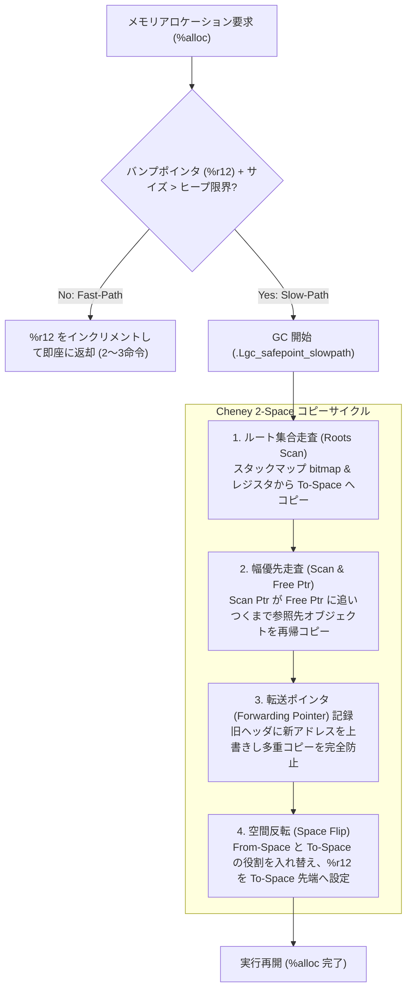

[ULisp トップ](../README.md) > [ドキュメント一覧](README.md) > **GC & メモリモデル仕様書**

---

# ULisp ガベージコレクション & メモリモデル仕様書
## (Garbage Collection & Memory Model Specification)

本ドキュメントは、**ULisp (Underlying LISP)** ネイティブ AOT コンパイラにおけるメモリモデル、Tagged Pointer 表現、Cheney 2-Space コピーガベージコレクタ、GC Safepoint、スタックマップ生成、およびヒープ管理アーキテクチャを定義する。

- **正典アーキテクチャ仕様書**: [DSN-33 (ULisp 包括設計仕様書)](../../docs/designs/DSN-33-ulisp_underlying_x86_native_aot_compiler_architecture_specification.md)
- **関連仕様書**:
  - [パイプライン・Nanopass 詳細仕様書](spec_pipeline.md)
  - [低レベル IR (LIR) 正典仕様書](spec_lir.md)
  - [バックエンド & コード生成仕様書](spec_backend.md)
- **関連実装ファイル**:
  - `ulisp/lib/gc.scm`: Cheney's 2-Space コピー GC ロジック (Scheme レベル)
  - `ulisp/lir/131_lir_safepoint.scm`: Pass 131 スタックマップ・Safepoint 生成
  - `ulisp/backend/141_backend_x86_gc.scm`: Pass 141 x86-64 GC ルーチン生成
  - `ulisp/backend/142_backend_x86_freestanding.scm`: Pass 142 ヒープ初期化・ベアメタル `mmap`

---

## 1. 64-bit Tagged Pointer メモリモデル (Tagged Pointer Model)

ULisp は 64 ビットアーキテクチャ（x86-64 / AArch64）を前提とし、ポインタ下位 2〜8 ビットを型タグとして利用する効率的な **Tagged Pointer 方式** を採用している。

### 1.1 タグ割り当て表 (Tag Allocation Table - DSN-33 準拠)

| 型 (Type) | ビットマスク / タグ | 内部表現 (Internal Bit Pattern) | 設計意図・最適化特性 |
| :--- | :--- | :--- | :--- |
| **Fixnum (小整数)** | 下位 2bit = `00` | `val << 2` (62bit 符号付き整数) | タグが `00` のため、加減算（`add`, `sub`）はシフト解除不要で直接実行可能。 |
| **Heap Pointer** | 下位 2bit = `01` | `(ptr & ~3) \| 0x01` | 8 バイト境界整列ヒープアドレス。`Pair`, `Closure`, `Vector`, `String` 等。 |
| **Symbol Pointer** | 下位 2bit = `10` | `(sym_ptr & ~3) \| 0x02` | インターン済みシンボル構造体（名前＋ハッシュ）へのポインタ。 |
| **Character (文字)** | 下位 8bit = `0000_1110` (`0x0E`) | `(ascii_code << 8) \| 0x0E` | 文字リテラル。単項型述語 `char?` で高速判定。 |
| **Boolean (真偽値)** | 即値定数 | `#f`: `0x2F` (`0010_1111`)<br>`#t`: `0x6F` (`0110_1111`) | Scheme 仕様に基づき `#f` のみ偽、他はすべて真。`cmp rax, 0x2F` で高速判定。 |
| **Empty List (`'()`)** | 即値定数 | `'()`: `0x3F` (`0011_1111`) | リスト終端記号（NIL）。 |
| **EOF Object** | 即値定数 | `#<eof>`: `0x4F` (`0100_1111`) | ポート・I/O 終端オブジェクト。 |
| **Void (未定義値)** | 即値定数 | `#<void>`: `0x5F` (`0101_1111`) | 副作用構文（`set!`, `define` 等）の評価結果。 |

### 1.2 8バイト統一 Prefix Header と Fixnum タグエンコード (DSN-33 Section 2.3)

ヒープオブジェクト（Pair, Closure, String, Vector）のアロケーション時、オブジェクト直前の 8 バイト（`[addr - 8]`）にメタデータヘッダを配置する。
- **未コピー時 (通常時)**:
  ヘッダ値は Scheme の **Fixnum (最下位 2 ビット `00`)** として格納する：
  - Pair (24B: 8B Header + 16B payload): `((16 << 16) | (2 << 8) | 1) * 4 = 4196356`
  - Closure (aligned-size + 8B): `((aligned_size << 16) | ((n_args + 1) << 8) | 2) * 4`
  - String (aligned-size + 8B): `((aligned_size << 16) | 3) * 4`
  - Vector (aligned-size + 8B): `((aligned_size << 16) | 4) * 4`
  Scheme コードから `%raw-load` した際、そのまま自然な Scheme 整数（Fixnum）として型・ワード数・ペイロードサイズを操作可能。
- **転送済み時 (Forwarded)**:
  オブジェクト退避後、ヘッダ位置に**コピー先ポインタ（末尾タグ `01` / `10`）**をそのまま直接上書きする。最下位 2 ビットが `00` でないため、`(not (= (%ptr-tag hdr) 0))` により即座に転送済みと判定できる。

---

## 2. Cheney 2-Space コピー GC アーキテクチャ (Cheney's Copying GC)

ULisp のコア GC は、停止時間とメモリ安全性を両立する **Cheney's 2-Space コピーアルゴリズム** をベースとしている。

```text
┌─────────────────────────────────────────────────────────────┐
│                       ULisp 仮想メモリ                      │
│                                                             │
│   From-Space (割り当て領域)           To-Space (退避領域)    │
│  ┌───────────────────────┐          ┌───────────────────────┐│
│  │ 生存オブジェクト (A, B) │   GC    │ 複製オブジェクト (A',B')││
│  │ 死亡オブジェクト (C, D) │ ──────> │                       ││
│  │ 未使用領域 (Free Space)│ コピー   │ 未使用領域             ││
│  └───────────────────────┘          └───────────────────────┘│
│       R12 (Heap Alloc)                   Scan / Free Ptr      │
└─────────────────────────────────────────────────────────────┘
```

### 2.1 バンプポインタ割り当て (Bump-Pointer Fast-Path)
通常実行時、メモリアロケーションはレジスタ（x86-64 では `%r12`）に保持されたバンプポインタをインクリメントするだけの極小オーバーヘッド（2〜3 命令）で実行される：

```asm
;; %alloc fast path: 16 バイトの Pair 割り当て例
movq  %r12, %rax          ; 割り当てアドレス取得
addq  $16,  %r12          ; バンプポインタ進行
cmpq  heap_limit(%rip), %r12 ; ヒープ限界判定
ja    .Lgc_safepoint_slowpath ; 超過時は GC トリガー
orq   $1,   %rax          ; Pair タグ (0x01) を付与
```

### 2.2 Cheney GC 実行サイクル (GC Execution Cycle)



### 2.3 Forwarding Pointer (転送ポインタ) によるループ・多重参照保護
コピーされたオブジェクトの旧 From-Space ヘッダには、移動先の To-Space アドレスが **転送ポインタ（Forwarding Pointer）** として上書きされる。
- **未コピー状態**: ヘッダ最下位 2 ビットは `00b`（Fixnum エンコード）。
- **コピー済状態**: ヘッダ最下位 2 ビットは `01b` / `10b`（To-Space ヒープポインタ）。
これにより、循環参照リストや共有グラフ構造であっても $O(N)$（生存オブジェクト数比例）の線形時間で完全に複製される。

---

## 3. GC Safepoint と スタックマップ (Pass 131)

正確なガベージコレクション（Exact GC）を実現するため、コンパイラは実行時スタック上のどのスロットがヒープポインタを含んでいるかを把握する必要がある。

### 3.1 スタックマップの構造
コンパイラは、アロケーションや関数呼び出しが発生する直前の地点に **GC Safepoint** を配置し、その時点のスタックフレーム構造をスタックマップとして静的データセクションに生成する：

```scheme
;; Pass 131 が出力する Safepoint メタ情報例
(%gc-safepoint
  :label .Lsafepoint_42
  :frame-size 32
  :live-roots (0 2)) ; スタックオフセット -8, -24 がヒープポインタ
```

### 3.2 ハイブリッド走査 (Hybrid Exact/Conservative Scanning)
Issue #568 で導入されたハイブリッド走査機能により：
- スタックマップが存在する通常フレームでは **完全正確（Exact）走査** を実行。
- スタックセグメントコピー等で退避された継続フレームや C 境界では **保守的走査（Conservative Scanning）** をフォールバックとして併用し、ポインタの早期回収リークをゼロに抑制する。

---

## 4. エスケープ解析とスタック配置最適化 (Pass 120)

Pass 120（`frontend/120_alias_escape.scm`）による型・エイリアス解析に基づき、関数のレキシカルスコープ外にエスケープしないクロージャや局所 Pair/Vector は、ヒープではなく**スタックフレーム上（Scoped Stack Alloca）**に割り当てられる。
これにより、Cheney GC へのアロケーション負荷が大幅に削減される。
