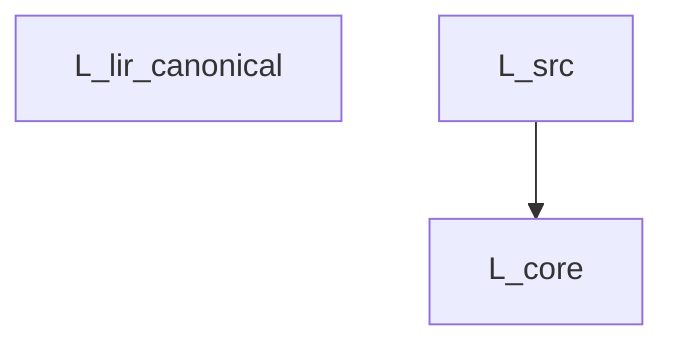

[ULisp トップ](../README.md) > [ドキュメント一覧](README.md) > **Nanopass Framework 言語仕様書**

---

# ULisp Nanopass Framework 言語仕様書 (Language Specifications)

本書は `ulisp/tools/generate_nanopass_docs.scm` により、登録済みの中間言語メタ情報から完全自動生成された仕様ドキュメントです。

- **関連仕様書**:
  - [パイプライン・Nanopass 詳細仕様書](spec_pipeline.md)
  - [低レベル IR (LIR) 正典仕様書](spec_lir.md)
  - [バックエンド & コード生成仕様書](spec_backend.md)
  - [テスト実行ガイド](guide_testing.md)

---

## 1. 言語継承・構文遷移図 (Language Derivation Graph)



## 2. 各言語の詳細定義 (Language Definitions)

### 言語: `L_lir_canonical`

- **親言語 (Parent)**: (ルート言語)
- **エントリ非終端記号 (Entry)**: `Program`
- **Nongenerative ID**: `#f`

#### 終端記号 (Terminals)

| 述語 (Predicate) | メタ変数パターン (Meta-Variables) |
| :--- | :--- |
| `symbol` | `(x lbl var cond_op sp_lbl)` |
| `integer` | `(n offset shift frame_size bytes tag si cnt bitmap)` |
| `string` | `(str fn_name)` |

#### 非終端記号とプロダクション規則 (Nonterminals & Productions)

##### `Register` (reg)

```scheme
  %rax
  %rbx
  %rcx
  %rdx
  %rsi
  %rdi
  %rbp
  %rsp
  %r8
  %r9
  %r10
  %r11
  %r12
  %r13
  %r14
  %r15
  %al
  (%reg x)
```

##### `StackSlot` (stk)

```scheme
  (%stack offset)
```

##### `MemRef` (mem)

```scheme
  (%mem reg offset)
  (%mem reg reg)
```

##### `LValue` (lval)

```scheme
  reg
  stk
  mem
```

##### `Operand` (opnd)

```scheme
  lval
  n
  lbl
```

##### `Inst` (inst)

```scheme
  (%label lbl)
  (%block lbl (x |...|) inst |...|)
  (%jump lbl)
  (%jump lbl (opnd |...|))
  (%jump-if-false reg lbl)
  (%jump-if-false reg lbl (opnd |...|))
  (%jump-if reg lbl1 (opnd1 |...|) lbl2 (opnd2 |...|))
  (%jump-cond cond_op lbl)
  (%jump-if-zero lbl)
  (%direct-jump lbl)
  (%return)
  (%return opnd)
  (%c-call fn_name shift)
  (%call-closure shift)
  (%call-closure shift sp_lbl)
  (%direct-call lbl shift)
  (%direct-call lbl shift sp_lbl)
  (%dispatch-consumer si1 si2 shift)
  (%mov lval opnd)
  (%load reg1 reg2 offset)
  (%store reg1 offset opnd)
  (%load-byte-zx reg1 reg2 offset)
  (%store-byte reg1 offset opnd)
  (%push reg)
  (%pop reg)
  (%code-ref reg lbl)
  (%str-ref reg lbl)
  (%global-ref reg var)
  (%global-set! var reg)
  (%add opnd1 opnd2)
  (%raw-add opnd1 opnd2)
  (%sub opnd1 opnd2)
  (%raw-sub opnd1 opnd2)
  (%imul opnd1 opnd2)
  (%raw-mul opnd1 opnd2)
  (%neg opnd)
  (%inc opnd)
  (%cqo)
  (%idiv opnd)
  (%shl opnd shift)
  (%shr opnd shift)
  (%sar opnd shift)
  (%bit-and opnd1 opnd2)
  (%bit-or opnd1 opnd2)
  (%bit-xor opnd1 opnd2)
  (%cmp opnd1 opnd2)
  (%raw-cmp opnd1 opnd2)
  (%set-boolean opnd cond_op)
  (%box-fixnum opnd1 opnd2)
  (%unbox-fixnum opnd1 opnd2)
  (%syscall)
  (%alloc opnd bytes tag)
  (%alloc opnd bytes tag si)
  (%alloc-stack opnd offset tag)
  (%capture-cc lbl si)
  (%push-handler lbl si1 si2)
  (%pop-handler si)
  (%raise)
  (%set-values-count cnt)
  (%store-values-buf si cnt)
```

##### `StringEntry` (se)

```scheme
  (lbl str)
```

##### `SafepointEntry` (sm)

```scheme
  (lbl frame_size bitmap)
```

##### `FunctionDecl` (f)

```scheme
  (%lir-function lbl (params (x |...|)) (frame-size frame_size) (body inst |...|))
```

##### `MainDecl` (m)

```scheme
  (%lir-main (frame-size frame_size) (body inst |...|))
```

##### `Program` (p)

```scheme
  (%lir-program (strings (se |...|)) (stackmaps (sm |...|)) (%lir-functions f |...|) m)
```

---

### 言語: `L_core`

- **親言語 (Parent)**: `L_src`
- **エントリ非終端記号 (Entry)**: `Expr`
- **Nongenerative ID**: `L_src->L_core`

#### 終端記号 (Terminals)

| 述語 (Predicate) | メタ変数パターン (Meta-Variables) |
| :--- | :--- |
| `symbol` | `(x)` |
| `constant` | `(c)` |

#### 非終端記号とプロダクション規則 (Nonterminals & Productions)

##### `Expr` (e)

```scheme
  x
  c
  (quote datum)
  (if e1 e2 e3)
  (if e1 e2)
  (begin e |...|)
  (lambda (x |...|) e |...|)
  (set! x e)
  (let ((x e1) |...|) e |...|)
  (letrec ((x e1) |...|) e |...|)
  (%program defs main)
  (e0 e1 |...|)
```

#### 削除・排除された不変条件 (Removed Invariants)

本言語では以下の構文が明示的に禁止・脱糖済みとして排除されています：

- `parameterize`
- `let*-values`
- `let-values`
- `guard`
- `string-append`
- `bytevector-append`
- `vector-append`
- `bytevector`
- `vector`
- `list`
- `or`
- `and`
- `do`
- `let*`
- `case`
- `cond`

---

### 言語: `L_src`

- **親言語 (Parent)**: (ルート言語)
- **エントリ非終端記号 (Entry)**: `Expr`
- **Nongenerative ID**: `#f`

#### 終端記号 (Terminals)

| 述語 (Predicate) | メタ変数パターン (Meta-Variables) |
| :--- | :--- |
| `symbol` | `(x)` |
| `constant` | `(c)` |

#### 非終端記号とプロダクション規則 (Nonterminals & Productions)

##### `Expr` (e)

```scheme
  x
  c
  (quote datum)
  (if e1 e2 e3)
  (if e1 e2)
  (begin e |...|)
  (lambda (x |...|) e |...|)
  (set! x e)
  (let ((x e1) |...|) e |...|)
  (letrec ((x e1) |...|) e |...|)
  (let* ((x e1) |...|) e |...|)
  (do ((x e1 e2) |...|) (e_test e_res |...|) e_cmd |...|)
  (cond (e1 e2) |...| (else e_else))
  (case key (dat e |...|) |...| (else e_else))
  (and e |...|)
  (or e |...|)
  (list e |...|)
  (vector e |...|)
  (bytevector e |...|)
  (vector-append e |...|)
  (bytevector-append e |...|)
  (string-append e |...|)
  (guard (x c |...|) e |...|)
  (let-values (((x |...|) e1) |...|) e |...|)
  (let*-values (((x |...|) e1) |...|) e |...|)
  (parameterize ((x e1) |...|) e |...|)
  (%program defs main)
  (e0 e1 |...|)
```

---

