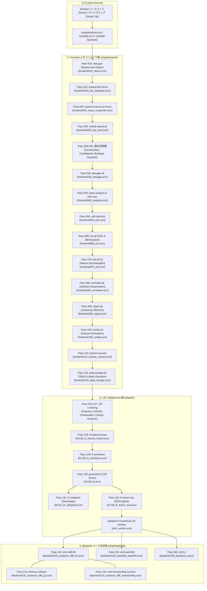

[ULisp トップ](../README.md) > [ドキュメント一覧](README.md) > **パイプライン・Nanopass 詳細仕様書**

---

# ULisp パイプライン・Nanopass 詳細仕様書

本ドキュメントは、ULisp コンパイラ内部の各 Nanopass の役割、入出力データ構造、最適化パス、およびパス間で維持される不変条件（Invariants）を定義する。

- 正典アーキテクチャ仕様書: [DSN-33 (ULisp 包括設計仕様書)](../../docs/designs/DSN-33-ulisp_underlying_x86_native_aot_compiler_architecture_specification.md)
- 関連仕様書:
  - [Nanopass 言語仕様書 (自動生成)](spec_nanopass.md)
  - [LIR 命令セット仕様書](spec_lir.md)
  - [継続・dynamic-wind 仕様書](spec_continuations_and_unwind.md)
  - [GC & メモリモデル仕様書](spec_gc_and_memory.md)
  - [バックエンド & コード生成仕様書](spec_backend.md)
  - [テスト実行ガイド](guide_testing.md)

---

## 1. 3層物理分離パイプライン構成図 (Architecture Overview)

ULisp コンパイラは、Issue 589（Canonical LIR 境界の確立）および Issue 590（物理層分離）に基づき、以下の 3 つの独立した物理ディレクトリ層によって構成される：

---

## 2. 各層および各パスの詳細仕様 (Pass Specifications)

### 基盤: コンパイラユーティリティ & 述語 (`compiler/helpers.scm`, `compiler/primitives.scm`, `compiler/verifier.scm`)
- **責務**: 全パス共通の述語、アキュムレータ、一意シンボル/ラベル生成ルーチンの提供。
- **主要機能**:
  - `atomic-expr?`, `pure-prim?`, `closure-prim?`, `type-predicate-op?`
  - `unique-label`, `unique-symbol`, `set-diff`, `set-union`
  - ビットマスク・型タグ定数（Fixnum, Pair, Closure, String, Vector, Continuation）
  - 軽量 IR Verifier フレームワーク (`verify-pass-output`)

---

### 第 1 層: Frontend メタコンパイラ層 (`ulisp/frontend/`)

#### Pass 010: R7RS ライブラリ構文脱糖 (`frontend/010_library.scm`)
- **責務**: `define-library`, `import`, `export` の解析と静的名前空間プレフィックス化。

#### Pass 015: Nanopass DSL 手続き型展開器 (`frontend/015_dsl_expander.scm` - Issue #587)
- **責務**: `define-language`, `define-pass`, `define-parser`, `define-unparser` の手続き型展開、およびホスト専用 `define-macro` の除去。
- **不変条件**: 本パス通過後、DSL 構文およびホスト専用マクロはすべて標準 Scheme 構文（`define`, `lambda` 等）へ展開され、下流のマクロ展開器（Pass 020）へ純粋な式列として渡される。

#### Pass 020: 衛生的マクロ展開器 (`frontend/020_macro_expander.scm`)
- **責務**: `define-syntax` / `syntax-rules` によるコンパイル時マクロ定義の評価と AST 展開。
- **不変条件**: 本パス通過後、ユーザー定義マクロはすべて基本構文へ置換される。

#### Pass 025: トップレベル定義巻き上げ (`frontend/025_top_level.scm` - Issue #570)
- **責務**:
  - `rewrite-top-level`: トップレベル `(define ...)` および `(define-record-type ...)` 群を解析し、単一の正規化された `(%program unique-defs body)` へ巻き上げる。

#### Pass 026〜029: 構文別ナノ脱糖パス群 (Issue #574)
- **`frontend/026_desugar_constructors.scm`**: リスト・ベクタ・文字列・バイトベクタ構築構文（`list`, `vector`, `string-append` 等）の脱糖。
- **`frontend/027_desugar_conditionals.scm`**: 条件構文（`cond`, `case`, `and`, `or`, `when`, `unless`）の基本 `if` 分岐連鎖への脱糖。
- **`frontend/028_desugar_bindings.scm`**: 束縛構文（`let*`, `named-let`, `do` 反復構文）の `letrec` / 相互再帰への脱糖。
- **`frontend/029_desugar_dynamic.scm`**: 動的スコープ・多値・例外構文（`let-values`, `let*-values`, `parameterize`, `guard`）のプリミティブ脱糖。

#### Pass 030: 統合構文脱糖コア (`frontend/030_desugar.scm`)
- **責務**:
  - `desugar-all`: 構文別ナノパスを束ね、高水準構文から Core 構文（`if`, `let`, `letrec`, `lambda`, 基本プリミティブ）への完全展開を統制。
  - `%raw-call/cc`: ファーストクラス継続プリミティブの透過的パイプライン伝搬。

#### Pass 040: 静的スコープ・高速自由変数解析 (`frontend/040_analysis.scm`)
- **責務**: 式内の自由変数集合（`free-vars`）の正確な算出。ビットセットおよび順序付きリストによる高速集合演算（Issue #529）。
- **エスケープ解析**: 関数が外部へエスケープするか、直接呼び出し（Contification）可能かを判定。

#### Pass 050: CP0 ソースレベル最適化 (`frontend/050_cp0.scm`)
- **責務**:
  1. **定数畳み込み (Constant Folding)**: 四則演算、ビット演算、論理述語のボトムアップ事前計算。
  2. **自明分岐剪定 (Dead Branch Pruning)**: `(if #t ...)` / `(if #f ...)` の静的剪定。
  3. **自明 begin 平坦化**: ネストした `begin` 式の解除。
  4. **不要束縛削除 (Dead Let Elimination)**: 未使用な純粋束縛の削除。

#### Pass 060: ローカル値番号付け LVN (`frontend/060_lvn.scm` - Issue #521)
- **責務**: 基本ブロック内における共通部分式除去（CSE）およびペア・クロージャアクセサ（`car`, `cdr`, `%closure-ref`）のメモ化・冗長ロード削除。

#### Pass 070: ANF 正規化 (`frontend/070_anf.scm`)
- **責務**: 式を 3 番地コード形式（A-Normal Form）へ平坦化。
- **Scoped Temporary Variable Pool (`%t0`〜`%t8`)**: セルフホスティング時のシンボルアロケーションを抑制。

#### Pass 080: 抽象解釈型アノテータ (`frontend/080_annotator.scm` - Issue #517)
- **責務**: 式ごとの型・値域制約（Fixnum, Boolean, Pair, Non-Null）を抽象解釈により推論し、型アノテーションタグを付与。

#### Pass 090: RType 推論 & アンボクシング (`frontend/090_rtyper.scm` - Issue #518)
- **責務**: RPython 型推論エンジンに準拠し、純粋な数値演算ループにおいて Tagged Pointer のタグ付け/外しを省略（Raw Integer 演算の選定）。

#### Pass 100: Contification & クロージャ除去 (`frontend/100_contify.scm` - Issue #522)
- **責務**: エスケープしない既知のローカル関数呼び出しを、ヒープクロージャアロケーションを伴わない直接ジャンプ（継続化）へ最適化。

#### Pass 110: 明示的クロージャ変換 (`frontend/110_closure_convert.scm`)
- **責務**:
  - **Lambda Lifting**: ネストした無名 `lambda` をトップレベルの `%function` へ巻き上げ。
  - **Flat Closures**: 自由変数を環境タプルとしてキャプチャする `%make-closure` の生成。
  - **相互再帰の正規化**: `letrec` を初期化と `%closure-set!` バックパッチシーケンスへ平坦化。

#### Pass 120: TBAA & エスケープ解析 (`frontend/120_alias_escape.scm` - Issue #525)
- **責務**: 型ベースのエイリアス解析（TBAA）とローカルオブジェクトのエスケープ解析。短命オブジェクトのスタック配置最適化の判定。

---

### 第 2 層: LIR / Middle-End 層 (`ulisp/lir/`)

#### Canonical LIR Verifier (`lir/lir_verifier.scm` - Issue #589)
- **責務**: Canonical LIR AST の正典構文、全オペコード、レジスタ・メモリオペランド境界、CFG 閉包、SSA ブロック引数アリティ、および Safepoint アライメント不変条件の機械的検証。

#### Pass 123〜127: 機能責務別 LIR 低レベル化 (Issue #583)
- **`lir/123_lir_closures.scm`**: クロージャ生成（`%make-closure`, `%alloc-stack`）および自由変数タプルの低レベル化。
- **`lir/124_lir_call_abi.scm`**: 関数呼び出し ABI（引数設定、末尾呼び出し `%direct-jump`、通常呼び出し `%direct-call` / `%call-closure`）の低レベル化。
- **`lir/125_lir_continuation.scm`**: ファーストクラス継続および dynamic-wind スタック退避・復元命令の低レベル化。
- **`lir/126_lir_control.scm`**: 条件分岐（`%jump-if-false`）、シーケンス、局所変数フレーム操作の低レベル化。
- **`lir/127_lir_runtime.scm`**: 多値返却バッファ操作（`%values`, `%call-with-values`）および例外ハンドラスタック（`%push-handler`, `%pop-handler`）の低レベル化。

#### Pass 128: LIR 分岐融合 & 条件比較低レベル化 (`lir/128_lir_branch_fusion.scm` - Issue #571)
- **責務**:
  - `if` 条件式における比較述語（`=`, `<`, `>`, `<=`, `>=`, `eq?`, `eqv?`, `zero?`, `null?`, `pair?`, `boolean?`, `symbol?`, `string?`, `vector?`, `bytevector?`, `port?`, `procedure?`, `promise?` 等）を直接 LIR 条件分岐命令 (`%jump-cond cc label`) へ直接融合。
  - 中間ブール値（`#t`/`#f`）のヒープ・レジスタアロケーション（`%set-boolean`）および無駄な再判定ジャンプ（`%jump-if-false`）を完全に排除。

#### Pass 129: LIR プリミティブ命令選択 (`lir/129_lir_primitives.scm` - Issue #573)
- **責務**: 単項演算子・二項演算子・型検査述語（70種以上）の Canonical LIR 命令選択。

#### Pass 130: LIR プログラム生成コア (`lir/130_lir.scm`)
- **責務**: `%program` AST から `%lir-program` ルート構造への変換統御、関数リストおよびメインボディの生成。

#### Pass 131: GC Safepoint & スタックマップ生成 (`lir/131_lir_safepoint.scm` - Issue #519)
- **責務**: 関数呼び出し地点における GC Safepoint の自動追跡および正確なスタックマップ（Exact GC Stackmap Bitmap）の生成。

#### Pass 132: Braun SSA 構築エンジン (`lir/132_lir_braun_ssa.scm` - Issue #523)
- **責務**: Braun et al. (2013) に基づくオンザフライ SSA 構築、基本ブロック引数（Block Arguments）の生成、および不要引数の静的剪定。

---

### 第 3 層: Backend コード生成層 (`ulisp/backend/`)

#### Pass 140: x86-64 ネイティブ AOT コード生成 (`backend/140_backend_x86_64.scm`)
- **責務**: x86-64 GNU アセンブラテキスト生成。LIR命令選択、プロローグ/エピローグ、`%capture-cc` スタック退避および `ulisp_continuation_invoke` スタック復元。

#### Pass 141: x86 世代別コピー GC ルーチン (`backend/141_backend_x86_gc.scm` - Issue #569)
- **責務**: x86-64 インラインGCコレクタ (`emit-gc-collector`)、スタック走査、成熟世代昇格、および OOM パニックルーチンのアセンブリ生成。

#### Pass 142: x86 フリースタンディングベアメタルランタイム (`backend/142_backend_x86_freestanding.scm` - Issue #569)
- **責務**: libc 完全非依存ベアメタル環境向けフリースタンディングランタイムルーチン (`emit-freestanding-runtime`) 生成。

#### Pass 150: AArch64 (ARM64) ネイティブコード生成 (`backend/150_backend_aarch64.scm`)
- **責務**: AArch64 GNU アセンブラテキスト生成。レジスタ規約（`x0`〜`x30`）および呼出規約の低レベル化。

#### Pass 160: Portable ANSI C99 コード生成 (`backend/160_backend_c.scm`)
- **責務**: ANSI C99 ソースコード生成。クロスプラットフォーム（Linux, macOS, Windows, WebAssembly）向け実行バイナリ生成基盤。

---

## 3. 3層構造における Nanopass 言語・パス設計指針 (Frontend / LIR / Backend)

Frontend, LIR (Middle-End), Backend の3層物理分離に伴い、各層の抽象度（式木 vs CFG/線形命令 vs ターゲット機械語）に特化した `define-language` および `define-pass` を定義・運用する。

### 3.1 層別中間言語（Languages）の推移
- **Frontend 層 (式木・高水準 AST)**:
  - `L_src` (全 Scheme / R7RS 構文) $\to$ `L_core` (コア構文脱糖) $\to$ `L_anf` (3番地・引数アトミック化) $\to$ `L_lifted` (クロージャ変換後)
- **LIR 層 (中水準・CFG・線形命令)**:
  - `L_lir_raw` (Lowering直後) $\to$ `L_lir_ssa` (Braun SSA形式) $\to$ `L_lir_canonical` (Safepoint確定・正典形式)
- **Backend 層 (低水準・ターゲット命令表現)**:
  - `L_asm_x86_64` / `L_asm_aarch64` / `L_ast_c99` (ターゲット抽象機械命令)

### 3.2 3層分離ロードマップ (Issues 593〜601)
1. **[Issue 593](../../docs/issues/closed/593-define-lir-canonical-language-and-verifier-integration.md)**: LIR層 `define-language L_lir_canonical` の導入と `lir_verifier.scm` の宣言的統合 (完了: `lir/lir_lang.scm`)
2. **[Issue 594](../../docs/issues/594-define-frontend-anf-and-lifted-languages.md)**: Frontend層 `define-language L_anf` / `L_lifted` の導入と不変条件自動検証
3. **[Issue 595](../../docs/issues/595-define-pass-lir-optimizations-and-peephole.md)**: LIR層 `define-pass` による分岐融合・DCE・ピープホール最適化の宣言化
4. **[Issue 596](../../docs/issues/596-backend-instruction-selection-and-emission-separation.md)**: Backend層 `define-language L_asm` 導入による命令選択とコード生成の2段階分離
5. **[Issue 597](../../docs/issues/597-unify-ir-verifier-framework-and-optimize-lir-performance.md)**: IR Verifier 基盤の共通化・階層分離と LIR 検証パフォーマンス最適化
6. **[Issue 598](../../docs/issues/598-implement-unified-compiler-pass-manager.md)**: 統一 Pass Manager の導入によるパイプライン制御・最適化レベルスケジューリング
7. **[Issue 599](../../docs/issues/599-implement-generic-dataflow-analysis-framework.md)**: 汎用データフロー解析フレームワーク（半順序束・伝達関数・固定点反復）
8. **[Issue 600](../../docs/issues/600-implement-unified-lexical-scope-and-alpha-conversion-engine.md)**: 統合シンボル・スコープ解決基盤および α 変換エンジンの導入
9. **[Issue 601](../../docs/issues/closed/601-reorganize-ulisp-docs-with-role-prefix-naming.md)**: ULisp ドキュメント体系の再構築と役割プレフィックス命名規約の適用 (完了)

